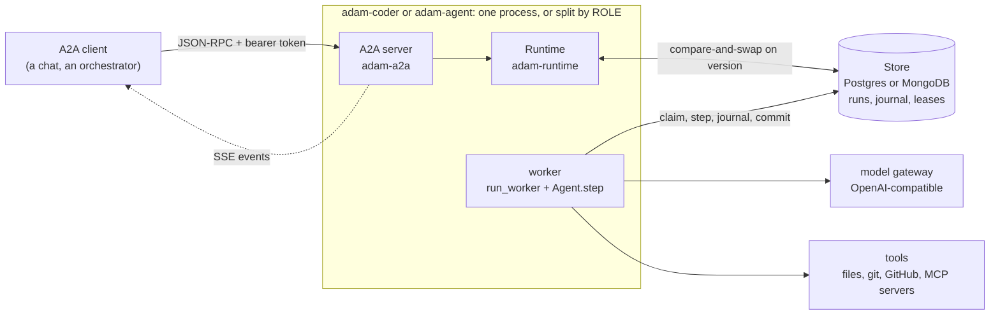

# adam-rs

adam-rs is a Rust framework for **durable AI agents**. An agent is a state machine whose state and every side
effect are saved after each step, so a worker that dies loses nothing and another resumes the run. Agents are
written as **Markdown folders** (plus `#[tool]` functions when you need code), speak **A2A 1.0**, and run on any
OpenAI-compatible model. Every piece of infrastructure (database, model, code host) is a trait with a test kit.

## What is in the box

| | What it is | Try it |
|---|---|---|
| **Assistant** | a chat-only agent: answers in plain words and asks when it needs to know more. It is [`adam-agent`](bin/adam-agent/README.md) serving the folder [`dev/agents/assistant`](dev/agents/assistant/agent/instructions.md) | `dev/chat.sh` |
| **Adam** ([`adam-coder`](bin/adam-coder/README.md)) | a general agent that also takes a coding task to a checked pull request: worktree, edits, the project's own checks, push, pull request | `dev/chat.sh http://127.0.0.1:8080` |
| **Your agent** | [`adam-agent`](bin/adam-agent/README.md) serves **any** agent folder (instructions, skills, subagents, MCP tools) with no build; the Painter in [`dev/agents/painter`](dev/agents/painter/agent/instructions.md) is one with tools | [write an agent](docs/guides/write-an-agent.md) |
| [`adam-egress`](bin/adam-egress/README.md) | an HTTPS-only forward proxy with an allow-list, for the sandboxes that run an agent's commands | its README |
| The library | [`crates/`](docs/architecture.md#the-crate-map): host adam agents in your own Rust program | [embed adam](docs/guides/embed-adam.md) |

All binaries ship in one image, `ghcr.io/vymalo/another-adam-rs/coder`.

## Try it in five minutes

You need Docker with Compose v2, `curl` and `jq`. The stack runs on mocks (a scripted model, a fake GitHub, a
local git server), so no credential is needed. The first build takes several minutes.

```sh
docker compose --profile app up -d --build --wait
dev/chat.sh                                  # chat with the Assistant (:8084)
dev/chat.sh http://127.0.0.1:8080            # Adam, the coder; try:
# In http://git-server:8080/local/sandbox.git (base branch main), add hello.txt containing hello.
docker compose --profile app down -v         # stop and forget everything
```

On the mocks the model is scripted, so the answers are canned. **For a real conversation**, point the stack at any
OpenAI-compatible endpoint; the key stays in your shell:

```sh
export MODEL_BASE_URL=https://your-gateway.example/v1 MODEL=your-model MODEL_API_KEY=...
docker compose -f compose.yaml -f dev/compose.real-model.yaml --profile app up -d --wait
```

Adam still works on the local git server and the mock GitHub, so nothing but the model calls leaves your machine.
The whole walk-through, the Painter and your own agent included: **[Try the agents](docs/guides/try-the-agents.md)**.

## Make your own agent

An agent is a folder with an `instructions.md`: a YAML header (name, limits, the card other agents read) and the
instructions in Markdown. Copy the Assistant, change the words, restart:

```sh
cp -R dev/agents/assistant/agent /tmp/my-agent && chmod -R a+rX /tmp/my-agent
AGENT_FOLDER=/tmp/my-agent docker compose --profile app up -d --wait agent
```

Add `skills/`, `subagents/`, `commands/` or an `mcp.json` for tools: [the agent files](docs/reference/agent-files.md).

## How it works



A client sends a message; the server stores a task; a worker claims it, calls the model and the tools, and saves
each step. Any worker can resume a run another one left: [the architecture](docs/architecture.md).

## Documentation

| | |
|---|---|
| [`docs/`](docs/README.md) | the index, by what you want to do |
| Get started | [try the agents](docs/guides/try-the-agents.md), [run locally](docs/guides/run-locally.md) |
| Guides | [write an agent](docs/guides/write-an-agent.md), [deploy the coder](docs/guides/deploy-the-coder.md), [embed adam](docs/guides/embed-adam.md), [embed in an application](docs/guides/embed-in-an-app.md) |
| Reference | [the A2A server](docs/reference/a2a-server.md), [environment variables](docs/reference/environment.md), [agent files](docs/reference/agent-files.md), [errors](docs/reference/errors.md), [the local stack](docs/reference/dev-stack.md) |
| [Architecture](docs/architecture.md) | how it works inside |
| [Decisions](docs/decisions/README.md) | ADRs: why it is the way it is |
| [Benchmark](bench/README.md) | adam-coder against OpenCode on the same tasks and model |

## Roadmap and contributing

- **Roadmap:** the product roadmap to launch, with every open piece of work as an issue, is
  [`ROADMAP.md` in another-agentic-system](https://github.com/vymalo/another-agentic-system/blob/main/ROADMAP.md).
  The library's own table is [`docs/roadmap.md`](docs/roadmap.md).
- **Contributing:** [`CONTRIBUTING.md`](CONTRIBUTING.md). Work on a branch and open a pull request against `main`;
  commits are Conventional Commits; the checks CI runs are in [Testing](docs/guides/testing.md#the-commands-ci-runs).
  Update the matching guide, reference or crate README in the same change as any change to behaviour.
- **Security:** report a vulnerability privately, as [`SECURITY.md`](SECURITY.md) says.
- **AI assistants:** `docs/` is written for people. A coding agent starts at [`CLAUDE.md`](CLAUDE.md) (`AGENTS.md`
  links to it) and finds its procedures and evidence in [`.agents/docs/`](.agents/docs/README.md). Repositories that
  integrate adam-rs install its skills with `npx skills add vymalo/another-adam-rs --list`.

## License

Licensed under either of [Apache License, Version 2.0](LICENSE-APACHE) or [MIT license](LICENSE-MIT) at your
option. Vendored agent skills keep their own licenses; see [third-party-notices.md](third-party-notices.md).

Unless you explicitly state otherwise, any contribution intentionally submitted for inclusion in this work by
you, as defined in the Apache-2.0 license, shall be dual licensed as above, without any additional terms or
conditions.
