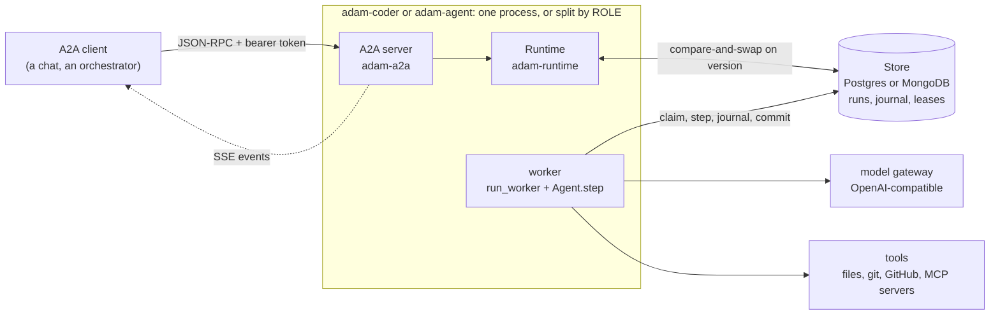

# adam-rs

adam-rs is a Rust framework for **durable AI agents**. An agent is a state machine whose state and every side
effect are saved after each step, so a worker that dies loses nothing and another resumes the run. Agents are
written as **Markdown folders** (plus `#[tool]` functions when you need code), speak **A2A 1.0**, and run on any
OpenAI-compatible model. Every piece of infrastructure (database, model, code host) is a trait with a test kit.

## What is in the box

| | What it is | Try it |
|---|---|---|
| **Assistant** | a chat-only agent: answers in plain words and asks when it needs to know more. It is [`adam-agent`](bin/adam-agent/README.md) serving the folder [`dev/agents/assistant`](dev/agents/assistant/agent/instructions.md) | `dev/chat.sh` |
| **Adam** ([`adam-coder`](bin/adam-coder/README.md)) | a general agent that also takes a coding task to a checked pull request: worktree, edits, the project's own checks, push, pull request | `dev/chat.sh http://127.0.0.1:8080` |
| **Your agent** | [`adam-agent`](bin/adam-agent/README.md) serves **any** agent folder (instructions, skills, subagents, MCP tools) with no build; the Painter in [`dev/agents/painter`](dev/agents/painter/agent/instructions.md) is one with tools | [write an agent](docs/guides/write-an-agent.md) |
| [`adam-egress`](bin/adam-egress/README.md) | an HTTPS-only forward proxy with an allow-list, for the sandboxes that run an agent's commands | its README |
| The library | [`crates/`](docs/architecture.md#the-crate-map): host adam agents in your own Rust program | [embed adam](docs/guides/embed-adam.md) |

All binaries ship in one image, `ghcr.io/vymalo/another-adam-rs/coder`.

## Features

✅ built and tested in CI · ⚠️ built, but partial or not yet proven end to end · 🚧 being built · 📋 planned · ⏸️ on hold. Updated with every change that moves a row.

Checked against the code on 2026-11-27. A row proven only on mocks (a scripted model, a mock GitHub) is ⚠️. The
library's own plan is [the roadmap](docs/roadmap.md); every setting by surface is [Parity](docs/reference/parity.md).

| Area | Feature | Status | Notes |
|---|---|---|---|
| **Runtime** | Durable agent loop: journaled steps, leases, a run resumed by any worker | ✅ | [Architecture](docs/architecture.md); a run's state is a head and an append-only transcript ([ADR 0055](docs/decisions/0055-a-runs-state-is-a-head-and-an-append-only-transcript.md)) |
| | Tool calls of a turn at the same time, a race of steps, a retry policy per step and per tool | ✅ | [ADR 0049](docs/decisions/0049-the-tool-calls-of-a-turn-run-at-the-same-time.md), [0062](docs/decisions/0062-a-race-of-steps-records-its-winner.md), [0061](docs/decisions/0061-a-step-names-its-retry-policy.md) |
| | Schedules: `cron`, `at`, `after` | ✅ | [ADR 0060](docs/decisions/0060-schedules-are-parked-runs.md) |
| | Compaction of a long history | ⚠️ | summarised once, and retried when the provider says too long; a folder's own `compaction` subagent is not built ([ADR 0044](docs/decisions/0044-paged-tools-a-stable-prompt-prefix-a-plan-skills-commands-and-project-context.md)) |
| | A subagent in the background, as a session | ⚠️ | all slices but the coder's own kept-open helpers, built in part ([ADR 0045](docs/decisions/0045-a-subagent-can-run-in-the-background-as-a-session.md)) |
| | Hooks around the loop: compiled plugins and custom events | ⚠️ | in the library; `plugins:` in agent files, approvals and hook programs are not built, so no shipped agent has one ([ADR 0050](docs/decisions/0050-hooks-around-the-agent-loop-compiled-first-and-programs-second.md)) |
| | A folder agent sleeps and waits on a named queue | 📋 | proposed ([ADR 0074](docs/decisions/0074-a-folder-agent-can-sleep-and-wait-on-a-named-queue.md)) |
| **Storage** | Run store: PostgreSQL, MongoDB, SQLite | ✅ | CI runs the conformance suite on PostgreSQL 12 and 17 and MongoDB 5.0 and 8.0; SQLite is one process per file, Unix only; signals by `LISTEN`/`NOTIFY` on PostgreSQL, polling on MongoDB ([Store adapters](docs/reference/store-adapters.md)) |
| | A store service, so an agent's pod holds no database credential | 📋 | [ADR 0053](docs/decisions/0053-sqlite-a-store-service-a-database-per-agent-and-a-static-coder.md), slices 4 and 5 |
| | SQLite replicated per commit, resumed on a new machine | 📋 | proposed ([ADR 0078](docs/decisions/0078-a-sqlite-store-is-replicated-per-commit-and-a-new-machine-resumes-from-the-copies.md)) |
| | The SQL adapters keep their rules in the database | 📋 | decided 2026-11-27; slices P0–P7 and S1–S2, nothing built ([ADR 0082](docs/decisions/0082-the-sql-adapters-keep-their-rules-in-the-database.md)) |
| **Agents** | An agent as a Markdown folder, served by `adam-agent` with no build | ✅ | [Agent files](docs/reference/agent-files.md), [write an agent](docs/guides/write-an-agent.md) |
| | `#[tool]` functions in Rust | ✅ | [The tool contract](docs/reference/agent-files.md#the-tool-contract), [embed adam](docs/guides/embed-adam.md) |
| | Subagents, local and remote (A2A) | ✅ | [Child runs](docs/reference/child-runs.md) |
| | MCP servers (stdio, streamable HTTP), with timeouts, instructions and prompts | ✅ | [Agent files](docs/reference/agent-files.md) |
| | A lean first request: tools load in groups | ⚠️ | a server or a folder's tools load on demand; the coder's own groups are not built ([ADR 0066](docs/decisions/0066-a-first-request-is-lean-and-tools-load-in-groups.md)) |
| | A memory the agent keeps near it | 📋 | decided 2026-11-27; slices M0–M11, nothing built ([ADR 0081](docs/decisions/0081-an-agent-keeps-a-self-improvement-memory-near-it-and-what-holds-becomes-the-deployments-memory.md)) |
| **Model** | Any OpenAI-compatible model, streamed, its reasoning beside the answer | ⚠️ | CI proves the client on a mock; the nightly live test skips without its secrets ([ADR 0020](docs/decisions/0020-reasoning-is-streamed-beside-the-answer-and-never-stored.md)) |
| | Model profiles: reasoning effort, output cap, presets, a fallback, a model per message | ⚠️ | partly: the task's echo of the effort is planned ([ADR 0063](docs/decisions/0063-a-reasoning-effort-is-one-setting.md), [0064](docs/decisions/0064-model-profiles-reasoning-effort-and-output-cap-follow-the-model.md)) |
| | Model credentials: a key, a device sign-in, or an injector so adam holds no key | ⚠️ | the device sign-in and the injector are proven on mocks only ([ADR 0058](docs/decisions/0058-the-models-credentials-come-from-a-provider-asked-for-each-call.md), [0067](docs/decisions/0067-a-model-call-through-an-injector-names-its-run-and-a-refusal-parks-the-run.md)) |
| | Signed history and signed model calls | ⚠️ | turns and the run's head are signed and checked; `signed-turns/v1` and refusing an unsigned turn are not built ([ADR 0068](docs/decisions/0068-adam-signs-its-own-history.md)); the orchestrator does not send the prompt statement yet ([ADR 0077](docs/decisions/0077-a-model-call-carries-the-prompt-statement-and-the-persons-envelope.md)) |
| **A2A** | A2A 1.0 server: JSON-RPC, SSE, the HTTP+JSON binding, Swagger UI, bearer tokens | ✅ | [The A2A server](docs/reference/a2a-server.md), [ADR 0031](docs/decisions/0031-swagger-ui-and-the-a2a-rest-binding.md) |
| | Push notifications, `ListTasks`, the extended card, signed cards | ⚠️ | no encrypted webhook credentials, no extended card per caller ([ADR 0030](docs/decisions/0030-a2a-push-notifications-list-tasks-extended-card-signatures.md)) |
| | A2UI v1.0, the UI catalog, steps, text stream, steer, mentions, thread tools, build | ✅ | [Extensions](docs/reference/extensions.md) |
| | Usage per model call with sandbox time, commands, child sessions, locale, model pick | ✅ | listed when configured ([Extensions](docs/reference/extensions.md), [ADR 0032](docs/decisions/0032-usage-per-model-call.md), [0043](docs/decisions/0043-sandbox-time-as-usage.md)) |
| | Large files by reference (`uploads/v1`) | ⚠️ | the coder's `share_file` only; a folder agent has no such tool ([#282](https://github.com/vymalo/another-adam-rs/issues/282)) |
| **adam-coder** | A coding task to a checked pull request | ⚠️ | CI runs chat to pull request on the dev stack (a scripted model, a mock GitHub, a local git server), not on GitHub.com ([The coder](docs/reference/coder-agent.md), [ADR 0026](docs/decisions/0026-a-failure-the-base-has-too-is-not-the-runs.md)) |
| | A GitHub token, or a GitHub App on every installation; GitHub read through MCP | ⚠️ | proven on a mock GitHub ([ADR 0009](docs/decisions/0009-github-per-installation-read-through-mcp.md), [0017](docs/decisions/0017-a-github-app-works-on-every-account-it-is-installed-on.md)) |
| | The access tier the person picks per message | ✅ | the coder only; a folder agent keeps to no tier ([ADR 0036](docs/decisions/0036-the-coder-keeps-to-the-access-tier-the-person-picks.md), [#274](https://github.com/vymalo/another-adam-rs/issues/274)) |
| | Several repositories, scratch projects, read-only references | ✅ | [ADR 0008](docs/decisions/0008-a-workspace-holds-several-repositories.md), [Workspace and environments](docs/reference/workspace-and-environments.md) |
| | Paged reads, a plan, skills, project instructions, background commands, language servers | ✅ | [ADR 0044](docs/decisions/0044-paged-tools-a-stable-prompt-prefix-a-plan-skills-commands-and-project-context.md) |
| | Images in | ⚠️ | off by default; the provider's wire shape is unverified (ADR 0044, slice 15a) |
| | Images out, made by the model | ⏸️ | deferred by the owner until a provider is named; an MCP server makes images today (ADR 0044, slice 15b) |
| | Run pods: a run's commands in a pod that sees only its run | ⚠️ | CI applies the chart's objects to kind and runs commands in such a pod; a run on a real model through it is not proven ([ADR 0019](docs/decisions/0019-a-runs-processes-in-a-pod-of-their-own.md), [0041](docs/decisions/0041-a-run-pod-sees-only-its-own-run.md)) |
| | The egress proxy (`adam-egress`) and the git sandbox | ⚠️ | the same kind job proves the refusals and the allowed hosts; the same limit ([ADR 0042](docs/decisions/0042-run-pods-reach-the-internet-through-an-egress-proxy.md), [network guide](docs/guides/egress-and-run-pod-network.md)) |
| | A repository's own environment, as a run pod of its image | ⚠️ | partly: lifecycle commands, `containerEnv` and the pulled digest are not built ([ADR 0052](docs/decisions/0052-no-podman-a-repositorys-own-environment-is-a-run-pod-of-its-image.md)) |
| | Editing workers, rules per agent, approvals, a check of who the person is, kept repository slots | 📋 | [ADR 0037](docs/decisions/0037-parallel-subagent-calls-and-an-editing-worker.md), [0039](docs/decisions/0039-the-agent-loop-takes-opencodes-structure-and-agents-get-plugins.md), [0072](docs/decisions/0072-the-coder-verifies-who-the-person-is-and-asks-github-before-it-touches-a-repository.md), [0073](docs/decisions/0073-a-conversation-keeps-its-repository-slots.md) |
| **Deploy** | The image: every binary, static, smoke-tested, pushed | ✅ | [Deploy the coder](docs/guides/deploy-the-coder.md) |
| | The Helm chart `deploy/coder` | ⚠️ | renders and goldens in CI; never applied with more than one worker ([chart README](deploy/coder/README.md)) |
| | Resource governance: admission pools, the OS's limits on a command | ⚠️ | the OS limits are Linux only, and no listener serves the pools' metrics ([ADR 0065](docs/decisions/0065-resource-governance-admission-pools-and-os-limits.md)) |
| | The activity route for scaling (`GET /internal/activity`) | 🚧 | the route is built, on the main listener behind the A2A tokens; a listener and tokens of its own are being built (ADR 0083, not merged) |
| | Metrics and traces, off by default | 📋 | proposed ([ADR 0075](docs/decisions/0075-metrics-and-traces-are-off-by-default-and-say-nothing-about-a-person.md)) |
| | A secret replaced wherever it is a value | ✅ | [ADR 0070](docs/decisions/0070-a-secret-is-replaced-where-it-is-a-value.md) |
| **Embedded** | `adam-engine`: adam inside an application, on a desktop or a phone | ⚠️ | a chat agent on SQLite, resumed after a kill; phones are type-checked only; approvals, a local coding agent, Windows and macOS, and adam as an ACP agent are not built ([ADR 0047](docs/decisions/0047-adam-rs-can-be-embedded-in-an-application.md), [embed in an app](docs/guides/embed-in-an-app.md)) |
| **Bench** | adam-coder against OpenCode on the same tasks and model | ⚠️ | the dry run passed on Docker; never run against a real model ([ADR 0048](docs/decisions/0048-a-benchmark-harness-for-adam-coder-and-opencode.md), [bench](bench/README.md)) |

## Try it in five minutes

You need Docker with Compose v2, `curl` and `jq`. The stack runs on mocks (a scripted model, a fake GitHub, a
local git server), so no credential is needed. The first build takes several minutes.

```sh
docker compose --profile app up -d --build --wait
dev/chat.sh                                  # chat with the Assistant (:8084)
dev/chat.sh http://127.0.0.1:8080            # Adam, the coder; try:
# In http://git-server:8080/local/sandbox.git (base branch main), add hello.txt containing hello.
docker compose --profile app down -v         # stop and forget everything
```

On the mocks the model is scripted, so the answers are canned. **For a real conversation**, point the stack at any
OpenAI-compatible endpoint; the key stays in your shell:

```sh
export MODEL_BASE_URL=https://your-gateway.example/v1 MODEL=your-model MODEL_API_KEY=...
docker compose -f compose.yaml -f dev/compose.real-model.yaml --profile app up -d --wait
```

Adam still works on the local git server and the mock GitHub, so nothing but the model calls leaves your machine.
The whole walk-through, the Painter and your own agent included: **[Try the agents](docs/guides/try-the-agents.md)**.

## Make your own agent

An agent is a folder with an `instructions.md`: a YAML header (name, limits, the card other agents read) and the
instructions in Markdown. Copy the Assistant, change the words, restart:

```sh
cp -R dev/agents/assistant/agent /tmp/my-agent && chmod -R a+rX /tmp/my-agent
AGENT_FOLDER=/tmp/my-agent docker compose --profile app up -d --wait agent
```

Add `skills/`, `subagents/`, `commands/` or an `mcp.json` for tools: [the agent files](docs/reference/agent-files.md).

## How it works



A client sends a message; the server stores a task; a worker claims it, calls the model and the tools, and saves
each step. Any worker can resume a run another one left: [the architecture](docs/architecture.md).

## Documentation

| | |
|---|---|
| [`docs/`](docs/README.md) | the index, by what you want to do |
| Get started | [try the agents](docs/guides/try-the-agents.md), [run locally](docs/guides/run-locally.md) |
| Guides | [write an agent](docs/guides/write-an-agent.md), [deploy the coder](docs/guides/deploy-the-coder.md), [embed adam](docs/guides/embed-adam.md), [embed in an application](docs/guides/embed-in-an-app.md) |
| Reference | [the A2A server](docs/reference/a2a-server.md), [environment variables](docs/reference/environment.md), [agent files](docs/reference/agent-files.md), [errors](docs/reference/errors.md), [the local stack](docs/reference/dev-stack.md) |
| [Architecture](docs/architecture.md) | how it works inside |
| [Decisions](docs/decisions/README.md) | ADRs: why it is the way it is |
| [Benchmark](bench/README.md) | adam-coder against OpenCode on the same tasks and model |

## Roadmap and contributing

- **Roadmap:** the product roadmap to launch, with every open piece of work as an issue, is
  [`ROADMAP.md` in another-agentic-system](https://github.com/vymalo/another-agentic-system/blob/main/ROADMAP.md).
  The library's own table is [`docs/roadmap.md`](docs/roadmap.md).
- **Contributing:** [`CONTRIBUTING.md`](CONTRIBUTING.md). Work on a branch and open a pull request against `main`;
  commits are Conventional Commits; the checks CI runs are in [Testing](docs/guides/testing.md#the-commands-ci-runs).
  Update the matching guide, reference or crate README in the same change as any change to behaviour.
- **Security:** report a vulnerability privately, as [`SECURITY.md`](SECURITY.md) says.
- **AI assistants:** `docs/` is written for people. A coding agent starts at [`CLAUDE.md`](CLAUDE.md) (`AGENTS.md`
  links to it) and finds its procedures and evidence in [`.agents/docs/`](.agents/docs/README.md). Repositories that
  integrate adam-rs install its skills with `npx skills add vymalo/another-adam-rs --list`.

## License

Licensed under either of [Apache License, Version 2.0](LICENSE-APACHE) or [MIT license](LICENSE-MIT) at your
option. Vendored agent skills keep their own licenses; see [third-party-notices.md](third-party-notices.md).

Unless you explicitly state otherwise, any contribution intentionally submitted for inclusion in this work by
you, as defined in the Apache-2.0 license, shall be dual licensed as above, without any additional terms or
conditions.
