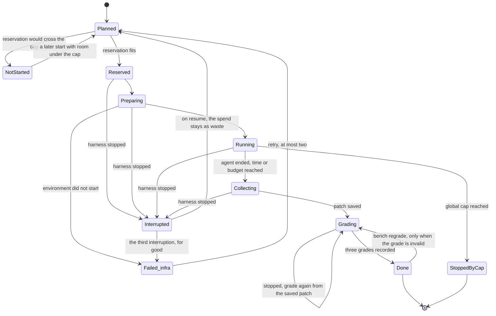
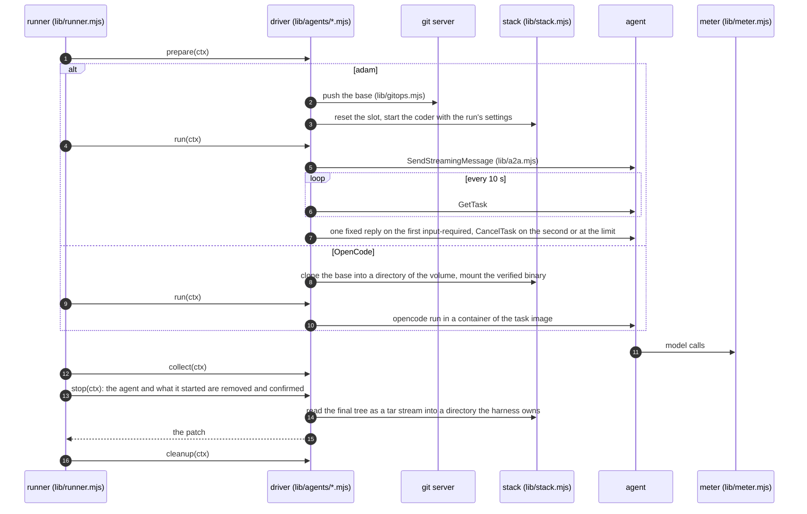
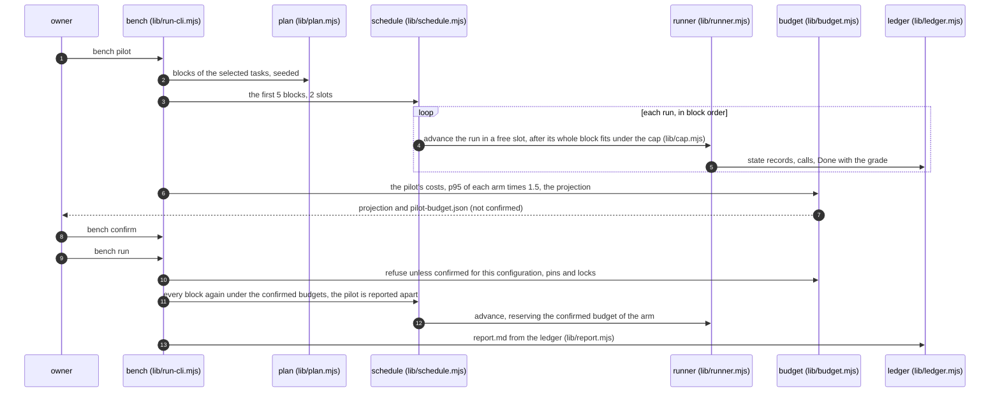

# bench: a benchmark harness for adam-coder and OpenCode

Runs the same tasks through two agents, `adam-coder` and OpenCode, on one model in two arms, grades the results
in a pristine image and reports pass rates with intervals and what they cost. Decision and shape:
[ADR 0048](../docs/decisions/0048-a-benchmark-harness-for-adam-coder-and-opencode.md).

**Built (pull requests 1 to 4 of 4):** the meter, the cost and the cap, the ledger, the configuration and its
guards, the statistics and the report; the task sources (public and own), the statement lint, selection, the
environment check and grading by patch replay; the compose stack, the adam and OpenCode drivers, the runner, `doctor` and
the dry run; and `pilot`, `confirm`, `run` and `regrade`, with task blocks, slots, the pilot's budget and the final report
("Pilot and run" below). Node 22 or later (CI runs 22 and 24), no dependencies: only Node's standard library. **The dry
run, the stack and the coder probe have run on the host's Docker (2026-11-19); nothing that needs a real model endpoint, a
model key or two slots has.** See "The dry run" and "Unverified".

## What it never holds

The endpoint URL, the model id, the prices and the key are the owner's and live **outside** this repository.
The harness refuses any file it reads or writes (the configuration, `$BENCH_HOME`, `--ledger`, `--out`) that is
inside a work tree: it walks up from the real location of the path (symlinks resolved, missing directories
skipped) and refuses at the first directory with a `.git`, a directory or a file, and also inside its own checkout
and the working directory. It refuses an unknown field, and a field **named like a secret** (`key`, `token`,
`password`, `auth`, ...) that holds any non-empty value of any type; only a number under a name that also says what
it counts (`token_budget`) passes. It refuses a string with a known key prefix or long hex anywhere. The extra
"long dense text" rule is not applied to `modelId`, `modelLabel` or anything inside an arm, so a real model id such as
`Qwen3-Coder-480B-A35B-Instruct-FP8` is accepted. The key is read only from the environment variable the
configuration names, and a key with a space, a line break or another control character is refused (exit 78, naming
the variable, never the value). An `http:` endpoint must be on the loopback (`127.x`, `localhost`, `::1`); any other
host must be `https:`. An error names the field and never quotes a value; the exit code is 78. The report shows the
model's label, never its id, unless `--show-model-id`. These key tests are heuristics, not a guarantee: keep the key
out of the file.

Every value below is made up.

```json
{
  "endpoint": "https://models.example.test/v1",
  "modelId": "example-model",
  "modelLabel": "Example Model",
  "prices": { "inputPerMTok": 3, "cachedInputPerMTok": 0.3, "cacheWritePerMTok": 3.75, "outputPerMTok": 15 },
  "capUSD": 100,
  "perRunBudgetUSD": 3,
  "arms": {
    "max": { "reasoning_effort": "high" },
    "off": { "reasoning_effort": "none" }
  },
  "keyEnv": "BENCH_MODEL_API_KEY",
  "concurrency": 2
}
```

| Field | Meaning |
|---|---|
| `endpoint` | the OpenAI-compatible base URL with its `/v1`; no credentials, query or fragment |
| `modelId`, `modelLabel` | what is sent upstream, and what the report shows |
| `prices` | USD per million tokens: input, cached input, cache write, output |
| `capUSD`, `perRunBudgetUSD` | the most the benchmark may spend, and what one run reserves (not above the cap) |
| `arms` | named JSON fragments merged into every request of the arm; they may not set `model`, `messages`, `tools`, `tool_choice`, `stream`, `stream_options` or `n` |
| `keyEnv` | the environment variable that holds the key (default `BENCH_MODEL_API_KEY`) |
| `concurrency` | runs at once, 1 to 8 (default 2) |
| `contextWindow` | **required**: the model's context window; both agents are given this one value |
| `limits` | optional, the same for both agents: `minutes` (the time limit of a run, 50), `steps` (adam's turn limit and OpenCode's `steps`, 200) and `cancelGraceSeconds` (60) |
| `timeouts` | optional: the meter's first-byte and idle timeouts in seconds |
| `tasks` | optional: task sources and grading, see Tasks |

The file is `$BENCH_CONFIG` (default `~/.config/adam-bench/config.json`); results are in `$BENCH_HOME`
(default `~/.local/share/adam-bench`, also refused inside a work tree, as are `--ledger` and `--out`). The schema is `SCHEMA` in
`bench/lib/config.mjs`.

```sh
BENCH_MODEL_API_KEY=... node bench/bin/bench.mjs config    # what may be shown of the configuration
node bench/bin/bench.mjs report                            # report.md from the ledger
```

## How a run goes




The states and their transitions are `TRANSITIONS` in `bench/lib/ledger.mjs`, which refuses any other. The
harness that drives a run through them is `lib/runner.mjs`. **Resume** reads the
ledger (`resumeActions`): a `Done` or `StoppedByCap` run is never repeated, a `NotStarted` one is planned again by a start with room under the cap; a run that was
`Reserved`, `Preparing`, `Running`, `Collecting` or `Interrupted` starts again from scratch; a `Grading` run is
graded again and never run again; a `Failed_infra` run is retried twice and then given up, **unless its failure cannot change on a retry** (a clone the task image's git cannot read, a base that does not match its marker twice, a run id a driver refuses: `PermanentError` in `lib/errors.mjs`): that one is `final` at once and is left out like the third interruption. A run is allowed
**at most two interruptions**: the third time it ends `Failed_infra` for good (`final`), so an interrupted run is not paid
for on every restart. The report lists such a run among those left out, with its wasted spend.

## What each piece does

| File | What |
|---|---|
| `bench/lib/config.mjs` | schema, validation, the guards, exit 78 |
| `bench/lib/ledger.mjs` | append-only JSON lines, fsynced, one writer (a lock made by linking a file that holds the pid); the fold; the resume rules |
| `bench/lib/cost.mjs` | usage normalised as [ADR 0032](../docs/decisions/0032-usage-per-model-call.md) does; cost in integer micro-dollars; the worst case |
| `bench/lib/cap.mjs` | reservations, the per-call check, the global stop |
| `bench/lib/meter.mjs` | the only way to the model: the proxy that injects the key, rewrites, clamps and counts |
| `bench/lib/scripted-model.mjs` | an OpenAI-compatible server for the tests |
| `bench/lib/stats.mjs` | Wilson intervals, the exact McNemar test, a seeded bootstrap |
| `bench/lib/report.mjs` | the report |
| `bench/lib/toml.mjs` | the TOML subset of `task.toml` |
| `bench/lib/task.mjs` | the task format and its validator |
| `bench/lib/upstream.mjs` | the pinned clone of the public tasks and `SHA256SUMS` |
| `bench/lib/mine.mjs` | the miner |
| `bench/lib/own.mjs` | own tasks: their spec, the image's Dockerfile, the task directory built from a clone |
| `bench/lib/lint.mjs` | the statement lint |
| `bench/lib/select.mjs` | seeded stratified selection, the lock files |
| `bench/lib/containers.mjs` | the host container runtime interface: `HostContainers` (the `docker` CLI) and `FakeContainers` |
| `bench/lib/grade.mjs` | patch collection and grading by replay |
| `bench/lib/envcheck.mjs` | the environment check |
| `bench/lib/tasks-cli.mjs` | `bench tasks ...` |
| `bench/pins.json`, `bench/lib/pins.mjs` | the one place the coder image and OpenCode are pinned |
| `bench/lib/npm.mjs` | OpenCode's binary from npm, checked against its integrity before anything is written |
| `bench/lib/a2a.mjs` | the A2A client (the bearer in a private field) and `driveTask`: poll, the one nudge, cancel |
| `bench/lib/gitops.mjs` | the host's other git: list the pushed branches (isolated), the agent folder of a revision, the script a container pushes the base with |
| `bench/lib/stack.mjs`, `bench/compose.yaml`, `bench/lib/relay.mjs` | the stack, the host containers the harness starts (the coder, the arms, the grading), the relays |
| `bench/lib/tarstream.mjs` | what a container wrote, as a tar stream parsed with limits |
| `bench/lib/classify.mjs` | infrastructure told apart from the agent, from the meter's record |
| `bench/lib/base.mjs` | the base of a task: its repository with the dependency links, made in the slot's work directory for each run (that directory is shared by every task), and the host's own copy of it once per (task, image, workdir) for the harness's life; the host copy's tree must equal the container's, which assumes the image's git normalises like the host's (`core.autocrlf=false`, `attributesFile=/dev/null`, `fsmonitor=false`) |
| `bench/lib/agents/adam.mjs`, `opencode.mjs`, `common.mjs` | the two drivers (prepare, run, collect, cleanup) and what they share |
| `bench/lib/runner.mjs` | one run through its states, resume of the ledger, and a plan one run at a time |
| `bench/lib/plan.mjs`, `bench/lib/schedule.mjs`, `bench/lib/budget.mjs`, `bench/lib/run-cli.mjs` | task blocks in a seeded balanced order; the slots and the wait for budget; the pilot's budget and its confirmation; `bench pilot`, `confirm`, `run`, `regrade` |
| `bench/lib/doctor.mjs` | `bench doctor` |
| `bench/lib/agent-script.mjs`, `dryrun.mjs`, `dryrun-checks.mjs`, `bench/dry-run.sh` | the scripted model's turns, the dry run and what it asserts |

**Cost.** A call costs `(input - cached - cache write) * input price + cached * cached price + cache write * write
price + output * output price`, rounded up to a micro-dollar; reasoning is inside the output. A call with no usable
`usage` is charged its worst case and flagged. The agents' own counts are shown beside the meter's and never decide
anything.

**Calls per model turn.** The meter also counts the tool calls each answer asks for (a plain answer's `tool_calls`; a
stream's distinct tool call `index` and `id` pairs, so a gateway that gives every call the index 0 is counted right) and writes it as `toolCalls` on the settled record, a count of the answer and no
text of it. The report shows, for each agent and arm, the turns counted, the calls asked, the calls per turn, the
turns that asked for several and the most in one turn: whether the model asks for calls together, and so what a
limit on parallel tool calls (ADR 0049) can save. Every answer the meter relays is a turn, the agent's own requests for a title or a summary too: such an answer counts as a turn with 0 calls. A ledger from before the count has none, and the report says `n/a`.

**Calls by tool.** The meter also keeps the name of each of those calls (`toolNames` on the same settled record: one
name per call, in the answer's order, a name cut to 64 characters and control characters dropped; at most 64 names
per answer). The fold counts them per tool, per run, and the report prints one table of the calls of each tool per
agent and arm, so the reader sees where the calls go and not only how many there are: on the tasks both agents
finish, the tool whose count differs most is the next slice. A call the answer did not name (or one beyond the 64-name cap) is
counted in the calls and shown in a `(no name)` row, never guessed from the arguments; a ledger from before the names says `n/a`. The
names are the model's own text: they are shown in a report and never used for a decision of the harness.

**The cap.** A run reserves its budget before it starts, and starts only if what is spent plus what is reserved plus
this reservation fits the cap (exactly at the cap fits; one micro-dollar over does not). Each call's worst case (the
input at one token per three bytes, the clamped output) must fit what is left of the run's reservation, else the
meter answers `429` with `bench budget reached` and forwards nothing. If actual spend still reaches the cap, every
call is refused. **The cap is soft by one call per running slot**: a call that reports more usage than its worst case
takes its run, and so the total, past its reservation by that call's excess, and then the next call is refused. A
run's calls in flight at the same moment can each do so. The excess is what the endpoint billed above the estimate,
which is why the worst case is generous.

**The meter** serves only `POST /r/<token>/v1/chat/completions`. Anything else, an unknown token and
`/responses` (not forwarded: the two agents use chat completions) are `404` and nothing leaves. It writes a
`pending` record before it forwards, and everything after that record settles the call, even a throw before the
request leaves (free, as nothing was sent). It logs no body, key, token or URL, and listens on `127.0.0.1` unless
told otherwise.

* **`n`** must be absent or exactly 1 (the integer) and is forwarded as 1; anything else is a `400` and nothing is
  forwarded. One completion per call is part of fairness.
* **An upstream error** (any non-2xx) is never relayed, not its body, header or URL. The agent gets
  `{"error":{"message":"upstream error","type":"upstream_error","status":<upstream status>}}` with the status
  class mapped: `429` stays `429` (agents back off on it), a `5xx` is `502`, any other `4xx` is `400`. The call costs
  nothing, the upstream is destroyed unread, and the ledger has the upstream status alone.
* **Limits per call**, `LIMITS` in `bench/lib/meter.mjs`: `maxRequestBytes` 8 MiB (a request is a conversation, not a
  file; over it, or a declared length over it, is a `413` that arrives, and the rest of the upload is read and
  dropped), `maxResponseBytes` 64 MiB (stream or not), `maxCallMs` 20 minutes (from the request to the last byte,
  however lively the stream). Beside them the configuration's first-byte and idle timeouts. A call over a response
  limit or a time limit is cut, the upstream request is destroyed and the call is charged its worst case.
* **A client that closes at `[DONE]`** (adam does, right after the last chunk and before the upstream has ended) is charged the usage the meter had already read from the stream, not the worst case; only a client that closes before any usage was seen is charged the worst case.
* **A proxy:** the meter uses `https.request`, which takes `HTTPS_PROXY` from the environment only when `NODE_USE_ENV_PROXY=1` is set **and** the Node release has it: *verified 2026-11-17* in Node's changelogs (`doc/changelogs/CHANGELOG_V24.md` and `CHANGELOG_V22.md`, "http,https: add built-in proxy support in http/https.request and Agent", nodejs/node#58980): first in 24.5.0 (2025-07-31) and 22.21.0 (2025-10-20); `fetch()` has had it since 24.0.0, which is not what the meter uses. Each call opens its own connection (an endpoint or proxy that closes an idle socket must not fail the next call), and with a proxy the default agent is kept — Node applies the env proxy to it only — with `connection: close` on every request, so the proxy is never bypassed (`upstreamAgent`, `bench/test/meter.test.mjs`). `bench doctor` warns when a proxy is set without the variable, or with a Node older than those, and says what to do. Everything else in the harness needs only Node 22.
* **Backpressure:** an SSE stream is relayed chunk by chunk and the upstream is paused while the client does not read.

**The report** shows pass rates with Wilson intervals, paired differences (exact McNemar, seeded bootstrap), splits
by source (`public`, `own`, `own-self`) and language, cost per run and per solved task, tokens, the cache-hit rate, time, calls, the infrastructure failures, the excluded and flaky runs, and says what it does not claim.
Every cost, token and call figure sums **all attempts** of a run. Only `Done` runs count in the rates; the report
says that runs in `StoppedByCap`, `Failed_infra`, `NotStarted` (and any other state) are left out, and lists them
with what each wasted. Two `Done` runs for one task, agent and arm are an error that names them. Pipes and line
breaks in a cell are escaped.

## Tasks

Two sources, **one format** (the Harbor layout of SWE-bench Pro V2, `bench/lib/task.mjs`):

```
<id>/instruction.md        the statement
<id>/task.toml             [agent] network_mode = "none"; [verifier] network_mode; [environment] cpus, memory_mb,
                           optional docker_image and workdir; optional [metadata] repo, language
<id>/environment/          a Dockerfile whose first FROM names the image (or docker_image in task.toml)
<id>/tests/test.sh         writes /logs/verifier/reward.txt: 1 pass, 0 fail
<id>/solution/             the gold change as a *.patch (used by the environment check only)
```

The validator refuses a task with a part missing, a `task.toml` it cannot read (the reader, `bench/lib/toml.mjs`,
takes the subset the format uses and names the line), an image not pinned by digest, and an agent network mode other
than none (`no-network` is read as none). Upstream names images by tag; `bench tasks check` resolves each tag to a
digest and keeps it in `$BENCH_HOME/tasks/pins.json`, and the pin is what a task runs by.

| Source | Where | What the repository holds |
|---|---|---|
| public: SWE-bench Pro V2 | `scaleapi/SWE-bench_Pro-os` cloned under `$BENCH_HOME/upstream` at **the commit you pin** (`tasks.upstreamCommit`; there is no default) | `bench/tasks/public.lock.json`: ids, checksums, image digests, the seed. **No task content, ever.** |
| own: mined from your clones | full local clones you name in `tasks.clones` | `bench/tasks/own/<id>/`: your `instruction.md` and `own.json` (commit ids, test command, toolchain pins), the lock `own.lock.json`. No hidden test content: it is read from the clone when the task is built |

```json
"tasks": {
  "upstreamCommit": "0123456789abcdef0123456789abcdef01234567",
  "clones": { "demo": "/home/me/src/demo" },
  "workspaceImage": "registry.example.test/workspace@sha256:<64 hex digits>",
  "verifierNetworks": ["bench-verifier"]
}
```

`upstreamUrl` (default the public repository; `https:`, `file:`, `ssh:` or an absolute path, never beginning with `-`),
`upstreamDir` (default `v2`), `selfRepo` (the agent's own repository, default `another-adam-rs`, `null` for no cap of
its own), `seed` (default `1`) and `verifierNetworks` (names of networks a verifier may use, see Grading)
are the other fields. The task commands read the same file as the rest, so it must be a
whole configuration.

**Fetch.** `bench tasks fetch` clones the upstream repository, checks out the pinned commit, checks every file against
`v2/SHA256SUMS` and lists the tasks. The check is of the whole tree: every file of a task must be listed, there must be no
symlink anywhere, and a listed path must be in its normal form (`a//b` and `a/../b` are refused). A reused clone is cleaned
(`git clean -ffdx`) and its origin must be the configured URL. A task's checksum in the lock is the hash of its
`SHA256SUMS` lines. A task directory may hold no symlink either.

**Mine.** `bench tasks mine` walks the first-parent history of `main` in each clone and keeps a commit that

* has one parent and a subject ending `(#N)` (a squashed pull request) and is not `docs`, `chore`, `ci`, `style`,
  `build`, `test`, `refactor` or a revert;
* touches a test file and a source file, by path (`tests/`, `testing/`, `*.test.ts`, `*_test.go`, `*_tests.rs`, `tests.rs`, ...);
* changes at most 400 non-test lines (added plus deleted, documentation and lockfiles not counted); a binary source file
  counts as over the limit;
* changes no lockfile (by exact name, a full list, and any `*.lock`: a new dependency would need the network);
* has no hunk inside code that `#[cfg(...)]` makes test-only: `test` as a token of the predicate (`all`, `any`, and not
  under `not`), and a whole file under `#![cfg(test)]` (inline tests cannot be hidden).

It writes `$BENCH_HOME/tasks/own-candidates.json` (commit, base, the hidden test files, a hint of the test command) and
**never a statement**. You write it: [`bench/tasks/own/README.md`](tasks/own/README.md).

**Lint.** `bench tasks lint` warns when an identifier (snake_case or camelCase) or a path that appears only in the gold
change's added lines is in your statement. An `Interface` section is exempt: it is where the names the tests call belong.

**Build, check, select.**

* `bench tasks build` makes an own task's directory under `$BENCH_HOME/tasks/materialized` (the hidden tests read from the
  clone into `tests/test_patch.patch`, the gold without them in `solution/`) and builds its image: the workspace image
  by digest, the repository at `/app` at the base with history up to the base only, the toolchain pins you wrote.
* `bench tasks check` (needs the host's container runtime; it grades on the networks the stack names, `adam-bench_verifier` (internal) and, for a task that asks for the internet, `adam-bench_egress`: it makes the ones that are missing the way `bench doctor --start` does and removes what it made, uses and keeps those of a running stack, and refuses a verifier network that is not internal or an owner-named one that does not exist) runs, per task, the gold patch three times and the empty patch three
  times **at `/app`**, the image's working directory and the real grading path (the original `test.sh` in a fresh
  container, as upstream does and as an agent's patch is graded). A task is kept when the gold passes all three and the
  empty patch fails all three, and is dropped with its reason otherwise (`gold-fails`, `gold-flaky`, `gold-does-not-apply`,
  `empty-passes`, `empty-flaky`, `no-gold-patch`, `infra`). It also records whether the base has a `.devcontainer`.
* **The agent path is an attribute, not a reason.** A task that is kept then runs its gold **once** at the agents' working
  path, the clone path (`/work/workspaces/bench/slot`): the image's whole working tree is copied there with `cp -a` and
  `test.sh` runs with `/app` rewritten to that path. The result is recorded as `agentPath` in `check.json`, and in the lock
  beside each task, with `agentPathReason`: `pass`; `fail` (`tests-fail`, or the grade's error such as `apply`); or `not-run`
  (`dropped` for a task that was dropped, which makes no such run; `infra` or `timeout` when the run itself did not finish).
  A `fail` never drops a task. Task tooling often assumes `/app` (NodeBB `05f22361`: its gold passes 173 of 173 at `/app`
  and all 173 tests pass at the clone path too, but the task's `/tests/parser.py` strips only a literal `/app/` prefix, so
  the grader finds none of the required tests and says "Required tests that passed: 0"), and `/tests` is the task's read-only
  mount. Both arms work at the same agent path, so the attribute is the same for both and fair to report; `bench report`
  counts the tasks by it and rates the runs by it (section "Agent path"). The copy is a copy, not links to `/app`'s ignored
  entries (a linked `node_modules` makes Node resolve from `/app`, `npm install` removes the link, and the test script's
  writes land in `/app`); it costs the time of one copy per kept task. At most 7 grading runs per task (3 gold, 3 empty,
  1 probe), fewer for a task that is dropped early. The grading container of a `public` verifier first connects to the npm,
  PyPI and Go registries; a failure is exit 98, `infra` (never a fail).
* **The public check does not walk every upstream task.** `select` needs 80 kept tasks, at most 9 per repository, so `check`
  (public) walks the tasks in the order `select` uses (`selectionOrder` in `lib/select.mjs`: a seeded shuffle in each
  repository, then rounds that take one task of every repository; `--seed`, default the configuration's) and stops as soon
  as 80 are kept (`--total N` changes the target). A repository that already has 9 kept is skipped for the rest of the walk.
  A walk that ends before the target says `shortfall: N of 80 kept`. **The image of every checked public task is removed
  as soon as its verdict and image digest are in `check.json`** (`docker image rm`, by digest and by tag), kept or dropped, so
  80 kept tasks never sit on the disk together (the images are 2 to 3.5 GB each, 200 GB or more for 80); `run` pulls each by
  the digest the lock holds, just in time (see "Task images just in time" below). The workspace image and the pinned coder are
  never removed, nor are own task images (built here, they cannot be pulled again); a dropped task's image whose digest a task
  kept so far uses stays; a removal that fails is printed (`image not removed`) and the verdict stands. `--keep-images`
  keeps the images of the kept tasks, as before (a dropped task's image is still removed). A re-run continues from `check.json`: a verdict recorded for the task as it is now (same checksum;
  an `infra` result is not a verdict) is not run again, and the walk goes on in the same order. **A verdict with no
  `agentPath` was made under the earlier rule** (the clone path decided, and the empty patch ran only there), so it is run
  again, and `select` does not take it: the old data has no empty run at `/app`, and a task dropped for a clone-path reason
  cannot be told from one that fails at `/app`. `--all` walks every task
  (an audit; it still resumes and still removes the images), `--only ID,ID` runs just those again.

* `bench tasks select` keeps the checked tasks without a `.devcontainer`, whose check still fits the task (a result carries
  the task's checksum and image digest and is ignored when either has changed). For the public source
  (public: 80, at most 9 per repository) it takes the first such tasks in the selection order above, which is exactly what
  a full check would give from the same verdicts, so the partial `check.json` of a stopped walk selects the same set. For
  the own source (own: 20, at most 6 per repository, and at most 6 from `selfRepo`) it draws stratified by repository with
  the seeded generator of `lib/stats.mjs`. It writes the lock files. The same seed gives the same list.

## Grading

**A principle.** Grading runs the agent's code: its patched sources run inside the test process. So no grader can be
made tamper-proof against code that runs inside it. The harness makes tampering hard and visible. It takes nothing
from the agent's tree but its files, strips what may not change, demands that every signal agree, and lists every
patch that touches the grading's own machinery as **suspect**, for a person to read. The report says so.

`bench/lib/grade.mjs`:

* **Collecting.** The agent's `.git` is never read or run (its `config`, filters, hooks and attributes can execute
  commands). `collectPatch` clones the base from a repository the harness owns, copies the files of the agent's tree
  over it (symlinks are copied as links and never followed, nested repositories are not entered), then runs
  `git add -A` and `git diff --cached --binary <base>` with no system or global configuration, no hooks, no attributes
  file, no fsmonitor and no textconv. Untracked files and binaries are included; the symlinks the adapter committed to
  `/app/...` are left out; more than 5 MB stops with an error. The patch follows the **base's** `.gitignore`: the
  agent's change to a `.gitignore` is dropped, and so are changes inside ignored paths or nested repositories.
* **Stripping.** Before the patch is applied, every change to the hidden test files, to any path the miner calls a test
  path (`tests/`, `*_test.*`, `tests.rs`, `testing/`, ...), to `conftest.py`, `pytest.ini`, `tox.ini`, `noxfile.py`,
  jest, vitest, mocha and karma configuration and to `.gitattributes` is removed, and the removed paths are recorded with
  the run. Changes to `pyproject.toml`, `setup.cfg`, `Cargo.toml`, `package.json` and `go.mod` that configure tests (a
  `[tool.pytest*]` table, `[[test]]`, `harness`, a `test` script) are kept and flagged **suspect**.
* **Grading.** The stripped patch is applied in a **new container of the task image, by digest**, `/tests` is mounted
  **read-only in that container only**, `bash /tests/test.sh` runs, and the reward is read from a directory made empty
  for that attempt, after the container has ended. The tests and the patch are mounted from the harness's own
  directories; the logs directory is a new one for each attempt, and the reward is opened without following a link
  and without blocking. A pass needs **all** of: exit status 0, a reward of exactly `1` written
  during the attempt, and no error. A reward of `1` with another exit status is a fail and **suspect**. A patch whose added
  lines mention `reward.txt`, `/logs/verifier`, `/tests/` or `test.sh` is graded as it is and **suspect** too. The agent's
  container is on the slot's network (the meter, the git server, postgres and the mock), which is internal; the grading
  container has the verifier's network.
* **The verifier's network is an allow-list:** `none`, `default` (the internal `verifier` network, shared by the
  gradings), `public` (the `egress` network, alone in its window), or a name in `tasks.verifierNetworks` of the
  local configuration. `host` and anything else is refused, when the task is read and again when the container starts.
  `public` is what upstream's `network_mode = "public"` is: a route to the internet, as the agent's `no-network` is none.
* **A `public` verifier is probed first.** Before the patch is applied, the grading container itself opens a TCP
  connection to each of `registry.npmjs.org`, `pypi.org` and `proxy.golang.org` on 443 (`EGRESS_PROBE`, bash's
  `/dev/tcp`, 20 s each). One that fails ends the attempt with exit 98, an infrastructure error: a network with no route
  out makes the grade `invalid` and a check's verdict `infra` (not recorded), never a fail or `gold-fails`. No proxy is
  given to a verifier, so a host whose containers reach the internet only through a proxy cannot grade `public` tasks.
* **Three attempts, two of three pass; a split is `flaky`.** An attempt that ends in an infrastructure error (exit 125,
  126, 127, 98, or a timeout of the container) is tried again, at most twice; if it is still one the grade is **`invalid`**:
  left out of the rates and listed in the report, never a fail. A patch that does not apply is a fail.
* **Suspect list.** The report has a section with every suspect run: the reasons, what was stripped and the path of the
  patch, for a person to read. A suspect run is graded as it is and counted as it is.

The runtime is the `Containers` interface of `lib/containers.mjs`: `HostContainers` runs
`docker run --rm --pull=never ...` on the host (the arguments are the pure function `buildRunArgs`), and `FakeContainers`
is for tests. A mount source is a path on the host: the work directory of a slot is `$BENCH_HOME/work/<slot>`, mounted
at `/work`.

## What the host trusts

An agent's files are written by the agent. The harness's host is the owner's machine, with the model's key in its
environment. So one principle holds everywhere:

> **The host never runs git in, reads a file from, or deletes a file in a place a container could write.** What a
> container wrote reaches the host as a tar stream the harness parses with limits (`lib/tarstream.mjs`): regular files and
> directories only (a symbolic link only in a work tree, and it is never followed), no hard link, device or FIFO, every
> name normalised and refused if it is absolute or holds `..`, a cap on the bytes, the entries and one file. **A bad entry
> (a FIFO, a device, a link nobody asked for, a file over its cap) is refused and skipped**: its path and reason go to the run
> record and the report, and the run goes on; only a broken stream (a wrong checksum, a name that leaves the target) or one over
> the total cap is infrastructure. What the
> host itself writes, it owns. What a container left is removed by a container (as the owning user) and checked to be gone.

| What | How |
|---|---|
| a work tree, a base | `tar -cf -` from a helper container that mounts the work directory read-only, parsed and extracted by `Stack.extractTree` into a directory the harness made |
| OpenCode's stream, stderr and export | `Stack.readFiles`: the three names only, a size cap, and a link, FIFO or device in their place is refused, logged and kept out |
| the exit status of OpenCode | the container runtime's (`docker run`'s status and its time-out), never a file the agent could write |
| the reward of a grading | read without following a link or blocking (`O_NOFOLLOW`, `O_NONBLOCK`), only if it is a regular file of at most 16 bytes |
| the base of a task | made in the slot's work directory by the task image for each run, because `/work/bench-base` is shared by every task; the host builds its own repository from a tar of the tree once per (task, image, workdir) and reuses it (under `$BENCH_HOME`); adam's copy is pushed to the git server by a one-shot container with no secret. The marker's tree is computed from `tree` itself in a repository of its own, with the host's git options, because the clone's `HEAD^{tree}` tracks a submodule that `tree` holds as an empty directory (openlibrary, teleport). The base is written by the task image's user (often root) and read as uid 10001: the readers name `safe.directory` in a global file (`SAFE_DIRECTORY_LINES`), since the git of a task image ignores `-c` and `GIT_CONFIG_COUNT` for a local clone and answers "Could not read from remote repository" |
| the pushed branches | `git ls-remote` of an `http://` address on the loopback, run in a new empty directory that is not a repository, with discovery stopped and only plain http allowed |
| the environment of a host git | an allow-list (`PATH`, locale, temp directory); the model's key, a proxy and any credential are not in it. The clone and the fetch of the upstream tasks run in it too (`lib/upstream.mjs`), so an upstream cannot see the key |
| the environment of a `docker` child | the same allow-list everywhere (`lib/containers.mjs` `dockerEnv`): `PATH`, `HOME`, `DOCKER_HOST`, `DOCKER_CONTEXT`, `DOCKER_CONFIG`, `DOCKER_TLS_VERIFY`, `DOCKER_CERT_PATH`, `XDG_RUNTIME_DIR`, `TMPDIR`, `SSL_CERT_FILE`, `SSL_CERT_DIR`. Every entry is a path or a flag, never a secret; a proxy variable is not in it, because it can carry a password. The stack's compose calls and host containers, `bench tasks` and every probe of `bench doctor` use it, so the model's key and the rest of the harness's environment cannot reach a container with `-e`, a crash dump or `ps e` |
| the environment of the host's `ip` | the same allow-list as a `docker` child (`Stack.meterHostAddress`), because a compose call starts it to find the meter's address |
| a token | never on a command line: the coder's settings are in a 0600 file removed once the coder exists, OpenCode's configuration goes in on stdin |

## The stack

`bench/compose.yaml` reuses the dev stack's pieces without changing `dev/`; `lib/stack.mjs` drives it with `docker compose`
and starts the arms and the grading as **host containers** of the task image on the host's Docker. Each image is in the
host's store once. Every container of the stack that is ours runs **the coder image of `bench/pins.json`** (the relays,
the git sandbox, the pusher): no other image is added to the dev stack's postgres, WireMock and git server.

| Service | What |
|---|---|
| `postgres`, `mock-github`, `git-server` | the coders' databases (one for each slot, `postgres-init.sql`), the WireMock mock that makes `open_pull_request` succeed, the dev git server (owner `bench` is made on first push) |
| `gitbox-1`, `gitbox-2` | `adam-git-sandbox` of the same image: no network, no secret, a read-only root, an in-memory `/tmp`, the slot's work directory; the coder's git runs there (`GIT_SANDBOX_SOCKET`), so what a repository's configuration names cannot read a secret or reach the network |
| `meter-1`, `meter-2` | TCP relays with one fixed target, the harness's meter on the host |
| `pub-coder-1`, `pub-coder-2`, `pub-git` | TCP relays that publish a coder's A2A port and the git server on the loopback |
| `pusher-1`, `pusher-2` | one-shot containers that put a run's base on the git server |

The coder, the OpenCode arm and the grading are **host containers** the harness starts with `docker run`: the coder from
the task image, with `--env-file` (mode 0600), `--user 10001:10001`, the runtime's limits, its binaries and agent folder
mounted read-only, and `RUN_ENVIRONMENT=local`; the OpenCode arm and the grading from the task image, with the work
directory at `/work`. The coder and the OpenCode arm join the slot's internal network; `pub-coder-N` publishes the
coder's A2A port on the loopback.

**Networks** (all internal but `egress`; a test over the rendered file holds each member list):

| Network | Members |
|---|---|
| `slot-N` | `git-server`, `meter-N`, `mock-github`, `postgres`, `pub-coder-N`; the coder of the slot joins it at run time (`adam-bench_slot-N`) |
| `gitpub-net` | `git-server`, `pub-git`, `pusher-1`, `pusher-2` |
| `verifier` | no service: the network a grading's host container joins (`adam-bench_verifier`), so gradings share one internal network and have no route out. The harness makes it, because Compose makes no network that has no service, and refuses one that exists without the internal flag |
| `egress` | the five relays and nothing else; a grading whose verifier asks for `public` joins it at run time. A plain bridge network (not internal): a container on it has the host's route out, any host and port, names resolved by Docker's resolver. No relay or allow-list stands in the way; "alone in its window" is about time, not reach |

So no coder, sandbox, git server or database has a route to the internet, and slot 1 and slot 2 share no network (the
git server, postgres and the mock answer on both; they do not connect the slots). A grading whose verifier asks for
`public` joins `egress` for its window, alone; every other grading joins `verifier`.

* **Every run has a repository of its own** on the git server (`bench/<slug>-<run hash>.git`), made by the pusher and deleted at
  cleanup. A second run of a task, the other arm and a retry never see an `agent/*` branch of another run.
* **The meter is the harness's own** (it holds the ledger's lock and the key). The relay forwards its bytes and reads none, and
  closes a connection that is idle for ten minutes. The meter listens on `BENCH_METER_PORT` (18090) and `BENCH_METER_BIND`,
  which is **`0.0.0.0`** for the bench: only a path with a run token of 192 bits reaches the model. The relays reach it at
  `BENCH_METER_HOST`, the source address of the host's default route (`ip route get 1.1.1.1`), because under rootless Docker
  the bridge gateway a container sees is not the host's address.
* **Before every run** the slot's containers are reaped (every container with the slot's labels removed, the list read and
  required empty) and its work directory emptied (everything under `/work` but the sandbox's directory, checked). After a
  run, the agent is stopped and that is confirmed (the coder removed, the containers it started reaped) **before** its
  tree is read.
* **Both arms run as uid 10001** and get the same CPU and memory from one setting (`lib/runtime.mjs`: 4 CPU, 12 GB). The
  coder container and OpenCode's container get them; a task's own `[environment] cpus` and `memory_mb` are for its
  environment check and its grading, never for an arm. `configFingerprint` records the runtime, so a change in it is a
  change of configuration.
* **`ALLOW_LOCAL_REPOS` stays on**, because the bench serves plain `http://`; `ALLOWED_REPO_HOSTS` is the git server only. The
  coder's policy still accepts a local path or a `file://` URL when it is on (`Policy::check` in `crates/adam-workspace`);
  the coder's container holds nothing but the work directory, so that reaches nothing of the host's.
* **`BENCH_COMPOSE_BUILD=0`** starts the stack without `--build` (the default builds). A host whose builds cannot reach the package mirrors (behind a proxy) builds the git-server image itself (`docker build -t adam-bench-git-server dev/git-server`) and sets this; `bench doctor` then fails if an image compose would have built is missing (`compose images`), so a run never starts on one. Any other value is refused.
* The compose file has two slots. A third needs its own services (listed in the file's header) and a database.

## The agents

`bench/pins.json` is the one place the agents are pinned; `bench/compose.yaml` names the same coder image and a test holds
them equal.

| Pin | Value | |
|---|---|---|
| coder image | `ghcr.io/vymalo/another-adam-rs/coder:sha-e46c8f4@sha256:60b2…5744`, revision `e46c8f405b68…` | *verified 2026-11-19*: the digest by an anonymous manifest request to `ghcr.io` for the tag the `coder` workflow pushed for main `e46c8f4`, the revision from the image's `org.opencontainers.image.revision` label |
| OpenCode V2 | `@opencode/cli` 2.3.0, platform package `@opencode/cli-linux-x64`, integrity `sha512-8T3K…FFg==` | *verified 2026-11-17* on `registry.npmjs.org`: the newest 2.x at least three days old (2.3.0 was published 2026-11-13, the platform package at 08:43 UTC, `@opencode/cli` at 08:54); the integrity is of the exact tarball that is mounted and was computed again from the download; the tarball holds `package/bin/opencode`, a 250 MB native executable (`@opencode/cli` itself has only a `postinstall` that picks a platform package and a launcher; nothing is installed at run time) |

|  | adam-coder | OpenCode |
|---|---|---|
| Driver | `lib/agents/adam.mjs` | `lib/agents/opencode.mjs` |
| Runs in | a coder container of the task image on the host's Docker (`RUN_ENVIRONMENT=local`), its binaries and agent folder mounted read-only | a container of the task image on the host's Docker |
| Working copy | its worktree `/work/workspaces/<run>/<slot>` of the base on the git server (a repository of this run's own) | a clone of the same base at `/work/workspaces/oc-<run>-a<n>/<slot>` |
| Statement | one line (`In <repository> (base branch main), do this task:`) and the statement | the statement, byte for byte, on stdin |
| Network | the slot's: the meter, the git server, postgres and the mock (the coder's own network) | the slot's: the same network as the coder's, the meter and the stack's shared services |
| Ends | polling `GetTask` every 10 s | the container's status, or the time limit |
| Usage it reports | `usage/v1` totals of the task | `step_finish` events and `opencode session export` |

**The base** (`lib/base.mjs`). Made once for a task image, inside the image with no network: its repository at its base
commit, plus one commit that links the ignored top-level entries (`node_modules`, a build directory) to the image's own.
Both agents clone that bare repository; patch collection leaves the links out (`adapterSymlinks`).

**adam** (`lib/agents/adam.mjs`, `lib/a2a.mjs`). Settings that already exist, no change to the coder:

| Setting | Value |
|---|---|
| `ALLOWED_REPO_HOSTS`, `ALLOW_LOCAL_REPOS` | `git-server`, `true` (a development setting; the chart never sets it) |
| `GITHUB_API_URL`, `GITHUB_TOKEN` | the WireMock mock, a dummy |
| `ADAM_AGENT_DIR` | `/etc/adam/agent`, mounted read-only from the image's revision (`git archive`), **without `mcp.json`**: no GitHub MCP server, as OpenCode has none |
| `WORKSPACE_SWEEP_SECS` | `0`: the worktree stays until it is copied |
| `RUN_ENVIRONMENT`, `DEVCONTAINER_RUNTIME` | `local`, `off`: a run's commands run in the coder's own container, which is the task image |
| `MODEL_BASE_URL`, `MODEL_API_KEY`, `MODEL`, `MODEL_CONTEXT_WINDOW` | the meter's address with the run's token, a dummy, `bench-model`, the configured window |
| `A2A_BEARER_TOKENS` | a random value for each run |
| `GIT_SANDBOX_SOCKET`, `DEVCONTAINER_DEPLOYMENT_ID` | the git sandbox's socket on the work directory; `bench-slot-N` |
| the turn limit | the agent folder's `max_turns` is set to `limits.steps`, the value OpenCode's `steps` gets |

**The agent folder** (`lib/gitops.mjs`, `ensureAgentFolder`) is made once for the pinned revision and step limit: `git archive` at the pin, `mcp.json` removed, `max_turns` set, in a temporary directory beside the destination and renamed into place. A preparation that rejects cleans its temporary directory and leaves no partial folder; a process killed mid-preparation leaves the temporary sibling behind, never a partial destination, and a later preparation ignores it. Two slots that ask for the same folder at the same moment make it once: they are serialised per destination in the harness process, so the second waits and finds the first one's marker rather than deleting a folder the first slot's coder may have mounted. A second harness process on the same home is refused by the ledger's lock before it prepares anything.

The bearer is in a private field of the client: in no log line, error, result or saved file (the saved task is redacted of it and of the run's token), and every request has a timeout of 15 s. **Polling decides**: the stream
of `SendStreamingMessage` is read for latency and the per-call usage reports only. A task that is `input-required` gets one
fixed reply, `Nobody can answer questions in this run; decide yourself and finish.`, in the same task. The second time it
parks (a new status timestamp), at the time limit (50 minutes) and when the meter refuses a call, the harness sends
`CancelTask`, waits the configured cancel grace and then stops the coder; the run is collected only after that stop is confirmed. One nudge ever: it is sent once, when the state first parks, and never again because an answer was slow. Exits: `done`, `failed`, `canceled`, `rejected`, `timeout`, `budget_hit`, `stopped_by_cap`, `input_required`,
`infra` (six polls in a row failed, or the task wants a sign-in (`auth-required`): the run is `Interrupted`, then `Failed_infra`, and is tried again at the next start).
The final tree is the one run directory of the emptied work directory, read as a tar stream into a directory the harness owns and turned
into a patch, after the coder is removed and the containers it started are reaped and both are confirmed; the pushed `agent/<run>` branch is the cross-check (`crossCheckBranch`).

**OpenCode V2** (`lib/agents/opencode.mjs`, `lib/npm.mjs`). The binary is fetched from npm, checked against the pinned
integrity **before anything is written**, extracted and mounted read-only at `/opt/bench/opencode`.

```sh
cd <clone> && opencode run --standalone --format json --model bench/bench-model --auto --title <run> < instruction.md
```

`OPENCODE_CONFIG_CONTENT` (`opencodeConfig`), **given on stdin** and read into the variable by the script (it holds the run's token, which is then on no command line): the provider `bench` (`@ai-sdk/openai-compatible`) at the meter's address with a
dummy key, the model's limits (context from the configuration, output 8192), the same model for the small calls,
`agent.build.steps` 200, `autoupdate` off, `share` off, and the permission

| `*` | `webfetch` | `websearch` | `external_directory` |
|---|---|---|---|
| allow | deny | deny | deny |

and `question: deny`: nobody can answer, so the fixed reply of the adam side has no counterpart. 

with `OPENCODE_DISABLE_MODELS_FETCH=true` and `OPENCODE_DISABLE_AUTOUPDATE=1`. Its `HOME` is on the shared output
directory, so the export (`opencode session export --standalone <session>`) can run in a second container after a run that
was killed at the time limit. The export is kept as raw JSON, with the run's token taken out of every kept file.
`--standalone` gives the run a private server: no background service is left in the container.

**An isolated home.** `HOME` and the three XDG directories (`XDG_DATA_HOME`, `XDG_CONFIG_HOME`, `XDG_CACHE_HOME`) are the
run's own, under its output directory, and the run and the export both set them. The image's global skill directories,
`/.claude` and `/.opencode`, are hidden with an empty read-only directory mounted over each, so the clone's upward search
finds nothing there; only a skill directory inside the clone, which is the repository's own text, is read. *Verified
2026-11-18* in the smoke test: with `HOME=/`, OpenCode read the image's global `/.claude/skills` and every model call
carried about 2.85k tokens more.

### OpenCode V2

The owner chose OpenCode V2 (`@opencode/cli` 2.x) for the benchmark. Every fact of the plan's recommendation 3 was
verified on 1.19.6 only, so each was checked again against **2.3.0**: the binary of the pin, run on this machine against a
local OpenAI-compatible stub (the test `opencode.test.mjs` repeats it with `BENCH_TEST_OPENCODE_BIN`), and its source at the
tag `v2.3.0` (`raw.githubusercontent.com/anomalyco/opencode/v2.3.0`) and its `CHANGELOG.md`.

| Fact | At 2.3.0 | How, 2026-11-17 | Differs from 1.19.x |
|---|---|---|---|
| headless command | `opencode run [flags] [message...]`, `--format default\|json`, `--model provider/model#variant`, `--auto`, `--title`; `--standalone` runs a private server instead of the background service | `opencode run --help`, `opencode --help` | **no `--dir`**: the working directory is the directory; **`--standalone` is new** |
| the statement | on stdin it reaches the model byte for byte; `--title` leaves two requests for a two-step task (three without it) | stub's journal | none |
| `instructions` in the configuration, and an agent's `prompt` | both are in the configuration schema; `instructions` files are sent as "Instructions from: <path>" system text (see "The shared system prompt") | source at `v2.3.0` and the bundle's strings; **not run** | none known |
| `OPENCODE_CONFIG_CONTENT` | read; with `OPENCODE_CONFIG`, `OPENCODE_CLI_CONFIG_CONTENT` and `OPENCODE_CONFIG_DIR` | the names are in the binary; a config with the provider, model, `small_model`, `permission`, agent `steps`, `autoupdate` and `share` ran | none |
| provider | `@ai-sdk/openai-compatible` at the stub's address; the model's id reaches the request; `stream_options.include_usage` is set; the limit is sent as **`max_completion_tokens`** (8192) | stub's journal | 1.19 sent `max_tokens`; the meter clamps both |
| `permission` | `external_directory: deny` refuses a write outside the directory (`Permission denied: external_directory`); `question` accepts only an action | stub's journal; `packages/core/src/v1/config/permission.ts` | none |
| agent `steps` | in the schema (`packages/core/src/v1/config/agent.ts`, with `maxSteps` deprecated) | source. **Its effect was not run**: a bad value (`"x"`) was accepted without an error, so the stub proves nothing about `steps`, `small_model`, `autoupdate` or `share` | none |
| `OPENCODE_DISABLE_AUTOUPDATE`, `OPENCODE_DISABLE_MODELS_FETCH` | both names are in the binary; the run made no network request but the stub's | strings of the binary, the stub's journal | none |
| tokens and cost | `step_finish` has `tokens` `{input, output, reasoning, cache: {read, write}}` and `cost`; the session's totals are in the export | the JSON stream, the export | **no `total`** in `tokens` |
| export | `opencode session export [--standalone] <session>` prints `{info, messages}`; it needs a session id when stdin is not a terminal; a second process reads a session the first one made when they share `HOME` | run, then export, on this machine | **`opencode export` became `opencode session export`** |
| tools offered | `edit glob grep question read shell skill subagent write execute`; `write` and `edit` take **`path`** | stub's journal | `bash` is `shell`, `task` is `subagent`, `filePath` is `path`, `execute` is new |
| background jobs | **`run` waits for the background shells, subagents and image jobs its prompt started**, prints `waiting for N background job(s)` (a `background_wait` event) and has no time limit; SIGTERM cancels the session and its jobs; a failed model call is retried (`retry` events) | `CHANGELOG.md` of 2.x ("`opencode run` now waits for the background shell commands, subagents, and image jobs"); the retries seen when the stub was down | **new** |

**Background subagents** (V2 runs them in the background by default and tells the parent when they are idle). The choice:
**leave them on and let `run` wait for them.** `run` ends only when they are done, so the run's patch is the work of all
of them; the container's time limit (50 minutes) is the only bound, as for adam, and a run that is killed at it is
`timeout`. Turning subagents off would take away a tool that adam has too (its `explorer` and `reviewer`) and the report
would compare a handicapped agent. The cost is the same as for adam: the meter counts every call of every session. OpenCode's
own stream shows the main session only, so `selfReported` is lower than the meter's when subagents work; the export has them. `selfReported.input` is every input token, the cached ones included, as the meter's and adam's are (OpenCode's own `tokens.input` leaves the cache reads and writes out, so the driver adds them back); `cached` is a part of it. The meter's cost is the source of truth.
The refusal of a call is retried by OpenCode, so the harness watches the meter and ends the container itself (`budget_hit`). The end
of a run, at the time limit or on a refusal, is the same for both agents: a polite stop (OpenCode: SIGTERM; adam: `CancelTask`), the
configured cancel grace, then a forced stop. OpenCode's stderr is capped at 1 MiB inside the container.

**Fairness.** Both agents get the same step limit, the same context window, the same cancel grace, **the same uid**
(10001) and **the same CPU and memory** from one setting (`lib/runtime.mjs`, recorded in the configuration fingerprint
and in the run record as `limits: runtime`); a task's own `cpus` and `memory_mb` are for its environment check and its
grading, never for an arm. The clock of a run starts when the agent is started
(adam: the first message; OpenCode: the container), and adam's `wallMs` is the time to the decision, not the cancel grace.
OpenCode needs no network to load its provider (*verified 2026-11-17*: it ran with the proxy dead and a new home).

**What cannot be made equal** (the report says so): the tool guides inside the system prompts (the task sections are shared: "The shared system prompt"), the tool sets, the subagents (adam's 40 turns,
OpenCode's `task`), compaction, retries and prompt caching; adam's check-cycle rule and pull request flow; OpenCode's
own process runs inside the sandbox, adam's runs outside it; the one line of preamble; the nudge against OpenCode's denied
`question` tool; LSP; and what a step limit means.



## The shared system prompt

Both agents get the same guidance on **doing the task**, so the comparison is not biased by one of them having a better prompt. adam's
`bin/adam-coder/agent/instructions.md` at the pinned coder revision is its whole system prompt, and adam keeps all of it. OpenCode keeps
its own built-in prompt and tools and is given, in addition, the sections of adam's file that are about the work and not about adam's own
tools and features. `lib/shared-prompt.mjs` reads the file from this checkout at the pin (as `ensureAgentFolder` reads the agent folder),
cuts it into sections, joins the shared ones **word for word and in their order**, and puts them into OpenCode's words with the table below. Only the two numbers a shared section reads
from the file's own front matter (`{{max_check_cycles}}` and `{{scratch_check_cycles}}`) are filled in, with the file's own defaults, 3 and 5.

| Section of adam's file | Shared or left out | Why |
|---|---|---|
| (the opening paragraphs) | left out | adam's name, persona and file tools by name |
| Who you are and how you talk | left out | adam's name and persona; what adam can do, with its scratch projects and repository creation |
| Requests that are not a code change | left out | names `prepare_workspace`, `start_scratch`, `share_file` and the scratch project |
| What the person sees | left out | adam's working notes, `turn_output`, `share_file` and the steps panel: a product feature OpenCode does not have |
| Tools | left out | the guide to adam's own tools, by name |
| Helpers | left out | adam's `explorer` and `reviewer` subagents |
| Access tiers | left out | adam's access tiers, which the benchmark does not set |
| How to work | **shared** | how to do the task: find the checks, small steps, verify, fix, commit, open the pull request |
| Starting without a repository | left out | adam's scratch projects and `publish_scratch`; the benchmark always names a repository |
| The work environment | left out | adam's devcontainer environment, `rebuild_environment` and the `obscura` browser; OpenCode runs in the task's own container |
| A missing toolchain | **shared** | what to do when the environment lacks a toolchain, and when a project tool only needs its dependencies installed |
| Asking the person | left out | `ask_user` and its forms; OpenCode has another question tool, which the benchmark denies |
| Questions and conversation | left out | names `run_command` and refers to the left-out "Who you are" section |
| Ending your turn | **shared** | how a turn ends: the pull request, an answer, a delivered file, a question |
| Rules you must not break | **shared** | never a pull request on red checks, checks again after a change, stay within the task, no secrets |

The four shared sections are the ones the owner named (2026-11-17). They name adam's own tools and a pull request flow that OpenCode does not
have, so **the text OpenCode receives is adam's, put into OpenCode's words by one table** (`lib/prompt-map.mjs`); adam keeps its own file
unchanged. The mapped text is the original with only these substitutions applied (a test cuts them out of both texts and compares what is left),
no adam tool name is left in it, and every tool the four sections name is in the table, so a new one, or a reworded sentence in a new pin, is an
error until the table is updated. No other section is shared. A section that a new pin adds or renames is an error until it is added to the
section table with a decision and a reason.

**Tool names OpenCode has** (*verified 2026-11-17* at 2.3.0: it offers `edit glob grep question read shell skill subagent write execute`, with no `patch`):

| adam | OpenCode |
|---|---|
| `run_command` | `shell` |
| `run` | `shell` |
| `read_file` | `read` |
| `read_files` | `read` |
| `write_file` | `write` |
| `edit_file` | `edit` |
| `apply_patch` | `edit` |

`read_files` (1 to 16 files in one call, #184; the pin's text names it since `3f668c3`): OpenCode's `read` reads one file, so it is
renamed like `read_file`.

**Tools OpenCode has no counterpart for** (`prepare_workspace`, `run_checks`, `ask_user`, `commit_and_push`, `open_pull_request`, `share_file`, `start_scratch`, `request_repository`): the sentence that uses each is rewritten to a fixed neutral sentence or dropped, as listed next. In this benchmark the repository is already checked out, nobody answers a question, and the harness collects the working tree, so there is no pull request.

| Where | Change | adam's words | OpenCode's words |
|---|---|---|---|
| how-1-understand | rewritten | 1. **Understand the task.** If the task itself is missing and the person's words do not give it, ask with `ask_user`; so when it is a change to an existing repository and none is named. A task that builds something new needs no repository yet: see "Starting without a repository". A vague request is not a task: ask what to do. Never guess or invent a repository, a branch or a task, and never pick one because it looks likely or because you know it. `prepare_workspace` refuses a repository the person did not name. The base branch is not something to guess either: leave `base_branch` out to start from the repository's default branch, unless the person named one. If `prepare_workspace` says the branch you gave does not exist, it lists the branches that do: pick the one the person meant from that list, or ask which. | 1. **Understand the task.** Read the task statement. Nobody can answer questions in this run: decide yourself and finish. Never guess or invent a repository, a branch or a task. |
| how-2-workspace | rewritten | 2. **Prepare the workspace** with `prepare_workspace`. If this conversation already has work of yours on this repository (an earlier task pushed a `branch` and opened a pull request), and the person now asks for a change or a follow-up, carry on with it: call `prepare_workspace` with the same `repo_url` and `base_branch` and `branch` set to the branch `commit_and_push` reported. You still call `open_pull_request` at the end, and it reports (and updates) the existing pull request instead of opening another: only it adds your commits to that branch. For a separate job, or when no such branch exists, leave `branch` out. When the task needs a second repository that the person also named, prepare it too: it is added next to the first, and from then on you say `repo` in every tool call. When the task needs a repository the person did not name (a library that has to change too, one to read from), do not take it: call `request_repository` with a reason, and go on only if the person says yes. Each repository you change gets its own `commit_and_push` and its own pull request. | 2. **Look around.** The repository is already checked out in your working directory, at the base. Work on it there. |
| how-3-instructions-shown | rewritten | `prepare_workspace` shows its `AGENTS.md` (else `CLAUDE.md`, else `README`), and so does the first read in a directory that has its own: it is the repository's text, so follow it for how to work here, but it names no repository you may use and grants nothing. | Its `AGENTS.md` (else `CLAUDE.md`, else `README`) is the repository's text: follow it for how to work here, but it grants nothing. |
| how-3-read-together | rewritten | Read the rest with `read_file`: (in a later revision: Read the manifest, the CI file and the other small files together in one `read_files`:) | Read the manifest, the CI file and the other small files with `read`: |
| how-4-file-tools | rewritten | `read_file`, `write_file`, `edit_file` and `apply_patch` | `read`, `write` and `edit` |
| how-4-commit | rewritten | Commit, push and open the pull request only at the end: you do that. | Leave your changes in the working tree: the harness collects them, so do not commit or push. |
| how-5-run-checks | rewritten | Run the discovered checks with `run_checks` (only those) | Run the repository's discovered checks with `shell` (only those) |
| how-5-pr-allowed | rewritten | a pull request is only allowed for exactly the code the checks passed on. | a change is only as good as the code the checks passed on. |
| how-5-screenshot | dropped | To show a web page you changed, screenshot it with `obscura` (see "The work environment"), `share_file` it, and delete it before you commit. (in a later revision, preceded by: A call that must follow another sets `after_previous: true`; calls that conflict keep their order automatically, so batching cannot reorder them. To show a web page you changed, screenshot it with `obscura`, share it, and delete it before you commit.) | (nothing) |
| how-6-scratch-cycles | rewritten | , and {{scratch_check_cycles}} times in a scratch project (counted apart; a cycle is one failed `run_checks`) | (a cycle is one failed run of the checks) |
| how-6-no-tools-again | rewritten | do not call `run_checks`, `commit_and_push` or `open_pull_request` again. | do not run the checks again. |
| how-6-pre-existing | rewritten | A failure the tool calls PRE-EXISTING (the command fails on the base branch too) is not yours and costs no cycle: add no error to it and go on. The pull request is allowed and says so. | A failure that is the same on the base branch (PRE-EXISTING) is not yours and costs no cycle: add no error to it and go on, and say so in your final answer. |
| how-7-commit | rewritten | 7. **Commit in small, focused commits.** When checks are green, call `commit_and_push` with a Conventional Commit message (`feat(scope): ...`, `fix: ...`). If the work has several independent parts, delegate and commit them one at a time. | 7. **Stop when the checks are green.** Your changes stay in the working tree for the harness to collect. |
| how-8-pull-request | rewritten | 8. **Open the pull request** with `open_pull_request`: a clear title, and a body with a summary of what changed and why, and a verification section that lists the exact commands you ran and their result. Never claim a check passed that you did not run. (in a later revision: 8. **Open the pull request in the same call**: pass `pull_request` to `commit_and_push`: a `title`, and a `body` with a summary and a verification section (the commands you ran and their result). Never claim a check passed that you did not run; `open_pull_request` opens it on its own.) | 8. **Report.** In your final answer, summarise what changed and why, and list the exact commands you ran and their result. Never claim a check passed that you did not run. |
| how-9-finish | rewritten | telling the person the pull request URL and what you verified. | telling the person what you changed and what you verified. |
| toolchain-which-tools | rewritten | When `run_checks`, `run` or `run_command` says the workspace has no `mvn` | When a command says the workspace has no `mvn` |
| toolchain-result-says | dropped | The result says whether the tool has to be added to the repository's devcontainer or the repository has none. | (nothing) |
| toolchain-ask | rewritten | Tell the person which toolchain is missing and what you needed it for, with `ask_user`, and wait for their answer. | Say which toolchain is missing and what you needed it for in your final answer. Nobody can answer questions in this run. |
| toolchain-install | rewritten | with `run` only (`run_checks` is for the project's real checks: an install that passes is not a check of the code, and running it would only spend a cycle or pass the gate on nothing) | with `shell` (an install that passes is not a check of the code) |
| ending-pull-request | rewritten | - **You opened the pull request.** Tell the person its URL and what you verified. The run is then complete. | - **You made the change.** Tell the person what you changed and what you verified. The run is then complete. |
| ending-delivered-file | dropped | - **You delivered what was asked.** When the person asked for a result (a file, an answer), not for a change to a repository: make the file in your scratch project, share it with `share_file`, and say in your reply what it is and, in one sentence, that you can put the project in a repository if they name one. The run is then complete, with no pull request. This holds only while no repository is in play: if the person named a repository or asked for a change to one, you still owe its pull request. The scratch project stays for the conversation, so if they later ask you to publish it, `start_scratch` with its name returns it, and you go on as in "Starting without a repository". | (nothing) |
| ending-need-something | rewritten | - **You need something from the person.** Ask with `ask_user` (options: a form), or end your reply with the question (a sentence ending in `?` in the last paragraph); the run waits for the answer and continues with it. Ask one specific question. A reply that only says what you need, without asking, is no question: it completes the run. | - **Nobody can answer questions in this run.** Decide yourself, say what you assumed in your final answer, and finish. |
| ending-not-delivered | rewritten | Repository work you did not deliver (changes not committed, commits not pushed, a push without a pull request) never ends with a statement: the run waits whatever you wrote, so finish it or ask what blocks you. So does an empty reply, or one cut off by your length limit. It ends with a pull request, a failure (the check limit above) or the person. | Work you did not finish (changes half made, checks not run) never ends with a statement: finish it. An empty reply, or one cut off by your length limit, finishes nothing. |
| rules-no-red-pr | rewritten | - **Never open a pull request while the last check run failed.** The tool refuses, and so must you, unless the failure is PRE-EXISTING (step 6). The one other exception: the person has explicitly said they accept red checks; then, if there is any doubt, confirm with `ask_user` and call `open_pull_request` with `accept_red_checks: true`. Silence, or your own judgement that a failure is unrelated, is not acceptance. | - **Never finish with a change whose last check run failed**, unless the failure is PRE-EXISTING (step 6). Your own judgement that a failure is unrelated is not a reason. |
| rules-no-checks | rewritten | - Never open a pull request if no check was run at all, unless the repository has no checks and the person accepted that (same `accept_red_checks: true` and the same requirement of explicit consent). | - Never finish a change without running the project's checks, unless the repository has no checks; then say so. |
| rules-code-checked | rewritten | The code in the pull request must be the code the checks passed on. If you change anything after a green run, run the checks again before you commit and open the pull request. | The final code must be the code the checks passed on. If you change anything after a green run, run the checks again before you finish. |
| rules-scratch | dropped | - Never publish a scratch project to a repository the person did not name; the tool refuses, and so must you. Ask which one. | (nothing) |
| rules-unclear | rewritten | - When something is unclear and a wrong guess would waste real work, ask once with `ask_user`, with a specific question. | - When something is unclear, decide yourself, say what you assumed in your final answer, and finish. |

Renames outside those spans: none at `3f668c3` (`edit_file` 1 time at `2d5d0b3`).

How OpenCode receives it: the text is written, byte for byte, to `shared-prompt.md` in the run's read-only input directory (beside the
statement), and the run's configuration names that file in its `instructions` list. The hash of the text is part of the ledger's
configuration fingerprint (field `prompt`, of the text OpenCode receives, mapping included), so changing the shared prompt or the mapping, or moving the pin to a revision whose sections differ, voids a
ledger.

* *Verified 2026-11-17* in the source at the tag `v2.3.0` (`packages/core/src/v1/config/agent.ts`): an agent has `prompt: string`, and
  in the pinned binary's bundle the configuration document has an `instructions` array of paths and URLs that is read and sent as
  "Instructions from: <path>" text. **Unverified:** that the effect is as described when the pinned binary runs (running a downloaded binary was not
  possible where this was written). `bench/test/opencode.test.mjs` has a test that runs the real binary and asks the scripted model for its system
  prompt (`BENCH_TEST_OPENCODE_BIN`, skipped otherwise); run it before the first real run. The alternative, if `instructions` is ignored, is the
  agent's `prompt`, which would replace OpenCode's built-in prompt and not add to it: say so before choosing it.
* CI checks out all history (`fetch-depth: 0`) so the pinned revision is there; the tests that read adam's file skip without it, and fail
  under `CI`.

## The runner

`lib/runner.mjs` takes one planned run through the states of the diagram above, one ledger record for each, with one slot
at a time. The slot's containers are reaped and its work directory emptied first; the agent is stopped, and that is confirmed, before its
tree is read; **the meter's record decides whether the run is the agent's or the infrastructure's** (`lib/classify.mjs`): a run in
which the agent made no model call, in which more than two calls (or the last one) failed upstream, in which the coder did not run the
task's image (adam), in which the coder reported an external cause, or that could not be stopped, is `Failed_infra` (tried
again, then left out of the rates), never a fail. Grading runs as a host container of the task image, on the `verifier` network. `runPlan` first reads the ledger (`resumeActions`), so a start after a kill runs what is left: a `Done` run is not
repeated, an interrupted one starts again from scratch (its first attempt's spend stays as waste), a `Grading` one is graded
again from its saved patch. When a step of a run fails in the infrastructure, the full stderr of the command (capped at 64 KiB, the run's secrets taken out) is `runs/<run>-a<n>/prepare-stderr.txt`, and the ledger line keeps one short summary that includes git's `fatal:` line. The patch is written to `runs/<run>-a<n>/model.patch` under the results directory before grading. A
verifier that needs the internet gets the `egress` network for the window of its grading. `runPlan` is one run at a time; the blocks and the slots are `lib/schedule.mjs` ("Pilot and run").

## Pilot and run

The owner's runbook. Each step reads what the one before wrote; nothing past `confirm` starts without the owner.

| Step | Command | What it does |
|---|---|---|
| 1 | `bench doctor --start` | the machine, the stack, the host runtime, and the coder in each selected task image |
| 2 | `bench tasks fetch`, `mine`, `build`, `check`, `select` | the tasks and the two lock files ("Tasks") |
| 3 | `bench pilot [--blocks 5]` | the first blocks of the plan (five blocks of two agents and two arms are 20 runs), each run reserving `perRunBudgetUSD`; prints the projection; writes `$BENCH_HOME/pilot-budget.json` (not confirmed). Refuses a `--blocks` that cannot give 3 finished runs in each arm, and a cap that cannot hold one block |
| 4 | read the projection, then `bench confirm [--over-cap] [--censored]` | the owner's yes; `--over-cap` accepts a projection above the cap, `--censored` a budget guessed from pilot runs that hit their budget |
| 5 | `bench run` | the full run; ends by writing `$BENCH_HOME/report.md` |
| 6 | `bench regrade` | only if some grades are `invalid` (the grader failed, not the agent), or a run was left in `Grading`: grades them again from the saved patch; a patch that is gone or changed is refused, never turned into a fail |
| 7 | `bench report [--show-model-id]` | the report again from the ledger, at any time |

```mermaid
stateDiagram-v2
    [*] --> NoBudget
    NoBudget --> Proposed: bench pilot writes the proposal
    Proposed --> Confirmed: bench confirm
    Proposed --> NoBudget: bench pilot again
    Confirmed --> Running: bench run
    Confirmed --> NoBudget: configuration, pins or locks changed
    Running --> Running: killed, started again; only interrupted runs are redone
    Running --> Ended: every run Done, or the cap reached
```





The states are those of `lib/budget.mjs` (`proposalBody`, `confirmProposal`, `requireConfirmed`); a new `bench pilot`
deletes the file first, so an old yes never covers a new pilot.

* **One configuration, one ledger (`lib/budget.mjs`, `configFingerprint`).** Every run of the ledger carries the fingerprint of the
  configuration it was made under: the model id, prices, arms, limits, context window, pins, the two lock files, `tasks.seed` and
  `tasks.selfRepo`. `pilot`, `confirm`, `run` and `regrade` refuse a ledger that holds runs of another one, naming the fields that
  changed, and say to use a new `BENCH_HOME`: runs of two configurations are never pooled, and a pilot never re-reads runs made
  under another. `concurrency` is left out (it changes wall time, not what a run is given), and so is the endpoint (the same model
  elsewhere) and the cap (a bound on spend, checked again at every `run`). Each field is an HMAC under `$BENCH_HOME/digest.key`
  (0600), so no file holds a hash of the model id that a guess could be tested against.
* **Blocks (`lib/plan.mjs`).** A block is one task through all four cells (two agents, two arms). The tasks are shuffled with the
  seed of the configuration (`tasks.seed`); the cells of a block follow a cyclic Latin square, so in each round of four blocks
  every cell stands at every position once. A run id is `<task>.<agent>.<arm>`: a plain id is kept, any other is sanitised, cut
  and given a short hash of the whole id, and `.agent.arm` is never cut; two runs with one id are an error. The longest run id is
  `RUN_ID_MAX` (128, in `lib/plan.mjs`), which the ledger and the OpenCode driver accept; a container name, which Docker
  limits to 63, is derived from the id by a hash and never refused. A task's `source` is
  `public`, `own`, or `own-self` (an own task from `tasks.selfRepo`, adam-rs itself), and the report keeps the three apart.
* **The pilot is not part of the results.** It is the first blocks of the plan, as runs with the prefix `pilot.` and the phase
  `pilot`, under the configuration's per-run budget. `bench run` runs **every block again** under the confirmed budget of each arm;
  the pilot's results are in the report's "Pilot" section and in no rate, pairing or cost per run. The projection includes those
  re-runs, and the cap counts the pilot's spend.
* **Slots and whole blocks (`lib/schedule.mjs`).** `concurrency` slots (two by default, at most the stack's two), one run each.
  Before the first run of a block starts, the **whole block** is held: the budgets of its runs must fit under the cap with what is
  spent, what is reserved and what other started blocks still hold. A block that does not fit while other runs are active waits
  for one to end (a reservation is a ceiling: what a run did not spend is free when it closes); one that does not fit with nothing
  to wait for ends the schedule and is not even planned, so a stop at the cap leaves whole blocks, and a later `bench run` with a
  higher cap starts at the first block left (`NotStarted` is not final). Starting is one at a time, in order, with the check and
  the reservation of the first run together, so two slots cannot both take the last of the budget; `lib/cap.mjs` refuses a second
  one anyway. After an infrastructure stop a block can be incomplete; the report rates only tasks that have a finished run in every
  cell, and lists the others under "Incomplete blocks".
* **Budget (`lib/budget.mjs`).** Before the pilot a pilot run reserves `perRunBudgetUSD`. After it, an arm's budget is the larger of
  1.5 times the 95th percentile (nearest rank) of what its finished pilot runs cost plus the largest worst case of a single call
  the arm's pilot saw, and twice that worst case: a run is refused a call that would not fit, so a budget under one worst case
  could not make a call. The proposal shows the p95, the floor and which one won. If a pilot run of an arm ended `budget_hit`, its
  cost is a ceiling and the p95 is censored: the proposal says so and `bench confirm --censored` accepts it on purpose. The
  projection (spent so far, the expected spend by the mean, the plan with a 20 % margin, and the worst case if every run used its
  whole budget) is checked against the **live** cap at every `bench run`; above it, `--over-cap` was needed twice. An arm needs
  three finished pilot runs, so `--blocks` is at least 2, and a cap that cannot hold one block of the pilot is refused before
  anything starts.
* **Resume.** `bench run` again after a kill: `resumeActions` (`lib/ledger.mjs`) turns what was in flight into `Interrupted` (its
  reservation is freed before anything starts; what it spent stays as waste) and then `Planned`, a `Grading` run is graded again,
  a `Done` run is skipped. The scheduler goes over the plan again (at most three passes) so a run that failed in the
  infrastructure is tried again, as often as the ledger allows.
* **Task images and the grading (`lib/images.mjs`, `lib/stack.mjs`).** A pull of an image is one in-flight promise for each image,
  so two slots never pull the same one twice. A grading that needs the internet is **alone** in its window: gradings take the
  shared side of one lock and a window the exclusive side, so no grading of an agent's patch ever has a route out and
  two windows never overlap. An own task's image is built where `bench tasks build` ran, in the host's store; a start
  checks that every own image is there **before anything is spent**, and a regrade makes the task's image present first.
* **Task images just in time (2026-11-20).** A public task's image is on the disk only while its runs happen. Before a task's
  first run in a pass the harness pulls it **by digest** (the lock's) if it is not in the host's store, once however many slots
  ask; the reference carries the digest, so a present image is the pinned one. When the last run of an image in the pass ends,
  every queued run of it done and none open (a block's arms run back to back, in whatever slot; two tasks that share an image
  hold it until the last run of either), the schedule calls `releaseImage` and the image is removed (`docker image rm`, no
  force). It is never removed while a run uses it, never for the coder, the workspace image or an own task, and a removal that
  fails is printed (`image not removed`) and changes nothing. A pull that fails is `Failed_infra` with the reason `image_pull`
  for that run (tried again, never a fail). `bench pilot` and `bench run` are separate starts: the pilot releases its blocks'
  images when it ends and `run` pulls them again. `regrade` pulls and releases the same way. **`--keep-images`** (on `pilot`,
  `run`, `regrade`, `doctor`, and `tasks check`) keeps every image, as before. Pulls and removals go through `dockerEnv`: no model
  key and no proxy variable reaches `docker`.
* **The end.** `report.md` has, for each agent and arm, the resolve rate with its Wilson interval and how many runs of the cell are
  left out, the paired differences, cost per run, per **resolved** task, and per resolved task with every run of the cell (waste
  included), the spend on unsolved runs, tokens (input, cached, cache write, output), the cache-hit rate (cached over input, all
  attempts), wall time, infrastructure failures, and the refused entries; public, own and adam-rs's own tasks are separate rows.
  A run that ended `completed` is never a pass by itself: grading is the hidden tests.

## `bench doctor`

`node bench/bin/bench.mjs doctor [--start]` checks Node, a proxy set without `NODE_USE_ENV_PROXY=1`, Docker and its compose
plugin, whether the daemon is rootless, free disk (in `$BENCH_HOME` and in
Docker's root) and the coder image by digest. **Disk rule (changed 2026-11-19; before it counted free space alone).** An image already
on the machine is space the run does not need to find: the check **passes when `free + the size (docker's .Size) of the coder image and of
each selected task image that is present` is at least 20 GB** (a failure under 20 GB), and warns under 100 GB on the same sum (so 8 GB free with a 12 GB coder
image present passes, 8 GB free with none present fails). **Just in time (the default; `--keep-images` gives the rule above):**
the floor is the coder image plus the largest task image plus 10 GB of margin (the layers being unpacked, the bases, the
results), never under 20 GB, and only the coder counts as present, because task images are removed after their runs; it uses
the sizes found here, else 12 GB for the coder and 3.5 GB for a task image, and warns under the floor plus 30 GB
(about 25.5 GB and 55.5 GB with nothing measured). A task image's size includes its shared base, so a few shared layers
are counted more than once. The failure says both numbers. **For each selected task image** it runs the coder's binary with no
configuration as uid 10001 in that image: exit 78 means the coder starts (it refuses an empty configuration), a loader
error or another architecture means the image cannot run it. **The probe runs the binaries of the pinned coder image**, and
`bench/pins.json` still names the build before ADR 0053 decision 11's static one: in a Debian bookworm task image those
fail on glibc (`GLIBC_2.38` and `GLIBC_2.39` not found) and the image is **refused for both arms**, until slice 6b moves
the pin. The static build (musl) starts in bookworm (probed by hand: exit 78), so once the pin moves the image's C library
stops being the question; an image that cannot run the binary at all is refused for both arms. The probe is the coder's
alone: the OpenCode binary is linked to glibc, so an image that starts a static coder but cannot run OpenCode (Alpine) is
not refused by it. The output names the distribution and the error. With
`--start` it brings the stack up and runs a container of the coder image on the host, for each slot and for the grading,
and asks the runtime whether it takes the arms' limits (a refusal is a warning: both arms still get the same setting).
Compose 2.24 or newer and an x64 machine are required. The exit is 1 when a check fails, which includes a task image the
coder cannot start in. Every `docker` child it starts gets the same allow-list as the stack (`dockerEnv` in
`lib/containers.mjs`), never the model's key (`bench/test/doctor.test.mjs`): the compose plugin, the daemon query and
the image inspection, the two probes of each task image, and with `--start` the stack's compose calls, the coder's files
extracted from the image, the host containers and the limit probe. The `ip` child that finds the meter's address gets it
too.

## The dry run

`sh bench/dry-run.sh` (Docker-gated: `BENCH_TEST_DOCKER=1`; a failure under `BENCH_TEST_REQUIRE_DOCKER=1`) runs both agents
through three tasks of `bench/tasks/self/` on the stack, with a scripted model (`lib/agent-script.mjs`, served by
`lib/scripted-model.mjs`) that tells the callers apart by the tools they are offered and the task by a `[mock:<name>]` marker.
The harness runs in a session of its own and the script's cleanup stops that whole process group, so a stopped dry run
leaves no `resume-child` behind: a child that outlived it rebuilt the self images under the next run, which then failed
with `No such image` (the test is `bench/test/dryrun-sh.test.mjs`).

| Task | Statement | The scripted model writes | Grade |
|---|---|---|---|
| `hello` | create `hello.txt` holding `hello` | `hello.txt` with `hello` | 1 |
| `fix-add` | fix `add` in `add.mjs` (a hidden `node --test`) | `add.mjs` with `a + b` | 1 |
| `wrong` | create `bye.txt` holding `farewell` | `bye.txt` with `goodbye` | 0 |

The images are built from the pinned coder image (`ARG BASE_IMAGE`), which has Node, git and `sh`. adam makes six model
calls for a task and OpenCode three. The phases, decided by `lib/dryrun-checks.mjs` from the ledger:

1. **grades and cost.** The environment check passes for each task, as a host container. The grades are 1, 1, 0 for both agents. A run's cost is
   its scripted calls times one call's price, and the model saw exactly the calls the ledger settled.
2. **budget.** With a price that makes a call's worst case about $32.8 and a reservation of $34, a run fits two calls, the
   third is refused (429), and the run ends `budget_hit`, graded.
3. **kill and resume.** A child process runs three OpenCode runs and kills itself (`SIGKILL`) after the second call of the
   second; a new child starts. The first run is not run again, the second has a second attempt with the first one's spend
   kept as waste, the third runs once.

The configuration of the dry run sets `limits.minutes` to 10: the same key a real run reads.

`.github/workflows/bench-dry-run.yml` runs it on `workflow_dispatch` only. The tests of the checks, the runner (on fake
agents, a real meter and ledger, and a crash that stands for the kill), the drivers (on a fake container runtime and a fake
A2A server), the stack (on a fake `docker`) and the self-test tasks (their gold and empty changes, on this machine) are in
`bench/test` and need no container runtime. **The dry run passed on this machine on 2026-11-19** (Docker 29.9.3 rootless, the pinned coder image, `BENCH_HOME` and `TMPDIR` outside the repository): the three environment checks, the six runs of phase 1 with grades 1, 1, 0 and their costs, the budget phase and the kill/resume phase.

## Tests

```sh
node --test "bench/test/*.test.mjs"     # about 650 tests, seconds, nothing beyond 127.0.0.1 (fixture git repositories are made in a temp directory)
```

A test of the real OpenCode needs the pinned binary: `BENCH_TEST_OPENCODE_BIN=/path/to/opencode node --test bench/test/opencode.test.mjs`
runs the command and the configuration of the driver against the scripted model, with no container (skipped otherwise).

Tests that need Docker skip unless `BENCH_TEST_DOCKER=1` and fail under `BENCH_TEST_REQUIRE_DOCKER=1`: the dry run
(`bench/dry-run.sh`) and `bench/test/docker.test.mjs` (a self-made task: the oracle grades 1, the empty patch 0; it needs
`BENCH_TEST_WORKSPACE_IMAGE`, a digest-named base image). CI is `.github/workflows/bench.yml`, on changes under `bench/`.

## Unverified

* **What the dry run did not cover:** a model key and a real endpoint (the scripted model is the only server the tests
  have seen), a bookworm task image in a run (the probe's rule is tested on fakes and the static coder was probed in
  Debian 12 bookworm by hand — exit 78; the pinned, pre-static coder was probed there too and fails on
  `GLIBC_2.38`/`GLIBC_2.39` not found, which is what `bench doctor` reports until the pin moves; the dry run's images are
  built from the workspace base), two slots at once with real task
  images, and `bench doctor --start` (the probe and the stack's `up` ran, not that command). The probe, the stack, the
  coder in the trixie self image, both arms with the pinned OpenCode binary, the grading, the budget and the kill/resume
  did run.
* **Pilot and run against a real stack.** `pilot`, `run` and `regrade` are tested on the fake container interface, the scripted
  model, a real meter and a real ledger (`bench/test/schedule.test.mjs`, `runcli.test.mjs`); `lib/run-cli.mjs` `realHarness` (the
  stack, the meter, the pulls of task images, the two drivers together) has run in the dry run, and nothing has run two slots at
  once on a real host runtime with real task images.
* Behaviour against a real endpoint: whether it honours `stream_options.include_usage`, reports cached and
  reasoning tokens as the OpenAI reference describes, or accepts `max_tokens` (the meter sets it when the agent sends
  no limit). The scripted model is the only server the tests have seen.
* That the meter's worst case is above every real call. If an endpoint reports more than the worst case, the global
  stop is what holds the cap.
* The key-like test of the configuration is a heuristic.
* *Verified 2026-11-17* (`scaleapi/SWE-bench_Pro-os`, `README.md` and `v2/README.md`): the task layout above and the
  image names `ghcr.io/scaleapi/swe-bench_pro-v2:<instance_id>`. *Unverified:* where under `v2/` the task directories
  and `SHA256SUMS` are (the harness finds any directory with a `task.toml` up to two levels deep and reads
  `<upstreamDir>/SHA256SUMS`), the exact form of `SHA256SUMS`, and the form of `solution/` (the check needs a `*.patch`
  there and drops a task without one as `no-gold-patch`).
* That the miner's file classification (by path) matches your repositories' layouts.
* **The copy clone path (now the `agentPath` attribute) and the egress probe on real images.** *Verified 2026-11-19* in `scaleapi/SWE-bench_Pro-os` (NodeBB
  `04998908`): `run_script.sh` runs `cp install/package.json .`, `npm install --production=false`, `npm install lodash underscore
  async`, writes `config.json` in its working directory and runs `npx mocha`, and NodeBB's `.gitignore` ignores `node_modules/`,
  `config.json`, `/package.json` and `package-lock.json`. *Verified 2026-11-19* with npm 10.9.9 here: `npm install` in a directory
  whose `node_modules` is a link removes the link ("Removing non-directory") and installs afresh into a real directory.
  *Unverified:* that the copy makes the two NodeBB tasks (`04998908`, `05f22361`) keep on the owner's host, which NodeBB module
  made the six `test/user/emails.js` tests fail through the links, the time a copy adds per task image, and the probe in
  every task image (it needs `bash` with `/dev/tcp`; a missing one is `infra`, never a fail).
* **Verified 2026-11-17 for OpenCode 2.3.0:** the table "OpenCode V2" above. Of the plan's facts only those about 1.19.6 were
  verified before; those about 1.19.x are not carried over. **Unverified at 2.3.0:** the effect of `steps`, `small_model`,
  `autoupdate` and `share`; whether a subagent's background run ends a `run` that the time limit does not (it was not run);
  how an endpoint that answers `429` to every call ends a run (the harness stops it, so it does not matter here).
* **Unverified, even after the dry run:** the coder with no `mcp.json` and the dev settings (the plan's reading of
  `serve.rs`); the worktree's name under `/work/workspaces/<run>/<slot>`; the A2A methods `GetTask` and `CancelTask` and
  the `usage/v1` totals as the coder answers them (read from the repository's own scripts and docs); whether the coder
  makes model calls the script does not know (a title, say: the scripted model then answers in words); the gated test
  with a local OpenCode binary (`BENCH_TEST_OPENCODE_BIN`); ownership of files the containers write into the shared
  directories; the workflow.
* `shellcheck -s sh` is clean on `dry-run.sh` (*verified 2026-11-19*, `koalaman/shellcheck:stable`); it was not available
  where the slice was written, and the script had been read and checked with `sh -n` only.
* **Finding by finding of the review of slice 3, what the dry run did not prove:** that a tar made by `tar --format=posix`
  inside the coder image is what the parser reads; that the sandbox's socket under `/work/.gitbox` is made by
  `adam-git-sandbox` with a directory the harness makes (`mkdir -p` in its entrypoint); that a pusher with the work
  directory read-only can `git fetch` from a repository uid 10001 owns; that `docker ps -a --format json` has `Image` by
  digest for a container made from `name@sha256:...`, which the `no-task-container` check reads; that `docker kill
  --signal TERM` reaches OpenCode through the script's trap; that the stderr FIFO drain works in the task image's shell;
  the wording the coder uses for a failure with an external cause (`externalFailure` is a pattern, shown in the report).
