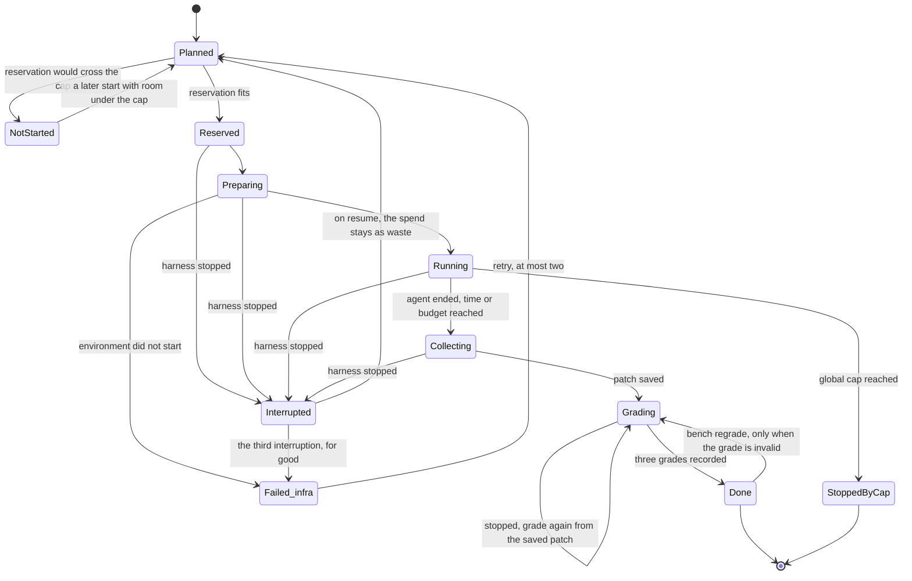
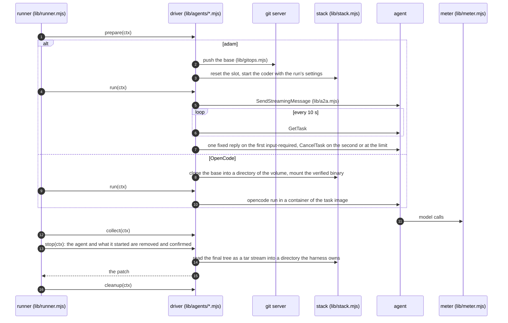
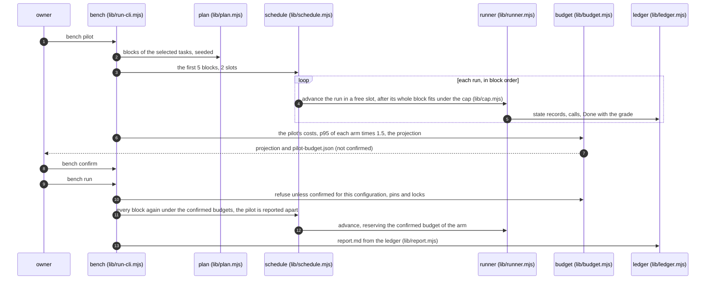

# bench: a benchmark harness for adam-coder and OpenCode

Runs the same tasks through two agents, `adam-coder` and OpenCode, on one model in two arms, grades the results
in a pristine image and reports pass rates with intervals and what they cost. Decision and shape:
[ADR 0048](../docs/decisions/0048-a-benchmark-harness-for-adam-coder-and-opencode.md).

**Built (pull requests 1 to 4 of 4):** the meter, the cost and the cap, the ledger, the configuration and its
guards, the statistics and the report; the task sources (public and own), the statement lint, selection, the
environment check and grading by patch replay; the compose stack, the adam and OpenCode drivers, the runner, `doctor` and
the dry run; and `pilot`, `confirm`, `run` and `regrade`, with task blocks, slots, the pilot's budget and the final report
("Pilot and run" below). Node 22 or later (CI runs 22 and 24), no dependencies: only Node's standard library. **Nothing that needs a container service has run** (the dry run, the stack,
`doctor --start`): see "Unverified".

## What it never holds

The endpoint URL, the model id, the prices and the key are the owner's and live **outside** this repository.
The harness refuses any file it reads or writes (the configuration, `$BENCH_HOME`, `--ledger`, `--out`) that is
inside a work tree: it walks up from the real location of the path (symlinks resolved, missing directories
skipped) and refuses at the first directory with a `.git`, a directory or a file, and also inside its own checkout
and the working directory. It refuses an unknown field, and a field **named like a secret** (`key`, `token`,
`password`, `auth`, ...) that holds any non-empty value of any type; only a number under a name that also says what
it counts (`token_budget`) passes. It refuses a string with a known key prefix or long hex anywhere. The extra
"long dense text" rule is not applied to `modelId`, `modelLabel` or anything inside an arm, so a real model id such as
`Qwen3-Coder-480B-A35B-Instruct-FP8` is accepted. The key is read only from the environment variable the
configuration names, and a key with a space, a line break or another control character is refused (exit 78, naming
the variable, never the value). An `http:` endpoint must be on the loopback (`127.x`, `localhost`, `::1`); any other
host must be `https:`. An error names the field and never quotes a value; the exit code is 78. The report shows the
model's label, never its id, unless `--show-model-id`. These key tests are heuristics, not a guarantee: keep the key
out of the file.

Every value below is made up.

```json
{
  "endpoint": "https://models.example.test/v1",
  "modelId": "example-model",
  "modelLabel": "Example Model",
  "prices": { "inputPerMTok": 3, "cachedInputPerMTok": 0.3, "cacheWritePerMTok": 3.75, "outputPerMTok": 15 },
  "capUSD": 100,
  "perRunBudgetUSD": 3,
  "arms": {
    "max": { "reasoning_effort": "high" },
    "off": { "reasoning_effort": "none" }
  },
  "keyEnv": "BENCH_MODEL_API_KEY",
  "concurrency": 2
}
```

| Field | Meaning |
|---|---|
| `endpoint` | the OpenAI-compatible base URL with its `/v1`; no credentials, query or fragment |
| `modelId`, `modelLabel` | what is sent upstream, and what the report shows |
| `prices` | USD per million tokens: input, cached input, cache write, output |
| `capUSD`, `perRunBudgetUSD` | the most the benchmark may spend, and what one run reserves (not above the cap) |
| `arms` | named JSON fragments merged into every request of the arm; they may not set `model`, `messages`, `tools`, `tool_choice`, `stream`, `stream_options` or `n` |
| `keyEnv` | the environment variable that holds the key (default `BENCH_MODEL_API_KEY`) |
| `concurrency` | runs at once, 1 to 8 (default 2) |
| `contextWindow` | **required**: the model's context window; both agents are given this one value |
| `limits` | optional, the same for both agents: `minutes` (the time limit of a run, 50), `steps` (adam's turn limit and OpenCode's `steps`, 200) and `cancelGraceSeconds` (60) |
| `timeouts` | optional: the meter's first-byte and idle timeouts in seconds |
| `tasks` | optional: task sources and grading, see Tasks |

The file is `$BENCH_CONFIG` (default `~/.config/adam-bench/config.json`); results are in `$BENCH_HOME`
(default `~/.local/share/adam-bench`, also refused inside a work tree, as are `--ledger` and `--out`). The schema is `SCHEMA` in
`bench/lib/config.mjs`.

```sh
BENCH_MODEL_API_KEY=... node bench/bin/bench.mjs config    # what may be shown of the configuration
node bench/bin/bench.mjs report                            # report.md from the ledger
```

## How a run goes




The states and their transitions are `TRANSITIONS` in `bench/lib/ledger.mjs`, which refuses any other. The
harness that drives a run through them is `lib/runner.mjs`. **Resume** reads the
ledger (`resumeActions`): a `Done` or `StoppedByCap` run is never repeated, a `NotStarted` one is planned again by a start with room under the cap; a run that was
`Reserved`, `Preparing`, `Running`, `Collecting` or `Interrupted` starts again from scratch; a `Grading` run is
graded again and never run again; a `Failed_infra` run is retried twice and then given up. A run is allowed
**at most two interruptions**: the third time it ends `Failed_infra` for good (`final`), so an interrupted run is not paid
for on every restart. The report lists such a run among those left out, with its wasted spend.

## What each piece does

| File | What |
|---|---|
| `bench/lib/config.mjs` | schema, validation, the guards, exit 78 |
| `bench/lib/ledger.mjs` | append-only JSON lines, fsynced, one writer (a lock made by linking a file that holds the pid); the fold; the resume rules |
| `bench/lib/cost.mjs` | usage normalised as [ADR 0032](../docs/decisions/0032-usage-per-model-call.md) does; cost in integer micro-dollars; the worst case |
| `bench/lib/cap.mjs` | reservations, the per-call check, the global stop |
| `bench/lib/meter.mjs` | the only way to the model: the proxy that injects the key, rewrites, clamps and counts |
| `bench/lib/scripted-model.mjs` | an OpenAI-compatible server for the tests |
| `bench/lib/stats.mjs` | Wilson intervals, the exact McNemar test, a seeded bootstrap |
| `bench/lib/report.mjs` | the report |
| `bench/lib/toml.mjs` | the TOML subset of `task.toml` |
| `bench/lib/task.mjs` | the task format and its validator |
| `bench/lib/upstream.mjs` | the pinned clone of the public tasks and `SHA256SUMS` |
| `bench/lib/mine.mjs` | the miner |
| `bench/lib/own.mjs` | own tasks: their spec, the image's Dockerfile, the task directory built from a clone |
| `bench/lib/lint.mjs` | the statement lint |
| `bench/lib/select.mjs` | seeded stratified selection, the lock files |
| `bench/lib/containers.mjs` | the container runtime interface: `PodmanRemote` and `FakeContainers` |
| `bench/lib/grade.mjs` | patch collection and grading by replay |
| `bench/lib/envcheck.mjs` | the environment check |
| `bench/lib/tasks-cli.mjs` | `bench tasks ...` |
| `bench/pins.json`, `bench/lib/pins.mjs` | the one place the coder image and OpenCode are pinned |
| `bench/lib/npm.mjs` | OpenCode's binary from npm, checked against its integrity before anything is written |
| `bench/lib/a2a.mjs` | the A2A client (the bearer in a private field) and `driveTask`: poll, the one nudge, cancel |
| `bench/lib/gitops.mjs` | the host's other git: list the pushed branches (isolated), the agent folder of a revision, the script a container pushes the base with |
| `bench/lib/stack.mjs`, `bench/compose.yaml`, `bench/lib/relay.mjs` | the stack, the Podman clients inside the services, the relays |
| `bench/lib/tarstream.mjs` | what a container wrote, as a tar stream parsed with limits |
| `bench/lib/classify.mjs` | infrastructure told apart from the agent, from the meter's record |
| `bench/lib/base.mjs` | the base of a task: its repository with the dependency links, made in the slot's volume, and the host's own copy of it |
| `bench/lib/agents/adam.mjs`, `opencode.mjs`, `common.mjs` | the two drivers (prepare, run, collect, cleanup) and what they share |
| `bench/lib/runner.mjs` | one run through its states, resume of the ledger, and a plan one run at a time |
| `bench/lib/plan.mjs`, `bench/lib/schedule.mjs`, `bench/lib/budget.mjs`, `bench/lib/run-cli.mjs` | task blocks in a seeded balanced order; the slots and the wait for budget; the pilot's budget and its confirmation; `bench pilot`, `confirm`, `run`, `regrade` |
| `bench/lib/doctor.mjs` | `bench doctor` |
| `bench/lib/agent-script.mjs`, `dryrun.mjs`, `dryrun-checks.mjs`, `bench/dry-run.sh` | the scripted model's turns, the dry run and what it asserts |

**Cost.** A call costs `(input - cached - cache write) * input price + cached * cached price + cache write * write
price + output * output price`, rounded up to a micro-dollar; reasoning is inside the output. A call with no usable
`usage` is charged its worst case and flagged. The agents' own counts are shown beside the meter's and never decide
anything.

**The cap.** A run reserves its budget before it starts, and starts only if what is spent plus what is reserved plus
this reservation fits the cap (exactly at the cap fits; one micro-dollar over does not). Each call's worst case (the
input at one token per three bytes, the clamped output) must fit what is left of the run's reservation, else the
meter answers `429` with `bench budget reached` and forwards nothing. If actual spend still reaches the cap, every
call is refused. **The cap is soft by one call per running slot**: a call that reports more usage than its worst case
takes its run, and so the total, past its reservation by that call's excess, and then the next call is refused. A
run's calls in flight at the same moment can each do so. The excess is what the endpoint billed above the estimate,
which is why the worst case is generous.

**The meter** serves only `POST /r/<token>/v1/chat/completions`. Anything else, an unknown token and
`/responses` (not forwarded: the two agents use chat completions) are `404` and nothing leaves. It writes a
`pending` record before it forwards, and everything after that record settles the call, even a throw before the
request leaves (free, as nothing was sent). It logs no body, key, token or URL, and listens on `127.0.0.1` unless
told otherwise.

* **`n`** must be absent or exactly 1 (the integer) and is forwarded as 1; anything else is a `400` and nothing is
  forwarded. One completion per call is part of fairness.
* **An upstream error** (any non-2xx) is never relayed, not its body, header or URL. The agent gets
  `{"error":{"message":"upstream error","type":"upstream_error","status":<upstream status>}}` with the status
  class mapped: `429` stays `429` (agents back off on it), a `5xx` is `502`, any other `4xx` is `400`. The call costs
  nothing, the upstream is destroyed unread, and the ledger has the upstream status alone.
* **Limits per call**, `LIMITS` in `bench/lib/meter.mjs`: `maxRequestBytes` 8 MiB (a request is a conversation, not a
  file; over it, or a declared length over it, is a `413` that arrives, and the rest of the upload is read and
  dropped), `maxResponseBytes` 64 MiB (stream or not), `maxCallMs` 20 minutes (from the request to the last byte,
  however lively the stream). Beside them the configuration's first-byte and idle timeouts. A call over a response
  limit or a time limit is cut, the upstream request is destroyed and the call is charged its worst case.
* **A client that closes at `[DONE]`** (adam does, right after the last chunk and before the upstream has ended) is charged the usage the meter had already read from the stream, not the worst case; only a client that closes before any usage was seen is charged the worst case.
* **A proxy:** the meter uses Node's own http client, which takes `HTTPS_PROXY` from the environment only when `NODE_USE_ENV_PROXY=1` is set; `bench doctor` warns when a proxy is set without it.
* **Backpressure:** an SSE stream is relayed chunk by chunk and the upstream is paused while the client does not read.

**The report** shows pass rates with Wilson intervals, paired differences (exact McNemar, seeded bootstrap), splits
by source (`public`, `own`, `own-self`) and language, cost per run and per solved task, tokens, the cache-hit rate, time, calls, the infrastructure failures, the excluded and flaky runs, and says what it does not claim.
Every cost, token and call figure sums **all attempts** of a run. Only `Done` runs count in the rates; the report
says that runs in `StoppedByCap`, `Failed_infra`, `NotStarted` (and any other state) are left out, and lists them
with what each wasted. Two `Done` runs for one task, agent and arm are an error that names them. Pipes and line
breaks in a cell are escaped.

## Tasks

Two sources, **one format** (the Harbor layout of SWE-bench Pro V2, `bench/lib/task.mjs`):

```
<id>/instruction.md        the statement
<id>/task.toml             [agent] network_mode = "none"; [verifier] network_mode; [environment] cpus, memory_mb,
                           optional docker_image and workdir; optional [metadata] repo, language
<id>/environment/          a Dockerfile whose first FROM names the image (or docker_image in task.toml)
<id>/tests/test.sh         writes /logs/verifier/reward.txt: 1 pass, 0 fail
<id>/solution/             the gold change as a *.patch (used by the environment check only)
```

The validator refuses a task with a part missing, a `task.toml` it cannot read (the reader, `bench/lib/toml.mjs`,
takes the subset the format uses and names the line), an image not pinned by digest, and an agent network mode other
than none (`no-network` is read as none). Upstream names images by tag; `bench tasks check` resolves each tag to a
digest and keeps it in `$BENCH_HOME/tasks/pins.json`, and the pin is what a task runs by.

| Source | Where | What the repository holds |
|---|---|---|
| public: SWE-bench Pro V2 | `scaleapi/SWE-bench_Pro-os` cloned under `$BENCH_HOME/upstream` at **the commit you pin** (`tasks.upstreamCommit`; there is no default) | `bench/tasks/public.lock.json`: ids, checksums, image digests, the seed. **No task content, ever.** |
| own: mined from your clones | full local clones you name in `tasks.clones` | `bench/tasks/own/<id>/`: your `instruction.md` and `own.json` (commit ids, test command, toolchain pins), the lock `own.lock.json`. No hidden test content: it is read from the clone when the task is built |

```json
"tasks": {
  "upstreamCommit": "0123456789abcdef0123456789abcdef01234567",
  "clones": { "demo": "/home/me/src/demo" },
  "workspaceImage": "registry.example.test/workspace@sha256:<64 hex digits>",
  "podman": { "connection": "bench-slot-1" }
}
```

`upstreamUrl` (default the public repository; `https:`, `file:`, `ssh:` or an absolute path, never beginning with `-`),
`upstreamDir` (default `v2`), `selfRepo` (the agent's own repository, default `another-adam-rs`, `null` for no cap of
its own), `seed` (default `1`), `verifierNetworks` (names of networks a verifier may use, see Grading) and `podman`
(`connection`, a plain name, or `url`, `unix://` or `ssh://`, of the Podman service, as `podman --remote` takes them)
are the other fields. The task commands read the same file as the rest, so it must be a
whole configuration.

**Fetch.** `bench tasks fetch` clones the upstream repository, checks out the pinned commit, checks every file against
`v2/SHA256SUMS` and lists the tasks. The check is of the whole tree: every file of a task must be listed, there must be no
symlink anywhere, and a listed path must be in its normal form (`a//b` and `a/../b` are refused). A reused clone is cleaned
(`git clean -ffdx`) and its origin must be the configured URL. A task's checksum in the lock is the hash of its
`SHA256SUMS` lines. A task directory may hold no symlink either.

**Mine.** `bench tasks mine` walks the first-parent history of `main` in each clone and keeps a commit that

* has one parent and a subject ending `(#N)` (a squashed pull request) and is not `docs`, `chore`, `ci`, `style`,
  `build`, `test`, `refactor` or a revert;
* touches a test file and a source file, by path (`tests/`, `testing/`, `*.test.ts`, `*_test.go`, `*_tests.rs`, `tests.rs`, ...);
* changes at most 400 non-test lines (added plus deleted, documentation and lockfiles not counted); a binary source file
  counts as over the limit;
* changes no lockfile (by exact name, a full list, and any `*.lock`: a new dependency would need the network);
* has no hunk inside code that `#[cfg(...)]` makes test-only: `test` as a token of the predicate (`all`, `any`, and not
  under `not`), and a whole file under `#![cfg(test)]` (inline tests cannot be hidden).

It writes `$BENCH_HOME/tasks/own-candidates.json` (commit, base, the hidden test files, a hint of the test command) and
**never a statement**. You write it: [`bench/tasks/own/README.md`](tasks/own/README.md).

**Lint.** `bench tasks lint` warns when an identifier (snake_case or camelCase) or a path that appears only in the gold
change's added lines is in your statement. An `Interface` section is exempt: it is where the names the tests call belong.

**Build, check, select.**

* `bench tasks build` makes an own task's directory under `$BENCH_HOME/tasks/materialized` (the hidden tests read from the
  clone into `tests/test_patch.patch`, the gold without them in `solution/`) and builds its image: the workspace image
  by digest, the repository at `/app` at the base with history up to the base only, the toolchain pins you wrote.
* `bench tasks check` (needs the Podman service) runs, per task, the gold patch three times and the empty patch three
  times **from the clone path the agents will use**, not from `/app`: the base is cloned there, the top-level ignored
  entries are linked to `/app`'s, and `test.sh` runs with `/app` rewritten to that path. A task is kept only if the gold
  passes all three and the empty patch fails all three, and is dropped with its reason otherwise (`gold-fails`,
  `gold-flaky`, `gold-does-not-apply`, `empty-passes`, `empty-flaky`, `no-gold-patch`, `infra`). It also records whether
  the base has a `.devcontainer`.
* After the clone-path runs the check runs the gold **once more through the real grading path** (working directory `/app`,
  the original `test.sh`) and keeps the task only if that passes too (`gold-fails-at-app`).
* `bench tasks select` keeps the checked tasks without a `.devcontainer`, whose check still fits the task (a result carries
  the task's checksum and image digest and is ignored when either has changed), draws them stratified by repository with the
  seeded generator of `lib/stats.mjs` (public: 80, at most 9 per repository; own: 20, at most 6 per repository and at
  most 6 from `selfRepo`) and writes the lock files. The same seed gives the same list.

## Grading

**A principle.** Grading runs the agent's code: its patched sources run inside the test process. So no grader can be
made tamper-proof against code that runs inside it. The harness makes tampering hard and visible. It takes nothing
from the agent's tree but its files, strips what may not change, demands that every signal agree, and lists every
patch that touches the grading's own machinery as **suspect**, for a person to read. The report says so.

`bench/lib/grade.mjs`:

* **Collecting.** The agent's `.git` is never read or run (its `config`, filters, hooks and attributes can execute
  commands). `collectPatch` clones the base from a repository the harness owns, copies the files of the agent's tree
  over it (symlinks are copied as links and never followed, nested repositories are not entered), then runs
  `git add -A` and `git diff --cached --binary <base>` with no system or global configuration, no hooks, no attributes
  file, no fsmonitor and no textconv. Untracked files and binaries are included; the symlinks the adapter committed to
  `/app/...` are left out; more than 5 MB stops with an error. The patch follows the **base's** `.gitignore`: the
  agent's change to a `.gitignore` is dropped, and so are changes inside ignored paths or nested repositories.
* **Stripping.** Before the patch is applied, every change to the hidden test files, to any path the miner calls a test
  path (`tests/`, `*_test.*`, `tests.rs`, `testing/`, ...), to `conftest.py`, `pytest.ini`, `tox.ini`, `noxfile.py`,
  jest, vitest, mocha and karma configuration and to `.gitattributes` is removed, and the removed paths are recorded with
  the run. Changes to `pyproject.toml`, `setup.cfg`, `Cargo.toml`, `package.json` and `go.mod` that configure tests (a
  `[tool.pytest*]` table, `[[test]]`, `harness`, a `test` script) are kept and flagged **suspect**.
* **Grading.** The stripped patch is applied in a **new container of the task image, by digest**, `/tests` is mounted
  **read-only in that container only**, `bash /tests/test.sh` runs, and the reward is read from a directory made empty
  for that attempt, after the container has ended. The `grader` service mounts nothing of the host: the harness copies the tests and
  the patch into a directory of its own per grading (`/grade/<id>`, a tmpfs) as tar streams, mounts them read-only, takes the reward
  out as a tar stream and removes the directory inside the service. A pass needs **all** of: exit status 0, a reward of exactly `1` written
  during the attempt, and no error. A reward of `1` with another exit status is a fail and **suspect**. A patch whose added
  lines mention `reward.txt`, `/logs/verifier`, `/tests/` or `test.sh` is graded as it is and **suspect** too. The agent
  phase has no network; the grading container has the verifier's network.
* **The verifier's network is an allow-list:** `none`, `default`, `public`, or a name in `tasks.verifierNetworks` of the
  local configuration. `host` and anything else is refused, when the task is read and again when the container starts.
* **Three attempts, two of three pass; a split is `flaky`.** An attempt that ends in an infrastructure error (exit 125,
  126, 127, 98, or a timeout of the container) is tried again, at most twice; if it is still one the grade is **`invalid`**:
  left out of the rates and listed in the report, never a fail. A patch that does not apply is a fail.
* **Suspect list.** The report has a section with every suspect run: the reasons, what was stripped and the path of the
  patch, for a person to read. A suspect run is graded as it is and counted as it is.

The runtime is the `Containers` interface of `lib/containers.mjs`: `PodmanRemote` runs
`podman --remote [--connection C | --url U] run --rm --pull=never --entrypoint sh ...` (the arguments are the pure
function `buildRunArgs`) and `FakeContainers` is for tests. A mount source is a path as the Podman service sees it:
the service and the harness must share the harness's work directory.

## What the host trusts

An agent's files are written by the agent. The harness's host is the owner's machine, with the model's key in its
environment. So one principle holds everywhere:

> **The host never runs git in, reads a file from, or deletes a file in a place a container could write.** What a
> container wrote reaches the host as a tar stream the harness parses with limits (`lib/tarstream.mjs`): regular files and
> directories only (a symbolic link only in a work tree, and it is never followed), no hard link, device or FIFO, every
> name normalised and refused if it is absolute or holds `..`, a cap on the bytes, the entries and one file. **A bad entry
> (a FIFO, a device, a link nobody asked for, a file over its cap) is refused and skipped**: its path and reason go to the run
> record and the report, and the run goes on; only a broken stream (a wrong checksum, a name that leaves the target) or one over
> the total cap is infrastructure. What the
> host itself writes, it owns. What a container left is removed by a container (as the owning user) and checked to be gone.

| What | How |
|---|---|
| a work tree, a base | `tar -cf -` inside the Podman service, parsed and extracted by `Stack.extractTree` into a directory the harness made |
| OpenCode's stream, stderr and export | `Stack.readFiles`: the three names only, a size cap, and a link, FIFO or device in their place is refused, logged and kept out |
| the exit status of OpenCode | the container runtime's (`podman run`'s status and its time-out), never a file the agent could write |
| the reward of a grading | read without following a link or blocking (`O_NOFOLLOW`, `O_NONBLOCK`), only if it is a regular file of at most 16 bytes; on the grader it comes out as a tar stream of that one name |
| the base of a task | made in the slot's volume by the task image; the host builds its own repository from a tar of the tree; adam's copy is pushed to the git server by a one-shot container with no secret |
| the pushed branches | `git ls-remote` of an `http://` address on the loopback, run in a new empty directory that is not a repository, with discovery stopped and only plain http allowed |
| the environment of a host git | an allow-list (`PATH`, locale, temp directory); the model's key, a proxy and any credential are not in it. The clone and the fetch of the upstream tasks run in it too (`lib/upstream.mjs`), so an upstream cannot see the key |
| a token | never on a command line: the coder's settings are in a 0600 file removed once the coder exists, OpenCode's configuration goes in on stdin |

## The stack

`bench/compose.yaml` reuses the dev stack's pieces without changing `dev/`; `lib/stack.mjs` drives it with `docker compose`.
Every container of the stack that is ours runs **the coder image of `bench/pins.json`** (the relays, the git sandbox, the
pusher): no other image is added to the dev stack's postgres, WireMock, git server and Podman service.

| Service | What |
|---|---|
| `postgres`, `mock-github`, `git-server` | the coders' databases (one for each slot, `postgres-init.sql`), the WireMock mock that makes `open_pull_request` succeed, the dev git server (owner `bench` is made on first push) |
| `podman-1`, `podman-2` | the Podman service of a slot (4 CPU, 12 GB): what an agent's commands run on. Mounts the slot's work volume and one directory the harness writes, **read-only**; never `$BENCH_HOME`, so no hidden test, gold patch or ledger is visible to it |
| `grader` | a Podman service of its own, on a network with nothing else, where grading and the environment check run; it mounts nothing of the host (a tmpfs `/grade` holds one directory per grading, filled and emptied through tar streams) |
| `coder-1`, `coder-2` | the pinned coder, recreated for each run, on its slot's network only |
| `gitbox-1`, `gitbox-2` | `adam-git-sandbox` of the same image: no network, no secret, a read-only root, an in-memory `/tmp`, the work volume; the coder's git runs there (`GIT_SANDBOX_SOCKET`), so what a repository's configuration names cannot read a secret or reach the network |
| `meter-1`, `meter-2` | TCP relays with one fixed target, the harness's meter on the host |
| `pub-coder-1`, `pub-coder-2`, `pub-git` | TCP relays that publish a coder's A2A port and the git server on the loopback |
| `pusher-1`, `pusher-2` | one-shot containers that put a run's base on the git server |

**Networks** (all internal but `egress`; a test over the rendered file holds each member list):

| Network | Members |
|---|---|
| `agentnet-N` | `podman-N`, `meter-N`. A container the Podman service runs shares the service's network namespace, so what an agent's commands reach is the meter relay and nothing else |
| `slot-N` | `coder-N`, `meter-N`, `pub-coder-N`, `git-server`, `postgres`, `mock-github` |
| `gitpub-net` | `git-server`, `pub-git`, `pusher-1`, `pusher-2` |
| `grader-net` | `grader` |
| `egress` | the five relays and nothing else |

So no coder, sandbox, git server, database or Podman service has a route to the internet, and slot 1 and slot 2 share
no network (the git server, postgres and the mock answer on both; they do not connect the slots). A Podman service
joins `egress` only while the harness pulls an image, and the grader only while a verifier needs the network.

* **Every run has a repository of its own** on the git server (`bench/<slug>-<run hash>.git`), made by the pusher and deleted at
  cleanup. A second run of a task, the other arm and a retry never see an `agent/*` branch of another run.
* **The meter is the harness's own** (it holds the ledger's lock and the key). The relay forwards its bytes and reads none, and
  closes a connection that is idle for ten minutes. The meter listens on `BENCH_METER_PORT` (18090) and `BENCH_METER_BIND`,
  which is **`127.0.0.1` by default**. `dry-run.sh` sets it to the address of Docker's default bridge, which the relay reaches
  through the host gateway. Under rootless Docker the host gateway is another address: set `BENCH_METER_BIND` yourself
  (*unverified* which). The meter serves only paths with a run token of 192 bits.
* **Before every run** the slot's service is reaped (every container removed, the list read and required empty) and its volume
  emptied (everything under `/work` but the sandbox's directory, checked). After a run, the agent is stopped and that is
  confirmed (the coder removed, its devcontainers reaped) **before** its tree is read.
* **`ALLOW_LOCAL_REPOS` stays on**, because the bench serves plain `http://`; `ALLOWED_REPO_HOSTS` is the git server only. The
  coder's policy still accepts a local path or a `file://` URL when it is on (`Policy::check` in `crates/adam-workspace`);
  the coder's container holds nothing but the work volume, so that reaches nothing of the host's.
* The compose file has two slots. A third needs its own services (listed in the file's header), a database and volumes.

## The agents

`bench/pins.json` is the one place the agents are pinned; `bench/compose.yaml` names the same coder image and a test holds
them equal.

| Pin | Value | |
|---|---|---|
| coder image | `ghcr.io/vymalo/another-adam-rs/coder:sha-2d5d0b3@sha256:3476…ac91`, revision `2d5d0b3926cb…` | *verified 2026-11-17*: the digest by an anonymous manifest request to `ghcr.io` for the tag `deploy/coder/values.yaml` names, the revision from the image's `org.opencontainers.image.revision` label |
| OpenCode V2 | `@opencode/cli` 2.3.0, platform package `@opencode/cli-linux-x64`, integrity `sha512-8T3K…FFg==` | *verified 2026-11-17* on `registry.npmjs.org`: the newest 2.x at least three days old (2.3.0 was published 2026-11-13, the platform package at 08:43 UTC, `@opencode/cli` at 08:54); the integrity is of the exact tarball that is mounted and was computed again from the download; the tarball holds `package/bin/opencode`, a 250 MB native executable (`@opencode/cli` itself has only a `postinstall` that picks a platform package and a launcher; nothing is installed at run time) |

|  | adam-coder | OpenCode |
|---|---|---|
| Driver | `lib/agents/adam.mjs` | `lib/agents/opencode.mjs` |
| Runs in | the coder container; its commands in a devcontainer of the task image on the Podman service | a container of the task image on the Podman service |
| Working copy | its worktree `/work/workspaces/<run>/<slot>` of the base on the git server (a repository of this run's own) | a clone of the same base at `/work/workspaces/oc-<run>-a<n>/<slot>` |
| Statement | one line (`In <repository> (base branch main), do this task:`) and the statement | the statement, byte for byte, on stdin |
| Network | the stack's, through the meter | the Podman service's: the meter and nothing else |
| Ends | polling `GetTask` every 10 s | the container's status, or the time limit |
| Usage it reports | `usage/v1` totals of the task | `step_finish` events and `opencode session export` |

**The base** (`lib/base.mjs`). Made once for a task image, inside the image with no network: its repository at its base
commit, plus one commit that links the ignored top-level entries (`node_modules`, a build directory) to the image's own.
Both agents clone that bare repository; patch collection leaves the links out (`adapterSymlinks`).

**adam** (`lib/agents/adam.mjs`, `lib/a2a.mjs`). Settings that already exist, no change to the coder:

| Setting | Value |
|---|---|
| `ALLOWED_REPO_HOSTS`, `ALLOW_LOCAL_REPOS` | `git-server`, `true` (a development setting; the chart never sets it) |
| `GITHUB_API_URL`, `GITHUB_TOKEN` | the WireMock mock, a dummy |
| `ADAM_AGENT_DIR` | `bin/adam-coder/agent` at the image's revision (`git archive`), **without `mcp.json`**: no GitHub MCP server, as OpenCode has none |
| `WORKSPACE_SWEEP_SECS` | `0`: the worktree stays until it is copied |
| `DEVCONTAINER_RUNTIME`, `DEVCONTAINER_DEFAULT_IMAGE`, `DEVCONTAINER_PREPULL`, `DEVCONTAINER_NETWORK` | `podman`, the task image by digest only, `false`, `inherit` |
| `MODEL_BASE_URL`, `MODEL_API_KEY`, `MODEL`, `MODEL_CONTEXT_WINDOW` | the meter's address with the run's token, a dummy, `bench-model`, the configured window |
| `A2A_BEARER_TOKENS` | a random value for each run |
| `GIT_SANDBOX_SOCKET`, `DEVCONTAINER_DEPLOYMENT_ID` | the git sandbox's socket on the work volume; `bench-slot-N` |
| the turn limit | the agent folder's `max_turns` is set to `limits.steps`, the value OpenCode's `steps` gets |

The bearer is in a private field of the client: in no log line, error, result or saved file (the saved task is redacted of it and of the run's token), and every request has a timeout of 15 s. **Polling decides**: the stream
of `SendStreamingMessage` is read for latency and the per-call usage reports only. A task that is `input-required` gets one
fixed reply, `Nobody can answer questions in this run; decide yourself and finish.`, in the same task. The second time it
parks (a new status timestamp), at the time limit (50 minutes) and when the meter refuses a call, the harness sends
`CancelTask`, waits the configured cancel grace and then stops the coder; the run is collected only after that stop is confirmed. One nudge ever: it is sent once, when the state first parks, and never again because an answer was slow. Exits: `done`, `failed`, `canceled`, `rejected`, `timeout`, `budget_hit`, `stopped_by_cap`, `input_required`,
`infra` (six polls in a row failed, or the task wants a sign-in (`auth-required`): the run is `Interrupted`, then `Failed_infra`, and is tried again at the next start).
The final tree is the one run directory of the emptied volume, read as a tar stream into a directory the harness owns and turned
into a patch, after the coder is removed and its devcontainers are reaped and both are confirmed; the pushed `agent/<run>` branch is the cross-check (`crossCheckBranch`).

**OpenCode V2** (`lib/agents/opencode.mjs`, `lib/npm.mjs`). The binary is fetched from npm, checked against the pinned
integrity **before anything is written**, extracted and mounted read-only at `/opt/bench/opencode`.

```sh
cd <clone> && opencode run --standalone --format json --model bench/bench-model --auto --title <run> < instruction.md
```

`OPENCODE_CONFIG_CONTENT` (`opencodeConfig`), **given on stdin** and read into the variable by the script (it holds the run's token, which is then on no command line): the provider `bench` (`@ai-sdk/openai-compatible`) at the meter's address with a
dummy key, the model's limits (context from the configuration, output 8192), the same model for the small calls,
`agent.build.steps` 200, `autoupdate` off, `share` off, and the permission

| `*` | `webfetch` | `websearch` | `external_directory` |
|---|---|---|---|
| allow | deny | deny | deny |

and `question: deny`: nobody can answer, so the fixed reply of the adam side has no counterpart. 

with `OPENCODE_DISABLE_MODELS_FETCH=true` and `OPENCODE_DISABLE_AUTOUPDATE=1`. Its `HOME` is on the shared output
directory, so the export (`opencode session export --standalone <session>`) can run in a second container after a run that
was killed at the time limit. The export is kept as raw JSON, with the run's token taken out of every kept file.
`--standalone` gives the run a private server: no background service is left in the container.

### OpenCode V2

The owner chose OpenCode V2 (`@opencode/cli` 2.x) for the benchmark. Every fact of the plan's recommendation 3 was
verified on 1.19.6 only, so each was checked again against **2.3.0**: the binary of the pin, run on this machine against a
local OpenAI-compatible stub (the test `opencode.test.mjs` repeats it with `BENCH_TEST_OPENCODE_BIN`), and its source at the
tag `v2.3.0` (`raw.githubusercontent.com/anomalyco/opencode/v2.3.0`) and its `CHANGELOG.md`.

| Fact | At 2.3.0 | How, 2026-11-17 | Differs from 1.19.x |
|---|---|---|---|
| headless command | `opencode run [flags] [message...]`, `--format default\|json`, `--model provider/model#variant`, `--auto`, `--title`; `--standalone` runs a private server instead of the background service | `opencode run --help`, `opencode --help` | **no `--dir`**: the working directory is the directory; **`--standalone` is new** |
| the statement | on stdin it reaches the model byte for byte; `--title` leaves two requests for a two-step task (three without it) | stub's journal | none |
| `OPENCODE_CONFIG_CONTENT` | read; with `OPENCODE_CONFIG`, `OPENCODE_CLI_CONFIG_CONTENT` and `OPENCODE_CONFIG_DIR` | the names are in the binary; a config with the provider, model, `small_model`, `permission`, agent `steps`, `autoupdate` and `share` ran | none |
| provider | `@ai-sdk/openai-compatible` at the stub's address; the model's id reaches the request; `stream_options.include_usage` is set; the limit is sent as **`max_completion_tokens`** (8192) | stub's journal | 1.19 sent `max_tokens`; the meter clamps both |
| `permission` | `external_directory: deny` refuses a write outside the directory (`Permission denied: external_directory`); `question` accepts only an action | stub's journal; `packages/core/src/v1/config/permission.ts` | none |
| agent `steps` | in the schema (`packages/core/src/v1/config/agent.ts`, with `maxSteps` deprecated) | source. **Its effect was not run**: a bad value (`"x"`) was accepted without an error, so the stub proves nothing about `steps`, `small_model`, `autoupdate` or `share` | none |
| `OPENCODE_DISABLE_AUTOUPDATE`, `OPENCODE_DISABLE_MODELS_FETCH` | both names are in the binary; the run made no network request but the stub's | strings of the binary, the stub's journal | none |
| tokens and cost | `step_finish` has `tokens` `{input, output, reasoning, cache: {read, write}}` and `cost`; the session's totals are in the export | the JSON stream, the export | **no `total`** in `tokens` |
| export | `opencode session export [--standalone] <session>` prints `{info, messages}`; it needs a session id when stdin is not a terminal; a second process reads a session the first one made when they share `HOME` | run, then export, on this machine | **`opencode export` became `opencode session export`** |
| tools offered | `edit glob grep question read shell skill subagent write execute`; `write` and `edit` take **`path`** | stub's journal | `bash` is `shell`, `task` is `subagent`, `filePath` is `path`, `execute` is new |
| background jobs | **`run` waits for the background shells, subagents and image jobs its prompt started**, prints `waiting for N background job(s)` (a `background_wait` event) and has no time limit; SIGTERM cancels the session and its jobs; a failed model call is retried (`retry` events) | `CHANGELOG.md` of 2.x ("`opencode run` now waits for the background shell commands, subagents, and image jobs"); the retries seen when the stub was down | **new** |

**Background subagents** (V2 runs them in the background by default and tells the parent when they are idle). The choice:
**leave them on and let `run` wait for them.** `run` ends only when they are done, so the run's patch is the work of all
of them; the container's time limit (50 minutes) is the only bound, as for adam, and a run that is killed at it is
`timeout`. Turning subagents off would take away a tool that adam has too (its `explorer` and `reviewer`) and the report
would compare a handicapped agent. The cost is the same as for adam: the meter counts every call of every session. OpenCode's
own stream shows the main session only, so `selfReported` is lower than the meter's when subagents work; the export has them.
The refusal of a call is retried by OpenCode, so the harness watches the meter and ends the container itself (`budget_hit`). The end
of a run, at the time limit or on a refusal, is the same for both agents: a polite stop (OpenCode: SIGTERM; adam: `CancelTask`), the
configured cancel grace, then a forced stop. OpenCode's stderr is capped at 1 MiB inside the container.

**Fairness.** Both agents get the same step limit, the same context window, the same cancel grace and the task's CPU and memory
for the container they run in (`limits`, `contextWindow` in the configuration; adam's devcontainer is made by the coder, which
takes no such limit, so its CPU and memory are the service's: not equal). If the Podman service refuses `--cpus` and `--memory` (it has no cgroups), OpenCode's container gets none, the run record says `limits: service`, and the report lists those runs. The clock of a run starts when the agent is started
(adam: the first message; OpenCode: the container), and adam's `wallMs` is the time to the decision, not the cancel grace.
OpenCode needs no network to load its provider (*verified 2026-11-17*: it ran with the proxy dead and a new home).

**What cannot be made equal** (the report says so): the system prompts, the tool sets, the subagents (adam's 40 turns,
OpenCode's `task`), compaction, retries and prompt caching; adam's check-cycle rule and pull request flow; OpenCode's
own process runs inside the sandbox, adam's runs outside it; the one line of preamble; the nudge against OpenCode's denied
`question` tool; LSP; and what a step limit means.



## The runner

`lib/runner.mjs` takes one planned run through the states of the diagram above, one ledger record for each, with one slot
at a time. The slot's service is reaped and its volume emptied first; the agent is stopped, and that is confirmed, before its
tree is read; **the meter's record decides whether the run is the agent's or the infrastructure's** (`lib/classify.mjs`): a run in
which the agent made no model call, in which more than two calls (or the last one) failed upstream, in which no container of the
task's image ran (adam), in which the coder reported an external cause, or that could not be stopped, is `Failed_infra` (tried
again, then left out of the rates), never a fail. Grading runs on the `grader` service. `runPlan` first reads the ledger (`resumeActions`), so a start after a kill runs what is left: a `Done` run is not
repeated, an interrupted one starts again from scratch (its first attempt's spend stays as waste), a `Grading` one is graded
again from its saved patch. The patch is written to `runs/<run>-a<n>/model.patch` under the results directory before grading. A
verifier that needs the network gets it for the window of its grading. `runPlan` is one run at a time; the blocks and the slots are `lib/schedule.mjs` ("Pilot and run").

## Pilot and run

The owner's runbook. Each step reads what the one before wrote; nothing past `confirm` starts without the owner.

| Step | Command | What it does |
|---|---|---|
| 1 | `bench doctor --start` | the machine, the stack, nested Podman |
| 2 | `bench tasks fetch`, `mine`, `build`, `check`, `select` | the tasks and the two lock files ("Tasks") |
| 3 | `bench pilot [--blocks 5]` | the first blocks of the plan (five blocks of two agents and two arms are 20 runs), each run reserving `perRunBudgetUSD`; prints the projection; writes `$BENCH_HOME/pilot-budget.json` (not confirmed). Refuses a `--blocks` that cannot give 3 finished runs in each arm, and a cap that cannot hold one block |
| 4 | read the projection, then `bench confirm [--over-cap] [--censored]` | the owner's yes; `--over-cap` accepts a projection above the cap, `--censored` a budget guessed from pilot runs that hit their budget |
| 5 | `bench run` | the full run; ends by writing `$BENCH_HOME/report.md` |
| 6 | `bench regrade` | only if some grades are `invalid` (the grader failed, not the agent), or a run was left in `Grading`: grades them again from the saved patch; a patch that is gone or changed is refused, never turned into a fail |
| 7 | `bench report [--show-model-id]` | the report again from the ledger, at any time |

```mermaid
stateDiagram-v2
    [*] --> NoBudget
    NoBudget --> Proposed: bench pilot writes the proposal
    Proposed --> Confirmed: bench confirm
    Proposed --> NoBudget: bench pilot again
    Confirmed --> Running: bench run
    Confirmed --> NoBudget: configuration, pins or locks changed
    Running --> Running: killed, started again; only interrupted runs are redone
    Running --> Ended: every run Done, or the cap reached
```





The states are those of `lib/budget.mjs` (`proposalBody`, `confirmProposal`, `requireConfirmed`); a new `bench pilot`
deletes the file first, so an old yes never covers a new pilot.

* **One configuration, one ledger (`lib/budget.mjs`, `configFingerprint`).** Every run of the ledger carries the fingerprint of the
  configuration it was made under: the model id, prices, arms, limits, context window, pins, the two lock files, `tasks.seed` and
  `tasks.selfRepo`. `pilot`, `confirm`, `run` and `regrade` refuse a ledger that holds runs of another one, naming the fields that
  changed, and say to use a new `BENCH_HOME`: runs of two configurations are never pooled, and a pilot never re-reads runs made
  under another. `concurrency` is left out (it changes wall time, not what a run is given), and so is the endpoint (the same model
  elsewhere) and the cap (a bound on spend, checked again at every `run`). Each field is an HMAC under `$BENCH_HOME/digest.key`
  (0600), so no file holds a hash of the model id that a guess could be tested against.
* **Blocks (`lib/plan.mjs`).** A block is one task through all four cells (two agents, two arms). The tasks are shuffled with the
  seed of the configuration (`tasks.seed`); the cells of a block follow a cyclic Latin square, so in each round of four blocks
  every cell stands at every position once. A run id is `<task>.<agent>.<arm>`: a plain id is kept, any other is sanitised, cut
  and given a short hash of the whole id, and `.agent.arm` is never cut; two runs with one id are an error. A task's `source` is
  `public`, `own`, or `own-self` (an own task from `tasks.selfRepo`, adam-rs itself), and the report keeps the three apart.
* **The pilot is not part of the results.** It is the first blocks of the plan, as runs with the prefix `pilot.` and the phase
  `pilot`, under the configuration's per-run budget. `bench run` runs **every block again** under the confirmed budget of each arm;
  the pilot's results are in the report's "Pilot" section and in no rate, pairing or cost per run. The projection includes those
  re-runs, and the cap counts the pilot's spend.
* **Slots and whole blocks (`lib/schedule.mjs`).** `concurrency` slots (two by default, at most the stack's two), one run each.
  Before the first run of a block starts, the **whole block** is held: the budgets of its runs must fit under the cap with what is
  spent, what is reserved and what other started blocks still hold. A block that does not fit while other runs are active waits
  for one to end (a reservation is a ceiling: what a run did not spend is free when it closes); one that does not fit with nothing
  to wait for ends the schedule and is not even planned, so a stop at the cap leaves whole blocks, and a later `bench run` with a
  higher cap starts at the first block left (`NotStarted` is not final). Starting is one at a time, in order, with the check and
  the reservation of the first run together, so two slots cannot both take the last of the budget; `lib/cap.mjs` refuses a second
  one anyway. After an infrastructure stop a block can be incomplete; the report rates only tasks that have a finished run in every
  cell, and lists the others under "Incomplete blocks".
* **Budget (`lib/budget.mjs`).** Before the pilot a pilot run reserves `perRunBudgetUSD`. After it, an arm's budget is the larger of
  1.5 times the 95th percentile (nearest rank) of what its finished pilot runs cost plus the largest worst case of a single call
  the arm's pilot saw, and twice that worst case: a run is refused a call that would not fit, so a budget under one worst case
  could not make a call. The proposal shows the p95, the floor and which one won. If a pilot run of an arm ended `budget_hit`, its
  cost is a ceiling and the p95 is censored: the proposal says so and `bench confirm --censored` accepts it on purpose. The
  projection (spent so far, the expected spend by the mean, the plan with a 20 % margin, and the worst case if every run used its
  whole budget) is checked against the **live** cap at every `bench run`; above it, `--over-cap` was needed twice. An arm needs
  three finished pilot runs, so `--blocks` is at least 2, and a cap that cannot hold one block of the pilot is refused before
  anything starts.
* **Resume.** `bench run` again after a kill: `resumeActions` (`lib/ledger.mjs`) turns what was in flight into `Interrupted` (its
  reservation is freed before anything starts; what it spent stays as waste) and then `Planned`, a `Grading` run is graded again,
  a `Done` run is skipped. The scheduler goes over the plan again (at most three passes) so a run that failed in the
  infrastructure is tried again, as often as the ledger allows.
* **Task images and the grader (`lib/images.mjs`, `lib/stack.mjs`).** A pull of an image is one in-flight promise for each image
  and service, so two slots never pull the same one twice. The grader's window with the internet is **alone** on the grader: gradings
  take the shared side of one lock and a window the exclusive side, so no grading of an agent's patch ever has a route out and
  two windows never overlap. An own task's image is built where `bench tasks build` ran; the harness saves it into an archive on its
  own side and loads it into each slot's service and into the grader **before anything is spent**, and a regrade makes the grader's
  image present first.
* **The end.** `report.md` has, for each agent and arm, the resolve rate with its Wilson interval and how many runs of the cell are
  left out, the paired differences, cost per run, per **resolved** task, and per resolved task with every run of the cell (waste
  included), the spend on unsolved runs, tokens (input, cached, cache write, output), the cache-hit rate (cached over input, all
  attempts), wall time, infrastructure failures, and the refused entries; public, own and adam-rs's own tasks are separate rows.
  A run that ended `completed` is never a pass by itself: grading is the hidden tests.

## `bench doctor`

`node bench/bin/bench.mjs doctor [--start]` checks Node, a proxy set without `NODE_USE_ENV_PROXY=1`, Docker and its compose plugin, whether the daemon is rootless,
`kernel.apparmor_restrict_unprivileged_userns` (a rootless Podman cannot make a user namespace when it is 1; the fix is
printed), the user namespace limits, free disk (a failure under 30 GB, a warning under 100 GB, in `$BENCH_HOME` and in
Docker's root) and the coder image by digest. With `--start` it brings the stack up and runs a container inside each Podman
service, and in the grader, and asks each Podman service whether it takes the task limits (a refusal is a warning: the limits are then the service's own, the same for both agents). Compose 2.24 or newer and an x64 machine are required. Nested Podman has been proven under rootful Docker only (`dev/podman/README.md`). When it does not work the exit is
1 and the output says which fallback to use: **1. a rootless Podman on the host** (its socket mounted into the coder and the
harness), **2. the coder's run pods on a k3d cluster**. Neither fallback is built here.

## The dry run

`sh bench/dry-run.sh` (Docker-gated: `BENCH_TEST_DOCKER=1`; a failure under `BENCH_TEST_REQUIRE_DOCKER=1`) runs both agents
through three tasks of `bench/tasks/self/` on the stack, with a scripted model (`lib/agent-script.mjs`, served by
`lib/scripted-model.mjs`) that tells the callers apart by the tools they are offered and the task by a `[mock:<name>]` marker:

| Task | Statement | The scripted model writes | Grade |
|---|---|---|---|
| `hello` | create `hello.txt` holding `hello` | `hello.txt` with `hello` | 1 |
| `fix-add` | fix `add` in `add.mjs` (a hidden `node --test`) | `add.mjs` with `a + b` | 1 |
| `wrong` | create `bye.txt` holding `farewell` | `bye.txt` with `goodbye` | 0 |

The images are built from the pinned coder image (`ARG BASE_IMAGE`), which has Node, git and `sh`. adam makes six model
calls for a task and OpenCode three. The phases, decided by `lib/dryrun-checks.mjs` from the ledger:

1. **grades and cost.** The environment check passes for each task, on the grader. The grades are 1, 1, 0 for both agents. A run's cost is
   its scripted calls times one call's price, and the model saw exactly the calls the ledger settled.
2. **budget.** With a price that makes a call's worst case about $32.8 and a reservation of $34, a run fits two calls, the
   third is refused (429), and the run ends `budget_hit`, graded.
3. **kill and resume.** A child process runs three OpenCode runs and kills itself (`SIGKILL`) after the second call of the
   second; a new child starts. The first run is not run again, the second has a second attempt with the first one's spend
   kept as waste, the third runs once.

The configuration of the dry run sets `limits.minutes` to 10: the same key a real run reads.

`.github/workflows/bench-dry-run.yml` runs it on `workflow_dispatch` only. The tests of the checks, the runner (on fake
agents, a real meter and ledger, and a crash that stands for the kill), the drivers (on a fake container service and a fake
A2A server), the stack (on a fake `docker`) and the self-test tasks (their gold and empty changes, on this machine) are in
`bench/test` and need no container service. **The dry run itself has not been run: no container service was available where it was written.**

## Tests

```sh
node --test "bench/test/*.test.mjs"     # about 520 tests, seconds, nothing beyond 127.0.0.1 (fixture git repositories are made in a temp directory)
```

A test of the real OpenCode needs the pinned binary: `BENCH_TEST_OPENCODE_BIN=/path/to/opencode node --test bench/test/opencode.test.mjs`
runs the command and the configuration of the driver against the scripted model, with no container (skipped otherwise).

Tests that need Docker skip unless `BENCH_TEST_DOCKER=1` and fail under `BENCH_TEST_REQUIRE_DOCKER=1`: the dry run
(`bench/dry-run.sh`) and `bench/test/docker.test.mjs` (a self-made task: the oracle grades 1, the empty patch 0; it needs
`BENCH_TEST_WORKSPACE_IMAGE`, a digest-named base image, and a Podman service that shares the temporary directory). CI is `.github/workflows/bench.yml`, on changes under `bench/`.

## Unverified

* **Moving an own image into a slot's service** (`podman save`, `docker compose cp`, `podman load`), the `image exists` probe, and the grader's lock under two real slots: tested on fakes and on a fake `docker`, never against a Podman service.
* **Pilot and run against a real stack.** `pilot`, `run` and `regrade` are tested on the fake container interface, the scripted
  model, a real meter and a real ledger (`bench/test/schedule.test.mjs`, `runcli.test.mjs`); `lib/run-cli.mjs` `realHarness` (the
  stack, the meter, the pulls of task images, the two drivers together) has never run, and nothing has run two slots at once on a
  real Podman service.
* Behaviour against a real endpoint: whether it honours `stream_options.include_usage`, reports cached and
  reasoning tokens as the OpenAI reference describes, or accepts `max_tokens` (the meter sets it when the agent sends
  no limit). The scripted model is the only server the tests have seen.
* That the meter's worst case is above every real call. If an endpoint reports more than the worst case, the global
  stop is what holds the cap.
* The key-like test of the configuration is a heuristic.
* *Verified 2026-11-17* (`scaleapi/SWE-bench_Pro-os`, `README.md` and `v2/README.md`): the task layout above and the
  image names `ghcr.io/scaleapi/swe-bench_pro-v2:<instance_id>`. *Unverified:* where under `v2/` the task directories
  and `SHA256SUMS` are (the harness finds any directory with a `task.toml` up to two levels deep and reads
  `<upstreamDir>/SHA256SUMS`), the exact form of `SHA256SUMS`, and the form of `solution/` (the check needs a `*.patch`
  there and drops a task without one as `no-gold-patch`).
* Everything that needs a container service: `podman --remote` and its options as the Podman version in use takes them,
  that a bind mount of a harness path works on the service, that `image inspect --format {{.Digest}}` gives the registry
  digest of a pulled image and the manifest digest of a locally built one (and that a locally built image can then be
  run as `name@sha256:...`), the clone-path check's `ln -s` of ignored entries (top level only) and its `sed` of
  `/app` in `test.sh`, image sizes and pull speed.
* That the miner's file classification (by path) matches your repositories' layouts.
* **Verified 2026-11-17 for OpenCode 2.3.0:** the table "OpenCode V2" above. Of the plan's facts only those about 1.19.6 were
  verified before; those about 1.19.x are not carried over. **Unverified at 2.3.0:** the effect of `steps`, `small_model`,
  `autoupdate` and `share`; whether a subagent's background run ends a `run` that the time limit does not (it was not run);
  how an endpoint that answers `429` to every call ends a run (the harness stops it, so it does not matter here).
* **Unverified, everything below needs a container service and none was available where the slice was written:**
  the compose stack (it renders with `docker compose config`); nested Podman under rootless Docker (`doctor --start`
  says); `docker compose exec` as the way to the Podman client; the relay's route to the harness through the host
  gateway (`BENCH_METER_BIND`); a 0600 env file read by `env_file` with `required: false`; an absolute seccomp path in
  `security_opt`; the coder with no `mcp.json` and the dev settings (the plan's reading of `serve.rs`); the worktree's
  name under `/work/workspaces/<run>/<slot>` (the driver takes the one run directory of the emptied volume); the A2A
  methods `GetTask` and `CancelTask` and the `usage/v1` totals as the coder answers them (read from the repository's
  own scripts and docs); whether the coder makes model calls the script does not know (a title, say: the scripted model then
  answers in words); OpenCode V2 in a container of a task image (a native binary linked to glibc on the image's libc, `--standalone` with `HOME` on the shared directory, its `HOME` on the
  shared directory, the links into `/app` read through a `external_directory` deny); that a locally built self-test image can
  be run by digest; ownership of files the containers write into the shared directories; `dry-run.sh` and the workflow.
* `shellcheck` was not available where the slice was written: `dry-run.sh` was read for its findings and checked with `sh -n`.
* **Finding by finding of the review of slice 3, what cannot be proven without containers:** that a tar made by `tar --format=posix`
  inside the Podman image is what the parser reads (it is read here from the `tar` of this machine); that the sandbox's socket under
  `/work/.gitbox` is made by `adam-git-sandbox` with a directory the harness makes (`mkdir -p` in its entrypoint); that the
  coder reaches the relays by their names and publishes through `pub-coder-N`; that a pusher with `work-N:/work:ro` can `git fetch`
  from a repository the service's user owns; that `podman ps -a --format json` has `Image` by digest for a container made from
  `name@sha256:...`, which the `no-task-container` check reads; that the devcontainers carry the label of the coder's deployment
  (the reap does not rely on it: it removes every container of the slot's service); whether `--cpus` and `--memory` are accepted by a
  service whose containers have no cgroups (`cgroups="disabled"`: the probe of `doctor --start` and of each slot asks; a refusal means no limits and a note in the run record); that `podman kill --signal TERM` reaches OpenCode through the script's trap; that the stderr FIFO drain works in the task image's shell; that `/grade` as a tmpfs of the grader is usable by its nested mounts; the wording the coder uses for a failure with an external cause (`externalFailure` is a pattern, shown in the report).
