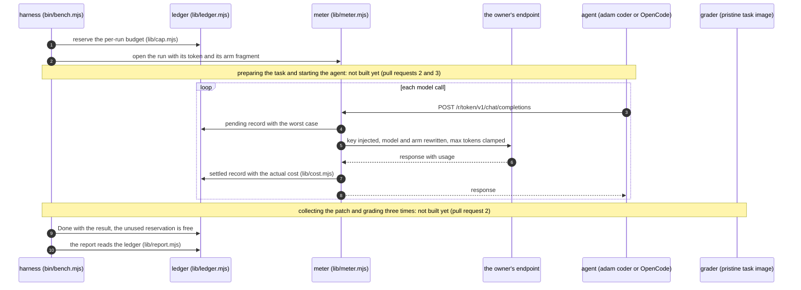
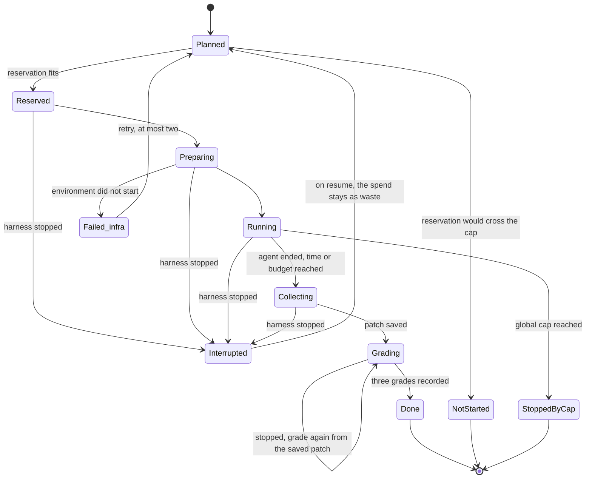

# bench: a benchmark harness for adam-coder and OpenCode

Runs the same tasks through two agents, `adam-coder` and OpenCode, on one model in two arms, grades the results
in a pristine image and reports pass rates with intervals and what they cost. Decision and shape:
[ADR 0048](../docs/decisions/0048-a-benchmark-harness-for-adam-coder-and-opencode.md).

**Built so far (pull request 1 of 4):** the meter, the cost and the cap, the ledger, the configuration and its
guards, the statistics and the report. **Not built yet:** task sources and grading (pull request 2), the agent
drivers, the compose stack and the dry run (3), `pilot` and `run` (4). `node bench/bin/bench.mjs doctor`, `tasks`,
`pilot`, `run` and `regrade` exit 2 with "not built yet" until then. Node 24 (CI), no dependencies: only Node's
standard library.

## What it never holds

The endpoint URL, the model id, the prices and the key are the owner's and live **outside** this repository.
The harness refuses a configuration file inside any work tree it can see (symlinks resolved), refuses a field
named like a secret that holds a value and any key-like string (a known prefix, long hex, long dense text), refuses
an unknown field, and reads the key only from the environment variable the configuration names. An error names
the field and never quotes a value; the exit code is 78. The report shows the model's label, never its id,
unless `--show-model-id`. The key-like test is a heuristic, not a guarantee: keep the key out of the file.

Every value below is made up.

```json
{
  "endpoint": "https://models.example.test/v1",
  "modelId": "example-model",
  "modelLabel": "Example Model",
  "prices": { "inputPerMTok": 3, "cachedInputPerMTok": 0.3, "cacheWritePerMTok": 3.75, "outputPerMTok": 15 },
  "capUSD": 100,
  "perRunBudgetUSD": 3,
  "arms": {
    "max": { "reasoning_effort": "high" },
    "off": { "reasoning_effort": "none" }
  },
  "keyEnv": "BENCH_MODEL_API_KEY",
  "concurrency": 2
}
```

| Field | Meaning |
|---|---|
| `endpoint` | the OpenAI-compatible base URL with its `/v1`; no credentials, query or fragment |
| `modelId`, `modelLabel` | what is sent upstream, and what the report shows |
| `prices` | USD per million tokens: input, cached input, cache write, output |
| `capUSD`, `perRunBudgetUSD` | the most the benchmark may spend, and what one run reserves (not above the cap) |
| `arms` | named JSON fragments merged into every request of the arm; they may not set `model`, `messages`, `tools`, `tool_choice`, `stream`, `stream_options` or `n` |
| `keyEnv` | the environment variable that holds the key (default `BENCH_MODEL_API_KEY`) |
| `concurrency` | runs at once, 1 to 8 (default 2) |
| `contextWindow`, `timeouts` | optional: the context window, and the meter's first-byte and idle timeouts in seconds |

The file is `$BENCH_CONFIG` (default `~/.config/adam-bench/config.json`); results are in `$BENCH_HOME`
(default `~/.local/share/adam-bench`, also refused inside a work tree). The schema is `SCHEMA` in
`bench/lib/config.mjs`.

```sh
BENCH_MODEL_API_KEY=... node bench/bin/bench.mjs config    # what may be shown of the configuration
node bench/bin/bench.mjs report                            # report.md from the ledger
```

## How a run goes





The states and their transitions are `TRANSITIONS` in `bench/lib/ledger.mjs`, which refuses any other. The
harness that drives a run through them (stack, clone, agent, grading) is not built yet. **Resume** reads the
ledger (`resumeActions`): a `Done`, `NotStarted` or `StoppedByCap` run is never repeated; a run that was
`Reserved`, `Preparing`, `Running`, `Collecting` or `Interrupted` starts again from scratch; a `Grading` run is
graded again and never run again; a `Failed_infra` run is retried twice and then given up.

## What each piece does

| File | What |
|---|---|
| `bench/lib/config.mjs` | schema, validation, the guards, exit 78 |
| `bench/lib/ledger.mjs` | append-only JSON lines, fsynced, one writer; the fold; the resume rules |
| `bench/lib/cost.mjs` | usage normalised as [ADR 0032](../docs/decisions/0032-usage-per-model-call.md) does; cost in integer micro-dollars; the worst case |
| `bench/lib/cap.mjs` | reservations, the per-call check, the global stop |
| `bench/lib/meter.mjs` | the only way to the model: the proxy that injects the key, rewrites, clamps and counts |
| `bench/lib/scripted-model.mjs` | an OpenAI-compatible server for the tests |
| `bench/lib/stats.mjs` | Wilson intervals, the exact McNemar test, a seeded bootstrap |
| `bench/lib/report.mjs` | the report |

**Cost.** A call costs `(input - cached - cache write) * input price + cached * cached price + cache write * write
price + output * output price`, rounded up to a micro-dollar; reasoning is inside the output. A call with no usable
`usage` is charged its worst case and flagged. The agents' own counts are shown beside the meter's and never decide
anything.

**The cap.** A run reserves its budget before it starts, and starts only if what is spent plus what is reserved plus
this reservation fits the cap (exactly at the cap fits; one micro-dollar over does not). Each call's worst case (the
input at one token per three bytes, the clamped output) must fit what is left of the run's reservation, else the
meter answers `429` with `bench budget reached` and forwards nothing. If actual spend still reaches the cap, every
call is refused.

**The meter** serves only `POST /r/<token>/v1/chat/completions`. Anything else, an unknown token and
`/responses` (not forwarded: the two agents use chat completions) are `404` and nothing leaves. It writes a
`pending` record before it forwards, relays an SSE stream chunk by chunk, reads the last chunk's `usage`, and logs
no body, key, token or URL. It listens on `127.0.0.1` unless told otherwise.

**The report** shows pass rates with Wilson intervals, paired differences (exact McNemar, seeded bootstrap), splits
by source and language, cost, tokens, time, calls, the excluded and flaky runs, and says what it does not claim.

## Tests

```sh
node --test "bench/test/*.test.mjs"     # about 80 tests, seconds, nothing beyond 127.0.0.1
```

Tests that need Docker (pull requests 3 and 4) skip unless `BENCH_TEST_DOCKER=1` and fail under
`BENCH_TEST_REQUIRE_DOCKER=1`. CI is `.github/workflows/bench.yml`, on changes under `bench/`.

## Unverified

* Behaviour against a real endpoint: whether it honours `stream_options.include_usage`, reports cached and
  reasoning tokens as the OpenAI reference describes, or accepts `max_tokens` (the meter sets it when the agent sends
  no limit). The scripted model is the only server the tests have seen.
* That the meter's worst case is above every real call. If an endpoint reports more than the worst case, the global
  stop is what holds the cap.
* The key-like test of the configuration is a heuristic.
