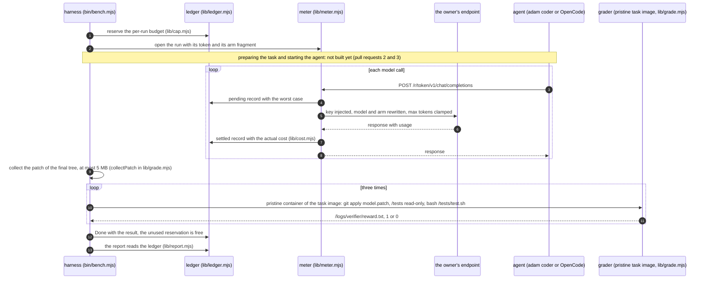
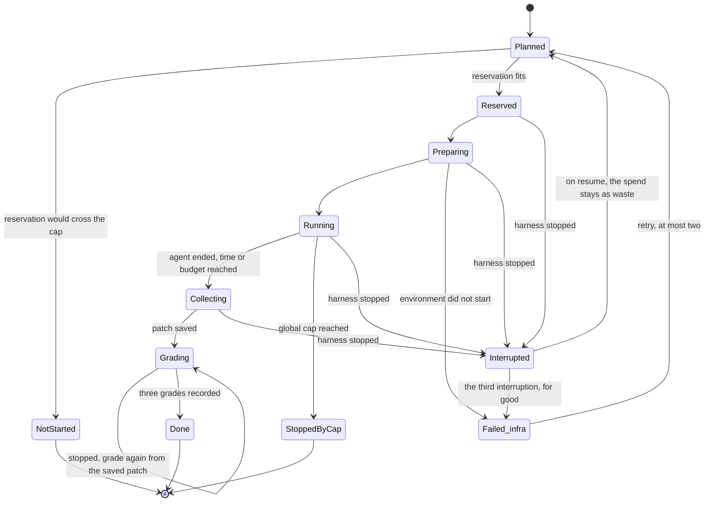

# bench: a benchmark harness for adam-coder and OpenCode

Runs the same tasks through two agents, `adam-coder` and OpenCode, on one model in two arms, grades the results
in a pristine image and reports pass rates with intervals and what they cost. Decision and shape:
[ADR 0048](../docs/decisions/0048-a-benchmark-harness-for-adam-coder-and-opencode.md).

**Built so far (pull requests 1 and 2 of 4):** the meter, the cost and the cap, the ledger, the configuration and its
guards, the statistics and the report; the task sources (public and own), the statement lint, selection, the
environment check and grading by patch replay. **Not built yet:** the agent drivers, the compose stack and the dry
run (3), `pilot` and `run` (4). `node bench/bin/bench.mjs doctor`, `pilot`, `run` and `regrade` exit 2 with "not built
yet" until then. Node 24 (CI), no dependencies: only Node's standard library.

## What it never holds

The endpoint URL, the model id, the prices and the key are the owner's and live **outside** this repository.
The harness refuses any file it reads or writes (the configuration, `$BENCH_HOME`, `--ledger`, `--out`) that is
inside a work tree: it walks up from the real location of the path (symlinks resolved, missing directories
skipped) and refuses at the first directory with a `.git`, a directory or a file, and also inside its own checkout
and the working directory. It refuses an unknown field, and a field **named like a secret** (`key`, `token`,
`password`, `auth`, ...) that holds any non-empty value of any type; only a number under a name that also says what
it counts (`token_budget`) passes. It refuses a string with a known key prefix or long hex anywhere. The extra
"long dense text" rule is not applied to `modelId`, `modelLabel` or anything inside an arm, so a real model id such as
`Qwen3-Coder-480B-A35B-Instruct-FP8` is accepted. The key is read only from the environment variable the
configuration names, and a key with a space, a line break or another control character is refused (exit 78, naming
the variable, never the value). An `http:` endpoint must be on the loopback (`127.x`, `localhost`, `::1`); any other
host must be `https:`. An error names the field and never quotes a value; the exit code is 78. The report shows the
model's label, never its id, unless `--show-model-id`. These key tests are heuristics, not a guarantee: keep the key
out of the file.

Every value below is made up.

```json
{
  "endpoint": "https://models.example.test/v1",
  "modelId": "example-model",
  "modelLabel": "Example Model",
  "prices": { "inputPerMTok": 3, "cachedInputPerMTok": 0.3, "cacheWritePerMTok": 3.75, "outputPerMTok": 15 },
  "capUSD": 100,
  "perRunBudgetUSD": 3,
  "arms": {
    "max": { "reasoning_effort": "high" },
    "off": { "reasoning_effort": "none" }
  },
  "keyEnv": "BENCH_MODEL_API_KEY",
  "concurrency": 2
}
```

| Field | Meaning |
|---|---|
| `endpoint` | the OpenAI-compatible base URL with its `/v1`; no credentials, query or fragment |
| `modelId`, `modelLabel` | what is sent upstream, and what the report shows |
| `prices` | USD per million tokens: input, cached input, cache write, output |
| `capUSD`, `perRunBudgetUSD` | the most the benchmark may spend, and what one run reserves (not above the cap) |
| `arms` | named JSON fragments merged into every request of the arm; they may not set `model`, `messages`, `tools`, `tool_choice`, `stream`, `stream_options` or `n` |
| `keyEnv` | the environment variable that holds the key (default `BENCH_MODEL_API_KEY`) |
| `concurrency` | runs at once, 1 to 8 (default 2) |
| `contextWindow`, `timeouts` | optional: the context window, and the meter's first-byte and idle timeouts in seconds |
| `tasks` | optional: task sources and grading, see Tasks |

The file is `$BENCH_CONFIG` (default `~/.config/adam-bench/config.json`); results are in `$BENCH_HOME`
(default `~/.local/share/adam-bench`, also refused inside a work tree, as are `--ledger` and `--out`). The schema is `SCHEMA` in
`bench/lib/config.mjs`.

```sh
BENCH_MODEL_API_KEY=... node bench/bin/bench.mjs config    # what may be shown of the configuration
node bench/bin/bench.mjs report                            # report.md from the ledger
```

## How a run goes





The states and their transitions are `TRANSITIONS` in `bench/lib/ledger.mjs`, which refuses any other. The
harness that drives a run through them (stack, clone, agent, grading) is not built yet. **Resume** reads the
ledger (`resumeActions`): a `Done`, `NotStarted` or `StoppedByCap` run is never repeated; a run that was
`Reserved`, `Preparing`, `Running`, `Collecting` or `Interrupted` starts again from scratch; a `Grading` run is
graded again and never run again; a `Failed_infra` run is retried twice and then given up. A run is allowed
**at most two interruptions**: the third time it ends `Failed_infra` for good (`final`), so an interrupted run is not paid
for on every restart. The report lists such a run among those left out, with its wasted spend.

## What each piece does

| File | What |
|---|---|
| `bench/lib/config.mjs` | schema, validation, the guards, exit 78 |
| `bench/lib/ledger.mjs` | append-only JSON lines, fsynced, one writer (a lock made by linking a file that holds the pid); the fold; the resume rules |
| `bench/lib/cost.mjs` | usage normalised as [ADR 0032](../docs/decisions/0032-usage-per-model-call.md) does; cost in integer micro-dollars; the worst case |
| `bench/lib/cap.mjs` | reservations, the per-call check, the global stop |
| `bench/lib/meter.mjs` | the only way to the model: the proxy that injects the key, rewrites, clamps and counts |
| `bench/lib/scripted-model.mjs` | an OpenAI-compatible server for the tests |
| `bench/lib/stats.mjs` | Wilson intervals, the exact McNemar test, a seeded bootstrap |
| `bench/lib/report.mjs` | the report |
| `bench/lib/toml.mjs` | the TOML subset of `task.toml` |
| `bench/lib/task.mjs` | the task format and its validator |
| `bench/lib/upstream.mjs` | the pinned clone of the public tasks and `SHA256SUMS` |
| `bench/lib/mine.mjs` | the miner |
| `bench/lib/own.mjs` | own tasks: their spec, the image's Dockerfile, the task directory built from a clone |
| `bench/lib/lint.mjs` | the statement lint |
| `bench/lib/select.mjs` | seeded stratified selection, the lock files |
| `bench/lib/containers.mjs` | the container runtime interface: `PodmanRemote` and `FakeContainers` |
| `bench/lib/grade.mjs` | patch collection and grading by replay |
| `bench/lib/envcheck.mjs` | the environment check |
| `bench/lib/tasks-cli.mjs` | `bench tasks ...` |

**Cost.** A call costs `(input - cached - cache write) * input price + cached * cached price + cache write * write
price + output * output price`, rounded up to a micro-dollar; reasoning is inside the output. A call with no usable
`usage` is charged its worst case and flagged. The agents' own counts are shown beside the meter's and never decide
anything.

**The cap.** A run reserves its budget before it starts, and starts only if what is spent plus what is reserved plus
this reservation fits the cap (exactly at the cap fits; one micro-dollar over does not). Each call's worst case (the
input at one token per three bytes, the clamped output) must fit what is left of the run's reservation, else the
meter answers `429` with `bench budget reached` and forwards nothing. If actual spend still reaches the cap, every
call is refused. **The cap is soft by one call per running slot**: a call that reports more usage than its worst case
takes its run, and so the total, past its reservation by that call's excess, and then the next call is refused. A
run's calls in flight at the same moment can each do so. The excess is what the endpoint billed above the estimate,
which is why the worst case is generous.

**The meter** serves only `POST /r/<token>/v1/chat/completions`. Anything else, an unknown token and
`/responses` (not forwarded: the two agents use chat completions) are `404` and nothing leaves. It writes a
`pending` record before it forwards, and everything after that record settles the call, even a throw before the
request leaves (free, as nothing was sent). It logs no body, key, token or URL, and listens on `127.0.0.1` unless
told otherwise.

* **`n`** must be absent or exactly 1 (the integer) and is forwarded as 1; anything else is a `400` and nothing is
  forwarded. One completion per call is part of fairness.
* **An upstream error** (any non-2xx) is never relayed, not its body, header or URL. The agent gets
  `{"error":{"message":"upstream error","type":"upstream_error","status":<upstream status>}}` with the status
  class mapped: `429` stays `429` (agents back off on it), a `5xx` is `502`, any other `4xx` is `400`. The call costs
  nothing, the upstream is destroyed unread, and the ledger has the upstream status alone.
* **Limits per call**, `LIMITS` in `bench/lib/meter.mjs`: `maxRequestBytes` 8 MiB (a request is a conversation, not a
  file; over it, or a declared length over it, is a `413` that arrives, and the rest of the upload is read and
  dropped), `maxResponseBytes` 64 MiB (stream or not), `maxCallMs` 20 minutes (from the request to the last byte,
  however lively the stream). Beside them the configuration's first-byte and idle timeouts. A call over a response
  limit or a time limit is cut, the upstream request is destroyed and the call is charged its worst case.
* **Backpressure:** an SSE stream is relayed chunk by chunk and the upstream is paused while the client does not read.

**The report** shows pass rates with Wilson intervals, paired differences (exact McNemar, seeded bootstrap), splits
by source and language, cost, tokens, time, calls, the excluded and flaky runs, and says what it does not claim.
Every cost, token and call figure sums **all attempts** of a run. Only `Done` runs count in the rates; the report
says that runs in `StoppedByCap`, `Failed_infra`, `NotStarted` (and any other state) are left out, and lists them
with what each wasted. Two `Done` runs for one task, agent and arm are an error that names them. Pipes and line
breaks in a cell are escaped.

## Tasks

Two sources, **one format** (the Harbor layout of SWE-bench Pro V2, `bench/lib/task.mjs`):

```
<id>/instruction.md        the statement
<id>/task.toml             [agent] network_mode = "none"; [verifier] network_mode; [environment] cpus, memory_mb,
                           optional docker_image and workdir; optional [metadata] repo, language
<id>/environment/          a Dockerfile whose first FROM names the image (or docker_image in task.toml)
<id>/tests/test.sh         writes /logs/verifier/reward.txt: 1 pass, 0 fail
<id>/solution/             the gold change as a *.patch (used by the environment check only)
```

The validator refuses a task with a part missing, a `task.toml` it cannot read (the reader, `bench/lib/toml.mjs`,
takes the subset the format uses and names the line), an image not pinned by digest, and an agent network mode other
than none (`no-network` is read as none). Upstream names images by tag; `bench tasks check` resolves each tag to a
digest and keeps it in `$BENCH_HOME/tasks/pins.json`, and the pin is what a task runs by.

| Source | Where | What the repository holds |
|---|---|---|
| public: SWE-bench Pro V2 | `scaleapi/SWE-bench_Pro-os` cloned under `$BENCH_HOME/upstream` at **the commit you pin** (`tasks.upstreamCommit`; there is no default) | `bench/tasks/public.lock.json`: ids, checksums, image digests, the seed. **No task content, ever.** |
| own: mined from your clones | full local clones you name in `tasks.clones` | `bench/tasks/own/<id>/`: your `instruction.md` and `own.json` (commit ids, test command, toolchain pins), the lock `own.lock.json`. No hidden test content: it is read from the clone when the task is built |

```json
"tasks": {
  "upstreamCommit": "0123456789abcdef0123456789abcdef01234567",
  "clones": { "demo": "/home/me/src/demo" },
  "workspaceImage": "registry.example.test/workspace@sha256:<64 hex digits>",
  "podman": { "connection": "bench-slot-1" }
}
```

`upstreamUrl` (default the public repository), `upstreamDir` (default `v2`), `selfRepo` (the agent's own repository,
default `another-adam-rs`), `seed` (default `1`) and `podman` (`connection` or `url` of the Podman service, as
`podman --remote` takes them) are the other fields. The task commands read the same file as the rest, so it must be a
whole configuration.

**Fetch.** `bench tasks fetch` clones the upstream repository, checks out the pinned commit, checks every file against
`v2/SHA256SUMS` and lists the tasks. A task's checksum in the lock is the hash of its `SHA256SUMS` lines.

**Mine.** `bench tasks mine` walks the first-parent history of `main` in each clone and keeps a commit that

* has one parent and a subject ending `(#N)` (a squashed pull request) and is not `docs`, `chore` or a revert;
* touches a test file and a source file, by path (`tests/`, `*.test.ts`, `*_test.go`, ...);
* changes at most 400 non-test lines (added plus deleted, documentation and lockfiles not counted);
* changes no lockfile (a new dependency would need the network);
* has no hunk inside a `#[cfg(test)]` item of a Rust file (inline tests cannot be hidden).

It writes `$BENCH_HOME/tasks/own-candidates.json` (commit, base, the hidden test files, a hint of the test command) and
**never a statement**. You write it: [`bench/tasks/own/README.md`](tasks/own/README.md).

**Lint.** `bench tasks lint` warns when an identifier (snake_case or camelCase) or a path that appears only in the gold
change's added lines is in your statement. An `Interface` section is exempt: it is where the names the tests call belong.

**Build, check, select.**

* `bench tasks build` makes an own task's directory under `$BENCH_HOME/tasks/materialized` (the hidden tests read from the
  clone into `tests/test_patch.patch`, the gold without them in `solution/`) and builds its image: the workspace image
  by digest, the repository at `/app` at the base with history up to the base only, the toolchain pins you wrote.
* `bench tasks check` (needs the Podman service) runs, per task, the gold patch three times and the empty patch three
  times **from the clone path the agents will use**, not from `/app`: the base is cloned there, the top-level ignored
  entries are linked to `/app`'s, and `test.sh` runs with `/app` rewritten to that path. A task is kept only if the gold
  passes all three and the empty patch fails all three, and is dropped with its reason otherwise (`gold-fails`,
  `gold-flaky`, `gold-does-not-apply`, `empty-passes`, `empty-flaky`, `no-gold-patch`, `infra`). It also records whether
  the base has a `.devcontainer`.
* `bench tasks select` keeps the checked tasks without a `.devcontainer`, draws them stratified by repository with the
  seeded generator of `lib/stats.mjs` (public: 80, at most 9 per repository; own: 20, at most 6 per repository and at
  most 6 from `selfRepo`) and writes the lock files. The same seed gives the same list.

## Grading

`bench/lib/grade.mjs` collects the patch from a run's final tree (`git add -A`, `git diff --cached --binary <base>`;
untracked files and binaries included; ignored files not; the symlinks the adapter committed to `/app/...` left out;
more than 5 MB stops with an error) and grades it in a **new container of the task
image, by digest**: the patch is applied in `/app`, `/tests` is mounted **read-only in that container only**, `bash
/tests/test.sh` runs and the reward is read from `/logs/verifier`. The agent phase has no network; the grading
container has the verifier's network (`public` by default). Three runs, two of three pass; a split is `flaky`. A patch
that does not apply is a fail. The runtime is the `Containers` interface of `lib/containers.mjs`: `PodmanRemote` runs
`podman --remote [--connection C | --url U] run --rm --pull=never --entrypoint sh ...` (the arguments are the pure
function `buildRunArgs`) and `FakeContainers` is for tests. A mount source is a path as the Podman service sees it:
the service and the harness must share the harness's work directory.

## Tests

```sh
node --test "bench/test/*.test.mjs"     # about 200 tests, seconds, nothing beyond 127.0.0.1 (fixture git repositories are made in a temp directory)
```

Tests that need Docker skip unless `BENCH_TEST_DOCKER=1` and fail under `BENCH_TEST_REQUIRE_DOCKER=1`; today that is
`bench/test/docker.test.mjs` (a self-made task: the oracle grades 1, the empty patch 0; it needs
`BENCH_TEST_WORKSPACE_IMAGE`, a digest-named base image, and a Podman service that shares the temporary directory). CI is `.github/workflows/bench.yml`, on changes under `bench/`.

## Unverified

* Behaviour against a real endpoint: whether it honours `stream_options.include_usage`, reports cached and
  reasoning tokens as the OpenAI reference describes, or accepts `max_tokens` (the meter sets it when the agent sends
  no limit). The scripted model is the only server the tests have seen.
* That the meter's worst case is above every real call. If an endpoint reports more than the worst case, the global
  stop is what holds the cap.
* The key-like test of the configuration is a heuristic.
* *Verified 2026-11-17* (`scaleapi/SWE-bench_Pro-os`, `README.md` and `v2/README.md`): the task layout above and the
  image names `ghcr.io/scaleapi/swe-bench_pro-v2:<instance_id>`. *Unverified:* where under `v2/` the task directories
  and `SHA256SUMS` are (the harness finds any directory with a `task.toml` up to two levels deep and reads
  `<upstreamDir>/SHA256SUMS`), the exact form of `SHA256SUMS`, and the form of `solution/` (the check needs a `*.patch`
  there and drops a task without one as `no-gold-patch`).
* Everything that needs a container service: `podman --remote` and its options as the Podman version in use takes them,
  that a bind mount of a harness path works on the service, that `image inspect --format {{.Digest}}` gives the registry
  digest of a pulled image and the manifest digest of a locally built one (and that a locally built image can then be
  run as `name@sha256:...`), the clone-path check's `ln -s` of ignored entries (top level only) and its `sed` of
  `/app` in `test.sh`, image sizes and pull speed.
* That the miner's file classification (by path) matches your repositories' layouts.
