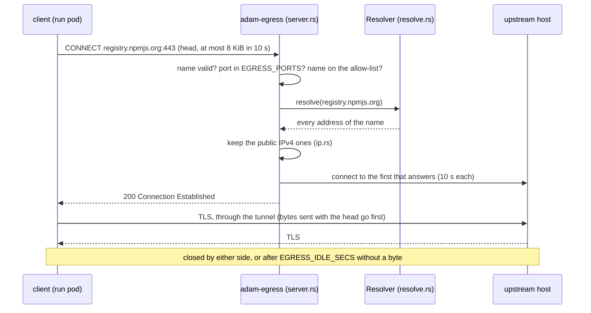
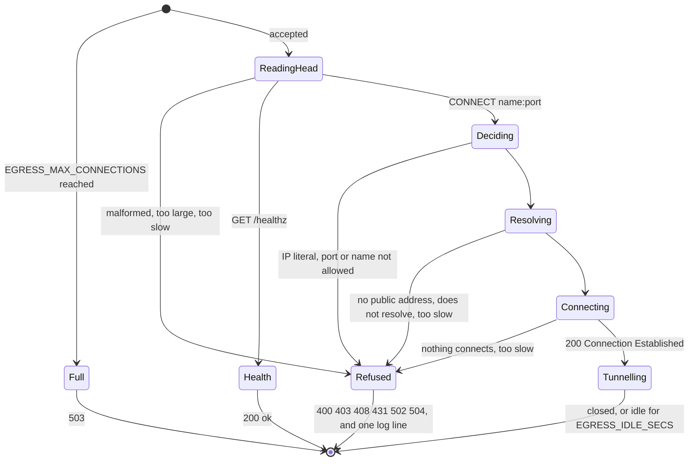

# adam-egress

A small **HTTPS-only forward proxy** for the pods that run an agent's commands. It accepts `CONNECT host:443` to the
names on an allow-list and nothing else, resolves the name **itself**, connects only to **public IPv4** addresses, and
splices the bytes. No TLS interception, no credentials, no plain HTTP.

It is a library (`adam_egress`) and a binary (`adam-egress`). The binary ships in the coder image beside `adam-coder`,
`adam-agent` and `adam-kube-exec` and is run with the entrypoint `tini -- adam-egress`; it needs no database and no
other service. It does nothing by itself to stop a run pod from going around it: that is the job of a
`NetworkPolicy`, which denies the pod every egress but this proxy.

```sh
EGRESS_ALLOW=registry.npmjs.org,.pythonhosted.org,github.com \
EGRESS_LISTEN=127.0.0.1:3128 \
  cargo run -p adam-egress

HTTPS_PROXY=http://127.0.0.1:3128 npm view left-pad version   # curl, git, cargo, pip and go read it too (unverified for each)
```

## What a request gets



| Request | Answer |
|---|---|
| `CONNECT name:port`, name on the list, port in `EGRESS_PORTS`, a public IPv4 address that answers | `200`, then the tunnel |
| `CONNECT` to an IP literal (`1.2.3.4`, `[::1]`, `2130706433`), a port or a name that is not allowed | `403` |
| the name resolves, but to no public IPv4 address (private, loopback, link-local, IPv6 ... : DNS rebinding) | `403` `no public address` |
| any other method: plain HTTP, absolute-form or not | `403` `only HTTPS through CONNECT` |
| a head that is not HTTP, or a `CONNECT` target that is not `name:port` | `400` |
| a head over 8 KiB or with over 64 headers / not complete in 10 s | `431` / `408` |
| the name does not resolve / no address connects | `502` |
| resolving or connecting takes over 10 s | `504` |
| the proxy already serves `EGRESS_MAX_CONNECTIONS` | `503` |
| `GET /healthz` (not a proxy request, which is `CONNECT`) | `200` `ok`, not logged |

Every refusal is a short plain-text body and `Connection: close`. The allow-list matches **names**: `example.com` is
that host; `.example.com` is every subdomain of it (`a.example.com`, `a.b.example.com`) and **not** `example.com`
itself, so list both when both are wanted. A suffix covers everything below it: name the registrable domain
(`.example.com`), never a bare `.com`.

The address rules are in `src/ip.rs`, as a table with a test for the edges of every range: `0/8`, `10/8`, `100.64/10`,
`127/8`, `169.254/16`, `172.16/12`, `192.0.0/24`, `192.0.2/24`, `192.88.99/24`, `192.168/16`, `198.18/15`,
`198.51.100/24`, `203.0.113/24`, `224/4` and `240/4` (which includes the broadcast address), then every range of
`EGRESS_DENY_CIDRS`. **Every IPv6 address is dropped**, an IPv4-mapped one (`::ffff:10.0.0.1`) after the address inside
it has been judged, so that a future IPv6 option starts from a function that cannot forget it.



## Variables

Read once at startup, the allow-list file too (a change to it is a restart); every problem is reported at once
(`invalid configuration`, exit 78). The same table is in
[`docs/reference/environment.md`](../../docs/reference/environment.md#egress-proxy-adam-egress).

| Variable | Meaning | Default |
|---|---|---|
| `EGRESS_LISTEN` | the address to listen on | `0.0.0.0:3128` |
| `EGRESS_ALLOW_FILE` | a file of allowed hosts, one per line; `#` starts a comment; blank lines are ignored | unset |
| `EGRESS_ALLOW` | allowed hosts, comma-separated; added to the file's. **At least one host must come from the two**: an entry that is not a name or a `.name` (`*.example.com`, a URL, an IP address) is exit 78, and so is an empty list | unset |
| `EGRESS_PORTS` | ports `CONNECT` may name, comma-separated | `443` |
| `EGRESS_DENY_CIDRS` | IPv4 ranges never connected to, on top of the built-in ones: the cluster's own (`10.96.0.0/12`). An IPv6 range is accepted and has no effect | unset |
| `EGRESS_IDLE_SECS` | a tunnel with no byte for this long is closed (1 to 86400) | `300` |
| `EGRESS_MAX_CONNECTIONS` | connections served at once (1 to 1000000) | `1024` |
| `RUST_LOG` | log filter | `info` |

Not variables: the head limit (8 KiB), the head time (10 s), the resolve and each connect time (10 s), at most 4
addresses tried, and 25 s for the tunnels to finish after SIGTERM (`Limits`, `src/config.rs`).

## Exit codes

| Code | When |
|---|---|
| 0 | clean shutdown after SIGTERM or Ctrl-C: no new connection, open tunnels get up to 25 s |
| 78 | the configuration (the log line lists every problem) |
| 71 | `EGRESS_LISTEN` cannot be bound |

The failure is one JSON log line, `adam-egress failed`, with the cause chain. Values and classes: `src/error.rs`
(`EgressError` implements `adam_error::Classify`, as does every other error here), and
[the exit codes of both agents](../../docs/reference/errors.md#exit-codes).

## Logs

JSON on stdout, one line per decision (`src/server.rs`):

```json
{"level":"WARN","fields":{"message":"egress request refused","decision":"refuse","reason":"host not allowed","status":403,"host":"evil.example","port":443,"client":"10.244.1.7:51234"}}
{"level":"INFO","fields":{"message":"egress tunnel opened","decision":"allow","reason":"allow-listed host","host":"registry.npmjs.org","port":443,"client":"10.244.1.7:51236","upstream":"104.16.1.35"}}
```

`detail` adds what was found (the range an address was in, the error kind of a failed connect). The log holds a host
that is a valid name (or a short IP literal) and a port, and **never a path, a query string, a header (so not
`Proxy-Authorization`), user information or a byte of the tunnel**; a test sends all of them in a refused request and
reads the log. A `GET /healthz` is not logged.

## What it does not do

* **No TLS interception.** It sees the name and the port of a `CONNECT`, not the traffic. A client can name an allowed
  host and send another SNI to the CDN behind it (**domain fronting**), and the proxy cannot tell.
* **What an allowed host accepts is its own business**: an upload to an allowed registry needs that registry's
  credentials, which a run pod does not hold.
* **IPv4 only.** A name that has only IPv6 addresses is `no public address`. A deployment must deny IPv6 in its
  network policy as well; this proxy is not the only thing that has to.
* **No authentication.** Whoever can reach the port is a client; the network policy decides who that is.
* **No plain HTTP**, no `apt`: run pods are not root, so it buys nothing.
* The name is resolved **once**, and the proxy connects to the address it checked, so there is no window in which a
  second answer can differ from the first.

## Tests

Offline: `cargo nextest run -p adam-egress`.

* In the modules: the address table and its edges and IPv4-mapped IPv6 (`ip.rs`), allow-list parsing and matching
  (`allow.rs`), head parsing, IP literals, oversized and slow heads (`head.rs`), every variable and each bad value
  (`config.rs`), the status and class of every refusal (`refusal.rs`).
* `tests/proxy.rs`: the proxy on a loopback listener with an injected resolver (`Resolver`) and address filter
  (`AddressFilter::only`, so that 127.0.0.1 is public in a test and in no other place): a tunnel to a local echo
  server with pipelined bytes, each refusal, a name that rebinds to a private address with a real server behind it, the
  connection cap, the idle limit, shutdown, and the log of a refusal that carries a `Proxy-Authorization` header and a
  query.
* `tests/binary.rs`: the binary as a process: exit 78 for every bad value, 71 for a taken port, and a run with the real
  resolver, the probe, a refusal and SIGTERM.

The image builds the binary and runs it with no allow-list in its smoke test (`docker/coder/Dockerfile`); the proxy
in a cluster, with the policies that make it the only way out, is the chart's.
