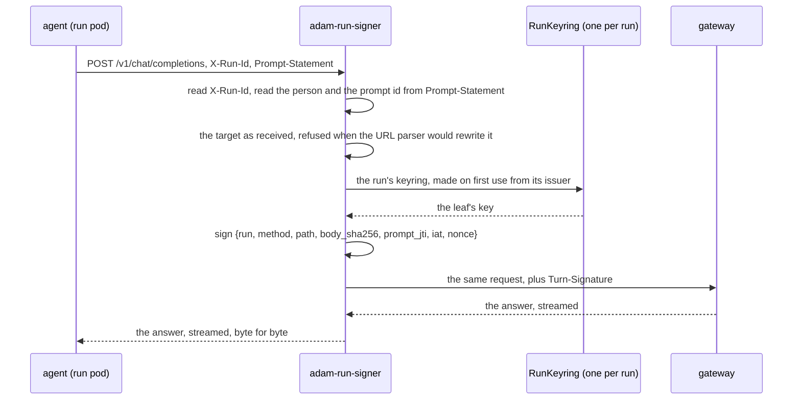
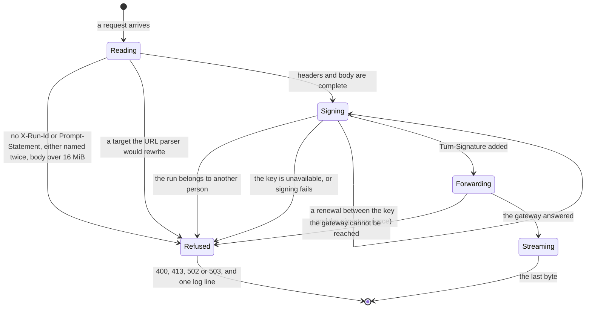

# adam-run-signer

A **loopback sidecar** that signs each of a run's model requests with the run's own key, and forwards the request to
the gateway in front of the model. The agent process sends plain HTTP to `127.0.0.1:8443`; the sidecar adds
`Turn-Signature`, an attached JWS over the request as it is sent, and passes everything else through unchanged.

It exists so that the run's private key never enters the process that runs the model's answers: the key is made in
this sidecar's memory, certified for that run, and used to sign there. No method, log line, error or `Debug`
rendering gives the key out, and nothing is written to disk.

It is a library (`adam_run_signer`) and a binary (`run-signer`, `bin/run-signer`) that ships in the coder image.

```sh
RUN_SIGNER_UPSTREAM=http://gateway.internal:8080 \
RUN_SIGNER_LISTEN=127.0.0.1:8443 \
RUN_CERT_ISSUER=broker \
RUN_CERT_ISSUER_URL=https://broker.internal:8443 \
RUN_CERT_TOKEN_FILE=/var/run/secrets/run-cert/token \
  run-signer
```

## What a request gets





Every method and every path is carried; the sidecar has no routes of its own and no health check, because a process
that reaches it is already inside the run's pod.

## Variables

Read once at startup; every problem is reported at once (`invalid configuration`, exit 78).

| Variable | Meaning | Default |
|---|---|---|
| `RUN_SIGNER_LISTEN` | the address and port to listen on. **Must be a loopback address** (`127.0.0.1` or `::1`): anything else is exit 78 | `127.0.0.1:8443` |
| `RUN_SIGNER_UPSTREAM` | **required**. The absolute `http` or `https` base URL of the gateway. No query and no fragment, and no credentials: the request's own path and query are appended. Reached **directly**: the client ignores `HTTP_PROXY`, `HTTPS_PROXY` and `ALL_PROXY` | unset |
| `RUN_SIGNER_UPSTREAM_CA_FILE` | a PEM bundle the client trusts for the gateway, beside the platform's roots. A file that cannot be read, is empty, over 1 MiB or is not PEM is exit 78 | the broker's `RUN_CERT_CA_FILE` |
| `RUN_CERT_ISSUER`, `RUN_CERT_ISSUER_URL`, `RUN_CERT_TOKEN_FILE`, `RUN_CERT_CA_FILE`, `RUN_CERT_RENEW_FRACTION` | the first three are **required here**, unlike for an agent: a signer with no issuer cannot sign. Read by `adam-service`'s `RunCertSettings`, exactly as the agents read them ([their rows](../../docs/reference/environment.md#the-run-signer-run-signer)); all unset is this binary's own problem naming the three required ones, and a half-set configuration is refused with the agents' problems. Both halves' problems are reported in the **one** error. The token file is re-read on every call, never cached and never logged | the first three required; the two optional ones default as for the agents |
| `RUST_LOG` | log filter; JSON logs on stdout | `info` |

The gateway and the certificate broker share one trust domain today, which is why the default of
`RUN_SIGNER_UPSTREAM_CA_FILE` is the certificate's CA bundle: the binary reads `RUN_CERT_CA_FILE` under the broker's
own 1 MiB bound and passes its bytes, and the client trusts them unless the override names another file. The two are
named separately so that a reader never has to assume they are the same.

Not variables: the body limit (16 MiB), the connect timeout (10 s), the read timeout (300 s: a black-holed gateway
frees the request instead of pinning it, and it stays above the shutdown grace), the number of runs kept in memory
(1024) and the shutdown grace (25 s) — a `Limits` value, so a test can shorten them. The grace bounds the **drain**:
a shutdown starts the clock, and the server answers requests for as long as it runs.

## What it refuses, and with what

Every refusal is an RFC 9457 problem document, `application/problem+json`, with `type`, `title`, `status` and
`detail`. It holds no header value, no run id and no key: the detail says what was wrong, and the one log line says
the same reason.

| The request | Answer |
|---|---|
| no `X-Run-Id`, an empty one, over 128 bytes, or not a run id | `400` |
| two `X-Run-Id` headers, or two `Prompt-Statement` headers: the request names its run (or its statement) twice | `400` |
| no `Prompt-Statement`, or one that is not a compact JWS of at most 8 KiB (three base64url segments, its header and signature non-empty) | `400` |
| a `Prompt-Statement` whose payload has no `sub` (the person), or no `jti` (the prompt id) | `400` |
| a target that is not `/`-rooted (`CONNECT gateway:443`, `OPTIONS *`), or one `Url::parse` rewrites (`..`, `%2e%2e`, `\`, `{}`): the signature covers the target as received, so this sidecar will not sign one path and send another | `400` |
| a body over `Limits::max_body` (16 MiB) | `413` |
| the run already belongs to another person: a run's key is never re-keyed | `400` |
| the run's key is unavailable now (its issuer cannot be reached, the leaf has expired, or a renewal outlived the one retry) | `503` |
| signing fails for any other reason | `502` |
| the gateway cannot be reached | `503` |

A request with no `X-Run-Id` is **refused, never signed and never forwarded**: the run is what the key is bound to.

A `503`'s problem document carries `type: unavailable` — a relative reference `adam-model` reads as a slug and parks
the run on a timer for — where `400`, `413` and `502` carry `about:blank` (the status is all there is, and the run is
not parked). When a renewal lands between the key read and the signature, the signature is retried **once** with the
key that replaced it; a conflict that survives that retry is the same `503`, not a `502`.

The request's headers are forwarded as they came, except the hop-by-hop ones (`Connection`, `Keep-Alive`, `Proxy-*`,
`TE`, `Trailer`, `Transfer-Encoding`, `Upgrade`, and every name the request's own `Connection` header lists), `Host`,
`Content-Length`, and any `Turn-Signature` — this sidecar signs, so only its signature goes out. `X-Run-Id` and
`Prompt-Statement` go out **once each, as the validated values**; of two or more `Prompt-User-Signature` values only
the first is forwarded.

The gateway's answer comes back the same way: its status, its headers minus the hop-by-hop ones and
`Content-Length`, and its body as a stream, so a model's server-sent events reach the agent as they are produced
rather than at the end.

## Exit codes

| Code | When |
|---|---|
| 0 | a clean shutdown |
| 78 | the configuration (the log line lists every problem) |
| 71 | `RUN_SIGNER_LISTEN` cannot be bound, or the listener fails |

## The key

A run's keyring is made on its first request from the `IssuerFactory` the process was given; one keyring is one run,
and the leaf it holds names the run and the person in its subject alternative name. A keyring renews itself at
`RUN_CERT_RENEW_FRACTION` of its leaf's life (two thirds by default) with a new key pair, and refuses to sign with an
expired leaf. At most 1024 runs are kept, and the **least recently used** is dropped when a new one arrives — the
long-lived run that calls steadily is the last to go. A later call for a dropped run makes a fresh keyring, with a
fresh key, as the run's next certificate allows.

## The person is not verified here

The statement's `sub` names the person the run's leaf is certified for, and this sidecar **believes it**: the
gateway is the only verifier of the statement's signature, and nothing here checks that the person signed it. So the
first request for a run fixes that run's person, and a statement with a wrong `sub` — signed or not — mints a leaf
for a person who did not prove they are that person, and binds the run to them, denying the real person's calls for
that run until the entry is evicted. That is the trust the deployment places in the gateway and in whatever
stands between a person and their run's prompts; it is not a guarantee this process makes.

## Tests

Offline: `cargo test -p adam-run-signer`. A wiremock or axum server stands in for the gateway, and a fake issuer
(`adam_core::turn::run_cert::testkit::FakeRunCertIssuer`) mints real leaves, so a signature is verified against the
leaf the sidecar actually signed with, not against a stub.
