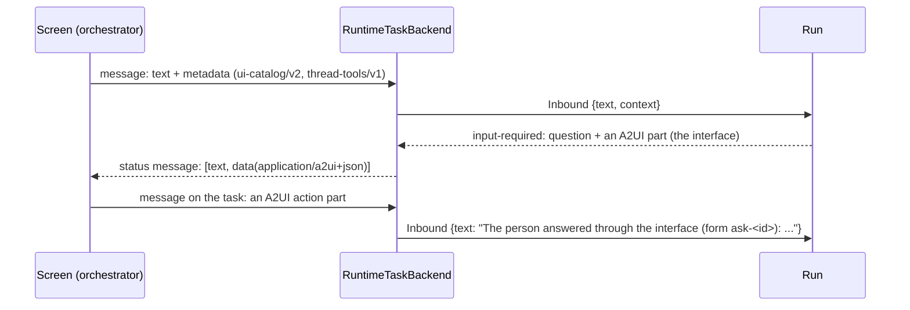
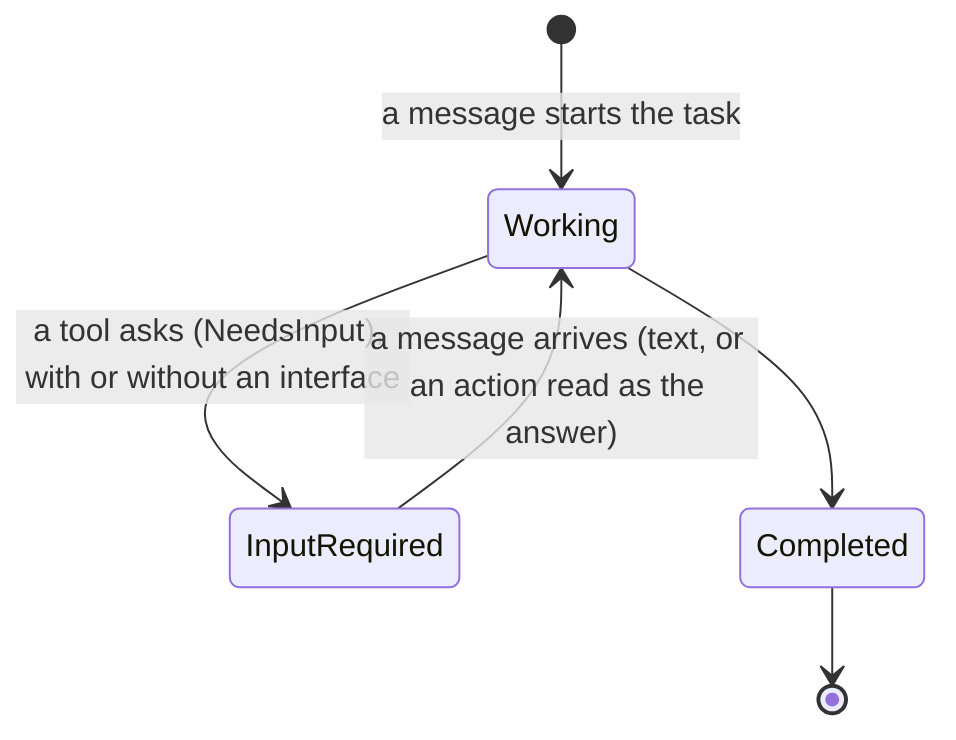

# adam-a2a-runtime

`RuntimeTaskBackend`: the `adam_a2a::TaskBackend` implemented over
`adam_runtime::Runtime`, so any adam-rs agent can be served as an A2A agent.

## Where it sits

The glue between two ports: it implements the backend seam of
[`adam-a2a`](../adam-a2a/README.md) using [`adam-runtime`](../adam-runtime/README.md)
(and through it whatever `Store` the runtime holds). It is reusable by any
agent; [`adam-coder`](../../bin/adam-coder/README.md) uses it.

## API at a glance

| Item | What |
|---|---|
| `RuntimeTaskBackend::new(runtime, events, agent)` | `events` must be the `BroadcastSink` the runtime was built with; `agent` is the registered name, as an agent (`.agent`) or as a start-only starter (`.starter`) |
| `.with_poll_interval(..)`, `DEFAULT_POLL_INTERVAL` | how often a subscription re-reads the durable run: the fallback for a state change no live event announced, 2 s by default. A `Status` event (a commit) makes the pump poll at once, so this is not the latency of a run this process steps |
| `.with_prompt(..)`, `.with_inbound(..)` | override how the `input-required` question is derived (`PromptFn`; the default reads `state.pending_wait.question`, and `state.pending_question.question` for runs parked by an older build) and how an A2A message becomes an `Inbound` (`InboundFn`) |
| `NOT_PARKED`, `RESUME_METADATA_KEY` | a run parked on the model ([ADR 0067](../../docs/decisions/0067-a-model-call-through-an-injector-names-its-run-and-a-refusal-parks-the-run.md)): see [A run parked on the model](#a-run-parked-on-the-model) |
| `default_prompt`, `default_inbound`, `task_state`, `artifact_of`, `artifact_id` | the default mappings. `default_inbound` marks a line of text that begins as a form's answer `(typed) `, as `vymalo_inbound` does ([below](#a-screen-as-the-sender)). `artifact_of(artifact: &ArtifactRef, bytes: Option<Arc<[u8]>>)`: string data is a text part, anything else a data part; an object whose `url` is an absolute `http(s)` URL also gets a `url` part after the data part (A2A v1 `Part.url`), so a client can show a link; **a file artifact is one `raw` part** (`Part.raw`: the bytes, base64 in JSON) with `mediaType` and `filename` and nothing else, so any A2A client reads a standard file artifact and no extension is involved ([ADR 0012](../../docs/decisions/0012-files-as-a2a-artifacts.md)). A view carries a file **by reference** (`adam_runtime::FileRef`): an inline file (a v4 run) serves its own bytes, and a blob (a v5 head) serves the bytes the caller fetched with `Runtime::artifact_bytes`; a blob that is gone answers `None`, and that artifact is left out of the task. `artifact_id` is the id an artifact was given (`ArtifactRef::id`), else follows a file's name, media type, filename and its content digest, so the live event, the durable copy and the same file in a v4 or a v5 run are one artifact. **An artifact with an id is one artifact however often it changes** (a plan): `GetTask` lists it once, holding the newest, and the stream sends each change under that `artifactId` with no `append` (in A2A an update without `append` replaces the artifact with that id); a subscriber is sent an id again whenever its content differs from the **last** content it was sent under that id (so A, B, A is three updates), and remembers one entry per id. Such an artifact carries `metadata["vymalo.replaceable"] = true`, which tells a delivery cursor that its id can hold different content later. **Breaking** (from `adam-runtime`): `RunView::artifacts` is a `Vec<ArtifactRef>`, not the artifacts with inline bytes, and `artifact_of` takes a reference and the fetched bytes |
| `vymalo_inbound`, `form_answer_surface`, `ASK_SURFACE_PREFIX`, `comparable`, `is_format_or_control`, `CONTEXT_UI_REF`, `CONTEXT_UI_CATALOG`, `CONTEXT_A2UI_RENDERER`, `MAX_OFFERED_CATALOG_IDS`, `CONTEXT_THREAD_TOOLS`, `integral_numbers` | the inbound function of an agent that serves a screen (`.with_inbound(vymalo_inbound)`): an A2UI action reads as the person's answer, and the extensions a message carries become the run's inbound context; see *A screen as the sender* |
| `CONTEXT_CALLER`, `UNREADABLE_CALLER`, `asked_by_an_agent` | who a message was sent for, from the claims of its thread-tools token: the thread's addressed agent (a person, or a program with their token, behind it) or an agent another agent asked (nobody); see *A screen as the sender* |
| `CONTEXT_PERSON`, `person_said` | what the person wrote in the thread, as the orchestrator tells an agent another agent asked beside the grant (`person.said`): the only words of theirs such a run has; see *A screen as the sender* |
| `task_id_for(agent, subject, context_id, message_id)` | the task id a new task of `agent` started by that message gets (see *Stable ids*) |
| `MAX_REFERENCES` | how many of a message's `referenceTaskIds` are looked at (8); see *Continuing a task* |
| `RuntimeTaskBackend::list` (`TaskBackend::list`), `MAX_SCAN` | `ListTasks`: the caller's tasks, newest update first, by keyset cursor; see *Listing tasks* |
| `MAX_TOKEN_COUNT` | the largest count a `usage/v1` report or total carries (2^53 - 1); see *Usage* |
| `RuntimeTaskBackend::with_access_tiers(AccessTiers)`, `CONTEXT_ACCESS_TIER` | `access-tier/v1`: the backend reads the tier of a message that activated the extension, refuses a bad one, and says the tier a task works under; the tier is the run's context key `vymalo.accessTier` = `{"tier": ..}`; see *The access tier* |
| `RuntimeTaskBackend::with_model_choices(ModelChoices)`, `RuntimeTaskBackend::model_choices()`, `CONTEXT_MODEL` | `model-pick/v1`: the backend reads the model alias of a message that activated the extension, refuses one the card does not offer as `model_not_offered`, and the alias is the run's context key `vymalo.model` = `{"model": ..}`; see *The model a message picks* |
| `RuntimeTaskBackend::with_reasoning_efforts(ReasoningEfforts)`, `RuntimeTaskBackend::reasoning_efforts()`, `RuntimeTaskBackend::agent()`, `CONTEXT_REASONING_EFFORT` | `reasoning/v1`: the backend reads the effort of a message that activated the extension, refuses one the agent's model does not take (`InvalidParams`, naming the agent and its levels) before anything is written, and the level is the run's context key `vymalo.reasoningEffort` = `{"effort": ..}`; see *The reasoning effort* |
| `CONTEXT_UPLOADS` | `uploads/v1`: whether the **latest message activated** the extension, and with which limits: the run's context key `vymalo.uploads` = `{maxBytes?, ttlSecs?}` (each a positive whole number from the message's `metadata[URI]`; a double with no fraction counts), or `null`, which deletes it, for a request that did not activate it. A tool that holds a file over the inline threshold reads it before it asks the thread tools for a slot (the contract: no `request_upload` unless a message activated the extension). Not a credential (the grant is `CONTEXT_THREAD_TOOLS`). **Also:** an artifact made by `adam_runtime::Artifact::upload_ref` is served as the contract's `data` part (`{}` with `filename`, `mediaType` and `metadata[URI].uploadId`, no bytes: `artifact_of`) |
| `CONTEXT_LOCALE` | `locale/v1`: the person's interface language of the **latest message that activated the extension**, the run's context key `vymalo.locale` = `"fr-FR"` (a bare BCP 47 tag), set from `metadata[URI] = {"locale": "<tag>"}` and **cleared** by an activated message that names none (or names a malformed tag, which is refused rather than passed on); one of `adam_llm_agent::PROTECTED_CONTEXT_KEYS`, so a dropped context does not take it; a request that did not activate the extension changes nothing; see *The interface language* |
| `PAYLOAD_PROMPT_STATEMENT` | `prompt-statement/v1` (ADR 0077): the inbound payload key `prompt_statement` = `{"statement", "user"?}` (equal to `adam_llm_agent::PROMPT_STATEMENT_KEY`, a test keeps them so), written by `submit` and by a person's message to a session from a request that activated the extension, and **removed** from any other payload; a malformed entry is `InvalidParams` and writes nothing; see *The prompt statement* |
| `RemoteCommand`, `CommandRefusal`, `Commands::add_remote(name, Arc<dyn RemoteCommand>)`, `Commands::expand_any`, `Commands::served()`, `Commands::refuse_prefix(prefix, why)` | a command whose text is **asked** when a message names it (an MCP server's prompt): the source gets the argument text as typed, trimmed (`expand(&str)`, and maps it itself), the source answers, and the answer is held to the same limits and `(typed)` marking and stored like a template's expansion. `CommandRefusal::Invalid` is `invalid params`, `Unavailable` the A2A `unavailable` error; a name the agent already has is not replaced (`add_remote` returns `false`). `refuse_prefix` makes a process that cannot serve a family of commands (a control plane has no MCP server) answer `invalid params` with a sentence of its own to `/<prefix>...` (typed or in the metadata) instead of letting it reach the model as text; `is_empty()` counts the refusals. `is_format_or_control` now lives in `adam-agent-fs` and is re-exported here. **Breaking:** the crate-private `apply` is async, and `Commands`' `PartialEq` compares a remote command by pointer |
| `RuntimeTaskBackend::with_commands(Commands)`, `Commands`, `Commands::from_manifest(&[adam_agent_fs::Command])` (the one place a manifest becomes the backend's commands, used by `adam-agent` and `adam-coder`; this crate gained the `adam-agent-fs` dependency for it), `MAX_COMMAND_ARGUMENTS`, `MAX_COMMAND_EXPANSION` | `commands/v1`: the backend expands a message that names a command the agent serves, in this request, and stores the expansion; see *Commands*. An empty `Commands` is the same as none |
| `RuntimeTaskBackend::with_child_sessions(ChildSessions)`, `ChildSessions::new(agents, max_open)`, `.with_max_rounds(n)`, `.card_extension()`, `.agents()`, `RuntimeTaskBackend::child_sessions()` (what the backend serves, `None` when never given or refused), `ChildSessionAgent::new(name, agent, description)` + `.within(duration)` + `.with_bounds(SessionBounds)` + `.remote()`, `ChildSessions::with_bounds(bounds by card name)` (what a `start.config` is held to, [ADR 0054](../../docs/decisions/0054-a-child-session-can-be-configured-within-what-its-folder-allows.md); `Assembly::child_sessions` and the shipped agents' workers set it from `Assembly::session_bounds()`, **a helper with no bounds refuses any `start.config`**; the control plane of a split deployment gets them from `AgentDef::session_bounds`, without binding the agent: ANR-1093; every number is a worker's, the tool names are not: it knows none and checks the shape of `tools` and `denyTools` only) (a helper whose rounds work on another agent's task: a cancel of its round, or an idle expiry, is followed by a closing round that a worker steps and that sends the remote `CancelTask`; a kept-open session stays open) (and `adam_a2a::ChildSessionInfo::new(name, description)`; all three types are `#[non_exhaustive]`), `MAX_DESCRIPTION_CHARS`, `CONTEXT_SESSION_TOOLS` (`vymalo.session.tools`: the tools a round's session narrows, written by `put_header` from the header's config over whatever a person's message said), `MAX_SESSION_ROUNDS` (a close is always allowed, even at the limit) | `child-sessions/v1`: a client that activates it sees the agent's sessions on the parent task, follows each round as a task of a child context, and starts, talks to, stops and closes a session; see *Child sessions*. A helper whose `agent` is not registered on the runtime is logged (`error!`) and the extension is not served. `card_extension()` is what the card lists (`None` when the contract's bounds are not met). Wired by `adam-assembly` (`AgentDef::child_sessions`), `adam-service` (`Agents::child_sessions`) and the shipped agents |
| `RuntimeTaskBackend::owned_view(caller, task_id)` | the run as the runtime has it (`RunView`), if it is the caller's: a task of this agent, or a round of one of the caller's child sessions (with the extension activated), the ownership check every call makes, without building a task, so no file's bytes are read; `adam-engine` lists and serves a run's files with it |
| `RuntimeTaskBackend::unowned_task(view)` | the task the backend would serve for a view, under the run's own conversation id and without artifacts, **with no ownership check**: for a composition root that decided itself the run may be seen (`adam-engine` shows its host a schedule's firing); never an answer to an A2A caller |
| `RuntimeTaskBackend::push_store()`, `StorePushStore::new(store, agent)` | the `adam_a2a::push::PushStore` over the run `Store`: configs and delivery progress next to the runs, so a restart or another replica loses nothing; see *Push notifications* |

**A file is fetched once.** The backend resolves a view's artifacts for the wire
(`RuntimeTaskBackend::task_of`): each file's blob is read once and cached by content address in the
runtime (32 MiB, least recently used first), so a poll of an unchanged task reads the head and no
file **when the head is current; a stale one serves the state (a v4 run) or the head (a
tombstoned run)**. `GetTask`, a subscription's
snapshot and a stream's artifact event all go through that cache; a missing blob is logged and left
out of that artifact only. The status, the prompt, the usage, the tier and the sessions object read
the same pointers from the **head**, so a poll reads no body.

```rust
use std::sync::Arc;
use adam_a2a::{A2aServer, AgentCardConfig, AuthConfig};
use adam_a2a_runtime::RuntimeTaskBackend;
use adam_runtime::{BroadcastSink, Runtime};

let events = BroadcastSink::default();
let runtime = Runtime::builder(store).agent(agent).event_sink(events.clone()).build();
let backend = RuntimeTaskBackend::new(runtime.clone(), events, "my-agent");
let card = AgentCardConfig::new("my-agent", "Does things", "http://localhost:8080/".parse().unwrap(), "0.1.0");
let app = A2aServer::router(card, Arc::new(backend), AuthConfig::AllowAnonymous);
// serve `app` with axum, and run `runtime.run_worker(shutdown)` next to it
```

The backend only starts, delivers to, reads and cancels runs, never steps one,
so a front process can register the agent's `AgentStarter` instead of the
agent (`Runtime::builder(store).starter(starter)`), holding no model or
credentials, while workers with the full agent run in another process over the
same store. Nothing steps a task in the front itself.

A task is `submitted` while it is runnable, nothing is committed and no worker holds it, and `working` from the moment a
worker claims it: a turn commits once, so the first model call can last a long time, and the lease is what says it is
being worked on (`RunView::claimed`, read by `Runtime::view`; a lease that ran out reads `submitted` again). The worker
emits `Status(Runnable, "claimed")` at its first claim, which a subscription turns into a re-read and a `working` status
update, so a client that steers a running task (`steer/v1`) sees `working` promptly. A front that registers only the
starter claims nothing: its tasks stay `submitted`.

Mapping (full table in `src/backend.rs`): a task is a run (`task_id` is the run
id); a new `SendMessage` is `Runtime::start_with_id` (delivering to the context's open task if it has one), or
`Runtime::start_with_id_continuing` when it references a finished task (see *Continuing a task*); a message with `taskId` is
`Runtime::deliver`, while the task is `input-required` or its run is parked on the model and, when the request activated
`steer/v1`, while it is `submitted` or `working` (see *Steering a running task*); `CancelTask` is
`Runtime::cancel`, which also cancels the subagent runs the task is waiting for (`cancelled: the parent run ended`; a remote A2A
subagent's task is not cancelled; `tests/cancel_cascade.rs`). Ownership is encoded in the run's durable conversation id
(`<subject>:<context id>`), so it survives restarts with no side table, and a
task owned by someone else looks like one that does not exist. Subscriptions
are built from `Runtime::view` and polling, so they work for a task started by
another process or before a restart; live events only reduce latency (a subscriber is first replayed the run's recent ones, see *Steps*). Across
processes those events do not exist unless something carries them, so a
subscription of a task another process is stepping advances at the durable poll.
[`adam-notify-postgres`](../adam-notify-postgres/README.md) carries them (its
`PgEventSink` as the runtime's sink, with this backend subscribing to the
`BroadcastSink` it delivers into) and also wakes the worker on a start and
delivers a `CancelTask` to the running step at once (a `Notifier`), instead of at
the next poll. `adam-coder` wires it in for every role (`Coder::new_with`,
`Coder::control_plane_with`).

**A subscription's queue is bounded** (`src/subscribe.rs`): at most 64 events and 8 MiB of payload
per subscriber, so a client that stops reading cannot pin more than that of a run's artifacts (64
events of a 4 MiB file would otherwise be 256 MiB). Past the byte bound, artifact events are dropped
for that subscriber — the stream is resumable and `GetTask` is the truth, so the artifact is in the
task it reads and in the snapshot of a resubscription. A snapshot and a status are never dropped:
they are the state that ends the stream, so they wait for the client to read instead.

## File parts

`default_inbound` and `vymalo_inbound` read the file parts of a message (`src/files_in.rs`): a `raw` part that is a PNG, JPEG, GIF or WebP (by its bytes) goes in the payload's `images` (`{name, mediaType, data}`), at most `MAX_INBOUND_IMAGES` (4) and `MAX_INBOUND_IMAGE_BYTES` (2 MiB) a message, the inbox being in the run's durable state; past either, or any other `raw` part, or a `url` part, it is **one line of the text** (`[image not shown: ...]`, `[attached: report.pdf (pdf, 84.0 KiB); only images are read]`, `[linked: <url>]`). **A link is never fetched.** A message that is only a picture is accepted; one with no text and no image is still `invalid params`, but **a message whose only part is a file that is not a picture** (a PDF), which was `invalid params` too, is now a message of one line, `[attached: ...; only images are read]`. A name is a file name before a line quotes it (`adam_runtime::safe_file_name`: letters, digits, `.`, `_`, `-`, every other character `_`, at most 64) and a type is a `type/subtype` token. Every line is built by `adam_runtime::SystemLine`, and a reader of the person's words skips them (`is_system_line`). The caps equal `adam-llm-agent`'s (a test holds them). The picture of it, with the states, is in [the A2A server](../../docs/reference/a2a-server.md#images-in).

## Listing tasks
## Listing tasks

`TaskBackend::list` is one indexed read per page of the run store (`Store::list_runs`, `count_runs`), scoped to
`<subject>:` (an owner's whole namespace, or exactly `<subject>:<context>` for a `contextId`; a `:` in a subject is escaped, so
no subject's namespace is a prefix of another's), ordered by last update, newest first, id breaking ties, and continued by the
`PageToken` of `adam-a2a` (the position of the last task; never an offset). The A2A state is derived, not stored (`failed` and
`canceled` are both a failed run, `submitted` and `working` both a runnable one), so a `status` filter narrows by the run
statuses its state can come from and each candidate is kept only if its state is the one asked for, reading
at most `MAX_SCAN` (500) runs per page: a rare filter returns a short page and a token that continues. A candidate is built
from the record the listing returned (`adam_runtime::view_from_record`), not read again: the state is already in it, and the
lease is read only for a runnable run at version 1, the one row whose task state can still turn from `submitted` to
`working` because a worker claimed it. A 50-task page is one count, one page and one lease read per runnable run at version 1
(submitted, or claimed and still at version 1).
**`totalSize` is exact for
no status filter and for `completed`, and an upper bound for the other states.** A run of another agent in the same store, an
unreadable record and a record whose conversation id has no subject are not listed.

## Child sessions (`child-sessions/v1`)

The contract is `docs/api/child-sessions-v1.md` of
[another-agentic-system](https://github.com/vymalo/another-agentic-system/blob/main/docs/api/child-sessions-v1.md);
the decision is [ADR 0045](../../docs/decisions/0045-a-subagent-can-run-in-the-background-as-a-session.md) (decision 11, slice 6 parts a, b and c). The front is wired by `adam-service` (`Agents::child_sessions`, which lists the card entry only when `RuntimeTaskBackend::child_sessions()` says the backend serves it) from `AgentDef::child_sessions` of `adam-assembly`; `ChildSessions::agents()` lists the helpers.
A session is a chain of runs of a helper agent that share one conversation (`adam_runtime::session_conversation_id`); to a client
that **activated** the extension each round is a task of a **child context**, and the parent task lists its sessions.
**A round may ask the person** (ADR 0045 decision 9): its task is `input-required` with the question, the session's round
event says `blocked`, and the person's answer is a plain message in the child context (or a follow-up to the round's task),
which the parked round reads as the asking tool's result. Only a round of a kept-open session is askable, and the front
writes `visible` into the header of a round it starts; a message to a root context carries, in the run's context,
`child_sessions::CONTEXT_CHILD_SESSIONS` (`vymalo.childSessions`), `true` when the request activated the extension and `null`
when it did not, so a session the model starts for a client that shows none is one whose rounds are told `NOT_ASKABLE`.

**Context ids.** The client says `C` for a parent context and `K = session_conversation_id(C, S)` (`<C escaped>/s/<S>`) for
the child context of session `S`. The store keeps `encode_conversation(subject, C)` and
`session_conversation_id(encode_conversation(subject, C), S)`. The caller owns `K` when the subject in the stored parent part
is its own; a record is judged from its raw fields before its state is read. **`K` is reserved**: a message to a root context
with that shape is `InvalidParams`, activated or not, and a session cannot hold a session (`C` itself with the shape is
`InvalidParams`).

| Request (activated) | Answer |
|---|---|
| message to `C` with `metadata[URI].start {agent, description, keepOpen, config}` | round 1 of a new session, in a new child context; no turn of the parent. `agent` is a card name, `description` is one line of at most 80 characters, `keepOpen` defaults to `false`; `taskId`, an unknown agent, a malformed `start` or `maxOpen` sessions open (`UnsupportedOperation`) are refused with nothing written. A repeat (same `messageId`) is the same round. `config` (optional, [ADR 0054](../../docs/decisions/0054-a-child-session-can-be-configured-within-what-its-folder-allows.md)) is an object of whole numbers named `maxTurns`, `maxToolCalls`, `maxOutputTokens`, `contextWindow`, `maxParallelToolCalls`, `timeLimit` and `maxRounds`, and of two lists of tool names or `*` patterns, `tools` and `denyTools` (ADR 0054 slice 3; every round it starts carries them in its context under `CONTEXT_SESSION_TOOLS`, written from the header, never from the message; a remote helper takes neither): it is held to the helper's bounds by `SessionBounds::admit`, **the function `subagent_start` uses**, and written into the round's `SessionHeader::config`. An unknown member, a value outside its bound, `maxOutputTokens: 0`, a helper with no bounds given to the front (the shipped agents give every role its bounds) and, on a remote helper, any option but `timeLimit` and `maxRounds` are `InvalidParams` naming `start.config.<member>`, with nothing written |
| message to `K`, no `taskId` | working session: delivered into its round (also when `input-required`), the answer is that round's task. Idle: the next round, continuing the latest round's conversation. Closed, or `max_rounds` reached: `UnsupportedOperation` |
| message to `K` with `metadata[URI].close {cancel}` | idle: closes at once by a round that calls no model. Working: closes when its round ends, the answer is that round with `closing: true`; with `cancel` the round is cancelled first. Already closed: the latest round again. `taskId` or the parent context: `InvalidParams` |
| message naming a round's `taskId` | the follow-up rules of any task (`steer/v1` for a working one, the answer for `input-required`, `UnsupportedOperation` for a finished one), in context `K` |
| `GetTask`, `SubscribeToTask`, `CancelTask` of a round | the round as a task; cancel is `Runtime::cancel` (a kept-open session goes idle) |
| `ListTasks {contextId: K}` | the rounds of the session, newest first; an unknown or foreign `K` is an empty page |

Not activated: every request about `K` or a round is `InvalidParams` (another caller's round is `TaskNotFound`), before anything
is written; a `start` is an ordinary message and no task carries anything of this section; plain `ListTasks` lists root tasks
only. **`maxOpen` is checked before the start**, counting every open session (the listing puts working and idle ones first), so two concurrent starts may both pass and exceed it by the number racing; the model's start tool counts the same way. **The root list stays right only because the store query is for this agent's runs**: a session's conversation id
starts with the caller's subject too, but its runs are the helper's.

**What a task says.** A task of a parent context (the answer to `SendMessage`, `GetTask`, the snapshot of a stream, each task of
`ListTasks {contextId}`) carries `metadata[URI] = {sessions: [..]}`, open sessions first, then the 16 most recently closed. A
round carries `{session, parentContextId, agent, description, keepOpen, round, by, state, closing}` plus `config` (camelCase, only the options set; a session the model started with a `report_schema` also carries `reportSchema`, the schema its report must match, so it is not only whole numbers) when the session has one (`keepOpen` is `false` for a session with no header, the contract's default). A task whose sessions cannot be listed carries no sessions object (a warning is logged), never an empty one. `state` is `working`,
`idle` or `closed` (closed also when the latest round is the one that closes it), `closing` is a close waiting for a working
round, `by` is `person` for a round that is its own parent. The snapshot of a stream, `GetTask`, `ListTasks` and the answers carry these objects; a stream carries the events below.

**Events (`src/session_events.rs`, `src/subscribe.rs`).** On the stream of a **parent** task whose request activated the
extension, each change of one of its sessions is a `TaskStatusUpdateEvent` of that task, carrying the task's current status
(the last one that did not end the stream) and `metadata[URI] = {event, session, contextId, agent, description, keepOpen, by}` (and `config` when the session has one)
plus `round {number, taskId, state}` (`opened`, `round`, `reported`) and `report` (`reported`: `done`, `failed`, `canceled`,
`blocked` for a round that waits for the person). `closed` carries nothing more. `by` is `person` for a round that is its own
parent. **`round.state` is the A2A JSON spelling** (`TASK_STATE_WORKING`, `TASK_STATE_COMPLETED`, `TASK_STATE_INPUT_REQUIRED`, ...), as
in the sessions object, not the contract's lower-case examples. The tracker lists the sessions once before the snapshot is built (so it is a separate listing from the one
the snapshot's sessions object makes: a session that starts between the two may be told twice, once in the object and once as
`opened`, never missed), and a session that existed then says nothing. It lists again after at least 200 ms when the parent's
record changed, and on the subscription's next poll once a second has passed (`SESSIONS_MIN_INTERVAL`, `SESSIONS_POLL`); a
listing that fails is warned about and retried at the next poll; and it lists once more before the final event. **The real
bound for a session change is `max(SESSIONS_POLL, poll)` — 2 s with the default 2 s fallback poll** — because the tracker is
evaluated only when the subscription polls. That is the deliberate trade: a listing arm of its own every second would pay a
whole `list_sessions` (two counts and a page, plus a view per changed open round) per subscriber per second, for a change
nobody is blocked on. A session whose latest round the listing cannot
read is left out until it can. **A session whose listing row did not change is not read again**: the tracker keeps the row its
`Seen` came from and skips the `view` (two queries and the full state of an open round) when the next listing returns the same
row. The row is the version that matters — a commit moves `updated_at`, a new round moves `round` and `latestRun`, and the
listing decides `state` and `closed` (the idle TTL) from the record and its clock — so anything that can change a `Seen`
changes the row. Per session the diff is a pure function (`diff`) in the contract's order: new -> `opened`; the
latest round's number grew and it is not a round that only closes -> `round`; the latest round left `working`, or waits for the
person -> `reported`; the session turned closed -> `closed`. **`opened` carries the latest round**, which is not round 1 for a
session first seen later (a session that began and went through rounds between two listings, or that a shifting page hid from
one). Missed steps are filled in only so far as the listings allow: a session first seen with its round over says `opened`,
`reported`, and `closed` if it closed; a round that began and ended unseen says `round` then `reported`; and the round **immediately
before** the new one is settled (its report is read from its run) if it was still working. A round skipped entirely between two
listings is not reported, and what happens after the last listing before the final event is not told: the sessions object, read
again, is the truth. A round that only closes the session reports nothing. An event's status carries the task's state and no
message. A subscriber that did not activate the extension is sent none, though the sessions happen.

**The stream of a round** (activated) carries the session object (`{session, parentContextId, agent, description, keepOpen, round,
by, state, closing}`, as on the round's tasks) on the status update that ends the round or pauses it (`input-required`), read after
it (so `state` is `idle` or `closed` for an ended round), and on a status update of its own when `closing` turns true, read under the
same rate limit as the parent's listing. A stream that ends with an error, or a round whose session cannot be read (a warning), sends
no object: the round's tasks still carry it. A round the store could not be read for when the stream starts degrades to a stream with
no session object, not to a failed subscription.

**A person's round is its own parent.** A round a person starts has no run of an agent behind it, so the runtime is told it is
its own parent (`start_child_continuing_within(S, S, ..)`): no run's end cancels it and no run waits for it, and
`SessionView::started_outside_a_run` reads true. A round the model starts is a child of the parent run as ever.

**The access tier.** A message that activated `access-tier/v1` names a tier as for any message; a round a person starts that did
not still gets the agent's default written, so it never runs under a tier nobody chose. A close names none. Commands are not
expanded in a child context (they are the parent agent's).

**The workspace a person's round reads** (ADR 0045 slice 7). A round a person starts has no task of its own, so the front
writes `SessionHeader::workspace` at the start: the **most recently created** task of the parent context — the repository the
person is looking at — and every later round keeps it. Created, not updated: the store lists a context's runs by
`(updated_at, id)` descending, and `updated_at` moves whenever a run progresses, so a task still running, or one somebody wrote
to, is not "the task the person is in". The start reads **the whole context, a page of 64 runs at a time**, and keeps the best
`(created_at, id)` **root** of every page: it stops when a page comes back short, which is the store's own statement that the
context ended. A child run registered under the root's own agent name is skipped, since a child has no workspace. No number of
runs turns this into "no workspace": `workspace` is `None` for exactly one case, a context with no root run of the agent at
all (a person who has not started a task there), and then the session's rounds answer in words. `WORKSPACE_MAX_PAGES` is a
loop-safety guard only (a store that never ends a page), and it is logged when it trips. Tests:
`a_persons_session_reads_the_workspace_of_the_most_recently_created_task_of_its_context`,
`a_context_whose_newest_runs_are_children_still_names_its_root_task`, and the unit test
`the_workspace_scan_stops_on_a_page_that_never_ends`.

## A run parked on the model

A run whose model call was refused under a provider that parks ([ADR 0067](../../docs/decisions/0067-a-model-call-through-an-injector-names-its-run-and-a-refusal-parks-the-run.md))
keeps its conversation and waits to make the call again (`adam-llm-agent`, *A run parked on the model*). Its task reads
`state.model_wait` (`src/model_park.rs`):

| The park | Task |
|---|---|
| a refusal of status 401 or 403, timer or not | `auth-required`, the reason as the status message |
| until woken | `input-required`, the reason as the message (also `default_prompt`'s last fallback; a host's `PromptFn` does not hide it) |
| on a timer | `working`, the reason as the status message |

A run that **waits on a child parked on the model** is parked on the model for this purpose (ADR 0067 decision 5): its
task reads the copy of the child's wait (`/pending_wait/model_wait`, what `adam-llm-agent` keeps), so it is
`input-required` with the child's reason when the child waits until woken, and `working` with it when the child is on a
timer. A child's refusal of status 401 or 403 is **never** `auth-required` on the root: the gateway refused the child's
call, not the root's.

`ListTasks` returns them by those states. A message with the `taskId` of a parked task is delivered, timer or not. A message
whose metadata holds `adam.resume: true` (`RESUME_METADATA_KEY`) is a **resume**, read before the inbound function, so it
may have no text: it delivers a wake-up of kind `adam.resume` that the loop drops, adding nothing. A message or a resume
to a run that waits on a parked child is delivered the same way: the loop sends the child one resume, and the words of a
message stay at the root. A task that is not parked on the model (asking, working, finished, canceled, or waiting on a
child that is not parked) refuses it with `InvalidParams` `NOT_PARKED` and nothing is written; a resume names its
`taskId`. A round of a child session is resumed the same way. The contract is
[`docs/reference/a2a-server.md`](../../docs/reference/a2a-server.md#a-run-parked-on-the-model). Tests: `tests/model_park.rs`
(the three states and their messages, the list filter, a message to a timer park on `working` and `auth-required`, a textless
resume through the backend and over HTTP with no part, a task waiting on a parked child (its reason, a resume and a message
accepted, a resume after the child finished refused), the refusals with -32602 and nothing written, cancel) and the unit
tests of `src/convert.rs` (`a_park_on_the_model_says_its_state_and_its_reason`) and `src/model_park.rs`.

## Push notifications

The configs and each one's delivery progress are kept by the `Store` (`push_put`, `push_list`, `push_delete`,
`push_claim_due`, `push_commit`: see [`adam-core`](../adam-core/README.md#push-configurations)), and `StorePushStore` maps the
`adam_a2a::push::PushStore` port onto them (`TaskPushNotificationConfig` and `PushCursor` as the store's opaque JSON; the agent
name scopes the claims, so two agents sharing a database never deliver each other's). A stored config that cannot be read is
given up on (`GaveUp`, "the stored configuration cannot be read") and never returned; a cursor that cannot be read starts
over (at least once). Run `PushSupport::new(Arc::new(backend.push_store()), policy).deliverer(Arc::new(backend), options)`
beside the server (`adam-service` does, in the control plane). The mechanism, the guarantees and the lifecycle are in
[`adam-a2a`](../adam-a2a/README.md) and [ADR 0030](../../docs/decisions/0030-a2a-push-notifications-list-tasks-extended-card-signatures.md).

## Steering a running task

A2A does not say what a message with the `taskId` of a `working` task is. With the optional extension **`steer/v1`**
([`docs/api/steer-v1.md`][steer], [ADR 0016](../../docs/decisions/0016-a-message-sent-to-a-working-task-is-steered-into-it.md)),
a message that names a `submitted` or `working` task (a claimed task is `working` from the claim) and **activates the extension** (the card declares
`STEER_EXTENSION`, the client names it in `A2A-Extensions` or in `message.extensions`: `Caller::extensions`) is
**delivered to the open task**: `Runtime::deliver`, so it is in the run's inbox in the store (durable: it survives a
worker crash and a lease that moves), and the answer is the task as it is, still `working`. The agent reads it at its next step
(`LlmAgent`: before its next model turn, after the result of a tool call it has started, never in the middle of it), and a run that
is about to finish takes another step first (`Ctx::reopen_on_arrival`, which `LlmAgent` asks for; see the runtime's README).

| The task | The request | Answer |
|---|---|---|
| `submitted` or `working` | activated | delivered; the task, `working` |
| `submitted` or `working` | not activated | `InvalidParams`, exactly as before (the specification leaves it undefined) |
| `completed`, `failed` or `canceled` | any | `UnsupportedOperation` (`-32004`, A2A's error for a message to a terminal task; before steer/v1 this was `InvalidParams`) |
| `submitted` or `working`, another context than the message's | activated | `TaskNotFound` |
| unknown, or another caller's | any | `TaskNotFound` |
| `input-required` | any | the follow-up that resumes it, as plain A2A: the extension changes nothing |

The backend does not deduplicate (the runtime keeps no record of consumed ids): a message sent twice is delivered twice, and
**the agent** reads one copy per `messageId` (`LlmAgent` keeps the last 128 ids it has read in its state). Declaring the
extension on the card (`adam_ui::card_extensions()` does, for `adam-agent` and the coder) is the host's promise that its agent
does that and never loses an accepted message; a host that serves an agent which does not should not declare it.

[steer]: https://github.com/vymalo/another-agentic-system/blob/main/docs/api/steer-v1.md

## Continuing a task

A refinement, a follow-up or a rework is a **new** task in the same `contextId` (a finished task accepts
nothing more), and A2A lets the client name what it builds on in `Message.referenceTaskIds`. A new task
(no `taskId`) whose message has references starts its run **continuing** one of them: the new run's first
state is `Agent::init_continuing` (`AgentStarter::init_continuing` on a front that holds only the starter,
which works because the prior state is read from the store) of that run's last state, so an `LlmAgent` keeps
the conversation. The new run is still a new run, with its own id, journal and limits.

The backend takes the **first** of the first `MAX_REFERENCES` (8) references that is all of:

* a task **of this agent, owned by the caller**: the rule of every other call;
* in the **same context** as the new task (the message's `contextId`; a message without one gets a context of
  its own, so it continues nothing);
* **terminal**: `completed`, `failed` or `canceled`. A task that is `input-required` or `working` is open: a
  message for the context goes to its open task as before, reference or not (and if that task finishes
  between the two steps the reference is judged again, instead of starting fresh).

A reference that is malformed, unknown, someone else's, in another context, still open or unreadable is
skipped. The client cannot tell why: it gets the fresh task it would for an id that never existed, so a
reference is no way to find out whether another caller's task exists. A reference is **judged from the raw
record** (agent, conversation, status: `Store::load_run`) **before any state is decoded**: a record the caller
does not own is never decoded and cannot fail the request, and one of the caller's own that does not decode
is skipped with a `warn`. No reference, no continuation: the backend never guesses "the latest task of the
context". `task_id_for` does not depend on the references, so a repeated request is idempotent, continuing or
not.

* **"Caller" is the authenticated subject** (`Caller::subject`; `Caller::extensions`, the extensions the request activated, is for what the agent *reports*, never for who owns a task). With token authentication that is
  `token-<index>` of the token in the configured list, so **reordering or replacing tokens hands the history of
  an index to whoever holds it next**: keep the list append-only, or drop the contexts, when a holder changes.
  The **anonymous** caller (`Caller::ANONYMOUS`, authentication off) is every client at once, so a message from
  it **never continues anything**: references are ignored (debug log) and the task starts fresh.
* **What the operator sees.** A request that named references and **started a fresh task** anyway leaves one
  `info` line (`none of the referenceTaskIds could be continued`) with `given` and a count per reason
  (`malformed`, `unknown`, `not_the_callers`, `other_context`, `open`, `unreadable`, `over_limit`), and never an
  id of another caller's task. `start_or_join` says it once, after the start that settled the outcome: not
  when a reference was continued, not when the message was delivered to the open task of its context, not
  again when a busy conversation made the request pick twice, and not for a repeat of the request. At `debug` each reference is shown escaped (`{:?}`) and cut to 48 characters.

An agent only continues if it overrides `init_continuing` (`LlmAgent`, `LlmStarter`, and the coder's
`CoderAgent` and `CoderStarter` do); the default is `init`, and a wrapper must forward it. The decision, the rejected alternatives and the state diagram are in
[ADR 0003](../../docs/decisions/0003-a-new-task-continues-the-task-it-references.md).

## A screen as the sender

`RuntimeTaskBackend::with_inbound(vymalo_inbound)` reads a message the way the orchestration layer's chat
sends it (contracts: `docs/api/ui-catalog-v2.md`, `docs/api/thread-tools-v1.md` and `docs/api/mentions-v1.md` of
`vymalo/another-agentic-system`; the card entries that announce them are in [`adam-a2a`](../adam-a2a/README.md)):

| In the message | In the run |
|---|---|
| text parts | the text; **a line that begins as a form's answer does** (after whitespace, invisible characters and case, `The person answered through the interface`) **is marked `(typed) `**, so typed words are never a form's answer (an A2UI `answer` action is) |
| an A2UI action part (`application/a2ui+json`, in `mediaType` or in `metadata.mimeType`; the message must say `"version": "1.0"`, a part none of whose messages says `"1.0"` is read as any other data part, its JSON as text, never as a form's answer; only the action's `name`, `surfaceId` and `context` are read) named `answer` on a surface `ask-<identifier>` (`A-Z a-z 0-9 _ . : -`, at most 64 characters after the prefix: the one `ask_user` draws; any other id is not a form's), with Choices answers (`context.answers`: `[{id, values, other?, text?}]`, and `context.note`) | `The person answered through the interface (form ask-<id>):` (the surface the answer was made on; `form_answer_surface` reads the line) then one line per question, `- db: pg`, `- auth: other: "Keycloak"`, `- name: text: "Quokka"`, and a last line `Note: "by Friday"` when the form's free box was used (what the person typed is always JSON-quoted after its label, so it can never pass for an option's value); a question with nothing chosen reads `(nothing chosen)`; it is the result of the `ask_user` call that parked the run |
| the same action, whatever its context holds (a number for a value, no `answers`, nothing) | the same message **and** the payload member `form` (`PAYLOAD_FORM`): `{surface, context}`, the surface the action names and its `context` exactly as it came (`null` when it had none; a context over 16 KiB, the most an action may carry, is `{"oversize": true}`, which no form accepts; a message with more than one such action carries the first one's and, beside them, `actions: <how many>`). It lets the tool that asked read the answer against its own form (`Tool::read_answer`, [`adam-llm-agent`](../adam-llm-agent/README.md)) without parsing the text, and sees a value the text has no line for. Words, and any other action, carry no `form` |
| any other A2UI action (another name, another surface, even with the shape of answers: a card's button cannot pass for the form's answer) | `The person used the interface: action "<name>" on surface "<id>" with context <JSON, cut at 4096 characters>` |
| `metadata[ui-catalog/v2]` | `Conversation::context["vymalo.ui.ref"]` = `{catalogId, version, digest}` |
| an inline catalog with that `catalogId` in the renderer's capabilities (`metadata["a2uiRendererCapabilities"]["1.0"]`, the only entry read: `a2uiClientCapabilities` under `v0.9.1` or `v0.9`, and a `"v1.0"` key, say nothing) | `context["vymalo.ui.catalog"]` = `{catalogId, version, digest, catalog}`; an inline catalog of another id is ignored |
| the `supportedCatalogIds` of those capabilities and the `catalogId` of each of their `inlineCatalogs` | `context["vymalo.a2ui.renderer"]` (`CONTEXT_A2UI_RENDERER`) = `{catalogIds: [...]}`: the union, non-empty strings only, each once, at most 32 (`MAX_OFFERED_CATALOG_IDS`) of at most 256 bytes (the contract's limit for a `catalogId`; a longer one is left out). **The offer of the latest message:** a message without that entry (and one with no metadata at all) sets the key to `null`, which deletes it, so a stale offer never carries into a later turn. `adam-ui` draws only a catalog this entry lists ([`adam-ui`](../adam-ui/README.md)) |
| `metadata[thread-tools/v1]` `{url, token, expiresAt}` | `context["vymalo.threadTools"]`, copied exactly; the entry expires at `expiresAt` (`Conversation::drop_expired_context`) |
| the claims `caller` and `depth` of that `token` (a JWS: the middle of three base64url segments, read and **not verified**, the key being the orchestrator's) | `context["vymalo.caller"]` (`CONTEXT_CALLER`): `{"caller": "main"}` (with `depth` 0), `{"caller": "ask:<n>", "depth": <1..255>}` (`depth` left out when the claim is missing or out of range), or `{"caller": "unreadable"}` for any entry under the URI whose token says neither (fail closed). One of `adam_llm_agent::PROTECTED_CONTEXT_KEYS`, and it does not expire: the run keeps saying who it was sent for. `asked_by_an_agent(entry)` is true for any entry but `main`, false for none (no message carried a grant). What is trusted is the authenticated A2A caller, as for the rest of the metadata; a model's text never reaches it |
| the `person` member of that entry, `{said: [...], omitted?}`: on the message of an agent another agent asked, the text of every message the person wrote in the thread, oldest first, as written (the orchestrator redacts a credential in it, so `[redacted]` may stand inside an entry), each cut at 4 KiB, the oldest left out whole beyond 64 KiB and counted in `omitted` | `context["vymalo.person"]` (`CONTEXT_PERSON`): `{"said": [<strings>]}`, with `"omitted": <n>` when above 0, the strings exactly as sent (no trimming); `null` for any entry under the URI without a well-formed one (`person` not an object, `said` not an array of strings, an entry over 16 KiB (four times the contract's 4 KiB cut), over 128 KiB together (twice its 64 KiB, and under the context's own 256 KiB bound, so a well-formed value never costs a message the rest of its context) or more than 4096 entries: fail closed), so an earlier message's words go. The words, not a list of repositories: the rule of what names one is the agent's (`adam-coder` hears only these in a run another agent started). **Not** one of `PROTECTED_CONTEXT_KEYS`: a protected value is capped at 1 KiB, far under the words, and losing them is fail closed. `person_said(entry)` is the strings, empty for none, `null` or a malformed one |
| `metadata[mentions/v1]` `{mentions: [{agentId, label, start, end, name?, cardUrl?}], coordinate?: {tool}}` | `context["vymalo.mentions"]` = `{mentions, coordinate?}` (`CONTEXT_MENTIONS`): the references that are well formed (an `agentId`, a `label` of at most 64 UTF-16 code units; the `name` cut at 200 characters), at most 16, in order, and `coordinate` only as `{tool}` with a tool name a model can be shown. **The mentions of the latest message:** a message that carries other extension metadata (a thread-tools grant included, even one whose token cannot be read) and no mentions sets the key to `null`, which deletes it, so a run that continues another does not read the earlier message's mentions as its own. The text is not rewritten; `adam-ui` turns the entry into the "Mentioned agents" block of the prompt |

Every message has a `context`: at least `vymalo.a2ui.renderer`, which is `null` for a message with no renderer capabilities, so that a run that continues another never draws with an earlier turn's offer. An A2A server holds the numbers of
metadata as doubles (a catalog's `maxLength: 256` arrives as `256.0`, `version` as `2.0`); every whole number that goes into
the context is written as an integer (`integral_numbers`), which is what the digest of a catalog is taken over.





**The question's interface.** While a run waits on a question, its status message has the question as a text part and,
when `state.pending_wait.ui` is a non-empty array of A2UI messages (`PendingQuestion::ui`), that array as a second part
(`mediaType` and `metadata.mimeType` both `application/a2ui+json`). The status message id and the "did anything change" key
include a digest of the interface, so a question with another interface is another status; a status without one has
exactly the id it had before. A run **artifact** whose media type is `application/a2ui+json` (what a `show` tool emits) carries
the same two spellings on its data part.

## Steps

A run's work reaches an A2A client as **steps** ([ADR 0007](../../docs/decisions/0007-progress-as-steps-and-streamed-text.md)):
each `RunEvent::Step` that a subscription sees (live, in the process that steps the run, like every event) is a
`working` status update whose message has one text part and, **for a client whose request activated `steps/v1`**
(`Caller::extensions`, which `adam-a2a` fills from the `A2A-Extensions` header and `message.extensions`), the step
itself in the message's `metadata` under the extension's URI (`STEPS_EXTENSION` of `adam-a2a`; the contract is
`docs/api/steps-v1.md` of `vymalo/another-agentic-system`):

```json
{"https://agents.vymalo.com/a2a/extensions/steps/v1": {
  "id": "acp:c2:1", "parentId": "tool:c2", "kind": "command", "label": "npm test",
  "state": "failed", "icon": "execute", "detail": "1 failed"}}
```

A tool call's report also carries what the tool was given (`input`, on the report that starts the step) and what it
answered (`output`, `{text, truncated?, bytes?, error?}`, on the one that ends it), cut and redacted by the agent
([ADR 0011](../../docs/decisions/0011-a-tool-calls-step-carries-its-input-and-output.md)):

```json
{"https://agents.vymalo.com/a2a/extensions/steps/v1": {
  "id": "tool:call_1", "kind": "tool", "label": "Search the web", "state": "completed",
  "output": {"text": "1. Example Domain ..."}}}
```

The members are in the metadata only: the plain line does not carry them.

The text is the plain line the contract asks for. Without the activation it is all a client gets, one line per report:
the label for a start or a move; the detail alone for a progress line of a step at the top (what a tool's
`emit_progress` always was); `label: detail` for one under another step; and `label: done`, `label: failed` or
`label: canceled` (then the detail) for an end. For an activated client the subscription holds back a report of the
state a step is already in for a second (a change of state, the start and the end always go out), because the
contract asks for at most one update per step per second; a client without steps gets every line. Steps are live
events: a subscription that attaches long after they were emitted (more than `REPLAY_MAX_AGE`, 30 s, or past the newest
`REPLAY_EVENTS_PER_RUN`, 64, of the run), or in another process without an event sink, does not see them (the durable
record of the task is unchanged). A subscription that attaches a moment after, as one does after `message/stream` has
submitted the run and a worker has already begun, is **replayed** the run's recent live events first by
`BroadcastSink::subscribe_run` (see *A late subscriber* of `adam-runtime`): without it the start of a step, the one report
with its `input`, was lost to the race. A `SubscribeToTask` within those 30 seconds may therefore repeat a recent step
or text piece; that is safe, because a step is a snapshot of its `id`'s state (`step_message` in `src/steps.rs`, which each
report replaces for a client that activated `steps/v1`) and a text chunk says where it begins (`offset`, `append`).

## Streamed text

The model's answer reaches an A2A client **as it is written** ([ADR 0007](../../docs/decisions/0007-progress-as-steps-and-streamed-text.md),
`text-stream/v1`, the contract of `docs/api/text-stream-v1.md` of `vymalo/another-agentic-system`). Each `RunEvent::TextDelta` a
subscription sees (live, like every event; `adam-llm-agent` sends them while a model turn streams) is, **for a client whose
request activated `text-stream/v1`** (`Caller::extensions` has `TEXT_STREAM_EXTENSION` of `adam-a2a`), a **chunk**: a
`TaskArtifactUpdateEvent` whose artifact is the stream (`artifactId` = the stream id, `name` `reply`, one text part, the
piece), with where it begins in UTF-8 bytes in its metadata, and nothing for any other client:

```json
{"artifact": {"artifactId": "run-m2-a1b2c3d4", "name": "reply", "parts": [{"text": "onacci "}],
              "extensions": ["https://agents.vymalo.com/a2a/extensions/text-stream/v1"],
              "metadata": {"https://agents.vymalo.com/a2a/extensions/text-stream/v1": {"offset": 3}}},
 "append": true, "lastChunk": false}
```

`append` is false for the first chunk and true after; the last has `lastChunk: true` (and its text may be empty), and
`"abandoned": true` in the metadata when the model failed in the middle (no whole text follows, and the task ends as a
failed model call always did). The whole text is **stated once**, in the metadata of a status message under the same URI,
`{"streamId": "<the stream>"}`: on a `working` status for the words that came before a tool call (from the `agent_text`
event that names a stream; best effort, like every event; only for an activated client; the message id is the stream's),
and on the status that ends the turn when its text is the streamed words (durable, so a poll and a stream agree, and
**for every client**: it is data under a namespaced key): `completed` for a run whose output names its stream
(`output.stream`), and `input-required` for a question that is the model's own reply (`pending_wait.stream`, set by an agent
that turns a reply into a question, as the coder does: `PendingQuestion::stream` of `adam-llm-agent`) while the status
says that question. Chunks are transient: they are never in a task's
`artifacts`, a resubscribe does not replay them from the record (the pieces of the last 30 seconds that the process still
remembers may arrive again, each with the `offset` it began at, and the whole text that ends the turn is the truth), and a blocking `message/send` is unchanged. A client that did not activate
the extension reads the whole reply with the turn, as it always did. On the wire the SDK writes a number of metadata as a
float (`"offset": 3.0`): the contract reads a whole number either way.

### Reasoning chunks

A `RunEvent::ReasoningDelta` is, for a client that activated `text-stream/v1`, a chunk of the same shape as the reply's with the
artifact named `reasoning`, **its own `artifactId`** (the reasoning stream's id, never the reply's) and `"kind": "reasoning"` in the
metadata entry beside `offset` (`{"offset": 0, "kind": "reasoning"}`; `abandoned` as for a reply): a reader that knows `kind`
says it apart from the reply, a chunk with none is a reply. **No status message states it whole**: it is transient like every chunk,
and a client that wants it keeps the pieces. Nothing for a client that did not activate the extension. Added on 2026-10-05
([ADR 0020](../../docs/decisions/0020-reasoning-is-streamed-beside-the-answer-and-never-stored.md)); a reader that predates `kind`
reads these chunks as a reply of a stream nobody states, so the reader goes first in a rollout. Unit tests in `src/text_stream.rs`
(`a_reasoning_chunk_is_a_chunk_of_its_own_stream_marked_with_its_kind`) and the subscription test of `tests/text_stream.rs`.

## Usage

`usage/v1` (the contract of `docs/api/usage-v1.md` of `vymalo/another-agentic-system`,
[ADR 0032](../../docs/decisions/0032-usage-per-model-call.md)): each `RunEvent::Usage` is, **only for a client whose request
activated it** (`Caller::extensions` has `USAGE_EXTENSION` of `adam-a2a`), a `working` status update with **no message** and
the report in the **event's** `metadata`, so the task's visible state and text do not change:

```json
{"statusUpdate": {"taskId": "...", "contextId": "...", "status": {"state": "TASK_STATE_WORKING", "timestamp": "..."},
  "metadata": {"https://agents.vymalo.com/a2a/extensions/usage/v1": {
    "call": "<run>-c0-1a2b3c4d", "stepId": "tool:call_2", "provider": "openai", "model": "glm-5.3",
    "inputTokens": 41250, "outputTokens": 812, "totalTokens": 42062, "reasoningTokens": 300,
    "cachedInputTokens": 38000, "contextWindow": 131072}}}}
```

`stepId` only for a subagent's call, the parts and `contextWindow` only when known. A client that did not activate it is sent
nothing. A resubscribe within the replay window hears a recent report again under the same `call` (the event is the same; the
orchestrator drops a repeat). **The totals are on the task, for every reader** (`GetTask`, `ListTasks`, a stream's snapshot, a
blocking send's answer): a task that ended (`completed`, `failed`, `canceled`, `rejected`) or waits (`input-required`,
`auth-required`) carries `metadata[URI] = {"totals": [...]}`, one AG-UI `TokenUsage` per provider and model (at most 32),
read from the `usage_totals` its agent keeps in its state (`adam_runtime::UsageTotals`; `adam-llm-agent`'s `Conversation`);
a working task, and a task whose agent keeps none, carries none. Nothing is stored for it: the run's state is the record. Counts are at most
`MAX_TOKEN_COUNT` and consistent (`totalTokens` is the sum, a part never exceeds its total); labels at most 128 bytes. A
stream's last status update carries no totals: a client reads them from the task. The SDK writes a number of metadata as a
float on both bindings, a whole one (`41250.0`). Unit tests in `src/usage.rs`; `tests/usage.rs`.

**`sandbox`, beside `totals`** ([ADR 0043](../../docs/decisions/0043-sandbox-time-as-usage.md)): the time the run's commands ran in a
sandbox, read from the `sandbox_usage` the agent keeps in its state (`adam_runtime::SandboxUsage`), written under the same rules as the
totals (when the task ends or waits, cumulative, for every reader):

```json
{"totals": [], "sandbox": {"environment": "kubernetes", "usage": [
  {"cpuMillis": 250, "memoryBytes": 536870912, "commands": 12, "milliseconds": 81234}]}}
```

One entry per shape (at most 8), whole numbers of at most `MAX_TOKEN_COUNT`; a request the pod does not make is left out of the entry.
`"environment": "local"` has **no `usage`**: the commands were not measured, which is not zero. A report of an older coder may say
`"devcontainer"`, which reads as `"local"` (ADR 0052), and this coder writes `"local"` from now on; `"usage": []` is a
pod that was asked for and ran no command. The object is written when there are token totals **or** a sandbox report, and `totals` is
always in it (`[]` for a run that made no model call), because the orchestrator rejects an object without it. A task whose agent keeps
neither carries no metadata, and a task with tokens only carries the object it always did, byte for byte.

## The access tier

`access-tier/v1` (the contract of `docs/api/access-tier-v1.md` of `vymalo/another-agentic-system`, ADR 0036 of this repository). With
`with_access_tiers(tiers)`, for an agent whose card lists the extension (`ExtensionConfig::access_tier`):

| | |
|---|---|
| A message whose request **activated** the extension (`Caller::extensions`) | must carry `metadata[URI] = {"tier": "plan" \| "edits" \| "auto" \| "bypass"}`, a tier the agent honours. Anything else (no entry, an entry that is not an object, a `tier` that is missing, not a string, not exactly one of the four words, or not honoured) is **`InvalidParams`** (A2A `-32602`) with a sentence, **before anything is written**: no task, no run. A tier is never rounded |
| the tier of an accepted message | the run's inbound context key `vymalo.accessTier` = `{"tier": ..}` (`CONTEXT_ACCESS_TIER`), merged like any key: the **newest message that names one wins** from the agent's next step, and a message that names none leaves it. This holds for a message to an open task too (an answer, a steer). The key is one of `adam_llm_agent::PROTECTED_CONTEXT_KEYS`: the run keeps it when the rest of the message's context is too large and dropped. A payload that cannot carry it (not text, or a `context` that is not an object) is `InvalidParams`, never a tier silently dropped |
| a message that did **not** activate it | no tier is read, whatever its metadata says; the context is untouched |
| **A task never inherits** | a new task that continues another starts with the earlier task's context, so **the agent drops the key at `init_continuing`** (the coder's `CoderStarter` does); the backend cannot know which keys an agent keeps |
| the echo | to a caller that activated it, `metadata[URI] = {"tier": ..}` on the task of `SendMessage`, `GetTask` and a steered message's answer, and on the first frame of a stream; the tier said is the one in the run's state, else the agent's default. A stream says it again, in a status update (the current state, no message), **when the tier of the run changes** (the run committed the step that read the message), once per change |
| a backend with no `with_access_tiers` | never reads or says a tier |

Unit tests in `src/tier.rs` (the validation sentences, the context) and `tests/access_tier.rs` (a real `Runtime` and `LlmAgent`: the tier reaches the run and the task, the first frame and `GetTask` say it, a caller that did not activate it reads none, every kind of bad tier is `InvalidParams` and writes no run, a message that did not activate it carries no tier and an activated reader is told the default, a backend with no tiers reads none, and a tier changed by a message sent while the task works is said once on the stream).

## Modes (`agent-mode/v1`)

`agent-mode/v1` ([ADR 0039](../../docs/decisions/0039-the-agent-loop-takes-opencodes-structure-and-agents-get-plugins.md), decision 3). With
`with_agent_modes(modes)`, for an agent whose card lists the extension (`ExtensionConfig::agent_mode`), `submit` reads every message
right after the inbound function and beside the tier:

| | |
|---|---|
| A message whose request **activated** the extension (`Caller::extensions`) | must carry `metadata[URI] = {"mode": "<name>"}`, a mode the agent declares (`adam_a2a::AgentModes`). Anything else — no entry, an entry that is not an object, a `mode` that is missing, blank or not a string, or a name the agent does not declare — is **`InvalidParams`** (A2A `-32602`) whose sentence begins `mode_not_offered` and names the modes, **before anything is written**: no task, no run |
| the mode of an accepted message | the run's inbound context key `vymalo.mode` = `{"mode": ..}` (`CONTEXT_MODE`, `adam_llm_agent::MODE_CONTEXT_KEY` and one of its `PROTECTED_CONTEXT_KEYS`), merged like any key: the **newest message that names one wins** from the agent's next step, and a message that names none leaves it. The assembly's mode source reads it on every model turn and every call, and a child run starts in its parent's mode |
| a message that did **not** activate it | no mode is read, whatever its metadata says; the context is untouched, and the run works in the agent's default mode |
| a backend with no `with_agent_modes` | never reads one. A card that lists the extension while the service was given no modes stops the process at start (`adam-service`'s `ServeError::AgentModes`, exit 78), so the card never promises a choice nothing keeps |
| only narrowing | a mode withholds the tools it does not list and adds its words; the tier still caps every tool it allows, and a mode can neither raise the tier nor grant a tool the agent does not have |

Unit tests in `src/mode.rs` (the key's identity and protection, any payload shape, an activated message with a mode the agent does not
declare) and `tests/mode.rs` (a real `Runtime` and `LlmAgent`: a declared mode reaches the run's context, it holds until another
message names another, every refusal is `InvalidParams` and writes no run, a message that did not activate the extension carries no
mode, and a backend that declares none reads none).

## The model a message picks

`model-pick/v1` ([ADR 0064](../../docs/decisions/0064-model-profiles-reasoning-effort-and-output-cap-follow-the-model.md), amended
2026-11-23). With `with_model_choices(choices)`, for an agent whose card lists the extension
(`ExtensionConfig::model_pick`), `submit` reads every message right after the inbound function and beside the tier:

| | |
|---|---|
| A message whose request **activated** the extension (`Caller::extensions`) | must carry `metadata[URI] = {"model": "<alias>"}`, one of the card's `choices` (each listed as `{"id": "<alias>", "endpoint"?: "<label>"}`, the label from `MODEL_ALIASES_FILE` when the deployment names one, ANR-623). Anything else (no entry, an entry that is not an object, a `model` that is missing, blank or not a string, or an alias the card does not offer) is **`InvalidParams`** (A2A `-32602`) whose sentence begins `model_not_offered` and names the choices, **before anything is written**: no task, no run |
| the pick of an accepted message | the run's inbound context key `vymalo.model` = `{"model": ..}` (`CONTEXT_MODEL`), merged like any key: the **newest message that names one wins** from the agent's next step, and a message that names none leaves it. This holds for a message to an open task too. The agent loop honours it only for a model it was given a binding for; the assembly gives it those choices (`BoundDef::allow_model_choice`, which `adam-agent` and the coder do) |
| a message that did **not** activate it | no pick is read, whatever its metadata says; the context is untouched |
| a backend with no `with_model_choices`, or one given no choice | never reads a pick: a deployment with one model offers none, and its card lists no extension |
| never an authorisation | the pick chooses the model, it does not allow it: the call goes through the deployment's gateway as any other, and a locked model is refused there (`model_locked`, ADR 0067) and the run may switch to its fallback |

Unit tests in `src/model_pick.rs` (the context, any payload shape, the key's identity with `adam_llm_agent::MODEL_CONTEXT_KEY`)
and `tests/model_pick.rs` (a real `Runtime` and `LlmAgent` with a `MockModel`: an offered pick is the model request's alias and cap, an
alias outside the choices is `InvalidParams` and writes no run, a backend that serves no choices leaves the pick unread, and a message
that did not activate the extension carries no pick).

## The reasoning effort

`reasoning/v1` ([ADR 0063](../../docs/decisions/0063-a-reasoning-effort-is-one-setting.md), decision 5). With
`with_reasoning_efforts(efforts)`, for an agent whose card lists the extension
(`ExtensionConfig::reasoning`), `submit` reads every message right after the inbound function and beside the
tier and the pick:

| | |
|---|---|
| A message whose request **activated** the extension (`Caller::extensions`) | must carry `metadata[URI] = {"effort": "<level>"}`, a level the agent's model takes (`adam_a2a::ReasoningEfforts`, keyed by the agent's registration name). Anything else — no entry, an entry that is not an object, a missing or non-string `effort`, a word outside the seven, or a level the model does not take — is **`InvalidParams`** (A2A `-32602`) whose sentence names the agent and its levels, **before anything is written**: no task, no run |
| the effort of an accepted message | the run's inbound context key `vymalo.reasoningEffort` = `{"effort": ..}` (`CONTEXT_REASONING_EFFORT`, `adam_llm_agent::REASONING_EFFORT_CONTEXT_KEY` and one of its `PROTECTED_CONTEXT_KEYS`), merged like any key: the **newest message that names one wins** from the agent's next model call, a message that names none leaves it, and a dropped context keeps it. The loop asks for it on every model turn and the client sends it through the model's `reasoningWire` |
| a message that did **not** activate it | no effort is read, whatever its metadata says; the context is untouched |
| a backend with no `with_reasoning_efforts`, or one given the empty set | never reads one: a model that takes no level lists no extension |
| only setting | no member clears an effort; the extension cannot take one away (a new thread starts at the resolved default) |

Unit tests in `src/reasoning.rs` (the key's identity and protection, any payload shape) and
`tests/reasoning.rs` (a real `Runtime` and `LlmAgent` with a `MockModel`: an accepted level reaches the run and
its model request, every refusal shape is `InvalidParams` and writes no run, a backend that serves no level
leaves the effort unread, and the whole chain through `adam-model-openai` against a mock server: the body of
the call asks for `"reasoning_effort": "high"`).

## The prompt statement

`prompt-statement/v1` ([ADR 0077](../../docs/decisions/0077-a-model-call-carries-the-prompt-statement-and-the-persons-envelope.md)). The
backend reads it in `submit`, after the locale, and in the three places a person's message reaches a session
(`src/child_sessions.rs`), with `adam_a2a::statement_of_request`: a request that activated the extension and carries
an entry puts `PAYLOAD_PROMPT_STATEMENT` in the inbound payload; any other leaves none (a key an inbound function
wrote is removed). The loop keeps the values in `Conversation::prompt_statement` (a later message that brings new ones
replaces them, one that brings none keeps them) and the injector, or `SignedRequests`, sends them on every model call
of the run. A device's entry is the envelope alone (`{"user"}`, ADR 0077 amended 2026-11-25). A
malformed entry refuses the message before anything is written, with a sentence that quotes no value.
`tests/prompt_statement.rs` drives it through the real client to a `wiremock` endpoint (below).

## The interface language

`locale/v1` ([ADR 0069](../../docs/decisions/0069-the-interface-language-is-a-hint-and-a-hint-is-all-it-is.md)). The backend reads it in`submit`, right after the inbound function and beside the tier, for an agent whose card lists the extension
(`ExtensionConfig::locale`):

| | |
|---|---|
| A message whose request **activated** the extension | may carry `metadata[URI] = {"locale": "<BCP 47 tag>"}`. The tag is validated and bounded (`adam_a2a::Locale`, RFC 5646's `langtag`, at most 64 bytes) and becomes the run's inbound context key `vymalo.locale` (`CONTEXT_LOCALE`), a bare string, merged like any key: the **newest message that names one wins** from the agent's next step |
| an activated message that names **none**, or a malformed tag | the key is set to `null`, which deletes it: a run never answers in the language of a message that is no longer the newest, and a malformed tag is refused rather than passed on. Never an empty string |
| a message that did **not** activate it | nothing is read, whatever its metadata says; the context is untouched |
| the protection | the key is one of `adam_llm_agent::PROTECTED_CONTEXT_KEYS`: a message whose context is over `MAX_CONTEXT_BYTES` and dropped keeps it (a test in `adam-llm-agent` proves it), so a large catalog never costs the person their language |
| never a refusal | the hint is optional: a payload that cannot carry a context is left as it is, and no message is refused for it |

What the agent does with the key is the prompt's rule (the coder's `agent/instructions.md`): answer in that language, follow the person when
they write in another one, and never write a string a person must trust (a consent, a payment) from it. The hint is not a translation layer
and not a filter: a well-formed tag the card does not name is still read.

Unit tests in `src/vymalo.rs` (the tag in the context, the clear for none and for a malformed one, the untouched context of a request that did
not activate it, any payload shape, and the key's identity with `adam_llm_agent::LOCALE_CONTEXT_KEY` and its place among the protected keys)
and `tests/vymalo.rs` (a real `Runtime` and `LlmAgent`: the tag reaches the run, a request that did not activate it leaves it, and an
activated message that names none takes it away from the next job of the thread).

## Custom events

A tool of an `LlmAgent` may emit custom events ([ADR 0050](../../docs/decisions/0050-hooks-around-the-agent-loop-compiled-first-and-programs-second.md),
slice H5). One declared for clients is a `RunEvent::Custom { kind: <name>, payload: { version, key, data } }`, which this
crate already maps to a `working` status whose message holds one data part, `{"kind": <name>, "payload": ...}`; no
extension is activated and nothing here changed. `key` (`<run>/tool:<call id>/<name>/<index>`) is the same when a replay says
the event again, so a client that must not act twice dedupes on it. One declared for hooks only never reaches this layer:
the filter is the emitter's, in `adam-llm-agent`, and `subscribe` does not look at the kind. Test: `tests/custom_events.rs`.

## Commands

`commands/v1` (ADR 0044, decision 9; the consumer's contract page is [`commands-v1`](https://vymalo.github.io/another-agentic-system/api/commands-v1)). With `with_commands(commands)`, for an agent whose card lists the extension (`ExtensionConfig::commands`), `submit` reads every message right after the inbound function, once, and the expansion is what is stored:

| | |
|---|---|
| the metadata form | when the request **activated** the extension, `metadata[URI] = {"command": "<name>", "arguments": "<text>"}` (`arguments` optional, a string). A `command` the agent does not serve, a `command` that is not a string, `arguments` that are not text: `InvalidParams`, nothing written. Not activated: the member is not read, whatever it names. The message still needs a text part (the inbound function refuses none); when the member is read, it decides and the text is replaced |
| the text form | any message, activated or not, whose text starts with `/name` followed by the end of the text or whitespace, for a command the agent serves: the rest of the text, trimmed, is the arguments. **A `/word` that is not a command is plain text** (`/tmp is full`). `//name` for a command the agent serves is the literal `/name` (one slash dropped, nothing expanded) |
| the expansion | plain substitution in one pass: `$ARGUMENTS` (the arguments, trimmed), `$1` to `$9` (the arguments split on whitespace, double quotes respected, quotes dropped, an unclosed quote runs to the end, `""` is an empty argument, a missing one is empty). `$$` is one `$` (so `$$1` is the text `$1`), a digit after `$1` is literal (`$10` is `$1` and `0`), and a `$` followed by anything else is a `$`. What is substituted is never read again; nothing is executed. A line of the whole result that begins as the answer of a form is marked `(typed) `, as in any message (a template's own line included). A message that carries a form's answer (an A2UI `action` part) is never a command: its text is not read as `/name` and a metadata command beside it is `InvalidParams`. A NUL in metadata `arguments` is `InvalidParams`; an unknown name in an error is cut at 64 characters and escaped; metadata wins over the text form and its arguments are trimmed in what is stored |
| the limits | arguments at most `MAX_COMMAND_ARGUMENTS` (4 KiB) bytes before; the expansion at most `MAX_COMMAND_EXPANSION` (32 KiB) bytes, and not empty, after: otherwise `InvalidParams`, nothing written |
| what is stored | the inbound payload's `text` is the expansion and `command` = `{"name", "arguments"}` is beside it. The inbound is the truth: a replay, or a restart with an edited folder, never expands again, and a message sent again with the same `messageId` joins the run it made |
| a backend with no `with_commands` | never reads a command: `/review x` is the text `/review x` |

A remote command is asked once, in the request (`tests/commands.rs`: `a_remote_commands_text_is_asked_once_and_stored`, a refusal, an unreachable source, the limits, a folder's command winning a clash); a retry of the same `messageId` may ask the source once more, and its answer is dropped.

Unit tests in `src/commands.rs` (the splitter, the placeholder grammar, the readings), `tests/commands_flow.rs` (a typed reply to a question, a steering message and a form's answer) and `tests/commands.rs` (a real `Runtime` and `LlmAgent`: both forms give one text, an unknown name writes nothing, a restart with an edited template changes no stored run).

## Stable ids

Ids are derived, never drawn at random per read, so a consumer that keys on
them sees each thing once (a SHA-256 of length-prefixed fields, laid out as a
UUID of version 8):

* **Status messages.** The `message_id` of a task's status message is a
  function of the task id, the state and the message text (and, for a question that has an
  interface, a digest of it). The stream event and
  every `tasks/get` snapshot of the same status carry the same id; another
  state or text gives another id. (Progress messages, which exist only in the
  live stream, keep a fresh id.)
* **Submission is idempotent by `messageId`.** A new task's id is
  `task_id_for(agent, subject, contextId, messageId)` and it is started with
  `Runtime::start_with_id`, so a client that repeats `SendMessage` /
  `SendStreamingMessage` (an outbox retry after a crash) gets the task its
  first attempt made, with the agent reading the input once. A repeat without
  a `contextId` finds the context the first attempt generated. A message with
  an empty `messageId` is not recognised as a repeat. The caller is part of
  the id, so two callers never share a task.
  Not covered: a message delivered into an already open task of its context,
  and a follow-up to a `taskId`, are not recognised on a repeat (the runtime
  keeps no record of consumed inbound ids); a repeated follow-up is refused
  because the task is no longer `input-required`. A repeated **steer** is delivered again, and the agent reads
  it once (above).

## Errors

The backend has no error type of its own: it returns `adam_a2a::BackendError`.
`RuntimeError` is mapped by its class (see
[`adam-error`](../adam-error/README.md)), and is kept as the `source` of the
result so the A2A server can log the chain while the client sees only what the
mapping chose to say.

| `RuntimeError` class | `BackendError` | Client sees |
|---|---|---|
| `NotFound` | `TaskNotFound` | `-32001` |
| `Invalid`, `Rejected` | `InvalidParams` | `-32602` with a safe detail |
| `Transient`, `RateLimited`, `Conflict` | `Unavailable` | `-32603` "backend temporarily unavailable" |
| anything else | `Internal` | `-32603` "internal error" |

The `-32602` detail is one of: "task <id> is already <status>", "the
conversation already has an open task", the agent's own message for an `init`
rejection (`AgentError::Permanent`, such as an unreadable start message), a
store's `InvalidInput` message, or "the request was rejected". A transport or
driver text, and the conversation id (which holds the caller's subject), never
reach the client.

## Features and environment

| Feature | Default | Effect |
|---|---|---|
| `push` | **yes** | `StorePushStore` and `RuntimeTaskBackend::push_store`, over `adam-a2a`'s `server` (its push delivery and the server it serves). Without it ([ADR 0047](../../docs/decisions/0047-adam-rs-can-be-embedded-in-an-application.md), the embedded set) the backend has no HTTP, TLS or A2A SDK server in its tree; `adam-a2a` is a dependency with `default-features = false`. The tests that start a server (`backend`, `steer`, `text_stream`, `usage`) say `required-features = ["push"]` |

No environment variables at runtime.

## Tests

`tests/model_run.rs`: a message whose metadata or data part says `root_run`, `model_run` or `session` does not change the
run its task's model calls name ([ADR 0067](../../docs/decisions/0067-a-model-call-through-an-injector-names-its-run-and-a-refusal-parks-the-run.md)),
with the default inbound and with `vymalo_inbound`: the call names the task, and the state holds none of the three.

`tests/prompt_statement.rs`: `prompt-statement/v1` from the A2A message to the wire (ADR 0077), a real `LlmAgent` whose
model calls go through `adam-model-openai` with `InjectedRun` to a `wiremock` server: every call of the root, of a local
subagent and of a session's round carries `Prompt-Statement` and `Prompt-User-Signature` beside `X-Run-Id`; a steer
that brings new values replaces them for every later call, one that brings none keeps them, a malformed entry is
`InvalidParams` quoting no value; a request that did not activate the extension (or a data part that spells the payload
key) sends neither; and no value is in any log line, at any level (one global subscriber for the binary). With
`adam_model::SignedRequests` (ADR 0068 amended 2026-11-25), `every_model_call_of_the_run_is_signed`: each call of the
root, of the local subagent and of the session's round carries its own `Turn-Signature`, which verifies over the
request the mock received (its `X-Run-Id`, method, path and exact body) and binds the statement's `jti`; and
`a_device_envelope_alone_is_sent_and_its_nonce_is_signed`: `{"user"}` alone sends `Prompt-User-Signature` and no
`Prompt-Statement`, and binds the envelope's `nonce`; no signature is in any log line. Always runs.

`tests/backend.rs` drives the backend with a real A2A client over HTTP and a
scripted agent (its `listing` module: the caller's tasks newest first and each state told from the others, including
`failed` from `canceled` and `submitted` from `working`; pages that walk the whole list once at every page size, also under
a filter that needs the state read; another caller's tasks, counts and cursors never visible, a forged position staying
inside the forger's own tasks; another agent's runs not listed. Its `push` module, over a real server, the official client,
a local webhook and `StorePushStore`: **notifications survive a restart** because the store keeps the configs, the progress
and the pending event, the pending event is delivered first by the replica that starts over the same store, nothing is
delivered twice, the terminal state ends the config; two replicas deliver each event once; a purged run takes its configs
with it. `src/push.rs`: configs round-trip, a task id that is no run is not found, a damaged config is given up on): snapshot/progress/artifact/completed order, `input-required`
round trips, ownership between callers, context handling, an `init` rejection
that is `-32602` and not `-32603`
(`an_init_rejection_is_invalid_params_not_internal`,
`an_init_rejection_is_a_32602_over_http`), and a
`a_starter_only_front_accepts_a_task_a_separate_worker_completes_it`, and a
restart scenario in which a second backend (a second replica) rebuilds a
subscription from the store, and the repeated-`messageId` cases. The continuation cases: a
new task that references a finished one continues it (and a failed or canceled one), no reference means a fresh
task, another caller's, another context's, unknown and malformed references are ignored without a difference the
caller can see, an open referenced task keeps the old semantics, the first qualifying reference wins and the list is
bounded, a repeated continuing request starts one task, two concurrent continuing messages make one task and
the other joins it (memory and PostgreSQL, eight rounds each), an unreadable referenced record (foreign or
own) is skipped and is never an error, the anonymous caller continues nothing, `referenceTaskIds` over the
wire through the official client, one `info` line with counts and no foreign id (and the escaped, cut debug
form), a front that holds only the starter continues what a
separate worker finished, a continuation after a restart (memory and PostgreSQL), and a real `LlmAgent` behind
the backend whose model is shown the earlier messages (memory and PostgreSQL). Unit tests in `src/backend.rs`
(`runtime_errors_map_by_class`,
`what_a_client_is_told_carries_no_cause_and_no_conversation_id`) and
`src/convert.rs` (the interface part of a status, its id and key, the A2UI artifact), `src/caller.rs` (the claims of a
token, every shape that is unreadable, `asked_by_an_agent`, the key protected), `src/person.rs` (the person's words kept
exactly, `omitted` only as a whole number above 0, every malformed shape and every bound `null` and nothing said, the key
**not** protected so that far more than a kibibyte of words reaches the run), and the reading of a screen's
messages in `src/vymalo.rs` (each shape of answer, who a message was sent for, what the person said reaching the context of a
message with the grant and `null` set by one without a well-formed member, only the `answer` action of an `ask-<identifier>` surface being one and the line naming it, **a text part never being one however it is spelled**, quoting, the cut, the context under every capability key, a catalog
of another id, a malformed reference, the doubles) and `tests/vymalo.rs` (a real `Runtime` and `LlmAgent`: the
extensions reaching the run's context, who a message was sent for reaching it and carried into the next task, a question with an interface as `input-required` with two parts, and the person's
answer as the tool result the model reads), and `tests/child_sessions.rs` (a real `Runtime` and `LlmAgent` helper behind the backend, memory and PostgreSQL: a person's start answers round 1 in a child context, in no parent task, as its own parent, and a repeat finds it; a message to an idle session starts round 2 which continues round 1, one to a session that closes when its round ends is refused; a message to a working session goes into its round and naming the round steers only with `steer/v1`; `CancelTask` makes a kept-open session idle; a close of an idle, a working and a cancelled session; every request not activated is `InvalidParams` with nothing written and a `start` is a plain message; another caller sees nothing; refused starts and `maxOpen`; the rounds listed newest first and the parent task's sessions object; a session the model starts is listed, by the agent, and a person can talk to it; the tier of a person's round; the parent stream's events: `opened`, `reported` and `closed` of a session the model starts, `opened` by a person on a running parent, `round` for a second round, none without activation; the round stream's closing update and the session object on its last update) and the unit tests of `src/child_sessions.rs` (the roster, reserved and nested context ids, the owner of a session conversation by property, strict `start` and `close`, the wire state of a session, the header put into any payload), the unit tests of `src/session_events.rs` (the diff of two listings in the contract's order, with the missed steps, and the members an event carries), and `tests/steer.rs` (a real `Runtime` and `LlmAgent` behind the backend, on memory and PostgreSQL: a steered message is delivered to the working task and the model's next request carries it, once even when sent twice; a `submitted` task takes one, **a task a worker has taken is `working` before its first commit (while the model is at its first call) and takes one, and a subscriber is told so by the live event, not the poll**; without the extension it is `InvalidParams` as before and nothing is delivered; a completed or canceled task is `-32004`, activated or not; an unknown, foreign or other-context task is not found; **a message sent while the model writes the final answer is answered**; and the whole path over HTTP through the real server and the official client, a streaming send whose first event is the working task, the activation by header alone, and the refusals), and `tests/text_stream.rs` (a real `Runtime` and an `LlmAgent` with a model that writes slowly: an activated client reads chunks that begin where the one before ended and add up to the answer, all before the status that ends the turn, and that status carries the stream's id; the words before a tool call are a `working` status with the stream's id as the message id and the answer is another stream; a question that is the streamed reply is stated under its stream; a model that fails in the middle ends the stream abandoned and fails the task as it does without streaming; a client that did not activate reads no chunk and the same reply; a blocking send's task has no chunk; and over HTTP through the SDK the header activates it, the response names it, and `offset` is a whole number on the wire), `src/text_stream.rs` (the chunk, the marker and the stream id as pure functions), `tests/usage.rs` (a real `Runtime` and `LlmAgent`s with scripted models: an activated client reads a report per model call
on a `working` status with no message and the turn ends as before; one that did not reads none and the task still has its
totals; a subagent's calls carry its step and are in the totals; a resubscribe hears a report again under the same id; a task
that waits carries its totals, carries none once resumed and covers every call when it ends, in `GetTask` and `ListTasks`; a
failed and a canceled task carry theirs; **the time of a tool's commands is the task's `sandbox` beside its totals, cumulative for a task that waits, and an environment that is not measured is named with no usage**; and over HTTP, JSON-RPC and REST, with and without the header: the reports reach only
the client that named the extension, in whole numbers, and `GetTask` says the totals on both bindings), and `tests/steps.rs` (a real `Runtime` and an agent that reports a tool call, a command under it that waits and fails, and the end: an activated client reads each step as a report in the metadata beside its line, with the same state held back within a second and a change of state not, one that did not reads every step as a line and nothing else, and another extension activates nothing) with the unit tests of `src/convert.rs` (the state table, a claimed run is `working` before its first commit and a lapsed claim is not, a claim changes no other state and changes the status key), `src/steps.rs` (the metadata, the message, the line of each state) and of the throttle in `src/subscribe.rs` (once a second a state, every change, the end, a retry starting afresh, the bound on what is remembered, a poll of an unchanged run derives nothing and a changed one only what changed) and of its queue (a subscriber that does not read holds at most the byte bound and still hears the status that ends the stream; one that reads gets every artifact in order; what ends the stream waits for room rather than being dropped).

| Variable | Meaning |
|---|---|
| `ADAM_TEST_POSTGRES_URL` | also runs the restart and continuation scenarios against PostgreSQL (`adam-store-postgres`); the in-memory variants always run |
| `ADAM_TEST_REQUIRE_DB` | `1`: an unset Postgres URL fails instead of skipping (CI sets it) |

## See also

[`adam-a2a`](../adam-a2a/README.md),
[`adam-runtime`](../adam-runtime/README.md),
[`adam-coder`](../../bin/adam-coder/README.md),
[`adam-error`](../adam-error/README.md).

New in slice 4 ([ADR 0045](../../docs/decisions/0045-a-subagent-can-run-in-the-background-as-a-session.md)): `ChildSessions::with_limits(SessionLimits)` sets the card's `maxOpen`, the most rounds working at once and the most rounds a session may have (without it the front uses the tools' defaults, 16/4/20, with `max_working` at most `max_open`; `AgentDef::child_sessions` passes the root's effective limits, `AgentDef::effective_session_limits()`, which the file may have lowered, never `SessionSettings.limits`). A person's start, or a message that would start a round, past `max_working` is `UnsupportedOperation` with words (this adds a refusal case to `child-sessions/v1`: say so to its clients); a message to a session that sat idle past the runtime's TTL is refused as closed and says why. Tests: `the_card_max_open_follows_the_limits`, `a_persons_round_past_max_working_is_refused_in_words`, `an_expired_session_refuses_a_message`.
