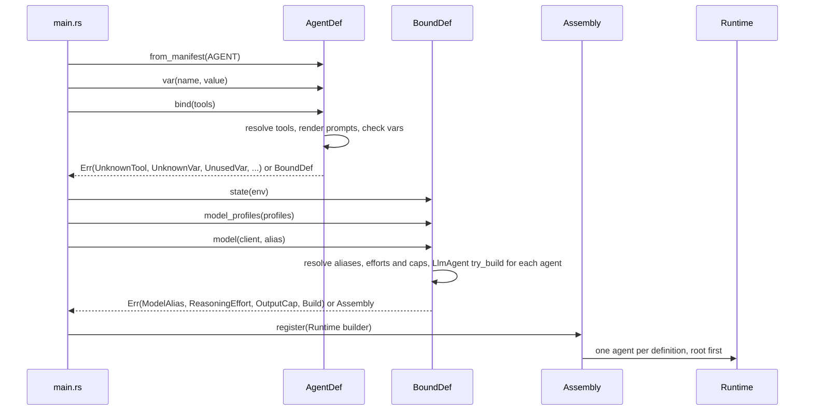
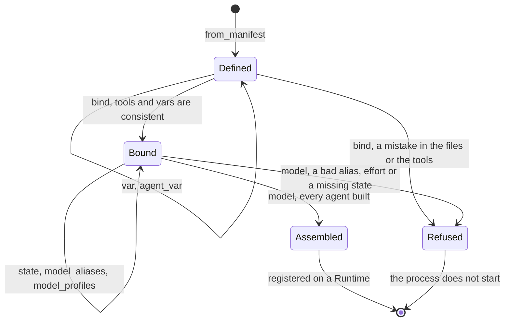
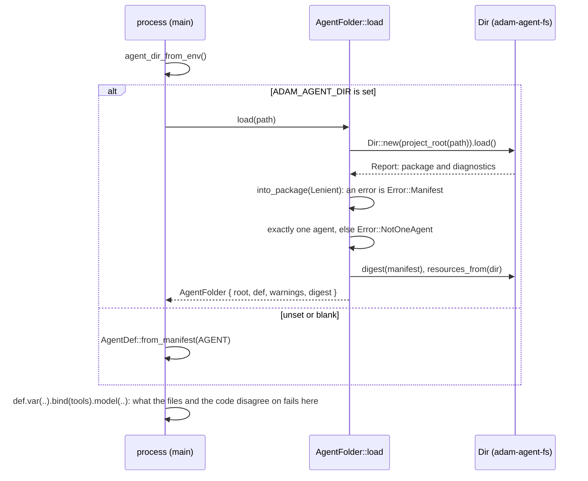
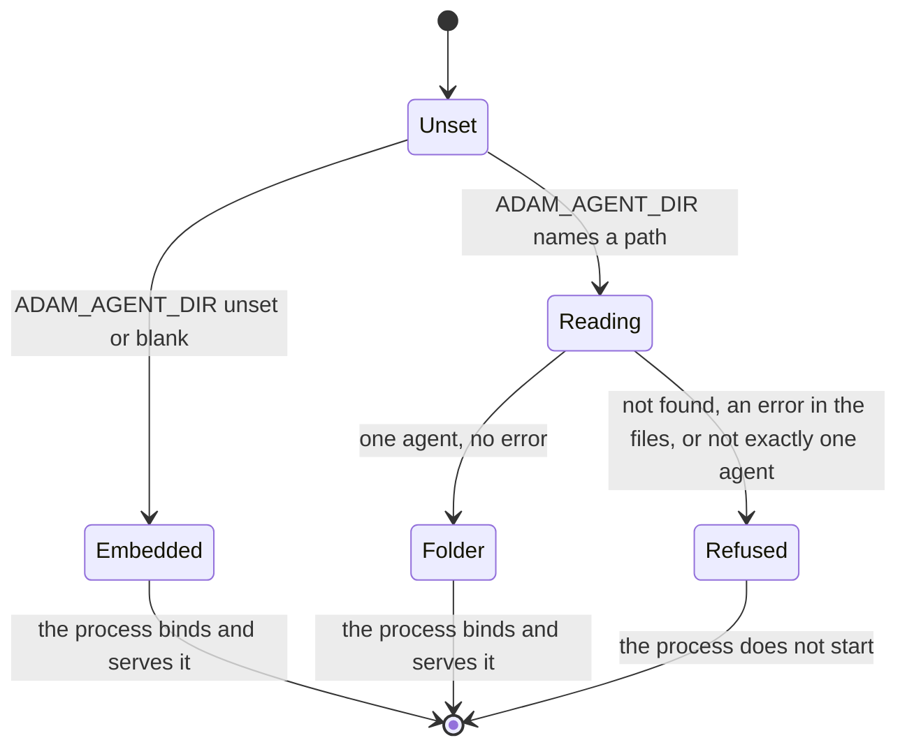
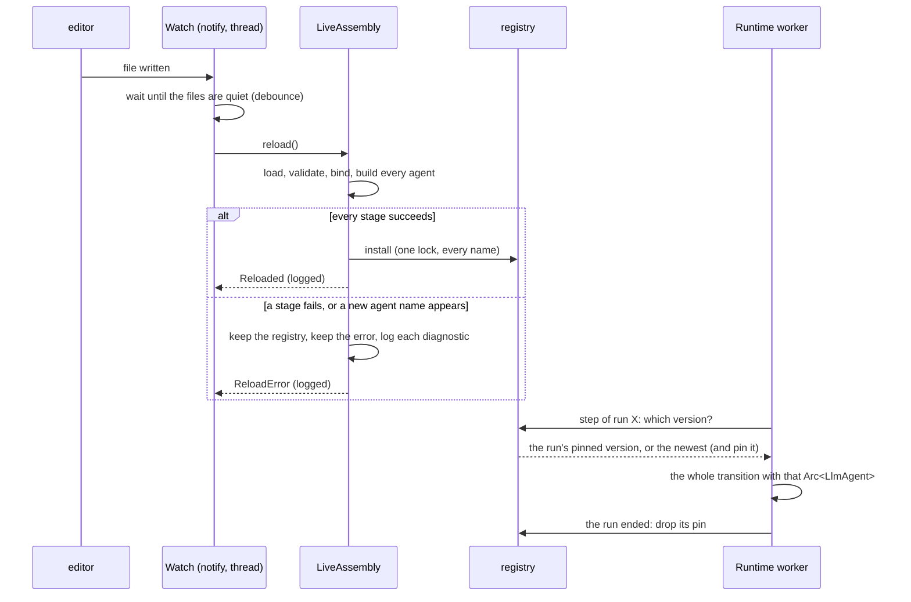
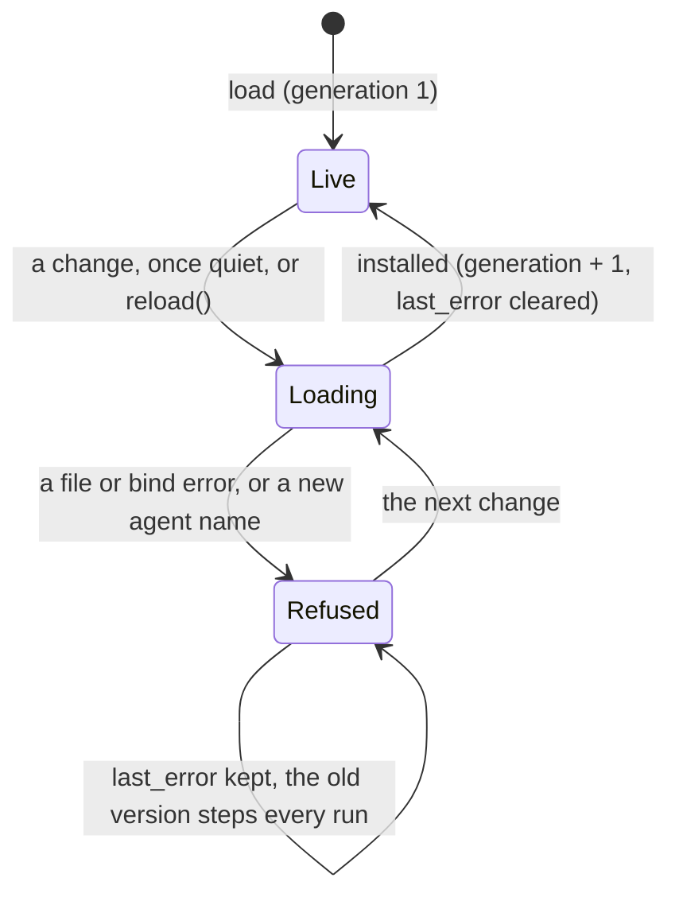
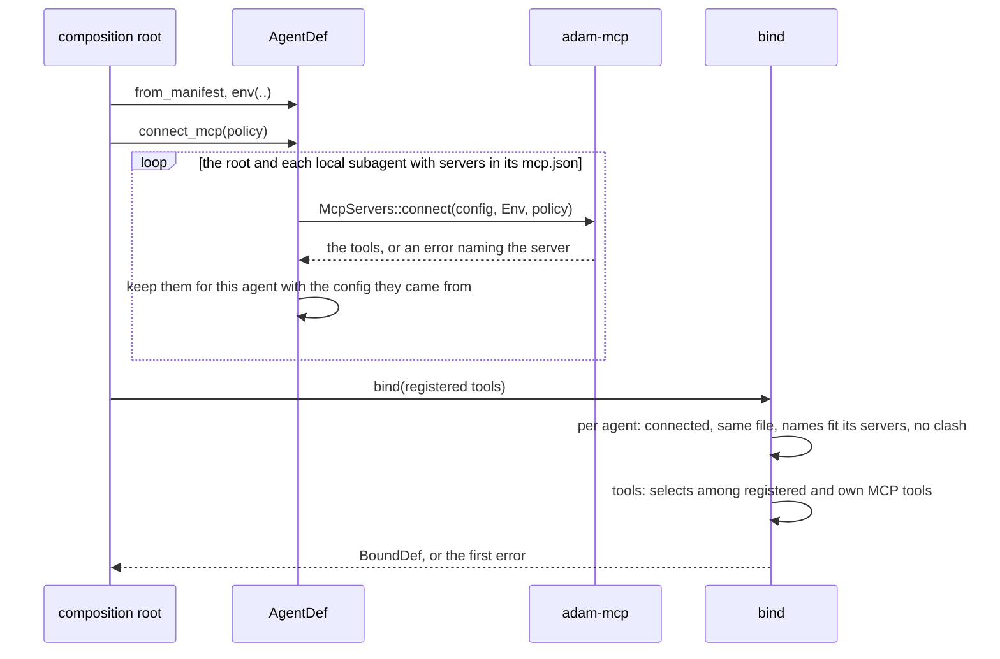
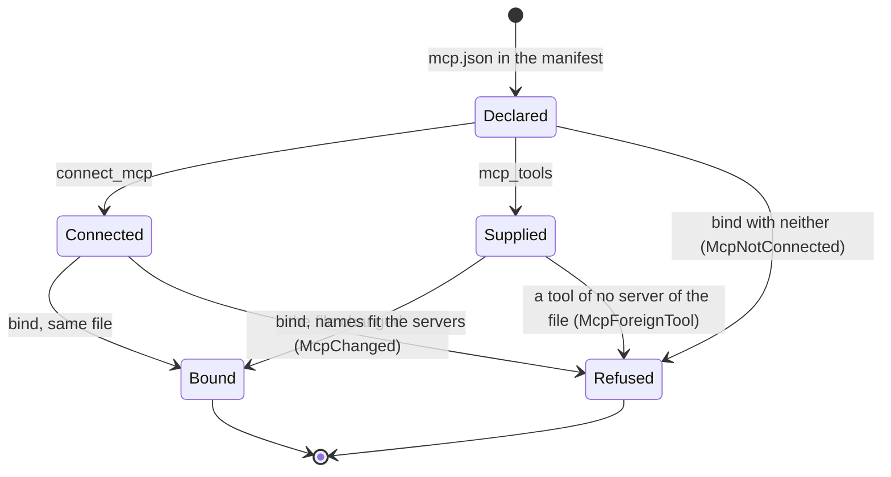

# adam-assembly

Bind an agent manifest to [`LlmAgent`](../adam-llm-agent/README.md)s. An agent written as files
(`agent/instructions.md`, subagents, skills, `mcp.json`; see [`docs/reference/agent-files.md`](../../docs/reference/agent-files.md))
is read into a manifest by [`adam-agent-fs`](../adam-agent-fs/README.md). This crate gives the
manifest its meaning at run time: the tools it names, the `{{placeholders}}` of its prompt, the model
it talks to and the state its tools need. Every mistake in that is found **when the process starts**,
with the agent and the file in the message, and never in the middle of a run.

## Where it sits

Slices S6, S7, S9, S9b, S10 and S11 of the authoring layer, the meeting point of the "macro" track (`#[tool]`, `ToolSet`)
and the "files" track (`adam-agent-fs`).

```text
adam-agent-fs  (files -> manifest) ─┐
adam-llm-agent (ToolSet, LlmAgent) ─┼─> adam-assembly ─> adam (facade)
adam-model, adam-runtime ───────────┘        ▲
adam-a2a, adam-a2a-runtime (feature a2a) ───┤
adam-mcp  (feature mcp) ─────────────────────┘
```

It depends on `adam-agent-fs`, `adam-llm-agent`, `adam-model`, `adam-runtime`, `adam-error`,
`adam-core`, `async-trait`, `jiff`, `serde`, `serde_json`, `thiserror`, `tokio` (a lock and a timeout), `secrecy` (the tokens)
and `tracing`, on the A2A client for remote subagents (`a2a-client-lf`, `a2a-lf`, `reqwest`, `url`) behind the feature
`remote`, **on by default** (see [Without remote subagents](#without-remote-subagents-feature-remote)), on `adam-a2a` and
`adam-a2a-runtime` (its `ChildSessions` type, both without their defaults) behind the feature `sessions` (the
sessions of local subagents alone: no A2A server or client, what `adam-engine` turns on), and with their defaults behind
the feature `a2a` (which turns `remote` and `sessions` on), on [`adam-mcp`](../adam-mcp/README.md) behind the feature `mcp` (the MCP client; see
[MCP tools](#mcp-tools-feature-mcp)), and, behind the feature `dev` only, on [`notify`](https://crates.io/crates/notify) (see
[Dev reload](#dev-reload-feature-dev)). It has no `unsafe`. Its I/O is the skill tools (the bytes are read once at startup, or come
from the binary) and the remote subagents' tool: the environment variable of `auth: bearer:VAR` at `bind`, and
the network (agent card, `SendMessage`, `GetTask`) only when a call needs it.

## Use

```rust
use adam::prelude::*; // AgentDef and friends are in the facade prelude

adam::include_agent!(); // AGENT: the agent build.rs embedded (a `&'static EmbeddedAgent`)

let assembly = AgentDef::from_manifest(AGENT)?    // or an `AgentManifest` a `Dir` loaded
    .var("repo", "acme/widgets")                   // a value for a `{{repo}}` placeholder
    .bind(tools![PrepareWorkspace, RunChecks])?    // tools: names checked, prompts rendered
    .state(Arc::new(env))                          // what the tools read with State<T>
    .model(model, "coder-large")?;                 // one client, and the default gateway alias

let runtime = assembly.register(Runtime::builder(store)).build(); // root and subagents
let card = assembly.card(public_url, env!("CARGO_PKG_VERSION"))?;   // feature a2a
```

The embedded agent and the directory read at run time are the same `AgentManifest`, so they take the
same code path here and bind to equal agents (`Assembly::info()` compares equal). The facade calls the
first `AgentDef::from_manifest(AGENT)`; note that `AGENT` is already a reference, so no `&`.

## API at a glance

| Item | What |
|---|---|
| `AgentDef` | `from_manifest(impl IntoManifest)`, `card(url, version)` (feature `a2a`; the root's card before anything is bound), `from_source(&impl ManifestSource, Strictness)` (one per agent of a package, with the bytes of the skills' files), `resources_from(&impl ManifestSource)`, `run_skills(Arc<dyn RunSkills>)` (the root finds skills during its run: [Skills a run finds](#skills-a-run-finds-runskills)), `var(name, value)`, `agent_var(agent, name, value)`, `env(name, value)` (a value for the environment variable `auth: bearer:VAR` reads), `secrets(DynSecretSource)` (where a variable that `env` does not give is asked, for remote subagents and MCP servers alike: `adam_core::ProcessEnv` by default, `adam_core::NoSecrets` in an embedded engine, ADR 0047), `allow_insecure_remotes(bool)`, `remote_timeout(Duration)`, `mcp_tools(agent, ToolSet)` (the MCP tools of an agent, from a client of your own), `connect_mcp(&McpPolicy)` (feature `mcp`: connect to the servers of every agent's `mcp.json`; what each agent's servers said about themselves is appended to **that agent's** instructions at `bind`, once, after the instructions and before the skills — the **eager** servers' only: a server with a `when` contributes its section to the first prompt when the task loads it, and to the load's result when the run loads it: [adam-mcp](../adam-mcp/README.md#server-instructions)), `with_extra_mcp(McpConfig, &Path)` and `with_extra_mcp_file(&Path)` (add the servers of another file to the root's own `mcp.json`; a name both have is an error, see [Extra MCP servers](#extra-mcp-servers-adam_extra_mcp_file)), `mcp_env_references()` (the `${VAR}` names every local agent's servers refer to), `si_memory_ceiling(SiMemoryCeiling)` and `si_memory() -> SiMemorySetting` (the deployment's `SI_MEMORY` and the folder's `si_memory:` key, ADR 0081 decision 11: either only narrows the other, an absent key follows the ceiling, and `Off` means nothing is built), `reasoning_effort(Option<ReasoningEffort>)` (the root's reasoning level when its file sets none; the file's own `reasoning_effort` wins, and a subagent's file always has its own; resolved against the root model's profile at `BoundDef::model`, not at `bind` (which does not know the model), ADR 0063 decision 8), `name()`, `manifest()`, `bind(ToolSet)`, `child_sessions()` (feature `sessions`, which `a2a` turns on: the helpers and limits the root's A2A front serves `child-sessions/v1` for, from the same roster as the session tools, `None` without a subagent; pure, no binding), `session_starters(RuntimeBuilder)` (the start-only agents of the root's helpers, local and remote, for a process that serves the front and does not step: [Child sessions on the A2A front](#child-sessions-on-the-a2a-front)) |
| `IntoManifest` | `AgentManifest`, `&AgentManifest`, `EmbeddedAgent` and `&EmbeddedAgent` (what `include_agent!` gives; these bring the bytes of the skills' files) |
| `SkillFiles` | the bytes of the files skills bundle (opaque: made by `IntoManifest` and `resources_from`) |
| `LOAD_SKILL`, `READ_SKILL_FILE` | the names of the two skill tools |
| `RunSkills`, `run_skills_conformance` | the trait of the skills a run finds (`load` and `read` take the context, a `<source>/<skill>` name and a checked window), and the function that checks an implementation (Rule 2) |
| `SkillError` | why `load_skill` or `read_skill_file` refused a call: closed enum, its `Display` is the tool result the model reads (`Window` is a bad `offset` or `limit`, or an offset past the end: a new variant, so a `match` on it breaks) |
| `BoundDef` | `state(Arc<T>)`, `tool_source(source)` (a `ToolSource` of `adam-llm-agent` for every agent: tools it learns about while it runs, offered at every model turn after the agent's own; `tools:` does not narrow it), `model_aliases(..)`, `model_profiles(ModelProfiles)` (the deployment's per-model profiles, ADR 0063/0064: the default reasoning effort of each agent is resolved from its folder, its `model_preset`, the profile and the profile's preset, and its output cap from the folder, the preset, the profile and the 128,000 fallback, clamped to the model's limit and window; a value the model does not take is refused), `wait_poll(Duration)` (how often a waiting agent looks: a remote subagent's task is polled at this interval), `max_parallel(n)` (the most tool calls of one model turn that run at once, for every agent: the deployment's `MAX_PARALLEL_TOOL_CALLS`, 10 when not given; an agent's `limits.max_parallel` lowers it for that agent, and a larger one is **clamped** to the deployment's with a warning — a folder is portable across deployments, ADR 0049, ADR 0054 decision 3 — while a *round's requested* config above a bound is refused by `SessionBounds::admit`, decision 2), `model_parking(ModelParking)` (how every agent, the root and its subagents, waits on a model that refused it, ADR 0067: the deployment's `MODEL_PARK_LIMIT` and, behind the injector, an unreachable gateway that parks; the loop's default when not given; `tests/parallel.rs` `the_deployments_model_parking_reaches_every_agent`), `admission(DynAdmission)` (the process's pools of [ADR 0065](../../docs/decisions/0065-resource-governance-admission-pools-and-os-limits.md): every agent built here asks it for every model call and every tool call; `LlmAgentBuilder::admission`; without one nothing is admitted), `scrub(f)` (a function that scrubs secrets out of what the six session tools give the model, which `bind` makes itself and a deployment's own tool wrapper never sees: the coder gives its redactor; the wrapper it makes, `Scrubbed`, also forwards `Tool::read_answer` and scrubs the words and interface of a refusal or an ending, as it scrubs a question), `scrub_longest(f)` (the length of the longest value it replaces, for `ToolCtx::scrub_margin`, as the coder's own wrapper passes it; a report is a child's text scrubbed whole, never a cut one, so no open edge applies), `step_io(StepIo)` (how every agent's tool-call steps report their input and output, and what is scrubbed from them first: `LlmAgentBuilder::step_io`, [ADR 0011](../../docs/decisions/0011-a-tool-calls-step-carries-its-input-and-output.md)), `hooks(HookSet)` (the host's own hooks, ADR 0050, for **every** agent built here, the root and each subagent: they run first, under the set's limits, then the plugins the agent's file names; `AgentInfo::plugins` lists the file's only; what `adam-engine` gives its agents, ADR 0047 slice 5), `model(DynModel, alias)` |
| `adam_llm_agent::ReadOutput` | **added by `bind` to every agent whose tools include an MCP tool** (unless its tool list already holds `read_output`, as the coder's does), after the tools it selected: a long MCP result is kept and the model reads the rest with `read_output { id, offset?, limit? }` (an agent that is only a folder keeps it in the run's state, 4 MiB; see [`adam-mcp`](../adam-mcp/README.md)). An agent with no MCP tool among its tools does not get it |
| `SubagentTool` | the tool that runs a subagent as a child run: `new(tool_name, agent, description)`, `agent()`. `bind` adds one per local subagent, so a user never builds one. Its call is a `subagent` step drawn as an agent (`Tool::step_style`), as is a remote subagent's, **labelled with the tool's name as a person reads it** (`explorer` is "Explorer", `code_reviewer` is "Code reviewer"). `load_skill` and `read_skill_file` are "Load a skill" and "Read a skill file" |
| `Assembly` | `agents()`, `root()`, `register(RuntimeBuilder)` (the agents and the round agents of the remote sessions), `remote_round_agents()` (feature `remote`), `info()`, `remotes()`, `manifest()`, `card(url, version)` (feature `a2a`), `child_sessions()` (feature `sessions`: what the definition computed at `bind`), `agent_modes()` (feature `sessions`: the root's modes as the card lists them and the A2A front refuses a message for, `None` without `modes/`; `agent_modes_of(&AgentManifest)` is the same for a manifest), `session_bounds()` (the bounds of each subagent a session may be started on, by its name: [ADR 0054](../../docs/decisions/0054-a-child-session-can-be-configured-within-what-its-folder-allows.md), read from the session tools the root was built with; empty without a subagent — see [The bounds of a session](#the-bounds-of-a-session)). `AgentDef::session_bounds()` gives the same list **without binding**, and `AgentDef::session_max_parallel(n)` is the deployment's `MAX_PARALLEL_TOOL_CALLS` for it (and, at `bind`, for the agents unless `BoundDef::max_parallel` says another) |
| `RemoteRoundAgent` (feature `remote`) | the `Agent` (and `AgentStarter`) that works the rounds of a session on a remote subagent of the root, registered as `<root>/<subagent>`; `with_wait_poll(Duration)` (`BoundDef::wait_poll` sets it). See [Remote sessions](#remote-sessions) |
| `RemoteRoundStarter` (feature `remote`) | its start-only twin, `new(name)`: makes the same round state (`init`, `init_continuing`) with no endpoint and no credential; `AgentDef::session_starters` registers it |
| `Assembly::prompt_commands()` (feature `mcp`) | the prompts of the **root's** MCP servers as commands (`adam_mcp::PromptCommand`), read once when the servers were connected; a subagent's give none. `adam-service` adds them to the backend and the card ([adam-mcp](../adam-mcp/README.md#prompts-as-commands)) |
| `Group`, `Groups` | a named set of tools that load together (ADR 0066): `Group::new(name, note, members)`, `for_server` (a `when` server's group: its name is the server's, its note the server's words, and a bad name's error names the server), `with_keywords`, `searchable` (refused until S2), `loader()`, `server`; `Groups::bind(&Origin, defs, &[(String, DynTool)])` drops every member the agent was not given (an empty group has no loader), refuses a bad name, two groups of one name, a searchable group, a tool in two groups, and a loader name a tool already has; the reserved `load__` catalogue check is `def.rs`'s. `declared_loaders()` is the catalogue (S2/S3 and tests); the run-time path is the trait's `loaders(ctx)`, and `loader_tools()` gives one `load__group__<name>` per group. `Groups` is a `ToolSource`: it withholds a group's members until the task's keywords or the run's load, appends a loaded group after every other tool, and journals the task-loaded groups and the loaders. Constants: `GROUP_LOADER_PREFIX`, `MAX_GROUP_NAME_CHARS`, `MAX_KEYWORDS`, `MAX_KEYWORD_CHARS`, `name_fits`, `keywords_fit`; the reserved prefix is `adam_llm_agent::RESERVED_LOADER_PREFIX` |
| `AgentInfo` | `name` (`coder`, `coder/reviewer`), `parent`, `description`, `file`, `model_alias`, `model_fallback` (the alias its run continues on when its model is locked) and `model_choices` (the aliases a message may pick), `reasoning_effort` (the default the folder, its `model_preset` or the profile resolves to, or `None`), `prompt` (rendered, with the skills catalog and the instructions of its eager MCP servers), `tools` (own, one `load__group__<server>` per server with a `when`, skill tools, then one per subagent, local or remote, then the six session tools of the root when it has a subagent, local or remote: what the model is offered), `skills`, `preloaded`, `when`, `tools_loading` (`eager`, `lazy` or `searchable`: how the folder's own tools load, ADR 0066; `eager` leaves `when` empty), `limits` (the loop's limits, with `max_output_tokens` resolved for the agent's model and clamped, ADR 0064): what an `LlmAgent` was made from, comparable. **Breaking:** `reasoning_effort`, `model_fallback`, `model_choices` and `tools_loading` are new public fields, so a hand-built literal needs them |
| `RemoteInfo` | a remote (`a2a:`) subagent, as data (its tool is in `AgentInfo::tools` like a local subagent's) |
| `LiveAssembly`, `LiveBuilder`, `Watch` (feature `dev`) | dev reload: `LiveAssembly::builder(dir, model, alias)` then `tools`, `configure`, `configure_bound`, `strictness`, `default_name`, `debounce`, `connect_mcp(&McpPolicy)` (feature `mcp`), `load()`; on the handle `register(RuntimeBuilder)`, `reload()`, `watch()`, `generation()`, `schedules()`, `last_error()`, `info()`, `retired()`, `runs_on_previous_tools()`, `dir()` |
| `Reloaded`, `ToolChange`, `ReloadError`, `WatchError` (feature `dev`) | what a reload did (`generation`, `changed`, `tool_changes`, `retired`), why it changed nothing (`Load(Error)` with `diagnostics()`, `NeedsRestart { added }`), why a watcher did not start |
| `AgentFolder` | one agent read from a folder when the process starts (no feature): `AgentFolder::load(path)` gives `root`, `def` (an `AgentDef`), `warnings` and `digest`; the folder holds exactly one agent, else `Error::NotOneAgent` |
| `extra_mcp_file_from_env`, `EXTRA_MCP_FILE_ENV` | `ADAM_EXTRA_MCP_FILE` when set and not blank, else `None`: a file of extra MCP servers (below). No feature |
| `agent_dir_from_env`, `agent_dir`, `AGENT_DIR_ENV`, `AgentDef::from_dir` | where the folder is: `ADAM_AGENT_DIR` when set and not blank (`agent_dir_from_env` is `None` otherwise, `agent_dir(default)` falls back to `default`), and one `AgentDef` per agent of a directory. No feature |
| `Error`, `Origin` | the closed error enum, and the agent and file every file-related variant carries |
| `AliasProblem`, `EffortSource`, `CapSource`, `TemplateProblem`, `SkillField`, `ToolClash`, `RemoteAuthProblem`, `RemoteUrlProblem` | closed enums inside `Error::ModelAlias`, `Error::ReasoningEffort`, `Error::OutputCap`, `Error::Template`, `Error::UnknownSkill`, `Error::SubagentToolClash` (which may name a parent's MCP tool: `ToolClash::McpTool`), `Error::RemoteAuth` and `Error::RemoteUrl` |

## The stages

Each step is a type, so a step cannot be skipped: the state comes before the model because the model
step is the one that builds the agents and finds a missing state.





## What binding checks

**Tools.** `tools:` names are checked against the `ToolSet`. A name nobody registered is
`Error::UnknownTool`, with the closest registered name as a suggestion and the list of what is
registered (`Read` in a Claude Code file suggests `read_diff`). An entry with a `*` (`linear__*`, the
MCP spelling) is a pattern over the registered names and must match at least one
(`Error::NoToolMatches`). A tool listed twice, or matched twice, is bound once, in the order the file
lists. A `ToolSet` with two tools of one name is `Error::DuplicateTool`. Without `tools:` the root
agent gets every registered tool and a subagent gets none (decision D3 of `docs/authoring.md`); `*` is
every tool and `[]` none. A subagent's tools come from the same set but are only the ones it lists: it
inherits nothing.

**Modes.** A root agent's `modes/<name>.md` ([ADR 0039](../../docs/decisions/0039-the-agent-loop-takes-opencodes-structure-and-agents-get-plugins.md), decision 3) are resolved against the tools the agent ends up with: a mode's `tools:` is the allowlist of the tools the model is shown in it. A plain name the agent does not have is left out with a warning (a deployment's setting decides some tools, and the agent's own `tools:` may narrow them); a pattern that matches nothing is `Error::NoToolMatches`. A mode only narrows: its hold is a `ToolSource` beside the tier's, so the tier still caps every tool it allows, and a mode can neither raise the tier nor grant a tool the agent does not have. Every agent of the assembly narrows by the root's modes, because a child run starts in its parent's mode. `Assembly::agent_modes` and `agent_modes_of` (feature `sessions`) give the card's entry and the A2A front's check from the same files. Tests: `tests/modes.rs`.

**Retry policies.** Each name of an agent's `retry:` ([ADR 0061](../../docs/decisions/0061-a-step-names-its-retry-policy.md))
must be one of that agent's tools once they are all bound (its own, its MCP servers', which are connected before
`bind`, and its skill and subagent tools): another is `Error::UnknownRetryTool`, with the closest of its tools as a
suggestion; an entry for a declared MCP server that gave no tools (an `optional` one that is down) is skipped with a
warning. The policy goes to the agent as `LlmAgentBuilder::tool_retry`, so it wins over the tool's own
`Tool::retry_policy`; `AgentInfo::retry` lists it as the file says it. Each agent has its own: a subagent does not
inherit the root's. An entry that is no policy, in a manifest the loader never checked (built in code, or embedded
by another version), is `Error::InvalidRetry`. Tests: `tests/retry.rs`.

**Vars.** `{{name}}` is logic-free substitution into the body of `instructions.md` and each
`instructions/*.md`; spaces inside the braces are ignored, `{{{{` writes a literal `{{` (so a
literal `{{name}}` is `{{{{name}}`), and a `}}` in text is always itself. The rules, checked per agent:

| Mistake | Error |
|---|---|
| a `{{` that is not closed, is empty or is not a var name | `Template { line, problem }` |
| a placeholder that `vars` does not declare | `UnknownVar`, with a suggestion |
| a value supplied in code for a var `vars` does not declare | `UnknownVarValue`, with a suggestion |
| a var declared and never used, even if a value was supplied | `UnusedVar` |
| a used var with an empty default and no value from the code (`vars:` with `repo:` and nothing after it) | `UnsetVar` |
| `agent_var` for an agent the definition does not have | `UnknownAgent`, with a suggestion |

A var is required, with no default, when its default is empty. The value comes from
`AgentDef::var` (root) or `agent_var("coder/reviewer", ..)` (any agent by its registered name), and any
`ToString` works. Lines are counted from the start of the body of the file (the frontmatter is not
counted); the error names the file, `instructions/10-style.md` for a part.

**Model.** One `DynModel` serves every agent (decision: one OpenAI-compatible endpoint), and the
gateway alias of each agent is, in this order: the `model:` it names; the alias of its parent when it
says `inherit` or names nothing (a subagent's default); the alias passed to `model(..)` (the root's
default). The alias is a deployment setting, so the code picks the default and a file may pin one for
an agent that needs a particular model. `model_aliases([..])` lists what the deployment serves and
turns an alias outside the list into `Error::ModelAlias` with a suggestion; an empty alias or one with
whitespace is refused either way.

**Reasoning effort.** With `model_profiles(profiles)` (the deployment's `MODEL_ALIASES_FILE`, ADR
0063/0064), each agent's default effort is, narrowest first: its own `reasoning_effort`, the preset
its `model_preset` names, the profile's `reasoningEffort`, then the profile's base preset. The value
must be one of the levels of the profile of the alias the agent uses; otherwise `model(..)` returns
`Error::ReasoningEffort` naming the agent, the value and the levels the model takes (`InvalidReasoningEffort`
for a word outside the closed vocabulary, `UnknownModelPreset` for a preset the file does not declare).
A folder that sets an effort on a model whose profile takes none is that same error. The resolved
value is `AgentInfo::reasoning_effort` and goes to `LlmAgentBuilder::reasoning_effort`; the run's
`vymalo.reasoningEffort` context still wins per message.

**Fallback and choices.** The fallback alias is resolved per agent: its folder's `model_fallback:`, else its
`model_preset`'s `fallback`, else its model's profile's `fallback` (else that profile's base preset's). It is checked like `model:`
(and refused as `AliasProblem::SameAsModel`, a `#[non_exhaustive]` enum now, when it is the agent's own alias), with the cap resolved
from the fallback's **own** profile and the level its profile gives (`reasoningEffort`, else its base preset, which
must be one of the model's levels; the folder's cap and level are for the agent's model) and handed to
`LlmAgentBuilder::model_fallback`. Tests: `tests/fallback.rs`. `BoundDef::allow_model_choice()` (the engine calls it; off by default) gives
every agent a `ModelBinding` for each other profiled model, for `Say::with_model` (ADR 0064, amended 2026-11-23).

**Output cap.** With `model_profiles(profiles)`, each agent's cap is, narrowest first: its folder's
`limits.max_output_tokens`, the preset its `model_preset` names, the profile's `maxOutputTokens`, the profile's base
preset, then `adam_model::DEFAULT_MAX_OUTPUT_TOKENS` (128,000). It is then the smallest of that, the model's
`maxOutputTokensLimit` and, when the client knows the alias's context window, what the window leaves after
`adam_llm_agent::WINDOW_MARGIN_TOKENS` (20,000) and the history the agent keeps (`max_history_tokens`, or half the
window when it is `0`; an omitted key keeps the 100,000 default; at least 1). A lowered cap is logged once per agent and model. A **preset** above the
model's limit is `Error::OutputCap` (a preset is the deployment's promise); the folder's value is clamped, and a
profile's own cap above its limit is refused when the profiles file is read. The resolved cap is
`AgentInfo::limits.max_output_tokens` and the loop's `Limits`, so the request, the
compaction budget and the summary (`min(4,096, cap)`) all use it.

**State.** `state(Arc<T>)` is given to every agent, like `LlmAgentBuilder::state`. `model()` builds
the agents with `try_build`, so a tool whose `required_state` nobody gave is
`Error::Build { origin, source: MissingState }`, naming the agent, before anything runs.

**Limits.** The frontmatter `limits` (`max_turns`, `max_tool_calls`, `max_output_tokens`,
`max_history_tokens`) replace the loop's default for the keys that are set. `max_output_tokens` is the folder's cap,
the first of the cap's resolution (above); absent, the assembly resolves it from the preset, the profile and 128,000
and clamps it. Each subagent has its own. A run that
reaches `max_turns` or `max_tool_calls` gets one closing model call in which it may call no tool and ends `Done`
with that answer marked `limited` (see `adam-llm-agent`). `limits.max_minutes` is the time limit of a subagent's run
(`SubagentTool::with_run_limit`; 30 by default, `0` none, at most 1,440; a warning on a root agent): past it the runtime
fails the child and the parent reads "the run failed: cancelled: time limit: ...". `DEFAULT_SUBAGENT_MINUTES` is 30. The classes of the tools the assembly makes (ADR 0049): `load_skill` and `read_skill_file` are `Independent`; a one-shot subagent tool and a remote subagent tool are `Alone` (they park the run on a child or a task), and so are the session tools. A remote agent's files are taken from the room the turn's calls share (`ToolCtx::spend_files_of`). `limits.max_parallel` is not in the loop's `Limits` (ADR 0049): it is the number of tool calls of one
model turn that run at once for that agent, 1 to 32, and it can only lower `BoundDef::max_parallel` (the deployment's setting); a larger one is clamped to that setting, with a warning.

**The card.** With feature `a2a`, `Assembly::card(url, version)` is the root's `card:` as an
`adam_a2a::AgentCardConfig`: `card.name` (default: the agent's), `card.description` (default: the
frontmatter `description`, else `Error::MissingCardDescription`), `card.skills` and `card.extended` (`description`,
`skills`: what an authenticated caller sees on top of the public card, `GetExtendedAgentCard`; it becomes
`AgentCardConfig::extended`, and `extended: {}` declares nothing). The public URL and the
version are the deployment's, so they are arguments. A2A card skills are not Agent Skills. The card is a fact
about the files, so `AgentDef::card(url, version)` gives the same card before any tool, state or model is
bound: a process that only serves A2A (a control plane, with no model) needs it, and the coder uses it. When the agent has `commands/`, the card also lists the `commands/v1` extension (`ExtensionConfig::commands`, sorted by name); an agent without commands lists none. The templates are not on the card and not in the prompt: the A2A backend expands them (`adam-a2a-runtime`).

## Skills

An agent's skills are the ones under its **own** `skills/` (a subagent inherits none), narrowed by
`skills:` (`all`, the default, or a list, kept in the order given) and turned into the three tiers of
[Agent Skills](https://agentskills.io/specification) progressive disclosure at `bind`. Nothing is added
for an agent with no selected skill: no catalog, no tool. The design and the reasons are in
[`docs/reference/agent-files.md`](../../docs/reference/agent-files.md#skills-at-run-time); the contract is
here.

**Tier 1, the catalog.** After the instructions and a blank line, in this format (pinned by
`tests/golden/coder-prompt.txt`):

```text
The following skills provide specialized instructions for specific tasks.
When a task matches a skill's description, call the load_skill tool with the skill's name to load its full instructions.
Files a skill bundles are listed under <skill_resources> when it is loaded; read one with the read_skill_file tool.
<available_skills>
  <skill>
    <name>release-notes</name>
    <description>Drafts release notes from merged pull requests. ...</description>
  </skill>
</available_skills>
```

The third line is there only when a selected skill bundles a file. A description is collapsed to one line
and `&`, `<`, `>` are escaped. Skills that are preloaded are not listed.

**Tier 2, `load_skill { name, offset?, limit? }`.** `name` is a string, never an enum: the description and schema of the tool are the same whatever skills exist (an unknown name is answered with the list of those that do). It pages like `read_file`: at most 2,000 lines or 50 KiB a page, `offset` from 1 (negative from the end), and every result ends with the line that says where the next page starts, `[more: N lines left; next page: offset=K]` or `[end: N lines]`. The text it pages is

```text
<skill_content name="release-notes">
{the body of SKILL.md, frontmatter stripped}

Relative paths in this skill are relative to the skill's directory.
<skill_resources>
  <file>references/style.md</file>
  <file>scripts/run.sh</file>
</skill_resources>
</skill_content>
```

(the last two blocks only for a skill with files; the list is sorted, and lists files without reading them, and comes with the last page of a body that goes on; the first page of such a body names the files in one line before its paging line). A line of the body that starts with `[` is shown with `\x5b`, so that only the last line of a page starts with `[`.

**Tier 3, `read_skill_file { skill, path, offset?, limit? }`.** `skill` is a string (no enum). The
path is normalised (a leading `./` is dropped) and refused when it is empty, absolute (`/x`, `\x`, `C:`), has
a `..` component, a backslash or a control character. What passes is looked up by exact match in the
skill's list of files, so nothing outside the list is reachable and there is no file system access at run
time. A **text** file (UTF-8, no NUL byte) is paged like a body (an empty one is `(the file is empty)` and `[end: 0 lines]`); a
**binary** file is refused with its size. A skill bundles at most 1 MiB (`SKILL_RESOURCE_LIMIT`, checked by
the build script and again when the bytes are loaded), which bounds any result.

A refusal is a tool result with `is_error`, not a failed run: the message says what to do (the available
names with a "did you mean", the skill's files, that `SKILL.md` is loaded with `load_skill`). An unselected
skill gets the same answer as a made-up one.

**`preload_skills: [a]`** puts `<skill_content name="a">` in the prompt after the catalog, under the line
"The following skills are already loaded. ...", instead of leaving it to `load_skill`. A preloaded skill
must be selected by `skills:`; it leaves the catalog (asking for it says it is
already in the instructions), and its files stay readable. With every skill preloaded there is no
`load_skill`, and with no skill bundling a file there is no `read_skill_file`.

**Where the bytes come from.** An embedded agent (`from_manifest(AGENT)`) brings its files, borrowed from the
binary. A directory is read with `AgentDef::from_source(&Dir, ..)`, which reads every file once, at
startup. A manifest made without its source (`from_manifest(manifest)` from `Dir::load`) has none:
binding it fails with `Error::SkillFilesUnavailable` when a selected skill bundles a file, and
`resources_from(&dir)` supplies them. Embedded and directory therefore give equal `AgentInfo`s and the
same tool results.

| Mistake in the files or the wiring | Error, at `bind` |
|---|---|
| `skills:` or `preload_skills:` names a skill the agent does not have | `UnknownSkill { field, .. }`, with a suggestion |
| `preload_skills:` names a skill `skills:` does not select | `PreloadNotSelected` |
| a selected skill's files were not supplied | `SkillFilesUnavailable` |
| a skill bundles more than 1 MiB | `SkillTooLarge` (also from `resources_from`) |
| a registered tool called `load_skill` or `read_skill_file` on an agent with skills | `ReservedToolName` |
| a registered tool, selected tool or subagent whose name starts with `load__` | `ReservedLoaderName` |
| a group's name or keywords do not fit, or two groups have one name | `GroupName` |
| a searchable group (S2 is not built yet) | `SearchableGroup` |
| one tool in two groups | `GroupOverlap` |

`tools:` does not filter the skill tools; `skills: []` turns them off. Both are ordinary tools, so their
results are journaled with the step that ran them.

Known limit: a loaded skill is a tool result, and the loop may truncate an old one to fit
`limits.max_history_tokens`. `preload_skills` is the way around it until the loop learns to protect skill
content.

### Skills a run finds (`RunSkills`)

A host that finds skills **during a run** (the coder: the skills of a repository it prepared) gives the root
agent `AgentDef::run_skills(Arc<dyn RunSkills>)`. The two tools then take names the folder does not hold:

| Call | Goes to |
|---|---|
| `load_skill { name }` or `read_skill_file { skill, .. }` with a `/` in the name (`<source>/<skill>`) | `RunSkills::load` / `RunSkills::read`, with the window already checked (`offset` from 1 or negative, `limit` at most 2,000) |
| a name without a `/` | the folder's own skills, never `RunSkills`, so what a run finds cannot shadow a skill of the folder; an unknown one is answered with the list of the folder's |

* **The tool list and the prompt never depend on the run.** With it set the root always has both tools and its
  prompt ends with one fixed sentence ("Other skills may be listed to you during the run, named
  `<source>/<skill>`; load them with load_skill the same way."), also when the folder has no skill of its own.
  What a run finds arrives as a tool result, so the prefix of the provider's cache holds for the whole run.
* **`skills: []` turns it off too:** no tool, no sentence, and the implementation is never called. A host
  that lists skills itself must check the same thing.
* **Root only.** A subagent gets none: its skills are its own.
* **A contract for the implementation** (`run_skills_conformance` checks it): the same call gives the same
  bytes (a retried step is answered from what the host recorded, not from the file system as it is now);
  only the last line of a result starts with `[`; a refusal is `Ok(ToolOutput::error(..))`, and only a
  failure worth retrying is `Err(ToolError::Transient)`; a path never leaves the skill's directory; what
  it reads is the repository's text, never the person's, and grants no tool, access tier or consent.

`RunSkills` is a new public trait, `AgentDef::run_skills` a new method and `SkillError::Window` a new variant
of a closed enum (a `match` on it breaks).

## Run-time folders (no feature)

An agent does not have to be embedded. `AgentFolder::load(path)` reads one agent's folder when the process
starts, with the same loader `build.rs` uses (lenient: a warning is returned, an error is an `Err`), so a
deployment can change the instructions, the card, the skills or the `mcp.json` of an agent by changing
a mounted folder, without a build. It is read once, and a change on disk is picked up by the next start.

```rust
use adam::{AgentFolder, agent_dir_from_env};

// ADAM_AGENT_DIR=/etc/adam/agent; unset or blank: the copy embedded at build time.
let def = match agent_dir_from_env() {
    Some(path) => {
        let folder = AgentFolder::load(path)?;             // exit 78 on `Err`: the files are wrong
        for warning in &folder.warnings { tracing::warn!("{warning}"); }
        tracing::info!(root = %folder.root.display(), digest = %folder.digest, "agent files");
        folder.def
    }
    None => AgentDef::from_manifest(AGENT)?,
};
let assembly = def.var("max_check_cycles", 3).bind(tools)?.model(model, "alias")?;
```





A path may name the directory that holds `agent/` (or `agents/`), or that directory itself. `agents/` is
accepted when it holds exactly one agent: a process serves one. `digest` is the digest of the manifest and
the bytes of the files its skills bundle, so the same files read from a folder and embedded by `build.rs`
have the same digest (a test compares them on the fixture); a startup log line with it says which files a
process runs. `AgentDef::from_dir(path)` is the one-shot `from_source(&Dir::new(root), Strictness::Lenient)`
for a path that may hold several agents, with `ADAM_AGENT_DIR` replacing the path.

## Dev reload (feature `dev`)

Off by default, so **a release build cannot watch and reload prompts unless its author turned the feature on**
(the `adam` facade re-exports it as `dev`; reading a folder once, at startup, needs no feature: see above);
turning it on brings `notify` and logs a warning at startup.
`LiveAssembly` does what `from_source`, `bind` and `model` do at startup, keeps the recipe, and does it again
when a file changes. Tool code is Rust and still needs a rebuild (`cargo watch`); `mcp.json` tools are connected
once, at startup, and outlive reloads (see the paragraph on `mcp.json` below).
`schedules()` gives the roots' schedules in force (those of the last load that swapped; a refused reload keeps
them). `LiveAssembly` runs none: a host that runs schedules registers `adam_schedule::SchedulerAgent::new(root)` for
each root and, when `generation()` moves, calls `adam_schedule::reconcile` with them for every root of the first load,
`retired()` ones included (a removed root's empty list cancels its schedulers)
([ADR 0060](../../docs/decisions/0060-schedules-are-parked-runs.md)).

```rust
use adam::assembly::LiveAssembly; // feature `dev`

let live = LiveAssembly::builder(adam::assembly::agent_dir("."), model, "coder-large")
    .tools(tools![PrepareWorkspace, RunChecks])
    .configure(|def| def.var("repo", "acme/widgets").env("BILLING_TOKEN", token()).remote_timeout(secs(600)))
    .configure_bound(move |bound| bound.state(env.clone()).wait_poll(secs(5)))
    .load()?;                                       // a bad first load is a startup error
let runtime = live.register(Runtime::builder(store)).build(); // stable names, current version
let _watch = live.watch()?;                        // notify; dropping it stops the watching
```

`ADAM_AGENT_DIR` replaces the directory the code names; it may name the directory that
holds `agent/` (or `agents/`), or that directory itself (the same rule as for a run-time folder). A store that survives the process
(the Compose Postgres) lets a restart resume runs; the in-memory store cannot.





**What a reload changes, and when.** Each `step` of a run takes the current `Arc<LlmAgent>` once and makes its
whole transition with it, so a swap is never seen in the middle of a step, and a running run picks up new
instructions at its next step. The prompt is not journaled and the model request is rebuilt on every turn, so
a new prompt, limits, model alias, tool description, `{{var}}` value, wait timer, remote timeout or rotated
token (the hooks run again, and a re-bind gives a remote tool a fresh client) apply to every run at its next
step.

**The replay rule.** A run is durable: its journal is keyed by step names (`model:3`, `tool:<call id>`), and a
transition that is replayed must take the same steps, or it fails with `NonDeterminism`. What would change the
steps is a change to *which tools exist*. So the tool set of an agent (its tools' names) decides which
versions may step the same run:

| Reload | Runs already stepped | Runs that start later |
|---|---|---|
| same tool set | swap to the new version | the new version |
| changed tool set | keep the newest version **with the tool set they started with**, until they end | the new version |
| goes back to an old tool set | the runs on it follow it again | the new version |
| a new agent name (a new subagent, a renamed root) | *refused as a whole* (`NeedsRestart`): the runtime registers agents once, when it is built | - |
| an agent removed from the files | it stays registered with its last version (`retired()`), for its runs and for parents on the old tool set | a parent on the new tool set has no tool for it |

A pin is dropped when its run ends (done, failed, or a permanent error). A run that is cancelled while nobody
steps it leaves a small entry (and its old version) until the process ends; `runs_on_previous_tools()` counts
the runs that are on a replaced tool set. A restart is a deploy: pins are in memory, and a new process steps
every run with the files as they are, as a production deploy of new code does.

**An invalid edit.** The old version stays in force for every run. Each diagnostic of the files is logged at
`error` with its file and line, then `reload refused, keeping the last good version`; `last_error()` returns
the `ReloadError` (its `diagnostics()` are the loader's findings; a bind error such as an unknown tool is
`ReloadError::Load(Error::UnknownTool { .. })`). The next good load clears it. Warnings of a load that
succeeds are logged at `warn` (with `Strictness::Strict` they refuse the load instead).

**`mcp.json` and reload (features `dev` and `mcp`).** `reload()` is synchronous and may run on the watcher's
thread, where nothing can wait for a network, so a reload never connects. `LiveBuilder::connect_mcp(&policy).await`
does it once, before `load()`: it reads the directory, applies the `configure` hooks added so far (so an `env` given
there is what `${VAR}` sees), calls `AgentDef::connect_mcp` for each root and keeps the connections in the
recipe. Every load then gives each definition its root's connections, after the hooks, so **connections outlive
reloads**: a reload starts no process and opens no session (a test counts one `initialize` across reloads).
The tools of an agent are discovered once, and a run in flight may already have called one, so an edit of an
`mcp.json` is not applied: the reload hits `Error::McpChanged` (the connected file is no longer the agent's),
which is `ReloadError::Load(..)` like any bind error, keeps the last good version, and whose message says to
restart the process. Putting the file back makes the next reload succeed. An `mcp.json` added for an agent that
had none is `McpNotConnected`, the same way.

**The watcher.** `watch()` uses [`notify`](https://crates.io/crates/notify) on `agent/` and `agents/`
recursively, ignores what cannot have changed a load (reads, access times, so a reload does not trigger the
next), waits until the files have been quiet for the debounce (150 ms by default; an editor writes in several
steps), then calls `reload()` on its own thread. A reload reads the disk on the calling thread. There is no
watcher for `ADAM_AGENT_DIR` itself: it is read once, when the builder is made.

**`notify` (verified 2026-09-29, crates.io API and the manifests in the registry):** version 8.2.0 is the
current stable release (`9.0.0-rc.5` is a pre-release, not used); licence CC0-1.0 (accepted by `deny.toml`);
MSRV 1.77; the API used is `recommended_watcher`, `Watcher::watch`, `RecursiveMode::Recursive` and
`EventKind`. It comes in only through the feature `dev`; the debounce is ours (about 15 lines), so
`notify-debouncer-mini` is not a dependency.

## Errors

`Error` is a closed enum (`UnknownRetryTool` and `InvalidRetry` are the newest variants; `RemoteNotEnabled` is one in every build: see
[Without remote subagents](#without-remote-subagents-feature-remote)); every variant about the files carries an `Origin { agent, file }`, printed as
``agent `coder/reviewer` (agent/subagents/reviewer.md)``. All are `ErrorClass::Invalid` (the same input
never succeeds) except `Manifest`, which keeps its source's class (a folder that is not there is `NotFound`), and `Mcp`, which keeps the class of the MCP
client's error in its `class` field (a server that is down is transient). `Mcp` is a variant of every build, with
or without the feature `mcp`, and its `source` is an opaque `Box<dyn Error + Send + Sync>` (with the feature, an
`adam_mcp::Error`: `source.downcast_ref::<adam_mcp::Error>()`), so that the feature adds nothing to the enum. `bind` and `model` return the first
problem found, in the order of the tables above.

## Subagents

A subagent that is a local file becomes an `LlmAgent` of its own, registered as `<parent>/<name>`
(`coder/reviewer`, `coder/researcher/summarizer`), with its own prompt, tools, skills, model and limits.
It inherits **nothing** from its parent: its tools are the ones its own `tools:` lists and none when it
lists none (a tool only the parent has is unknown to the child), its skills are the ones under its own
`skills/`, and its history starts with the message it is called with.

Its parent gets a `SubagentTool`, one per subagent, named after it, added by `bind` after the parent's own
tools and its skills' tools, in the order of the manifest (`AgentInfo::tools` lists them):

* input `{ "message": string }` (required); description: the subagent's `description`, then "The agent does
  not see this conversation; put everything it needs in `message`.";
* a call starts the subagent as a child run of the parent's run and parks the parent until it is done
  (`ToolCtx::start_child` and `ToolError::AwaitRun`, see "Child runs" in `docs/architecture.md`). The
  child's final **text** is the tool result; an error result if the child failed, and the parent goes on. A
  blank or missing `message` is an error result and starts nothing;
* the child's own `limits:` apply to the child (its turns and tool calls are not the parent's);
* **a root that has a subagent, local or remote, also gets the six session tools** (`subagent_start`, `_send`, `_read`, `_edit`, `_close`,
  `_list` of `adam-llm-agent`, [ADR 0045](../../docs/decisions/0045-a-subagent-can-run-in-the-background-as-a-session.md)), after
  the subagent tools, and its `LlmAgent` waits at the end of a turn for the sessions it started. Their `agent` argument is the
  folder's subagent names, sorted (a remote subagent is in the enum: [remote sessions](#remote-sessions)). A tool or
  a subagent called like one of the six is `Error::SubagentToolClash`. A subagent does not get them (depth is one). **Breaking:**
  `AgentInfo::tools` of such an agent has six more names, a root with only remote subagents gets them too, and a hot reload that removes its last subagent removes them too;
* **each subagent's session bounds are computed at `model`, not at `bind`** ([ADR 0054](../../docs/decisions/0054-a-child-session-can-be-configured-within-what-its-folder-allows.md), slice 1 part 2): the deployment's `MAX_PARALLEL_TOOL_CALLS` and the model are known only then. They are the folder's `limits` where it names a value (`max_turns`, `max_tool_calls`, `max_output_tokens`, `max_minutes`), the deployment's for `max_parallel_tool_calls` (lowered by the folder, never raised: a larger one is clamped to it) and `max_rounds` (the root's effective `max_session_rounds`); `context_window` is `None` until the model's window is a fact of its alias (decision 11). `Assembly::session_bounds` and `SessionTools::bounds` ([adam-llm-agent](../adam-llm-agent/README.md)) read the same list, so a card, a client and the tool cannot disagree; `SessionBounds::admit` holds a `subagent_start`'s `config` to them, and a request above a bound is refused by name, never clamped; a worker's bounds also carry `tools` and `tools_complete` (the names the subagent can be offered — its own, and what every source of its node declares with `ToolSource::declared` — and whether they are every one of them), so `config.tools` / `deny_tools` entries are checked against them by the rule in `SessionBounds::tools_complete` (ADR 0054 slice 3, amended 2026-11-28: a declaration may name a **shape**, `*__*` for a relayed `<server>__<tool>`, so the thread-tools source declares the contract's tools and that shape and **both shipped agents' sets are complete**: a `tools` entry that selects nothing is refused there and `github__*` is admitted; a source that answers `Declared::Unknown` still leaves a set incomplete, and the control plane and a remote have no names, so they check the shape); the loop, not the assembly, applies a session's narrowing;
* **the root that has subagents ends its prompt with the *Child sessions* section** ([ADR 0054](../../docs/decisions/0054-a-child-session-can-be-configured-within-what-its-folder-allows.md) decision 9, slice 2): `bind` appends `SessionTools::guide_for` (the six tools, the helpers sorted, what `config` takes) after the skills catalog, so it is in `AgentInfo::prompt` and in the stable prefix. It names no limit and no count, so it is the same bytes under any `SessionLimits`. **Breaking:** `AgentInfo::prompt` of such an agent is longer (about 1.7 KB) and the first request after a deploy misses the prompt cache once. A subagent, and a root without subagents, get nothing;
* **each subagent's session bounds are computed at `model`, not at `bind`** ([ADR 0054](../../docs/decisions/0054-a-child-session-can-be-configured-within-what-its-folder-allows.md), slice 1 part 2): the deployment's `MAX_PARALLEL_TOOL_CALLS` and the model are known only then. They are the folder's `limits` where it names a value (`max_turns`, `max_tool_calls`, `max_output_tokens`, `max_minutes`), the deployment's for `max_parallel_tool_calls` (lowered by the folder, never raised: a larger one is clamped to it) and `max_rounds` (the root's effective `max_session_rounds`); `context_window` is `None` until the model's window is a fact of its alias (decision 11). `Assembly::session_bounds` and `SessionTools::bounds` ([adam-llm-agent](../adam-llm-agent/README.md)) read the same list, so a card, a client and the tool cannot disagree; `SessionBounds::admit` holds a `subagent_start`'s `config` to them, and a request above a bound is refused by name, never clamped;
* **the runtime handle is not something you attach.** The tool starts the child on the runtime that steps
  the parent, through the `ToolCtx` of the call, so there is nothing to forget. What it needs is the child
  registered on that runtime: `Assembly::register` registers every agent. A process that steps the parent
  without the child (only `assembly.root()` registered) refuses the call for good, with the agent's name, as
  an error result; in a split deployment register the subagents as starters where the parent runs;
* what does not travel back: artifacts (they stay on the child's run). What does not happen: two subagent
  calls of one model turn run one after the other, not side by side, and cancelling the parent does not
  cancel the child.

| Mistake | Error, at `bind` |
|---|---|
| a subagent named like a tool its parent has (registered and selected, or `load_skill` / `read_skill_file` when the parent has skills), or like another subagent of the parent | `SubagentToolClash { origin, parent, tool, clash: ToolClash }` (origin is the subagent) |
A registered tool the parent does not select is not a clash. **A subagent may have a tool that asks the
person** (`Tool::asks_user()`), by name, by `*` or by a pattern: whether the person can be asked is decided
per **run** (ADR 0045 decision 9, `docs/reference/child-runs.md`), not at `bind`. A round of a kept-open
session whose client shows child sessions asks and parks `input-required`; any other child run is told that
nobody can answer it (`adam_llm_agent::NOT_ASKABLE`) and goes on, so no child parks for an answer nobody can
give. It is a declaration: a tool that returns `NeedsInput` without saying so would still park its child.

### The bounds of a session

A session may only **narrow** what its helper allows ([ADR 0054](../../docs/decisions/0054-a-child-session-can-be-configured-within-what-its-folder-allows.md), decision 2). Each helper's `SessionBounds` are computed once, at `model` (not at `bind`: the model is not known there), from its folder and the deployment:

| Bound | Where it comes from |
|---|---|
| `max_turns`, `max_tool_calls` | the subagent's `limits`, else the loop's 50 and 200 |
| `max_output_tokens` | the subagent's `limits.max_output_tokens`, else `0`: the model's cap (ADR 0064) |
| `context_window` | `None` until a window is a fact of the model alias (decision 11); `admit` then applies only its floor |
| `max_parallel_tool_calls` | `MAX_PARALLEL_TOOL_CALLS`, lowered by the subagent's `limits.max_parallel`; a larger value in the file is clamped to it (ADR 0049, ADR 0054 decision 3) |
| `time_limit` | the round's own limit: `limits.max_minutes` (30 when absent, none for `0`), a remote's `remote_timeout` |
| `max_rounds` | the root's effective `max_session_rounds` (`SESSION_MAX_ROUNDS` lowered by the root's file) |

**One function makes them for every role** (`bounds_of`, private to the crate): `Assembly::session_bounds` (a worker) and `AgentDef::session_bounds` (the control plane of a split deployment, which binds no agent: ANR-1093) both call it with the root's manifest, the roster and the same two settings, `MAX_PARALLEL_TOOL_CALLS` and the root's effective `max_session_rounds`, so the roles agree on every number. They do **not** agree on tool names: a worker's bounds carry the names of the tools it can be offered (`tools`, and `tools_complete` when every source of the node declares them with `ToolSource::declared`; both shipped agents add the thread-tools source, which declares the contract's tools and the shape `*__*` of the ones it relays, so their sets are **complete**), a control plane's carry none, so it checks the shape of `tools` and `deny_tools` only and a worker may still refuse what it admitted. The model's window is the one thing neither knows, which is why `context_window` is `None` in both. Give the control plane's definition `session_limits` and `session_max_parallel` as a worker's: a larger `MAX_PARALLEL_TOOL_CALLS` there would admit what a worker narrows at run time, never the reverse.

The six session tools hold them (`SessionTools::bounds`), `Assembly::session_bounds` reads the same list, and `SessionBounds::admit` holds a `subagent_start`'s `config` to them: a request above a bound is refused naming the option, the value and what is allowed, never clamped. `tests/session_bounds.rs` covers the two directions (and that a definition's bounds equal a worker's over a table of folders, session limits and `MAX_PARALLEL_TOOL_CALLS`) (a folder lower than the deployment wins; a higher one is clamped to it and `admit` refuses what is above that), the deployment alone, the folder alone and neither, and a real definition's helpers.

## Remote subagents

A subagent file with `a2a:` is a tool on the parent whose work is done by another A2A agent. Everything above
about the tool's shape holds: `{ "message": string }`, the description and the same "does not see this
conversation" note (the body of the file, if any, extends the description), no questions to the user, the same
name checks (`SubagentToolClash`, in manifest order with the local subagents). It is not an `LlmAgent` of the
assembly, so the tool needs nothing registered on the runtime. A session on it does: see [Remote sessions](#remote-sessions).

```markdown
---
description: Handles billing questions for a customer account.
a2a: https://billing.example.com/.well-known/agent-card.json
auth: bearer:BILLING_AGENT_TOKEN
---
```

* **A call** is one journaled `SendMessage` (`returnImmediately`) whose message id is derived from the parent's
  run and the tool call, so a retry or a replay sends the same id (a server that recognises repeated ids, as
  `adam-a2a-runtime` does, returns the task it already made). A reply that is already final is the result;
  otherwise the tool returns `ToolError::AwaitRemote { task, timeout_ms }` and the parent parks.
* **The wait** is polled: nothing tells the parent the task is over, so each time its `wait_poll` timer fires
  the agent calls `Tool::poll_remote` (a `GetTask`) in a journaled step, until the task is final or the wait
  passes `AgentDef::remote_timeout` (default one hour: an error result, the remote task is left running).
  Set `BoundDef::wait_poll` for the remote (default 60 s). See "Remote subagents" in
  [`docs/reference/agent-files.md`](../../docs/reference/agent-files.md#remote-subagents-a2a) and the diagrams in
  [`docs/reference/child-runs.md`](../../docs/reference/child-runs.md#remote-tasks-the-same-wait-without-a-message).
* **The result:** `completed` gives the text of the artifacts (else of the status message; when the artifacts hold
  files only, as an adam agent's screenshots do, the status message first, then their lines), cut at 64 KiB;
  `failed`, `canceled` and `rejected` are error results with the remote's message; **`input-required` and
  `auth-required` are error results too**, because nobody can answer a subagent (the message says so and tells
  the model to call again with the whole task). Data parts are their JSON; a file at a `url` stays a line (it is not
  fetched); a `raw` file part is described and dropped, unless the file says `files: true`.
* **`files: true`** in the subagent's file (a browser agent's screenshots) shares each `raw` part of the answer as a
  **file artifact of the calling run**, through `adam_runtime::ReceivedFiles`, the rule of a `files: true` MCP server
  ([`adam-mcp`](../adam-mcp/README.md#files-files-true)), which believes nothing the sender says of a file: it is named
  `<base>-<hash>.<ext>` (the sender's file name without its extension, cut to `[A-Za-z0-9._-]`, else the subagent's
  name; a hash of the bytes; the extension of the type checked against the bytes, so `evil.html` that is not a PNG is a
  `.bin`), the remote artifact's name (one line, at most 120 characters) names the artifact when the part is its only
  one, and the model reads a line in its place. Every cap is checked on the part's length before its bytes are copied:
  4 MiB a file, 16 a result and what the run may still share (`ToolCtx::files_left`, also for the `poll:` step); a
  refused file makes the result an error result. The root's go to the person (its A2A client gets them as shared
  files); a subagent's stay on its run. A file at a `url` is never fetched. The files are untrusted content for the
  client too: served as attachments or sanitized.
* **Auth.** `auth: bearer:VAR` reads `VAR` at `bind`: `AgentDef::env(VAR, value)` first, then the process
  environment; trimmed; refused as `Error::RemoteAuth { origin, var, problem }` (`Missing`, `Empty`,
  `NotAToken`) without ever showing a value. The token is a `SecretString`, sent as `Authorization: Bearer` on
  the card fetch and every call, and appears in no journal entry, event, log line, error message or `Debug`
  (tests read all of them). It goes only to the origin of the card URL: a card that advertises an interface on
  another host or port is refused for an agent with `auth`, and redirects are not followed.
* **The URL** must be `https`, or `http` to `localhost`, `*.localhost`, `127.0.0.0/8` or `::1`
  (`Error::RemoteUrl { problem: Insecure }` otherwise, unless `AgentDef::allow_insecure_remotes(true)`: development, or
  a service of the same cluster, `A2A_ALLOW_INSECURE_REMOTES` in `adam-agent`). With it the messages and the bearer
  cross the pod network in clear text: the deployment is expected to protect that network (a NetworkPolicy that admits
  only the caller, or mesh mTLS). A card cannot widen it: an `https` card's plain-`http` interface is refused, and a
  plain-`http` interface is accepted only on the card's own host. A URL with a user name or password is
  `Credentials`, always refused, and errors show the URL without them.
* **Under a local subagent.** `subagents/researcher/subagents/browser.md` with `a2a:` is a tool of `researcher`
  (the walk binds every local agent's subagents, remote ones included): the researcher's child run calls it, parks
  on the remote task and polls it like a root, and the root gets the researcher's text. A subagent gets no tool its
  own files do not declare, so a remote the root declares is the root's alone; a second declaration (the same URL,
  the same `auth` variable if you like) gives it to another agent.
* **The client** is made by the first call that needs it (agent card fetched with a size cap, a safe interface
  chosen, the token attached) and kept in the tool, so `bind` never touches the network and everything it decides
  is plain values: a reload binds again and gets a new client.
* **Failures.** A transport error or a JSON-RPC internal error is transient (the step is retried; the message id
  makes that safe); a 401, a task that no longer exists, or an invalid card is an error result for the model.

| Mistake | Error, at `bind` |
|---|---|
| `auth: bearer:VAR` and `VAR` unset, empty or not a token | `RemoteAuth { origin, var, problem }` |
| an `a2a:` URL that is plain http to another machine (without the development switch) or has a user name or password | `RemoteUrl { origin, url, problem }` |
| a remote named like a tool of the parent, like `load_skill`/`read_skill_file`, or like another subagent | `SubagentToolClash` |
| any `a2a:` subagent, in a build without the feature `remote` | `RemoteNotEnabled { origin }` |

### Without remote subagents (feature `remote`)

Remote subagents are the feature `remote`, **on by default** (the facade `adam` turns it on through its own default
feature `remote`): the A2A client (`a2a-client-lf`, `a2a-lf`), an HTTP client and TLS (`reqwest`) and `url`. An
application that embeds adam ([ADR 0047](../../docs/decisions/0047-adam-rs-can-be-embedded-in-an-application.md),
`adam-engine`) builds without it and carries none of them; `tools/embedded-deps/check.sh` fails when one comes back.
Without it:

* `bind` refuses a subagent file with `a2a:` with `Error::RemoteNotEnabled { origin }` (class `Invalid`), after the name
  checks and **before any secret is read**: the message names the feature (`` enable the feature `remote` of
  adam-assembly ``). The agent never starts without a tool its files promise;
* `RemoteRoundAgent`, `RemoteRoundStarter` and `Assembly::remote_round_agents` do not exist, and `session_starters`
  registers nothing for a remote subagent (none binds);
* `env`, `secrets`, `allow_insecure_remotes`, `remote_timeout` and `connect_mcp` keep their signatures and their
  behaviour (`env` and `secrets` still serve the `${VAR}` of `mcp.json`);
* the feature `a2a` turns `remote` on: the state of a round on a remote subagent holds an A2A request;
* the feature `sessions` is `a2a`'s child sessions without the rest: `child_sessions()` for the local subagents (a
  remote one does not bind without `remote`), and `adam-a2a` and `adam-a2a-runtime` without their defaults, so no
  server, client or TLS stack. `adam-engine` turns it on.

**Breaking:** `Error` gains the variant `RemoteNotEnabled` (it is closed: a `match` without `_` breaks), in every build.

### Child sessions on the A2A front

With feature `sessions` (or `a2a`), `AgentDef::child_sessions()` gives `adam-a2a-runtime` the helpers a person may start a session with
(`ChildSessions`): the root's subagents in the order of the manifest, each registered as `<root>/<name>`, with the
time limit of its rounds (a local one's `limits.max_minutes`, a remote one's `remote_timeout`), and the **effective**
limits (`effective_session_limits()`), never the deployment's raw `SessionSettings`. It is made from the same roster as
the six session tools, so the card, the front and the tools cannot disagree. A control plane that never binds an agent
passes it to the front and registers `session_starters` beside the root's starter; the worker registers the assembly.
Register one or the other for a name on a process, not both: a second registration replaces the first. Tests:
`tests/child_sessions.rs` (the list and its limits, a property test over random folders, the starters, and a session
started on a control plane and worked by a worker on every store).

### Remote sessions

A root's remote subagent can run as a session (`subagent_start` and the other four tools). Each round is a run of a
`RemoteRoundAgent`, registered as `<root>/<subagent>`: `Assembly::register` registers it, and a composition root that
registers `agents()` one by one adds `remote_round_agents()` too (`Coder::register` does). It has no model: it sends the
message to the remote, looks at the task and reports. It shares the connection of the subagent's tool, so the URL and token
rules are the same and the token is never journaled or logged. Only the root's remote subagents have one.

* **Context.** The remote's `contextId` and the last task go from round to round (`referenceTaskIds`). An adam remote honours
  `referenceTaskIds` only for an authenticated caller, so give the subagent `auth: bearer:VAR`.
* **A message to a working round** is steered into the remote task when the card lists `steer/v1` (`subagent_send` says
  `steered`), else queued and sent as the next task of the round (`queued`). The card is read once per round.
* **Report.** The remote's answer in text; a file is a line, not shared; the remote's tokens are not counted in the parent.
  A question (`input-required`) is the report and the next message answers it.
* **Time and cancel.** A round has the limit `AgentDef::remote_timeout`. A round that is cancelled sends the remote
  `CancelTask` (`Agent::on_cancelled` of `adam-runtime`), best effort. A process that registered only the starter sends none;
  the next round of the session cancels what the round before left working.
* **Dev reload** does not replace the round agents: a changed remote needs a restart.
* **Breaking.** A root with only remote subagents now has five more tools; `Assembly::agents()` is unchanged and the runtime
  has one more registered name per remote subagent.

The sequence, the states and the failure table are in
[`docs/reference/child-runs.md`](../../docs/reference/child-runs.md#remote-sessions).

## MCP tools (feature `mcp`)

An agent's `mcp.json` names MCP servers; their tools become tools of that agent, named `<server>__<tool>`.
The client is [`adam-mcp`](../adam-mcp/README.md) (behind the feature `mcp`, off by default); this crate decides
whose tools they are and checks them at `bind`.

```rust
use adam::mcp::McpPolicy; // feature `mcp` of `adam`

let assembly = AgentDef::from_manifest(AGENT)?
    .env("LINEAR_API_TOKEN", token())                    // what `${LINEAR_API_TOKEN}` in mcp.json reads
    .connect_mcp(&McpPolicy::default().allow_stdio(true)).await?   // startup: every server, or an error
    .bind(tools![PrepareWorkspace, RunChecks])?          // `tools: ["linear__*"]` selects among both
    .state(Arc::new(env))
    .model(model, "coder-large")?;
```

* **Per agent, not shared.** The tools come **only** from the `mcp.json` next to the agent's own instructions
  (the root's for the root, a subagent directory's for that subagent). They are not added to the `ToolSet` given
  to `bind`, so a subagent inherits none of its parent's, and two directories may each have a server called
  `linear`, connected separately with their own headers. `connect_mcp` walks the root and every local subagent.
* **Files of a `files: true` server** are artifacts of the run that made the call
  ([`adam-mcp`](../adam-mcp/README.md#files-files-true)): the root's go to the person, a subagent's stay on the
  subagent's run with its budget, as for every artifact of a child (see *Subagents*).

### A server loaded only when the task asks (`when`)

A server entry may say `"when": { "keywords": ["linear", "ticket"] }`. It becomes one **group**, named after
the server, and the agent gets one generated tool per group, `load__group__<server>`
([ADR 0066](../../docs/decisions/0066-a-first-request-is-lean-and-tools-load-in-groups.md)). A server with no
`when` is eager, as before the key existed. The task is the words of the run's first message
(`Conversation::task`), the same text at every turn, so a run that continues another selects the same groups.
`when.paths` is not supported (the coder has no checkout before its first model call) and is ignored with a
warning. The format is
[`agent-files.md`](../../docs/reference/agent-files.md#a-server-loaded-only-when-the-task-asks-when).

**A group and its loader.** The group's tools are the agent's own tools, **withheld** until the task holds one
of the group's keywords or the run calls its loader. A group the **task** loads keeps the `when` behaviour: its
tools stand where the agent's list puts them and its note (the server's instructions section) is in the first
request's prompt. A group the run loads during itself says its note in the loader's result, and the loop makes
the run's list from it (`Conversation::loaded`): from the
**next** model call on the group stops being withheld and its tools are **appended after every other tool** of
the request, in the order the run loaded them ([`ToolSource::appended`](../adam-llm-agent/README.md#context-and-tool-sources)).
That is the whole point: the request before stays a byte prefix of the one after it, and the loop records the
turn where the head grew (`Conversation::tools_appended`), so the prefix test knows the one recorded exception.
The append costs **one full history re-prefill** — the result says so in words, and the tool invents no number:
what it cost is the next call's `Usage::cached_input_tokens`, which only the provider reports. A refused load
changes nothing: a loader called twice, and one whose group the task already loaded. A group with no member the
agent was given (its `tools:` narrowed the server's list, or an `optional` server was not reachable) has **no
loader**: lazy never widens access, and its existence is not revealed. `Groups::bind` refuses a group name that
does not fit `^[a-z0-9]+(_[a-z0-9]+)*$` (at most 40 characters), two groups of one name, a tool in two groups, a
reserved `load__` name, and a searchable group until S2. A `when` server's name becomes its group's name, so
`adam-agent-fs` refuses a `when` server whose name is not one at load, naming the server and saying to rename it;
nothing is renamed, because a rename would change its tools' `<server>__<tool>` names. The loaders reserve the word `load`: a server named `load` is refused at start, and a registered tool
whose name starts with `load__` is refused at bind.

### Extra MCP servers (`ADAM_EXTRA_MCP_FILE`)

A deployment that wants an agent to have more MCP servers than its folder (or its embedded copy) names does not copy
the agent's files: it gives **one more file** in the shape of `mcp.json`, and the binary adds its servers to the root
agent's own before `connect_mcp`. `AgentDef::with_extra_mcp_file(path)` reads it with the loader of `mcp.json`
(`adam_agent_fs::parse_mcp`: the same fields, `${VAR}` and `optional`), returns the definition and what the loader
warned about, and `AgentDef::with_extra_mcp(config, path)` is the same for a config already parsed. The rules:

* a server name that the agent already has is an error (`Error::Manifest`, `Invalid`, one `path:line: error:` per
  name, naming the extra file): a file added over an agent never replaces one of its servers, and nothing is added;
* an unreadable file is `Error::Io` and one with errors is `Invalid`, both before anything connects (exit 78 in the
  binaries);
* the servers of subagents are untouched; the digest of a folder is the folder's, not the sum;
* `mcp_env_references()` is the union of the `${VAR}` names of every local agent's servers, extras included:
  `adam-coder` hides exactly those from the processes it starts and registers their values with its redactor.

`adam-coder` and `adam-agent` read the file named by `ADAM_EXTRA_MCP_FILE` (`EXTRA_MCP_FILE_ENV`, `extra_mcp_file_from_env`).
Tests: `tests/extra_mcp.rs`.
* **Selection is `tools:`.** The catalog `tools:` selects from is the registered tools plus the agent's own MCP
  tools, so `tools: [ask_user, "linear__*"]`, a misspelt name with its suggestion and `NoToolMatches` all work as
  before. A root without `tools:` gets everything registered and its own MCP tools; a subagent that lists none
  gets none, its own MCP tools included (decision D3).
* **Fail closed.** An agent whose `mcp.json` lists servers must have been connected (or given tools with
  `AgentDef::mcp_tools`, for a client of your own or a test): `Error::McpNotConnected { origin, servers }`
  otherwise, and the message says what to call. An empty set given for such an agent (by hand, or servers that
  offer no tool it can use) binds, with a `warn` naming the agent and its servers. `connect_mcp` itself fails at startup (`Error::Mcp { origin,
  class, source }`, the agent and the `mcp.json` in `origin`) for anything `adam-mcp` refuses: an unset variable,
  `type: sse`, a stdio server the policy does not allow, a server that is down, an allow-listed tool the server
  lacks.
* **The checks at `bind`,** in this order, per agent: connected or supplied (`McpNotConnected`); the connected
  config is the agent's current `mcp.json` (`McpChanged`); each tool is named `<server>__<tool>` after a server
  of **that agent's** file, and no name repeats (`McpForeignTool`, `DuplicateTool`); no MCP tool has the name of
  a registered tool (`McpToolClash`); then `tools:` resolves against the catalog. A subagent named like an MCP
  tool its parent selects is a `SubagentToolClash` with `ToolClash::McpTool { server }`. Tools given for an agent
  the definition does not contain are `McpUnknownAgent`, with a suggestion, before anything else is checked.
* **The environment.** `${VAR}` in the files reads `AgentDef::env` first and the `AgentDef::secrets` source second (the
  process environment unless the host gives another; a name it refuses is `RemoteAuthProblem::Refused` or
  `VarProblem::Refused`, **new variants of closed enums**), as
  `auth: bearer:VAR` does, so one set of secrets serves remote subagents and MCP servers. Secrets stay
  `SecretString`s in `adam-mcp`; none appears in a journal, state, event, log, `Debug`, error or tool result (a
  test reads all of them). Put secrets in `headers`: a `${VAR}` in a `url` is refused unless the policy given to
  `connect_mcp` says `allow_url_secrets(true)`, because the SDK logs URLs (see
  [`adam-mcp`](../adam-mcp/README.md#security)).
* **Durability.** A call runs inside the agent's journaled step `tool:CALL_ID`, so a replay of a committed call
  returns the recorded result and does not call the server. A transition that fails *before* it commits (a
  crash, a lost lease, a later tool of the same turn returning `Transient`) runs again from its start and calls
  the server again: MCP has no idempotency key, so an MCP tool is **at-least-once**, and `adam-mcp` never turns
  a failed call into `ToolError::Transient` (which would retry a call that may have run). The tests pin both
  cases.
* **The connections** live as long as the tools do, that is as long as the `Assembly` (drop it and the sessions
  close and the child processes are killed). A server that dies mid-run is an error result for that call and
  is reconnected once, on the next call, from the same recipe; the tools are never listed again.





| Mistake | Error |
|---|---|
| `mcp.json` lists servers and nothing was connected or supplied | `McpNotConnected { origin, servers }`, at `bind` |
| `mcp.json` lists servers and an empty tool set was connected or supplied | no error: a `warn` naming the agent and its servers |
| a server cannot be connected (variable, policy, network, allow-list) | `Mcp { origin, class, source }`, at `connect_mcp` (feature `mcp`; the variant itself is always there) |
| the connected `mcp.json` is not the agent's current one (dev reload) | `McpChanged { origin }` |
| a tool not named after a server of the agent's own `mcp.json` | `McpForeignTool { origin, tool, servers }` |
| an MCP tool named like a registered tool | `McpToolClash { origin, tool }` |
| `mcp_tools` for an agent the definition lacks | `McpUnknownAgent`, with a suggestion |
| a subagent named like an MCP tool of its parent's selection | `SubagentToolClash` with `ToolClash::McpTool` |

Schedules stay in `Assembly::manifest()`. The seams for the slices are in code, in one
place each:

| Slice | What plugs in | Where |
|---|---|---|
| S7 skills (built) | the catalog appended to the prompt, `load_skill` and `read_skill_file` added to the tools | `add_skills` in `def.rs`, called while `bind` resolves an agent, so `Node::prompt` and `Node::tools` are final when `BoundDef::build` hands them to `LlmAgent`; the logic is `skills.rs` |
| S9 subagents (built) | a `SubagentTool` per local child, the name checks, the asks-user refusal | `add_subagent_tools` and `refuse_asking_tools` in `def.rs`, in the same walk; the tool is `subagent.rs` |
| S9b remote subagents (built) | a `RemoteSubagentTool` per remote child, through the same name checks | `add_subagent_tools` in `def.rs`; `RemoteSubagentTool::bind` and the tool are `remote.rs`; the deployment's choices (`allow_insecure_remotes`, `remote_timeout`) are `AgentDef` fields passed in as `RemoteSettings`, and the secrets (`env`, `secrets`) as `Secrets`, which `connect_mcp` reads too; feature `remote` |
| S10 dev reload (built, feature `dev`) | `from_source` + `bind` + `model` again on a changed directory, swapped at a step boundary | `dev.rs`: a `Recipe` (the directory, the `ToolSet`, the model and the hooks that give `AgentDef` and `BoundDef` their values) that a reload runs again from the top; `AgentDef` and `BoundDef` are plain values, and a remote tool holds only plain values (URL, token, limits) until its first call, so a new bind is a new client |
| S11 MCP tools (built, feature `mcp`) | the tools of each agent's own `mcp.json`, joined to the catalog `tools:` selects from | `Walk::mcp_tools` and `Catalog::with` in `def.rs`, in the same walk (so `AgentInfo::tools` and the agent cannot disagree); the binding (per agent, with the config it was connected from) and its diagrams are `mcp.rs`; `connect_mcp` calls `adam-mcp`; `AgentDef::env` is where a `${VAR}` in `mcp.json` reads from too; `LiveBuilder::connect_mcp` keeps one binding per root for reloads |

## Tests

`cargo test -p adam-assembly --all-features` (and without, for the compile-fail doctests of a build without `dev` or `mcp`):

* `tests/folder.rs` (no feature): `AgentFolder::load` on the fixture (its digest equals the embedded copy's, its
  manifest equals the embedded manifest), a root or the `agent/` directory, binding and rendering a loaded
  folder, an edit changing the digest and the prompt, the bytes of a skill's bundled file counting in the digest,
  warnings returned, an error in the files refused with every diagnostic (`Error::Manifest`, class `Invalid`), a
  folder that is not there (class `NotFound`), several agents refused and named (`Error::NotOneAgent`), one
  agent under `agents/`, and `AgentDef::from_dir`.

* `tests/bind.rs`: unknown tool (the message asserted, the suggestion, the subagent's origin), patterns,
  default tool access, duplicate tools; unknown, unused and unset vars, values for undeclared vars and
  unknown agents, syntax errors with their line, an error in an `instructions/*.md` part.
* `tests/model.rs`: alias resolution through three generations, alias errors, a deployment's alias list,
  missing state and state reaching a running tool, manifests by value and by reference, `from_source`
  for one agent, several agents and a directory with errors.
* `tests/mcp.rs` (feature `mcp`, and `dev` for the last): a real MCP server (`adam-mcp-testkit`, streamable HTTP,
  bearer token) and runs on `MockModel` through a `Runtime`: each agent gets its own `mcp.json` (two servers
  both called `linear`, two tokens, each server called once with its own), patterns select MCP tools in the
  file's order and the model is offered their descriptions and schemas, a clash with a registered tool and
  with a subagent name, unconnected and failing servers name the agent and the `mcp.json` (an unset variable
  sends no request, a stdio server without the policy, a server that is down), a parent run calls an MCP tool on
  memory and PostgreSQL (the journal has `tool:c1`, the token is in no journal, state, event or `Debug`), a
  committed call is not repeated when a later transition is retried, a transient failure later in the turn calls
  the server again (at-least-once, documented), a server that went away is an error result and the run goes on,
  the screenshot of a `files: true` server is an artifact of the run on memory and PostgreSQL (in its view, emitted,
  never in a model request), three images of about 4 MiB in one result share one and the call's journal entry stays
  within the run's 6 MiB of files (memory and PostgreSQL), and one of a subagent's server stays on the subagent's run
  while only its text reaches the parent, and, with `dev`, a reload keeps the connections (one `initialize`) and refuses a changed `mcp.json`.
* `tests/bind.rs` also covers `mcp.json` without the feature: unconnected servers fail closed (root and
  subagent, with the file), tools given by hand bind like connected ones, a foreign tool name is refused, the
  clashes and the unknown agent.
* `tests/fixture.rs`: the fixture of [`adam-agent-fixture`](../adam-agent-fixture/README.md) (the valid
  directory of `adam-agent-fs`), embedded and read from disk, binds to equal `AgentInfo`s; each agent is
  bound as its files say; the root and a subagent run to the end on a `MockModel` through a `Runtime` on
  the in-memory store. The fixture's remote subagent says `auth: bearer:BILLING_AGENT_TOKEN`, so these tests
  give it a value with `AgentDef::env` (an unset variable is a bind error).
* `tests/sessions_guide.rs`: a root with subagents ends its prompt with the section after the catalog, one without has none, a subagent has none, and the section is the same bytes under any `SessionLimits`.
* `tests/child_sessions.rs` (feature `a2a`): see [Child sessions on the A2A front](#child-sessions-on-the-a2a-front).
* `tests/remote_sessions.rs`: remote sessions against an in-process A2A server whose backend records what it was asked: the
  context carried across rounds, a steer and a queued message, a restart, a lost send response, a failed round, a question, a
  closing round, and the four cancel cases (`CancelTask` on close with cancel, on a cancelled parent, at the time limit, and
  from the next round after a lost one). Memory, and PostgreSQL when set.
* `tests/subagents.rs`: a parent calls a subagent which calls its own (root, researcher, summarizer) on a
  `MockModel` through a `Runtime`, on the memory store and on PostgreSQL when `ADAM_TEST_POSTGRES_URL` is
  set: each model request's prompt, tool list and history asserted, the answers coming back as tool results,
  the runs recorded under their parents; the fixture's reviewer; a tool only the parent has is not offered
  to the child and is refused when the child calls it; limits apply per child (a child over its `max_turns`
  answers from its closing turn, and the parent is told the answer may be incomplete; a child's turns are not the parent's); a call without a `message`; a runtime
  that does not know the child; a parent whose process goes away while it waits and is stepped by a new
  runtime that gets the child's answer; every name clash and the asks-user refusal.
* `tests/remote.rs`: an in-process `adam-a2a` server (`InMemoryBackend` where it suffices, a scripted backend
  for a failing task, a repeated message id and a lost response), a parent on `MockModel` through a `Runtime`
  on the memory store and on PostgreSQL when set: a remote called, polled and answered (the request's tools and
  description, the message id derived from run and call, `Authorization: Bearer` on every request, the journal
  recording `tool:` and `poll:` and no token anywhere in it, the state, the events, the logs or `Debug`);
  failed, canceled and input-required tasks as error results; a blank message sends nothing; a missing, empty
  or malformed token variable is a bind error naming it; a wrong token; a card that points the token at another
  origin; a restart mid-wait that polls on without sending again; a send whose response is lost and is retried
  under the same message id; the wait limit; plain http refused unless local or allowed; clashes with a tool, a
  skill tool and a subagent; the tool's place among the subagents; a remote declared in a local subagent's directory
  is that subagent's tool, and its child run sends (message id from the child's run and call), polls and answers
  the root with its text; with `files: true` a remote's screenshot is an artifact of the calling run (in its view)
  and a line for the model, without it a line only. Unit tests in `src/remote.rs`: the parts of a completed task
  shared (names, types, a `url` part kept as a line; an adam agent's words in its status message kept before its
  screenshot's line), the parts of a plain message reply shared too (a real PNG called
  `evil.html` is `evil-<hash>.png`; with no budget left the part is refused before it is copied), a file over the cap
  refused as an error result, allowed plain `http` never a downgrade from an `https` card nor another host, and a
  remote card never an interface on this machine.
* `tests/skills.rs`: the catalog against `tests/golden/coder-prompt.txt` (the fixture; regenerate with
  `ADAM_UPDATE_GOLDEN=1`) and against a hand-written text with escaping; no skill, no tool; `skills:`
  selection and order; unknown, unselected and unsupplied skills, an over-size skill and a reserved tool
  name at startup; on a `MockModel` through a `Runtime`: `load_skill` then `read_skill_file` with both
  results in the conversation, every refusal (unknown, unselected, `../x`, `/etc/passwd`,
  `a/../../b`, not in the list, `SKILL.md`, a binary file, bad arguments), `preload_skills` (prompt,
  enum, "already loaded", files still readable), a subagent with its own selection, and the embedded
  fixture against the same files read from disk giving equal `AgentInfo`s and equal tool results.
* `tests/dev.rs` (feature `dev`): a temp directory is edited while a run is parked on a question, and the
  model request of the run's next step carries the new prompt (memory and PostgreSQL); a run started as the
  continuation of a finished one (`Runtime::start_with_id_continuing`) carries its conversation through the
  stable agent a reload registers, which forwards `init_continuing` as it forwards `init`; an unchanged file
  swaps and reports no change; an invalid edit keeps the old version (the run's next step still has the old
  prompt), the loader's diagnostic is in `last_error()` and in the captured log, a bind error is refused
  the same way, and the fix applies and clears the error; a bad first load and a missing directory are
  startup errors; a changed tool set: a run that has taken a step keeps its tools, prompt and the call it is
  owed (the removed tool runs for real), a run that starts after the reload gets the new tools, the pin ends
  with the run, and going back to the old set updates the runs on it; a new subagent is `NeedsRestart` and
  changes nothing; a removed one stays registered and serves a run; vars and state given by hooks are
  applied on every load; `remote_timeout` and `wait_poll` are still in force in a version made by a reload
  (a wait that would otherwise last an hour ends), and a rotated token is the one sent after it; one test
  with a real `notify` watcher on a temp directory (a burst of writes, a broken file, the fix) and a stop by
  drop. Unit tests in `dev.rs`: the pin bookkeeping of a slot, the event filter, the directory rules.
* Without the features the API does not exist: `compile_fail` doctests in `lib.rs` (and in `adam`) for `dev` and
  for `mcp`, and in `lib.rs` for `remote` (`RemoteRoundAgent`), which run when the crate is tested without the feature
  (`tools/embedded-deps/check.sh` runs the doctests with no default feature, and builds and tests `dev` and `mcp` each
  without `remote`).
* `tests/no_remote.rs` (only **without** the feature `remote`: `cargo test -p adam-assembly --no-default-features`,
  which `tools/embedded-deps/check.sh` runs): an `a2a:` subagent is `Error::RemoteNotEnabled` naming the subagent and
  its file and the feature, class `Invalid`, with a secret source that counts and is never asked; with `NoSecrets` and a
  value from `env` the same; a subagent named like a tool is still `SubagentToolClash` (the name checks come first); the root without the file binds. `tests/remote.rs`, `tests/remote_sessions.rs` and
  `tests/fixture.rs` need `remote` (`required-features`; the fixture has an `a2a:` subagent), as do `tests/dev.rs`
  (with `dev`) and the fixture's tests in `tests/skills.rs` and `tests/subagents.rs`.
* `tests/card.rs` (feature `a2a`): the card of the fixture against `tests/golden/card.json`
  (regenerate with `ADAM_UPDATE_GOLDEN=1`), the fallbacks and the missing description, and
  `AgentDef::card` equal to `Assembly::card`.
* Unit tests next to the code: the template scanner (with proptest), the suggestions, the error texts,
  glob matching, the limits, the path checks and the tool results of `skills.rs`, and, in `remote.rs`, the
  URL and token rules, every task state's mapping, the cut of a long answer and the same-origin rule.

The dev-dependency on `adam-agent-fixture` is a cycle through `adam` (which re-exports this crate);
cargo allows cycles through dev-dependencies, and only the integration tests use the fixture. The fixture depends on
`adam` with `default-features = false`, and `adam` on this crate the same way, so the cycle does not turn `remote` back
on in a test build without it (`check.sh` asserts it with `cargo tree -e features`).

New in slice 4 ([ADR 0045](../../docs/decisions/0045-a-subagent-can-run-in-the-background-as-a-session.md)): `AgentDef::session_limits(SessionLimits)` (the deployment's, default 16/4/20), `AgentDef::effective_session_limits()` (pure, the deployment's lowered by the root's `limits.max_open_sessions`, `max_working_sessions`, `max_session_rounds`; a larger value is the deployment's with a warning; a subagent's keys are ignored) and `Assembly::session_limits()`; `bind` gives them to the session tools. A control plane that serves the card without binding can read `effective_session_limits()`. Tests: `the_deployments_session_limits_are_lowered_by_the_roots_file_and_never_raised`, `a_subagents_session_limits_are_ignored` in `tests/subagents.rs`.

`plugins:` (ADR 0050, slice H6a): `AgentDef::plugin(name, Arc<dyn Plugin>)` and `plugin_with(name, make)` register compiled plugins; an agent file lists them in `plugins:`, a subagent runs its parent's first and then its own, and `AgentInfo::plugins` says which. A name nobody registered is `Error::UnknownPlugin` (class `Invalid`, so a host exits 78). Hook programs are never named by an agent file. Tests in `tests/plugins.rs`. **Breaking:** `AgentInfo` gained `plugins`.
A host's own hooks need no file to name them: `BoundDef::hooks(HookSet)` runs them in every agent before the file's
plugins (ADR 0047 slice 5, for an application that must be asked before a tool runs); `tests/plugins.rs`
`the_hosts_hooks_run_in_every_agent_before_the_files_plugins` holds that the root's call and a subagent's both reach the
host's hook, ahead of a file's plugin that denies them.
