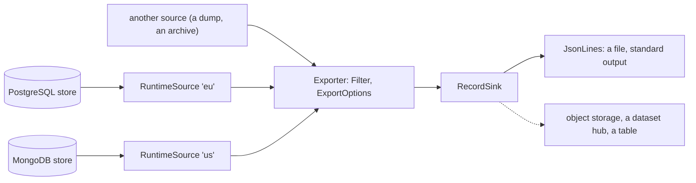

# adam-export

Turns adam-rs runs into training records: one JSON Lines record per run, in the chat shape most
trainers read, with the facets a stack filter needs, the outcome the store holds, every string
scrubbed and every id a pseudonym. The conversion is pure: no store driver and no I/O. Where runs
come from and where records go are two ports, `RunSource` and `RecordSink`, with an adapter each
here (`RuntimeSource` over any `Store`, `JsonLines` over any `std::io::Write`) and their
conformance suites in [`adam-export-testkit`](../adam-export-testkit/README.md). The `Exporter`
reads one or several sources into one sink.

The decision is
[ADR 0087](https://github.com/vymalo/another-adam-rs/blob/main/docs/decisions/0087-runs-are-exported-as-training-records.md),
slices E1, E4 (the outcome contract) and E5 (per-turn samples). The binaries' `export` subcommand (slice E2) is described in
[`adam-agent`](../../bin/adam-agent/README.md) and [`adam-coder`](../../bin/adam-coder/README.md);
the training pipeline around it is the guide
[Export runs for training](../../docs/guides/export-runs-for-training.md).

## What is in it

| Item | Purpose |
|---|---|
| `record_of(&RunMeta, &Conversation, &ExportOptions) -> Record` | One run to one record. Pure. |
| `record_with(&RunMeta, &Conversation, Option<&RequestShape>, &ExportOptions) -> Record` | The same, with the prompt and tools the run recorded (`Conversation::request`, read from the store); they win over the current ones and the record says `recorded`. |
| `samples_of(&RunMeta, &Conversation, &[TurnRequest], &ExportOptions) -> Vec<Record>` | One record per assistant turn since the run's last compaction, oldest first: the request of that call and its answer last (*Per-turn samples*). Pure; applies no token budget. |
| `TurnRequest { turn, shape: RequestShape }` | The prompt and tools a run recorded for its calls from `turn` on (`Conversation::requests`, read from the store). |
| `Samples` | `Run` (the default: one record per run) or `Turn` (one per assistant turn). |
| `estimated_tokens(&Record) -> u64` | The characters of a record's messages and tools divided by four, rounded up: an estimate, adam's own rule (`adam-llm-agent`'s history estimate). |
| `turns_lost_to_compaction(&Conversation) -> u32` | The run's turns before its last compaction, which have no sample. |
| `RunMeta`, `RunMeta::of(&RunRecord, error)`, `.with_artifacts(..)` | A run's bookkeeping without its state: id, agent, conversation id, parent, status, times, error, and its JSON artifacts (`artifacts: Vec<RunArtifact>`, what the outcome is read from; `of` leaves it empty). The field is new: **breaking** for a `RunMeta { .. }` literal outside the crate. |
| `RunArtifact::new(name, mime_type, data)`, `RunArtifact::json(name, data)` | One JSON artifact of a run, as it committed it. `#[non_exhaustive]`. |
| `pull_requests_of(&[RunArtifact], &Pseudonyms) -> Vec<PullRequestOutcome>`, `checks_of(&[RunArtifact]) -> Option<ChecksOutcome>` | What a run delivered, read from the artifacts of the outcome contract (*The outcome contract*). Pure. |
| `PULL_REQUEST_ARTIFACT`, `CHECKS_ARTIFACT`, `JSON_MEDIA_TYPE` | The contract's names: `pull_request`, `checks`, `application/json`. |
| `ExportOptions` | `new(Pseudonyms)`, then `.scrub(..)` (the deployment's secrets), `.include_reasoning(bool)`, `.current(agent, RequestShape)` (the agent's current prompt and tools), `.samples(Samples)` and `.max_tokens(Option<u32>)` (the driver leaves out a record over it, whole). |
| `RequestShape` | A system prompt and a list of `ToolSpec`, as the export passes them. |
| `Exporter::new(Filter, ExportOptions)`, `.run(&[&dyn RunSource], &mut dyn RecordSink) -> Result<Summary, ExportError>` | The pipeline: for each source, for each of its agents, reads the runs page by page and puts the records the filter accepts into the sink: one per run, or its samples with `Samples::Turn`, each under `max_tokens`; then finishes the sink. *Ports and adapters*, below. |
| `RunSource` (port), `SourceQuery`, `SourcePage`, `SourceRun`, `Skipped`, `Cursor`, `SourceError` | Where runs come from. |
| `RuntimeSource::new(Runtime)`, `.only(agents)`, `.named(label)` | The source over a runtime, so over every `Store` adapter. |
| `RecordSink` (port), `SinkError` | Where records go. |
| `JsonLines::new(W: Write + Send)`, `.into_inner()`, `.get_ref()` | The sink of one JSON object per line, flushed on `finish`. |
| `export_runs(&Runtime, agents, &Filter, &ExportOptions, &mut (impl Write + Send)) -> Result<Summary, ExportError>` | The convenience path: an `Exporter` over one unnamed `RuntimeSource` into `JsonLines` (`export_runs_is_the_exporter_over_one_unnamed_runtime_source`). The writer must now be `Send`. |
| `write_record(&mut impl Write, &Record)` | One record as one line of JSON, as `JsonLines` writes it. |
| `Summary` | `seen`, `written` (records: runs, or samples), `filtered` (runs), `not_a_conversation`, `unreadable`, `over_budget` (records left out by `max_tokens`), `turns_lost_to_compaction` and `inexact` (samples written with `exact: false`), summed over every source. **Breaking** for a `Summary { .. }` literal outside the crate: it needs the three new fields or `..Summary::default()`. |
| `ExportError` | `Source` (a page failed; its class), `Sink` (its class: a write is `Transient`, a put after `finish` `Internal`), `Labels` (several sources and one has no label of its own: `Invalid`, nothing read). `#[non_exhaustive]`. Implements `Classify`. **Breaking**: it was `Runtime`, `Write`, `Json`. |
| `Filter` | Which records are written; `Filter::parse_requirement("lang=rust")`. See *Filters*. |
| `Record`, `ChatMessage`, `ChatToolCall`, `FunctionCall`, `ToolDef`, `FunctionDef`, `Outcome`, `OutcomeArtifact`, `PullRequestOutcome`, `ChecksOutcome`, `Facets`, `ToolsSource`, `TrainOn`, `Sample`, `SCHEMA` | The record (below). `Serialize` and `Deserialize`. `Record` gained `train_on`, `sample` and `source`, `Outcome` gained `pull_requests` and `checks` (and `Outcome::verified`): **breaking** for a `Record { .. }` or `Outcome { .. }` literal outside the crate. |
| `facets` (module) | `facets_of(&[Message]) -> Facets`, the kinds `LANG` and `DEP`. |
| `Scrub`, `NoSecrets`, `scrub_known_shapes` | What removes secrets. A closure `Fn(&str) -> String` is a `Scrub`. |
| `Pseudonyms`, `NoRandomness` | HMAC-SHA256 pseudonyms; `Pseudonyms::new(key)` or `Pseudonyms::random()`. |
| `IMAGE_PLACEHOLDER` | `[image]`, what an image part becomes. |

## The record: `adam.export/v1`

One line per run (wrapped here):

```json
{"schema":"adam.export/v1","id":"9b1d0c6e4f2a8b37c5d1e0f9a6b4c2d8","agent":"coder","status":"done",
 "created_at":"2026-11-27T09:12:03Z","updated_at":"2026-11-27T09:20:41Z","turns":2,"tool_calls":1,
 "usage":{"input_tokens":5120,"output_tokens":310},"models":["main"],"compacted":false,
 "facets":{"dep":["axum"],"lang":["rust"]},"outcome":{"status":"done"},"tools_source":"none",
 "messages":[{"role":"user","content":"Add a /health route."},
  {"role":"assistant","content":"","tool_calls":[{"id":"c1","type":"function","function":{"name":"read","arguments":"{\"path\":\"src/main.rs\"}"}}]},
  {"role":"tool","tool_call_id":"c1","content":"use axum::Router;\n..."},
  {"role":"assistant","content":"Done: GET /health returns 200."}]}
```

| Field | What |
|---|---|
| `schema` | always `adam.export/v1`. A new field is not a new schema; a changed meaning is |
| `id`, `parent`, `conversation` | pseudonyms of the run, the run it works for (a child) and its conversation; never the store's ids |
| `source` | the label of the source the run was read from (`RunSource::label`), as the operator named it; absent when the export reads one unnamed source, which is what the binaries' `export` does, so their lines are the ones they wrote before |
| `agent`, `status` | the agent's name; `runnable`, `parked`, `done` or `failed` |
| `created_at`, `updated_at` | RFC 3339 |
| `turns`, `tool_calls`, `usage` | the run's model calls, tool calls and tokens (`adam_model::Usage`) |
| `models` | the model aliases the assistant turns name, sorted, plus both sides of a fallback switch |
| `compacted` | a compaction, a shortening, omitted turns or a summary replaced history: `messages` are not what the model saw at every turn |
| `facets` | `{kind: [values]}`, derived from the transcript (*Facets*) |
| `outcome` | `status`, the scrubbed `error` of a failed run, the run's `artifacts` by `name` and `mime_type`, and what it delivered: `pull_requests` (`[{number, repository?, verified}]`, left out when none) and `checks` (`{passed, reports, failed}`, left out when none), read from the artifacts of the outcome contract (below) |
| `tools_source` | `none` (no system message, no tools), `current` (the agent's current ones, passed by the export) or `recorded` (the system prompt and tools the run's last model call was sent, `Conversation::request`, read with `RecordedRequest::load`; `RuntimeSource` reads them when their blobs are still in the store). A per-turn sample's are those recorded for its call |
| `train_on` | which messages carry the loss: `assistant` (a whole run: every assistant message) or `last` (a per-turn sample: its last message). A record written before the field reads as `assistant` |
| `sample` | a per-turn sample only: `{turn, index, of, exact}`, the model call (from 0), its place among the run's samples (from 0) and their number, and whether the messages and tools are what that call was sent (*Per-turn samples*) |
| `messages` | an optional `system`, then `user`, `assistant` (`content`, `tool_calls` as `{id, type: "function", function: {name, arguments}}` with `arguments` a JSON text, optional `reasoning_content`) and `tool` (`tool_call_id`, `content`) |
| `tools` | `{type: "function", function: {name, description, parameters}}`; left out when empty |

An assistant call whose arguments were not valid JSON keeps the model's own text as `arguments`. A
subagent's run is its own record, linked by `parent`. A chat with no tools is the same record with
no `tools`.

## Per-turn samples

With `Samples::Turn` (`--samples turn`) a run becomes one record per assistant turn: the system prompt and tools
recorded for that model call, the history before its answer, and the answer as the last message (`train_on: "last"`).
A sample is about as long as the request was, so a small card's budget (`max_tokens`) keeps most of a long run, and a
sample that starts with a compaction's marker teaches a model to go on after a compaction. The run's fields (facets,
outcome, models, counts, `compacted`) are on each of its samples.

**What a sample can be.** The store holds a run's **current** history:

* **After a compaction**, the turns before it are a marker; only the answers of the calls since the **last**
  compaction have their prefix, and only they are samples. The earlier turns are counted
  (`Summary::turns_lost_to_compaction`), never rebuilt. The answers a compaction kept verbatim are context, not
  targets: they were made from the longer history.
* **A shortening** rewrites old tool results in place (`Conversation::shortenings` names the turn): a sample of a call
  before a later shortening is `exact: false`.
* **The tools of a call** are the entry of `Conversation::requests` with the latest `turn` at or before it (an entry is
  recorded each time the prompt or tools change, at most 64). Before the first entry (a run recorded before slice E5
  has only its last call's, `Conversation::request`), the first entry, and `exact: false`. With none recorded, the
  agent's current ones or none, and `exact: false`.

**Which answer is which call.** Each model call puts one assistant message in the history, so answers are placed from
the newest back (`Conversation::turns` counts the calls), which also skips what a continued run carried from the run
before. The assistant message the loop writes for the reports of sessions (only `report_*` calls of `subagent_read`)
is never a target. A thinking-cut turn whose message left the history is found by the instruction the loop wrote
after it. The closing turn's instruction (`CLOSING_TURN`), sent but not kept, is put back before the closing answer.

`exact: false` also when: the count of answers and calls does not add up (an answer dropped after a lost commit, for
example), so the turns are a guess; the loop added a read to the answer (`wait_<turn>`); a run with a limit has an
answer that may be a closing one; the last call recorded no request and the sample is after the last recorded entry;
the run's context names an interface language (the request had a turn for it, which the history does not keep and
the export never writes). "Exact" is up to scrubbing, and images written `[image]`.

**The budget.** `max_tokens` leaves out a whole record whose `estimated_tokens` is over it, counted in
`over_budget`; nothing is cut in the middle, which would part a tool call from its result. It applies to run records
too. The estimate is characters / 4, not a tokenizer's count.

## Facets

A facet is a heuristic, not a fact. Both kinds are read from the assistant's tool call arguments;
`dep` also from tool results. **What a person wrote is never read for facets.**

| Kind | Derived from |
|---|---|
| `lang` | the extension of each file a tool call names (`src/main.rs` is `rust`; about forty extensions, `.toml`, `.md`, `.yaml` and `.json` included), and the build tool that starts a command or follows `&&` or `\|` (`cargo` and `rustc` are `rust`, `npm` is `javascript`, ...). A URL is not a file |
| `dep` | the dependency tables of a `Cargo.toml` (`[dependencies]`, `[dev-dependencies]`, `[build-dependencies]`, their `[workspace.*]` and `[target.*.*]` forms, and `[dependencies.<name>]`), the `dependencies`, `devDependencies`, `peerDependencies` and `optionalDependencies` of a `package.json`, and the crate of each `use <crate>::` or `extern crate` in Rust text. A file reader's line-number prefix is ignored |

Values are lower case, and a crate's `_` is written `-`, so `use tower_http::` and
`tower-http = "0.6"` are one dependency. `std`, `core`, `alloc`, `crate`, `self`, `super` and
`proc_macro` are not dependencies. Limits: a run that never names a file has no `lang`; a `use` of
one of the project's own modules counts as a `dep`; a manifest the run never read or wrote is not
seen. Facets are read before the text is scrubbed, and are names, never values.

## Filters

| Field | Default | Meaning |
|---|---|---|
| `statuses` | `[Done]` | only these statuses; empty for every one |
| `since`, `until` | none | `updated_at` at or after `since`, before `until` |
| `require` | none | facets every record must have: `("lang", "rust")`, `("dep", "cratestack")` |
| `include_compacted` | `false` | keep runs whose history was compacted |
| `min_turns` | `1` | the fewest model calls |
| `verified_only` | `false` | only runs that delivered verified work, `Outcome::verified`: at least one pull request, and every one `verified` (`--verified-only`) |

A record is also written only when it has at least one assistant message. `Filter::default()` is a
training export's: finished runs, not compacted, with at least one turn. **With `Samples::Turn` a compacted run is kept
whatever `include_compacted` says**: its samples start at its last compaction, so they are what the model was sent;
the filter's other fields decide on the run before its samples are made.
`Filter::parse_requirement` reads `kind=value`, trims both sides and lower-cases the value.

## Privacy

* **Every string passes the `Scrub`** the caller gives (the binaries build it from the redactor
  their tools use), then `scrub_known_shapes`, whatever the `Scrub` is: GitHub tokens, OpenAI- and
  Anthropic-style keys, AWS access key ids, Slack tokens, bearer headers, PEM private keys and the
  password of a URL become `adam_llm_agent::REDACTED_MARKER`, the marker the model already knows.
  Tool definitions' descriptions are cleaned too; their parameter schemas are copied as they are.
* **Ids are pseudonyms**: the first 16 bytes of `HMAC-SHA256(key, kind || 0x00 || id)`, 32 hex
  digits. The same key links two exports; without it nothing links back to the store.
  `Pseudonyms::random()` makes a key per export. `Debug` never shows the key. A tool call's id is
  the model's own and is kept.
* **Never exported**: the conversation's `context` (the caller is a key in it), its
  `prompt_statement` and its session header. Only `messages`, `turns`, `tool_calls`, `usage`,
  `artifacts` (names and media types), `model_switch` and the compaction bookkeeping are read, and, for per-turn
  samples, `request`, `requests`, `limit`, `continued_from` and whether `context` names an interface language (to
  mark samples not exact; the language is never written).
* **Images** become `[image]`: a user's or assistant's image part, and one line per image of a
  tool result. No image bytes are exported.
* **Reasoning** is exported only with `include_reasoning(true)`, and only when the run kept it.
* **A pull request is its number and a verdict.** Of a `pull_request` artifact only `number` and `verified` are
  written, and the repository as a pseudonym (kind `repository`): the URL, the repository's address and the commit
  name an owner and a host (a commit is searchable on a public one), and scrubbing removes secrets, not names. A
  `checks` artifact gives two counts and a boolean. So the contract adds no free text to a record.

The messages a person wrote are exported: which threads a deployment may train on is the
operator's call.

## The outcome contract

What a run delivered is read from two of its artifacts, by name and media type. The contract is the exporter's, so
`adam-export` depends on no agent: any agent that emits them gets the same `outcome`, and
[`adam-coder`](../../bin/adam-coder/README.md) emits both (its tests read its artifacts back through
`pull_requests_of` and `checks_of`).

| Artifact | Media type | Data read | Becomes |
|---|---|---|---|
| `pull_request` (`PULL_REQUEST_ARTIFACT`) | `application/json` | an object: `number` (decimal digits in a string, as A2A needs, or a non-negative integer; required), `repository` (a string), `verified` (a boolean; absent is `false`) | one `pull_requests` entry per repository and number, in the order first reported, each as **last** reported (a pull request updated with red checks is no longer verified) |
| `checks` (`CHECKS_ARTIFACT`) | `application/json` | an object: `passed` (a boolean; required) | `checks`: `passed` of the last verdict, `reports` (how many), `failed` (how many did not pass) |

Any other member is not read. An artifact of either name with another media type (`application/json; charset=...` is
fine), or without its required member, is not part of the outcome; it is still listed by name in `artifacts`. A run
with neither has the record it had before (`a_record_without_a_source_is_the_line_it_was`). `RuntimeSource` gives the
run's JSON artifacts as `RunMeta::artifacts` (a file artifact is left out: its bytes are never read); another source
fills them with `RunMeta::with_artifacts`.

## Ports and adapters

The pipeline knows two ports and nothing of a store or a file. A deployment may keep runs in
several stores (one per region, an old database and a new one), and a dataset may go to a file, a
bucket or a dataset hub: each is an adapter, and the `Exporter` reads **several sources into one
sink**. The pseudonym key is the export's, not the source's, so ids link across sources and across
exports.



| Port | Methods | Contract (checked by the testkit) |
|---|---|---|
| `RunSource: Send + Sync` | `label() -> Option<&str>`, `agents() -> &[String]`, `async page(&SourceQuery, Option<&Cursor>) -> Result<SourcePage, SourceError>` | the pages of a query are disjoint and cover every run once; a page lists at most `SourceQuery::limit` runs; a run outside the query, not a conversation, or unreadable is **counted** in `Skipped`, never yielded; a `Cursor` is opaque and read only by its source, and the same cursor answers the same page; `next: None` ends the listing |
| `RecordSink: Send` | `async put(&mut self, &Record) -> Result<(), SinkError>`, `async finish(&mut self) -> Result<(), SinkError>` | records are kept in order, each once; after `finish` every record is durable and visible; `finish` is idempotent; a `put` after it is `SinkError::Finished` (`Internal`) and writes nothing |

Both are `#[async_trait]`, as `Store` and `Notifier` are. A sink takes `&mut self`: an export owns
its sink, so order needs no lock (a `Store` takes `&self` because many workers share it). Neither
error names a backend type: an adapter boxes its error into `SourceError::Backend` or
`SinkError::Backend` with the class it chose (`SourceError::backend(class, e)`); a runtime's error
keeps its class (`From<RuntimeError>`), a write's `std::io::Error` is `Transient`, a cursor the
source did not make `Invalid`.

A label is the operator's name for a source (`eu`, `archive-2025`), written as each record's
`source`: never a host, a URL or a credential. One source may be unnamed; several must each have a
label of their own, or the export is `ExportError::Labels` before anything is read.

### Write an adapter

1. Implement the port in your own crate: a source over another store or a dump (it fills a
   `SourceRun::new(RunMeta, Conversation, requests)` per run, the run's JSON artifacts in
   `RunMeta::with_artifacts`, and counts what it cannot yield in `Skipped`), or a sink to object storage, a Hugging Face dataset or a database table (it buffers
   in `put`, makes the records visible in `finish`, and refuses a `put` after it).
2. Add `adam-export-testkit` as a dev-dependency and run the suite from an integration test:
   `source_conformance!(make_source)` with an `async fn(Vec<SeedRun>) -> Option<Box<dyn RunSource>>`
   that writes the seeds where a fresh source reads them, or `sink_conformance!(make_sink)` with an
   `async fn() -> Option<SinkFixture>`: a fresh sink and a `Readback` of its destination. `None`
   skips (and fails under `ADAM_TEST_REQUIRE_DB=1`).
3. Pass it to an `Exporter` beside the others. A backend reached only through a `Store` needs no
   source of its own: `RuntimeSource` reads it once its store passes `store_conformance!`.

## `RuntimeSource` and its limits

A page is one `Store::list_runs`, newest first, `SourceQuery::limit` runs (the `Exporter` asks for
100), with the query's statuses and `since` pushed into it; `until` is checked here and counted as
`outside_query` (the summary's `filtered`). Its cursor is the last run's `(updated_at, id)`. Each
run is joined with `Runtime::state`, so **each agent must be registered on the runtime** (its
`join` reads a run's transcript). A state that does not decode as a `Conversation` with messages
counts as `not_a_conversation` (another kind of agent, or a run that never started). A run whose
state cannot be read is logged with its id and counted as `unreadable`; the export goes on. A
failed listing or write stops it.

**Only runs that have a conversation id are listed.** The query's scope is
`ConversationScope::Prefix("")`, and `ConversationScope::contains` is `false` for a run with no
conversation id. **Every subagent's run has one** since [ADR 0089](../../docs/decisions/0089-every-child-is-a-session-and-the-one-shot-subagent-tool-goes.md)
slice C1: a subagent's own tool starts its child as a one-shot session (`<parent escaped>/s/<id>`),
so it is a record of its own, its `parent` the pseudonym of the parent's record
(`a_subagents_run_is_a_record_of_its_own_linked_to_its_parent` in `tests/export.rs`). Child sessions
and a session's timer runs have one too. Still not reached: a child a host starts itself with
`Runtime::start_child` (it has none), and a subagent's run from before C1. Export the subagents' agent
names too (`coder/reviewer`): a source lists by agent, and the `export` subcommand takes every
registered agent by default.

## Environment

None: the crate reads no variable. The binaries read `EXPORT_PSEUDONYM_KEY` for the key of
`Pseudonyms::new` ([environment variables](../../docs/reference/environment.md)).

## Tests

`cargo test -p adam-export` runs the unit tests:

* facets: `a_path_and_a_command_say_the_language`, `a_cargo_manifest_names_its_dependencies`,
  `a_use_line_names_its_crate`, `a_package_json_names_its_dependencies`,
  `what_a_person_wrote_is_not_read`;
* filter: `a_requirement_is_kind_equals_value`, `the_default_keeps_finished_runs_only`;
* samples: `each_answer_is_a_sample_with_its_prefix_and_its_turns_tools`,
  `without_a_recorded_request_no_sample_is_exact`, `a_compacted_run_starts_at_the_marker_and_counts_what_it_lost`,
  `a_later_shortening_makes_the_earlier_samples_inexact`, `the_reports_message_is_context_and_a_cut_turn_still_counts`,
  `the_closing_answer_is_asked_with_the_closing_instruction`, `a_read_the_loop_added_marks_its_answer_or_the_run_inexact`,
  `the_estimate_is_a_quarter_of_the_characters`;
* pseudonyms: `the_mac_is_hmac_sha256` and `a_long_key_is_hashed_first` (RFC 4231 cases 2 and 6),
  `a_pseudonym_depends_on_the_key_and_the_kind`;
* scrub: `every_known_shape_is_removed`, `a_url_keeps_everything_but_its_password`,
  `ordinary_text_is_borrowed`, `a_closure_is_a_scrub`;
* convert: `a_record_without_a_source_is_the_line_it_was` (the bytes of a record with no `source` are the
  line the exporter wrote before the ports, captured before the change, and stay so for a run whose artifacts are not
  the contract's), `the_outcome_contract_adds_the_pull_requests_and_the_checks`,
  `verified_only_keeps_a_run_whose_every_pull_request_was_verified`;
* outcome: `a_pull_request_is_its_number_its_repository_s_pseudonym_and_whether_it_was_verified`,
  `the_last_report_of_a_pull_request_wins_and_each_pull_request_is_listed_once`, `what_is_not_the_contract_is_not_read`,
  `a_verified_flag_that_is_not_true_is_not_verified`, `the_checks_are_the_last_verdict_and_the_counts`;
* sink: `each_record_is_one_line_of_json_in_order`, `a_refused_write_is_transient`;
* the pipeline: `several_sources_need_labels_of_their_own`.

The integration tests in `tests/export.rs` cover the conversion and the pipeline end to end:
`a_stack_filter_keeps_the_run_that_read_the_manifest`, `a_turn_export_writes_one_sample_per_answer` (two calls,
two samples with the recorded tools, `train_on: "last"`, and a budget that keeps the first),
`a_subagents_run_is_a_record_of_its_own_linked_to_its_parent`,
`the_outcome_says_whether_the_pull_request_was_verified` (a tool's `checks` and `pull_request` artifacts read back from
the store, the repository a pseudonym, `verified_only`),
`two_stores_export_into_one_sink_with_their_labels_and_linked_ids` (two memory stores, labels, the same id alone and
together, an unnamed source among several refused) and `export_runs_is_the_exporter_over_one_unnamed_runtime_source`
(byte for byte). The conformance suites run against `RuntimeSource` (memory store) and `JsonLines` in
[`adam-export-testkit`](../adam-export-testkit/README.md)'s own tests, as `adam-store-testkit` runs the memory store's:
a dev-dependency on the testkit would be a cycle. No test needs a database.

## See also

* [ADR 0087](../../docs/decisions/0087-runs-are-exported-as-training-records.md): the decision and
  its slices.
* [`adam-export-testkit`](../adam-export-testkit/README.md): the conformance suites of the two ports.
* [Export runs for training](../../docs/guides/export-runs-for-training.md): the pipeline, from
  collecting runs to evaluating a tuned model.
