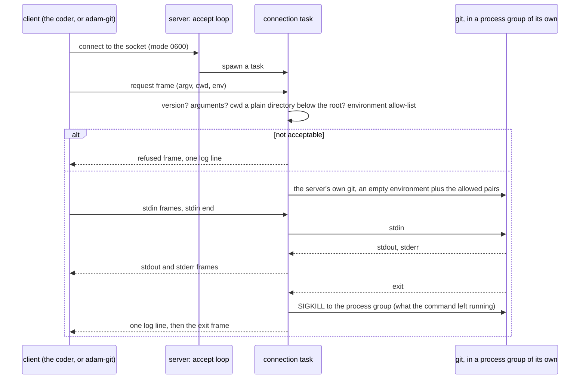
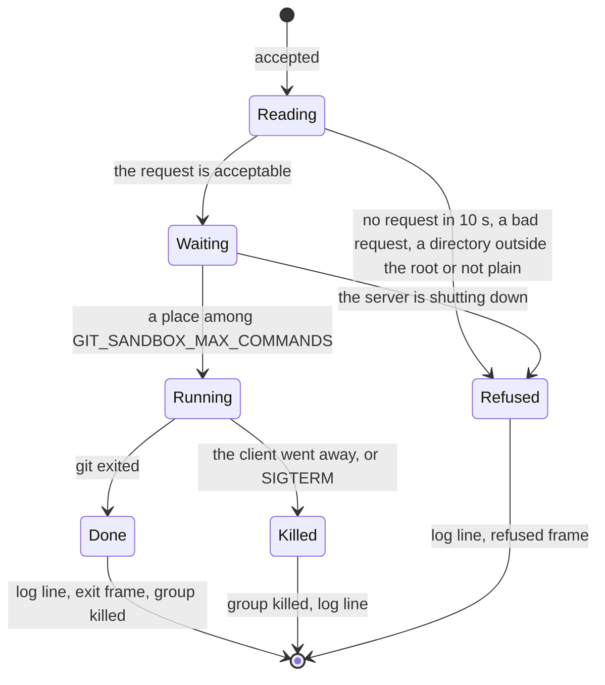

# adam-git-sandbox

Runs the coder's **local `git` where no secret is readable.**

`git` runs what a repository's configuration names: a `filter.<x>.clean` in a scratch project's `.git/config`, a
`textconv`, the configuration of an embedded repository that the coder's `git status`, `git add -A` or `git diff` enters.
Git has no switch that turns this off, and driver names are arbitrary, so it cannot be overridden key by key. The repositories
inside a run's working tree are written by the run. So the command has to run **where nothing secret can be read**: in this
crate's server, in a container of the coder's pod that has no Secret volume, no secret variable and no service-account token.

The crate is a library and two binaries, all in the coder image:

| | What |
|---|---|
| `adam-git-sandbox` | the **server**: listens on a Unix socket, runs the one `git` it resolved at startup for each connection, and streams the output back |
| `adam-git` | the **relay**: stands in for `git`; sends its arguments, its directory, the variables the sandbox allows and its input over the socket, and ends with git's exit code. It never runs git itself |
| `adam_git_sandbox` (the library) | the protocol, the environment allow-list, the directory check, the server and the **client** that [`adam-workspace`](../adam-workspace/README.md) uses in its own process |

It is **off unless the socket is configured** (`GIT_SANDBOX_SOCKET` in the coder). Which commands go where, and why a
command that carries a token never does, is in [`adam-workspace`](../adam-workspace/README.md#where-git-runs-the-git-sandbox);
the decision is [ADR 0041](../../docs/decisions/0041-a-run-pod-sees-only-its-own-run.md) (open decision 6, issue
[#118](https://github.com/vymalo/another-adam-rs/issues/118)).

```sh
GIT_SANDBOX_LISTEN=/run/git/git.sock GIT_SANDBOX_ROOT=/work adam-git-sandbox &
GIT_SANDBOX_SOCKET=/run/git/git.sock adam-git -C /work/workspaces/run/slot status --porcelain
```

## A command from end to end





A command **never outlives its connection**: when git exits, the server kills the process group it ran in (a filter that
daemonised does not stay); when the client goes away (a timeout, a killed relay) or the server gets SIGTERM, it kills the group
while the command still runs. Dropping the future of [`Client::output`] is how a timeout ends the command.

## The protocol

One connection, one command. Frames in both directions:

```text
+------+--------------------+----------------+
| kind | length (u32, BE)   | payload        |
| 1 B  | 4 B                | length bytes   |
+------+--------------------+----------------+
```

| Kind | Direction | Payload |
|---|---|---|
| `0x01` request | client to server | JSON [`Request`](src/protocol.rs); exactly one, and the first frame |
| `0x02` stdin | client to server | bytes for the command's standard input |
| `0x03` stdin end | client to server | empty: the standard input is closed |
| `0x81` stdout | server to client | bytes the command wrote to its standard output |
| `0x82` stderr | server to client | bytes the command wrote to its standard error |
| `0x83` exit | server to client | JSON `{"code": 0}` or `{"signal": 9}`; the last frame of a command that ran |
| `0x84` refused | server to client | JSON `{"reason": "bad_directory", "message": "..."}`; the last frame of a command that was not started |

A payload is at most 4 MiB; data is cut into frames of at most 32 KiB. A client stays connected until it has read the last frame; a
connection that ends earlier is how it says it has gone. The server reads a request within 10 s, and at most 256 MiB of standard
input from one client. A frame of an unknown kind, a payload that is not what its kind says and a second request end the
connection. The request:

```json
{
  "v": 1,
  "argv": ["-c", "core.hooksPath=/dev/null", "status", "--porcelain=v1", "-z"],
  "cwd": "/work/workspaces/run-1/lib",
  "env": [{"name": "GIT_DIR", "value": "/work/git/github.com/acme/lib.git/worktrees/run-1+lib"}]
}
```

`argv` is what follows `git`; the server puts its own `git` in front of it, **whatever the request says** (an argument that looks like
a program, a shell or another git is an argument). A string that is not UTF-8 crosses as `{"b64": "..."}`. Unknown fields are refused,
and so is any `v` but `1`. `reason` is one of `bad_request`, `unsupported_version`, `no_arguments`, `bad_directory`, `spawn_failed`,
`shutting_down`; the message names no argument and no value of the environment.

## What a command gets

* **The directory** must be the root (`GIT_SANDBOX_ROOT`) or below it, spelled with plain components (no `..`), and every component
  is opened from the root with `O_NOFOLLOW`: a slot or a mirror that a run replaced by a link to somewhere else is refused
  (`bad_directory`). The check is made right before the command starts, and git is given the name and not a descriptor, so a swap in the
  moment between is not seen; what that buys a run is a place in the sandbox, which holds nothing secret.
* **The environment** is the request's, filtered by an allow-list, and a fixed `PATH` (`/usr/local/bin:/usr/bin:/bin`). Allowed:
  the locale and time zone (`LANG`, `LANGUAGE`, `LC_ALL`, `TZ`), `HOME`, the variables that say which repository git works on and who
  wrote the commit (`GIT_DIR`, `GIT_COMMON_DIR`, `GIT_WORK_TREE`, `GIT_INDEX_FILE`, `GIT_OBJECT_DIRECTORY`,
  `GIT_ALTERNATE_OBJECT_DIRECTORIES`, `GIT_NAMESPACE`, `GIT_CEILING_DIRECTORIES`, `GIT_DISCOVERY_ACROSS_FILESYSTEM`, `GIT_AUTHOR_*`,
  `GIT_COMMITTER_*`) and the ones that say how it behaves (`GIT_CONFIG_GLOBAL`, `GIT_CONFIG_SYSTEM`, `GIT_CONFIG_NOSYSTEM`,
  `GIT_TERMINAL_PROMPT`, `GIT_OPTIONAL_LOCKS`, `GIT_NO_REPLACE_OBJECTS`, the pathspec switches). **Not allowed**, whatever the
  client sends: `GIT_CONFIG_COUNT`, `GIT_CONFIG_KEY_<n>`, `GIT_CONFIG_VALUE_<n>` and `GIT_CONFIG_PARAMETERS` (the way the coder
  hands a token to a command, so a command that carries one cannot reach the sandbox by mistake), `GIT_EXEC_PATH`, `GIT_ASKPASS`,
  `SSH_ASKPASS`, `GIT_SSH*`, `GIT_PROXY_COMMAND`, `GIT_EDITOR`, `GIT_PAGER`, `GIT_EXTERNAL_DIFF`, `GIT_TEMPLATE_DIR`, `GIT_TRACE*`, `TMPDIR`,
  proxies, certificates and every other variable. Both ends apply the list: the client so that a secret never leaves its process, the
  server because it does not trust its client. The server starts from an empty environment, so nothing of the server's own is inherited.
* **The process** is the server's `git` in a process group of its own, with the client's input and the output going back as frames.

## Variables

The server reads these once at startup, every problem at once (`invalid configuration`, exit 78). The same table is in
[`docs/reference/environment.md`](../../docs/reference/environment.md#git-sandbox-adam-git-sandbox-adam-git).

| Variable | Read by | Meaning | Default |
|---|---|---|---|
| `GIT_SANDBOX_LISTEN` | the server | the Unix socket to listen on: an absolute path, made with mode `0600` | required |
| `GIT_SANDBOX_ROOT` | the server | the work volume: an absolute path of an existing directory; commands run below it and nowhere else | required |
| `GIT_SANDBOX_GIT` | the server | the `git` to run: an absolute path of an executable file | the first `git` on `PATH`, found once at startup |
| `GIT_SANDBOX_MAX_COMMANDS` | the server | commands run at once (1 to 4096); the next waits | `64` |
| `RUST_LOG` | the server | log filter; JSON logs on stdout | `info` |
| `GIT_SANDBOX_SOCKET` | the relay, and the coder | the server's socket, an absolute path | required by the relay; optional for the coder (unset: no sandbox) |

A socket path that exists and is **not a socket** (a file, a link) is never replaced (exit 71). A socket that a server answers on is
not either. One that nobody answers on (a server that died) is replaced. The socket is made under a `0177` umask and set to `0600`: the
control is the mode of the socket and of the directory it lives in, which the deployment shares with the coder only.

## Exit codes

| Process | Code | When |
|---|---|---|
| `adam-git-sandbox` | 0 | clean shutdown after SIGTERM or Ctrl-C: the commands that still run are killed, the socket is removed |
| | 78 | the configuration (the log line lists every problem), or the root cannot be opened |
| | 71 | the socket cannot be made (see above) |
| `adam-git` | git's own | it ran and ended; 128 plus the signal for a command a signal killed |
| | 78 | `GIT_SANDBOX_SOCKET` is not set or not an absolute path: nothing was run, git was not run either |
| | 69 | nobody answers at the socket |
| | 77 | the sandbox refused the command (a directory outside its root) |
| | 74 | the connection ended before the command did, or broke the protocol |
| | 141 | the output could not be written (a closed pipe) |

The values are BSD `sysexits.h` numbers (*unverified*, from memory), like the other binaries'. Errors implement
`adam_error::Classify`: `SandboxError` is `Invalid` (configuration) or `Transient` (the socket); `ClientError` is `Transient`
(unreachable, disconnected), `Invalid` (a refusal), `Internal` (git could not be started) or `Corrupt` (the protocol). The
whole tree is in [Errors](../../docs/reference/errors.md).

## Logs

JSON on stdout, **one line per command**, written before the client is told it has ended:

```json
{"level":"INFO","fields":{"message":"git command","subcommand":"status","cwd":"/work/workspaces/run-1/lib","status":"exit 0","duration_ms":4}}
```

`subcommand` is the first word after git's own options (`-c <x>`, `--git-dir=...`), and only if it is made of letters, digits, `-` and
`_` (`?` otherwise: an alias can be called anything). `status` is `exit <n>`, `signal <n>`, `killed: client gone`, `killed: shutdown` or
`refused: <Reason>` (the name of the reason, `BadDirectory` for one). The log holds **no other argument, no value of the environment and no byte of the command's output**; a test
runs commands whose arguments, messages, environment and output are all marked and reads the log for them.

## Tests

`cargo nextest run -p adam-git-sandbox`. Real `git`, real Unix sockets and the real binaries; no network.

* In the modules: the frames (every one round-trips, a limit, a frame cut short, a kind of the other direction, a payload that
  is not what its kind says, a string that is not UTF-8), the environment allow-list (the token's variables are not in it),
  the directory check (a link at the end or on the way, a file, a sibling that shares a prefix, `..`), the subcommand of a log line,
  every variable and each bad value, the class and exit code of every error.
* `tests/server.rs` (the server and the client in one process): a command gives what git gives (stdout, stderr, status), large output
  and large input cross whole, **the program is always the server's git** (a stub that prints `$0`; arguments that look like a
  program are arguments), a directory outside the root or not plain is refused and nothing runs, a request that is not one is refused,
  the environment is filtered (the keys, the database URL, the path of the App's key and a `PATH` are dropped; the author is kept), the
  variables a token travels in are dropped, how a command ends (a code, a signal), what a command leaves running neither outlives it nor
  holds the call, **a client that goes away takes the command's group with it**, a shutdown kills the commands that run and removes the
  socket, at most the limit run at once, nobody on the socket is an error and not a fallback, the socket is `0600` and a path that is not a
  socket is not replaced.
* `tests/relay.rs` (the binaries as processes): the relay gives git's stdout, stderr and status, large output and input and a patch on
  the input, **without a socket it says so and runs no git** (a `git` on its own `PATH` leaves no marker), a directory outside the root
  is 77 and nothing is made, **a killed relay takes the command's group with it**, the server's log holds the subcommands and nothing
  else, the exit codes, SIGTERM, and **the vector**: a repository whose configuration runs a program as a clean filter. Run by a caller that
  holds a secret in its environment, `git add -A` shows the program under the caller, able to read the secret (the control); through
  the relay it shows the program under the server, reading the server's environment and not the caller's.

The coder's own code paths (`RunWorkspace`, `Worktree::commit_all`, the tools' questions) against a real server are in
[`adam-workspace`](../adam-workspace/README.md#tests) and [`adam-coder`](../../bin/adam-coder/README.md#tests).

## What it does not do

* **It is not the isolation.** In these tests the server is a process of the same user on the same machine, so a program it runs can read
  the test's files. The isolation is the deployment's: another container with **no Secret volume, no secret variable and no
  service-account token** (the token becomes a projected volume mounted into the coder alone), **its own PID namespace** (no
  `shareProcessNamespace`, so it cannot read the `/proc` of the coder's processes), a read-only root filesystem and an `emptyDir` for
  `/tmp`. The chart does not run the server yet; a kind check that the sidecar has no token, no Secret and no view of the coder's
  processes, and that a commit made through it works, comes with it.
* **A filter in the sandbox still sees the whole work volume**: every run's files, as the coder's `git` does today, and it can **write
  the shared mirrors** (which is why the coder checks a mirror's configuration before every network command,
  [`adam-workspace`](../adam-workspace/README.md#the-mirrors-configuration-is-checked-not-repaired)). Closing that needs git per run in
  the run's pod, which needs a different commit path. Other people's branches in the shared mirror stay as exposed as before, until a
  mirror per person ([#122](https://github.com/vymalo/another-adam-rs/issues/122)).
* **It does not authenticate.** Whoever can connect to the socket runs `git` in the sandbox. The mode `0600` and the directory decide who
  that is.
* **It does not stop the coder's own commands from being what they are**: a command the coder runs in its own container (a run's commands
  in local mode, Podman or run pods off) is not made safer by this. Local mode stays **unprotected** and is documented as such.
* **It runs one program: git.** The arguments and the environment are the client's within the allow-list, so a client can ask git for
  anything git does (`-c alias.x=!sh`, `-c core.sshCommand=...`) in the sandbox; the sandbox has nothing to protect from its client.
* Windows and macOS: Unix sockets, process groups and `openat` are used as Linux has them.
