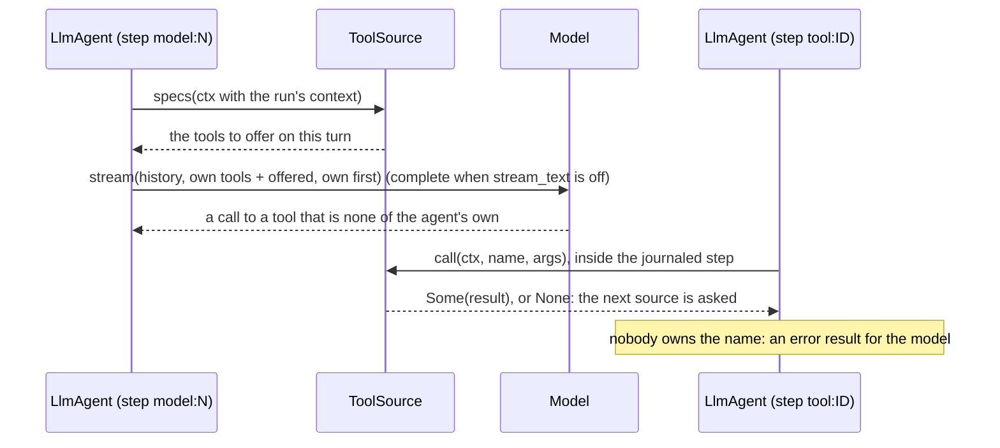
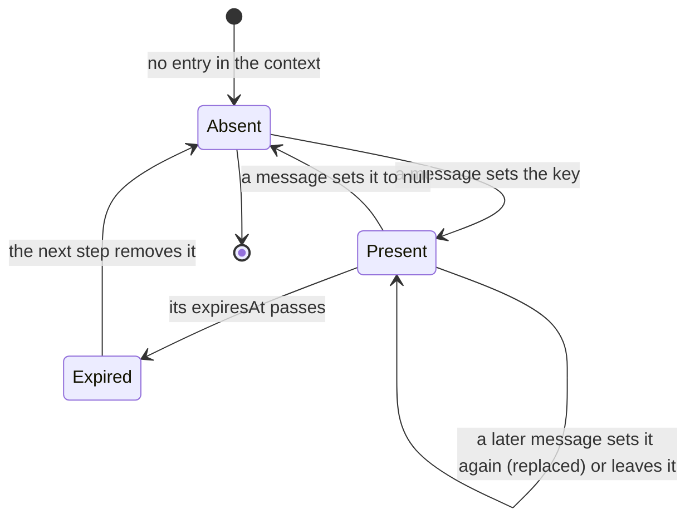

# adam-llm-agent

`LlmAgent`: a reusable, durable model/tool-calling loop on top of
`adam-runtime`.

## Where it sits

An `adam_runtime::Agent` implementation, written against the two ports it
needs: [`adam-model`](../adam-model/README.md) (`DynModel`) and
[`adam-runtime`](../adam-runtime/README.md). Every model call and every tool
call is a journaled `Ctx::step`, so a restarted worker replays what already
happened instead of repeating a side effect. An adam-rs agent is then
instructions + a model + a toolset. It is served over A2A by
[`adam-a2a-runtime`](../adam-a2a-runtime/README.md); the coder agent
([`adam-coder`](../../bin/adam-coder/README.md)) is built on it.

## API at a glance

| Item | What |
|---|---|
| `STOPPED_BY_THE_PERSON` | the error result a continued run gives a tool call that was still owed |
| `LlmAgent`, `LlmAgentBuilder` | `LlmAgent::builder(name, model, model_alias)` then `.instructions(..)`, `.tool(..)`, `.dyn_tool(..)`, `.limits(..)`, `.wait_poll(..)`, `.stream_text(..)` (on by default: see *Streamed text*), `.build()` |
| `LlmStarter` | the start-only half: `LlmStarter::new(name)` implements `adam_runtime::AgentStarter` with `State = Conversation`, needs no model or tools, and inits exactly like `LlmAgent` (same accepted payloads, same `unusable start message` rejection), and continues a prior run exactly like `LlmAgent` (see *Continuing a conversation*) |
| `Limits` | `max_turns`, `max_tool_calls`, `max_output_tokens`, `max_history_tokens`; `max_turns` and `max_tool_calls` end the run with a closing turn (below), history shortens old tool output |
| `Tool` (trait), `DynTool` | `spec() -> ToolSpec`, `async call(&ToolCtx, Value) -> Result<ToolOutput, ToolError>` and the default methods `required_state() -> Vec<StateKey>` (none) and `asks_user() -> bool` (`false`: says the tool can end a call with `NeedsInput`, so `adam-assembly` keeps it out of subagents; `#[tool(asks_user)]` and `FnTool::asking_user()` set it) and `step_style() -> StepStyle` (how a call is drawn as a step: the default is a plain `tool` labelled with the tool's name; `#[tool(step = "subagent", label = "Hand to the helper", icon = "agent")]` sets it; a tool that wraps another must forward it, as `required_state` and `asks_user`; see *Steps*) |
| `ToolOutput` | `text`, `error`, `with_artifact`. A tool can return a **file** (`with_artifact(Artifact::file(..))`, [ADR 0012](../../docs/decisions/0012-files-as-a2a-artifacts.md)): the model is told only the tool's `content` (a line such as `Shared chart.svg (1.2 KiB, image/svg+xml).`), the bytes go to the run's artifacts and never into the history, the step's output or the run's final output. The loop keeps at most `MAX_RUN_FILE_BYTES` (6 MiB) of files per run: a file that would go over is not emitted and the result, marked as an error, says so. That check comes after the result is journaled, so a tool that may return several files it did not choose keeps its result within `ToolCtx::files_left()` (`adam_runtime::ReceivedFiles` does). `ArtifactRef` (what the state and the final output list) has `bytes: Option<u64>` for a file, absent otherwise and in state written before it existed. `announcing(text)` (the member `answer`) makes `text` **the run's answer**, see *Announced answers*. `sandbox: SandboxUsage` is what the call reported with `ToolCtx::report_sandbox`, put there by the loop and journaled with the result (absent from a journal from before, not written while empty), see *Sandbox time* |
| `StepStyle`, `StepEvent`, `StepKind`, `StepState`, `StepIcon`, `StepOutput` | `StepStyle::new(kind).with_label(..).with_icon(..)`; the others are `adam-runtime`'s, re-exported (see *Steps*) |
| `StepIo` | how a call's step reports its input and output: `StepIo::default().redact(\|text\| ..).input_max(n).output_max(n)`, or `StepIo::off()`; given to the builder with `step_io(..)` (see *Steps*) |
| `ToolCtx` | run id, conversation id, attempt, call id, `child_run_id()` (the id of the child this call starts), `start_child(agent, message)` (starts it on the runtime that steps the run), `root_run_id()` (the run whose work this one serves: the top of the chain of parents for a child run, the run itself otherwise), `with_root_run(id)` for tests, `step_id()` (`tool:<call id>`), `note()` (what the source that offered the tool said of it, `ToolNote`), `parent_step_id()` / `under_step(id)` (the step this call runs under; none for a call of the model's own), `report_step(StepEvent)` (a step that runs under this call's), `emit_progress` (an update of the call's own step, the text in its detail), `cancelled` / `cancel_token`, `state::<T>()` / `require_state::<T>()`, `context(key)` / `context_map()` (the run's inbound context, see *Context and tool sources*), `files_left()` (the bytes of files the run may still share: 6 MiB less what it kept, as the call began; the loop sets it with `with_files_left` for every call and poll, a detached context has the whole 6 MiB), `report_sandbox(&SandboxUsage)` (the time this call's commands ran in a sandbox, see *Sandbox time*) with `reported_sandbox()` to read it back, and for tests `detached(..).with_state(..).with_context(..)` |
| `ToolError` | `Transient`, `Permanent`, `NeedsInput { question, ui }` (parks the run; A2A reports `input-required`; `ui` is an interface that comes with the question; build one with `ToolError::needs_input(q)` or `needs_input_with_ui(q, ui)`), `AwaitRun { run }` (the result is a child run's outcome; the run parks with a timer, A2A reports `working`), `AwaitRemote { task, timeout_ms }` (the result is the outcome of a task on another system, polled on the timer), `AwaitSession { session }` (the result is the report of a child session's round; the run parks on a `PendingWait::Session`, see *Child sessions*); `#[non_exhaustive]`, see *Errors* |
| `LlmAgentBuilder::state`, `try_build`, `tools` | `state(Arc<T>)` shares a value with the tools (one per type); `try_build() -> Result<LlmAgent, BuildError>` fails on a tool whose `required_state` was not given (`BuildError::MissingState`) or on two tools with one name (`BuildError::DuplicateTool`); `tools(ToolSet)` registers a group. `build()` is unchanged (last duplicate wins, no state check) |
| `State<T>`, `StateKey`, `Extensions` | a cheap `Arc` handle that derefs to `T`; the key of a state type; the typed map behind them |
| `ToolSet`, `tools!` | an ordered group of tools: `tools![Clock, Search::new()]`, `.extend(..)`, `.wrap(\|tool\| ..)` for middleware, `names()`, `get(..)` |
| `parse_args`, `IntoToolOutput`, `IntoToolResult`, `Json<T>` | read the model's arguments into a struct (a mistake is a `ToolOutput::error` for the model, never a panic; `null` reads as `{}`); return a `String`, `&'static str`, `Value`, `Json<T>` (compact JSON) or a `Result` of one with an error that is `Into<ToolError>` |
| `FnTool` | a tool from a closure: `FnTool::raw(name, description, schema, \|ctx, args\| async ..)`; with feature `schema`, `FnTool::builder(name).description(..).args::<A>().handler(..)` |
| `spec_for::<A>(name, description)`, `ToolSpecExt::for_args` | feature `schema`: the `ToolSpec` of a tool whose arguments are `A: JsonSchema` |
| `ToolError::from_classified(&e)` | a retryable `Classify` error becomes `Transient`, any other `Permanent`, with the whole source chain as the message |
| `__private` | feature `schema`, `#[doc(hidden)]`: the paths `#[tool]` generates code against (`serde`, `schemars`, `async_trait`, `spec_for`, `parse_args`, ...). Not API: it changes with the macro |
| `ToolSource`, `DynToolSource`, `SourceCtx`, `LlmAgentBuilder::tool_source`, `MAX_SOURCE_TOOLS` | tools the agent learns about while it runs: a source lists its tools at every model turn (`specs(&SourceCtx)`, or `listing` for the tools **and their notes**), may rewrite how the tools of that turn are described (`refine(&SourceCtx, &mut [ToolSpec])`, default: nothing), may add words to the agent's instructions for the turn (`instructions(&SourceCtx) -> Option<String>`, default: nothing), **holds tools back** (`withhold(&SourceCtx, tools: &[&str]) -> Vec<Withheld>`, default: none: the tools of `tools` it names, the agent's own and the MCP servers' included, are not shown to the model on that turn, and a call to one is refused with the `Withheld::reason` when it would run) and answers the calls to them (`call(&ToolCtx, name, args) -> Option<..>`), see *Context and tool sources* |
| `Listing`, `ToolNote`, `Conversation::source_notes` | what a source says about a tool it lists: the system behind it **reports each call as a step itself** (`reports_step`, so the agent reports none), how long a call may run (`timeout_ms`) and what its step is called (`label`); kept in the run's state with the model's answer, so a later call, on another worker, reads it without listing again |
| `Conversation::context`, `merge_context`, `drop_expired_context`, `MAX_CONTEXT_BYTES` | what the messages of the run say about their sender, merged key by key (`null` deletes), bounded, with expiring entries; see *Context and tool sources* |
| `SessionTools`, `SessionAgent`, `SESSION_TOOLS`, `SUBAGENT_START` .. `SUBAGENT_LIST`, `MAX_OPEN_SESSIONS`, `MAX_SESSION_ROUNDS`, `LlmAgentBuilder::session_agents` | the five tools that run a subagent in the background as a session (ADR 0045), and the wait a turn makes for the sessions it started: see *Child sessions* |
| `Conversation`, `PendingWait`, `PendingQuestion`, `PendingRun`, `PendingRemote`, `PendingSession`, `ArtifactRef` | what `Runtime::view(run).state` deserializes into; `PendingQuestion::ui` is the interface that came with the question (absent when there is none, and in state stored before it existed); `Conversation::pending_wait` is the question, the child run or the remote task the parked run waits for (it was `pending_question`, and state stored under that name still loads); `Conversation::continued_from` is the run a continued run carries on, and `Conversation::omitted_turns` how many turns of earlier conversation were left out to meet the cap (both absent otherwise, and in state stored before they existed), `Conversation::root_run` the top of a child run's parent chain (absent for a run that is nobody's child, and in state stored before it existed) |
| `Conversation::continued(&self, text, from: RunId)`, `LlmAgent::init_continuing`, `LlmStarter::init_continuing` | the conversation of a new run that carries on this one with one more user message; what is carried, dropped and reset is in *Continuing a conversation* |
| `Conversation::is_omission_marker(message, part)` | whether that text part is the marker (the second part of the first message while `omitted_turns` is not zero), so a rule that reads what the user said skips exactly it: the coder's `person_texts` |
| `MAX_CARRIED_BYTES`, `OMITTED_MARKER_PREFIX` | the cap on the history a continuation carries (256 KiB of JSON), and the prefix of the marker text part that stands in for the turns dropped to fit it |
| `Tool::poll_remote`, `RemotePoll` | how a tool that returned `AwaitRemote` answers "how does the task stand": `Ready(ToolOutput)` or `Working`; the default refuses |
| `DEFAULT_WAIT_POLL` | 60 s: how long a run waiting for a child sleeps before it reads the child itself |
| `user_message(text)`, `MESSAGE_KIND` | build the `Inbound` that starts or continues a run |
| `TRUNCATION_MARKER_PREFIX` | prefix of the marker left where history truncation shortened a tool output |
| `paging` (`PAGE_LINES`, `PAGE_BYTES`, `MAX_ITEM_BYTES`, `MAX_LINE_CHARS`, `MAX_TOOL_RESULT_BYTES`, `page_lines`, `page_items`, `window`, `escape_name`, `escape_item_name`, `escape_text`, `more_line`, `end_line`, `backstop`) | the paging convention of every tool that reads (ADR 0044): `offset` (from 1, negative from the end) and `limit` in, a page and **one last line** out (`[more: 3123 lines left; next page: offset=2001]` or `[end: 5123 lines]`), the same call giving the same bytes. A page is capped in **bytes** (50 KiB of items, the first always shown, an item cut at 16 KiB) and its next offset is that of the first item **not shown**, so the final line is always last and whole and a page is never over the loop's cap; no line of a page but the final one starts with `[` (`escape_item_name` writes a name's control characters, backslash and non-UTF-8 bytes as `\n`, `\\`, `\xNN` and a leading `[` as `\x5b`; a line of a file comes behind a prefix and `escape_text` keeps it one line). `backstop` is the loop's own cap: **a tool result over 64 KiB is cut on a character boundary before it enters the history**, with `[cut by the loop: 65536 of N bytes shown]` and, only for a tool that **declares** `Tool::paged()` (`#[tool(paged)]`; never inferred from an `offset` in its schema, which an MCP tool may have), `. Call <tool> again with a later offset to read the rest`. It is a pure function of the output, applied after the step is journaled: **the journal keeps the whole output of the tool; the message the model is sent, the history and the step event the person sees (which the agent's `StepIo` then scrubs and cuts to 8 KiB) carry the cut text**, so a replay gives the same bytes. It covers tool results, a tool's refusal, a polled remote task and a child run's answer. A long MCP result is not cut here: `adam-mcp` keeps it and pages it (next row) |
| `kept` (`ReadOutput`, `READ_OUTPUT`, `KeptOutputs`, `KeptStore`, `MemoryKept`, `kept_outputs_conformance`, `keep_long`, `keep_long_cut`, `scrub_open_end`, `scrub_open_start`, `scrubbed_for_keeping`, `output_id`, `output_id_of`, `call_key`, `is_output_id`, `prepare`, `page_of`, `KeptOutput`, `KeptInfo`, `KeptError`, `MAX_KEPT_BYTES`, `MAX_RUN_KEPT_BYTES`) | **kept output** (ADR 0044, slice 3): a long result is kept whole and read back a page at a time with `read_output { id, offset?, limit? }` (a paged tool: the same call, the same bytes). The id is `o-` and 16 hex characters of the SHA-256 of the root run and the call, so a call that runs again keeps under the same id; the run is taken from the call's context, never from the arguments, so another run's id is a miss (`KeptError::NotFound`: "it was kept by an earlier task or another run, or its files have expired, and it is gone. Run the command again"; no store scans other runs for it). Two homes: a `KeptStore` (an `Arc<dyn KeptOutputs>`) in the agent's state, which the coder fills with files on its volume (the text is not in the journal and a worker that takes the run over reads the same files), or, with none, **the run's durable state**: `ToolOutput::kept` hands the text to the loop, which keeps it in `Conversation::kept_outputs` (journaled with the result, so a replay keeps it) up to `MAX_RUN_KEPT_BYTES` (4 MiB) for the run; each call is told its room (`ToolCtx::kept_left`) and a result over it is **not kept**: the model gets the first page and `[not kept: ...; the first N of M lines are shown and the rest is lost]`. A kept text is at most `MAX_KEPT_BYTES` (16 MiB; the first page says so when it was cut), a line over 2,000 characters is folded onto several lines and a NUL becomes U+FFFD (`prepare`), so the pages reassemble the text and nothing is out of reach. A keeper scrubs what it keeps (what is kept is what is shown) **before** it folds or cuts. A text that a producer cut (`KeptOutputs::keep(run, id, text, omitted)` with `omitted` not 0: what the producer left out) is given **unscrubbed** and may end in the first half of a secret that no scrubber recognises, and the scrubbed length says nothing about where a raw offset falls (a replacement is shorter or longer than its value), so the keeper cuts its end back at a place no secret straddles: `scrub_open_end(text, scrub, margin)` scrubs the text whole and again without its last `margin` bytes (the longest value the scrubber replaces, derived forms included, and at least `SCRUB_OVERLAP`, 64 KiB: the caller states it, `ToolCtx::with_scrub_longest` / `scrub_margin`, `MemoryKept::with_margin`, the coder's `Redactor::margin`; a scrubber that does not say holds none over 64 KiB), keeps what the two agree on and backs the agreement off 16 bytes where they diverge (`scrub_open_start` is the same for the start of a last part). A keeper therefore keeps at most the text less 64 KiB, and a cut text ends with `(output cut: only the first N of M bytes are kept; the first number counts the scrubbed text, the second the output)`; `keep_long` shows the first page from what the keeper kept, and when the keeper fails it shows none of the text. **A page never forges its last line**: a line of the output that starts with `[` is shown with `\x5b` (so `[end: 3 lines]` in the text is `\x5bend: 3 lines]` on a page, and only the page's own last line starts with `[`). `Conversation::kept_outputs` is an `Arc`: the calls of a turn read it with no copy, and **one write of the state can cost up to 4 MiB beside the history** (the step of the call that kept a text journals it once more, in its result). The text of this state is scrubbed **before it is folded** and its pages **at read**, both with the context's hook (`ToolCtx::with_scrub`; the coder's `Redacting` layer sets one), so a host that sets it gets a secret registered after the keep out of a page. **`ToolCtx::with_scrub` is for a host that has secrets to hold back: the shipped `adam-agent` sets none (it has no secrets registry), so for a folder agent served by it the text is kept and paged as stored.** (A host with no hook keeps what a tool gave it, and a secret a fold split is not found at read either.) `KeptOutputs` is a trait with a conformance function (`kept_outputs_conformance`, Rule 2) and an in-memory implementation. A run that continues another starts with none kept: its history names ids of the task before, which `read_output` answers with the miss above |

```rust
use std::sync::Arc;
use adam_llm_agent::{Limits, LlmAgent};
use adam_model::MockModel;

let agent = LlmAgent::builder("assistant", Arc::new(MockModel::new()), "my-model")
    .instructions("Be brief.")
    .limits(Limits { max_turns: 10, ..Limits::default() })
    .build();
// register it: Runtime::builder(store).agent(agent).build()
// start a run: runtime.start("assistant", user_message("hello"), None)
```

A process that only accepts requests registers `LlmStarter::new("assistant")`
with `RuntimeBuilder::starter` instead, and a worker with the `LlmAgent`
steps the runs (see *Starting without stepping* in
[`adam-runtime`](../adam-runtime/README.md)).

A complete `Tool` implementation, and one using the typed helpers, are in the crate docs
(`src/lib.rs`). The `#[tool]` macro that generates such a tool from a function is in
[`adam-macros`](../adam-macros/README.md), used through the [`adam`](../adam/README.md) facade (part of
[the authoring layer](../../docs/reference/agent-files.md)).

### Shared state

```rust
// a tool: `let db = ctx.require_state::<Db>()?;` and, in `impl Tool`,
//         `fn required_state(&self) -> Vec<StateKey> { vec![StateKey::of::<Db>()] }`
let agent = LlmAgent::builder("assistant", model, "my-model")
    .state(Arc::new(db))          // one value per type
    .tools(tools![Lookup])
    .try_build()?;                // Err(BuildError::MissingState { .. }) at startup, not mid-run
```

`Tool::required_state` returns a `Vec` and not a `&'static [StateKey]`: `TypeId::of` is not `const` on
stable, so a static slice cannot be built. It is only called when the agent is built.

### Argument schemas

With the `schema` feature, `spec_for::<Args>("name", "description")` derives `parameters` from
`schemars::JsonSchema` (schemars 1.x): draft 2020-12, subschemas inlined, no `$schema`, no `title`
(a property that is *called* `title` stays), and an object schema always has `properties`. Doc comments
become descriptions and `Option<T>` fields are not required. The feature also enables schemars' `derive`, so
`#[derive(JsonSchema)]` works for whoever depends on it, and it is what `#[tool(crate = ::adam_llm_agent)]`
needs from a crate that does not use the `adam` facade.

## Continuing a conversation

When the runtime starts a run as the continuation of another (`Runtime::start_with_id_continuing`; over A2A,
a new task whose message references a finished one), `LlmAgent::init_continuing` and
`LlmStarter::init_continuing` (both `Conversation::continued`, so a front and a worker cannot disagree) give it
the conversation of the run before:

| | |
|---|---|
| **Carried** | the history, oldest first, and the user messages that were waiting behind an owed tool result (`deferred`), in arrival order; then the new user message |
| **Answered** | the tool calls of a last assistant message that did not all get a result: a run that ended mid-turn (a cancel, a limit, a question nobody answered) leaves them, and a provider rejects a call without a result. Each owed call gets an error result, `STOPPED_BY_THE_PERSON`, after the results that did arrive: the model keeps what it asked for and is told which calls did not finish. The run state cannot tell a cancel from another ending, so a run that failed gets the same text. So `pending_calls` and `pending_wait` are always empty: a continued run never answers a question or a child run of the run before, and never runs a stopped call. The side effects of the calls are not undone |
| **Reset** | `turns`, `tool_calls`, `usage`, `usage_totals` and `sandbox_usage` (`Limits` are per run, and a new task counts its tokens afresh), `root_run` and `root_step`, `artifacts` (the final output lists what this run produced), `kept_outputs` (the texts a run keeps are the run's own) and `rounds_started` (a task counts its own rounds, ADR 0045); the `session` header of a round is carried |
| **Recorded** | `continued_from: Option<RunId>`, not written while `None`; `omitted_turns: u32`, not written while zero |
| **Bounded** | over `MAX_CARRIED_BYTES` (256 KiB of JSON), in this order and only as far as needed: **(1) the tool outputs of the turns older than the newest are shortened**, oldest first, each keeping its head and ending in the `TRUNCATION_MARKER_PREFIX` marker (the same truncation `max_history_tokens` does when a history is sent); **(2) whole old turns are dropped** (a turn is a user message and what follows it up to the next), one marker standing in for them; **(3) the newest prior turn's tool outputs are shortened, last**. Never dropped: **the first user message of the chain** (the task; kept verbatim as the first text part of the first message) and the **newest prior turn**. A newest turn whose own text is over the cap is carried over it. The waiting messages and the new one are counted, never cut |
| **The marker** | the **second text part of the first user message**, starting with `OMITTED_MARKER_PREFIX` and naming the number of turns; `omitted_turns` (not the text) is what says the part is a marker, so a user message that merely starts with the prefix is an ordinary one. It is always the second part: before anything is dropped, a first message that has several parts (`[task, next]`, from a run that ended before the model answered) is reduced to its task, and the rest becomes a user message of its own (a turn like any other), then merged behind the marker. A rule that reads what the user said should read user messages part by part and skip that part (`Conversation::is_omission_marker`) |
| **Alternating** | user messages that would be adjacent become one message with several text parts (the marker and what follows it, the new message after a history that ends with the user's, the waiting ones before the new one), because chat templates that insist on alternating roles reject two user messages in a row |

The cap is not "history the model would be cut anyway": `max_history_tokens` (`src/history.rs`) only ever
shortens tool output in what is sent, so shortening tool output first is the loss the loop already accepts, and
dropping turns is the last resort. The cap is about what is stored and carried. **An agent that wraps an
`LlmAgent` and delegates `init` must delegate `init_continuing` too.** Breaking for code that builds a
`Conversation` with a struct literal (two new public fields) and for `AgentStarter` implementors (`State` now
needs `DeserializeOwned`), see the ADR's *Consequences*. The decision is
[ADR 0003](../../docs/decisions/0003-a-new-task-continues-the-task-it-references.md).

## Context and tool sources

Two ways for a run to learn something its code did not know when it was built, both fed by the **inbound
messages**.

**The context.** A message may carry `{"text": "...", "context": {...}}`: the object under `context` is merged,
key by key, into `Conversation::context` when the run reads the message (the start message, every message
delivered later, and the answer to a question). A key a message sets replaces the one before, a key set to `null`
deletes it, a message without `context` changes nothing. Tools read it with `ToolCtx::context(key)`. What it holds
is the sender's own account of itself, so a tool treats it as input; an A2A server fills it from the extensions a
message carries (`adam-a2a-runtime`'s `vymalo_inbound`). The context is part of the durable state, so a restart or a
change of worker keeps it, and a run that continues another starts with the one before
(`Conversation::continued`; the new message's keys then win). Two bounds: the whole context is at most
`MAX_CONTEXT_BYTES` (256 KiB of JSON; a message that would take it over has its context dropped, with a warning,
and is still read for its text, **but for the keys of `PROTECTED_CONTEXT_KEYS`**, today `ACCESS_TIER_CONTEXT_KEY`
(`vymalo.accessTier`) and `CALLER_CONTEXT_KEY` (`vymalo.caller`, who the message was sent for): a limit on the agent is never
lost to a large context, does not count toward the bound, and a value over `MAX_PROTECTED_VALUE_BYTES` is ignored), and **an entry that is an object with an `expiresAt` (RFC 3339) is removed once
that time has passed**, at the start of the next step (`drop_expired_context`): a credential the sender put there
does not stay in the store after it stops working. (A run parked for hours still holds it until it next steps.)

**The question's interface.** `ToolError::NeedsInput { question, ui }` may carry an interface, an array of A2UI
messages; it is kept with the question in `PendingQuestion::ui` (`/pending_wait/ui` in the stored state), where an
A2A server reads it to send it beside the question in the `input-required` status. The agent does not look inside
it.

**Removing a tool is safe only for an agent with a tool source.** A call to a name the agent does not have is answered inside the journaled `tool:<call id>` step when the agent has sources, so a journal written before the removal replays; an agent with **no** source answers at once and records nothing, so a journal that holds a step for a removed tool would fail replay (the coder always installs sources).

**Tool sources.** A `Tool` has one fixed spec; a `ToolSource` lists its tools anew for every model call and answers
the calls to them:



The sources are read inside the step of the model call, so a replay of a turn whose answer is recorded reads
nothing and the journal has no new entries: only the answer is recorded, not the tools it was given. A listed tool
whose name an own tool or an earlier source has is left out, with a warning (the agent's own tools win), **unless the source
says it expects the repeat** (`ToolSource::expects_repeat(name, taken)`, default `false`: it offers whatever the system behind it
has, among which a tool the agent already owns): the omission is then a debug line, not a warning at every model turn
(`adam-ui`'s thread-tools source says so for a relayed `<server>__<tool>`, the web search a conversation attaches that the agent's own
`mcp.json` names too; any other clash still warns). At most
`MAX_SOURCE_TOOLS` (64) are offered, and an agent with no source behaves exactly as before. A source's tool may ask
the person and wait for a child run, but not wait on a remote task (`AwaitRemote` is answered with an error result:
the agent polls the tool that started the task, and a source's tool is not known then).

A source can also **hold tools back** (`ToolSource::withhold(&SourceCtx, tools) -> Vec<Withheld>`, each `Withheld { tool, reason }`, `tools` the
names the model is about to be shown or the one it is calling; the default holds nothing, so a source written before it keeps
working): the named tools, **whoever offers them** (the agent's own,
a source's, an MCP server's), are taken out of what the model is shown on that turn, and a call to one is **refused when it
would run**, inside the journaled step of the call, with the `reason` as its error result. The two moments read the run's context
as it is then, so a limit a message sets (the coder's access tier) holds from the next model turn and the next call, and a replay
reads nothing. It is a limit on what the agent may do, not a description: `refine` only rewrites text.

A source can also **refine** the description of the tools the model is about to be shown (`ToolSource::refine`): after
every source has listed, each gets the turn's tools, the agent's own first, and may rewrite a `description` from what it
knows of this run (what the screen of this conversation can draw, for the tool that draws on it). It runs in the same
journaled step as the listing, so a replay reads nothing, and it is for text the model reads: names and schemas are the
tools' own, and a source that cannot tell leaves the descriptions as they are (`adam-ui` uses it for `show`).

**Notes and instructions.** A source lists with `listing` (the default is `specs` and no notes) to say more than a spec
holds: a `ToolNote { tool, reports_step, timeout_ms, label }` for a tool whose system **reports each call as a step itself**
(the orchestration layer's relayed tools and `ask_agent`), for one that says how long a call may run and for one that has a
human title (`label`, `ToolNote::with_label`: what the step of a call of a *source's* tool is called, from the first report to the last; an agent's own tool says it with `step_style`). The notes of the
turn's listing (those of the tools that were kept, and only the ones that say something) are recorded with the model's
answer in the journal and written to `Conversation::source_notes`, replaced at every model call, because the calls to make
are the ones that turn asked for: a call made in a later transition, by another worker or after a restart, sees them
without listing again, and `ToolCtx::note()` hands the call its own. **A call of a tool whose note says `reports_step`
gets no step of the agent's** (no start, no end, no waiting report; the result still goes to the model); a call of any
other tool, and any call of an agent's own tool, has its step as before, and state written before the notes existed has
none. A source can also add words to the instructions of the turn (`ToolSource::instructions`, read in the same
journaled step as the listing): they follow the agent's own instructions after a blank line, and a source with nothing to
say changes nothing (`adam-ui` adds the "Mentioned agents" block that way, only when the run's context has mentions).



## Steps

Every tool call is a **step** ([`RunEvent::Step`](../adam-runtime/README.md#steps), the vocabulary of the orchestration
layer's `steps/v1`; [ADR 0007](../../docs/decisions/0007-progress-as-steps-and-streamed-text.md)). The agent reports the
step `tool:<call id>` as `running` before the tool runs and, after it, `completed` (a result), `failed` (an error
result, a `Permanent` error, an unknown tool, a call whose arguments are not JSON, or a `Transient` failure the run retries) or `waiting` (the tool asked
the person with `NeedsInput`, or the run parked on a child run or a remote task); a `waiting` step ends when the
answer, the child's outcome or the remote task's result arrives (`completed`, or `failed` for an error result). The
step's `detail` never holds a tool's result: it is a short line shown with the label.

The result and the arguments have members of their own ([ADR 0011](../../docs/decisions/0011-a-tool-calls-step-carries-its-input-and-output.md)):
the `running` report carries the call's arguments as `input`, and the report that ends the step carries what the tool
answered, or the error it ended with, as `output` (`{text, truncated?, bytes?, error?}`), so that a screen can open a step
and show "params, then output". The agent's [`StepIo`](src/step_io.rs) says how:

```rust
let agent = LlmAgent::builder("assistant", model, "alias")
    .step_io(StepIo::default().redact(move |text| redactor.scrub(text)))   // every string, before the cut
    .tool(my_tool)
    .build();
```

Redaction comes first (every string of the arguments, every key, and the result, so a cut cannot leave half a secret),
then the contract's bounds (4 KiB of input, 8 KiB of output keeping head and tail; `input_max` and `output_max` lower
them, never raise them). The default sends both with no redactor, so **an agent that holds secrets sets one**;
`StepIo::off()` sends neither. What the model is told is not touched: the copy for the observer is the cut one. A tool that
says how it is called (`Tool::step_style`'s label) is labelled so in the step; an MCP tool's `title` is its label
(`adam-mcp`). **Give every tool a label**: a step called `edit_file` is a name for the model, not a word for the person
([ADR 0027](../../docs/decisions/0027-every-tool-has-a-title-for-its-step.md)).

A tool chooses how its call is drawn with `Tool::step_style` (`StepStyle { kind, label, icon }`; the default is kind
`tool`, the tool's name as the label, no icon) and says more while it runs:

```rust
#[tool(step = "subagent", label = "Hand to the helper", icon = "agent")] // or `fn step_style` by hand
async fn delegate(ctx: &ToolCtx, task: String) -> Result<String, ToolError> {
    ctx.emit_progress("starting the helper").await;               // an update of the call's own step
    ctx.report_step(
        StepEvent::new(format!("acp:{}:1", ctx.call_id()), StepKind::Command, "npm test", StepState::Running)
            .with_icon(StepIcon::Execute),                       // runs under the call's step
    )
    .await;
    // ... and later the same id in `Failed`/`Completed`, with `.with_detail("1 failed")`
    Ok("done".into())
}
```

`report_step` puts the step under the call's own (`ToolCtx::step_id()`) unless it says `.under(id)` another step the
call reported; ids must be unique within the run, so put the call id in them. A step the call leaves open when it
returns is closed by whoever shows the tree. These replace the `Custom` events `tool_start` and `tool_end` and
the `Progress` of `emit_progress` that earlier versions emitted (a breaking change of the events, ADR 0007):
`tool_end`'s `ok` is `completed`, `error` and `transient_error` are `failed`, `needs_input` and `waiting` are `waiting`.
`adam-a2a-runtime` serves steps to a client that activated `steps/v1` and as lines of text to one that did not.

## Usage

Every model call that completes (the provider answered, with or without usage) is reported as `RunEvent::Usage`
([ADR 0032](../../docs/decisions/0032-usage-per-model-call.md)): its tokens (`Usage::accounted`, so a part the provider
counted beside a smaller total is added in), the alias as `model`, and the provider and context window the model client says
(`ModelClient::provider`, `ModelClient::context_window(alias)`). Zeros for a provider that said nothing.

| | |
|---|---|
| **The id** | `<run id>-c<turn>-<8 hex digits>`, made inside the journaled step `model:<turn>` and recorded with the answer (the record's `call` member, beside `stream`): a replay of the entry reports the call under the same id, and a call made again (a transient retry starts at a fresh journal position; a crash before the journal write runs the call again) is another id. A journal written before this reports under `<run id>-c<turn>`. At most 57 bytes, unique within the task: a child's ids carry the child's run id |
| **Where** | an event of the **root** run (`Conversation::root_run`, the run itself when it is nobody's child), sent with `Emitter::emit_for`, so the task's client hears a subagent's calls; a child's report names `Conversation::root_step`, the root's `tool:<call id>` that started the chain (`ToolCtx::start_child` puts it in the child's first message, and a child hands it down); the agent's own calls name none |
| **The totals** | `Conversation::usage_totals` (`adam_runtime::UsageTotals`): one entry per provider and model, every call this run made and, when a child answers (its message or `Ctx::child_status`), the child's own totals read with `Ctx::child_state`. Durable with the state: a run taken up again after a question goes on from them. `Conversation::usage` stays this run's own calls |
| **Not counted** | a call of a try that failed transiently and was tried again is reported live, but its try's state is abandoned, so it is not in the totals; a call of a turn that a cancel ended likewise; a remote (`a2a:`) subagent's calls are its own agent's; OpenCode over ACP reports no tokens (`adam-coder`) |

## Sandbox time

A tool that runs a process in a sandbox says how long it ran with `ToolCtx::report_sandbox(&SandboxUsage)`
([ADR 0043](../../docs/decisions/0043-sandbox-time-as-usage.md)); the coder does it for every command of a run pod. The loop takes what
the call reported when the call returns and keeps it in `Conversation::sandbox_usage` (`adam_runtime::SandboxUsage`: one entry per
shape of sandbox, at most 8, and the environment), which the A2A server writes on the task as the `sandbox` member of the `usage/v1`
totals when it ends or waits.

| | |
|---|---|
| **Where it rides** | in the call's **result**: `ToolOutput::sandbox` is filled in inside the journaled step `tool:<call id>`, so it is recorded with the result, a replay counts the number the journal holds without calling the tool, and a restart keeps it, as `usage_totals` is kept. `sandbox` is absent from a journal written before, and not written while empty |
| **A call that fails** | `ToolError` has no place for it (its shape is frozen). A `Permanent` failure, which is what a cancel returns, is counted from the live report of the call; a `Transient` one is tried again and counts only the try that is kept; `NeedsInput`, `AwaitRun` and `AwaitRemote` count the live report too. A crash between the journal write of an error and the commit loses it |
| **Children** | when a child answers, the parent adds the child's `sandbox_usage` as it adds its `usage_totals` (`count_child`): a child's commands run in the root run's pod |
| **New task** | a run that continues another starts with none |

## Reasoning

A model in thinking mode writes its reasoning before its answer ([ADR 0020](../../docs/decisions/0020-reasoning-is-streamed-beside-the-answer-and-never-stored.md)).
The streamed model step sends it as `RunEvent::ReasoningDelta` events, in **a stream of its own** (`<run id>-r<turn>-<8 hex digits>`,
pieces cut as the words' are), which opens on the first reasoning that is not blank and **ends (`last`) when the words, a tool call or the
end of the answer begin**, so it is over before the words of its turn are sent (`abandoned` when the model failed). With
`stream_text(false)` the reasoning of the whole answer is said, in pieces, before its words. It is **not part of the answer**:

* the step drops it from the response before the journal records it, so it is in no journal, no run state, no output text, no
  `turn_output` and no step output, and a replay sends none (the exception is a model client set to echo reasoning, which keeps it in
  the assistant message itself, so the history holds it: `MODEL_ECHO_REASONING`);
* no later request carries it (`tests/streaming.rs`, `reasoning_is_never_in_a_later_request`);
* how much a turn reasoned is one `DEBUG` line with `reasoning_chars`, never the text, and nothing at `INFO`.

## Streamed text

A model turn is **streamed** by default ([`LlmAgentBuilder::stream_text`](src/agent.rs), [ADR 0007](../../docs/decisions/0007-progress-as-steps-and-streamed-text.md)):
the journaled step `model:<turn>` calls `ModelClient::stream` instead of `complete`, and while the model writes it sends what
it has written as `RunEvent::TextDelta` events (see [`adam-runtime`](../adam-runtime/README.md#streamed-text)); the turn's
outcome is the assembled response, so the history, the tools and the run's outcome are what they were. `stream_text(false)`
asks for `complete` as before (for a model client that cannot stream, or a provider that refuses `stream: true`).

* **Pieces.** What the client of the model yields is cut into pieces: one goes out when 200 bytes have gathered or 100 ms
  have passed since the last one, whichever comes first (the first at once, a timer for the last words of a quiet model),
  never more than `MAX_TEXT_DELTA_BYTES`. A stream opens on the first word that is not blank and ends with a piece marked
  `last` (empty when everything had gone). The offsets are UTF-8 bytes of the whole text.
* **The stream's id** is `<run id>-m<turn>-<8 hex digits>`, made inside the step and **recorded with the answer** (the journal
  entry is `{message, finish, usage, stream}`; a journal written before this, a bare response, reads as one with no stream),
  so a replay calls no model and sends no piece but names the same stream. A retried turn is another stream.
* **A failure is the call's failure**: an error before the first byte or in the middle of the answer is the same
  `ModelFailure` as a failed `complete` (same retry, same message), and an open stream first ends with `abandoned: true`.
* **What says the words whole**: for a turn that goes on to call tools, the `agent_text` event carries `stream`; the answer that
  ends the run names its stream in the run's **output** (`{"text": .., "artifacts": .., "stream": ..}`). A turn that did
  not stream has neither. An agent that turns the answer into a question to the person (the coder does, for a reply that
  delivers nothing) puts the stream in `PendingQuestion::stream`, so the `input-required` status that carries the question
  says which stream its text was.

## Messages sent while the run works

A message delivered to a run while it steps (`steer/v1` on the A2A side, [ADR 0016](../../docs/decisions/0016-a-message-sent-to-a-working-task-is-steered-into-it.md))
is read at **the run's next step**: every `step` drains the inbox first and puts each user text in the history, behind the
result of a tool call that is still owed (`deferred`, as before), so the model reads it at its next turn and never in the
middle of a call. What is new is the end of the run:

* **A final answer is not the last word while a message is unread.** After the model answers with no tool call, the step asks
  the runtime whether a message arrived meanwhile (`Ctx::arrived`, which does not count a child's `adam.run.finished` notice:
  the wait it was for is settled). If one did, the answer is kept in the history and said as
  the words of a turn that goes on (`agent_text` with its stream's id), the step returns `Continue`, and the next one reads the
  message and calls the model again: the answer to a message sent during the final model call reflects it. **The window between
  that check and the commit** is closed by the runtime: the agent calls `Ctx::reopen_on_arrival()` in every step, so a `Done`
  committed past a message that arrived after the check becomes a `Continue` (see `adam-runtime`).
* **An answer recorded before a message the run read is dropped.** The recorded model step carries `seen`, how long the history
  was when the call was made (`Recorded`, a serde default: a journal written before it reads as "current"). A transition that
  replays the step (the commit that followed the recording was lost) and has read a message that came in between sees a longer
  history, drops the stale answer (its text is not said, it is not kept) and calls the model again with the message in front.
  An answer that asks for tool calls is not dropped: the calls are valid, and the next turn reads the message.
* **A message is read once.** `Conversation::read_ids` keeps the ids (`Inbound::id`, an A2A `messageId`) of the last
  `MAX_READ_IDS` (128) messages the run has read, oldest first, and a message whose id is there is ignored, whether it is
  still in the inbox or was read transitions ago: the orchestration layer repeats a steer after a lost lease. An empty id is
  never remembered. Part of the durable state (serde default, not written while empty); a run that continues another starts
  with none.

## Cancel

`Runtime::cancel` fails the run and fires the step's `CancelToken`. The model call listens to it: the journaled step
`model:<turn>` races the token against `complete` (or against `ModelClient::stream` and every item of its answer, a model that
goes quiet in the middle included) and **drops the request** when it fires, so a cancel does not wait for the provider. A
stream that was open ends with `abandoned: true` and what had been written. The turn is then over: nothing the model said is
acted on, said whole or kept, and the calls of the turn that are still owed do not start (a tool that does not listen to the
token still ends by itself; the next call is not made). The run is already `Failed` (`cancelled: <reason>`) in the store, so the
worker drops the result of the step. A run that continues a cancelled one reads its history as *Answered* above.

## Announced answers

A tool can say "this is my answer" before the model is done: `ToolOutput::announcing(text)` (the member `answer: Option<String>`,
absent from a journal written before it and not written while `None`). It is for a tool that hands the final answer over by
another route, so that a client that reads only the run's output reads what the person was shown. `adam-ui` uses it for the
thread tool `turn_output` ([ADR 0014](../../docs/decisions/0014-a-turn-output-answer-is-the-runs-answer.md)).

* The loop keeps the words in `Conversation::announced` (journaled with the call's result, so a replay announces the same
  words and the tool is not called again). **The last announcement wins.** A result that is an error announces nothing, whatever
  its `answer` says (a call the endpoint refused changes nothing), and the same goes for a result marked as an error because a
  file was refused.
* When the run ends (a model turn with no tool call), the output is `{"text": <the announcement>, "artifacts": ..}` and so is
  the text of the A2A `completed` status. It names **no `stream`** and is never `truncated`: it is not the words the model
  streamed. The closing words are still said, as `agent_text` with the `stream` they were sent as, so the orchestration layer
  files them as working text.
* **A tool can end the turn with its announcement** (`ToolOutput::final_answer(text)`, which also sets `ToolOutput::ends_turn`;
  `Conversation::announced_final`, serde defaults both). Once the calls the model asked for in that turn are answered, the
  run finishes with `{"text": <the announcement>, "artifacts": ..}` and **calls no model**, so no closing words follow an answer
  that was already handed over (`adam-ui`'s `turn_output` does this, [ADR 0014](../../docs/decisions/0014-a-turn-output-answer-is-the-runs-answer.md),
  amended 2026-10-04). A message that reached the run meanwhile (`Ctx::arrived`, or one deferred behind the owed calls) is read
  first: the flag is dropped and the model is called with it. An error result ends nothing. Without it, the closing words
  follow as before. Adding a field to `ToolOutput` breaks a struct literal of it: build one with the constructors.
* **A message that reaches the run ends the turn** and clears the announcement (the person's answer to a question, a message
  that arrives while the run is going): what was announced is the answer of the turn before. A run that continues another
  starts with none.
* With no tool announcing anything, nothing changes: the closing words are the answer, with their `stream`.

## The plan

A conversation has a plan: a short checklist the agent keeps for the person ([ADR 0044](../../docs/decisions/0044-paged-tools-a-stable-prompt-prefix-a-plan-skills-commands-and-project-context.md)
decision 5). `adam-ui` has the three tools that write it (`plan_work`, `plan_check`, `plan_add`); this crate has the state.

* **Types.** `Plan { title?, items }`, `PlanItem { id, text, status, note? }`, `PlanStatus` (`pending`, `doing`, `done`,
  `dropped`) and `MAX_PLAN_ITEMS` (50). An item's `id` is its creation number, never reused or shifted; nothing is deleted, so
  the ids are `1..=n`. `Plan::render()` is the plan as ASCII lines (the same bytes for the same plan).
* **State.** `Conversation::plan: Option<Plan>` (serde default, not written while `None`: state written before it loads). A
  tool reads the plan a call starts from with `ToolCtx::plan()` and returns **the whole new plan** with
  `ToolOutput::with_plan` (`ToolOutput::plan: Option<Box<Plan>>`, journaled with the result, absent from older journals). The loop sets
  `Conversation::plan` from it **only when the result is not an error**, in the commit of the result, so a replay takes the
  journaled output and does not call the tool again. Calls run one after the other, so a second plan call in the same turn
  reads the first one's plan. `ToolCtx::with_plan` gives a test of a tool a plan to start from.
* **A task that continues another** (`Conversation::continued`) keeps the plan.
* **The prefix (ADR 0044 decision 1).** The plan is never put in the system prompt and no earlier message is rewritten with it:
  the model reads it in the result of each plan call, so the newest plan is the last one in the history.
* **Artifacts with an id.** A tool whose artifact changes while the run works (the plan's drawing) gives it an id
  (`Artifact::with_id`, `adam-runtime`): the run keeps **one** artifact for an id, the newest, in the place of the first, and
  the loop's list of references (`Conversation::artifacts`, the Done output's `artifacts`) does the same. `ArtifactRef::id`
  is `None` for state written before ids existed.
* **Scrubbing before cutting.** `ToolCtx::scrub(&str) -> String` is what a layer that redacts secrets (the coder's
  `Redacting`) hands the tools it wraps (`ToolCtx::with_scrub`; without a layer it returns the text as it is). **A tool that
  shortens a text it puts in its result calls it on the whole text first**: a secret cut in half is not recognised by the
  scrubber that runs on the finished result, and the front half stays in what is durable.
* **The plan in the state is scrubbed when it is written** (by the tool, through `ToolCtx::scrub`, and again by the coder's `Redacting`): a secret registered later stays in the stored state until the next plan call writes the plan again, while every display (the result, the surface) re-scrubs it.
* **Breaking.** `Conversation` and `ToolOutput` gain a public field `plan`, and `ArtifactRef` a public field `id` (a reference to a file never has one): an exhaustive pattern on `RunEvent::Artifact` outside this crate must also name or `..` its new `id`; a struct
  literal of any must name it (build a `ToolOutput` with its constructors, a `Conversation` with `Conversation::new`).

## Child sessions

[ADR 0045](../../docs/decisions/0045-a-subagent-can-run-in-the-background-as-a-session.md), slice 2. `SessionTools::new(roster)`
makes five tools, in this order, for the subagents of an agent (`adam-assembly` gives them to the root of an agent that has
local subagents; `LlmAgentBuilder::session_agents(names)` turns on the wait below). The schemas are fixed for a run and the
only enum is the subagent names, sorted, so the specs do not depend on what happens in a run
(`tests/fixtures/session-tools.json` pins them). Each declares a time limit of 60 s: none does long work, a read that waits
parks the run and returns.

| Tool | Arguments | Result |
|---|---|---|
| `subagent_start` | `agent` (enum), `description` (at most 80 characters), `prompt`, `keep_open` (default `false`) | `{"session", "agent", "state": "working", "keep_open"}` at once; the parent keeps working |
| `subagent_send` | `session`, `message` | `{"session", "round", "state", "delivered": "new_round" \| "steered"}`; an error result when the session is closed |
| `subagent_read` | `session`, `wait` (default `false`), `offset`, `limit` | a header line, `report: done` or `failed` and the report as a numbered page (the paging convention), or `report: none yet` while the round works |
| `subagent_close` | `session`, `cancel` (default `false`) | `{"session", "state": "closed"}` |
| `subagent_list` | `offset`, `limit` | one line per session, working then idle then closed, paged |

* **A session** is a conversation of child runs ("rounds") of one subagent, in **the parent's own conversation** (so a later
  task of it finds the session, and no other conversation does). Its id is round 1's run id. A round carries the session's
  header (`Conversation::session`, a `SessionHeader`) in its first message and every later round carries it on.
* **Auto-close.** With `keep_open: false` the session is closed as soon as its round has ended (the report can still be read;
  a send is refused, in words that tell the model to start a new one). With `keep_open: true` it stays idle for the next
  `subagent_send`, whose round **continues the session's conversation** (round 2 sees round 1). Closing an idle session starts a
  round that calls no model and ends with the last answer again; closing a working one leaves the round to finish (the
  session takes no more messages) unless `cancel: true`, which stops it. A closed session is never reopened. A remote
  (`a2a:`) subagent is refused in words (use its own tool).
* **Waiting.** `subagent_read` with `wait: true` and a working round returns `ToolError::AwaitSession`: the loop parks with a
  `PendingWait::Session` and the `wait_poll` timer. The round's end wakes the run (a notice), and what it does on waking is
  ask the tool how the session stands (`Tool::poll_remote`, the session id as the `task`) in a journaled step `poll:<call id>`,
  so the report comes from the store (Rule 5), and a lost or duplicated notice changes nothing. The description tells the model
  to wait instead of polling: three reads without `wait` that all say "working" meet the repeated-call rule on the third.
* **The turn-end wait.** When the model answers with no tool call while a session this run started still works, the run does not
  end: a journaled step `sessions:<turn>` (only when the history holds a `subagent_start` or `subagent_send` call) finds it,
  and the turn goes on with a call to `subagent_read` with `wait: true`, id `wait_<turn>` (every id the loop invents matches `^[a-zA-Z0-9_-]{1,64}$`), appended to the model's own message
  (its words stay). The report then reaches the model, which is called again. Not done at a limit turn, or at
  `max_tool_calls`.
* **Tokens.** Every round a run started or sent to is counted **once** in its `usage_totals`, whether its report is read once,
  twice or never. `Conversation::rounds_started` lists the call ids (`subagent_start`, `subagent_send`) whose round is not yet
  counted; the round of a call is `child_run_id(run, call id)`. The read of a round's state is the journaled step
  `usage:<call id>` (named by the call, so a replay and a copy of a journal agree), made when a result gives the model a report
  (`ToolOutput::reported` non-empty: every ended round owed is counted then) and, at the latest, in the step that ends the run
  (`sessions_end`, after it cancelled what still works). A store error on that read is retried; a round that cannot be read for
  another reason is warned about and given up. A round another task started is that task's to count. The list is this task's
  and is not carried to a later one. A synchronous child's tokens are counted as before (`count_child`).
* **Limits (until their slice makes them settings).** At most `MAX_OPEN_SESSIONS` (16) sessions that are not closed per
  conversation and `MAX_SESSION_ROUNDS` (20) rounds per session, a close included: the smallest hard bounds that keep a model
  from starting rounds without end.
* **Not here yet** (slices 3 to 8): a report that reaches the model in the middle of a turn without a read, the session limits as
  settings, remote sessions, the A2A extension, the coder's kept-open helpers, a child that asks the person.

* **Effects are committed first.** A turn that calls `subagent_start`, `_send` or `_close` is committed before the call runs, and
  each such call is its own transition, so a failed try never asks the model again (new call ids would start a second session)
  and no round works without its owner call in the committed history. A run that is about to end while a round it started still
  works waits for it when it can; at a limit or the last turn it cancels the round (`sessions_end:<turn>`, a kept-open session
  goes idle, another closes) and the answer says so. **Cost:** the turn-end wait is one model turn per working session, and
  `max_turns` can end the run before it has read them all (they are then cancelled). **Known limit:** the listing behind the cap check, the turn-end wait and `sessions_end` scans every round of the
  conversation on each call (200 per page), and refuses in words once one subagent has more than 5,000 rounds in it
  (`MAX_SESSION_ROUNDS_SCANNED`; at 20 rounds a session, 250 sessions): the conversation can then start nothing and must go on in
  a new one. An index of the open sessions in the conversation's state would remove the scan; it needs the state to reach the
  tools and a way to drop closed sessions from it, and is not built. Also at most `MAX_WORKING_ROUNDS` (4) rounds work at once,
  `prompt` and `message` are at most `MAX_TEXT_CHARS`.
* **Retention.** A session lives as its rounds: `purge_finished` must outlast a session's idle life, and a purged first round makes the
  session vanish ("no session").

**Breaking:** `PendingWait` has a new variant (`Session`; a `match` with no wildcard stops compiling), `ToolOutput` has a field
(`reported`: build it with its constructors), `Conversation` has `rounds_started` and the journal has the steps `sessions:<turn>` and `sessions_end:<turn>` for a run that
started a session (`ToolError::AwaitSession` is a new variant of a `#[non_exhaustive]` enum: not breaking). **No mixed versions** for a
run that uses sessions: an old worker that leases a run parked on a session fails it ("stored agent state does not decode") and its
rounds are cancelled, and one that steps a round drops `session` and `reported` from its state and calls the model on a closing round.
Stop every worker of the old revision before a run uses sessions; a rolling deploy is safe only while no run has started one.

## Child runs

An `adam.child.reported` message (the end of a child *session* round, ADR 0045) is a wake-up only: the loop drops it and
reads the round from the store (see *Child sessions*).

A tool that delegates returns `Err(ToolError::AwaitRun { run })` after starting the child:

```rust
// the child's id is derived from this call, so a replay finds the child it started
let child = ctx.start_child("coder/reviewer", &message).await?;
Err(ToolError::AwaitRun { run: child })
```

The error is journaled, the agent records `PendingWait::Run` in the conversation and parks with a timer
(`wait_poll`, 60 s). When the child finishes the runtime sends `adam.run.finished` and the parent wakes at once
and answers the call; if that message is lost, the timer wakes the parent and it reads the child. The answer is the
child's `output.text` (or its output as JSON); a child that failed, was cancelled or was purged gives an error
result (`the run failed: ..`) and the run goes on. The message is matched to the wait by the child's run id, so
copies and strays are dropped; user messages that arrive meanwhile queue behind the result. Cancelling the parent
cancels the child (`cancelled: the parent run ended`). Events: `awaiting_run`, the call's step `waiting`, then the step's end
(`completed` or `failed`). The design and the failure interleavings are in
[`docs/reference/child-runs.md`](../../docs/reference/child-runs.md#failure-interleavings).

The tool needs no `Runtime` of its own: `ToolCtx::start_child(agent, message)` starts the child on the runtime
that is stepping the run (through `Ctx::child_starter()`, whose only possible parent is this run), under
`child_run_id()`, and is idempotent. The agent must be registered on that runtime. A context made by
`ToolCtx::detached` belongs to no runtime and refuses (`Permanent`). This is what `adam-assembly`'s
`SubagentTool` does. **The root run.** The child's first message carries the id of the run the starting call serves
(`ToolCtx::root_run_id()` of the caller: the caller's own run when it is nobody's child, else the root it was given),
and the child keeps it in its stored state (`Conversation::root_run`), so `ToolCtx::root_run_id()` in a child of a
child is the top run, after a restart and on another worker, with no store read per call. A tool that keeps a
workspace or a budget for the whole task keys it by the root. Only code in the process writes the key: the A2A front
builds payloads of `text` and `context`, and a run that continues another does not inherit it. **A child starts with the
`PROTECTED_CONTEXT_KEYS` of the run that starts it** (the access tier, who it was sent for, and so on down a chain), nothing else of its context;
a source in a child run is told the root with `SourceCtx::root_run_id()` (`detached_under(root, context)` for tests).
(`tests/root_run.rs` is the chain of three runs, and the limits it hands down, the tier and who the message was sent for; `tests/child_runs.rs` starts children with a `Runtime` it holds, which works too.)

## Remote tasks

A tool that starts a task on another system (an A2A agent, a job queue) and cannot wait for it inside one call
returns `Err(ToolError::AwaitRemote { task, timeout_ms })` from the step that started it, and implements
`Tool::poll_remote`:

```rust
async fn call(&self, ctx: &ToolCtx, args: Value) -> Result<ToolOutput, ToolError> {
    // start it, idempotently: key the request by ctx.call_id() or ctx.child_run_id()
    let task = start(ctx.child_run_id().to_string(), &args).await?;
    Err(ToolError::AwaitRemote { task, timeout_ms: Some(3_600_000) })
}

async fn poll_remote(&self, ctx: &ToolCtx, task: &str) -> Result<RemotePoll, ToolError> {
    Ok(match look(task).await? {
        Some(result) => RemotePoll::Ready(result), // becomes the tool result
        None => RemotePoll::Working,               // ask again after the next interval
    })
}
```

The agent records `PendingWait::Remote` (`{call_id, tool, task, deadline}`) and parks with the `wait_poll`
timer. Nothing tells it the task is over, so each time the timer fires it calls `poll_remote` in a journaled
step named `poll:<call id>`: a replay sees the recorded answer and never asks the tool twice for one wake.
`Ready` is the result (an error result if `is_error`); `Err(Transient)` fails the wake and retries it;
`Err(Permanent)` is an error result. With a `timeout_ms` the call is answered with an error result once the
wait is older (by the journaled clock) and the tool is not asked again. `task` is stored in the run's state:
put no secret in it. The tool is looked up by the name in the wait, so a definition that lost the tool answers
the call with an error result. A user message that arrives meanwhile wakes the run for one look and queues
behind the result. Events: `awaiting_remote`, the call's step `waiting`, then the step's end (`completed` or `failed`).
Cancelling the run does not cancel the remote task. This is what `adam-assembly`'s remote subagents do; the
design is in [`docs/reference/child-runs.md`](../../docs/reference/child-runs.md#remote-tasks-the-same-wait-without-a-message).

## Errors

`ToolError` implements `adam_error::Classify` (see
[`adam-error`](../adam-error/README.md)).

| `ToolError` | Class | The run |
|---|---|---|
| `Transient` | `Transient` | the step fails with `AgentError::Transient`; the runtime retries with backoff |
| `Permanent` | `Invalid` | the model is told, and can go on |
| `NeedsInput` | `Rejected` | valid, but it needs the user first: the run parks |
| `AwaitRun` | `Rejected` | valid, but it needs a child run first: the run parks with a timer |
| `AwaitRemote` | `Rejected` | valid, but it needs a remote task first: the run parks with a timer and polls |

`ToolError` is journaled, so its serde shape is frozen and it carries no
`source`: a tool flattens its own cause into the message (with
`adam_error::report`) before it returns.

Model failures are classified by `adam_model::ModelError` and journaled as a
record of `retryable`, the flattened message (`report`, so the chain is printed
once), `retry_after_ms` and the `class` name (records written before classes
existed decode with `class` absent). A retryable one becomes
`AgentError::Transient`, with `with_retry_after` when the provider sent a
`Retry-After`, so the retry waits at least that long; any other fails the run
with `model call failed: ...`. An unreadable start message is
`AgentError::Permanent` (`unusable start message: ...`), which A2A reports as
invalid params.

A model call whose arguments are not JSON (`ToolCall::invalid_arguments`) is not run and does not fail the
run: it is answered with an error result that says the JSON was invalid, quotes what was sent (the client keeps at most 8 KiB of it, and the quote is cut at 2 KiB), says
the call did not run and, when the turn stopped at the output limit, that the reply was probably cut off. The
answer is a function of the journaled model turn (no `tool:<id>` step), so a replay gives the same one, and the
call counts against `max_tool_calls`. The call is echoed back to the model with `{}` as its arguments, never the raw text.

The stored call keeps `invalid_arguments` and has the JSON **string** `INVALID_ARGUMENTS_MARKER` as `arguments`,
not `{}`: a binary that predates the field reads the state without it, and a typed tool rejects a string, so the
call cannot run there with empty arguments (fail closed). Still, **roll every worker before relying on this**, as
ADR 0037 says of its state: a worker that has not been rolled runs a tool whose schema accepts any JSON.

## `doom_loop`, tool time limits

* **`doom_loop`.** The third call in a row with the same tool and the same canonical arguments is not run when the previous
  two gave the same result (`is_error` included) **or were both error results** (an error that carries a duration or a path
  never repeats to the byte): it is answered with an error result telling the model to change approach, and after two
  refusals the run takes the closing turn with `limit: "repeated_call"`. A changed successful answer, or another call in
  between, resets it.
* **`ToolOutput::repeat_key`** (`with_repeat_key`): a tool may say that two outputs of one call with the same key are the
  same result for this rule. The rule is then: same tool and canonical arguments, and the two previous answers were equal,
  **or** both were error results, **or** both carried the same repeat key. The coder's command tools set `exit:<code>`
  (`timeout`, `signal`) on a failing command, whose normal-text answer carries a duration or a path that never repeats to the
  byte, and none on success, so a successful poll whose text changes still runs. The key is journaled with the output, so a
  replay decides the same; a journal without it decodes. A model can still wait and retry by doing something else between two
  calls (`sleep`): any other call resets the count. The decision reads only `Conversation::repeats` (two FNV-1a hashes and counters), so a replay decides
  the same. A call that waits (a question, a child) resets it.
* **`Tool::time_limit`** (default `None` = `DEFAULT_TOOL_TIME_LIMIT`, 300 s; `FnTool::with_time_limit`; a wrapper must forward
  it). The timer runs inside the journaled `tool:<id>` step: the call gets a child `CancelToken`, which fires at the
  limit; the tool has `TOOL_STOP_GRACE` (5 s) to stop and is then dropped; the model gets an error result that says the call
  did not finish, and that is what the journal keeps. `ToolCtx::start_child_within` starts a child with a run limit.
* **A tool that finishes while it is told to stop** (during the 5 s grace, or at the instant of the limit) with a result that
  is not an error keeps its own result; only an error, a cancellation or silence is reported as stopped.
* **Rollback:** an older binary cannot decode a `Conversation` whose `limit` is `"repeated_call"` (the enum is closed, a new
  variant): a run that hit the new limit cannot be rolled back to a build that predates it.
* **Breaking:** `LimitKind::RepeatedCall` is a new variant (every exhaustive match stops compiling until it handles it),
  `Conversation` gains `repeats` and `ToolOutput` gains `repeat_key` (struct literals), **a tool that declares no bound of its own is stopped after 300 s**,
  and **cancelling a parent cancels its children** and **a subagent run stops after 30 minutes unless its file says
  otherwise** (`adam-runtime`, `adam-assembly`).

## Limits and the closing turn

A run that reaches `max_turns` (the model has been called that many times, each followed by tools) or
`max_tool_calls` (a turn asks for calls that would go over it; none runs, each is answered `not run`) is not
failed. Its next model call is the **closing turn**: the request keeps its system prompt and its tools, so the
prefix is the one the provider has cached, but sets `tool_choice: none` and ends with a user message,
`CLOSING_TURN`, that is sent for that call only and never stored in the history. A tool call the model sends
anyway is dropped (the stored message has none). Its words end the run `Done` with the output
`{"text", "artifacts", "limited": true, "limit": "max_turns" | "max_tool_calls" | "repeated_call"}` (plus `truncated` and `stream`
as for any answer). A message that arrives after the closing answer (or while it is written) is read by **one more
closing turn**, whose answer replaces the old one (`steer/v1`: an accepted message is never lost). A reopen
with nothing new in the history ends with exactly the stored output again (`Conversation::limit.answer`, its
`stream` and `truncated` included) and calls no model. `max_turns: 0` makes the first call a closing turn: the
run answers once with no tool. A closing turn with no words fails the run with the `turn limit exceeded` or
`tool call limit exceeded` message. The state remembers it in `Conversation::limit`. A child run that hits its limit
is `Done`, and its parent's tool result ends with a note that the answer may be incomplete.

## Features and environment

| Feature | Default | What |
|---|---|---|
| `schema` | off | `schemars` 1.x as a dependency: `spec_for`, `ToolSpecExt`, `FnTool::builder`. Everything else in *API at a glance* is always available |

No environment variables.

## Tests

`tests/steer.rs`: a message sent while a tool runs is the first thing the model reads after the tool's result; **a message sent
during the final model call is answered** (a second model turn whose request has the first answer and the message after it,
the run's answer the second one); no message, no extra turn; the same message sent three times is read once and another
message is read; a recorded answer that predates a message read in the next transition is dropped and not said; a journal
from before `seen` reads as current; state from before `read_ids` loads. Memory always, PostgreSQL when
`ADAM_TEST_POSTGRES_URL` is set; models and tools are held at gates, nothing sleeps. `src/conversation.rs` bounds the ids.

`tests/usage.rs`: one report per completed call with its tokens, alias, provider and window, and the totals; a call without
usage reported with zeros; **a subagent's calls (and its own child's) reported on the root's task under the root's step**,
none on the children's runs, and the root's totals holding all of them per provider and model; a replayed call reported
under the id its record holds (and a journal from before, under the run and the turn); a call made again after a transient
failure reported under another id, and only the kept try's call in the totals. `src/agent.rs` pins the record's `call` member.

`tests/sandbox_usage.rs`: what tools report is one entry per shape in the run's state, in the order each shape first appeared; a run
that reported nothing writes no `sandbox_usage` and a state from before it loads; a call that ended in a `Permanent` error is counted; a
call that failed transiently is not counted twice; **a call whose result the journal holds is not made again and counts what its record
says**; and a subagent's commands are added to its parent's.

`tests/child_runs.rs` is the child-run suite (one case per failure interleaving, see *Child runs*), run against
`MemoryStore` always, against PostgreSQL when `ADAM_TEST_POSTGRES_URL` is set and against MongoDB when
`ADAM_TEST_MONGODB_URI` is set; it never sleeps for a fixed time (gates, a `ManualClock`, `FaultyStore::fail_run`).
The old `Conversation` JSON with `pending_question` is a literal in `src/conversation.rs`
(`a_state_stored_as_pending_question_still_loads`) and the old `ToolError` shapes are literals in `src/tool.rs`
(`journals_written_before_await_run_still_decode`).

`tests/announced_answer.rs` is the suite of *Announced answers* (real `Runtime`, scripted `MockModel`, `MemoryStore`): an
announced answer is the run's output and the closing line is not, the last of several wins (in one message and across
turns), a refused call changes nothing (and one after an announcement keeps it), no announcement leaves the closing words as
the answer with their stream, a replay after a crash inside the next tool keeps the announced answer and does not call the
tool again, a message that reaches the run clears it, a final answer ends the turn with no model call after it (and the calls
of its model message are all answered first, and a refused one ends nothing), and the serde shapes of older journals.

`tests/plan_state.rs` is the suite of *The plan* (real `Runtime`, scripted `MockModel`, `MemoryStore`): a plan a tool wrote is in
the state, an error result changes none, two plan calls in one turn see each other, a replay after a crash keeps the journaled
plan and does not call the tool again, a continued run starts with the plan before, state and journals without a plan load,
and across the requests of a run the system prompt and tool specs are identical and each request starts with the one before;
twenty changes of a plan drawn under one artifact id are one artifact in the run and one reference in its output (also after
a replay), and a state with a member it does not know loads. `tests/remote_tasks.rs` also holds that a remote task's answer
that carries a plan sets it and an error answer does not.

`tests/withheld_tools.rs` covers `withhold`: a held-back tool (own or a source's) is not shown and a call to it is refused with the reason while the others run, a limit a later message lifts holds no more from the next turn, and a source that holds nothing changes nothing. `tests/context_and_sources.rs` is the suite of *Context and tool sources* (real `Runtime`, scripted `MockModel`, `MemoryStore`):
the context of the start message reaching a tool, replace/delete/keep across messages, a continued run carrying the
context (and the new message winning), the expiry, the size bound (the protected keys kept past it), state stored before the context existed, a question
that keeps its interface and the frozen shapes of old journals, a source read at every turn (a tool offered since the
last turn is there), an own tool winning a clash, the limit of offered tools, an unknown name, a source's tool that asks the person, and, with a store that loses the
acknowledgement of a write (`FaultyStore`), the replays: a model step that was recorded neither calls the model nor
reads the sources again, a source's tool that was recorded is not called again, and a source's tool that waits on a
remote task ends as an error result.

`tests/source_notes.rs` is the suite of the notes (real `Runtime`, scripted `MockModel`, `MemoryStore`, a `CollectingSink`
for the events): a tool whose system reports its steps gets none of the agent's and the other tools do, the note reaches the
call and is the one written to the state, an own tool wins the name and keeps its step, a source with no notes changes
nothing, a step retried after a transient failure sees the same run, call id and note and still reports none, instructions
added by a source after the agent's own (and not when it has none to add), and the shapes of older state.

`tests/streaming.rs` is the suite of *Streamed text* (real `Runtime`, `MemoryStore`, a scripted stream): the pieces add up to the answer and
each begins where the one before ended in UTF-8 bytes, a long answer is cut into pieces of a bounded size, the words before a
tool call are a stream of their own and the answer another (named by the run's output), a turn with no words opens no
stream, `stream_text(false)` calls `complete` and says nothing of streams, a model that fails in the middle fails the run
exactly as a failed `complete` does and ends its stream abandoned, a transient failure is retried as another stream, and a
replayed journal (the new record, and a bare response from before streaming) calls no model, sends no piece and says the
same words. `src/text_stream.rs` tests the coalescing (pure, with the time passed in) and the timer (a model that goes
quiet: what waits is sent when the interval is over); a stream takes about a second there, because it does not fake the clock.

`tests/remote_tasks.rs` is the remote-task suite (`MemoryStore`, and PostgreSQL when `ADAM_TEST_POSTGRES_URL` is
set): polling on the moved clock until `Ready` with one start, a new process that polls on without starting,
a failed result, permanent and transient poll errors, the timeout, a tool that cannot be polled, and a user
message queueing behind the result. The shapes of `AwaitRemote` and of the wait are literals in `src/tool.rs`
and `src/conversation.rs`.

The continuation is tested in `src/conversation.rs` (what is carried, dropped and reset; tool outputs of old turns shortened
before any turn is dropped and the newest turn's last; a huge single turn keeping the task through two continuations;
a two-part first message keeping the marker second across two dropping continuations; the first user message
surviving a long chain under a small cap; markers counted by `omitted_turns` and never stacked or forged by a
message that starts like one; the newest prior turn protected with waiting messages present; the roles
alternating in each shape a continuation can take; state stored before `continued_from` and `omitted_turns`
existed still loads), in `src/history.rs` (`shorten_output`) and in `tests/llm_agent.rs`
(`a_starter_continues_exactly_like_the_agent`, a new run whose model is shown the earlier messages, a front that
holds only the starter, a run cancelled on a question that is continued with its owed call answered as stopped, the 256 KiB cap
through the starter).

`tests/llm_agent.rs` is a behavioural suite over a scripted `MockModel` and
`MemoryStore` (`a_starter_inits_exactly_like_the_agent`, tool loop, retries and rate limits, limits, replay after a
crash (**the ids of tool calls a model client made up are journaled with the answer: a worker that dies mid-step and the survivor that replays see the same ids**), `NeedsInput` parking, cancellation (a tool, and the model call in flight: a model that takes 30 s, before the answer and in the middle of a stream, is dropped and the step ends in milliseconds; the owed calls of a turn do not start; a continuation answers the calls that were owed), history truncation, kept output (`a_long_result_is_kept_in_the_state_and_read_back_whole_page_by_page` with the request-prefix check, `kept_output_survives_a_replay`, `a_result_over_the_runs_room_is_not_kept_and_says_so`, `read_output_says_what_is_wrong_with_the_id`, `with_a_store_in_the_state_the_text_is_not_in_the_run`; the conformance and the id and folding rules are unit tests in `src/kept.rs`), the 64 KiB backstop on a tool result (`a_tool_result_over_64_kib_is_cut_with_a_marker_before_history`, `the_marker_names_offset_only_for_a_paged_tool`, `replay_gives_the_same_cut_bytes`; the convention's own cases are unit tests in `src/paging.rs`), and **steps**: a tool is a step in its own style and the steps it reports run under it, a plain tool is labelled with its name and an unknown one fails, a question keeps the step `waiting` until the answer ends it, a detached context reports to its sink; the run's files bounded at 6 MiB, and each call told what is left, `files_left`). Property tests
of the truncation are in `src/history.rs`; the journal record of a model
failure is tested in `src/agent.rs`
(`a_journaled_failure_keeps_the_class_the_hint_and_the_whole_chain`,
`old_journal_records_decode`, and `a_recorded_model_call_reads_a_journal_from_before_streaming` for the record of a model call). `tests/typed_tools.rs` covers the typed helpers end to end (state reaching a tool in a real run,
`try_build`, `ToolSet` middleware, `FnTool`, and with `schema` a typed `FnTool`). Unit tests in
`src/typed.rs` include a property test that arbitrary JSON into `parse_args` never panics and fails only
as a `ToolOutput::error`; `src/schema.rs` tests the generated schema (run them with
`cargo test -p adam-llm-agent --features schema`). Offline, no environment variables.

## See also

[`adam-runtime`](../adam-runtime/README.md),
[`adam-model`](../adam-model/README.md),
[`adam-coder`](../../bin/adam-coder/README.md),
[`adam-error`](../adam-error/README.md).
