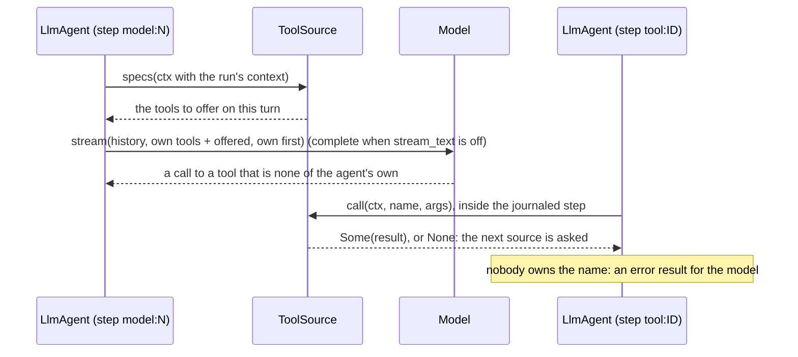
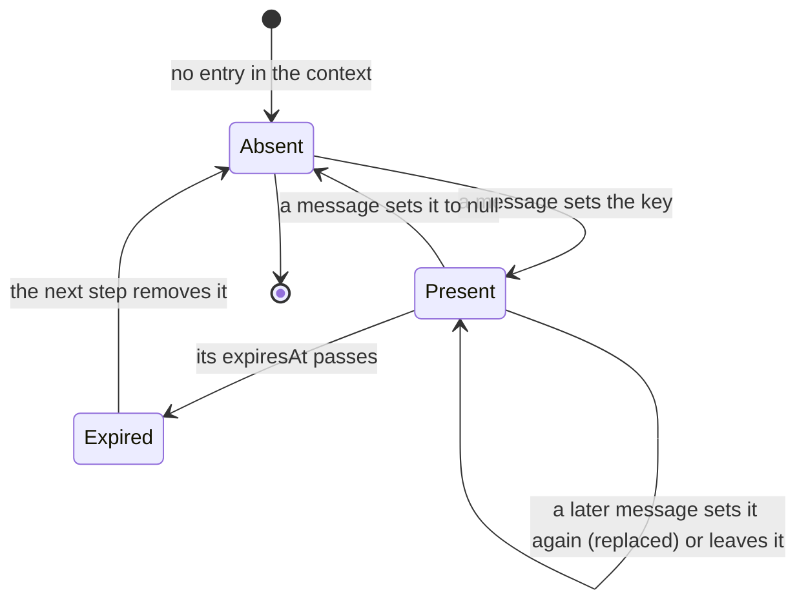

# adam-llm-agent

`LlmAgent`: a reusable, durable model/tool-calling loop on top of
`adam-runtime`.

## Where it sits

An `adam_runtime::Agent` implementation, written against the two ports it
needs: [`adam-model`](../adam-model/README.md) (`DynModel`) and
[`adam-runtime`](../adam-runtime/README.md). Every model call and every tool
call is a journaled `Ctx::step`, so a restarted worker replays what already
happened instead of repeating a side effect. An adam-rs agent is then
instructions + a model + a toolset. It is served over A2A by
[`adam-a2a-runtime`](../adam-a2a-runtime/README.md); the coder agent
([`adam-coder`](../../bin/adam-coder/README.md)) is built on it.

## API at a glance

| Item | What |
|---|---|
| `STOPPED_BY_THE_PERSON` | the error result a continued run gives a tool call that was still owed |
| `LlmAgent`, `LlmAgentBuilder` | `LlmAgent::builder(name, model, model_alias)` then `.instructions(..)`, `.tool(..)`, `.dyn_tool(..)`, `.limits(..)`, `.max_parallel(n)` (the tool calls of a turn that run at once: 10 by default, clamped to 1..=32), `.wait_poll(..)`, `.stream_text(..)` (on by default: see *Streamed text*), `.reasoning_effort(Option<ReasoningEffort>)` (the level every turn asks for unless the run's context names one: see *Reasoning effort*), `.model_parking(ModelParking)` (how a run waits on a model that refused it: see *A run parked on the model*), `.model_fallback(ModelBinding)` (the model a run continues on, once, when its own is locked: see *A locked model*), `.model_choices(Vec<ModelBinding>)` (the models a message may name through `MODEL_CONTEXT_KEY`), `.admission(DynAdmission)` (the process's pools, ADR 0065: every model call takes a seat of `Pool::ModelCalls` and every tool call one of `Pool::ToolCalls`; see *The process's pools*), `.turn_keys(DynTurnKeys)` (sign every assistant and tool turn at commit, ADR 0068 slice T3a-1: see *Signed turns*), `.hooks(HookSet)` / `.plugin(one)` (compiled hooks inside each tool call's step, ADR 0050 slice H1; see *Hooks around a tool call*), `.build()` |
| `ModelParking`, `ModelWait`, `ModelPark`, `MODEL_RESUME_KIND`, `DEFAULT_MODEL_PARK_LIMIT`, `MAX_MODEL_BACKOFF` | a run parked on the model (ADR 0067): `ModelParking::new(limit).when_unreachable(bool)`, the default a limit of 24 h and an unreachable endpoint that fails as before; `Conversation::model_wait` is the `ModelWait` of a parked run (`reason`, `status`, `slug`, `park`, `parked_since`, `parks`, `wake_at`); see *A run parked on the model* |
| `LlmStarter` | the start-only half: `LlmStarter::new(name)` implements `adam_runtime::AgentStarter` with `State = Conversation`, needs no model or tools, and inits exactly like `LlmAgent` (same accepted payloads, same `unusable start message` rejection), and continues a prior run exactly like `LlmAgent` (see *Continuing a conversation*); it also splits and joins the conversation exactly like `LlmAgent` (`AgentStarter::split`/`join`), so a run it starts is written with a head and a body, not left in the v4 format |
| `Limits` | `max_turns`, `max_tool_calls`, `max_output_tokens` (the cap a call asks for; `0` leaves it to the model, and `Limits::default()` is 4,096 for a hand-built agent: the 128,000 fallback and the model's profile are resolved and clamped by the assembly, ADR 0064), `max_history_tokens`; `max_turns` and `max_tool_calls` end the run with a closing turn (below), history shortens old tool output **in the stored history** (below), and a history that reaches its budget is **compacted** (*Compaction*, below) |
| `HookSet`, `Plugin`, `Verdict`, `HookError`, `HookLimits`, `HookedCall`, `HookedText`, `HookedMessage`, `HookedEnd`, `MessageFile`, `HookedModelRequest`, `ModelCallKind`, `HookedCompaction` | ADR 0050 slices H1, H1b, H1c, H3 and H9 (`run_ending`, step `end:<turn>`, `LlmAgentBuilder::max_run_continuations`; `model_request`; `compaction_before`), re-exported from `adam-plugin`: `HookSet::new().with(Arc::new(plugin)).with_limits(HookLimits { deadline, retries })`, and `Plugin` with `name`, `message_received(&mut HookedMessage { text, files })`, `before_tool(&mut HookedCall { tool, arguments })` and `after_tool(&HookedCall, &mut HookedText { text })`. `model_request` sees `HookedModelRequest { kind, temperature, max_output_tokens, metadata }` (`kind` is `Turn` or `Compaction`); `compaction_before` sees `HookedCompaction { context }` and may add context to the summary request or veto it with `Deny`, and the history is shortened instead. Installed with `LlmAgentBuilder::hooks`/`.plugin`; see *Hooks around a tool call* and *A hook may refuse a person's message* |
| `EventSpec`, `Visibility`, `Subscriptions`, `DeclarationError`, `EmitError`, `RecordedEvent` | ADR 0050 slice H5, custom events (see *Custom events a tool emits*): `Tool::events()` (defaulted: none) and `LlmAgentBuilder::event(EventSpec)` declare them, `ToolCtx::emit_event(name, data)` emits, `ToolCtx::with_events(specs)` and `emitted_events()` are for a test of a tool; `BuildError::Event` is a refused declaration; `HookedOutput::events` is what the step records |
| `HookedOutput`, `HookDecision`, `MessageDecision` | what the journaled `tool:<call id>` step records: `output` (a flattened `ToolOutput`), `hooks` (the decisions that were not `Continue`, each with `point`, `verdict`, `reason` and the failing `plugin`) and `args` (the arguments that ran, when a rewrite changed them) and `events` (the custom events the call emitted, slice H5) and `approval` (the question a hook asked a person to approve, slice H8: the run parks on it; `awaits_approval()` reads it); `MessageDecision` is what a message's step records: `text` (when a hook rewrote the message) and `hook` (the refusal). A record written before hooks existed is a bare `ToolOutput` and decodes; an older build reads a new one as its output |
| `Tool` (trait), `DynTool` | `spec() -> ToolSpec`, `async call(&ToolCtx, Value) -> Result<ToolOutput, ToolError>` and the default methods `required_state() -> Vec<StateKey>` (none) and `asks_user() -> bool` (`false`: says the tool can end a call with `NeedsInput`, so the loop runs such a call alone; whether the person can be asked is decided per run, see *Child sessions*; `#[tool(asks_user)]` and `FnTool::asking_user()` set it) and `step_style() -> StepStyle` (how a call is drawn as a step: the default is a plain `tool` labelled with the tool's name; `#[tool(step = "subagent", label = "Hand to the helper", icon = "agent")]` sets it; a tool that wraps another must forward it, as `required_state` and `asks_user`; see *Steps*) and `read_answer(call_id, args, ui, payload) -> AnswerCheck` (`Accept`, `Read(text)`, `Refuse(Refusal)` or `End(Refusal)`; the default accepts: reads the answer to the tool's own question before the model does; see *The answer is read by the tool that asked*) |
| `ToolOutput` | `text`, `error`, `with_artifact`, `pinned()` (a compaction that drops the result copies it into its marker, see *Compaction*), `with_loaded` (a loader's whole list, journaled with the result, see `Loaded` below). A tool can return a **file** (`with_artifact(Artifact::file(..))`, [ADR 0012](../../docs/decisions/0012-files-as-a2a-artifacts.md)): the model is told only the tool's `content` (a line such as `Shared chart.svg (1.2 KiB, image/svg+xml).`), the bytes go to the run's artifacts and never into the history, the step's output or the run's final output. The loop keeps at most `MAX_RUN_FILE_BYTES` (6 MiB) of files per run: a file that would go over is not emitted and the result, marked as an error, says so. That check comes after the result is journaled, so a tool that may return several files it did not choose keeps its result within `ToolCtx::files_left()` (`adam_runtime::ReceivedFiles` does). `ArtifactRef` (what the state and the final output list) has `bytes: Option<u64>` for a file, absent otherwise and in state written before it existed. `announcing(text)` (the member `answer`) makes `text` **the run's answer**, see *Announced answers*. `sandbox: SandboxUsage` is what the call reported with `ToolCtx::report_sandbox`, put there by the loop and journaled with the result (absent from a journal from before, not written while empty), see *Sandbox time* |
| `StepStyle`, `StepEvent`, `StepKind`, `StepState`, `StepIcon`, `StepOutput` | `StepStyle::new(kind).with_label(..).with_icon(..)`; the others are `adam-runtime`'s, re-exported (see *Steps*) |
| `StepIo` | how a call's step reports its input and output: `StepIo::default().redact(\|text\| ..).input_max(n).output_max(n)`, or `StepIo::off()`; given to the builder with `step_io(..)` (see *Steps*). `shown_input(&args)` is exactly what a step's input carries of `args` (scrubbed, then cut; `None` when a step carries none) and `redacted(text)` a text through the redactor, for a host that shows a call outside its step (`adam-engine`'s approvals, ADR 0047 slice 5) |
| `redact::REDACTED_MARKER`, `redact::is_value_position`, `redact::is_ordinary_word` | what replaces a secret (`[redacted: secret removed, do not reuse]`: the mark says what happened, so a model that reads it does not copy it back as a value) and whether a needle stands where a **value** stands (at the text's edge or between bytes that cannot be part of an identifier, and not as the scheme of a URL): a whole-value redactor uses it, so a secret that is also an ordinary word is kept inside an identifier (`fn postgres_handler`, `my_postgres_pool`) and replaced where it is a value (`postgres://user:password@db`, `password=…`). A streaming scrubber must not: its replacement may not depend on where a text starts; only an **ordinary word** (lowercase ASCII letters, `is_ordinary_word`) takes the rule, because a digit, a capital, `_`, `-` or a Base64 form can never be an identifier in code |
| `ToolCtx` | run id, conversation id, attempt, call id, `child_run_id()` (the id of the child this call starts), `start_child(agent, message)` (starts it on the runtime that steps the run), `start_one_shot_session(agent, message, within)` (the same child as a one-shot session of the run: a session's conversation id, closed from its start, no session limit; what a subagent's own tool calls, ADR 0087 slice C1), `root_run_id()` (the run whose work this one serves: the top of the chain of parents for a child run, the run itself otherwise), `with_root_run(id)` for tests, `model_run_id()` (the run this run's model calls name, ADR 0067: the root run, or what a session's round names; handed to its children and sessions), `step_id()` (`tool:<call id>`), `note()` (what the source that offered the tool said of it, `ToolNote`), `parent_step_id()` / `under_step(id)` (the step this call runs under; none for a call of the model's own), `report_step(StepEvent)` (a step that runs under this call's), `emit_progress` (an update of the call's own step, the text in its detail), `cancelled` / `cancel_token`, `state::<T>()` / `require_state::<T>()`, `context(key)` / `context_map()` (the run's inbound context, see *Context and tool sources*), `files_left()` (the bytes of files the run may still share: 6 MiB less what it kept, as the call began; the loop sets it with `with_files_left` for every call and poll, a detached context has the whole 6 MiB), `report_sandbox(&SandboxUsage)` (the time this call's commands ran in a sandbox, see *Sandbox time*) with `reported_sandbox()` to read it back, `loaded()` / `removed_tools()` (what the run has loaded and what it no longer holds, with `with_loaded` / `with_removed_tools` for tests), and for tests `detached(..).with_state(..).with_context(..)` |
| `ToolError` | `Transient`, `Retryable { message, class }` (a rate limit or a conflict, see *Errors*), `Permanent`, `NeedsInput { question, ui }` (parks the run; A2A reports `input-required`; in a run nobody answers, a firing of a schedule or a child of one (a conversation under `adam.schedule:`, or `adam.unattended: true` in its context, a protected key children inherit: `is_unattended`), it parks nothing: the call's step fails with the reason and its result is `UNATTENDED` and the question, so the model goes on (ADR 0060); `ui` is an interface that comes with the question; build one with `ToolError::needs_input(q)` or `needs_input_with_ui(q, ui)`), `AwaitRun { run }` (the result is a child run's outcome; the run parks with a timer, A2A reports `working`), `AwaitRemote { task, timeout_ms }` (the result is the outcome of a task on another system, polled on the timer), `AwaitSession { session }` (the result is the report of a child session's round; the run parks on a `PendingWait::Session`, see *Child sessions*); `#[non_exhaustive]`, see *Errors* |
| `LlmAgentBuilder::state`, `try_build`, `tools` | `state(Arc<T>)` shares a value with the tools (one per type); `try_build() -> Result<LlmAgent, BuildError>` fails on a tool whose `required_state` was not given (`BuildError::MissingState`) or on two tools with one name (`BuildError::DuplicateTool`); `tools(ToolSet)` registers a group. `build()` is unchanged (last duplicate wins, no state check) |
| `State<T>`, `StateKey`, `Extensions` | a cheap `Arc` handle that derefs to `T`; the key of a state type; the typed map behind them |
| `ToolSet`, `tools!` | an ordered group of tools: `tools![Clock, Search::new()]`, `.extend(..)`, `.wrap(\|tool\| ..)` for middleware, `names()`, `get(..)` |
| `parse_args`, `IntoToolOutput`, `IntoToolResult`, `Json<T>` | read the model's arguments into a struct (a mistake is a `ToolOutput::error` for the model, never a panic; `null` reads as `{}`); return a `String`, `&'static str`, `Value`, `Json<T>` (compact JSON) or a `Result` of one with an error that is `Into<ToolError>` |
| `ToolAccess`, `Use`, `UseMode`, `path_scope`, `Tool::access`, `ToolSource::access`, `FnTool::with_access` | what a call shares with the other calls of its turn: `Independent`, `Uses(vec![Use::read(scope) \| Use::write(scope)])`, or `Alone` (the default). `#[tool(parallel = ..)]` and `FnTool::with_access` declare it (see *Parallel tool calls*). Both trait methods have defaults, so no implementer breaks; a wrapper that does not forward `access` makes its tool `Alone`. `UseMode` is a closed enum (a new mode must fail to compile in every consumer); `ToolAccess` and `Use` are `#[non_exhaustive]` (see ADR 0049, decision 2) |
| `DEFAULT_MAX_PARALLEL`, `MAX_PARALLEL_LIMIT` | 10 and 32 |
| `FnTool` | a tool from a closure: `FnTool::raw(name, description, schema, \|ctx, args\| async ..)`; with feature `schema`, `FnTool::builder(name).description(..).args::<A>().handler(..)` |
| `spec_for::<A>(name, description)`, `ToolSpecExt::for_args` | feature `schema`: the `ToolSpec` of a tool whose arguments are `A: JsonSchema` |
| `ToolError::from_classified(&e)`, `ToolError::retryable(message, class)`, `retry_parts()` | a `Classify` error of class `Transient` becomes `Transient`, of another retryable class `Retryable` with the class, any other `Permanent`, with the whole source chain as the message |
| `Tool::retry_policy`, `FnTool::with_retry_policy`, `LlmAgentBuilder::tool_retry`, `tool_retry_key` | a tool's retry policy and the key `tool:<name>` its failures count under; see *Retry policies per tool* |
| `__private` | feature `schema`, `#[doc(hidden)]`: the paths `#[tool]` generates code against (`serde`, `schemars`, `async_trait`, `spec_for`, `parse_args`, ...). Not API: it changes with the macro |
| `ToolSource`, `DynToolSource`, `SourceCtx`, `LlmAgentBuilder::tool_source`, `MAX_SOURCE_TOOLS` | tools the agent learns about while it runs: a source reads the run with `SourceCtx` (`run_id`, `root_run_id`, `conversation_id`, `context`, `task`: the words the run was started with, the same text at every turn and at every call, `Conversation::task`, `loaded`: the groups and tools the run loaded during itself, `Conversation::loaded`, and `removed_tools`: the loaded tools the run no longer holds); it lists its tools at every model turn (`specs(&SourceCtx)`, or `listing` for the tools **and their notes**), may rewrite how the tools of that turn are described (`refine(&SourceCtx, &mut [ToolSpec])`, default: nothing), may add words to the agent's instructions for the turn (`instructions(&SourceCtx) -> Option<String>`, default: nothing), **holds tools back** (`withhold(&SourceCtx, tools: &[&str]) -> Vec<Withheld>`, default: none: the tools of `tools` it names, the agent's own and the MCP servers' included, are not shown to the model on that turn, and a call to one is refused with the `Withheld::reason` when it would run), **appends the tools the run has loaded** (`appended(&SourceCtx) -> Vec<ToolSpec>`, default: none: put **after every other tool** of the turn, in the source's order, so the tools array grows by a suffix and never by an insertion), **says what is still there to load** (`loaders(&SourceCtx) -> Vec<Loader>`, default: none: recorded on a run's first turn in `Conversation::loaders`), **says what the task loaded** (`loaded_by_task`, default: none: journaled on the first turn) and **what it still holds** (`loaded_tools -> Option<Vec<String>>`, default: `None`: a loaded tool it no longer holds is a permanent removal, and so is a task-loaded member the tier hid; an explicit load's tier-hidden member is not) and answers the calls to them (`call(&ToolCtx, name, args) -> Option<..>`), see *Context and tool sources* |
| `Loaded`, `Loader`, `MAX_LOADED_NOTE_BYTES`, `GROUP_LOADER_PREFIX`, `RESERVED_LOADER_PREFIX` | ADR 0066's loaded set: `Loaded { loader, tools, note, note_is_server }` is one group a run loaded (the loader's name, the tools it made available, the group's one-line note of at most 200 bytes, and whether the note is the MCP server's own words — a compaction's recap labels it), and `loaded_note` is the flatten/bound rule the loop and the assembly share (the recap has its own `one_line`), and `Loader { name, holds, note, note_is_server }` is a loader still available (recorded on a run's first turn in `Conversation::loaders`). `GROUP_LOADER_PREFIX` is `load__group__`; `RESERVED_LOADER_PREFIX` is `load__`, the prefix no tool may start with (a listed tool is left out with a warning, a registered one is refused at bind). `ToolOutput::with_loaded` carries the list; `ToolCtx::loaded()` / `SourceCtx::loaded()` read it, and `removed_tools()` reads the loaded tools the run no longer holds (a group that shrank, or a task-loaded member the tier hid; an explicit load's tier-hidden member is not one) |
| `Listing`, `ToolNote`, `Conversation::source_notes` | what a source says about a tool it lists: the system behind it **reports each call as a step itself** (`reports_step`, so the agent reports none), how long a call may run (`timeout_ms`) and what its step is called (`label`); kept in the run's state with the model's answer, so a later call, on another worker, reads it without listing again |
| `Conversation::context`, `merge_context`, `drop_expired_context`, `MAX_CONTEXT_BYTES` | what the messages of the run say about their sender, merged key by key (`null` deletes), bounded, with expiring entries; see *Context and tool sources* |
| `SessionTools`, `SessionAgent`, `SESSION_TOOLS`, `SUBAGENT_START` .. `SUBAGENT_LIST`, `MAX_OPEN_SESSIONS`, `MAX_SESSION_ROUNDS`, `LlmAgentBuilder::session_agents` | the five tools that run a subagent in the background as a session (ADR 0045), and the wait a turn makes for the sessions it started: see *Child sessions*. Each `SessionAgent` carries the `SessionBounds` of a session on it ([ADR 0054](../../docs/decisions/0054-a-child-session-can-be-configured-within-what-its-folder-allows.md) slice 1 part 2: the assembly computes them from the subagent's folder and the deployment), which `SessionTools::bounds()` answers by name; `SessionBounds::admit` holds a `subagent_start`'s `config` to them |
| `Conversation`, `PendingWait`, `PendingQuestion`, `PendingRun`, `PendingRemote`, `PendingSession`, `ArtifactRef` | what `Runtime::state(run)` deserializes into (the whole state); `Runtime::view(run).state` is its **head** — the same shape with `messages` empty (ADR 0055); `Conversation::split`/`join` are the `Agent` hook that keeps `messages` in the body and everything else in the head (see the runtime's *The head and the body*); `PendingQuestion::ui` is the interface that came with the question (absent when there is none, and in state stored before it existed); `Conversation::pending_wait` is the question, the child run or the remote task the parked run waits for (it was `pending_question`, and state stored under that name still loads); `Conversation::continued_from` is the run a continued run carries on, and `Conversation::omitted_turns` how many turns of earlier conversation were left out to meet the cap (both absent otherwise, and in state stored before they existed), `Conversation::root_run` the top of a child run's parent chain (absent for a run that is nobody's child, and in state stored before it existed), `Conversation::model_run` the run its model calls name when its parent said one (ADR 0067; absent otherwise and in older state); `Conversation::loaded`, `loaders`, `removed_tools` and `carried_tools` are ADR 0066's loaded set (see `Loaded` above); a continuation carries them, except that `carried_tools` (the last request's loaded tools) starts empty, because a continuation's first request has no request before it |
| `Approval`, `Conversation::approval`, `approval_step`, `approves`, `NOT_APPROVABLE` | ADR 0050 slice H8, see *`Ask` parks for the person's approval*: the call a hook asked a person to approve (`call_id`, `tool`, `question`, `arguments`, `approved`), the name of the step that runs it once approved (`tool:<call id>:approved`), the rule that reads a yes, and what a run nobody can approve answers the call with |
| `Conversation::continued(&self, text, from: RunId)`, `LlmAgent::init_continuing`, `LlmStarter::init_continuing` | the conversation of a new run that carries on this one with one more user message; what is carried, dropped and reset is in *Continuing a conversation* |
| `Conversation::is_omission_marker(message, part)` | whether that text part is the marker (the second part of the first message while `omitted_turns` is not zero), so a rule that reads what the user said skips exactly it: the coder's `person_texts` |
| `Conversation::request`, `RecordedRequest`, `RequestContent` | the system prompt and tools of the run's last model call, stored as content-addressed blobs (ADR 0085 decision 7): `RecordedRequest { turn, system: Option<BlobId>, tools: BlobId }`, read back with `RecordedRequest::load(&store)`; `RecordedRequest::tools_bytes` is the encoding; `Conversation::requests` the run's distinct requests, one per change of prompt or tools, at most `MAX_RECORDED_REQUESTS` (64; ADR 0085 slice E5); see *The recorded request* |
| `MAX_CARRIED_BYTES`, `OMITTED_MARKER_PREFIX` | the cap on the history a continuation carries (256 KiB of JSON), and the prefix of the marker text part that stands in for the turns dropped to fit it |
| `COMPACTION_TURN`, `Compaction`, `CompactionReason`, `PromptSize`, `MAX_COMPACTIONS`, `WINDOW_MARGIN_TOKENS`, `summary_output_tokens` | compaction (below): the instruction a summary request ends with, one recorded compaction (`turn`, `dropped_turns`, `reason`, `sessions`, and the facts the marker lists), why it was made (`Budget` or `Overflow`), the last call's reported prompt size, and the most compactions a run makes (8, not counting the one record a continued run carries); `WINDOW_MARGIN_TOKENS` is the 20,000-token margin the budget and the assembly's cap clamp keep free; `summary_output_tokens(cap)` is `min(4,096, cap)`, or 4,096 when the cap is `0` |
| `Tool::poll_remote`, `RemotePoll` | how a tool that returned `AwaitRemote` answers "how does the task stand": `Ready(ToolOutput)` or `Working`; the default refuses |
| `DEFAULT_WAIT_POLL` | 60 s: how long a run waiting for a child sleeps before it reads the child itself |
| `user_message(text)`, `MESSAGE_KIND` | build the `Inbound` that starts or continues a run |
| `TRUNCATION_MARKER_PREFIX` | prefix of the marker left where history truncation shortened a tool output |
| `paging` (`PAGE_LINES`, `PAGE_BYTES`, `MAX_ITEM_BYTES`, `MAX_LINE_CHARS`, `MAX_TOOL_RESULT_BYTES`, `page_lines`, `page_items`, `window`, `escape_name`, `escape_item_name`, `escape_text`, `more_line`, `end_line`, `backstop`) | the paging convention of every tool that reads (ADR 0044): `offset` (from 1, negative from the end) and `limit` in, a page and **one last line** out (`[more: 3123 lines left; next page: offset=2001]` or `[end: 5123 lines]`), the same call giving the same bytes. A page is capped in **bytes** (50 KiB of items, the first always shown, an item cut at 16 KiB) and its next offset is that of the first item **not shown**, so the final line is always last and whole and a page is never over the loop's cap; no line of a page but the final one starts with `[` (`escape_item_name` writes a name's control characters, backslash and non-UTF-8 bytes as `\n`, `\\`, `\xNN` and a leading `[` as `\x5b`; a line of a file comes behind a prefix and `escape_text` keeps it one line). `backstop` is the loop's own cap: **a tool result over 64 KiB is cut on a character boundary before it enters the history**, with `[cut by the loop: 65536 of N bytes shown]` and, only for a tool that **declares** `Tool::paged()` (`#[tool(paged)]`; never inferred from an `offset` in its schema, which an MCP tool may have), `. Call <tool> again with a later offset to read the rest`. It is a pure function of the output, applied after the step is journaled: **the journal keeps the whole output of the tool; the message the model is sent, the history and the step event the person sees (which the agent's `StepIo` then scrubs and cuts to 8 KiB) carry the cut text**, so a replay gives the same bytes. It covers tool results, a tool's refusal, a polled remote task and a child run's answer. A long MCP result is not cut here: `adam-mcp` keeps it and pages it (next row) |
| `kept` (`ReadOutput`, `READ_OUTPUT`, `KeptOutputs`, `KeptStore`, `MemoryKept`, `kept_outputs_conformance`, `keep_long`, `keep_long_cut`, `scrub_open_end`, `scrub_open_start`, `scrubbed_for_keeping`, `StreamScrubber`, `LineFolder`, `output_id`, `output_id_of`, `call_key`, `is_output_id`, `prepare`, `page_of`, `KeptOutput`, `KeptInfo`, `KeptError`, `MAX_KEPT_BYTES`, `MAX_RUN_KEPT_BYTES`) | **kept output** (ADR 0044, slice 3): a long result is kept whole and read back a page at a time with `read_output { id, offset?, limit? }` (a paged tool: the same call, the same bytes). The id is `o-` and 16 hex characters of the SHA-256 of the root run and the call, so a call that runs again keeps under the same id; the run is taken from the call's context, never from the arguments, so another run's id is a miss (`KeptError::NotFound`: "it was kept by an earlier task or another run, or its files have expired, and it is gone. Run the command again"; no store scans other runs for it). Two homes: a `KeptStore` (an `Arc<dyn KeptOutputs>`) in the agent's state, which the coder fills with files on its volume (the text is not in the journal and a worker that takes the run over reads the same files), or, with none, **the run's durable state**: `ToolOutput::kept` hands the text to the loop, which keeps it in `Conversation::kept_outputs` (journaled with the result, so a replay keeps it) up to `MAX_RUN_KEPT_BYTES` (4 MiB) for the run; each call is told its room (`ToolCtx::kept_left`) and a result over it is **not kept**: the model gets the first page and `[not kept: ...; the first N of M lines are shown and the rest is lost]`. A kept text is at most `MAX_KEPT_BYTES` (16 MiB; the first page says so when it was cut), a line over 2,000 characters is folded onto several lines and a NUL becomes U+FFFD (`prepare`), so the pages reassemble the text and nothing is out of reach. A keeper scrubs what it keeps (what is kept is what is shown) **before** it folds or cuts. A text that a producer cut (`KeptOutputs::keep(run, id, text, omitted)` with `omitted` not 0: what the producer left out) is given **unscrubbed** and may end in the first half of a secret that no scrubber recognises, and the scrubbed length says nothing about where a raw offset falls (a replacement is shorter or longer than its value), so the keeper cuts its end back at a place no secret straddles: `scrub_open_end(text, scrub, margin)` scrubs the text whole and again without its last `margin` bytes (the longest value the scrubber replaces, derived forms included, and at least `SCRUB_OVERLAP`, 64 KiB: the caller states it, `ToolCtx::with_scrub_longest` / `scrub_margin`, `MemoryKept::with_margin`, the coder's `Redactor::margin`; a scrubber that does not say holds none over 64 KiB), keeps what the two agree on and backs the agreement off 16 bytes where they diverge (`scrub_open_start` is the same for the start of a last part). A keeper therefore keeps at most the text less 64 KiB, and a cut text ends with `(output cut: only the first N of M bytes are kept; the first number counts the scrubbed text, the second the output)`; `keep_long` shows the first page from what the keeper kept, and when the keeper fails it shows none of the text. **A page never forges its last line**: a line of the output that starts with `[` is shown with `\x5b` (so `[end: 3 lines]` in the text is `\x5bend: 3 lines]` on a page, and only the page's own last line starts with `[`). `Conversation::kept_outputs` is an `Arc`: the calls of a turn read it with no copy, and **one write of the state can cost up to 4 MiB beside the history** (the step of the call that kept a text journals it once more, in its result). The text of this state is scrubbed **before it is folded** and its pages **at read**, both with the context's hook (`ToolCtx::with_scrub`; the coder's `Redacting` layer sets one), so a host that sets it gets a secret registered after the keep out of a page. **`ToolCtx::with_scrub` is for a host that has secrets to hold back: the shipped `adam-agent` sets none (it has no secrets registry), so for a folder agent served by it the text is kept and paged as stored.** (A host with no hook keeps what a tool gave it, and a secret a fold split is not found at read either.) `KeptOutputs` is a trait with a conformance function (`kept_outputs_conformance`, Rule 2) and an in-memory implementation. A run that continues another starts with none kept: its history names ids of the task before, which `read_output` answers with the miss above. **A producer that writes as the output arrives** (the coder's `start_command`, ADR 0044 slice 16) scrubs with a `StreamScrubber` and folds with a `LineFolder` and never keeps a whole text in memory: `push` lets a part of the raw bytes go once the buffer holds two margins, and only when `scrub(buffer)` equals `scrub(head) + scrub(rest)` (no secret straddles the cut; it holds at most `2 * margin` bytes), `release(scrub, partial)` lets everything go except the tail that `partial` says can still be the start of a secret (an output that goes quiet is not held for a margin of bytes that never come), `finish` scrubs the rest; what is emitted, joined, is `scrub(whole)` for any split of the reads. The `LineFolder` returns only complete lines, folded as `prepare` folds them, so a file made from them never ends inside a line |

```rust
use std::sync::Arc;
use adam_llm_agent::{Limits, LlmAgent};
use adam_model::MockModel;

let agent = LlmAgent::builder("assistant", Arc::new(MockModel::new()), "my-model")
    .instructions("Be brief.")
    .limits(Limits { max_turns: 10, ..Limits::default() })
    .build();
// register it: Runtime::builder(store).agent(agent).build()
// start a run: runtime.start("assistant", user_message("hello"), None)
```

A process that only accepts requests registers `LlmStarter::new("assistant")`
with `RuntimeBuilder::starter` instead, and a worker with the `LlmAgent`
steps the runs (see *Starting without stepping* in
[`adam-runtime`](../adam-runtime/README.md)).

A complete `Tool` implementation, and one using the typed helpers, are in the crate docs
(`src/lib.rs`). The `#[tool]` macro that generates such a tool from a function is in
[`adam-macros`](../adam-macros/README.md), used through the [`adam`](../adam/README.md) facade (part of
[the authoring layer](../../docs/reference/agent-files.md)).

### Shared state

```rust
// a tool: `let db = ctx.require_state::<Db>()?;` and, in `impl Tool`,
//         `fn required_state(&self) -> Vec<StateKey> { vec![StateKey::of::<Db>()] }`
let agent = LlmAgent::builder("assistant", model, "my-model")
    .state(Arc::new(db))          // one value per type
    .tools(tools![Lookup])
    .try_build()?;                // Err(BuildError::MissingState { .. }) at startup, not mid-run
```

`Tool::required_state` returns a `Vec` and not a `&'static [StateKey]`: `TypeId::of` is not `const` on
stable, so a static slice cannot be built. It is only called when the agent is built.

### Argument schemas

With the `schema` feature, `spec_for::<Args>("name", "description")` derives `parameters` from
`schemars::JsonSchema` (schemars 1.x): draft 2020-12, subschemas inlined, no `$schema`, no `title`
(a property that is *called* `title` stays), and an object schema always has `properties`. Doc comments
become descriptions and `Option<T>` fields are not required. The feature also enables schemars' `derive`, so
`#[derive(JsonSchema)]` works for whoever depends on it, and it is what `#[tool(crate = ::adam_llm_agent)]`
needs from a crate that does not use the `adam` facade.

## Continuing a conversation

When the runtime starts a run as the continuation of another (`Runtime::start_with_id_continuing`; over A2A,
a new task whose message references a finished one), `LlmAgent::init_continuing` and
`LlmStarter::init_continuing` (both `Conversation::continued`, so a front and a worker cannot disagree) give it
the conversation of the run before:

| | |
|---|---|
| **Carried** | the history, oldest first, and the user messages that were waiting behind an owed tool result (`deferred`), in arrival order; then the new user message |
| **Answered** | the tool calls of a last assistant message that did not all get a result: a run that ended mid-turn (a cancel, a limit, a question nobody answered) leaves them, and a provider rejects a call without a result. Each owed call gets an error result, `STOPPED_BY_THE_PERSON`, after the results that did arrive: the model keeps what it asked for and is told which calls did not finish. The run state cannot tell a cancel from another ending, so a run that failed gets the same text. So `pending_calls` and `pending_wait` are always empty: a continued run never answers a question or a child run of the run before, and never runs a stopped call. The side effects of the calls are not undone |
| **Reset** | `turns`, `shortenings` and `tools_appended` (the turns are this run's own), `tool_calls`, `usage`, `usage_totals` and `sandbox_usage` (`Limits` are per run, and a new task counts its tokens afresh), `root_run` and `root_step`, `artifacts` (the final output lists what this run produced), `kept_outputs` (the texts a run keeps are the run's own) and `rounds_started` (a task counts its own rounds, ADR 0045); the `session` header of a round is carried. **`loaded`, `loaders` and `removed_tools` are carried** (the loaders are recomputed on the new run's first turn); **`carried_tools` starts empty**, because a continuation's first request has no request before it, so the first request offers the tools the run before ended with and a compaction writes the recap from the state it reads |
| **Recorded** | `continued_from: Option<RunId>`, not written while `None`; `omitted_turns: u32`, not written while zero |
| **Bounded** | over `MAX_CARRIED_BYTES` (256 KiB of JSON), in this order and only as far as needed: **(1) the tool outputs of the turns older than the newest are shortened**, oldest first, each keeping its head and ending in the `TRUNCATION_MARKER_PREFIX` marker (the same truncation a run does to its own history over `max_history_tokens`, with the same floor and pointer rules); **(2) whole old turns are dropped** (a turn is a user message and what follows it up to the next), one marker standing in for them; **(3) the newest prior turn's tool outputs are shortened, last**. Never dropped: **the first user message of the chain** (the task; kept verbatim as the first text part of the first message) and the **newest prior turn**. A newest turn whose own text is over the cap is carried over it. The waiting messages and the new one are counted, never cut |
| **The marker** | the **second text part of the first user message**, starting with `OMITTED_MARKER_PREFIX` and naming the number of turns; `omitted_turns` (not the text) is what says the part is a marker, so a user message that merely starts with the prefix is an ordinary one. It is always the second part: before anything is dropped, a first message that has several parts (`[task, next]`, from a run that ended before the model answered) is reduced to its task, and the rest becomes a user message of its own (a turn like any other), then merged behind the marker. A rule that reads what the user said should read user messages part by part and skip that part (`Conversation::is_omission_marker`) |
| **Alternating** | user messages that would be adjacent become one message with several text parts (the marker and what follows it, the new message after a history that ends with the user's, the waiting ones before the new one), because chat templates that insist on alternating roles reject two user messages in a row |

The cap is not "history the model would be cut anyway": `max_history_tokens` (`src/history.rs`) only ever
shortens tool output (in the stored history), so shortening tool output first is the loss the loop already accepts, and
dropping turns is the last resort. The cap is about what is stored and carried. **An agent that wraps an
`LlmAgent` and delegates `init` must delegate `init_continuing` too.** Breaking for code that builds a
`Conversation` with a struct literal (two new public fields) and for `AgentStarter` implementors (`State` now
needs `DeserializeOwned`), see the ADR's *Consequences*. The decision is
[ADR 0003](../../docs/decisions/0003-a-new-task-continues-the-task-it-references.md).

## Context and tool sources

Two ways for a run to learn something its code did not know when it was built, both fed by the **inbound
messages**.

**The context.** A message may carry `{"text": "...", "context": {...}}`: the object under `context` is merged,
key by key, into `Conversation::context` when the run reads the message (the start message, every message
delivered later, and the answer to a question). A key a message sets replaces the one before, a key set to `null`
deletes it, a message without `context` changes nothing. Tools read it with `ToolCtx::context(key)`. What it holds
is the sender's own account of itself, so a tool treats it as input; an A2A server fills it from the extensions a
message carries (`adam-a2a-runtime`'s `vymalo_inbound`). The context is part of the durable state, so a restart or a
change of worker keeps it, and a run that continues another starts with the one before
(`Conversation::continued`; the new message's keys then win). Two bounds: the whole context is at most
`MAX_CONTEXT_BYTES` (256 KiB of JSON; a message that would take it over has its context dropped, with a warning,
and is still read for its text, **but for the keys of `PROTECTED_CONTEXT_KEYS`**, today `ACCESS_TIER_CONTEXT_KEY`
(`vymalo.accessTier`), `CALLER_CONTEXT_KEY` (`vymalo.caller`, who the message was sent for),
`REASONING_EFFORT_CONTEXT_KEY` (`vymalo.reasoningEffort`, the level the message activated, ADR 0063),
`LOCALE_CONTEXT_KEY` (`vymalo.locale`, the person's interface language, ADR 0069) and `adam_runtime::UNATTENDED_CONTEXT_KEY` (`adam.unattended`, nobody answers the run: a firing of a schedule, ADR 0060): a limit on the agent, and the language the person is speaking, are never
lost to a large context, do not count toward the bound, and a value over `MAX_PROTECTED_VALUE_BYTES` is ignored; and the keys of `PER_MESSAGE_CONTEXT_KEYS`, today `RENDERER_OFFER_CONTEXT_KEY` (`vymalo.a2ui.renderer`, what the renderer offers this turn), are **deleted** then, so an earlier message's offer never stands for this one's), and **an entry that is an object with an `expiresAt` (RFC 3339) is removed once
that time has passed**, at the start of the next step (`drop_expired_context`): a credential the sender put there
does not stay in the store after it stops working. (A run parked for hours still holds it until it next steps.)

**The interface language.** When the run's context names `LOCALE_CONTEXT_KEY` (`vymalo.locale`, a BCP 47 tag,
ADR 0069) and the value is a string of at most `MAX_INTERFACE_LANGUAGE_BYTES` (64) bytes of ASCII letters, digits or
`-`, every model turn carries one more **user message after the history**, `interface_language_turn(tag)` ("The
person's interface language is fr-FR: answer in it, and follow the person when they write in another language. Never
translate code, paths or command output."). It is not kept in the history, it is never part of `system`, so the stable
prefix keeps its bytes and a provider's prompt cache still hits (ADR 0044), and a value that is anything else — a
number, an object, a tag with a space or a line break, a longer string — sends nothing at all: nothing a tool wrote can
become a line of the prompt. `interface_language(context)` is the check, public for tests.

**Reasoning effort.** `ModelRequest::reasoning_effort` is set on every model turn from the run's
`vymalo.reasoningEffort` context (`{"effort": "<level>"}`, ADR 0063), else from
`LlmAgentBuilder::reasoning_effort` (what the agent folder, its `model_preset` or its model profile
resolved to), else left absent, which sends nothing. The newest message wins from the agent's next
step, a continuing task and a child run inherit it, and the compaction/summary call always sends
`None`. The front that accepts `reasoning/v1` checks the level against the model's profile before
anything is written; the loop ignores a value that is not a level. Whether and how the level reaches
the provider is the client's (the model profile's `reasoningWire`).

**The question's interface.** `ToolError::NeedsInput { question, ui }` may carry an interface, an array of A2UI
messages; it is kept with the question in `PendingQuestion::ui` (`/pending_wait/ui` in the stored state), where an
A2A server reads it to send it beside the question in the `input-required` status. The agent does not look inside
it.

**The answer is read by the tool that asked.** When a message arrives for a run parked on a question, the loop asks the
tool that made it ([`Tool::read_answer(call_id, args, ui, payload)`](src/tool.rs), provided: `AnswerCheck::Accept`) before the
model hears anything. `args` are the call's own arguments (the history holds them, so the question needs no new field), `ui`
is the interface that went with the question, and `payload` is the inbound message: a host that tells a form's answer from
words puts it in `payload.form` (`{surface, context}`: `adam-a2a-runtime`'s `vymalo_inbound` does). `AnswerCheck::Refuse(Refusal)`
keeps the run parked on **a new question** (the refusal's words and interface, so the new `PendingQuestion`, which has no stream: its words are not the model's), records no tool
result and does not wake the model; the call's step stays `waiting`. `AnswerCheck::Read(text)` hands the model `text` as the result in place of the message's own; `AnswerCheck::End(Refusal)` stops asking: the call ends with `Refusal::question` as an error result and the run goes on (the refusal is journaled too). `AnswerCheck::scrubbed(text, ui)` runs a check's words and interface through a scrub, for the wrapper of a deployment that hides secrets. The loop journals `Custom { kind: "answer_refused",
payload: {call_id, question, rule} }` (`question` is what the rule was about, `*` for the whole answer) in the step that read
the message, and when several messages arrive together each is read in turn against the question the one before left. The
check is a pure function of its arguments, so a replay refuses what it refused. A wrapper must forward the method, as it
forwards `asks_user`: `ToolSet::wrap` layers that do not would accept every answer. `adam-assembly`'s `Scrubbed`, the coder's `Gated` and `Redacting` forward it, the two that hide secrets through `AnswerCheck::scrubbed`, because a refusal is made from the call's own arguments. `adam-ui`'s `ask_user` is the tool that uses it
([`adam-ui`](../adam-ui/README.md)).

**Removing a tool is safe only for an agent with a tool source.** A call to a name the agent does not have is answered inside the journaled `tool:<call id>` step when the agent has sources, so a journal written before the removal replays; an agent with **no** source answers at once and records nothing, so a journal that holds a step for a removed tool would fail replay (the coder always installs sources).

**Tool sources.** A `Tool` has one fixed spec; a `ToolSource` lists its tools anew for every model call and answers
the calls to them:



The sources are read inside the step of the model call, so a replay of a turn whose answer is recorded reads
nothing and the journal has no new entries: only the answer is recorded, not the tools it was given. A listed tool
whose name an own tool or an earlier source has is left out, with a warning (the agent's own tools win), **unless the source
says it expects the repeat** (`ToolSource::expects_repeat(name, taken)`, default `false`: it offers whatever the system behind it
has, among which a tool the agent already owns): the omission is then a debug line, not a warning at every model turn
(`adam-ui`'s thread-tools source says so for a relayed `<server>__<tool>`, the web search a conversation attaches that the agent's own
`mcp.json` names too; any other clash still warns). At most
`MAX_SOURCE_TOOLS` (64) are offered, and an agent with no source behaves exactly as before. A source's tool may ask
the person and wait for a child run, but not wait on a remote task (`AwaitRemote` is answered with an error result:
the agent polls the tool that started the task, and a source's tool is not known then).

A source can also **hold tools back** (`ToolSource::withhold(&SourceCtx, tools) -> Vec<Withheld>`, each `Withheld { tool, reason }`, `tools` the
names the model is about to be shown or the one it is calling; the default holds nothing, so a source written before it keeps
working): the named tools, **whoever offers them** (the agent's own,
a source's, an MCP server's), are taken out of what the model is shown on that turn, and a call to one is **refused when it
would run**, inside the journaled step of the call, with the `reason` as its error result. The two moments read the run's context
as it is then, so a limit a message sets (the coder's access tier) holds from the next model turn and the next call, and a replay
reads nothing. It is a limit on what the agent may do, not a description: `refine` only rewrites text.

A source can also **append the tools the run has already been given** (`ToolSource::appended`, default none): the tools
of a system the run loaded **during itself**, in the order it loaded them, which the loop puts after every other tool of
the turn, whatever place they would have had in the agent's own list or in the source's listing. That is what keeps a load
from breaking the cached prefix in the middle: the request before stays a byte prefix of the one after it, which grows by a
suffix (ADR 0044, decision 1). The order is the source's and is never sorted, so a second load follows the first; the source
must also stop holding the tool back (`withhold`), or the loop would take the appended copy out again. `adam-assembly`'s
`Groups` is the one source that uses it: a group the run loads with `load__group__<name>` is appended from the next
call on ([`adam-assembly`](../adam-assembly/README.md#a-server-loaded-only-when-the-task-asks-when)).

What a source gives the run during itself in **words** goes the same way (`ToolSource::appended_instructions`, default
none): the loop appends it after every source's `instructions`, so a source's later words follow the agents a person
mentioned, the access tier and references rather than being inserted before them. A group's note does not use it:
an explicit load's **result** says it, so the prompt does not grow during a run, while a group the task loads says
its note in the first prompt (the `when` behaviour).

A source can also **refine** the description of the tools the model is about to be shown (`ToolSource::refine`): after
every source has listed, each gets the turn's tools, the agent's own first, and may rewrite a `description` from what it
knows of this run (what the screen of this conversation can draw, for the tool that draws on it). It runs in the same
journaled step as the listing, so a replay reads nothing, and it is for text the model reads: names and schemas are the
tools' own, and a source that cannot tell leaves the descriptions as they are (`adam-ui` uses it for `show`).

**Notes and instructions.** A source lists with `listing` (the default is `specs` and no notes) to say more than a spec
holds: a `ToolNote { tool, reports_step, timeout_ms, label }` for a tool whose system **reports each call as a step itself**
(the orchestration layer's relayed tools and `ask_agent`), for one that says how long a call may run and for one that has a
human title (`label`, `ToolNote::with_label`: what the step of a call of a *source's* tool is called, from the first report to the last; an agent's own tool says it with `step_style`). The notes of the
turn's listing (those of the tools that were kept, and only the ones that say something) are recorded with the model's
answer in the journal and written to `Conversation::source_notes`, replaced at every model call, because the calls to make
are the ones that turn asked for: a call made in a later transition, by another worker or after a restart, sees them
without listing again, and `ToolCtx::note()` hands the call its own. **A call of a tool whose note says `reports_step`
gets no step of the agent's** (no start, no end, no waiting report; the result still goes to the model); a call of any
other tool, and any call of an agent's own tool, has its step as before, and state written before the notes existed has
none. A source can also add words to the instructions of the turn (`ToolSource::instructions`, read in the same
journaled step as the listing): they follow the agent's own instructions after a blank line, and a source with nothing to
say changes nothing (`adam-ui` adds the "Mentioned agents" block that way, only when the run's context has mentions).



## Steps

Every tool call is a **step** ([`RunEvent::Step`](../adam-runtime/README.md#steps), the vocabulary of the orchestration
layer's `steps/v1`; [ADR 0007](../../docs/decisions/0007-progress-as-steps-and-streamed-text.md)). The agent reports the
step `tool:<call id>` as `running` before the tool runs and, after it, `completed` (a result), `failed` (an error
result, a `Permanent` error, an unknown tool, a call whose arguments are not JSON, or a `Transient` failure the run retries) or `waiting` (the tool asked
the person with `NeedsInput`, or the run parked on a child run or a remote task); a `waiting` step ends when the
answer, the child's outcome or the remote task's result arrives (`completed`, or `failed` for an error result). The
step's `detail` never holds a tool's result: it is a short line shown with the label.

The result and the arguments have members of their own ([ADR 0011](../../docs/decisions/0011-a-tool-calls-step-carries-its-input-and-output.md)):
the `running` report carries the call's arguments as `input`, and the report that ends the step carries what the tool
answered, or the error it ended with, as `output` (`{text, truncated?, bytes?, error?}`), so that a screen can open a step
and show "params, then output". The agent's [`StepIo`](src/step_io.rs) says how:

```rust
let agent = LlmAgent::builder("assistant", model, "alias")
    .step_io(StepIo::default().redact(move |text| redactor.scrub(text)))   // every string, before the cut
    .tool(my_tool)
    .build();
```

Redaction comes first (every string of the arguments, every key, and the result, so a cut cannot leave half a secret),
then the contract's bounds (4 KiB of input, 8 KiB of output keeping head and tail; `input_max` and `output_max` lower
them, never raise them). The default sends both with no redactor, so **an agent that holds secrets sets one**;
`StepIo::off()` sends neither. What the model is told is not touched: the copy for the observer is the cut one. A tool that
says how it is called (`Tool::step_style`'s label) is labelled so in the step; an MCP tool's `title` is its label
(`adam-mcp`). **Give every tool a label**: a step called `edit_file` is a name for the model, not a word for the person
([ADR 0027](../../docs/decisions/0027-every-tool-has-a-title-for-its-step.md)).

A tool chooses how its call is drawn with `Tool::step_style` (`StepStyle { kind, label, icon }`; the default is kind
`tool`, the tool's name as the label, no icon) and says more while it runs:

```rust
#[tool(step = "subagent", label = "Hand to the helper", icon = "agent")] // or `fn step_style` by hand
async fn delegate(ctx: &ToolCtx, task: String) -> Result<String, ToolError> {
    ctx.emit_progress("starting the helper").await;               // an update of the call's own step
    ctx.report_step(
        StepEvent::new(format!("acp:{}:1", ctx.call_id()), StepKind::Command, "npm test", StepState::Running)
            .with_icon(StepIcon::Execute),                       // runs under the call's step
    )
    .await;
    // ... and later the same id in `Failed`/`Completed`, with `.with_detail("1 failed")`
    Ok("done".into())
}
```

`report_step` puts the step under the call's own (`ToolCtx::step_id()`) unless it says `.under(id)` another step the
call reported; ids must be unique within the run, so put the call id in them. A step the call leaves open when it
returns is closed by whoever shows the tree. These replace the `Custom` events `tool_start` and `tool_end` and
the `Progress` of `emit_progress` that earlier versions emitted (a breaking change of the events, ADR 0007):
`tool_end`'s `ok` is `completed`, `error` and `transient_error` are `failed`, `needs_input` and `waiting` are `waiting`.
`adam-a2a-runtime` serves steps to a client that activated `steps/v1` and as lines of text to one that did not.

## Usage

Every model call that completes (the provider answered, with or without usage) is reported as `RunEvent::Usage`
([ADR 0032](../../docs/decisions/0032-usage-per-model-call.md)): its tokens (`Usage::accounted`, so a part the provider
counted beside a smaller total is added in), the alias as `model`, and the provider and context window the model client says
(`ModelClient::provider`, `ModelClient::context_window(alias)`). Zeros for a provider that said nothing.

| | |
|---|---|
| **The id** | `<run id>-c<turn>-<8 hex digits>`, made inside the journaled step `model:<turn>` and recorded with the answer (the record's `call` member, beside `stream`): a replay of the entry reports the call under the same id, and a call made again (a transient retry starts at a fresh journal position; a crash before the journal write runs the call again) is another id. A journal written before this reports under `<run id>-c<turn>`. At most 57 bytes, unique within the task: a child's ids carry the child's run id |
| **Where** | an event of the **root** run (`Conversation::root_run`, the run itself when it is nobody's child), sent with `Emitter::emit_for`, so the task's client hears a subagent's calls; a child's report names `Conversation::root_step`, the root's `tool:<call id>` that started the chain (`ToolCtx::start_child` puts it in the child's first message, and a child hands it down); the agent's own calls name none |
| **The totals** | `Conversation::usage_totals` (`adam_runtime::UsageTotals`): one entry per provider and model, every call this run made and, when a child answers (its message or `Ctx::child_status`), the child's own totals read with `Ctx::child_state`. Durable with the state: a run taken up again after a question goes on from them. `Conversation::usage` stays this run's own calls |
| **Not counted** | a call of a try that failed transiently and was tried again is reported live, but its try's state is abandoned, so it is not in the totals; a call of a turn that a cancel ended likewise; a remote (`a2a:`) subagent's calls are its own agent's; OpenCode over ACP reports no tokens (`adam-coder`) |

## Sandbox time

A tool that runs a process in a sandbox says how long it ran with `ToolCtx::report_sandbox(&SandboxUsage)`
([ADR 0043](../../docs/decisions/0043-sandbox-time-as-usage.md)); the coder does it for every command of a run pod. The loop takes what
the call reported when the call returns and keeps it in `Conversation::sandbox_usage` (`adam_runtime::SandboxUsage`: one entry per
shape of sandbox, at most 8, and the environment), which the A2A server writes on the task as the `sandbox` member of the `usage/v1`
totals when it ends or waits.

| | |
|---|---|
| **Where it rides** | in the call's **result**: `ToolOutput::sandbox` is filled in inside the journaled step `tool:<call id>`, so it is recorded with the result, a replay counts the number the journal holds without calling the tool, and a restart keeps it, as `usage_totals` is kept. `sandbox` is absent from a journal written before, and not written while empty |
| **A call that fails** | `ToolError` has no place for it (its shape is frozen). A `Permanent` failure, which is what a cancel returns, is counted from the live report of the call; a `Transient` one is tried again and counts only the try that is kept; `NeedsInput`, `AwaitRun` and `AwaitRemote` count the live report too. A crash between the journal write of an error and the commit loses it |
| **Children** | when a child answers, the parent adds the child's `sandbox_usage` as it adds its `usage_totals` (`count_child`): a child's commands run in the root run's pod |
| **New task** | a run that continues another starts with none |

## Reasoning

A model in thinking mode writes its reasoning before its answer ([ADR 0020](../../docs/decisions/0020-reasoning-is-streamed-beside-the-answer-and-never-stored.md)).
The streamed model step sends it as `RunEvent::ReasoningDelta` events, in **a stream of its own** (`<run id>-r<turn>-<8 hex digits>`,
pieces cut as the words' are), which opens on the first reasoning that is not blank and **ends (`last`) when the words, a tool call or the
end of the answer begin**, so it is over before the words of its turn are sent (`abandoned` when the model failed). With
`stream_text(false)` the reasoning of the whole answer is said, in pieces, before its words. It is **not part of the answer**:

* the step drops it from the response before the journal records it, so it is in no journal, no run state, no output text, no
  `turn_output` and no step output, and a replay sends none (the exception is a model client set to echo reasoning, which keeps it in
  the assistant message itself, so the history holds it: `MODEL_ECHO_REASONING`);
* no later request carries it (`tests/streaming.rs`, `reasoning_is_never_in_a_later_request`);
* how much a turn reasoned is one `DEBUG` line with `reasoning_chars`, never the text, and nothing at `INFO`.

## Streamed text

A model turn is **streamed** by default ([`LlmAgentBuilder::stream_text`](src/agent.rs), [ADR 0007](../../docs/decisions/0007-progress-as-steps-and-streamed-text.md)):
the journaled step `model:<turn>` calls `ModelClient::stream` instead of `complete`, and while the model writes it sends what
it has written as `RunEvent::TextDelta` events (see [`adam-runtime`](../adam-runtime/README.md#streamed-text)); the turn's
outcome is the assembled response, so the history, the tools and the run's outcome are what they were. `stream_text(false)`
asks for `complete` as before (for a model client that cannot stream, or a provider that refuses `stream: true`).

* **Pieces.** What the client of the model yields is cut into pieces: one goes out when 200 bytes have gathered or 100 ms
  have passed since the last one, whichever comes first (the first at once, a timer for the last words of a quiet model),
  never more than `MAX_TEXT_DELTA_BYTES`. A stream opens on the first word that is not blank and ends with a piece marked
  `last` (empty when everything had gone). The offsets are UTF-8 bytes of the whole text.
* **A call starts while the words go on.** A `ModelDelta::ToolCallComplete` item starts the call it names, beside the
  stream, if the gate admits it (see *Parallel tool calls*); the words that follow stream while the call runs. A
  non-streaming model says nothing of the kind, so it starts nothing early.
* **The stream's id** is `<run id>-m<turn>-<8 hex digits>`, made inside the step and **recorded with the answer** (the journal
  entry is `{message, finish, usage, stream}`; a journal written before this, a bare response, reads as one with no stream),
  so a replay calls no model and sends no piece but names the same stream. A retried turn is another stream.
* **A failure is the call's failure**: an error before the first byte or in the middle of the answer is the same
  `ModelFailure` as a failed `complete` (same retry, same message), and an open stream first ends with `abandoned: true`.
* **What says the words whole**: for a turn that goes on to call tools, the `agent_text` event carries `stream`; the answer that
  ends the run names its stream in the run's **output** (`{"text": .., "artifacts": .., "stream": ..}`). A turn that did
  not stream has neither. An agent that turns the answer into a question to the person (the coder does, for a reply that
  delivers nothing) puts the stream in `PendingQuestion::stream`, so the `input-required` status that carries the question
  says which stream its text was.

## Messages sent while the run works

A message delivered to a run while it steps (`steer/v1` on the A2A side, [ADR 0016](../../docs/decisions/0016-a-message-sent-to-a-working-task-is-steered-into-it.md))
is read at **the run's next step**: every `step` drains the inbox first and puts each user text in the history, behind the
result of a tool call that is still owed (`deferred`, as before), so the model reads it at its next turn and never in the
middle of a call. What is new is the end of the run:

* **A final answer is not the last word while a message is unread.** After the model answers with no tool call, the step asks
  the runtime whether a message arrived meanwhile (`Ctx::arrived`, which does not count a child's `adam.run.finished` notice:
  the wait it was for is settled). If one did, the answer is kept in the history and said as
  the words of a turn that goes on (`agent_text` with its stream's id), the step returns `Continue`, and the next one reads the
  message and calls the model again: the answer to a message sent during the final model call reflects it. **The window between
  that check and the commit** is closed by the runtime: the agent calls `Ctx::reopen_on_arrival()` in every step, so a `Done`
  committed past a message that arrived after the check becomes a `Continue` (see `adam-runtime`). **A copy of a message the
  run has read is not such a message**: a sender that was not told its delivery worked sends it again under the same id (the
  orchestration layer after a lost lease, `subagent_send` after a failed try), and the step names the ids the state remembers
  (`Ctx::read_already`), so the copy costs no turn and no model call. It is dropped when the inbox is next read.
* **An answer recorded before a message the run read is dropped.** The recorded model step carries `seen`, how long the history
  was when the call was made (`Recorded`, a serde default: a journal written before it reads as "current"). A transition that
  replays the step (the commit that followed the recording was lost) and has read a message that came in between sees a longer
  history, drops the stale answer (its text is not said, it is not kept) and calls the model again with the message in front.
  An answer that asks for tool calls is not dropped: the calls are valid, and the next turn reads the message.
* **A message is read once.** `Conversation::read_ids` keeps the ids (`Inbound::id`, an A2A `messageId`) of the last
  `MAX_READ_IDS` (128) messages the run has read, oldest first, and a message whose id is there is ignored, whether it is
  still in the inbox or was read transitions ago: the orchestration layer repeats a steer after a lost lease. The ids of
  the resumes the run read are kept in the same window (the forwarded resume's id, ADR 0067 decision 5): a copy of one
  is no wake. The window is shared, so a burst of resumes can evict an old message id; that fails open — the old message,
  delivered again, is read once more (one extra turn), never lost — and an evicted resume id makes the copy a kept
  resume, so it costs one extra call (and its step). An empty id is never remembered. Part of the durable state (serde
  default, not written while empty); a run that continues another starts with none.

## Cancel

`Runtime::cancel` fails the run and fires the step's `CancelToken`. The model call listens to it: the journaled step
`model:<turn>` races the token against `complete` (or against `ModelClient::stream` and every item of its answer, a model that
goes quiet in the middle included) and **drops the request** when it fires, so a cancel does not wait for the provider. A
stream that was open ends with `abandoned: true` and what had been written. The turn is then over: nothing the model said is
acted on, said whole or kept, and the calls of the turn that are still owed do not start (a tool that does not listen to the
token still ends by itself; the next call is not made). A call the stream had already started ends within `TOOL_STOP_GRACE`
(5 s) and its result is dropped. The run is already `Failed` (`cancelled: <reason>`) in the store, so the
worker drops the result of the step. A run that continues a cancelled one reads its history as *Answered* above.

## Announced answers

A tool can say "this is my answer" before the model is done: `ToolOutput::announcing(text)` (the member `answer: Option<String>`,
absent from a journal written before it and not written while `None`). It is for a tool that hands the final answer over by
another route, so that a client that reads only the run's output reads what the person was shown. `adam-ui` uses it for the
thread tool `turn_output` ([ADR 0014](../../docs/decisions/0014-a-turn-output-answer-is-the-runs-answer.md)).

* The loop keeps the words in `Conversation::announced` (journaled with the call's result, so a replay announces the same
  words and the tool is not called again). **The last announcement wins.** A result that is an error announces nothing, whatever
  its `answer` says (a call the endpoint refused changes nothing), and the same goes for a result marked as an error because a
  file was refused.
* When the run ends (a model turn with no tool call), the output is `{"text": <the announcement>, "artifacts": ..}` and so is
  the text of the A2A `completed` status. It names **no `stream`** and is never `truncated`: it is not the words the model
  streamed. The closing words are still said, as `agent_text` with the `stream` they were sent as, so the orchestration layer
  files them as working text.
* **A tool can end the turn with its announcement** (`ToolOutput::final_answer(text)`, which also sets `ToolOutput::ends_turn`;
  `Conversation::announced_final`, serde defaults both). Once the calls the model asked for in that turn are answered, the
  run finishes with `{"text": <the announcement>, "artifacts": ..}` and **calls no model**, so no closing words follow an answer
  that was already handed over (`adam-ui`'s `turn_output` does this, [ADR 0014](../../docs/decisions/0014-a-turn-output-answer-is-the-runs-answer.md),
  amended 2026-10-04). A message that reached the run meanwhile (`Ctx::arrived`, or one deferred behind the owed calls) is read
  first: the flag is dropped and the model is called with it. An error result ends nothing. Without it, the closing words
  follow as before. Adding a field to `ToolOutput` breaks a struct literal of it: build one with the constructors.
* **A message that reaches the run ends the turn** and clears the announcement (the person's answer to a question, a message
  that arrives while the run is going): what was announced is the answer of the turn before. A run that continues another
  starts with none.
* With no tool announcing anything, nothing changes: the closing words are the answer, with their `stream`.

## The plan

A conversation has a plan: a short checklist the agent keeps for the person ([ADR 0044](../../docs/decisions/0044-paged-tools-a-stable-prompt-prefix-a-plan-skills-commands-and-project-context.md)
decision 5). `adam-ui` has the three tools that write it (`plan_work`, `plan_check`, `plan_add`); this crate has the state.

* **Types.** `Plan { title?, items }`, `PlanItem { id, text, status, note? }`, `PlanStatus` (`pending`, `doing`, `done`,
  `dropped`) and `MAX_PLAN_ITEMS` (50). An item's `id` is its creation number, never reused or shifted; nothing is deleted, so
  the ids are `1..=n`. `Plan::render()` is the plan as ASCII lines (the same bytes for the same plan).
* **State.** `Conversation::plan: Option<Plan>` (serde default, not written while `None`: state written before it loads). A
  tool reads the plan a call starts from with `ToolCtx::plan()` and returns **the whole new plan** with
  `ToolOutput::with_plan` (`ToolOutput::plan: Option<Box<Plan>>`, journaled with the result, absent from older journals). The loop sets
  `Conversation::plan` from it **only when the result is not an error**, in the commit of the result, so a replay takes the
  journaled output and does not call the tool again. Calls run one after the other, so a second plan call in the same turn
  reads the first one's plan. `ToolCtx::with_plan` gives a test of a tool a plan to start from.
* **A task that continues another** (`Conversation::continued`) keeps the plan.
* **The prefix (ADR 0044 decision 1).** The plan is never put in the system prompt and no earlier message is rewritten with it:
  the model reads it in the result of each plan call, so the newest plan is the last one in the history.
* **Artifacts with an id.** A tool whose artifact changes while the run works (the plan's drawing) gives it an id
  (`Artifact::with_id`, `adam-runtime`): the run keeps **one** artifact for an id, the newest, in the place of the first, and
  the loop's list of references (`Conversation::artifacts`, the Done output's `artifacts`) does the same. `ArtifactRef::id`
  is `None` for state written before ids existed.
* **Scrubbing before cutting.** `ToolCtx::scrub(&str) -> String` is what a layer that redacts secrets (the coder's
  `Redacting`) hands the tools it wraps (`ToolCtx::with_scrub`; without a layer it returns the text as it is). **A tool that
  shortens a text it puts in its result calls it on the whole text first**: a secret cut in half is not recognised by the
  scrubber that runs on the finished result, and the front half stays in what is durable.
* **The plan in the state is scrubbed when it is written** (by the tool, through `ToolCtx::scrub`, and again by the coder's `Redacting`): a secret registered later stays in the stored state until the next plan call writes the plan again, while every display (the result, the surface) re-scrubs it.
* **Breaking.** `Conversation` and `ToolOutput` gain a public field `plan`, and `ArtifactRef` a public field `id` (a reference to a file never has one): an exhaustive pattern on `RunEvent::Artifact` outside this crate must also name or `..` its new `id`; a struct
  literal of any must name it (build a `ToolOutput` with its constructors, a `Conversation` with `Conversation::new`).

## Child sessions

[ADR 0045](../../docs/decisions/0045-a-subagent-can-run-in-the-background-as-a-session.md), slice 2. `SessionTools::new(roster)`
makes five tools, in this order, for the subagents of an agent (`adam-assembly` gives them to the root of an agent that has
local subagents; `LlmAgentBuilder::session_agents(names)` turns on the wait below). The schemas are fixed for a run and the
only enum is the subagent names, sorted, so the specs do not depend on what happens in a run
(`tests/fixtures/session-tools.json` pins them). Each declares a time limit of 60 s: none does long work, a read that waits
parks the run and returns.

| Tool | Arguments | Result |
|---|---|---|
| `subagent_start` | `agent` (enum), `description` (at most 80 characters), `prompt`, `keep_open` (default `false`), `config` (optional: `max_turns`, `max_tool_calls`, `max_output_tokens`, `context_window`, `max_parallel_tool_calls`, `time_limit`, `max_rounds`; [ADR 0054](../../docs/decisions/0054-a-child-session-can-be-configured-within-what-its-folder-allows.md)) | `{"session", "agent", "state": "working", "keep_open"}` at once; the parent keeps working; a `config` above the subagent's bounds, or with an option that is not one of the seven, is an error result and starts nothing |
| `subagent_send` | `session`, `message` | `{"session", "round", "state", "delivered": "new_round" \| "steered" \| "queued"}` (`queued`: the round's agent says in its state, `queues_messages: true`, that it keeps the message until its remote can take it); an error result when the session is closed |
| `subagent_read` | `session`, `wait` (default `false`), `offset`, `limit` | a header line (and a `config:` line, `max_turns 20, time_limit 10`, when the session has a config), `report: done` or `failed` and the report as a numbered page (the paging convention), or `report: none yet` while the round works, or `report: blocked` and the question while the round waits for the person (`SessionView::waiting`) |
| `subagent_close` | `session`, `cancel` (default `false`) | `{"session", "state": "closed"}` |
| `subagent_list` | `offset`, `limit` | one line per session, working then idle then closed, paged; a session with a config ends its line with `config: max_turns 20, time_limit 10` (`SessionSummary::config`) |

* **A session** is a conversation of child runs ("rounds") of one subagent, in **the parent's own conversation** (so a later
  task of it finds the session, and no other conversation does). Its id is round 1's run id. A round carries the session's
  header (`Conversation::session`, a `SessionHeader`) in its first message and every later round carries it on.
* **The session's limits** (ADR 0054 slice 1). `subagent_start`'s `config` is held to the subagent's `SessionBounds` by
  `SessionBounds::admit` (a request above a bound is refused, naming the option) and recorded in the session's header
  (`SessionHeader::config`). A round reads its limits **from its header, narrowing what the agent has and never raising it**:
  `max_turns` and `max_tool_calls` against `Limits` at each step, `max_output_tokens` in the request (never `0`: with the
  folder's cap left to the model the session's is the cap), `max_parallel_tool_calls` for the run's segments, and
  `context_window` as `min(model window, context_window)` for the compaction budget (never instead of the model's window; held
  to at least 20,000 + the cap + 8,000, so a budget is left). These apply at the next model call. `time_limit` (the deadline of
  the round, under the folder's) and `max_rounds` (read by `subagent_send`) apply from the next round. `subagent_send` copies
  the header's config into round 2 **clamped to the bounds of that moment** (`SessionBounds::clamp`), before it checks the round
  limit, so a lowered deployment limit is obeyed and the session's own `max_rounds` is enforced. Tests:
  `tests/session_limits.rs`, `tests/compaction.rs` and `tests/sessions.rs`.
* **Auto-close.** With `keep_open: false` the session is closed as soon as its round has ended (the report can still be read;
  a send is refused, in words that tell the model to start a new one). With `keep_open: true` it stays idle for the next
  `subagent_send`, whose round **continues the session's conversation** (round 2 sees round 1). Closing an idle session starts a
  round that calls no model and ends with the last answer again; closing a working one leaves the round to finish (the
  session takes no more messages) unless `cancel: true`, which stops it. A closed session is never reopened. A remote
  (`a2a:`) subagent works like any other: `SessionAgent::remote` only says it is one, and its rounds are runs of the agent
  registered under `SessionAgent::agent`, which `adam-assembly` makes (`RemoteRoundAgent`). `subagent_send` reads
  `queues_messages` from such a round's state to say `queued` instead of `steered`.
* **A round that asks the person.** A round of a **kept-open** session a client shows may end a call with
  `ToolError::NeedsInput` and park `input-required`; `SessionHeader::visible` says the person sees the session (the A2A
  front writes it for a round it starts, and `subagent_start` writes it when the run's context says the client shows child
  sessions, `Conversation::shows_child_sessions`). Every other child run — a one-shot child, a session that is not kept
  open, one a client does not show — is answered `adam_llm_agent::NOT_ASKABLE` and goes on (`Conversation::may_ask_person`).
  `subagent_read` on a waiting round says `report: blocked` and the question; `wait: true` still waits, because the answer
  ends the round. `adam-assembly` no longer refuses an asking tool on a subagent (ADR 0045 decision 9).
* **Waiting.** `subagent_read` with `wait: true` and a working round returns `ToolError::AwaitSession`: the loop parks with a
  `PendingWait::Session` and the `wait_poll` timer. The round's end wakes the run (a notice), and what it does on waking is
  ask the tool how the session stands (`Tool::poll_remote`, the session id as the `task`) in a journaled step `poll:<call id>`,
  so the report comes from the store (Rule 5), and a lost or duplicated notice changes nothing. The description tells the model
  to wait instead of polling: three reads without `wait` that all say "working" meet the repeated-call rule on the third.
* **The turn-end wait.** When the model answers with no tool call while a session this run started still works, or a round ended
  and was not reported, the run does not
  end: a journaled step `sessions:<turn>` (only when the history holds a `subagent_start` or `subagent_send` call, or a listing
  saw a session open: `Conversation::sessions_open`) finds it,
  and the turn goes on with a call to `subagent_read` with `wait: true`, id `wait_<turn>` (every id the loop invents matches `^[a-zA-Z0-9_-]{1,64}$`), appended to the model's own message
  (its words stay). The report then reaches the model, which is called again. **A round that only closes a session is not
  work** (`SessionSummary::closing`): it calls no model and reports nothing new, so the run neither waits for it here (it would
  read the last report again and ask the model once more) nor cancels it when it ends. Not done at a limit turn, or at
  `max_tool_calls`.
* **Reports during a turn (slice 3).** A round that ended while the model worked is told to it by its next call, with no read of
  its own. Inside the journaled step `model:<turn>` (no new step) the loop lists the sessions (`ChildStarter::sessions`) and reads
  each **due** round through the read tool's `poll_remote`. A session's report is of **the latest round that worked** (`SessionSummary::report`:
  a closing round that follows does not hide it, and a round a later round replaced before the parent looked is not reported on its own, and a round cancelled by the close that follows it is not reported: whoever closed the session knows). It is
  due when that round has ended, is not in `Conversation::reported_rounds` (the last `MAX_REPORTED_ROUNDS` = 128, carried by
  `Conversation::continued`) and its call id `report_<32 hex>` is not already in the history (a round the cap gave up is not told twice), and
  either this run started it or a person did **after the chain of tasks began** (`Conversation::chain_started`, set at the run's first model call and
  carried: a task that does not continue another does not re-tell a person's old round). A person's report says "started by the person" in
  its header and holds none of the person's words. The request ends with one assistant message of `subagent_read` calls and their results; the
  record of the call holds them (`Recorded::reports`, with `sessions_open`, both absent when empty), so a replay gives the model the
  same words and every request starts with the one before it. The loop lists at the first model call of a run and, while
  `Conversation::sessions_open` is set, before every call; it stays set while a due report was not appended (a failed or erroring read, a
  stale answer). The tokens of the rounds are counted (`usage:<call>`) whenever a record holds reports, **whether or not the history takes them**
  (an answer that predates a message is dropped with its reports, which the next call finds again), so the steps of a replay do not depend on it. The appended reads are
  not calls of the model: they do not count toward `max_tool_calls` or `doom_loop` and are added only when no result is owed, never
  inside a segment. A notice stays a wake-up (a lost one costs at most one turn, a copy matches nothing). `LlmAgentBuilder::without_session_reports`
  (hidden) builds the agent as one from before, for the tests that replay such a journal and count a round nobody read. **Unverified risks:**
  the appended assistant message carries no reasoning (a model with `echo_reasoning` may expect it); a history can hold two assistant messages in a
  row (the turn-end read is attached to the answer, but a report appended after an unsent answer is not); the listing runs inside `model:<turn>` before
  the call with no time limit of its own; the step events of the appended reads are emitted after the answer has streamed.
* **Tokens.** Every round a run started or sent to is counted **once** in its `usage_totals`, whether its report is read once,
  twice or never. `Conversation::rounds_started` lists the call ids (`subagent_start`, `subagent_send`) whose round is not yet
  counted; the round of a call is `child_run_id(run, call id)`. The read of a round's state is the journaled step
  `usage:<call id>` (named by the call, so a replay and a copy of a journal agree), made when a result gives the model a report
  (`ToolOutput::reported` non-empty: every ended round owed is counted then) and, at the latest, in the step that ends the run
  (`sessions_end`, after it cancelled what still works). A store error on that read is retried; a round that cannot be read for
  another reason is warned about and given up. A round another task started is that task's to count. The list is this task's
  and is not carried to a later one. A synchronous child's tokens are counted as before (`count_child`).
* **Limits (until their slice makes them settings).** At most `MAX_OPEN_SESSIONS` (16) sessions that are not closed per
  conversation and `MAX_SESSION_ROUNDS` (20) rounds per session, a close included: the smallest hard bounds that keep a model
  from starting rounds without end.
* **Not here yet** (slices 4 to 8): the session limits as
  settings, the A2A extension, the coder's kept-open helpers, a child that asks the person.

* **Effects are committed first.** A turn that calls `subagent_start`, `_send` or `_close` is committed before the call runs, and
  each such call is its own transition, so a failed try never asks the model again (new call ids would start a second session)
  and no round works without its owner call in the committed history. A run that is about to end while a round it started still
  works waits for it when it can; at a limit or the last turn it cancels the round (`sessions_end:<turn>`, a kept-open session
  goes idle, another closes) and the answer says so. **Cost:** the turn-end wait is one model turn per working session, and
  `max_turns` can end the run before it has read them all (they are then cancelled). **Known limit:** the listing behind the cap check, the turn-end wait and `sessions_end` scans every round of the
  conversation on each call (200 per page), and refuses in words once one subagent has more than 5,000 rounds in it
  (`MAX_SESSION_ROUNDS_SCANNED`; at 20 rounds a session, 250 sessions): the conversation can then start nothing and must go on in
  a new one. An index of the open sessions in the conversation's state would remove the scan; it needs the state to reach the
  tools and a way to drop closed sessions from it, and is not built. Also at most `MAX_WORKING_ROUNDS` (4) rounds work at once,
  `prompt` and `message` are at most `MAX_TEXT_CHARS`.
* **Retention.** A session lives as its rounds: `purge_finished` must outlast a session's idle life, and a purged first round makes the
  session vanish ("no session").

**Breaking (slice 3):** `Conversation` has `reported_rounds`, `sessions_open` and `chain_started`: a struct literal of it without
`..Default::default()` stops compiling; `adam_runtime::SessionSummary` has a `report` field (type `ReportRound`), so a literal of it does too. No
`Store` or trait method is added and no step changes name. A journal that is **committed** from before slice 3 replays as it was. **No mixed
versions**, as for slice 2: a transition in flight when a worker of the other revision takes the run can replay differently (the steps taken
follow the build that replays), so stop every worker of the old revision before a run uses sessions; an old build ignores the new members of
`model:<turn>` and of the state and replays without the reports.

**Breaking:** `PendingWait` has a new variant (`Session`; a `match` with no wildcard stops compiling), `ToolOutput` has a field
(`reported`: build it with its constructors), `Conversation` has `rounds_started` and the journal has the steps `sessions:<turn>` and `sessions_end:<turn>` for a run that
started a session (`ToolError::AwaitSession` is a new variant of a `#[non_exhaustive]` enum: not breaking). **No mixed versions** for a
run that uses sessions: an old worker that leases a run parked on a session fails it ("stored agent state does not decode") and its
rounds are cancelled, and one that steps a round drops `session` and `reported` from its state and calls the model on a closing round.
Stop every worker of the old revision before a run uses sessions; a rolling deploy is safe only while no run has started one.

## Child runs

An `adam.child.reported` message (the end of a child *session* round, ADR 0045) is a wake-up only: the loop drops it and
reads the round from the store (see *Child sessions*).

A tool that delegates returns `Err(ToolError::AwaitRun { run })` after starting the child:

```rust
// the child's id is derived from this call, so a replay finds the child it started
let child = ctx.start_child("coder/reviewer", &message).await?;
Err(ToolError::AwaitRun { run: child })
```

The error is journaled, the agent records `PendingWait::Run` in the conversation and parks with a timer
(`wait_poll`, 60 s). When the child finishes the runtime sends `adam.run.finished` and the parent wakes at once
and answers the call; if that message is lost, the timer wakes the parent and it reads the child. The answer is the
child's `output.text` (or its output as JSON); a child that failed, was cancelled or was purged gives an error
result (`the run failed: ..`) and the run goes on. The message is matched to the wait by the child's run id, so
copies and strays are dropped; user messages that arrive meanwhile queue behind the result. Cancelling the parent
cancels the child (`cancelled: the parent run ended`). Events: `awaiting_run`, the call's step `waiting`, then the step's end
(`completed` or `failed`). The design and the failure interleavings are in
[`docs/reference/child-runs.md`](../../docs/reference/child-runs.md#failure-interleavings).

The tool needs no `Runtime` of its own: `ToolCtx::start_child(agent, message)` starts the child on the runtime
that is stepping the run (through `Ctx::child_starter()`, whose only possible parent is this run), under
`child_run_id()`, and is idempotent. The agent must be registered on that runtime. A context made by
`ToolCtx::detached` belongs to no runtime and refuses (`Permanent`). This is what `adam-assembly`'s
`SubagentTool` does, through `ToolCtx::start_one_shot_session`: the same child under the same id, started as round 1
of a **one-shot session** of the run (ADR 0087 slice C1), closed from its start, so a listing shows it and nobody can send
to it. The loop counts such a child as reported when the wait on it ends (`reported_rounds`, when the agent has
`session_agents`), so its end is told to the model once, as the call's result, and never again as a session report. A
child the call started before C1 (a plain child, no conversation) is found by the call. **The root run.** The child's first message carries the id of the run the starting call serves
(`ToolCtx::root_run_id()` of the caller: the caller's own run when it is nobody's child, else the root it was given),
and the child keeps it in its stored state (`Conversation::root_run`), so `ToolCtx::root_run_id()` in a child of a
child is the top run, after a restart and on another worker, with no store read per call. A tool that keeps a
workspace or a budget for the whole task keys it by the root. Only code in the process writes the key: the A2A front
builds payloads of `text` and `context`, and a run that continues another does not inherit it. **A child starts with the
`PROTECTED_CONTEXT_KEYS` of the run that starts it** (the access tier, who it was sent for, the interface language, and so on down a chain), nothing else of its context;
a source in a child run is told the root with `SourceCtx::root_run_id()` (`detached_under(root, context)` for tests).
**Every model call names its root run** in `ModelRequest::run` ([ADR 0067](../../docs/decisions/0067-a-model-call-through-an-injector-names-its-run-and-a-refusal-parks-the-run.md)),
the turns and the summary call of a compaction alike, which `adam_model::InjectedRun` sends as `X-Run-Id`: the run its
parent named (`Conversation::model_run`, from the `model_run` key of its first message, which only in-process code
writes), else its session's root (`SessionHeader::root`: `subagent_start` writes the opener's, `subagent_send` the
sending task's, so a round names the task that sent it), else `Conversation::root_run`, else the run itself. A tool
reads it as `ToolCtx::model_run_id()`, and every child it starts and every session it opens or sends to is handed it,
so the whole tree under a task or a round names one run; `root_run` (whose task hears a subagent's steps) is unchanged.
Never a message's context, which a person can set.
**The prompt statement** ([ADR 0077](../../docs/decisions/0077-a-model-call-carries-the-prompt-statement-and-the-persons-envelope.md)):
`Conversation::prompt_statement` holds the statement and the person's envelope of the run (`PROMPT_STATEMENT_KEY`,
`prompt_statement`, of its first message, which the A2A front writes for a request that activated `prompt-statement/v1`);
a later message of the task that brings new ones replaces them, one that brings none keeps them, and a later task
starts with none of them. Every model call, the summary call included, carries them in `ModelRequest::prompt_statement`
(`InjectedRun` sends the headers), and a child and a session's round start with the values of the run that started
them (`child_message`). Not in the context, so no tool reads them; their `Debug` holds no value.
(`tests/root_run.rs` is the chain of three runs, every model call of which names the top, and the limits it hands down, the tier and who the message was sent for; `tests/child_runs.rs` starts children with a `Runtime` it holds, which works too; `tests/compaction.rs` checks the summary call names the run, a child's included (`a_childs_summary_call_names_the_top_run`), and `tests/sessions.rs` `every_round_names_the_root_that_opened_its_session` the rounds of a session (round one, a person's later round, a round a later task sends, which names that task, and a person's round after it) and a session a person opened, whose round names itself; `everything_under_a_persons_round_names_what_the_round_names` a subagent under a person's round; `tests/prefix.rs` checks each request names a run of its rig; `adam-a2a-runtime`'s `tests/model_run.rs` that a message's metadata and data parts cannot name the run.)

## Remote tasks

A tool that starts a task on another system (an A2A agent, a job queue) and cannot wait for it inside one call
returns `Err(ToolError::AwaitRemote { task, timeout_ms })` from the step that started it, and implements
`Tool::poll_remote`:

```rust
async fn call(&self, ctx: &ToolCtx, args: Value) -> Result<ToolOutput, ToolError> {
    // start it, idempotently: key the request by ctx.call_id() or ctx.child_run_id()
    let task = start(ctx.child_run_id().to_string(), &args).await?;
    Err(ToolError::AwaitRemote { task, timeout_ms: Some(3_600_000) })
}

async fn poll_remote(&self, ctx: &ToolCtx, task: &str) -> Result<RemotePoll, ToolError> {
    Ok(match look(task).await? {
        Some(result) => RemotePoll::Ready(result), // becomes the tool result
        None => RemotePoll::Working,               // ask again after the next interval
    })
}
```

The agent records `PendingWait::Remote` (`{call_id, tool, task, deadline}`) and parks with the `wait_poll`
timer. Nothing tells it the task is over, so each time the timer fires it calls `poll_remote` in a journaled
step named `poll:<call id>`: a replay sees the recorded answer and never asks the tool twice for one wake.
`Ready` is the result (an error result if `is_error`); `Err(Transient)` fails the wake and retries it;
`Err(Permanent)` is an error result. With a `timeout_ms` the call is answered with an error result once the
wait is older (by the journaled clock) and the tool is not asked again. `task` is stored in the run's state:
put no secret in it. The tool is looked up by the name in the wait, so a definition that lost the tool answers
the call with an error result. A user message that arrives meanwhile wakes the run for one look and queues
behind the result. Events: `awaiting_remote`, the call's step `waiting`, then the step's end (`completed` or `failed`).
Cancelling the run does not cancel the remote task. This is what `adam-assembly`'s remote subagents do; the
design is in [`docs/reference/child-runs.md`](../../docs/reference/child-runs.md#remote-tasks-the-same-wait-without-a-message).

## Errors

`ToolError` implements `adam_error::Classify` (see
[`adam-error`](../adam-error/README.md)).

| `ToolError` | Class | The run |
|---|---|---|
| `Transient` | `Transient` | the step fails with `AgentError::Transient`; the runtime retries with backoff |
| `Retryable { message, class }` | its `class` (`RateLimited`, `Conflict`) | as `Transient`, of that class: a policy that names its classes may not retry it |
| `Permanent` | `Invalid` | the model is told, and can go on |
| `NeedsInput` | `Rejected` | valid, but it needs the user first: the run parks |
| `AwaitRun` | `Rejected` | valid, but it needs a child run first: the run parks with a timer |
| `AwaitRemote` | `Rejected` | valid, but it needs a remote task first: the run parks with a timer and polls |

`ToolError` is journaled, so its serde shape is frozen and it carries no
`source`: a tool flattens its own cause into the message (with
`adam_error::report`) before it returns. `ToolError::from_classified` and `ToolError::retryable(message, class)`
build `Transient` for the class `Transient`, `Retryable` for another retryable class and `Permanent` for the rest;
`retry_parts()` gives the message and class of either retryable one. `Retryable` is journaled with its class by
name (`{"Retryable": {"message": .., "class": "rate-limited"}}`); a name this build does not know decodes as
`transient`, and a build older than this one cannot read the entry at all, so roll forward, not back.

### Retry policies per tool

A tool's retryable failures are retried under the tool's policy, counted under the key `tool:<name>`
(`tool_retry_key`) apart from the run's other steps ([ADR 0061](../../docs/decisions/0061-a-step-names-its-retry-policy.md)).
The policy, first found: one set by name with `LlmAgentBuilder::tool_retry(name, policy)` (an agent folder's
`retry:`, and the only way to give a policy to a tool another system offers, such as `<server>__<tool>`), the
tool's own `Tool::retry_policy()` (default `None`; `FnTool::with_retry_policy`; `#[tool(retry(...))]`; a
wrapper must forward it), else the runtime's. It applies to a call's failure in its turn, in an early call, and
while a remote task is polled. A model provider's retryable error keeps its class too (a rate limit is
`RateLimited`), under the runtime's policy. Tests: `tests/llm_agent.rs`
`a_tools_policy_decides_its_retries_and_one_set_by_name_wins`, `a_tools_failure_keeps_its_class`,
`a_model_rate_limit_keeps_its_class`, and `tool.rs` `a_retryable_error_is_journaled_by_its_class_name`.

### A run parked on the model

A refusal whose provider parks the run (`adam_model::ModelError::Refused`, [ADR 0067](../../docs/decisions/0067-a-model-call-through-an-injector-names-its-run-and-a-refusal-parks-the-run.md)
decisions 4, 6 to 8) does not fail it. Neither does an endpoint that cannot be reached (`ModelError::Unreachable`) once the
step's retries are spent (`Ctx::retries_left() == 0`), when `ModelParking::when_unreachable` is set (`adam-service` sets it
for `MODEL_AUTH=injector`).

| | Park on a timer | Park until woken |
|---|---|---|
| When | the provider said `Park::OnTimer`, or the endpoint cannot be reached | the provider said `Park::UntilWoken` (a usage limit reached) |
| The run | parked with `wake_at`: 30 s, doubling at each park in a row, at most 15 min (`MAX_MODEL_BACKOFF`), at least what the provider asked | parked with no timer, like a question: its deadline is paused |
| Ends | on its own; past `ModelParking::limit` (`MODEL_PARK_LIMIT`, 24 h) from the first park of the row, on the journaled clock, the run fails with the last reason. A wait longer than what is left of the limit ends at the limit | never on its own; a schedule's firing (`is_unattended`) fails instead, and a local subagent waits for its parent's forwarded resume ([a parked child](#a-child-parked-on-the-model)) |
| Woken by | its timer, a message (its text is the person's turn), a resume | a message, a resume |

A schedule's firing also fails on a refusal of status 401 or 403: nothing binds a firing at the gateway yet (ADR 0067
decision 6). Its other timer parks wake on their own.

### A child parked on the model

A local subagent's refusal parks the child, and its parent shows it and wakes it through itself (ADR 0067 decision 5).
The child sends `adam.child.parked` after its park commit; the parent reads its record in one read (`Ctx::child_look`)
and keeps what it waits on beside its pending child (`PendingRun::model_wait`): the child's own wait, or the copy the
child keeps of its own child, so a grandchild is shown one level at a time. A child that waits until it is woken makes
the parent wait with **no timer**, as a question does (it cannot finish on its own); a child on a timer keeps the
parent's `wait_poll` look, and the reason is on the parent's head at `/pending_wait/model_wait`. A message or a resume
to the parent sends the child one `RESUME_KIND` (`Ctx::resume_child`), under an id derived from the waking message's id
and the child's run id (the child drops a copy it has read); the words of a message stay at the parent, and each level
forwards to its own pending child. A child's refusal of status 401 or 403 is the child's: the root's task is `working`
with the reason, never `auth-required`. A parent that is not an `LlmAgent` — a hand-written agent on `adam-embed` —
forwards none, so a child's until-woken park waits until a cancel, where S8b-2a failed the child with the reason.

The conversation is kept as it was before the call and `Conversation::model_wait` says why (`reason`, `status`, `slug`,
`park`, `parked_since`, `parks`, `wake_at`). When the run wakes the **same call** is made again (a new journal position,
so it is called); the summary call of a compaction parks and is asked for again the same way (its step says `waiting`
with the reason), and the messages that woke it are read with their words kept in `Conversation::deferred`, after
the summary: a parked run never keeps an inbox, which the runtime's looks at a child would step every minute. A message of
kind `MODEL_RESUME_KIND` (`adam.resume`, the runtime's wake-only `RESUME_KIND`) wakes the run and adds nothing; one that
lands while the run works is no message that arrived and reopens nothing. The first call
that is answered clears the wait. A cancel ends the park. `ModelError::ModelLocked` is no park: the run fails naming the
model, or switches once to its fallback (*A locked model*). A refusal of status `402` (the person's usage limit reached)
takes that one switch first, and parks as `over_limit` (`Park::UntilWoken`) when no model is left, so the person reads
the limit reached rather than a failed run. A provider that does not park (`StaticBearer`) fails as before. The journal
holds the reason's status and slug
(`park` in the failure's record), never a header, a body or a credential.

**Breaking:** `Conversation::model_wait` is a new public field of a struct that is not `#[non_exhaustive]`: a literal
outside the workspace needs it. `PendingRun::model_wait` is the same for a wait on a child. A wait this build cannot read
loads as none (`ModelPark` gains a kind in a later build).

**A locked model** (ADR 0064, amended 2026-11-23). An agent built with `.model_fallback(ModelBinding::new(alias, cap)
.reasoning_effort(..))` (the assembly builds it from the folder's `model_fallback:`) answers a `ModelError::ModelLocked`
by recording `Conversation::model_switch` (`ModelSwitch { from, to, turn }`), emitting the step `Switched model`, and asking
the same turn again of the fallback, with its cap and level, in the next transition. Every later call of the run names the fallback, and so do the compaction budget (the live model's window and cap), the image limits and the summary call; a `ModelLocked` on a summary call switches the run too, and the summary is asked of the fallback in the next transition; `usage/v1` names it, and the run never goes back. A `ModelLocked` on the
fallback fails the run naming both models; an agent with no fallback fails as before; a fallback that is the model the run is on already (a message picked it) fails the run at once, with no second call. A refusal of status `402` (the
person's usage limit reached, `over_limit`, whatever the gateway's problem type called it) takes the same one switch, and
when no model is left — none configured, the fallback already locked too, or the fallback is the live model — it parks
the run as `over_limit` (`Park::UntilWoken`) instead of failing it, which is the event the app renders. `ModelFailure` journals the locked
alias, so a replay finds the same refusal and makes no call. `.model_choices(..)` gives the models a message may pick with
the context key `MODEL_CONTEXT_KEY` (`vymalo.model`, `{"model": alias}`); an alias without a binding, or an agent without
choices, is ignored. **Breaking:** `Conversation::model_switch` is a new public field of a struct that is not
`#[non_exhaustive]`. Tests: `tests/model_fallback.rs` (the switch, no switch back, a second lock, no fallback, a message's
pick, a replay after a lost commit, a smaller fallback's window, a lock on a budget and on an overflow summary, a fallback equal to the live model, a 402 that switches once and a 402 on the fallback that parks).

Tests: `tests/model_park.rs` (each kind, the backoff by the journaled times, the limit and a wake clamped to it, a message,
one refused again, a resume, a resume during the woken call adding no turn, a row that changes kind, a replay after a lost
commit, an unattended run, a parked summary with a message not stepped before its wake, an
unreachable endpoint, `ModelLocked`, a 402 with no model left parking as `over_limit`, `StaticBearer`'s errors, a cancel, a parked child shown on its parent and woken
through a message or a resume (its words staying there, a copy of the waking message waking it once, a copy of a resume
it read making no call, the copy cleared while it works, a timer child keeping the look), a grandchild reached one level
at a time, and nothing of a problem document's body in the journal through `adam-model-openai` against a mock
server), `tests/compaction.rs`
`a_refused_summary_parks_the_run_and_is_asked_for_again`, and `src/model_wait.rs` (the backoff, the reasons, a wait that
cannot be read).

Model failures are classified by `adam_model::ModelError` and journaled as a
record of `retryable`, the flattened message (`report`, so the chain is printed
once), `retry_after_ms` and the `class` name (records written before classes
existed decode with `class` absent). A retryable one becomes
`AgentError::Transient` of the recorded class, with `with_retry_after` when the provider sent a
`Retry-After`, so the retry waits at least that long; any other fails the run
with `model call failed: ...`. An unreadable start message is
`AgentError::Permanent` (`unusable start message: ...`), which A2A reports as
invalid params.

A model call whose arguments are not JSON (`ToolCall::invalid_arguments`) is not run and does not fail the
run: it is answered with an error result that says the JSON was invalid, quotes what was sent (the client keeps at most 8 KiB of it, and the quote is cut at 2 KiB), says
the call did not run and, when the turn stopped at the output limit, that the reply was probably cut off. The
answer is a function of the journaled model turn (no `tool:<id>` step), so a replay gives the same one, and the
call counts against `max_tool_calls`. The call is echoed back to the model with `{}` as its arguments, never the raw text.

The stored call keeps `invalid_arguments` and has the JSON **string** `INVALID_ARGUMENTS_MARKER` as `arguments`,
not `{}`: a binary that predates the field reads the state without it, and a typed tool rejects a string, so the
call cannot run there with empty arguments (fail closed). Still, **roll every worker before relying on this**, as
ADR 0037 says of its state: a worker that has not been rolled runs a tool whose schema accepts any JSON.

## `doom_loop`, tool time limits

* **`doom_loop`.** The third call in a row with the same tool and the same canonical arguments is not run when the previous
  two gave the same result (`is_error` included) **or were both error results** (an error that carries a duration or a path
  never repeats to the byte): it is answered with an error result telling the model to change approach, and after two
  refusals the run takes the closing turn with `limit: "repeated_call"`. A changed successful answer, or another call in
  between, resets it.
* **`ToolOutput::repeat_key`** (`with_repeat_key`): a tool may say that two outputs of one call with the same key are the
  same result for this rule. The rule is then: same tool and canonical arguments, and the two previous answers were equal,
  **or** both were error results, **or** both carried the same repeat key. The coder's command tools set `exit:<code>`
  (`timeout`, `signal`) on a failing command, whose normal-text answer carries a duration or a path that never repeats to the
  byte, and none on success, so a successful poll whose text changes still runs. The key is journaled with the output, so a
  replay decides the same; a journal without it decodes. A model can still wait and retry by doing something else between two
  calls (`sleep`): any other call resets the count. The decision reads only `Conversation::repeats` (two FNV-1a hashes and counters), so a replay decides
  the same. A call that waits (a question, a child) resets it.
* **`Tool::retry_policy`** (default `None`, the runtime's): see *Retry policies per tool*.
* **`Tool::time_limit`** (default `None` = `DEFAULT_TOOL_TIME_LIMIT`, 300 s; `FnTool::with_time_limit`; a wrapper must forward
  it). The timer runs inside the journaled `tool:<id>` step: the call gets a child `CancelToken`, which fires at the
  limit; the tool has `TOOL_STOP_GRACE` (5 s) to stop and is then dropped; the model gets an error result that says the call
  did not finish, and that is what the journal keeps. `ToolCtx::start_child_within` starts a child with a run limit.
* **A tool that finishes while it is told to stop** (during the 5 s grace, or at the instant of the limit) with a result that
  is not an error keeps its own result; only an error, a cancellation or silence is reported as stopped.
* **Rollback:** an older binary cannot decode a `Conversation` whose `limit` is `"repeated_call"` (the enum is closed, a new
  variant): a run that hit the new limit cannot be rolled back to a build that predates it.
* **Breaking:** `LimitKind::RepeatedCall` is a new variant (every exhaustive match stops compiling until it handles it),
  `Conversation` gains `repeats` and `ToolOutput` gains `repeat_key` (struct literals), **a tool that declares no bound of its own is stopped after 300 s**,
  and **cancelling a parent cancels its children** and **a subagent run stops after 30 minutes unless its file says
  otherwise** (`adam-runtime`, `adam-assembly`).

## Hooks around a tool call (ADR 0050, slice H1)

`LlmAgentBuilder::hooks(HookSet)` installs compiled plugins, and `.plugin(one)` appends one; the order
they are added in is the order their hooks run in. `adam-plugin` holds the vocabulary: `Plugin`
(`name`, `before_tool`, `after_tool`, each with a do-nothing default), `Verdict` (`Continue`, `Deny`,
`Ask`, `Stop`), `HookError` and `HookLimits`; all are re-exported here.

* **Where.** Both points run **inside** the call's journaled step `tool:<call id>`, after a source's
  `withhold` and before the tool for `before_tool`, and once the tool answered for `after_tool`. No
  step is added and no step name or seq changes, whatever a plugin decides, so adding or removing one
  leaves every journal replayable.
* **What a hook may do.** Rewrite the arguments (before) or the text the model reads (after); `Deny`
  answers the call with the reason and the run goes on; `Ask` parks the run for the person's approval
  (slice H8, below); `Stop` answers the call with the reason and fails the run
  `stopped by a plugin: <reason>`.
* **Fail closed.** A hook that errors, panics or misses its deadline never lets the call through. A
  `Transient`/`RateLimited` failure is the step's own: the transition is retried and the call runs
  afresh. Anything else denies the call (before) or turns the result into an error (after).
* **A rewrite may not change what the call touches.** A `before_tool` rewrite whose `Tool::access`
  differs from the one the schedule of the turn was made from (ADR 0049) is refused and the call is
  denied: two calls the loop started together would otherwise have been ordered from other arguments.
* **Recorded, never asked twice.** The step's record is `HookedOutput`: the `ToolOutput` flattened,
  plus `hooks` (each decision: `point`, `verdict`, `reason`, and `plugin` when a plugin failed) and
  `args` (the arguments that ran, when a hook rewrote them). A record written before hooks existed is
  a bare `ToolOutput` and decodes as one with no decision; an older build reads a new record as its
  output and ignores the rest. A replay that finds the step recorded runs no hook.
* **What takes no hook.** A call that takes no step (arguments that are not JSON, a tool nobody has,
  the `after_previous` refusal) runs no hook: a decision is recorded in the step it would have
  changed, and there is none. A call a source holds back runs none either.
* **A call that starts while the model writes** (ADR 0049) runs its hooks when it starts, and its
  step is written once the stream ends: a stream that fails runs its hooks again with the call, and
  the recorded step is the one no later replay asks about.

## `Ask` parks for the person's approval (ADR 0050, decision 12, slice H8)

A `before_tool` hook that returns `Verdict::Ask(question)` parks the run on a question, and the call
runs only if the person says yes.

* **Every plugin still has its say.** `HookSet::before_tool` keeps asking the plugins after the one
  that asked; a later `Deny`, `Stop` or failure wins, and of two asks the first question stands. A
  rewrite made before or after the ask is in the arguments that run, and one that would change
  `Tool::access` is refused as for `Continue`.
* **The step that asks records it.** `tool:<call id>` records `HookedOutput` with the `ask` decision,
  the arguments the hooks left (`args`) and the new member **`approval`** (the question). Its output is
  the error `awaiting approval: <question>`, so a build that predates H8 reads the call as unrun, and
  a record written before H8 (no `approval`) still replays as an unrun call. A replay of the
  transition that parked finds the step recorded: it parks on the same question and asks no hook.
* **The question is the one every question takes.** The run parks with a `PendingQuestion` (the
  hook's words, then "Approve the call to `<tool>`? Answer yes to run it; any other answer refuses
  it.", no `ui`) at `/pending_wait/question`, which the A2A front reads for `input-required` as it
  does for `ask_user` (no A2A test drives an approval yet); `adam-engine` installs a host's
  hooks and shows the approval as a state of its own (ADR 0047 slice 5). The `input_required` event
  says `"approval": true`, and its `question` goes through the agent's `StepIo` redactor, as the call's
  step input does. The call is kept
  in `Conversation::approval` (`Approval { call_id, tool, question, arguments, approved }`).
* **Yes runs the call once.** A clear yes (`approves`: `yes`, `y`, `approve`, `approved`, `allow`,
  `ok`, `okay`, any case, a final `.` or `!`) sets `approved`, and the loop runs the call next, alone,
  in the journaled step **`tool:<call id>:approved`** (`approval_step`) with the recorded arguments:
  no `before_tool` hook is asked again, a source's `withhold` and `after_tool` still apply. A replay
  past that step's journal write finds it recorded and runs nothing. The approval is cleared in the
  state that commits the call's result.
* **Anything else is a no.** The call is answered with `not run: the person did not approve the call.
  They answered: <words>` and the run goes on; no step is taken.
* **A run nobody can approve reads `Ask` as `Deny`.** A child run that may not ask the person (ADR 0045
  decision 9, `Conversation::may_ask_person`) or a firing of a schedule (`is_unattended`) records the
  ask as a `deny` and answers the call with `NOT_APPROVABLE` and the question; nothing parks.
* **Beside other calls** (a segment of ADR 0049) an asked call cannot wait: it is answered "call the
  tool alone to have it approved" and not run. A single call that started while the model wrote
  parks as one that did not.
* **Observers** read `approval.asked` (key `<run>/tool:<call id>/approval.asked/0`, the `tool`, the
  `call_id` and the `question`) when the run parks, and `approval.answered` (key
  `<run>/<inbound id>/approval.answered/0`, with `approved`) when the answer is taken in; the asking
  call has no `tool.completed` or `tool.denied` until it runs or is refused.
* **Breaking:** `HookedOutput` and `Conversation` gain public fields (`approval`), so a struct literal
  outside the crate names them; `HookSet::before_tool` no longer stops at an `Ask`. `tool:<call id>:approved`
  is a new step name: roll every worker before a deployment whose plugins ask uses this build.

Tests: `tests/approval.rs` — an approved call runs once across a crash (the worker dies in the next
call after `tool:c1:approved` was journaled; the side effect stays at 1), a replay never asks twice
(the park's commit is lost, and the replay parks on the recorded ask with the hook asked once), a
child reads `Ask` as `Deny`, a no refuses the call with the person's words, only a clear yes approves,
and an ask written before H8 still reads as an unrun call. `tests/hooks.rs`
`an_ask_parks_the_run_and_observers_read_the_approval` holds the observer events and their keys.

## A hook may refuse a person's message (ADR 0050, slice H1b)

`Plugin::message_received(&mut HookedMessage { text, files })` is asked about every message before a
model can see it: the start of the run, and each message delivered while it works. It may allow the
message, rewrite `text` in place, or return `Verdict::Deny(reason)`; `files` holds the message's files
**by reference** (name, media type, size, the SHA-256 the image step records), never their bytes.

* **A step of its own, only when a set is installed.** The decision is recorded in `message:start` (or
  `message:<inbound id>`) as a `MessageDecision` — the text a rewrite made, or the refusal — so a
  replay applies it and asks no hook. With no `HookSet` the step is not taken at all: a journal written
  without hooks replays unchanged. Installing one on a run already in flight is the same change as
  adding any step, so roll the workers over first.
* **A refused start fails the run**: `AgentError::Rejected` with `the message was refused by
  <plugin>: <reason>`, class `Rejected` (`Classify`), and no model is called.
* **A refused message that arrives while the task works** is left out — its files are not kept — and
  the task goes on; a `RunEvent::Progress` line names the plugin and the reason, so a refusal is never
  silent. A transient hook failure is the step's own: the transition is retried.

Tests: `tests/message_hooks.rs` — a refused start fails `Rejected` with the reason and the record, a
refused steer is dropped while the task finishes, a replay asks the hook once, a run with no hook
takes no `message:` step, and a message's files reach the hook as the SHA-256 the image step recorded.

Tests: `tests/hooks.rs` — a replay past the step's journal write asks no hook again (a counter that
stays at 1 while the unrecorded call's reaches 2), a rewrite that changes `Tool::access` is denied (the
tool never runs, the record says `failed`), old and new records decode both ways, each of four calls of
one turn runs its own hooks, a rewrite at each point is what runs and what the model reads, and deny,
an ask that parks, stop and a panicking plugin.

## Custom events a tool emits (ADR 0050, slice H5)

A tool declares the events it emits, and a call emits them:

```rust
fn events(&self) -> Vec<EventSpec> {
    vec![
        EventSpec::new("demo.published").published(), // clients read it too
        EventSpec::new("demo.kept"),                  // observers only
    ]
}
// in `call`:
ctx.emit_event("demo.published", serde_json::json!({"title": "release"}))?;
```

* **Declared first.** `Tool::events` (and `LlmAgentBuilder::event` for every tool of the agent) names each event with a
  version, a schema and a visibility. `try_build` refuses a name outside `ns.name`, a name in a core namespace
  (`tool`, `run`, `adam`, ...), two declarations of one name that differ, and a plugin subscription to a namespace nobody
  declares (`BuildError::Event`). A tool emits only what it or the agent declared. **A tool that wraps another must forward
  `Tool::events`**, as it forwards `required_state` (the scrub, the coder's `Gated` and `Redacting` do); one that does not
  makes every emit of the wrapped tool refused as undeclared.
* **Recorded, then delivered.** An emit is held with the call and recorded in `HookedOutput::events`, in the call's own
  journaled step. The loop delivers from the record after the step, in call order and after `tool.completed`, so a replay
  that finds the step recorded delivers the events again, with the same keys, and does not run the tool.
  The key is `<run>/tool:<call id>/<name>/<index>` (the index is the event's place among the call's).
* **Who sees it.** Every event goes to the observers whose `Plugin::subscriptions` match it: an exact name, `ns.*` or `*`.
  The default, `Subscriptions::core()`, is the core catalogue and no custom event, so an observer written before this slice
  is unchanged. An event declared `Clients` also goes out as `RunEvent::Custom { kind: <name>, payload: { version, key,
  data } }` (and without a hook set), which `adam-a2a-runtime` serves as a data part; one declared `Hooks` never leaves the
  process. A recorded name this build no longer declares is delivered to nobody.
* **Bounds, checked at the emit** (`EmitError`, class `Invalid`; a refused event is not recorded and takes no budget): data
  is scrubbed with the call's scrubber (object keys too; two keys that scrub to one form both stay, the later ones
  suffixed `#2`, `#3`, ... in the map's iteration order) and then at most 4 KiB serialized, a call emits at most 16, and one **transition**
  at most 256 across all its calls (one counter on the loaded `Conversation`, skipped when serialized, shared by early and
  segment calls alike).

Tests: `tests/custom_events.rs` — an undeclared name and a name in a core namespace are refused (and not recorded or
sent), a replay after a crash delivers the event again under the same key while the tool ran once, a `Clients` event
reaches the sink and a `Hooks` one does not (with and without a plugin), observers get custom events only by
subscription and keep their core ones, a tool emits only its own and the agent's, the 4 KiB and 16 bounds, and 17 calls of
16 events give exactly 256. Seen red: with the declaration check removed, with the record dropped, with the index left out
of the key, with the visibility test removed, and with a counter per call.

## Parallel tool calls

## The process's pools

`LlmAgentBuilder::admission(DynAdmission)` ([ADR 0065](../../docs/decisions/0065-resource-governance-admission-pools-and-os-limits.md))
hands the agent the process's admission, and then two pools bound it:

* **Model calls.** The model client is wrapped in `gate::Admitted`, so every `complete` and every
  `stream` asks for one seat of `Pool::ModelCalls` first and holds it until the answer or the
  stream ends (a cancelled stream gives it back). The conversation it counts under is the root run
  the request names (`ModelRequest::run`, which the loop always sets), so every turn, summary and
  child call of one conversation counts together; a request that names no run counts under the
  agent's name. The call waits `gate::WAIT` (5 s) for a seat and then parks the run on the
  refusal's `retry_after`: a full pool is a `RateLimited` model failure, which the loop already
  waits and retries on (ADR 0061, ADR 0067). When the budget meters tokens, the call also charges
  its estimate: the request's text at four characters a token plus `max_output_tokens`.
* **Tool calls.** Each call takes one seat of `Pool::ToolCalls` for the duration of its work. It
  waits up to `TOOL_ADMISSION_WAIT` (60 s) and then runs anyway with a `WARN` that names the pool
  and its limit: **a run never fails because a slot was busy** (ADR 0065 decision 4). A ceiling of
  zero, or another refusal that can never pass, is the same: the call runs, and the warning says so.

Without `.admission(..)` nothing is admitted: a host that sets no ceiling is the ceiling.

The calls of one model turn run at the same time, up to `LlmAgentBuilder::max_parallel(n)` (10 by default, clamped to
1..=32; `1` is one after another). [ADR 0049](../../docs/decisions/0049-the-tool-calls-of-a-turn-run-at-the-same-time.md)
decides it; `src/schedule.rs` is the pure schedule and `run_pending` in `src/agent.rs` the loop.

| | |
|---|---|
| What a call shares | `Tool::access(&args) -> ToolAccess`, `ToolSource::access(name, &args)`. A scope is a key with `/` levels; two uses overlap when equal or one is a prefix of the other at a `/`. Two calls conflict when one is `Alone`, or they overlap and one writes. **A tool that declares nothing is `Alone`** |
| Forced `Alone` | a tool whose `asks_user()` is true, the session tools (`subagent_start`, `_send`, `_read`, `_close`), and every call at a limit of 1. A tool that can park the run on a child or a remote task is not detected: it must say `Alone` (the default), and one that declares a class and parks anyway gets the *Undeclared wait* error |
| Library classes | `ReadOutput` is `Independent`; the session tools are `Alone`; `ToolCtx::spend_files_of(&mut output)` takes the room for the files of a result the moment the tool has them, by compare-and-swap (`try_spend_files`), and drops a file that does not fit with the loop's own "Not shared" line, so two calls that run together never journal more than the run may share (an MCP tool with `files: true` and a remote subagent call it); `Tool::schema_is_foreign` (an MCP tool's) keeps a property `after_previous` of the tool's own instead of refusing it at build. The classes of `adam-ui`, `adam-assembly` and `adam-mcp` are in their READMEs |
| Barriers | an `Alone` call, a call whose model set `after_previous: true` (below), and a call with the same key as the one before it (the doom-loop count needs that result applied first). A barrier starts after every earlier call finished and was applied, and nothing after it starts before it is done. The calls between two barriers are a segment |
| In a segment | call *j* waits for each earlier call *i* it conflicts with, otherwise it starts when fewer than the limit run, ready calls in call order. More calls than the limit queue; none is refused |
| While the model writes | a call whose arguments are whole starts **before the turn ends**, beside the stream (ADR 0049, amended). The client says `ModelDelta::ToolCallComplete` once per call; the pure gate `src/early.rs` admits it only when it is in the first segment, is no barrier, does not conflict with a call already running or with an earlier call of the turn that did not start early (it will run at the turn, after this one), leaves room under `max_tool_calls`, is not a `doom_loop` refusal, and the run is neither closing nor cancelled. Every other call waits for the turn, as before. `Early` in `src/agent.rs` holds the started calls: their `running` event is said when they start, their end when they finish, and their step is written only after `model:N`, at the seq a sequential loop gives them. A batch that is not the turn's calls at their positions is dropped whole and every call runs at the turn |
| `after_previous` | **sync on demand.** With a limit above 1 every tool's schema gets one more optional boolean property, `after_previous` (`AFTER_PREVIOUS`; never in `required`; a schema whose top level is not an object is left alone), and the instructions get one sentence saying what it means. A call that sets it to `true` is a barrier. The argument is **taken out of the call** before the tool, `Tool::access`, the doom-loop key, the hooks and the step's input see it (a `deny_unknown_fields` tool is unaffected); the history keeps what the model said. `null` and `false` are absent; any other value answers `` `after_previous` of `t` must be true or false ... The call did not run `` and takes no step, like arguments that are not JSON. A tool whose own schema has a property of that name keeps it, untouched: `try_build` refuses an own tool of that kind (`BuildError::ReservedArgument`, class `Invalid`; **a new variant of an exhaustive enum**), and a source's tool (an MCP server's) is left alone and logged. At a limit of 1 nothing is injected and the prompt is what it was. The flag is recorded in the turn (`Conversation::ordered_calls`, a new field), so a replay at any limit has the same segments and the same seqs |
| Journal | one step `tool:<call id>` per call, at seqs reserved in call order (`Ctx::reserve_steps`): the journal is the one a sequential loop writes, so a replay works at any limit and a rollback to a sequential build replays |
| Results | applied in call order after the segment (messages, artifacts, the file budget, kept outputs, plan, the doom-loop count). The room for kept outputs, the room for files (`ToolCtx::spend_files`: a call that returns files takes its size, and the next call reads a smaller `files_left`) and the image gate are one budget for the segment. If several calls fail, a permanent error outranks a transient one |
| Steps | `running` when a call starts, its end when it finishes, each with the call's id; a corrected end follows when applying the result changes it (a file refused by the budget) |
| Crash | the replay reserves the same seqs: recorded calls do not run again, the others run again (at-least-once, as before). A crash in the middle of the stream writes nothing (the turn is not recorded): the replay asks the model again and runs its calls again |
| Transient failure | no new call starts, the running ones are waited for, the transition fails transiently and the retry runs the turn again from a fresh seq. A stream that fails waits for the calls it started (within their limits), drops their results and retries the turn |
| Cancel | no call starts; the loop waits up to `TOOL_STOP_GRACE` (5 s) for the running ones, the calls the stream started included, drops them and fails the run `cancelled` |
| Undeclared wait | a call in a segment of several that still ends with `NeedsInput` or `Await*`, or returns a result with `reported` rounds (honoured only from tools that run alone), is answered with the error `this tool cannot run alongside others: call it alone` |

Tests: `tests/parallel_calls.rs` (timing on a paused and on the real clock, order of results, conflicts, the journal at three
limits, a crash in the middle of a segment replayed at the other limit, cancel with and without the grace period, a transient
failure, `doom_loop`, `max_tool_calls`, a question in the middle of a turn, an undeclared question, a refused file and its
corrected end, a source's `access`, `after_previous`: a barrier in the middle of a segment, two barriers in one turn, the argument never reaching a strict tool or the step, a bad value (quoted in the answer), a tool's own property (a build error at every limit above 1), the refusal of a file by `spend_files_of` and the bytes it says were shared, the schema at a limit of 1 and of 10), the unit tests and seven properties of `src/schedule.rs`, `tests/early_calls.rs` (a call that starts before the stream ends and one that waits: an `after_previous` call, an `Alone` tool, a repeated key, and a call that conflicts with an earlier call the gate refused; a cancel mid-stream, a stream error and its retry, a crash mid-stream replayed, a `doom_loop` refusal, a turn over `max_tool_calls` and one that goes over it after its first call started, the journal at limits 1 and 10, a call started early that is not run again, a transient failure of an early call that stops new starts, the limit that bounds the early calls, a busy stream that still takes a finished call, and a turn that does not stream), the unit table of `src/early.rs`, and the earlier suite. **The prompt prefix changes once** with a limit above 1 (the default): the schemas and the instructions carry `after_previous`; the tests that compare a request's schemas or system prompt byte for byte set `max_parallel(1)`.

**Above a limit of one** each schema the model is shown carries about 30 more tokens (the property
`after_previous`, about 140 characters), and the instructions one sentence; the compaction budget counts both for the
agent's own tools (`fixed_chars`). An agent with no instructions of its own gets that sentence as its system prompt.

## Limits and the closing turn

A run that reaches `max_turns` (the model has been called that many times, each followed by tools) or
`max_tool_calls` (a turn asks for calls that would go over it; none runs, each is answered `not run`) is not
failed. Its next model call is the **closing turn**: the request keeps its system prompt and its tools, so the
prefix is the one the provider has cached, but sets `tool_choice: none` and ends with a user message,
`CLOSING_TURN`, that is sent for that call only and never stored in the history. A tool call the model sends
anyway is dropped (the stored message has none). Its words end the run `Done` with the output
`{"text", "artifacts", "limited": true, "limit": "max_turns" | "max_tool_calls" | "repeated_call"}` (plus `truncated` and `stream`
as for any answer). A message that arrives after the closing answer (or while it is written) is read by **one more
closing turn**, whose answer replaces the old one (`steer/v1`: an accepted message is never lost). A reopen
with nothing new in the history ends with exactly the stored output again (`Conversation::limit.answer`, its
`stream` and `truncated` included) and calls no model. `max_turns: 0` makes the first call a closing turn: the
run answers once with no tool. A closing turn with no words fails the run with the `turn limit exceeded` or
`tool call limit exceeded` message. The state remembers it in `Conversation::limit`. A child run that hits its limit
is `Done`, and its parent's tool result ends with a note that the answer may be incomplete.

**The output cap is the assembly's.** `Limits::default().max_output_tokens` stays 4,096 for a hand-built agent: the
loop applies no profile and no clamp. The assembly resolves each agent's cap (the folder, its preset, the model's
profile, then `adam_model::DEFAULT_MAX_OUTPUT_TOKENS`, 128,000) and clamps it to the model's limit and window
(ADR 0064); the compaction budget and the summary read that resolved value (the summary asks `min(4,096, cap)`, or
4,096 when the cap is `0`).

**A turn cut while thinking is not an answer.** A model turn that ends at the output limit
(`FinishReason::Length`) with no tool call and no visible words (empty or whitespace; the reasoning does not
count) is not the run's answer, and whitespace is not said as `agent_text`. The loop asks again: the cut turn
leaves the history unless the client echoes its reasoning (then it stays, so the history matches what the provider
expects; otherwise it would be sent as an empty assistant message, which some servers refuse), and a user message,
`THINKING_CUT_TURN`, says the turn reached the output limit while still thinking and asks the model to think briefly,
then call a tool or answer. When the next turn is the closing turn (the cut was the last turn `max_turns` allows) that
message is not added: the closing turn's own instruction follows. Each continuation is a model call against
`max_turns`. After `MAX_THINKING_CUTS` (2) in a row, `Conversation::thinking_cuts`, the next one fails the run with
`output limit reached while thinking: N turns in a row ended at the output limit with no words and no tool call;
raise max_output_tokens or lower the reasoning effort` (a plain failure like the limits above: never an answer). Any
turn that is not such a cut, and any message that reaches the run, starts the count again. A `Length` turn **with**
words is still a `truncated` answer. A closing turn that is itself cut with no words fails with the usual
`turn limit exceeded` message, not this one.

## Signed turns (ADR 0068, slice T3a-1)

With `LlmAgentBuilder::turn_keys(keys)` every step signs what it commits: each assistant and tool message that has no
`extra_content.adam.turn_signature` gets one, bound to the run, its conversation (`cnv`), its position in the transcript
(`idx`) and the chain `prv` over every message before it, a person's included. A person's message is chained and never
signed. The seam is one wrapper, `LlmAgent::sign_transition`, over the state `step` hands the runtime (every `messages.push`
of the loop is covered, and the chain is folded once, in order, over the messages as stored), in `src/signing.rs`.

* **As stored.** Before a message is hashed or signed it is made what the store will keep: a NUL in a string or a key
  becomes U+FFFD (the store's own `adam_core::storable`, ADR 0051), in the message itself, so the signed bytes are the
  bytes a read returns. A NUL in an answer or a tool call's arguments therefore does not break a signature.
* **A compaction or a shortening clears signatures.** Both move rows or change their bytes, so the turn signature of every
  assistant and tool row from the first changed position on is removed (`signing::unsign_from`; the summary row leads a
  compacted transcript, so every kept row after it) and the next commit signs those rows again at their new positions.
* **A carry signs again** (slice T3a-3). A history carried into a new run (`Conversation::continued`, a new task, a session
  round, a close round) is cleared of its signatures (`continue_conversation`) and the new run's first commit signs every
  row under its own id, with the chain of its own transcript; the runtime verified the rows under the old run before the
  agent saw them. `answer_owed_calls`' synthetic results are signed in the same pass.
* **A signing failure fails the step** with the keys' own class (`Refused` is `Unauthenticated`, `Unavailable` is
  `Transient`, retried by the runtime); a row that cannot be written, or an index past `u32::MAX`, is `Internal`. Nothing
  is committed unsigned.

* **No keys, no change**: without `turn_keys` (the default, until the host configures them) the transcript is the bytes it
  was. A host sets the keys itself; no variable is read here.
* A signature is never sent to a model: the wire sends no `extra_content` of a message (`adam-model-openai`).
* **The agent does not verify; the runtime does** (`adam-runtime`, `Sealer::check_turns`, slice T3a-3): a run whose head is
  signed is refused `Corrupt` before a step if any assistant or tool row does not verify. So a runtime given keys needs an
  `LlmAgent` given the same keys. A run that predates the keys is adopted and signed at its next commit. The journal's
  signature is a later slice.
* Cost: the chain is folded over the whole transcript each time a step commits a new turn (one RFC 8785 form and one
  SHA-256 per message), and not at all when no turn is new.
* Tests: `src/signing.rs` (a vector made independently in Python, `tests/vectors/turn_chain_vector.py`: the chain and both
  signatures byte for byte, the user row unsigned, a second pass signs nothing, a provider's members kept, a NUL replaced
  before signing, failing keys, `unsign_from`), `tests/compaction.rs` (a compacted run verifies at every row) and
  `tests/turn_signatures.rs` (a real `Runtime`: failing keys commit no unsigned turn, a NUL verifies after the store,
  rows verify against the key set at their position, an earlier change breaks every later `prv`, a moved row fails, no keys
  means no signature, and through `adam-model-openai` to a mock server no request body holds the member).

## The recorded request (ADR 0085, slice E3)

Every turn's model step records the **final** request (sources applied, tools final, the `model.request` hooks run) for
export: the system prompt as its UTF-8 bytes and the tools as the RFC 8785 canonical JSON of the `Vec<ToolSpec>`
(`RecordedRequest::tools_bytes`, so equal lists are equal bytes), each stored under its SHA-256 with the runtime's
`BlobWriter` (`Ctx::blob_writer`, `Store::put_blob`). The ids are journaled with the answer (`request` in the record of
`model:N`), so a replay names the same blobs without storing or reading anything, and the turn keeps them in
`Conversation::request` (`RecordedRequest { turn, system, tools }`: the last call's; `system` is absent when the request
had none). The transition names the ids with `Ctx::reference_blobs`, so the commit that keeps the state records them
(`RunUpdate::blobs`) and the bytes survive until no run references them (`Store::purge_blobs`).

* **Stored once.** The puts run beside the model call, not before it. A blob the state's `request` already names is not
  sent again (no store call at all on a turn whose prompt and tools did not change), and the runtime's writer checks
  `Store::blob_stored` before it puts, so a second run with the same prompt and tools stores nothing new.
* **Reading it.** `state.request.unwrap().load(&store)` gives `RequestContent { system: Option<String>, tools:
  Vec<ToolSpec> }`, `Ok(None)` when a blob is gone; by hand, `store.get_blob(&id)` then `String::from_utf8` for the
  prompt and `serde_json::from_slice::<Vec<ToolSpec>>` for the tools.
* **Fail-open.** The record is training metadata, not the run's truth: a store that keeps no blobs (`keeps_blobs()` is
  `false`), or a put that fails, never fails the call. That turn records no request (`Conversation::request` is `None`,
  never a stale record of an earlier call); the first failure in a process is a warning, the rest and the "keeps no blobs"
  line are at `debug`. A model call that fails leaves `request` as it was. A continuation starts with none.
* **No images**: they are in the messages, never in the system prompt or the tools.
* **Every distinct request (slice E5).** `Conversation::requests` lists the requests of the run's calls oldest first:
  a call that recorded one appends it when its `system` or `tools` id is not the last entry's, so a run whose tools
  never change has one entry (its first call's) and one more per change (a group loaded, a tool removed, a source that
  lists otherwise). The request of turn `n` is the entry with the latest `turn` at or before `n`; `request` stays the
  last call's. The list is derived from the journaled ids and the state before the call, so a replay writes the same
  one; its blobs were referenced by the commits that added them. At most `MAX_RECORDED_REQUESTS` (64): the oldest
  entry is given up. A call that recorded nothing appends nothing (its turn then reads the entry before), and a
  continuation starts with none. **Breaking** for a `Conversation { .. }` literal outside the workspace (a new public
  field), as `model_wait` was.
* State and journals written before the fields decode with `request` absent and `requests` empty, and a state without
  them writes no member.

## Features and environment

| Feature | Default | What |
|---|---|---|
| `schema` | off | `schemars` 1.x as a dependency: `spec_for`, `ToolSpecExt`, `FnTool::builder`. Everything else in *API at a glance* is always available |

No environment variables.

## Tests

`tests/steer.rs`: a message sent while a tool runs is the first thing the model reads after the tool's result; **a message sent
during the final model call is answered** (a second model turn whose request has the first answer and the message after it,
the run's answer the second one); no message, no extra turn; the same message sent three times is read once and another
message is read; a recorded answer that predates a message read in the next transition is dropped and not said; a journal
from before `seen` reads as current; state from before `read_ids` loads. Memory always, PostgreSQL when
`ADAM_TEST_POSTGRES_URL` is set; models and tools are held at gates, nothing sleeps. `src/conversation.rs` bounds the ids.

`tests/recorded_request.rs` is the suite of *The recorded request* (real `Runtime`, scripted `MockModel`, a `FaultyStore`
over `MemoryStore` that counts the blob calls): two turns with the same prompt and tools leave the last call's request in
the state, its blobs decode to exactly what the model was sent, one put and one existence check per content, a purge keeps
them, and a second run stores nothing new; a commit lost after the call replays it without the model and names the same
request and blobs, storing nothing; a store that refuses every put does not fail the run and records none; an older state
decodes and a state without a request writes the same bytes; tools that change mid-run record one entry per change in
`requests`, and the run replayed after a lost commit writes the same list without the model
(`tools_that_change_mid_run_record_one_request_per_change`); unchanged tools record one entry. `src/conversation.rs`
(`a_request_is_listed_once_per_change_and_the_list_is_bounded`) pins the rule and the cap. `src/request.rs` pins the canonical tool bytes and the
record's shape; `src/agent.rs` (`a_recorded_model_call_reads_a_journal_from_before_streaming`) pins the journal member.

`tests/usage.rs`: one report per completed call with its tokens, alias, provider and window, and the totals; a call without
usage reported with zeros; **a subagent's calls (and its own child's) reported on the root's task under the root's step**,
none on the children's runs, and the root's totals holding all of them per provider and model; a replayed call reported
under the id its record holds (and a journal from before, under the run and the turn); a call made again after a transient
failure reported under another id, and only the kept try's call in the totals; `each_report_carries_the_window_its_aliases_profile_names`
(ADR 0086: the window of a call's own alias as the client resolves it, the profile's over the configured one, a subagent's
on another alias its own). `src/agent.rs` pins the record's `call` member.

`tests/sandbox_usage.rs`: what tools report is one entry per shape in the run's state, in the order each shape first appeared; a run
that reported nothing writes no `sandbox_usage` and a state from before it loads; a call that ended in a `Permanent` error is counted; a
call that failed transiently is not counted twice; **a call whose result the journal holds is not made again and counts what its record
says**; and a subagent's commands are added to its parent's.

`tests/sessions.rs` is the child-session suite (the five tools, the turn-end wait and, since slice 3, the reports told to the model
during a turn: a report mid-turn, during the final call, with a lost or a repeated notice, a person's round, a replay and a journal
from before), run against the same three stores and without fixed sleeps. `src/agent.rs` pins the record's `reports` and
`sessions_open`; `src/sessions.rs` pins the rule that makes a round due.

`tests/child_runs.rs` is the child-run suite (one case per failure interleaving, see *Child runs*), run against
`MemoryStore` always, against PostgreSQL when `ADAM_TEST_POSTGRES_URL` is set and against MongoDB when
`ADAM_TEST_MONGODB_URI` is set; it never sleeps for a fixed time (gates, a `ManualClock`, `FaultyStore::fail_run`).
The old `Conversation` JSON with `pending_question` is a literal in `src/conversation.rs`
(`a_state_stored_as_pending_question_still_loads`) and the old `ToolError` shapes are literals in `src/tool.rs`
(`journals_written_before_await_run_still_decode`).

`tests/announced_answer.rs` is the suite of *Announced answers* (real `Runtime`, scripted `MockModel`, `MemoryStore`): an
announced answer is the run's output and the closing line is not, the last of several wins (in one message and across
turns), a refused call changes nothing (and one after an announcement keeps it), no announcement leaves the closing words as
the answer with their stream, a replay after a crash inside the next tool keeps the announced answer and does not call the
tool again, a message that reaches the run clears it, a final answer ends the turn with no model call after it (and the calls
of its model message are all answered first, and a refused one ends nothing), and the serde shapes of older journals.

`tests/plan_state.rs` is the suite of *The plan* (real `Runtime`, scripted `MockModel`, `MemoryStore`): a plan a tool wrote is in
the state, an error result changes none, two plan calls in one turn see each other, a replay after a crash keeps the journaled
plan and does not call the tool again, a continued run starts with the plan before, state and journals without a plan load,
and across the requests of a run the system prompt and tool specs are identical and each request starts with the one before;
twenty changes of a plan drawn under one artifact id are one artifact in the run and one reference in its output (also after
a replay), and a state with a member it does not know loads. `tests/remote_tasks.rs` also holds that a remote task's answer
that carries a plan sets it and an error answer does not.

`tests/withheld_tools.rs` covers `withhold`: a held-back tool (own or a source's) is not shown and a call to it is refused with the reason while the others run, a limit a later message lifts holds no more from the next turn, and a source that holds nothing changes nothing. `tests/context_and_sources.rs` is the suite of *Context and tool sources* (real `Runtime`, scripted `MockModel`, `MemoryStore`):
the context of the start message reaching a tool, replace/delete/keep across messages, a continued run carrying the
context (and the new message winning), the expiry, the size bound (the protected keys kept past it), state stored before the context existed, a question
that keeps its interface and the frozen shapes of old journals, a source read at every turn (a tool offered since the
last turn is there), an own tool winning a clash, the limit of offered tools, an unknown name, a source's tool that asks the person, and, with a store that loses the
acknowledgement of a write (`FaultyStore`), the replays: a model step that was recorded neither calls the model nor
reads the sources again, a source's tool that was recorded is not called again, and a source's tool that waits on a
remote task ends as an error result.

`tests/source_notes.rs` is the suite of the notes (real `Runtime`, scripted `MockModel`, `MemoryStore`, a `CollectingSink`
for the events): a tool whose system reports its steps gets none of the agent's and the other tools do, the note reaches the
call and is the one written to the state, an own tool wins the name and keeps its step, a source with no notes changes
nothing, a step retried after a transient failure sees the same run, call id and note and still reports none, instructions
added by a source after the agent's own (and not when it has none to add), and the shapes of older state.

`tests/streaming.rs` is the suite of *Streamed text* (real `Runtime`, `MemoryStore`, a scripted stream): the pieces add up to the answer and
each begins where the one before ended in UTF-8 bytes, a long answer is cut into pieces of a bounded size, the words before a
tool call are a stream of their own and the answer another (named by the run's output), a turn with no words opens no
stream, `stream_text(false)` calls `complete` and says nothing of streams, a model that fails in the middle fails the run
exactly as a failed `complete` does and ends its stream abandoned, a transient failure is retried as another stream, and a
replayed journal (the new record, and a bare response from before streaming) calls no model, sends no piece and says the
same words. `src/text_stream.rs` tests the coalescing (pure, with the time passed in) and the timer (a model that goes
quiet: what waits is sent when the interval is over); a stream takes about a second there, because it does not fake the clock.

`tests/remote_tasks.rs` is the remote-task suite (`MemoryStore`, and PostgreSQL when `ADAM_TEST_POSTGRES_URL` is
set): polling on the moved clock until `Ready` with one start, a new process that polls on without starting,
a failed result, permanent and transient poll errors, the timeout, a tool that cannot be polled, and a user
message queueing behind the result. The shapes of `AwaitRemote` and of the wait are literals in `src/tool.rs`
and `src/conversation.rs`.

The continuation is tested in `src/conversation.rs` (what is carried, dropped and reset; tool outputs of old turns shortened
before any turn is dropped and the newest turn's last; a huge single turn keeping the task through two continuations;
a two-part first message keeping the marker second across two dropping continuations; the first user message
surviving a long chain under a small cap; markers counted by `omitted_turns` and never stacked or forged by a
message that starts like one; the newest prior turn protected with waiting messages present; the roles
alternating in each shape a continuation can take; state stored before `continued_from` and `omitted_turns`
existed still loads), in `src/history.rs` (`shorten_output`) and in `tests/llm_agent.rs`
(`a_starter_continues_exactly_like_the_agent`, a new run whose model is shown the earlier messages, a front that
holds only the starter, a run cancelled on a question that is continued with its owed call answered as stopped, the 256 KiB cap
through the starter).

`tests/llm_agent.rs` is a behavioural suite over a scripted `MockModel` and
`MemoryStore` (`a_starter_inits_exactly_like_the_agent`, tool loop, retries and rate limits, limits, replay after a
crash (**the ids of tool calls a model client made up are journaled with the answer: a worker that dies mid-step and the survivor that replays see the same ids**), `NeedsInput` parking, cancellation (a tool, and the model call in flight: a model that takes 30 s, before the answer and in the middle of a stream, is dropped and the step ends in milliseconds; the owed calls of a turn do not start; a continuation answers the calls that were owed), history truncation, kept output (`a_long_result_is_kept_in_the_state_and_read_back_whole_page_by_page` with the request-prefix check, `kept_output_survives_a_replay`, `a_result_over_the_runs_room_is_not_kept_and_says_so`, `read_output_says_what_is_wrong_with_the_id`, `with_a_store_in_the_state_the_text_is_not_in_the_run`; the conformance and the id and folding rules are unit tests in `src/kept.rs`), the 64 KiB backstop on a tool result (`a_tool_result_over_64_kib_is_cut_with_a_marker_before_history`, `the_marker_names_offset_only_for_a_paged_tool`, `replay_gives_the_same_cut_bytes`; the convention's own cases are unit tests in `src/paging.rs`), and **steps**: a tool is a step in its own style and the steps it reports run under it, a plain tool is labelled with its name and an unknown one fails, a question keeps the step `waiting` until the answer ends it, a detached context reports to its sink; the run's files bounded at 6 MiB, and each call told what is left, `files_left`). Property tests
of the truncation are in `src/history.rs`; the journal record of a model
failure is tested in `src/agent.rs`
(`a_journaled_failure_keeps_the_class_the_hint_and_the_whole_chain`,
`old_journal_records_decode`, and `a_recorded_model_call_reads_a_journal_from_before_streaming` for the record of a model call). `tests/typed_tools.rs` covers the typed helpers end to end (state reaching a tool in a real run,
`try_build`, `ToolSet` middleware, `FnTool`, and with `schema` a typed `FnTool`). Unit tests in
`src/typed.rs` include a property test that arbitrary JSON into `parse_args` never panics and fails only
as a `ToolOutput::error`; `src/schema.rs` tests the generated schema (run them with
`cargo test -p adam-llm-agent --features schema`). Offline, no environment variables.

## See also

[`adam-runtime`](../adam-runtime/README.md),
[`adam-model`](../adam-model/README.md),
[`adam-coder`](../../bin/adam-coder/README.md),
[`adam-error`](../adam-error/README.md).

## The prefix holds (ADR 0044, slice 4)

Each request of a run starts with the one before it, so a provider's prompt cache keeps hitting. This
is a rule of the loop, not a guarantee of the whole request: the list of what breaks it is below, whole.

**Shortenings are recorded once, in the state.** At the start of a step, from the state as it was
committed (before the step reads an inbox message, a deferred one or the answer to a question: those
count toward the budget one turn later), `record_shortenings` (`src/history.rs`) shortens the history
when it is over `Limits::max_history_tokens` (characters / 4): the oldest tool outputs outside the
protected tail (the results after the last assistant message), down to **three quarters of the budget**,
and the turn (`Conversation::turns`, the turn of the next request) is pushed onto
`Conversation::shortenings`. The request's messages are the state's messages. It is a function of the
committed state, so a retry or a replay after a crash shortens the same way, whatever arrived in
between. **The stored history is no longer the complete history**; the journal still holds each tool's
original output.

* **The count is cumulative.** An output that was cut and grows again is cut from its head; its single
  marker says how many characters of the original are gone, in all.
* **A pointer stays, if it is the call's own and exact.** The loop knows the output id of each tool
  result's call (`output_id` of the root run and the call's key). A line of that result that is the
  shape the kept-output code writes (it starts with `[`, ends with `]` and holds
  `read_output {"id":"<that id>"}`: `find_pointer`) is replaced, when a cut removes it, by the one
  canonical line (`pointer_line`) after the marker, so `read_output` stays reachable whatever the cut.
  A line naming another id, or holding the words inside other text (a file's line, a command's
  output), is text like the rest and is cut with it. A history carried into a new run keeps no
  pointer of a cut result: the outputs of an earlier run are not readable by the new one.
* **A small result is never cut.** A tool result under `SHORTENING_FLOOR` (512 characters) is left whole:
  small structured results hold ids nothing else repeats (a session's, a plan's, a shared file's).
* **The marker says how to get more:** `[truncated: N chars of tool output omitted to fit the history
  limit; a kept output is read back with read_output, a file with its read tool]`.
* **"Rarely" holds while one cut can reach three quarters of the budget:** the next comes after the
  history has grown by a quarter of it. When everything outside the protected tail is already at its
  marker and the history is still over the budget (a long user message, a result under the floor, many
  small ones), a large output is cut each turn as it leaves the tail: a shortening is recorded at every
  such turn, and the break is near the end of the history, not at its start.

**What breaks the prefix** (every item is a place where `system`, `tools` or an earlier message
changes; everything else only appends):

| Break | Where |
|---|---|
| A recorded shortening | `record_shortenings`, the turns in `Conversation::shortenings` |
| A recorded compaction: the request after it is the first of a new prefix (the summary request itself extends the one before it and is no model turn) | `compact_if_due`, the turns in `Conversation::compactions` |
| The closing turn: appended to the request only, never kept, so a run reopened after it does not start with that request | `model_turn` (`CLOSING_TURN`) |
| The interface-language turn: appended to the request only, never kept, and never in `system`, so it costs the prefix nothing | `model_turn` (`interface_language_turn`) |
| A source's tools change: its listing, `refine` (the `show` description once the conversation's catalog is held), `withhold` (the access tier) | `offered`, `refined`, `withheld` in `src/source.rs` |
| **A load during the run** (`load__group__<name>`): the loaded group's tools are appended, so the head grows by a suffix and the next request re-reads the whole prompt. The only recorded head break that is not a shortening or a compaction | `appended_by` in `src/source.rs`, the turns in `Conversation::tools_appended` |
| The cap pushes a tool out when a new one sorts before it | `offered` (`MAX_SOURCE_TOOLS`) |
| What a source adds to the instructions: the agents a person mentioned, the access tier | `instructed` |
| **Time**: a credential in the run's context that expires changes what sources offer and instruct, so `system` and `tools` can change with time alone | `Conversation::drop_expired_context` |
| A continued run: its first request does not extend the earlier run's last, although the key is the same | `Conversation::continued` |

Nothing in `system` or `tools` is made of a clock or a counter by the loop; the source listings above
are the only way they move.

**What only appends, and so keeps the prefix:** a message from the inbox, a deferred message, the
answer to a question, a re-asked answer (a recorded answer that predates a message the run has since
read is dropped and the model answers again with the message at the end), a session's report (the
`wait_<turn>` call is added to the model's own message before that message is ever sent back, and the
report is its result), the pages read with `read_output`, and a group loaded with `load__group__<name>` (its
tools are appended; the head changes, but only by a suffix).

**Fixed order.** The agent's own tools are in registration order. Each source's tools are **sorted by
name before** the cap and the name clashes are applied (`offered`): the sort decides which tools
survive `MAX_SOURCE_TOOLS` and which of two same-named tools of one source is offered (the first of
them in the listing), so neither depends on the order a server lists in (across reconnects, that order
is *unverified*). What a source appends (`appended`) is **not sorted and not capped**: it goes after
everything, in the order the run loaded it, because it must be a suffix.

**Cache key.** The loop sets `ModelRequest::prompt_cache_key` on every request of a run that has a
conversation id: the first 32 hex digits of the SHA-256 of the id, so every run of a conversation has
the same key. A session round has a conversation id of its own and so a key of its own; a plain child
run has none. The hash is not salted: whoever can guess a conversation id can confirm it from the key,
and the key goes only to the model provider, which receives the conversation anyway. Whether it is
sent is the client's choice (`MODEL_PROMPT_CACHE_KEY`, `adam-service`).

* **Breaking:** `ModelRequest` has a new public field (`prompt_cache_key`) and `Conversation` one
  (`shortenings`): struct literals need them. Behaviour: the stored history is shortened in place, and
  a source's tools are offered by name. ADR 0066's load adds public fields to `Conversation` (`loaded`,
  `loaders`, `removed_tools`, `carried_tools`), `ToolOutput` (`loaded`) and `SourceCtx`/`ToolCtx` (`loaded`, `removed_tools`),
  and provided methods to `ToolSource` (`appended`, `loaders`, `loaded_by_task`, `loaded_tools`, additive). **Renamed:**
  `ToolOutput::with_loaded_servers` → `with_loaded`, `SourceCtx::with_loaded_servers` → `with_loaded` and
  `SourceCtx::loaded_servers()` → `loaded()`, `ToolCtx::with_loaded_servers` → `with_loaded` and
  `ToolCtx::loaded_servers()` → `loaded()`; `ToolOutput::loaded_servers` is gone. `Conversation::loaded_servers`
  is still `pub` and decoded but **never written**: any turn that finds `loaded` empty seeds it from the field,
  and a continuation carries the field. `carried_tools` is **not** carried: a continuation starts it empty. `MAX_SOURCE_TOOLS` no longer bounds a load: a loaded group's tools are
  appended after the cap, as a suffix.

Proof: `tests/prefix.rs`, `a_session_report_keeps_the_prefix` and
`the_start_result_survives_a_history_far_over_budget` in `tests/sessions.rs`, the tests of
`src/history.rs`. The rule the test holds: `system`, `tools` and `tool_choice` are the same bytes in every
request that is not a summary request; a summary request (`tool_choice: none`, its last message ends with
`COMPACTION_TURN`) extends the request before it; the requests that do not extend the one before are exactly
the recorded shortenings, the recorded compactions and the recorded `tools_appended`; every request after a compaction
extends the first one after it. At a `tools_appended` turn the head may grow, and only by a suffix: `tools` starts with
the array before it, `system` starts with the prompt before it, and the messages still start with the ones before.

## Images in (ADR 0044)

An image the person sends, or one a tool returns, reaches a model the deployment declares can see (`ModelClient::input_modalities`, for the alias `MODEL` only); any other model is given one line of text. **Off by default.** What is sent follows the deployment's settings **now** (`for_sending`): an image whose source is no longer sent, that is over the byte limit now, or for a model that no longer sees, is a line in every request and is recorded nowhere, so a change of settings changes the prompt once. A request the provider refuses for itself (`ErrorClass::Invalid`, not for length) that carries images no earlier request carried replaces them with lines, recorded, and is sent again; with none new it fails as any refusal does. The picture, with the states, is in [the A2A server](../../docs/reference/a2a-server.md#images-in).

| Item | What |
|---|---|
| `ImageGate::check` | the admission, in order: the capability, the source (`person`, `workspace`, `mcp`), the type by its bytes (an SVG is text), the size, the dimensions from the header (`adam_runtime::image_size`), the count of images the history holds. Pure; `took` counts one that was admitted and kept. A stand-in is a line, never an error ([the lines](../../docs/reference/errors.md#an-image-the-model-is-not-sent)) |
| `keep_image(ctx, bytes, claimed, name, origin) -> ImageOutcome` | what a tool calls, like `keep_long`: admit, keep, and say what the model is shown. `ToolOutput::with_image(outcome)` adds it; `ToolCtx::sees_images()` and `sees_images_from(origin)` tell a tool whether to bother; `ToolCtx::with_image_limits` makes a seeing context for a test. `ToolOutput` gains `images` and `kept_images` |
| `KeptImages`, `ImageStore`, `kept_images_conformance` | where the bytes live when the agent has a store in its state (the coder's volume): `keep(scope, sha256, media_type, bytes)`, `load(scope, sha256)`, the hash checked again on load. The agent keeps the bytes it checked in memory for the life of the process (64 MiB in all, oldest entry first), so a later request of the same scope does not load them again; a file changed after the first read is not re-read (the checked bytes are sent). `MemoryImages` passes it. `image_scope(conversation, root_run)` is the 32-hex scope. `note_run(scope, run)` is **provided** (it notes nothing): a keeper that something sweeps records there which run keeps the scope, so the sweep can ask the store whether it is still wanted; the loop calls it before it keeps an image |
| `Conversation::images`, `pending_images` | with **no** store the bytes are in the run's state, base64, counted with `kept_outputs` against `MAX_RUN_KEPT_BYTES`, and pruned when no message names them (a deferred message counts); a tool's step journals them as it journals a kept output, and what a run's tool steps journal this way is counted in `journaled_image_bytes`, bounded by `MAX_RUN_JOURNALED_IMAGE_BYTES` (6 MiB, a run's budget of file bytes) and never freed; `pending_images` holds the start message's until the first step admits them. `sent_images` names the images a request carried and the provider took. None is written while empty |
| `user_message_with_images`, `InboundImage`, `IMAGES_KEY` | an inbound message with pictures: payload `{"text", "images": [{name, mediaType, data}]}`, at most `MAX_INBOUND_IMAGES` and `MAX_INBOUND_IMAGE_BYTES`. A message that is only a picture is a message |

* **Once, recorded.** The first step admits the start message's pictures and each later message's in a journaled step (`image:start`, and `image:` and a 32-hex digest of the message id, never the id, which the sender chose) that records the decisions and no byte; the answer to a question gives the tool result its images. The same bytes are sent by every later request; a text-only conversation serializes byte for byte as before.
* **The history.** An image counts 4,000 characters (about 1,000 tokens, *unverified*). A shortening that touches an old tool result also replaces its images by `[image removed from the history: shot.png; read it again to see it]`, once, recorded with the turn; the person's are never shortened. A compaction summarises the images of the turns it drops away with them (the summary request is the request before it, bytes included, so the cache serves it; a prompt rejected as too long is summarised with each image said in words); the task's own pictures stay with the first message, after the marker; the turns that stay keep theirs.
* **One room.** A call that keeps a long result and an image spends one room (`ToolCtx::kept_left`): an image that does not fit is a line at once, and no reference is ever left without its bytes. `Debug` of `InboundImage`, `KeptImage` and `StateImage` says the length of the data and never the data.
* **Rule 3.** `ImageOrigin` is closed. **Breaking:** `ToolOutput`, `Conversation` and `Message::Tool` gain fields (`ToolOutput::text` and `Conversation::default()` still build); `ImageGate::check` writes names as file names (`_` for any other character); `Conversation` gains `sent_images` and `journaled_image_bytes`.

## Compaction (ADR 0044 slice 9)
## Compaction (ADR 0044 slice 9)

A history that reaches its budget is summarised once, at a journaled step `compact:<n>:<turn>`, and a prompt the
provider rejects as too long is compacted and tried once more. The picture, with the sequence and the states,
is in [the architecture](../../docs/architecture.md#compaction-a-long-history-is-summarised-once).

* **When.** At the start of a step, from the committed state, with no call and no wait open: the estimate (the
  last call's reported `input_tokens`, `Conversation::last_prompt`, plus characters / 4 of what came after;
  with no report, characters / 4 of the instructions, the tools and every message) reaches the budget, the
  smaller of `MODEL_CONTEXT_WINDOW` less 20,000 (`WINDOW_MARGIN_TOKENS`) less `max_output_tokens` (the cap the
  assembly resolved for the model, ADR 0064), and `Limits::max_history_tokens`.
  With neither set there is none. Fewer than two turns to drop, a compaction at this very turn already,
  eight in the conversation, or a request that would still be over the budget with no summary at all (the
  instructions, the tools, the task and the turns that stay): no compaction, and `record_shortenings` does
  what it always did.
* **The cut** is at a turn start, so a call keeps its result; the newest 1 to 8 turns worth at most a quarter
  of the budget stay verbatim.
* **The summary** is the agent's own model (no tool, `min(4,096, cap)` output tokens, or 4,096 when the cap is
  `0`; ADR 0064), the request as it stands plus
  `COMPACTION_TURN`; its usage is reported under its own call id. A transient failure retries the
  transition; any other failure shortens instead (`Conversation::compact_failed`: not tried again for eight
  turns). The outcome is journaled, so a replay applies it and calls no model.
* **The new history.** Message 0 keeps the task (its first part) verbatim, then the marker
  (`OMITTED_MARKER_PREFIX`, so `is_omission_marker` is true and the coder's reader of what the person said
  skips it), then the person's later messages verbatim (2 KiB each, 8 KiB in all) as parts of that message,
  then the turns that stayed. After the summary the marker's lines are **written by code**: the plan, the
  **recap** of the loaded tools (`Conversation::loaded` minus `removed_tools`, plus the loaders still available,
  at most 2 KiB and 50 lines, names only past either), the results a tool pinned (`ToolOutput::pinned`; 32 KiB
  each, 64 KiB in all), a pointer (`pointer_line`) for each kept output of a dropped call (built from the call's
  own output id), the names of the skills loaded earlier, a line that sessions exist. Copied text has each line
  that starts with `[` written `\x5b`.
* **Carried.** `Conversation::summary` is the marker's body: a run that continues this one carries it into the
  marker of its own first message (`Conversation::continued`), and with it `pinned_calls` and the
  `compactions` folded into one record (`Compaction::carried`, bounded as the marker is), so a compaction of
  the new run writes the same code-made lines again (pinned results, pointers, skills, the sessions line).
  The limit of eight is each run's own, and the carried record is not one of them: a conversation is
  compacted for as long as it lasts. The carried record's `turn` is a turn of the run that made it and
  holds back no compaction of the new run.
* **Trust.** The summary and the pinned results sit in message 0, a user-role message, for the rest of the
  run. A pinned result is text a tool returned (the project instructions of a repository among it), so from
  the first compaction on it has the standing of a user message with the provider; before, it was a tool
  result. It is kept whole, up to its bounds, because the run needs it (the workspace and the repository's
  instructions are what pinning is for); it is labelled as the repository's, not the person's, bounded and
  escaped, and a reader of what the person said (the coder's) skips the marker part, so nothing in it grants
  a repository or a consent.
* **Sessions.** `Compaction::sessions` says a `subagent_start` or `subagent_send` was cut: the run still waits
  for, and cancels, its working sessions.
* **Overflow.** `ModelError::is_context_overflow()` (the class stays `Invalid`) sets
  `Conversation::compact_next`; the next transition compacts, from the turns before the newest ones with every
  tool output over 2,000 characters shortened in the summary request, and the turn is asked again. A second
  rejection of the same turn (`overflow_turn`) fails the run with both messages. A summary request that is
  itself rejected as too long drops the turns without a summary (the marker says so); any other failure of
  the summary call fails the run with the call's class and message, and the history is kept. Only the two
  bodies `adam-model-openai` maps are recognised; others are *unverified*.
* **Bounds.** A summary is cut at 16 KiB; the person's later messages at 2,048 characters each and 8,192 in
  all (the newest first: older words are gone from the history, and the summary may carry them); a pinned
  result at 32 KiB each and 64 KiB in all, counted after escaping; at most 50 pointers and 50 skill names are
  listed, the newest pointers and the oldest skill names first.
* **Not built:** the folder's `compaction` subagent and the `compacting` hook (ADR 0039 decision 5): a
  built-in prompt only.
* **Breaking.** `Conversation` gains the public fields `last_prompt`, `summary`, `compactions`,
  `overflow_turn`, `overflow_message`, `compact_next`, `compact_failed` and `pinned_calls`, and `ToolOutput`
  gains `pinned` (struct literals need `..Default::default()`); a run whose prompt was rejected as too long
  compacts once instead of failing; the request after a compaction breaks the prefix on purpose. A run that has
  compacted does not replay on a build without this slice.

Proof: `tests/compaction.rs`, `tests/prefix.rs`, the units of `src/compaction.rs` and `src/conversation.rs`. The window
is `ModelClient::context_window` of the run's live alias, so a profile's `contextWindow` is the budget's
(ADR 0086, `the_budget_is_taken_from_the_window_of_the_models_profile`, a session's `contextWindow` still narrowing it).

New in slice 4 ([ADR 0045](../../docs/decisions/0045-a-subagent-can-run-in-the-background-as-a-session.md)): `SessionTools::with_limits(SessionLimits)` (default 16 open, 4 working, 20 rounds; the `MAX_*` constants are the defaults). A start refuses past `max_open` and `max_working`; **`subagent_send` now also refuses a send that would start a round past `max_working`** (a steer into a working round is not one); a send past `max_rounds` is refused and a close never. The specs do not mention the limits, so they stay byte-stable. A session that sat idle past the runtime's TTL refuses a send as closed and says why; its report, if still due, is told once. Tests in `tests/sessions.rs` (three stores): `each_limit_refuses_in_words`, `an_idle_expired_session_refuses_a_send_as_closed`, `an_expired_sessions_report_is_still_told_once`, `a_parent_that_fails_stops_its_rounds`, `a_cancel_frees_the_working_slots_for_the_next_task`, `limits_do_not_change_the_specs`.
