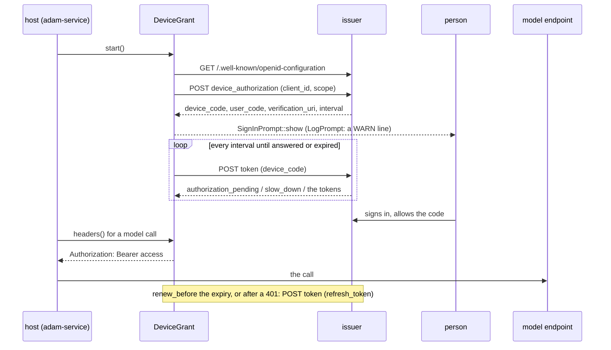
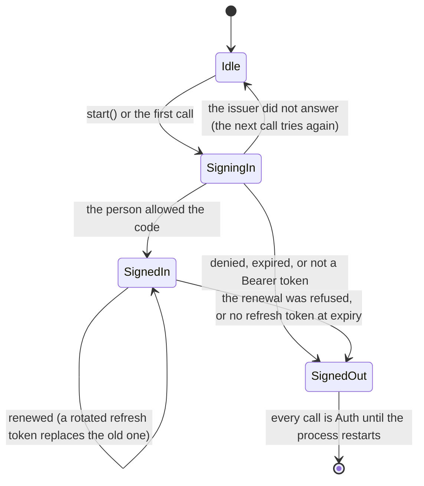

# adam-model-oauth

A `ModelCredentials` provider that signs a process in with the **OAuth 2.0 device grant** (RFC 8628) and renews its
token, so an agent can call a model endpoint that takes short-lived tokens from an issuer instead of a fixed key.

## Where it sits

An **adapter** of the credentials port in [`adam-model`](../adam-model/README.md)
([ADR 0058](../../docs/decisions/0058-the-models-credentials-come-from-a-provider-asked-for-each-call.md)). A
client that takes a provider ([`adam-model-openai`](../adam-model-openai/README.md)'s `with_credentials`) asks it
for the headers of every model call. [`adam-service`](../adam-service/README.md) builds one from `MODEL_AUTH=device`
and `MODEL_OAUTH_*`; a host that embeds adam and already holds the person's session gives its own provider
instead. Nothing here knows a particular issuer: the issuer, the client id and the scope are settings.

The states are `Phase` in `src/lib.rs`.

## API at a glance

| Item | What |
|---|---|
| `DeviceGrantSettings` | `issuer` (`https`, or `http` on a loopback address), `client_id`, `scope` (`offline_access`), `renew_before` (60 s), `sign_in_wait` (120 s), `timeout` (30 s); `DeviceGrantSettings::new(issuer, client_id)` |
| `DeviceGrant` | the provider: `new(settings, prompt) -> Result<_, OAuthConfigError>` (sends nothing), `start()` (asks for the code now, in the background; nothing outside a Tokio runtime), `is_signed_in()`; implements `ModelCredentials`. Clones share one sign-in. `Debug` shows the issuer's origin and the client id |
| `SignInPrompt` | how a code reaches the person: `show(&SignInCode)`, `signed_in()`. Never given a token |
| `LogPrompt` | the default prompt: a `WARN` log line with the code and the link, an `INFO` line once signed in |
| `SignInCode` | `user_code`, `verification_uri`, `verification_uri_complete`, `expires_in` |
| `OAuthConfigError` | `InvalidIssuer`, `EmptyClientId`, `Client`; `#[non_exhaustive]` |

## Behaviour worth knowing

* **Discovery on the issuer's origin.** The device and token endpoints come from
  `{issuer}/.well-known/openid-configuration` and must be on the issuer's origin; one elsewhere signs the process out
  before anything is sent to it. Redirects are never followed.
* **The person decides.** A code is asked for once per process. A denied or expired code, or a refused renewal, signs
  the process out: every later call is `ModelError::Auth`, and a new code needs a restart. The issuer not answering
  (discovery, the code request) is transient: the sign-in goes back to `Idle` and the next call asks again.
* **Polling** follows the server's `interval` (5 s when it gives none, at least 1 s); `slow_down` adds 5 s (RFC 8628
  §3.5); a poll that gets no answer is retried until the code expires.
* **A call waits for the sign-in** at most `sign_in_wait`, then fails with a transient error that the runtime retries.
  The error never carries the code: the code goes to the prompt only.
* **Renewal.** `renew_before` the access token's expiry (from `expires_in`, 300 s when absent), one renewal at a time
  (a lock), with the refresh token; a renewal that returns a new refresh token replaces the old one, since issuers
  rotate them. A renewal the issuer does not answer keeps the current token while it is valid. After a `401`
  (`rejected`), the token is renewed at the next call and the client retries once.
* **Only `Bearer`.** A token of another type (`DPoP`) signs the process out: proofs are a host's own provider.
* **Secrets.** The device code, the access token and the refresh token are `SecretString`s held in memory only:
  never in a file, a log, an error, the environment of a command or the journal. One process, one sign-in: two
  processes sharing a rotating refresh token would sign each other out.

## Features and environment

No Cargo features. The environment variables are `adam-service`'s (`MODEL_AUTH`, `MODEL_OAUTH_ISSUER`,
`MODEL_OAUTH_CLIENT_ID`, `MODEL_OAUTH_SCOPE`): [the reference](../../docs/reference/environment.md).

## Tests

* Unit tests in `src/lib.rs`: the form encoding, `slow_down`, the issuer's scheme, the token type, `Debug`.
* `tests/device_grant.rs`: against a `wiremock` issuer: the code shown and the token after a pending poll, the first
  call starting the sign-in, renewal before expiry with the rotated refresh token spent next, a refused renewal
  signing out with no new code, a denied code, a `401` renewed at once, a call that waits too long being transient
  without the code in its error, endpoints on another origin refused, an issuer that is down, and the provider in
  `adam-model-openai` turning a model's `401` into a renewed, successful call. No network, no environment variables.

## See also

[ADR 0058](../../docs/decisions/0058-the-models-credentials-come-from-a-provider-asked-for-each-call.md),
[`adam-model`](../adam-model/README.md), [`adam-model-openai`](../adam-model-openai/README.md),
[`adam-service`](../adam-service/README.md).

## TLS provider

The feature `aws-lc` (default) turns on reqwest's aws-lc-rs provider and `adam-model-openai/aws-lc`. A host
that installs its own provider uses `default-features = false`; see `adam-model-openai`'s README.
