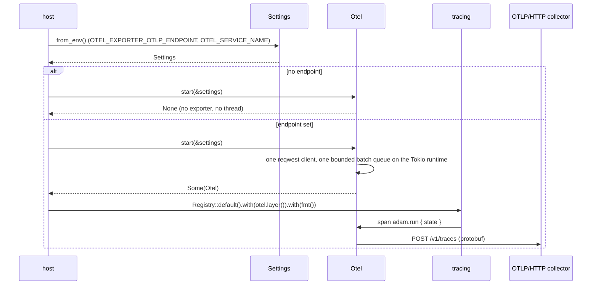

# adam-otel

The **OpenTelemetry layer** of adam-rs: OTLP/HTTP spans, **off unless an endpoint is set**
([ADR 0075](../../docs/decisions/0075-metrics-and-traces-are-off-by-default-and-say-nothing-about-a-person.md)).

This is the foundation of ADR 0075's trace slices, and the decision's exporter clause is
[amended](../../docs/decisions/0075-metrics-and-traces-are-off-by-default-and-say-nothing-about-a-person.md):
the exporter is built on the `opentelemetry` crates, not by hand. `adam-coder`, `adam-agent`, `adam-egress` and
`adam-git-sandbox` compose the layer beside their JSON log layer (ANR-1412); the configuration that reaches them
through `adam-service` and the chart is ANR-1386 and ADR 0075's D1.

## What it does



* **Off means off.** `OTEL_EXPORTER_OTLP_ENDPOINT` unset or blank: [`Otel::start`] answers `None`
  before it builds an exporter, a provider or a thread. The test proves it by handing in a factory
  that records whether it was ever called.
* **The endpoint is checked, and no value is echoed.** A relative endpoint, a scheme other than
  `http`/`https`, a userinfo (a credential in a URL), a query or a fragment is
  [`SettingsError`], class `Invalid`. The message names the variable and the reason, never the value.
  The variable is the **base** URL: traces are posted to `{endpoint}/v1/traces`, and a base that
  already ends in `/v1/traces` is not doubled.
* **OTLP over HTTP, protobuf, no gRPC.** `opentelemetry-otlp` is resolved with
  `default-features = false, features = ["http-proto", "reqwest-client", "trace", "internal-logs"]`.
  `reqwest-client` is the async client over the **workspace's `reqwest` 0.13** (`rustls-no-provider`,
  the provider chosen by the crate's `aws-lc` feature, exactly as `adam-model-openai` does).
  `reqwest-blocking-client` is refused: it adds the blocking client (and its own thread) and pulls
  reqwest's defaults, which is the TLS trap the `tls-provider` gate exists for. `grpc-tonic` is not
  a feature of this crate's build.
* **Bounded, and never a run's failure.** One `BatchSpanProcessor` on the process's Tokio runtime
  (`runtime::Tokio`) with a queue of [`MAX_QUEUE_SIZE`] (2048) spans, batches of
  [`MAX_EXPORT_BATCH_SIZE`] (512) every [`EXPORT_INTERVAL`] (5 s). A full queue drops; an export
  failure is the SDK's `internal-logs` line through `tracing`, and nothing propagates to the caller.
  [`Otel::shutdown`] flushes for [`SHUTDOWN_TIMEOUT`] (5 s). The exporter is the **async** reqwest
  client, so [`Otel::start`] is called from an async `main`; outside a Tokio runtime it answers
  `StartError::NoRuntime` instead of panicking.
* **The closed attribute set holds.** The bridge's own attributes are off (`with_location(false)`,
  `with_tracked_inactivity(false)`, `with_threads(false)`), so a span exports the fields its
  `tracing` macro wrote. [`SpansOnly`] keeps events out, so no log line becomes a span event. The
  run span is ANR-1345's `adam.run { state }`, and the test asserts the exported attribute set is
  exactly `state`.
* **The resource names the service.** `service.name` is `OTEL_SERVICE_NAME`, `adam` when unset.

## API

| Item | What |
|---|---|
| `Settings::from_env()` | reads `OTEL_EXPORTER_OTLP_ENDPOINT` and `OTEL_SERVICE_NAME`; a non-UTF-8 value is `NotUnicode`, a blank one is unset |
| `Settings::from_pairs(iter)` | the same from pairs, ignoring every other name (the tests use it) |
| `Settings::disabled()`, `Settings::enabled(endpoint)` | no endpoint, or one endpoint; `with_service_name(name)` |
| `Settings::endpoint()`, `service_name()`, `is_enabled()` | what was read |
| `Otel::start(&settings)` | `Ok(None)` when off; otherwise the provider, the bounded queue and the batch task, built inside the process's Tokio runtime |
| `Otel::layer()` | the layer to compose beside `tracing_subscriber::fmt()` |
| `Otel::meter()` | the meter a run's instruments are created from; its labels come from `labels` |
| `labels::RunState`, `labels::Name` | the closed label sets: a value outside a set cannot be built |
| `catalogue::EMITTED`, `catalogue::emitted(name)` | the instruments the workspace records — name, kind, unit, labels — and the list a dashboard panel is held to |
| `init(filter)` | installs the process's subscriber — JSON `fmt()` and, when an endpoint is set, the OTel layer
  beside it — and returns the running `Otel` (or `None` when off); every adam binary calls it |
| `Otel::shutdown()` | flush and stop, bounded by `SHUTDOWN_TIMEOUT` |
| `SettingsError`, `StartError` | `Classify`: `SettingsError` is `Invalid`; `StartError` is `Invalid`, or `Internal` for `NoRuntime` |

## Composing it

Every adam binary calls one function, from its async `main`:

```rust,no_run
let telemetry = adam_otel::init(adam_service::logging::env_filter());
// … the process runs …
if let Some(otel) = telemetry {
    otel.shutdown();
}
```

`init` installs the process's subscriber — the JSON `fmt()` layer the binary always wrote, and the OTel
layer beside it when `OTEL_EXPORTER_OTLP_ENDPOINT` is set — and returns the running `Otel` so the caller
flushes it before exit. With no endpoint the log is exactly what it was, and nothing is built. A setting
the crate refuses is one warning line and tracing stays off; it never exits a process.

A host that wants its own subscriber composes the pieces itself:

```rust,no_run
use tracing_subscriber::layer::SubscriberExt;

let settings = adam_otel::Settings::from_env()?;
if let Some(otel) = adam_otel::Otel::start(&settings)? {
    let subscriber = tracing_subscriber::registry()
        .with(tracing_subscriber::fmt::layer())
        .with(otel.layer());
    let _ = tracing::subscriber::set_global_default(subscriber);
}
# Ok::<(), Box<dyn std::error::Error>>(())
```

Both run inside the process's async `main` (Tokio): `Otel::start` builds a task on that runtime and
answers `StartError::NoRuntime` elsewhere.

## Metrics

The same `Otel` carries the metrics half (ANR-1448). `Otel::meter()` gives the meter a run's instruments are created
from; a periodic reader on the process's runtime posts to `{endpoint}/v1/metrics` every [`METRICS_INTERVAL`] (15 s),
with [`EXPORT_TIMEOUT`] for one export. Recording a measurement is the SDK's own aggregation in the process, so it
never blocks a run, and a failed export is the SDK's internal log line. With no endpoint nothing is built at all.
A dropped `Otel` without `shutdown()` leaves the reader's interval task on the runtime; `shutdown()` is what
stops it, and every adam binary calls it before exit. Starting installs the meter provider **globally**, so a
crate that emits a measurement uses `opentelemetry::global::meter(..)` and needs no handle threaded through the
layers; where nothing was started that meter is the no-op one. Ask for it per measurement rather than caching it: the global is read at the call, so a meter cached before `init` would stay the no-op one.

**Labels are types.** [`labels`] holds the closed sets the instruments use: `RunState` (the four states of
`adam_core::store::RunStatus`, held to them by a test) and a `Name` for the names a deployment declares (a tool, a
model alias, a pool), which accepts only `[a-z0-9._-]`, at most 64 bytes. A value outside a set cannot be built, so a
backend's cardinality is what the deployment planned for, and no id, token or amount can travel as a label by
accident. The shape check is not a secret filter — a token can have a name's shape — so what keeps a secret out is the
set, never a value at hand.

## Logs

The process's `tracing` events become OTLP log records on the same switch (ANR-1348): with an endpoint set, a
batch processor posts them to `{endpoint}/v1/logs`, and with none nothing is built.

**A record is allowlisted.** It carries its target, its severity, the message the macro wrote, and only the fields
named in [`logs::ALLOWED`] — an error's class, a run's state, a count, a declared tool or model, a worker id, an
attempt number. Every other field the event carries (a prompt, a tool's arguments, a path, a token) is dropped before
the record exists, so it cannot reach an exporter even by accident. The test emits an event with a prompt, an
argument and a token beside a class, and asserts the exporter saw the class and neither of the other three.

**No trace context.** A record carries no span's trace id, so a collector cannot join it to the traces this same
`Otel` exports; the JSON log on stdout remains the join. Whether to inject the current span's context is ADR 0075
open question 2's decision, not this card's.

The coder's redactor holds per-run secrets this process-level layer cannot see; the allowlist is what makes that
unnecessary, and it is why the log bridge is adam's own layer rather than a copy-everything appender.

**The message is not filtered.** It is the format string the macro wrote, so a call site that formats a value into
it puts that value in the record: eight sites do today (a startup warning, a panic payload, an OAuth error), and
moving those values into fields — where the allowlist decides — is its own card. Until then the allowlist covers
the fields, not the message.

## Dashboards

[`catalogue`](src/catalogue.rs) is the list of instruments this workspace actually records — today
`adam.runs`, with its kind, its unit and the labels it may carry. It is data, not a doc comment, so
`crates/adam-otel/tests/dashboards.rs` can read it: the test loads `deploy/dashboards/*.json` and
fails when a panel queries a metric that is not in the list, or groups or matches on a label the
instrument does not declare. A metric a deployment cannot scrape cannot become a graph that quietly
draws nothing.

The dashboards are generated, not hand-written: `tools/dashboards/<name>.py` (standard library only)
writes `deploy/dashboards/<name>.json`, `sh tools/dashboards/regenerate.sh` runs them all, and CI
regenerates and fails on a difference. `deploy/dashboards/README.md` says what each one shows and how
a deployment imports it.

## Versions

`opentelemetry` 0.33.1, `opentelemetry_sdk` 0.33.1, `opentelemetry-otlp` 0.33.1 and
`tracing-opentelemetry` 0.34.0 (*verified 2026-11-28* in the local cargo registry and against the
versions the card measured on 2026-11-27). `opentelemetry-otlp` depends on `reqwest` 0.13.1 with
`default-features = false`, so the workspace's `reqwest` is the one in the tree (*verified
2026-11-28* in its normalized `Cargo.toml`). The crate adds no `-sys` package beyond the
`aws-lc-sys` the workspace already links through `rustls` — and none at all under `default-features = false`, which is how
`adam-egress` and `adam-git-sandbox` build it.
