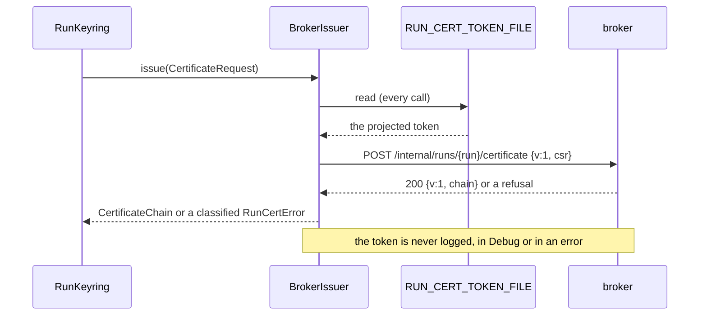
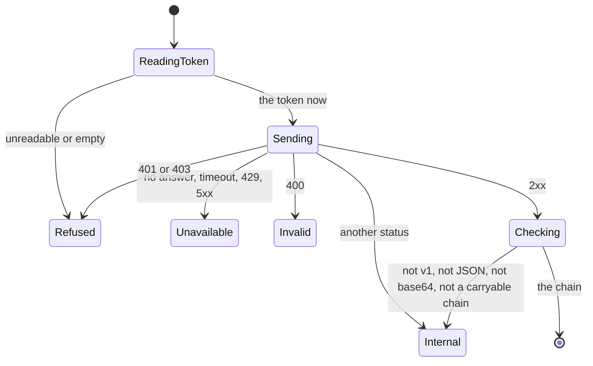

# adam-run-cert-broker

The **broker** adapter of [`RunCertIssuer`](../adam-core/README.md): it asks a run's credential
broker for the certificate that names the run, over the internal contract v1
([ADR 0086](../../docs/decisions/0086-a-run-signs-its-model-requests-with-a-certificate.md)).

## Where it sits

A run's keyring ([`adam-core`](../adam-core/README.md)) makes an Ed25519 key and a PKCS#10 request
**inside the run**; the private key never leaves it. It gives the request to this adapter, which
posts it to the broker with the run's projected token and answers the leaf-first chain. The keyring
caches the chain and renews at two thirds of the leaf's life.

## API at a glance

| Item | What |
|---|---|
| `BrokerIssuer::new(base_url, token_file, run)` | the issuer of one run, trusting the system roots; `base_url` is `RUN_CERT_ISSUER_URL` |
| `BrokerIssuer::trusting(base_url, token_file, run, ca_pem)` | the same, also trusting the PEM of `RUN_CERT_CA_FILE` |
| `BrokerIssuer::with_client(base_url, token_file, run, http)` | the same, with one client a host built for every run (`http_client`) |
| `BrokerIssuer::endpoint()`, `run()`, `token_file()` | the route, the run and the file, for a log line that carries no secret |
| `http_client(ca_pem)` | the client: no redirect, a 30 s bound, the anchors trusted beside the system roots; `None` for the system roots |
| `CONTRACT_VERSION`, `MAX_ANSWER_BYTES`, `MAX_CA_PEM_BYTES` | `1`, 64 KiB and 1 MiB |
| `BrokerError` | the base URL, the trust anchors or the client is unusable: `Classify` gives `Invalid` |
| `TokenError` | the projected token is unreadable, empty or not a header value: `Unauthenticated`; it carries the path, never the contents |
| `AnswerError` | the answer is not contract v1: the version, the size, the JSON, a base64 element, the chain, or the status |

`BrokerIssuer` is a `RunCertIssuer`: `issue(&CertificateRequest) -> Result<CertificateChain,
RunCertError>`, and `kind()` is `"broker"`. It is one run because the run is a path segment.

## The contract

| Part | Shape |
|---|---|
| route | `POST {RUN_CERT_ISSUER_URL}/internal/runs/{run}/certificate`; a path prefix on the base URL is kept |
| request | `{"v":1,"csr":"<base64 DER of a PKCS#10 request>"}`, standard alphabet, padded; `Authorization: Bearer <token>` |
| answer | `{"v":1,"chain":["<base64 DER>", …]}`, leaf first, root omitted, at most 8 in v1 |
| `400` | `RunCertError::Invalid` (`Invalid`) |
| `401`, `403` | `RunCertError::Refused` (`Unauthenticated`): no token, not the run's agent, a lease over, an injected path |
| `429`, `5xx` | `RunCertError::Unavailable` (`Transient`) |
| another status | `RunCertError::Internal` (`Internal`) |
| a wrong `v` | `RunCertError::Internal`: a chain is never read from a body adam does not speak |

The answer's body is never echoed: an error carries the status or the shape, not the peer's problem
document. The refusals' `code` (`run_not_bound`, `lease_expired`, `not_signed`, `bad_csr`,
`unavailable`, `unauthenticated`) is the broker's business; the class is all the keyring needs.

adam carries at most 4 certificates (`CertificateChain::MAX_CERTIFICATES`), while v1 allows 8. A
longer chain is `Internal`; real chains are 2 or 3.

## The projected token

`RUN_CERT_TOKEN_FILE` is a projected service-account token: the platform rotates it in place, so
the adapter opens the file **on every call** and sends what it holds now. The trailing whitespace a
mounted secret ends with is trimmed; an empty file is refused without sending anything.

The token is never in `Debug` (the issuer shows the endpoint's origin, the run and the file's path),
never in a log line, and never in an error (the header is marked sensitive, the errors carry the
status and the path). `tests/broker.rs` proves it with a sentinel token.

## Tests

| Test | What it proves |
|---|---|
| `the_broker_passes_the_run_cert_issuer_conformance_suite` | `run_cert_issuer_conformance!` on a mock that mints a leaf for the CSR it receives |
| `the_v1_fixture_crosses_the_wire_unchanged` | the contract v1 request and answer fixtures (`tests/fixtures/run-certificate-v1/`) go out and come back byte for byte |
| `a_wrong_version_is_refused` | `{"v":2,…}` is `Internal` |
| `each_refusal_has_its_class` | the v1 error fixtures: 401/403 `Unauthenticated`, 400 `Invalid`, 503 `Transient`; the body is not echoed |
| `the_token_is_read_again_on_every_call` | two calls after a rewrite carry two tokens |
| `a_missing_token_file_sends_nothing` | no request, `Unauthenticated` |
| `no_rendering_or_log_holds_the_token` | the sentinel is absent from `Debug`, the errors and a captured log, and present in the request |
