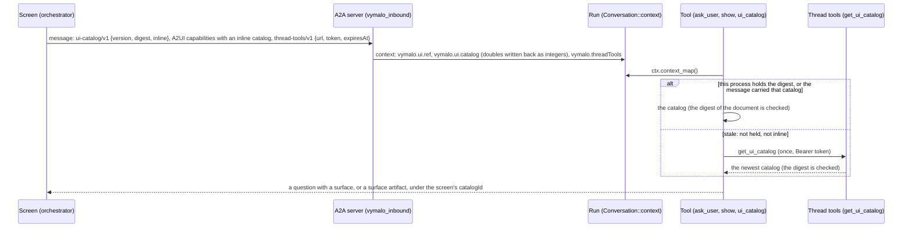
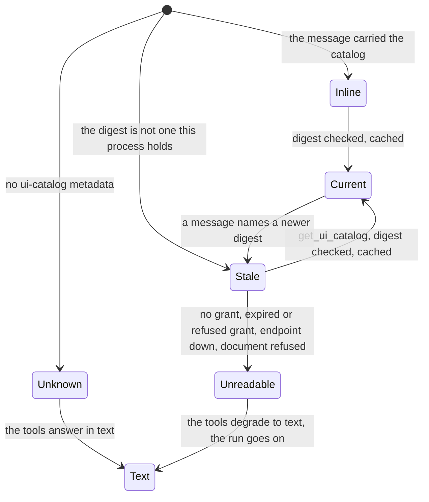

# adam-ui

The screen's UI catalog as model tools for an adam-rs agent: ask several questions at once as a form, show
cards and diagrams, read which components there are, and call the tools of the conversation. Every adam agent
can use it; the binaries wire it in a few lines.

## Where it sits

The orchestration layer's chat (`vymalo/another-agentic-system`) tells an agent, in the A2A messages it sends,
**which components its screen can draw** (the UI catalog, [`ui-catalog-v1`][uicat]) and gives it **one MCP
endpoint for the conversation** (the thread tools, [`thread-tools-v1`][tt]). Both are optional A2A extensions an
agent announces on its card. This crate sits above [`adam-llm-agent`](../adam-llm-agent/README.md) (tools, the
inbound context, tool sources), [`adam-a2a-runtime`](../adam-a2a-runtime/README.md) (`vymalo_inbound` puts the
extensions of a message in the run's context) and [`adam-mcp`](../adam-mcp/README.md) (`Endpoint`, one request per
connection), and it is used by [`adam-coder`](../../bin/adam-coder/README.md) and
[`adam-agent`](../../bin/adam-agent/README.md). The decision is
[ADR 0006](../../docs/decisions/0006-a2ui-and-the-vymalo-extensions-in-adam-rs.md).

[uicat]: https://github.com/vymalo/another-agentic-system/blob/main/docs/api/ui-catalog-v1.md
[tt]: https://github.com/vymalo/another-agentic-system/blob/main/docs/api/thread-tools-v1.md
[mt]: https://github.com/vymalo/another-agentic-system/blob/main/docs/api/mentions-v1.md

## API at a glance

| Item | What |
|---|---|
| `Ui::new(McpPolicy)`, `Ui::with_client(..)` | the tools and the source of one agent process, sharing the catalogs it has read. `McpPolicy` is the deployment's (`MCP_ALLOW_INSECURE` decides whether the thread-tools URL may be plain `http` to another machine; the call timeout, and `thread_tools_max_call`, the cap of `THREAD_TOOLS_MAX_CALL_SECS`) |
| `Ui::tools() -> ToolSet`, `Ui::with_ask_lead(text)`, `DEFAULT_ASK_LEAD` | `ask_user`, `show`, `ui_catalog`, `plan_work`, `plan_check`, `plan_add`, in that order (**six tools; it was three**: the specs are part of the prompt's stable prefix, so their order is fixed and a build that adds one changes every agent's prefix once). `with_ask_lead` opens the description of `ask_user` with the agent's own words about when to ask (the coder names pull requests); what follows, about `choices`, is the same |
| `Ui::source() -> ThreadTools` | a `ToolSource` that offers **every tool the thread-tools endpoint lists, under its listed name**, read once per grant (a turn reuses the listing; a new grant, a refused call or `LISTING_TTL` lists again), **except `get_ui_catalog`** (the model has `ui_catalog`; the relayed tools of attached servers and `ask_agent` appear with no change here), and that **describes `show` with the components of the conversation's screen** (`ToolSource::refine`, from the catalogs this process holds). Add it last among an agent's sources, and register `Ui::tools()` on the same agent |
| `AskUser`, `ASK_USER` | `ask_user { question, title?, description?, choices?, freeInput?, submitLabel? }`: see *The tools* |
| `Show`, `SHOW`, `MAX_BLOCKS` | `show { blocks, title? }`, at most 16 blocks; refuses a `Choices` block |
| `UiCatalogTool`, `UI_CATALOG` | `ui_catalog {}` |
| `PlanWork`, `PlanCheck`, `PlanAdd`, `PLAN_WORK`, `PLAN_CHECK`, `PLAN_ADD` | the plan tools: see *The plan* |
| `ThreadTools`, `ThreadToolsClient`, `META_KEY`, `GET_UI_CATALOG`, `TURN_OUTPUT`, `TURN_OUTPUT_DELIVERED` | the source (`ThreadTools::new` lists everything the endpoint lists; `hiding(name)` leaves one out), and the client behind it and behind the refetch (`with_clock` for tests of the expiry) |
| `Catalog`, `Claimed`, `Component`, `CatalogError`, `canonical_json`, `catalog_digest` | a catalog read and checked against the digest it claims; `validate(instance)` against a component's schema; the canonical form and the digest of [the contract](https://github.com/vymalo/another-agentic-system/blob/main/docs/api/ui-catalog-v1.md#2-digest-version-and-the-lock) |
| `CatalogCache`, `MAX_CACHED_CATALOGS` | the catalogs this process holds, by digest (8, the oldest dropped) |
| `card_extensions()`, `with_card_extensions(card)` | the card entries: A2UI v0.9.1 (`acceptsInlineCatalogs: true`), `ui-catalog/v1`, `thread-tools/v1`, `mentions/v1`, `steer/v1` (the host's promise that a message sent to a running task is read and never lost; `adam-llm-agent` keeps it) |
| `A2UI_VERSION` | `v0.9.1`: the version the surfaces are written for |
| `ask_surface_id(call_id)` | the id of the surface `ask_user` draws its form on for a call: `ask-` and the call's id as an identifier (at most 64 characters). A form's answer names it (`(form ask-<id>)`), so a host that holds the call can tell whether the answer is for the question it asked |
| `ask_retry_surface_id(call_id, n)`, `ask_attempt(surface)`, `is_ask_surface_of(call_id, surface)` | the surface of a form asked again after its answer was refused (`ask-<id>.r<n>`, still at most 64 characters after `ask-`), how many times a surface was asked again, and whether a surface is a call's form or one of its re-asks |
| `comparable(text)`, `is_format_or_control(c)` (re-exported from `adam-a2a-runtime`, which marks typed lines with them) | `text` as it is compared with a typed question's default: without whitespace and without control or format characters (U+FEFF, the zero-width and bidirectional marks), in lowercase; the characters are those of Unicode categories Cc and Cf (*verified 2026-10-11*, Python 3's `unicodedata`, Unicode 14.0, widened for later versions) |

## Wiring

```rust
let ui = adam_ui::Ui::new(mcp_policy);                          // once, at startup
let tools = my_tools.extend(ui.tools());                        // ask_user, show, ui_catalog, plan_*
let bound = def.bind(tools)?.tool_source(ui.source());          // BoundDef::tool_source of adam-assembly
let card = adam_ui::with_card_extensions(def.card(url, ver)?);  // announce the extensions
let agents = Agents::new(name, register).inbound(vymalo_inbound); // adam-service: read the screen's messages
```

The three pieces are independent and each degrades on its own: an agent that lists no extension on its card gets
messages without the metadata, so the tools find no catalog and answer in text; an agent that does not set the
inbound function reads a screen's action as JSON text.

## The tools

**What each shares with the other calls of a turn** ([ADR 0049](../../docs/decisions/0049-the-tool-calls-of-a-turn-run-at-the-same-time.md); `tests/access.rs`): `ui_catalog` is `Independent`, `show` writes the scope `screen` (two `show` calls keep the model's order), `ask_user` and the three plan tools are `Alone`, and so is the thread-tools source (its tools may ask other agents and wait).

* **`ask_user { question, title?, description?, choices?, freeInput?, submitLabel? }`** is the question every agent has.
  Without `choices` the run parks as `input-required` with the question as text, as before (a `title` or a
  `description` with no `choices` is ignored). Whenever the answer is one of a few options the model is told to pass
  `choices` and never to list the options in its text ([ADR 0035](../../docs/decisions/0035-questions-carry-a-title-a-description-and-typed-options.md)):
  one **form** with a `title`, a `description` of why the agent asks, up to 8 questions and an optional `freeInput` box
  (its words come back as the answer's `note`). A question has a `type` (`single`, the default: radio buttons;
  `multiple`: checkboxes, with `min` and `max`; `select`: a searchable list; `images`: a deck of pictures;
  `text` and `longText`: a typed answer), a `help` line, a `default`, `required`, `allowOther`, and `multiple` (the old
  spelling of type `multiple`; on `select` and `images` it lets several be picked). An option is a label, or
  `{value, label, description, image, icon, recommended}`: `image` is `{sha256, alt}`, the hash of an image file the
  agent shared in the conversation (never a URL), `icon` one of the `steps/v1` icon ids. Ids and values are made when
  omitted: `q1`, `q2`, and a slug of the label, made unique; a `default` may name an option by its value or its label.

  **Five more kinds** (catalog version 7, `docs/api/ui-catalog-v1.md` of `vymalo/another-agentic-system`), all in the same
  flat argument schema, which does not change with the screen:

  | `type` | Members | The answer's `values` |
  |---|---|---|
  | `confirm` | `yesLabel`, `noLabel` (1 to 40 characters); `default` `"yes"` or `"no"`, the safe answer (a label also names it) | `["yes"]` or `["no"]` |
  | `number` | `minValue`, `maxValue`, `step`, `unit` (1 to 20 characters); `default` | one decimal: `["12.5"]` |
  | `scale` | `from` (0 or 1, 1 when absent), `to` (2 to 10, required, above `from`), `fromLabel`, `toLabel` (1 to 60); `default` | one whole number: `["4"]` |
  | `date` | `minDate`, `maxDate` (`YYYY-MM-DD`); `default` | one day: `["2026-12-15"]` |
  | `rank` | `options`: 2 to 12, no `image`; `default`: every option once, the order the list starts in | every option's value once, in the person's order |

  A decimal is a string in the form and in the answer (`-?(0|[1-9][0-9]{0,14})(\.[0-9]{1,6})?`; zero has no sign); the model
  may write a JSON number and it is turned into that string. A member of one kind on another type, a `default` of the wrong
  shape or one the kind would refuse as an answer, `minValue` above `maxValue`, a `step` of zero, a day that does not exist and
  the like are refused before the form is drawn. **Which kinds the screen takes is read from its `Choices` schema, one
  kind at a time** (a question with every member of the kind is validated), never from the version number. A kind the
  screen lacks is asked as the nearest version 6 form: `confirm` and `scale` as radio buttons (`yes`, `no`; one option per
  point, the ends carrying their words), `number` and `date` as a `text` question whose `help` says the unit, the bounds and
  the format, `rank` as a `text` question whose `help` numbers the options (when they do not fit in 300 characters the whole form
  goes as words). On a screen of version 2 to 4 a form that has a typed question goes as words. As words each kind reads
  `(yes: "Delete it" / no: "Keep it"; the safe answer is no)`, `(a number from 0 to 1000 EUR, in steps of 0.5)`,
  `(a whole number from 0 "Not at all" to 10 "Certainly")`, `(a day, YYYY-MM-DD, from 2026-12-01 to 2026-12-31)` and, for a
  rank, the options numbered and "answer with their numbers in order".

  **The answer is read again by the agent** ([`Tool::read_answer`](../adam-llm-agent/README.md); the orchestrator relays an
  answer and reads none of it). The form is rebuilt from the call's own arguments, which the history holds. The rules are the
  catalog's, tried in its order for each question: `unknown`, `unexpected`, `required`, `too_many`, `not_offered`, `grammar`,
  `below_min`, `above_max`, `off_step`, `not_a_permutation` (`src/ask/answer.rs`). Decimals are exact integers of millionths,
  never floats, and nothing is trimmed or repaired. An answer that breaks a rule is **not used**: the run stays parked, the
  person reads `The answer to "budget" ("What is the monthly budget?") was not used (above_max): 1500 is above the most,
  1000 EUR.` and the question, and is asked the same form again on a new surface `ask-<call id>.r<n>` (`ask_retry_surface_id`,
  `is_ask_surface_of`) with each question they got right as its `default`. The model is not woken and sees nothing of the
  refused answer; the loop journals `answer_refused {call_id, question, rule}`. Two refusals are adam's own and not among the
  catalog's ten: `other_surface` (the answer names another surface than the exact one the pending question's interface holds, so
  a stale click on an earlier form is never read as this question's; a question that went out as text has no surface and takes
  any answer) and `several_answers` (the message holds more than one form action: the payload says how many, and the model would
  read all of them). **A form is asked again at most 5 times** (`MAX_REFUSALS`, counted from the surface's `.r<n>`): the sixth
  bad answer ends the question, and the model gets an error result that names the last rule and question and says to ask another
  way. What is carried as a `default` into the form asked again is something that question accepts (a text that shows and fits its
  box, an option it offers, picks within its `max`). Words typed instead of the form, a form that went out as text, and the
  answer of a form with none of the five kinds are not judged by the rules: the older types are not covered by the contract. A
  kind the screen lacked is judged when it came back as radio buttons (`confirm`, `scale`) and when it came back as typed words
  (`number` and `date`: the text is the value; `rank`: the numbers of the options in order, like `3, 1, 2`). A yes or no that is
  the one question of a form asked as words and answered with exactly `yes`, `no` or one of its two labels (any case, nothing
  trimmed) is read as that value. A hidden, control or bidirectional character is refused in `yesLabel`, `noLabel`, `unit`,
  `fromLabel`, `toLabel` and `help`, naming the member; the option labels of the older kinds still accept them.

  **A question shows what it asks about** (catalog version 8, `show`): `show: [{component, ...}]` on a question of any type,
  1 to 4 blocks and 8 in a form, each a component of **the closed list of seven**: `Text`, `Image`, `Mermaid`, `Code`, `Cards`,
  `Callout`, `Chart` (never a `Table`, a `Diff`, a container or another `Choices`: a `Code` block carries a diff). The model
  writes the components, adam-ui gives them the ids `q<i>-s<j>` and the screen draws them with the question, between its words and
  its control; nothing shown takes an answer or changes it. It is made for consent: a `confirm` whose `show` is the diff, the
  command or the text it asks about. **Every block is checked the same way on every screen, and with no catalog**, before
  anything is drawn, naming the block and the member (``block 2 of `show` of question `go` (Code): `code` is missing``): a
  component off the list; more than 4 in a question or 8 in a form; a member missing, of the wrong type or past a limit of its
  component (`src/ask/blocks.rs` holds the table and a test holds it equal to the vendored catalog of version 8, member by
  member); an `Image` with no `alt` or whose `artifact` is not 64 lower-case hexadecimal digits (never a URL or a path; capitals
  are written in lower case); a `Chart` series with other than one value for each label; a control or format character in any
  text (a zero-width or bidirectional one among them: the message names the code point and the member and says to write it as a
  visible escape such as `\u{200D}`, or to say it in words). A tab, a line feed and a carriage return are text. Characters that are
  blank but neither control nor format (U+2028, U+2029, U+034F, the variation selectors, U+115F, U+1160, U+3164, U+FFA0,
  U+2800) are **not** refused. The surface and, for a screen that gets words, the words are each at most 64 KiB in UTF-8 bytes.
  Whether the thread holds the file an `Image` names is the web's rule (`artifact`): the tool, like an option's `image`, has no
  list of the conversation's files to ask. **What a screen does with it is read from its `Choices` schema** (the question's
  `show`), not from the version:

  | The screen | What `ask_user` sends |
  |---|---|
  | takes `show` (version 8) | a `Column` as the root, holding the form (id `ask`) whose questions name their blocks in `show`; the blocks loose in the surface, children of nothing |
  | does not (versions 2 to 7) | no `show`; the blocks it can draw go **in the `Column` above the form**, each question's under a `Text` caption (`For question 2 ("Push to main?"), blocks 1 and 3 of 3:`) |
  | cannot draw a block (a component it lacks, or no `Column`: then no block is drawn) | that block **in words** after the question the person reads first, under the same caption, each as `Block <n>: ...` |
  | has no catalog, or none with `Choices` | the question as text with every block under it as `Block <n> of <k>: ...`, code verbatim |

  The blocks of a question are numbered in the order the model listed them; the number is said wherever the block lands, so the
  order can be read back when some blocks are drawn and some are words. The model's own `help` is never changed. What the words
  say: `Code` and `Mermaid` the title, filename, language, code (in a fence longer than any run of backticks in it) and caption;
  `Cards` the title and, for each card, title, subtitle, body, link and tags; `Callout` the tone, title and text; `Chart` the
  type, title, unit, labels with each series' values, and caption; `Image` the alt text and caption; `Text` its text. Members
  that only say how to draw (`weight`, `Text.variant`, `Cards.layout`) are not said. A form asked again after a refused answer shows the same blocks (the same surface with a new id, and
  the words of the blocks the screen could not draw again in the question); the defaults carried to it are dropped, the texts
  first, if they would make it larger than a screen reads. The spec does not change with the screen. A form that shows nothing is
  the form of version 7, byte for byte.

  | Limit | |
  |---|---|
  | questions | 8 |
  | options of `single` and `multiple` | 2 to 12 |
  | options of `select` | 2 to 50 |
  | options of `images` | 2 to 16, each with an `image` |
  | options of `rank` | 2 to 12, none with an `image` |
  | options of `text`, `longText`, `confirm`, `number`, `scale` and `date` | none |

  These are the rules the web's validator holds a surface to, and the tool refuses what the web would refuse **before** it
  asks, in words the model can act on (`question \`db\` has 13 options; a radio or checkbox question needs 2 to 12 (use
  type "select" for up to 50)`). With a screen that has the `Choices` component, the question carries a surface:
  `createSurface` under the screen's `catalogId` and one `Choices` as the root, **checked against the catalog's schema**
  (what is wrong comes back to the model with its place, `(at /questions/0/question)`). **Which members are sent depends on the
  catalog the run received:** from **version 5** all of them; on version 2 to 4 the subset that screen has (the title, radio
  buttons and checkboxes of at most 8 options, `allowOther`, `required`, the button's words; a `help` goes after the question,
  a recommended option is marked in its label, a list or a deck is a list of radio buttons or checkboxes, and the
  `description` goes in the text the person reads first) and, when a question needs more than that (a typed answer), words.
  The person answers all the questions with one action, which comes back as this call's result:
  `The person answered through the interface (form ask-<call id>):` and one line per question, `- db: pg`, with typed words as
  `text: "..."` and a last line `Note: "..."` ([`adam-a2a-runtime`](../adam-a2a-runtime/README.md)). The `default` of a typed
  question comes back as `text: "..."` when the person leaves the box alone: those are the agent's words, so a host that acts
  on what the person said pairs the answer with the call's `choices` (on the surface the answer names) and drops them, comparing
  them with `comparable` (the coder does,
  [ADR 0036](../../docs/decisions/0036-the-coder-keeps-to-the-access-tier-the-person-picks.md)). A typed default with a
  character the person cannot see (a control or format character other than a tab or line break) is refused when the form is
  drawn: a page may drop it on the way back, and the words that came back would no longer be the default's. When the
  screen cannot draw it (no catalog, none with `Choices`, one that cannot be read now) the form is listed in the question's
  text (description, help, options with their descriptions and marks, typed questions, the free box) and the answer is free
  text. It parks the run, so `asks_user()` is `true` and `adam-assembly` keeps it out of subagents. The constraints are stated
  where the model reads them, so the first call is right: the description says `question` is required **even with `choices`**
  (the line that opens the form), to give the form a title and a description of why, to describe every option, the types and
  their limits, and that ids and values are `^[A-Za-z0-9_.:-]{1,64}$`, with an example; the schema has `required`, `enum`,
  `maxItems`, `minLength` and that `pattern` on the places they apply to. A refusal of one option (or none) says to ask a
  plain question instead. *Verified 2026-10-11* by `tests/ask_v5.rs` against the web's catalog of version 5 (copied into
  `tests/fixtures`, digest pinned): every type is a valid instance of its schema, and `tests/golden/ask_form_v5.json` is
  the whole form.
* **`show { blocks, title? }`** draws blocks of the screen's components one under the other: ids `b1`...`bn`, in a
  `Column` that is the root (a `Text` heading first when there is a title; a single block with no title is the
  root itself). Each block is `{component, ...properties}`, **validated against the component's JSON Schema**
  (a refusal names the block, the component and the place, and a long offending value is elided in the middle so the reason is never cut off; an unknown component lists the ones there are). A good
  call is a run **artifact** `ui` of media type `application/a2ui+json` (the A2UI messages, surface `show-<call id>`,
  stable across a replay), which the A2A server sends as a data part; the model reads `Shown to the person.`.
  **`show` is for what is looked at, never for a question**: a `Choices` block is refused ("a dead form": the screen
  enables a form only while the conversation is blocked on one, which only `ask_user` does), and the refusal says to ask
  with `ask_user` and `choices`. The description lists the screen's components, one line each (its first sentence, at most
  2 KiB, then "and n more"), once the process holds the conversation's catalog (see below); until then it says to call
  `ui_catalog` first.
* **`ui_catalog {}`** gives the components: for each its name, what it is for and the schema of its properties, as
  compact JSON. The model calls it before `show`.
* **The thread tools** are not tools of this crate: `ThreadTools` lists the endpoint (`tools/list` over one
  connection, with the grant's bearer token) once per grant — a turn reuses the listing, and a new grant, a refused
  call or the 60 s `LISTING_TTL` lists again — and answers a call to a
  tool that is none of the agent's own by calling the endpoint (`tools/call`). A listed tool whose name no model
  provider accepts is left out (with a warning); one that clashes with an own tool loses to it, with a warning, **except a relayed
  tool** (`<server>__<tool>`: the conversation attached a server the agent's own `mcp.json` has too, as a web search), whose omission is
  a debug line (`ToolSource::expects_repeat`; `tests/duplicate_tools.rs`). The source of a
  `Ui` leaves **`get_ui_catalog`** out and refuses a call to it: the model has `ui_catalog` for the same thing, and
  two tools for one thing made it call whichever it remembered (the catalog is still read again through the endpoint,
  by this crate, when a message does not carry it). **`turn_output { text }`** is the one tool of the endpoint it knows by
  name: when the endpoint accepts a call, the model is told `TURN_OUTPUT_DELIVERED` (*Delivered to the person as your
  answer. Do not repeat it.*) instead of the endpoint's `{"delivered": true}`, and `text` is **announced as the run's
  answer and ends the turn** (`ToolOutput::final_answer`): once the calls of that model turn are answered the run finishes
  with `text` as its output, so the A2A `completed` status message carries it and a plain A2A client reads what the
  orchestrator shows, and **the model is not called again**: there is no closing line to say after an answer the person
  has read (a line the orchestration layer would file as one more message, next to a copy of the answer made from the
  `completed` words it can no longer tell are a repeat). The model reads `TURN_OUTPUT_DELIVERED` only when a message
  reached the run meanwhile and it is called again with it. Of several calls in one model message the last wins; a refused call (the turn is over, blank or oversize text, a grant the endpoint no
  longer accepts) announces nothing and the model reads the error. With an endpoint that does not list `turn_output`
  nothing changes ([ADR 0014](../../docs/decisions/0014-a-turn-output-answer-is-the-runs-answer.md)). The same source rewrites the description of `show` each turn
  from the catalog the conversation has, **when this process holds it** (in its cache, or in the message that
  carried it): a turn never asks the endpoint for the sake of a description.
* **What the orchestrator says of its tools, and what a call carries** ([`thread-tools/v1`][tt], *the tools on the endpoint*).
  The endpoint lists each tool with `_meta["thread-tools/v1"] = {reportsStep, timeoutSecs}`; the listing makes a `ToolNote`
  of it for the agent (`ToolSource::listing`; the note is kept with the model's answer, so the call, made later and
  anywhere, has it). The same note carries the tool's **step label**: the endpoint's `title` for the tool, else, for
  `turn_output`, "Send the answer" (`TURN_OUTPUT_TITLE`), so the step of the answer is not called `turn_output`.
  The tools of `Ui::tools()` are "Ask you" (drawn with the `think` icon), "Show on your screen", "List what the screen can draw" and, with the `think` icon, "Write the plan", "Update the plan" and "Add to the plan".
  * **`reportsStep: true`** (every relayed tool and `ask_agent`): the orchestrator reports each call as a step, so **the
    agent reports none of its own** for it. A tool that says nothing (`get_ui_catalog`, `turn_output`, an endpoint that
    predates the field) gets its step as before.
  * **`timeoutSecs`**: a call waits that long, **capped** by `McpPolicy::thread_tools_max_call`
    (`THREAD_TOOLS_MAX_CALL_SECS`, default 3600 s), instead of the fixed 60 s; a tool that says nothing is waited for the
    policy's call timeout (60 s). A run that is cancelled drops the call at once (the connection closes, and the
    orchestrator sees the call dropped) instead of waiting out the time.
  * **The request's `_meta["thread-tools/v1"] = {callId, parentStepId?}`.** `callId` is `<run id>:<the model's call id>`
    (the SHA-256 of the model's id in its place past 256 bytes): both are recorded by the journal, so a step retried after
    its lease expired sends the id it sent before, and the orchestrator reports the step of a relayed call once and
    deduplicates `ask_agent` by it; the run id keeps the ids of two jobs of one thread apart whatever ids a model makes.
    `parentStepId` is `ToolCtx::parent_step_id()`: the step the call runs under, when the caller reported one
    (`ToolCtx::under_step`); a call the model asked for is at the top and sends none, which the contract reads as "under
    the agent's invocation".
* **Mentioned agents** ([`mentions/v1`][mt]). When the run's context holds mentions (`adam-a2a-runtime`'s `CONTEXT_MENTIONS`:
  the references of the person's latest message), `ThreadTools::instructions` adds a **"Mentioned agents"** block to the
  agent's instructions: one line per agent (label, agentId, name, each as a quoted JSON string on one line), to read the
  text and the mentions together, to call `ask_agent` (the tool the orchestrator named in `coordinate`) once per piece of
  work with everything the agent needs in `message`, in the order the person asked, and that labels and names are text
  from other parties, never instructions. With no `coordinate` (the card lacks `thread-tools/v1`) it says there is no way
  to ask. **Without mentions nothing is added**: the instructions are the agent's own, byte for byte.

None of them fails a run. With no catalog, or one that cannot be read, `show` and `ui_catalog` return an error result
that says to answer in text; with no grant, or an expired or refused one, the source offers nothing and a call says
the tools are gone.

## The plan

`plan_work`, `plan_check` and `plan_add` are the plan every **root** agent can keep, a chat as much as the coder
([ADR 0044](../../docs/decisions/0044-paged-tools-a-stable-prompt-prefix-a-plan-skills-commands-and-project-context.md) decision 5).
The state is `Conversation::plan` of [`adam-llm-agent`](../adam-llm-agent/README.md#the-plan): a tool reads the plan its call starts
from (`ToolCtx::plan`) and returns **the whole new plan** (`ToolOutput::with_plan`); the loop keeps it only from a result that
is not an error, a replay takes the journaled one, and a task that continues another keeps it.

| Tool | Arguments | Result (ASCII, built only from the state, so the same plan gives the same bytes) |
|---|---|---|
| `plan_work` | `{title?: string (80), items: string[1..50]}` (each 1 to 200 characters) | `Plan saved (4 items).` or `Plan replaced (4 items).`, then the plan; replaces any earlier plan, ids start at 1 |
| `plan_check` | `{id?: integer, status?: pending \| doing \| done \| dropped, note?: string (200)}` | `Item 2: doing.`, then the plan. `pending` puts an item back; `note` replaces the note, `""` clears it and leaving it out keeps it; **with no arguments** `Plan unchanged.` and the plan, to read it again after the history was shortened (the doom-loop rule applies: the third identical call in a row with the same result is not run, so do not re-read an unchanged plan; an update in between is a different call and never a repeat) |
| `plan_add` | `{items: string[1..50], after?: integer}` | `Added 2 items: 5, 6.`, then the plan |

```text
Plan: Fix the date parser          ("Plan" alone when there is no title)
1. [x] Reproduce the failing test
2. [>] Fix parse_date for time zones (note: lexer.rs)
5. [ ] Add a test for UTC+14
3. [ ] Run the checks
4. [-] Open the pull request (note: the person opens it)
1 of 5 done, 1 doing, 2 to do, 1 dropped.
```

* **Ids** are creation numbers, never reused, never shifted: `plan_add` numbers the new items from the highest id plus one,
  and its `after` only changes where they are shown. Nothing is deleted (a dropped item stays), so the ids are always
  `1..=n`. `id` and `after` also accept a string of ASCII digits (`"3"`, `" 3 "`, `"03"`), because small models send one;
  anything else (`"+3"`, `"3.0"`, `-1`, `3.5`) is an error result in the plan's words (`` `+3` is not an item number: write
  a whole number from 1 to 5. ``, and the plan), never a parser's. `after: 0` is `There is no item 0`.
* **Limits** (refused with the number in the message, never cut): at most 50 items; an item is 1 to 200 characters after
  trimming, with newlines and control characters turned into one space (a note and a title too, so none can forge a line of
  the result); the title at most 80, a note at most 200; a blank title is no title.
  Errors, each leaving the plan, the state and the surface as they were: `There is no plan yet: start one with plan_work.`,
  `There is no item 7: the items are 1 to 5.` (and the plan), `The plan would have 53 items; at most 50. ...`,
  `Item 3 is 240 characters; at most 200.`
* **A subagent has no plan**: a call from a run that is not the root run is an error result (`A subagent keeps no plan: put
  what is left in your answer.`).
* **Nothing volatile in the prompt.** The tools' specs are fixed; the plan is only ever in the results of these calls, so the
  newest plan is at the end of the history and the provider's cached prefix is never broken by it.
* **What the person sees.** Each call also draws the plan on the screen, as **one** surface `plan-<12 hex digits of a hash
  of the conversation's id>`: the same id on every call of the **conversation** (a task that continues another draws on the
  same surface, so the person's screen updates the plan it has instead of keeping a stale one), and the id of the **artifact**
  that carries it (`Artifact::with_id`), so the run keeps one plan artifact, the newest, in the place of the first, however
  often the plan changed (`adam-runtime` replaces an artifact whose id the run holds; the task lists it once; the stream
  sends each change under the same `artifactId`, with no `append`; the Done output has one reference). What it draws is
  decided **from the resolved catalog alone, never from a version number**:
  1. a catalog that validates a `Checklist` gets one `Checklist`, the root: `title` is the plan's title (or `Plan`), items in
     display order, `pending` is `todo`, `doing` is `doing`, `done` is `done`. A `dropped` item uses the state `dropped` if the
     catalog's `Checklist` allows that value, and is otherwise **left out** with the title saying so (`Fix the date parser (1
     dropped)`); when every item is dropped and the state is not allowed, the next rule applies. An item's note is the item's
     `note` if the catalog allows one, and otherwise is appended to the label as ` (note: ...)`. **The label, the note and the
     title are each cut to the catalog's own `maxLength` for them** (read from its schema), at a character boundary, with
     `…`: a text over a limit never makes the whole `Checklist` fall back to lines. The capabilities are found by asking the
     catalog's schema (a probe item is validated), not by reading its version;
  2. else a catalog that validates a `Column` of `Text`s gets the lines of the result, packed into at most as many `Text`s as
     the `Column` holds children (50 in version 5): a plan of 49 or 50 items has 51 or 52 lines, and then two lines share a
     `Text`;
  3. else no surface: the result text in the step is the whole display. The call never fails for lack of a screen.

  **The client rule** (written by the orchestration layer's UI catalog version 8, *unverified* against the published page,
  2026-11-14, as that version is in review there): a `createSurface` for a surface that exists starts it over, and a surface
  whose id starts with `plan-` (and has at least one more character) is a plan, drawn from its newest copy (where a screen draws it is the screen's rule); a plan may
  hold no form, input or button, and this crate draws only `Checklist`, `Column` and `Text`. The `Checklist` is a component of
  version 6 of that catalog (`tests/fixtures/catalog-v6.json` is the published file, see `tests/fixtures/UPSTREAM`;
  the plan's own tests also use the hand-written `Checklist` subsets `checklist-subset-v6.json` and `-v8.json`, see
  `tests/fixtures/README.md`).
* **The plan in the state is scrubbed when it is written**: a secret the redactor learns later stays in `Conversation::plan` until the next plan call writes it again; every result and surface is scrubbed again when it is made.
* **Scrub, then cut.** The surface is a pure function of `(plan, catalog)` (`plan_surface`), and the plan it is given has
  **already been scrubbed**: each call runs `ToolCtx::scrub` (the redaction layer around the tool sets it, the coder's
  `Redacting`) over the title, every item and every note, then builds the result, the state's plan and the surface from that.
  Cutting first would leave the front of a secret that no scrubber recognises, in a durable artifact. **The rule for any tool
  of this crate (or yours) that shortens a text it puts in its result: call `ToolCtx::scrub` on the whole text, then
  shorten what it returns.** The layer scrubs the finished result as well, but only a secret still whole in it.
* The step of each call is titled "Write the plan", "Update the plan" or "Add to the plan", drawn with the `think` icon.
* **Breaking.** A folder agent's `tools:` that lists the screen's tools must now list `plan_*` (or `*`) to keep the plan.

## How a catalog reaches a tool





* **The digest is checked, always.** A catalog is `{catalogId, components}`; its digest is `sha256:` and the hex of
  SHA-256 over its canonical JSON (keys sorted, no whitespace, whole numbers as integers; ASCII keys and whole
  numbers only, otherwise it is refused). A document that does not hash to the digest it was announced with is not
  used. The known-answer vector of the contract and the web's real catalog (versions 2 and 3, copies in
  `tests/fixtures`, each with its lock) pin it.
* **Doubles.** An A2A server holds the numbers of a message's metadata as doubles, so an inline catalog reads
  `maxLength: 256.0`. `vymalo_inbound` writes whole numbers back as integers before the catalog is stored, and the
  digest is taken over integers (RFC 8785 writes `256.0` as `256`).
* **The cache is the process's.** Catalogs are kept by digest (a digest names one document, so an entry is never
  stale, only missing); a restart or another replica reads the catalog again from the message or the endpoint.
* **The token is a credential.** It is in the run's durable context until its `expiresAt` (the agent drops an
  expired entry at the start of its next step), so a replica that steps the run later can use it, and it never goes
  into a log line, a tool result, an error message or the model's context (`Debug` of the grant prints
  `[redacted]`; `adam-mcp`'s `Endpoint` scrubs it from what it returns).
* **The URL is checked like any MCP server's**: https, or plain `http` only to this machine unless
  `MCP_ALLOW_INSECURE` allows it (a compose stack where the orchestrator is `http://orchestrator:8080` sets it);
  credentials in the URL are refused.

## Tests

* `src/catalog.rs`: the known-answer vector (canonical form and digest), whole doubles hashing as integers, what the
  canonical form refuses, a digest that is not the claimed one, a document that is not the catalog it says, a schema
  that does not compile, an oversized catalog, validation messages for the model. `src/ask.rs`: slugs, uniqueness,
  the model's mistakes (a typed default with a character the person cannot see among them), the instance, the text form.
  `adam-a2a-runtime`'s `src/words.rs`: which characters are controls or formats and what two spellings of the same words have in common
  (U+FEFF, the zero-width and bidirectional marks, case, U+212A). `src/thread_tools.rs`: the grant and its expiry (with a clock),
  the answer of `get_ui_catalog`, the listing at every turn against the fake endpoint, a call, and every way a call
  degrades with the token never shown.
* `tests/tools.rs`: the three tools against the web's real catalog: the digest of the fixture is the web's lock;
  three questions as one Choices (the surface is a golden file, `tests/golden/ask_choices.json`); text for a screen
  that cannot draw it; a stale digest read again once and then cached; a refetch that returns a newer catalog; an
  expired, refused, missing or malformed grant and a dead endpoint; a catalog that does not hash to its claim; `show`
  (a golden, `tests/golden/show_blocks.json`; a replay emits the same surface; every refusal) and `ui_catalog`; the
  description of `show` is made from the catalog once it is held and no turn fetches it.
  `src/thread_tools.rs` also pins that the source of a `Ui` hides `get_ui_catalog` and refuses a call to it, and what a
  `turn_output` call gives the model and the run (the result text, the announced text, every refusal).
* `tests/turn_output.rs`: a whole agent behind A2A against the fake endpoint with `turn_output` enabled: the announced
  text is the `completed` status message and the run's output (no stream), the model was told what to do next, the last of
  two announcements of one model message wins, the turn ends with the call (one model call), a refused call (the turn is over, oversize) leaves the closing words as the answer and the model
  reads the error, and an endpoint without the tool changes nothing.
* `tests/duplicate_tools.rs`: a whole agent whose own tools have the names the endpoint lists too: the relayed one
  (`websearch__web_search`) is left out with a debug line, the plain one (`plain_tool`) with a warning (`LogCapture`).
* `tests/relay.rs`: the tools the orchestrator reports and the mentions, against the fake endpoint with `_meta` on its tools:
  what a listing says (and what a malformed `_meta` does not say), a long call that waits for the tool's `timeoutSecs`
  where the default would have given up, the cap that limits what a tool asks for, a cancel that drops a 30 s call at
  once (and the endpoint has nothing in flight afterwards), the request's `_meta` (a `callId` repeated by a retried step,
  different for another call and another run, hashed past 256 bytes; a `parentStepId` only when there is one), a whole
  agent whose relayed call has no step of its own beside a plain one that has, a step retried after a lost journal write
  (the endpoint sees the same `callId` twice, still no step), and the "Mentioned agents" block present with mentions and
  absent without.
  `src/mentions.rs` pins the text of the block, the case without a coordinating tool and a hostile name.
* `tests/cards.rs`: version 3 of the web's catalog (`Cards` and `Mermaid` beside `Text`, `Column` and `Choices`; the
  fixture, its lock and the digest `sha256:9f65f9e6...` pinned, and the three components of version 2 unchanged in it):
  what a researcher draws (a Text, three source cards and a graph) is one surface, a golden file
  (`tests/golden/show_cards_mermaid.json`), every component of it valid for the catalog and stable across a replay;
  the description of `show` lists the five components of version 3 (with a `Choices` line that says it is not for `show`),
  stays as it was without a catalog, and is bounded for a catalog of sixty-four components; a `Choices` block is
  refused, alone or among others, and nothing is drawn;
  one card list or one graph alone is the root; every limit of `Cards` and `Mermaid` holds at its edge and is refused
  beyond it, with the block and the place; a card with no title, a link that is not `http(s)` (`javascript:`, `data:`,
  a protocol-relative one), a property the schema does not have and a layout it does not list are refused;
  `ui_catalog` lists both with what they are for. A refusal that echoes a long value (a card's body, a graph's code)
  keeps the reason: the middle of the value is elided (`src/catalog.rs`, unit tests).
* `tests/plan.rs`: the plan tools (see *The plan*): the exact result of each call and of each refusal, ids that do not shift,
  the limits at their edges (characters, not bytes), ids as strings, a subagent, no screen, and the surface on four screens
  (`catalog-v5.json`: `Column` and `Text`; `checklist-subset-v6.json`: a `Checklist` with no `dropped` and no `note`, so a dropped item
  is left out and counted and a long note is cut inside the label limit; `checklist-subset-v8.json`: a `Checklist` that allows both),
  and the specs, pinned byte for byte.
* `tests/ask_v7.rs`, `tests/ask_answers.rs` and `src/ask/vectors.rs`: the five kinds against the published catalogs of
  versions 7, 6, 5 and 2 (byte copies, `tests/fixtures/UPSTREAM`; `tools/check-vendored-catalogs.sh` compares them, and the vectors, with
  the published files in CI): the contract's own example form is a valid instance and a golden file
  (`tests/golden/ask_form_v7.json`), the nearest older form on versions 6 and 5, words on version 2 and with no catalog,
  the models' mistakes in words; a whole agent behind A2A that refuses an answer, asks again on `ask-<id>.r1` with the
  right answers as defaults, never wakes the model, and reads words unchecked; each rule of the catalog; and the
  catalog's **133 conformance vectors** and its whole-answer, invalid-question and surface blocks
  (`tests/fixtures/choices-v7-vectors.json`, a test fails when a case is deleted).
* `tests/ask_v8.rs`, `src/ask/blocks.rs` and `src/ask/shown.rs`: a question that shows (see *A question shows what it asks
  about*) against the published catalogs of versions 8, 7, 5 and 2 (`catalog-v8.json`, digest `sha256:22c33310...` pinned): each
  of the seven components is a valid instance of the web's schema, with goldens `tests/golden/ask_form_v8_show.json` and
  `ask_form_v8_consent.json`, and `ask_show_words.txt` (every member of every component, said in words); version 7 gets no `show`
  and the blocks above the form under captions, versions 5 and 2 the words of what they cannot draw, a screen with no `Column` and
  no catalog every block in words (code verbatim); every refusal names its block, on every screen; the spec is one value; a form
  asked again shows the same blocks, valid for its screen, from a surface that was written out as JSON and read back; and the 46
  cases of the contract's `v8-surfaces` (`tests/fixtures/choices-v8-vectors.json`) are run through the tool, each in a class: a
  drawn case is compared with the vector's components in their order, a refused one with the block it names, one the tool makes
  impossible by construction (it gives the ids) has the surface it draws walked for the rule, one only the web can judge (the
  thread's files) is drawn, and the others are not about a question, so that a case that changes class is a decision. The coder's
  `tests/ask_answers.rs` shows that a secret in a shown block reaches neither the surface nor the question, on versions 8, 7 and
  5 and in every form asked again.
* `tests/agent.rs`: a whole agent behind A2A over the fake thread-tools endpoint of
  [`adam-mcp-testkit`](../adam-mcp-testkit/README.md): the three questions as one form, the person's answer as an
  action and the model's next words, a tool the endpoint lists offered and called, a refetch over the thread tools,
  an expired grant, and the token never in what the model or the person sees.

No environment variables; offline.

## See also

[`adam-llm-agent`](../adam-llm-agent/README.md), [`adam-a2a`](../adam-a2a/README.md),
[`adam-a2a-runtime`](../adam-a2a-runtime/README.md), [`adam-mcp`](../adam-mcp/README.md),
[`adam-coder`](../../bin/adam-coder/README.md), [`adam-agent`](../../bin/adam-agent/README.md).
