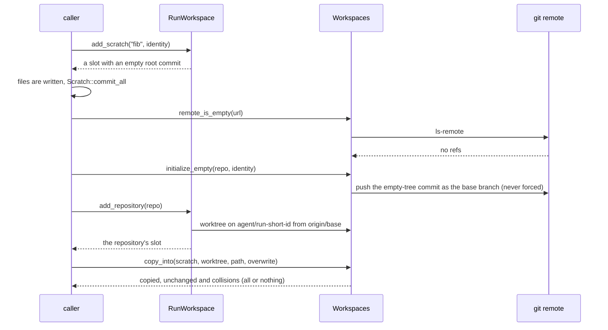
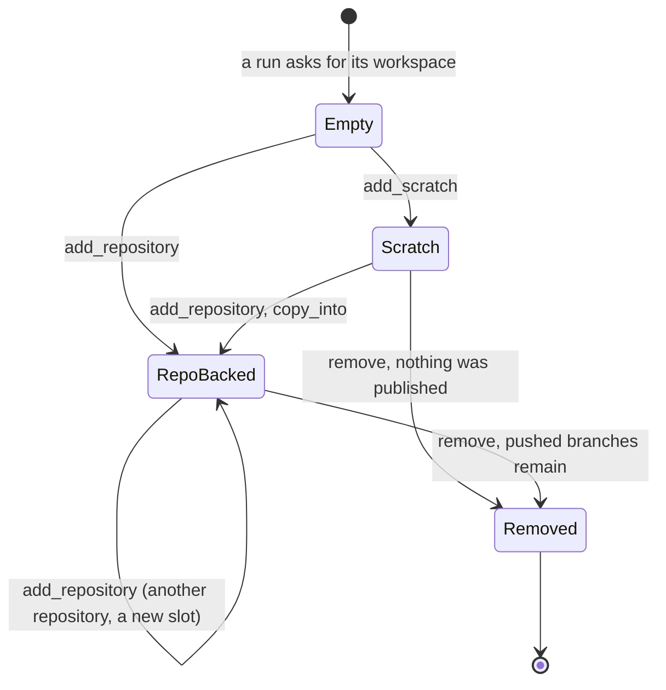
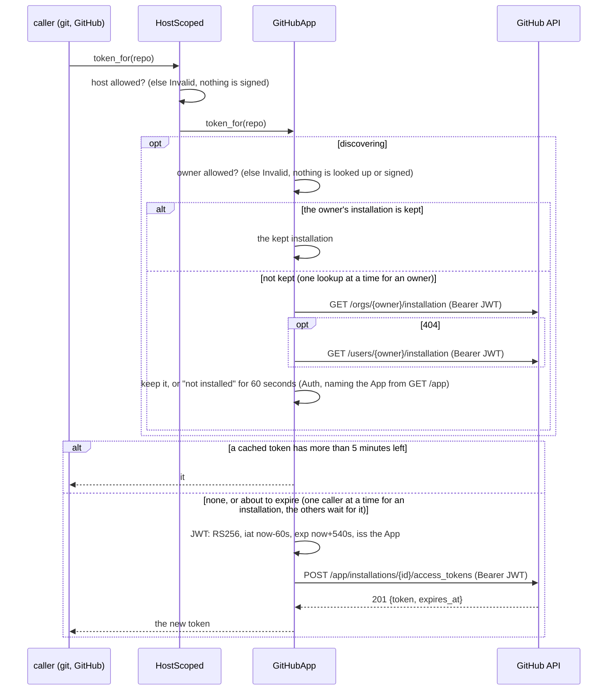
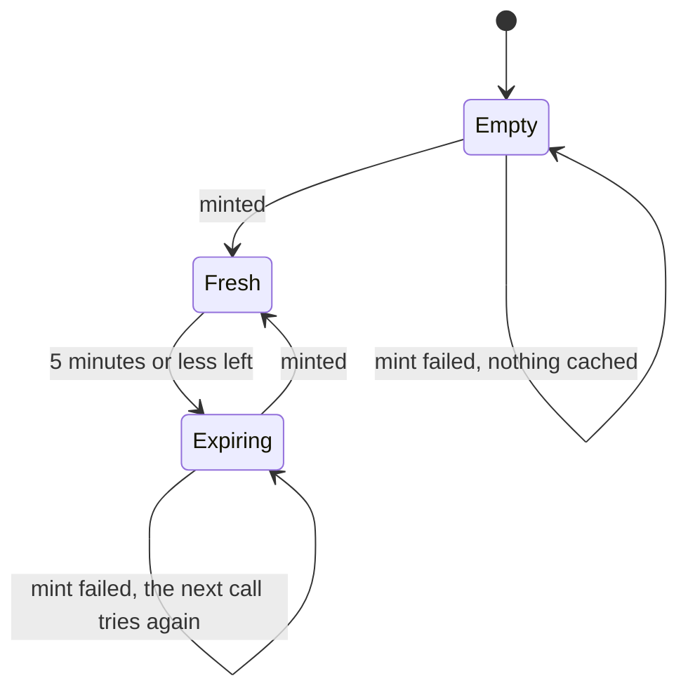
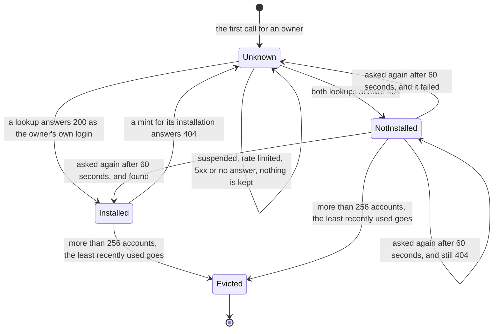
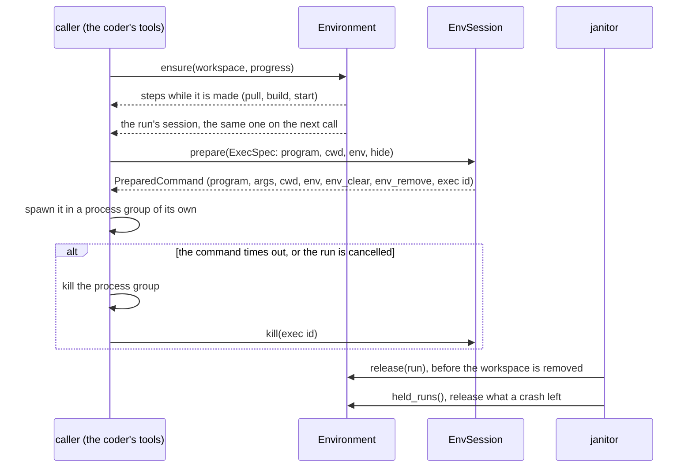
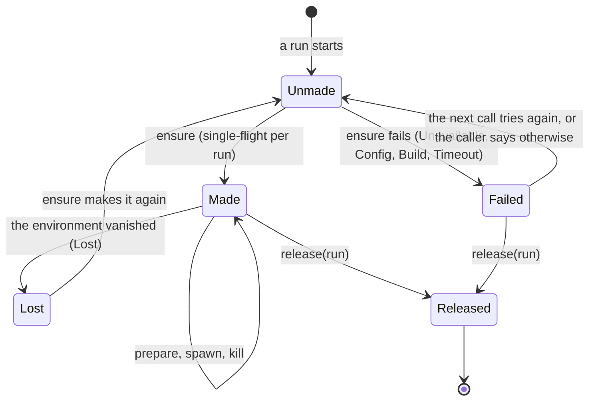

# adam-workspace

Per-run git worktrees, push and pull requests for coding agents. git is the
durable artifact: a run's result is a pushed branch and a pull request. A run's workspace holds
several repositories and scratch projects ([below](#a-runs-workspace-slots-scratch-projects-and-the-copy-between-them)).

## Where it sits

The **workspace and code-host layer** of the coder agent, used by
[`adam-coder`](../../bin/adam-coder/README.md) (and by anything that wants isolated
worktrees). It defines three ports, `GitCredentials`, `CodeHost` and `Environment` (where a run's
processes run, [below](#where-a-runs-processes-run-the-environment-port)), and ships
their implementations in the same crate (`StaticToken`, `ScopedToken`, `HostScoped`, `GitHubApp`,
`GitHub`; `MemoryCodeHost` for tests; `Local`). Nothing implementation-specific appears
in a trait signature. It shells out to the `git` CLI so mirrors, worktrees and
authentication behave like the real tool.

## API at a glance

| Item | What |
|---|---|
| `Workspaces` | `new(root, creds)`, `allow_hosts(..)`, `allow_local(bool)`, **`check_repository(&RepoRef)`** (whether the policy accepts a repository: nothing is spawned, requested or written), **`acts_for()`** (the accounts the credentials are confined to, `None` for a token), **`run(run)`** (a run's workspace, below), **`runs()`** (the runs that have one on disk), **`remote_is_empty(url)`**, **`initialize_empty(&RepoRef, &GitIdentity)`**, **`wait_reachable(url, Duration)`**, `default_branch(url)`, `remove(run)` (everything of the run's workspace, the legacy worktree included), and the single-repository helpers `prepare(&RepoRef, run)`, `prepare_continuing(&RepoRef, run, existing)`, `open_existing(run)`. One shared bare mirror per repository; each run gets a worktree on `agent/<run>`. `default_branch` is what the remote's `HEAD` names (`git ls-remote --symref <url> HEAD`); a remote whose `HEAD` names none is `NoDefaultBranch` (class `NotFound`: a caller that solves it by naming a branch matches this variant and no other). A base branch the remote does not have is `NotFound` and the error lists the remote's branches (the first 30) |
| `RunWorkspace`, `Slot`, `SlotKind`, `Scratch` | a run's workspace: `slots()`, `slots_in_join_order()`, `slot(dir)`, `slot_for(&RepoRef)`, `add_repository(&RepoRef)`, `add_repository_continuing(&RepoRef, branch)`, `add_scratch(dir, &GitIdentity)`, **`add_scratch_for(dir, &GitIdentity, Option<&str>)`** (for a conversation), **`adopt_scratch(conversation)`**, `remove()`, **`remove_keeping_scratch()`**; a `Slot` has `dir()`, `path()`, `seq()`, `kind()` (`SlotKind::Repository(Worktree)` or `SlotKind::Scratch(Scratch)`), `worktree()`, `scratch()` and **`generation()`** (a token that is new each time the coder makes the slot's directory, or moves a scratch project into a run's workspace: a run pod mounts a directory and not its name, so a pod made for a slot removed and added again under the same name is told from the one made for what is there now; `None` for a slot made before it was recorded); a `Scratch` has `path()`, `dir()`, `commit_all(message, &GitIdentity)`, `files()`, `status()`, `published_to()`, `set_published_to(url)`, **`generation()`** and **`conversation()`** **`root()`** on a `Slot`, a `Worktree` and a `Scratch`: the slot's directory as the coder opened it, `&Arc<SlotDir>` ([below](#a-slots-directory-is-held-not-named)); `path()` stays what it was, the name. `copy_into` and `Scratch::files()` work relative to those directories |
| `copy_into(&Scratch, &Worktree, path, overwrite)`, `CopyReport`, `Collision` | the files of a scratch project into a worktree, all or nothing: `copied`, `unchanged`, `collisions` |
| `Environment` (trait), `DynEnvironment`, `Local` | where a run's processes run: `ensure(&RunWorkspace, &dyn EnvProgress)` gives the run's `EnvSession` (made on first need, then the same), `release(run)` (idempotent), `held_runs()`, `rebuild(run, use_default)` (throw the run's environment away and make it again on the next `ensure`; `false` where there is nothing of its own to make again) and **`seal(&RunWorkspace)`** (a new **provided** method, default a no-op, so no implementation breaks: the caller calls it right after it adds a slot, because its file and git tools never call `ensure`; an environment that shows the run its slots as places the run cannot rename throws away what lacks the new slot when nothing runs in it, and answers `EnvError::Unavailable` while a command does; it never makes anything). `Local` is the caller's own container and holds nothing |
| `HidingEnvironment` | `HidingEnvironment::new(inner, names)`: an `Environment` that adds `names` to the `hide` list of **every** `ExecSpec` its sessions prepare, so a process that holds secrets keeps them from the code it runs for others (the coder passes the variables its `mcp.json` files read as `${VAR}`) without every caller having to remember them; everything else (`describe`, `kill`, `tool_path`, `secret_ref`, `release`, `held_runs`, `rebuild`, `seal`) is the inner environment's. `hidden()` lists the names |
| `EnvSession` (trait), `LocalSession` | `describe()`, `prepare(&ExecSpec)` (the command to spawn), `kill(&ExecId)`, `secret_ref(name)`, `tool_path(name)` (where an environment that runs processes elsewhere put the caller's own copy of a program the caller needs inside: the coder's `opencode`; `None`: use it as named) |
| `ExecSpec`, `Program`, `PreparedCommand`, `ExecId`, `SecretRef` | what to run (`ExecSpec::shell(command, cwd)` or `::argv(..)`, `.env(..)`, `.hide(names)`), the command an environment made of it (`PreparedCommand::command()` is a `tokio::process::Command` with its program, arguments, directory and environment), and how a process reads a secret (`SecretRef::Env` or `File`) |
| `EnvProgress` (trait), `EnvStep`, `EnvStepState`, `NoProgress`, `EnvKind`, `EnvDescription` | the steps of a slow `ensure`, and what an environment says it is (`EnvKind::{Local, DevContainer { source, image }, Kubernetes { pod, image }}`, `#[non_exhaustive]`: a `match` over it needs a wildcard) |
| `EnvError` | `Unavailable`, `Config { file, reason }`, `Refused`, `Build { reason, log_tail }`, `Timeout { phase, secs }`, `Lost`, `Io`; `#[non_exhaustive]`, see *Errors* |
| `GitPin` | where `git` works for a slot, from the coder's metadata: `git_dir()`, `common_dir()`, `work_tree()`, `apply(&mut Command)` (sets `GIT_DIR`, `GIT_COMMON_DIR` and `GIT_WORK_TREE`), `check().await` (**only checks**: the work tree and the git directory are plain directories, a worktree's `commondir` is a regular file that says `../..`, its `HEAD`, `index` and reflog are regular files, a scratch project has no `commondir`; it never rewrites anything), **`still_here().await`** (the work tree's name still leads to the directory the coder opened as the slot, [`SlotDir::is_still_here`](#a-slots-directory-is-held-not-named): not moved away, not replaced by another directory or a link; `check()` asks it first and last, and `GitCmd` once more as `git` starts; a tripwire, which narrows the window and does not close it). A `GitPin` now holds the slot's `Arc<SlotDir>` (its `Eq` compares the directory too). `Worktree::git_pin()`, `Scratch::git_pin()` and `Slot::git_pin()` give it ([below](#git-is-pinned-to-the-slots-repository)) |
| `safe_fs` (module) | how the coder opens what a run's commands can write, without being led anywhere by it: `read_regular_file(path, max)` / `read_regular_text` (`O_NOFOLLOW | O_NONBLOCK`, `fstat`: not a link, not a pipe, not longer than `max`), `private_copy_of(path, max)` (a copy, mtime kept, in a `0700` directory of the process's own temporary directory, made with `O_EXCL`; removed when the `PrivateCopy` is dropped; `private_copy_in(base, ..)` makes it in a directory of `base` instead: the work volume's, when git runs in the sandbox), `replace_file(path, bytes)` (written next to it and renamed over it), `is_real_directory`, `is_real_file`, `is_plain_path(below, path)` (`lstat`, so a link is not a directory) and the constants `MAX_SMALL_FILE`, `MAX_INDEX_COPY` ([below](#what-the-coder-opens-in-a-directory-a-run-writes)); and, for a slot's directory, **`SlotDir`** (opened once, without following a link, and held: everything in the slot is relative to it), its `Dir` (an open directory: `lstat`, `open_dir`, `open_regular`, `create_new`, `mkdir`, `rename`, `unlink`, `symlink`, `read_link`, `replace_file`), `Meta`, `Backend`, `WalkError`, `BeneathError`, and **`safe_fs::race`**, the seam the tests swap a directory with ([below](#a-slots-directory-is-held-not-named)) |
| `confine_git_env(&mut tokio::process::Command)`, `GIT_INHERITED_ENV` | the environment of a `git` a caller starts itself: empty, plus only the variables of `GIT_INHERITED_ENV` (`PATH`, `HOME`, the locale and temp dirs, certificate and proxy settings, `GIT_CONFIG_GLOBAL`). Every `git` this crate runs starts this way, and the coder's own (`git apply`, the tree-id probes) too ([below](#git-starts-from-an-empty-environment)) |
| `Workspaces::with_git_sandbox(socket)`, `git_sandbox()`, `GitSandbox` | run the `git` commands that carry no credential in the **git sandbox** ([`adam-git-sandbox`](../adam-git-sandbox/README.md)) instead of here: `GitSandbox::socket()`, and `private_dir()`, the directory of the work volume where the copy of an index is made. Off unless called; a sandbox that cannot be reached is an error and never a fallback ([below](#where-git-runs-the-git-sandbox)) |
| `LocalGit`, `LocalOutput` | the questions a tool asks of a repository (`new(cwd, sandbox)`, `pinned(&GitPin)`, `arg`/`args`/`env`/`stdin`, `output().await`): a `git` from the confined environment with hooks and the file system monitor off, in the sandbox when there is one, else a child of this process. A command that carries a credential is refused. `GitPin::sandbox()` says which |
| `login_shell()` | `bash` where the image has one, else `sh` (the shell of a `Program::Shell`) |
| `RepoRef`, `RepoLocation` | repository URL and base branch, parsed and validated (`RepoRef::new(url, base_branch)`, `locate()`) |
| `Worktree` | `lock_mirror` (`MirrorLock`), `path`, `mirror` (the bare mirror the worktree is linked to: an environment that runs `git` in the worktree has to read it), `dir` (the slot's name), **`git_dir`** (the worktree's directory in the mirror, from the coder's metadata; `None` when it cannot be told), **`git_dir_generation`** (a token that is new each time the coder makes that directory: the name is the same when a slot is made again, the directory is not, and a pod's mounts follow the directory; `None` for a worktree made before it was recorded), **`git_pin`**, `branch` (the branch the work ends up on, see below), `local_branch` (the run's own), `continues`, `run`, `repo`, `status`, `diff_stat`, `commit_all(message, &GitIdentity)` (committed onto the run's own branch explicitly, whatever `HEAD` says), `push` (the run's own branch), `publish` (moves the continued branch), `base_commit` (what `origin/<base>` is at), `add_base_checkout` / `remove_base_checkout` (a temporary detached checkout of it, a `BaseCheckout`, below) |
| `GitIdentity`, `ChangedFile`, `FileStatus` | commit author and changed files (`FileStatus` is `Display`: `modified`, `type changed`) |
| `GitCredentials` (trait), `DynGitCredentials` | `token_for(&RepoRef) -> SecretString`, and `acts_for() -> Option<Vec<String>>` (the accounts the credentials are confined to: a GitHub App's, `None` for a token; **a provided method**, so an implementer keeps compiling; `HostScoped` forwards it) |
| `StaticToken`, `ScopedToken` | one token for any host, or bound to named hosts (`from_env(..)` for both) |
| `HostScoped<C>` | any credentials, issued only for named hosts: `new(hosts, inner)` checks the host of the repository (and refuses a local one) **before** `inner` is asked, as `ScopedToken` does for its token |
| `GitHubApp`, `AppKey`, `AppOwners`, `Installation`, `MAX_CACHED_INSTALLATIONS` | credentials of a GitHub App (feature `github`): `AppKey::from_pem(&str)` parses the App's RSA key once; `GitHubApp::new(api_base, app_id, installation_id, key)` is **pinned** to one installation, and `GitHubApp::discovering(api_base, app_id, key, AppOwners)` finds the installation of each repository's owner (`installation_for(owner)` is the lookup, `pinned_installation()` says which mode); both mint installation access tokens and keep each until five minutes before it expires ([below](#github-app-credentials)); `with_clock(..)` moves its clock. `AppOwners::{Any, Only}` (`only(logins)`, `allows(owner)`, without case) is which accounts a discovering App may act for; an `Installation` is `{ id, account }` (`#[non_exhaustive]`); `MAX_CACHED_INSTALLATIONS` (64) bounds the tokens kept. `GitHubApp::accounts()` (and `acts_for`) says which accounts the App acts for, lowercased: the pinned installation's account (`GET /app/installations/{id}`), the listed `GITHUB_APP_OWNERS` (nothing asked of GitHub), or for `Any` every account it is installed on (`GET /app/installations`, at most 300, the suspended left out) |
| `CodeHost` (trait), `DynCodeHost` | `open_pull_request`, `find_pull_request` (matches the head **and** `repo.base_branch`), `find_pull_request_on_head` (the head alone, whatever the base: for a continued branch), `comment_on_pull_request`, and eight that have defaults (a host that cannot is an error, `None`, or no login): **`find_repository(repo)`** (the repository if the host has it, `Ok(None)` if not: what a caller unsure its `create_repository` took effect asks), **`create_repository(NewRepository)`** (an **empty** repository: `NewRepository { repo: the address it will have, private, description, kind }` and `CreatedRepository { full_name, clone_url, html_url, default_branch }`; an existing name is `Invalid` "already exists"), **`owner_kind(owner, host_repo)`** (`OwnerKind::{User, Organization}`) and **`authenticated_login(host_repo)`** (`None` for credentials that are not a person's: an installation token), **`pull_request_status(repo, number)`** (answers `PullRequestStatus { number, url, open, merged, draft, head_branch, head_repo, head_sha, base_branch, checks }`: `head_repo` is the `owner/name` the head branch is in, and `checks` is `Checks::{Passing, Failing(why), Pending(which), Unreported(why)}`, whether any status or check run of `head_sha` failed or is unfinished, and the host calls the pull request clean or reports some that passed; `ci_reported` says whether it reported any that **succeeded** (runs that were all skipped or neutral did not check anything), `false` with `Passing` being a repository with no CI or one nothing ran in: what a caller reads **before** it merges), **`merge_pull_request(MergePullRequest)`** (`{ repo, number, expected_sha, method: MergeMethod::{Squash (the default), Merge, Rebase}, delete_branch }`, `expected_sha` the head the caller looked at: a head that is another commit is `Conflict`, answers `MergedPullRequest { sha, url, already_merged, deleted_branch, branch_note }`; idempotent, a pull request merged already is `already_merged`; what the host's own rules refuse is `Conflict` with the host's words), **`rename_repository(repo, new_name)`** (answers the `CreatedRepository` it is now) and **`delete_repository(repo)`**; `NewPullRequest`, `PullRequest`. **The four added by the access tiers have defaults that say the host cannot, so a `CodeHost` of yours keeps compiling** |
| `GitHub` | GitHub REST `CodeHost`: `new(creds)`, `with_api_base(url)`; idempotent (returns the open pull request of the same head and base). `create_repository` is `POST /orgs/{owner}/repos` for an organisation and `POST /user/repos` for the authenticated user, with `auto_init: false`; the token is asked for the repository's future address, so the host check and the credentials are those of its host; `owner_kind` is `GET /users/{owner}` (`type`); `find_repository` is `GET /repos/{owner}/{name}` (`404` is `None`); `authenticated_login` is `GET /user`, and a `403` that is not a rate limit (what an installation token gets) is `None`. **Merge, rename, delete and the status follow no redirect and ask first**: `GET /repos/{owner}/{name}` must answer `200` with that very `full_name` (a repository that was renamed or transferred answers its old address with a redirect, and an address that is free again can be somebody else's: it is `Conflict`, "not the repository that was named"), and the change itself is sent on a client that follows no redirect. `pull_request_status` is `GET .../pulls/{n}`, then `GET .../commits/{sha}/status` and `GET .../commits/{sha}/check-runs` (at most 300 runs), always (a `mergeable_state` of `clean` stands in for success only when none was reported): a failed or errored status, or a run that ended in anything but `success`, `neutral` or `skipped`, is `Failing`; one not finished is `Pending`; none at all is `Unreported`. `merge_pull_request` reads the pull request (merged: reported, closed: `Invalid`), refuses a head that is not `expected_sha`, then `PUT .../pulls/{n}/merge` with `merge_method` and the `sha` (the expected one, else the head it read), so a head that moved is refused (`409`); a `405` or `409` is `Conflict` (class `Rejected`) carrying GitHub's message (branch protection, a required check, a conflict, a draft), a `403` is `Auth`. With `delete_branch` it then deletes the head branch (`DELETE .../git/refs/heads/<branch>`) only when the branch is in this very repository and is not the base; a branch GitHub will not delete is `branch_note`, never an error. `rename_repository` is `PATCH /repos/{owner}/{name}` with `{"name"}` (a taken name is `Invalid`; a name that is not `[A-Za-z0-9._-]{1,100}` is refused before a request) and `delete_repository` is `DELETE /repos/{owner}/{name}` |
| `MemoryCodeHost` | in-memory `CodeHost` that records pull requests and comments (`comments()`) and the repositories it was asked to create (`created()`; `with_organization(owner)`, `with_login(login)`), the merges (`merges()`, idempotent), the renames (`renames()`) and the deletions (`deletions()`), and with `refusing_changes(message)` answers all three with `Auth(message)`: what GitHub says to an App without the permission. Feature `test-util` |
| `WorkspaceError`, `WorkspaceResult` | `Auth`, `NotFound`, `NoDefaultBranch(repo)` (the remote's `HEAD` names no branch: what `default_branch` returns for an empty repository), `Invalid`, `Transient`, `RateLimited { retry_after }`, `Conflict`, `Corrupt`, `Git { .. }`, `Http { .. }`, `Io { .. }`; `#[non_exhaustive]`, see *Errors* |

**Continuing a pushed branch.** `prepare_continuing(repo, run, "agent/abc")` makes the run's worktree start from
`origin/agent/abc` (which must exist on the remote) instead of the base. The run still has its own local branch
`agent/<run>` checked out (so the worktree never collides with the one of the run that pushed `agent/abc`, and
a finished run's worktree need not be removed first), and **`Worktree::push` publishes that branch under its own
name**, also for a run that continues another: the continued branch is not moved by a push. `Worktree::publish`
does that, separately and on the caller's decision: `git push <url> agent/<run>:agent/abc`, never forced, so a
pull request from `agent/abc` is updated only when the caller lets the run's commits in (the coder does it
after its checks gate). `publish` on a worktree that continues nothing does nothing, and repeating it is a
no-op. `Worktree::branch()` is `agent/abc` (what a pull request is opened from), `local_branch()` is
`agent/<run>` and `continues()` is `Some("agent/abc")`. Only `agent/*` names can be continued (never `main`,
never a person's branch), a run that already has a branch of its own or another continued one is a `Conflict`,
no push ever forces, and a continued branch that moved on the remote makes `publish` fail with `Conflict` ("the
branch moved on the remote since this worktree was started from it"), the branch untouched and the run's commits
safe on its own branch. `diff_stat` and the pull request base are unchanged: the diff spans every run's work on
the branch.

```rust
use std::sync::Arc;
use adam_workspace::*;

let creds = Arc::new(StaticToken::from_env("GITHUB_TOKEN")?);
let workspaces = Workspaces::new("/data/workspaces".into(), creds.clone());
let repo = RepoRef::new("https://github.com/owner/repo", "main");

let wt = workspaces.prepare(&repo, "018f3a2b-7c1d-7000-8000-000000000001").await?;
// ... the agent edits files under wt.path() ...
let me = GitIdentity::new("adam", "adam@example.com");
if wt.commit_all("fix the thing", &me).await?.is_some() {
    wt.push().await?;
    let pr = GitHub::new(creds)?
        .open_pull_request(NewPullRequest {
            repo: repo.clone(),
            head: wt.branch().to_owned(),
            title: "Fix the thing".into(),
            body: "Automated change.".into(),
            draft: true,
        })
        .await?;
    println!("{}", pr.url);
}
```

Security posture: `Workspaces::allow_hosts` and `allow_local` decide which
repository URLs are accepted at all, so a token only goes to a host the
operator named. The commands that carry the token (`fetch`, `ls-remote`, `push`, `publish`) name that URL
(the canonical one for an http(s) remote) and the refspec, instead of the remote called `origin`;
`core.fsmonitor` is pinned off for every command and `GIT_CONFIG_GLOBAL` is `/dev/null` next to
`GIT_CONFIG_NOSYSTEM` unless the operator set `GIT_CONFIG_GLOBAL` in the process's own environment (a global file the
operator chose is theirs; `$HOME/.gitconfig` is not read, since code in a worktree can write it). That is not enough alone: `url.<base>.insteadOf` and `pushInsteadOf` rewrite the
URLs given on the command line too, and the mirror's configuration is shared by every run and
written by more than this crate (a model's command, OpenCode and a repository's scripts all run in
a worktree of it; and, with a git sandbox, a repository's own `filter` can write it). So **the guard is at the
credentialed call**: under the mirror lock, right before each of those commands, the crate **checks** the mirror's files
and every key of its configuration against what it writes itself, and refuses the command when anything else is there
([below](#the-mirrors-configuration-is-checked-not-repaired)). Who wrote the key does not matter. (A tool such as the coder's
`run_command` also undoes such writes when it sees them, but nothing relies on that.) The token reaches `git` only through the environment of one
invocation: never in a remote URL, `.git/config`, logs or error messages.
URLs with embedded credentials and ssh/scp forms are refused.

### The mirror's configuration is checked, not repaired

`Workspaces::check_mirror` (private; every command that carries a token goes through `Inner::run_network`, the only place
one is made for a mirror, so none starts without it) looks at `HEAD`, `packed-refs` and `commondir` of the mirror without
following a link (`HEAD` and `packed-refs` must be regular files, and there is no `commondir`: git would follow it to another
repository's configuration), reads `config` as a regular file of at most 1 MiB and not through a link, parses a **private copy
of the bytes it read** with `git config --file --no-includes --list -z` (so what is judged is what was read, and parsing runs no
program), and refuses unless every key is one the workspace writes:

| Key | Value |
|---|---|
| `core.repositoryformatversion` | `0` |
| `core.bare` | `true` |
| `core.filemode`, `core.ignorecase`, `core.precomposeunicode`, `core.symlinks` | `true` or `false` |
| `core.logallrefupdates` | `true`, `false` or `always` |
| `remote.origin.url` | the URL git is given for this repository (the canonical one for http(s); a filesystem remote in either spelling) |
| `remote.origin.fetch` | `+refs/heads/*:refs/remotes/origin/*` |
| `branch.agent/<name>.adam-run`, `.remote`, `.merge` | a run id, `origin`, `refs/heads/agent/<name>` |

Each key once. `include.*`, `includeIf.*`, `url.*`, `http.*`, `credential.*` and `core.sshCommand` are refused first,
whatever the table says. The refusal is a `WorkspaceError::Corrupt` that names the mirror and the **keys, never their values**,
and one `error` log line each. A missing `remote.origin.*` is not refused (the commands name the URL and the refspec themselves).

**Refused, not repaired**, because a repair hides an attack (the writer is still there, and the next run meets it again) and
because the operator has to look at what wrote the file. The cost is that one writer can stop a mirror (every run of that repository
fails with `Corrupt`) until the key is removed by hand: the commands that read the mirror's files, not the ones that carry a token, still
work. An older version of this crate removed such keys itself; none does now. `ensure_mirror` writes `remote.origin.*` once, when it
makes the mirror (three commands that run in the coder, in a mirror that holds no repository code yet), and never rewrites a mirror
that is there.

**What the check does not close**: a writer that changes the file between the check and the command's read of it. The window is the
time between two statements of one task, under the mirror lock, and the writer must be a process already running in the sandbox;
shortening it further needs the network commands to read a configuration of the coder's own, which is a follow-up. A mirror per
person is [#122](https://github.com/vymalo/another-adam-rs/issues/122).

### Where `git` runs: the git sandbox

`git` runs what a repository's configuration names (a `filter.*.clean`, a `textconv`), and some repositories are the run's own: a
scratch project's `.git/config`, an embedded repository in a worktree. With
`Workspaces::with_git_sandbox(socket)` (the coder: `GIT_SANDBOX_SOCKET`) **the `git` commands that carry no credential run in the
git sandbox**, a server in another container that holds no secret and executes only `git`
([`adam-git-sandbox`](../adam-git-sandbox/README.md)); the ones that talk to a remote stay here.

| Command | Where |
|---|---|
| `status`, `add`, `diff`, `commit` and its plumbing (`write-tree`, `commit-tree`, `update-ref`), `rev-parse`, `rev-list`, `ls-files`, `for-each-ref`, `show-ref`, `worktree add/move/remove`, `config` (reads and the branch bookkeeping), `check-ref-format`, `mktree`, `init` of a scratch project, `apply` | the sandbox |
| `fetch`, `push`, `ls-remote`, `pull`, `clone`, `remote`, `fetch-pack`, `send-pack`, `submodule`; **anything that carries a token**; the `init --bare` and the two `config` writes that make a mirror; the `git config --file` that parses a mirror's configuration | here |

The choice is made in one place, `GitCmd::route` (the `LocalGit` the coder's tools use takes the same road): a command goes to the
sandbox when there is one, it has no token, its subcommand is not a network one and it was not asked to stay. **A command with a
credential is never sent**: the check is in the code (`Invocation::carries_credentials`: `GIT_CONFIG_COUNT`, `GIT_CONFIG_PARAMETERS`,
`GIT_CONFIG_KEY_<n>`, `GIT_CONFIG_VALUE_<n>`, or a `-c http.*` or a `-c credential.*` with a value), and the sandbox drops those
variables if one were. **A sandbox that cannot be reached is an error, not a fallback**: `Transient` for an unreachable or
restarting server, `Corrupt` when it refuses the directory; git is not run here instead.

What the sandbox needs of the deployment: **the work volume at the same path in both containers** (the commands carry paths), and
the same user (the files are written by one and read by the other). The copy of an index that `diff_stat` and `working_tree_id`
work on is made in `<root>/staging/private/` instead of the process's `/tmp`, because the sandbox does not see this container's `/tmp`
(`GitSandbox::private_dir`; mode `0700`, removed with its owner). A `GIT_CONFIG_GLOBAL` file the operator names is read in the
sandbox too: it has to exist there, or git reads none.

**Local mode, Podman and run pods off stay unprotected**: without `with_git_sandbox` every command runs here, as before, and a
repository's configuration can run a program next to the coder's secrets (there the run's own commands run in this container
anyway). What this protects, and what it does not (a filter in the sandbox still sees the whole volume, every run's files), is
[ADR 0041](../../docs/decisions/0041-a-run-pod-sees-only-its-own-run.md)'s "Known limits" and the README of the sandbox.

### `git` starts from an empty environment

A repository's configuration can run a program: a `filter.<name>.clean` command written to `.git/config` (a check script
can write it) and a committed `.gitattributes` make the coder's own next `git add -A` run it, **in the environment of that
`git`**. So every `git` this crate starts (`GitCmd`) begins from an empty environment (`confine_git_env`) and gets back only
`GIT_INHERITED_ENV`, then what the call sets on purpose: `GIT_CONFIG_GLOBAL`, `GIT_CONFIG_NOSYSTEM`, the ceiling
directories, the identity of a commit, and, for the one command that carries it, the token in `GIT_CONFIG_VALUE_0`. The
secrets of the process (`GITHUB_TOKEN`, `MODEL_API_KEY`, the keys an MCP server reads) are not in that list. What remains:
the one invocation that carries **the token** (fetch, ls-remote, push) has it in its environment, and the mirror guard above
is a list of keys, not a proof that nothing in a repository's configuration runs there; a proxy URL with a password in
`HTTPS_PROXY` is inherited. Test: `git_env::tests::a_filter_a_repository_configures_does_not_see_the_coders_environment`.

### `git` is pinned to the slot's repository

The `.git` file of a worktree, and the `commondir` and `gitdir` files of its directory in the mirror, are written by git and
then by whatever runs in the slot. Followed by the coder's own `git`, they send it to a repository whose configuration a
command wrote. So the coder **records the worktree's directory in the mirror** (`Meta.admin`, a name; version 2 stays, the field is
optional) when it makes the worktree, and every `git` it runs on the slot is **pinned** (`GitPin`):
`GIT_DIR=<mirror>/worktrees/<name>`, `GIT_COMMON_DIR=<mirror>`, `GIT_WORK_TREE=<slot>`. Git's reference store still follows
`commondir` (*verified*, git 2.43.0), and the coder cannot put it right by writing it (it would open a file a run can replace by a
link), so **a run pod cannot write it** (`adam-env-kubernetes` mounts `HEAD`, `commondir`, `gitdir` and `logs` of the directory
read-only) and `GitPin::check` only refuses a worktree whose `commondir` is not what git wrote. `commit_all` commits onto
`refs/heads/<the run's branch>` with `commit-tree` and `update-ref` (the old tip as the compare), because `HEAD` is a file a
command can write.

**The directory is called `<run>+<slot>`.** Git names a worktree's directory after the last component of its path, so two
runs' directories are both called after the repository, and when `git worktree prune` removed one (its slot had been moved
away: a command can do that) the next worktree was given the same name, and the first run, putting its slot back, found
another run's directory under the name it had recorded. So a worktree is made in `<root>/staging/<run>+<slot>` (where no run
reaches) and moved to its slot with `git worktree move`, which keeps the name; `+` is in no run id and no slot name, so no other
run's directory can begin with `<run>+`. **Nothing is pruned**: what an earlier try at the same slot left is removed by its name
(and a directory with no run in its name that names the same slot), another run's directory is not touched whatever its `gitdir`
says, and removing a run removes its own by name (or by prefix, in every mirror, when its metadata cannot be read). Each time a
slot is opened, the recorded name must still be `<run>+...`, a real directory, and its `gitdir` must name the slot, or the worktree
has no git directory: no `git` runs on it, and no pod mounts it. A slot made before the record (or before names carried the run)
has the **one** `worktrees/*/gitdir` that names its `.git` among the directories that carry no run or this run; none or several, and
`git_dir()` is `None`, no `git` runs on it (`WorkspaceError::Corrupt`) and `adam-env-kubernetes` mounts no git directories for it.
A scratch project is pinned to its own `.git`, which must be a directory, and which must not hold a `commondir`.
`extensions.worktreeConfig` (which would make git read `config.worktree`, also writable by a command) is never set by the workspace, and a mirror that
has it is refused ([the check](#the-mirrors-configuration-is-checked-not-repaired)). What stays: an embedded repository in the working tree is entered by `status`, `add -A` and
`diff` with its own configuration ([ADR 0041](../../docs/decisions/0041-a-run-pod-sees-only-its-own-run.md), "Known limits"). Tests:
`workspace.rs`, `a_commondir_or_a_git_file_a_run_rewrites_steers_nothing_of_the_coders_git` (a planted filter and monitor leave no marker, and
the control without the pin does), `a_run_that_points_its_git_file_at_another_runs_directory_does_not_get_it`,
`a_slot_made_before_the_directory_was_recorded_is_resolved_from_the_mirror_only_when_that_is_unambiguous`,
`a_worktree_directory_of_the_mirror_is_never_taken_over_by_another_run` (a moved slot, two more worktrees, the slot put back),
`a_head_a_run_points_at_another_runs_branch_is_not_where_the_coder_commits`, `a_worktree_configuration_file_is_never_read_because_the_coder_never_turns_it_on`.

### What the coder opens in a directory a run writes

The coder holds the whole volume and the GitHub App's key; a run's pod holds its run's directory and the worktree's directory in the
mirror. Anything a run puts where the coder will look is met with the coder's rights, so the coder opens these paths in one way
([`safe_fs`](src/safe_fs.rs)):

* a file it reads (`commondir`, `gitdir`, the slot's `.git`, the index) is opened with `O_NOFOLLOW | O_NONBLOCK` and must be a regular
  file of a size it accepts: a link leads nowhere, and a pipe does not make the coder wait;
* a copy it makes (the index `diff_stat` and the coder's tree ids add to) is made in a `0700` directory of its own in the process's
  temporary directory (not on the volume), with a name nobody chose and `O_EXCL`, and `git` works on it (`GIT_INDEX_FILE`):
  nothing is made in the run's directory, so no name there can be a link to somewhere else, and a link in place of the index copies
  nothing;
* a file it writes in the run's directory (the slot's `.git`, put back) is written beside it and renamed over it;
* a slot is a **plain directory** (`lstat`) that is a direct child of the run's workspace, and so is the directory `git` is pinned
  to: a link a command put in place of a slot, to another run's slot, is not a slot, is not listed, and is refused by every `git`
  (`GitPin::check`); and `git worktree remove`, which resolves a link and deletes the worktree it leads to when the path is not the one a worktree is
  registered at (*verified*, git 2.43.0; a run that wrote its own `gitdir` arranges that), is asked only about a path that is plain all the way down;
* git itself appends to the reflog through a link (*verified*, git 2.43.0): `GitPin::check` refuses a worktree whose `logs` or
  `logs/HEAD` is not plain, and a run pod cannot replace them (they are read-only mounts);
* a scratch project's directory and its `.git` are looked at without following a link before `create_dir_all` and `git init` (on every
  `add_scratch`): a link or a file there is `WorkspaceError::Corrupt`, and nothing is made where the link leads;
* a worktree is moved into its slot with `git worktree move`, which follows a link on the way and, when something is at the destination,
  moves the tree **into** it. The way to the destination is looked at before the move and after it; when the new directory in the mirror
  does not name the destination, or a link appeared on the way, the directory in the mirror, the staging copy and the tree where git put
  it (if the way to it is plain) are removed and the call fails. A tree behind a link is left, not removed through the link.

What this does not close is a swap between a check and the use that follows it **in `git`**: the pod's commands run while the coder
checks. The coder's own opens are relative to the slot's directory as it opened it ([above](#a-slots-directory-is-held-not-named)), so a
slot swapped for a link is not followed by them. In a run pod the files that matter (`HEAD`, `commondir`, `gitdir`, `logs`) are read-only
mounts and cannot be swapped, and **each slot's directory is a mount point of its own** (`adam-env-kubernetes`, `Environment::seal`
makes a pod that lacks the mount of a new slot again, right after the slot is added), so the pod cannot rename it and `git`'s read of
its name is safe. What stays: while a command runs in a pod that lacks the mount (the seal waits for it to end), the window is the time
between the last look at the slot (`GitPin::check`, then `GitPin::still_here`) and git's own read of its name; the creation of a slot
(the move into it: the time between the look at the destination and git's move is detected afterwards and undone, not prevented); and
`.adam-base`. Local mode and Podman share the coder's container
or bind the mirror read-write, and are not protected at all ([ADR 0041](../../docs/decisions/0041-a-run-pod-sees-only-its-own-run.md), "Known limits").
Tests: `workspace.rs`, `a_commondir_that_is_a_link_is_refused_and_nothing_is_written_through_it`, `a_commondir_that_is_a_pipe_is_refused_and_does_not_hang_the_coder`,
`a_temporary_index_is_not_a_name_a_run_can_plant_a_link_at`, `an_index_that_is_a_link_is_refused_and_nothing_is_copied_from_it`,
`a_slot_that_is_a_link_to_another_runs_slot_is_not_a_slot`, `removing_a_run_whose_slot_became_a_link_does_not_remove_what_the_link_leads_to`,
`a_base_checkout_directory_that_is_a_link_is_replaced_and_never_followed`, `a_planted_reflog_link_is_not_appended_to`,
`a_gitdir_file_that_is_a_pipe_does_not_hang_the_coder`, `a_scratch_directory_that_is_a_link_is_not_made_into_a_repository_where_it_leads`,
`a_scratch_projects_dot_git_that_is_a_link_or_a_file_is_refused_and_nothing_is_made`,
`a_slot_made_again_under_the_same_name_has_another_generation_of_its_git_directory`, `a_repository_slot_has_the_generation_of_its_git_directory_and_a_new_one_when_made_again`, `a_scratch_project_has_a_generation_and_the_same_one_for_as_long_as_it_is_the_same_directory`, `a_scratch_project_made_again_under_the_same_name_has_another_generation`, `a_scratch_project_from_before_generations_has_none_until_it_is_made_again`, `a_generation_in_the_metadata_that_is_not_a_token_is_not_believed`, `a_scratch_project_taken_over_by_another_run_has_a_generation_of_its_own_there`; `workspace.rs` (`placement_tests`: a directory that appeared at
the destination, a tree behind a link, a destination there before the move, a parent that is a link) and `safe_fs.rs` have unit tests.

### A slot's directory is held, not named

A slot's directory is the run's to rename: a command in the run's pod, and a process it leaves running (which outlives the command
in a pod), can move the directory away and put a link to another run's directory at its name at any moment. The coder holds the
whole volume, so a path that is checked and then used by name may be followed there. [`SlotDir`](src/safe_fs/slot_dir.rs) makes the
check and the hold one step (vymalo/another-adam-rs#125):

* `SlotDir::open(path)` opens the directory without following a link (`O_DIRECTORY | O_NOFOLLOW`, `openat2` with
  `RESOLVE_NO_SYMLINKS | RESOLVE_BENEATH` where the kernel has it, from the parent the coder made) and keeps the descriptor. A
  `Slot`, a `Worktree` and a `Scratch` hold it as an `Arc<SlotDir>` (`root()`), opened where the slot is **checked**
  (`RunWorkspace::slots()`, `slot()`, `add_repository`, `add_scratch`, `Workspaces::prepare`): a link, a file or a worktree
  without its `.git` there is not a slot, as before. A directory that is moved or replaced afterwards is still the one the coder
  opened.
* Everything the coder does in the slot is relative to the descriptor: `Dir` has the `*at` calls (`lstat`, `open_dir`,
  `open_regular`, `create_new` with `O_EXCL`, `mkdir`, `rename`, `unlink`, `symlink`, `read_link`, `replace_file`), each taking one
  plain component, and `SlotDir` the paths below it: `dir_below`, `lstat_below`, `open_regular_below`, `read_regular_below`,
  `replace_file_below` (no link anywhere on the way, the last component included, refused with `ELOOP`), `walk(rel, create)` (one
  directory at a time with `mkdirat`, and the component that is a link or a file is named: `WalkError`) and, for a read that may
  go through a link that stays inside the slot, `resolve_inside(rel, avoid)` and `open_following(rel, avoid)`. Resolving is done in
  this process over held directories and never by asking the kernel to resolve a link or a `..`: an absolute link and a `..` above
  the slot's root are `BeneathError::Escapes`, a name `avoid` rejects (`.git`) is `Avoided` however it is reached, and the file is
  opened by the path the resolution found, which has no link in it, so a link put there meanwhile is `Changed` and never followed.
* Where `openat2` is missing (Linux before 5.6, a seccomp profile that does not allow it, other systems), the same refusals are made by a
  walk of one component at a time with `O_NOFOLLOW` (`Backend::Walk`; `Backend::detect()` probes once). The tests run every case both ways
  (`SlotDir::open_using`, under `test-util`).
* `copy_into` plans and writes relative to the scratch project's and the worktree's directories: the destination's directories are
  made with `mkdirat`, a file is a new one (`O_EXCL`) renamed over its target, a source file is opened without following a link and must
  still be a regular file, and a link is written as the plan read it. `Scratch::files()` lists a name only if `lstat` relative to the
  directory, with no link on the way, says it is not a directory. **Behaviour that changed**: a file behind a link inside the project is
  not one of its files any more (it was listed, and copied through the link).
* `git` cannot be given a descriptor: it finds its work tree by name inside its own process (*verified*, git 2.43.0: a held descriptor,
  `/proc/self/fd/N` and a relative `GIT_WORK_TREE` do not change that). So `GitPin::check` looks at the directory against the descriptor
  first and last, and `GitCmd` and the coder's `GitAt::command` once more after that, as near to the start of `git` as they can
  (`SlotDir::is_still_here`: `fstat` of the descriptor against `lstat` of the name, which must be a directory and not a link). A slot that
  was moved away and replaced by a directory of the same name (which `lstat` of the name alone calls fine, and `git add -A` calls a work
  tree in which every file was deleted) is refused. **This narrows the window and does not close it.** What closes it is a slot that cannot
  be renamed in the run's pod: a mount point of its own (the second change of #125, not built).
* `apply_patch` writes by `git apply`, by name: the coder checks the paths of a patch relative to the descriptor, then `git` writes them.
  The same limit.

**Public API** (this change; nothing here is a trait, so no implementer breaks): `SlotDir` (also `adam_workspace::SlotDir`), `Dir`, `Meta`,
`Backend`, `WalkError`, `BeneathError` and `safe_fs::race` are new; `Slot::root()`, `Worktree::root()`, `Scratch::root()` and
`GitPin::still_here()` are new; a `GitPin` holds the slot's directory (`Eq` compares it too); `Worktree`'s and `Scratch`'s constructors
are the crate's own, so nothing outside changes; `rustix` (`fs`, `std`; already in the tree through `tempfile`) is a direct dependency.
`safe_fs::race::checkpoint(slot, at)` is called where a check ends and the use begins and does nothing unless the crate is built for its
tests or with `test-util`; `race::on_checkpoint(slot, |at, n| ..)` (under the same condition) runs a closure there, keyed by the slot's path.

Tests: `src/safe_fs/slot_dir.rs` (both backends: what a slot may be, `is_still_here`, what is done after the slot moved lands in the
directory that was opened, links anywhere refused, a pipe not waited on, replace without writing through, `walk`, `resolve_inside`
and `open_following` with relative, absolute, escaping, looping, dangling and `.git` links, a directory swapped after the resolution);
`workspace.rs`: `copy_into_does_not_write_through_a_destination_slot_swapped_after_the_plan`,
`copy_into_does_not_copy_a_source_file_swapped_for_a_link_after_the_plan`,
`copy_into_does_not_read_a_source_slot_swapped_after_the_plan`, `a_file_behind_a_link_in_the_project_is_not_one_of_its_files`,
`git_is_not_run_on_a_slot_replaced_by_a_directory_after_the_coder_opened_it`,
`git_is_not_started_on_a_slot_replaced_between_the_check_and_the_start`.

### A check on the base: `BaseCheckout`

`Worktree::add_base_checkout()` checks `origin/<base>` out **detached** in `<run's workspace>/.adam-base/<slot>`: a second
worktree of the same repository, inside the directory the run's environment binds (so a command can be run there as in the
slot), and not a slot (slots are listed from their metadata). What the slot has and git ignores (`node_modules`, `target`,
installed dependencies) is **linked** into it, so the base's files are checked with the slot's installed tools; a command run
there must not write to them. `None` for a worktree of the old layout (`<root>/worktrees/<run>`) and when the mirror has no
`origin/<base>`. A checkout left by a process that died is replaced, and `remove_base_checkout` removes the links first (the
slot's files are never touched), then the worktree, and its directory in the mirror by name (`<run>+<slot>+base`; nothing is pruned); it is idempotent.
`.adam-base` and the checkout are the run's to write: a link in place of either is removed, not followed. `adam-coder`'s
`run_checks` uses it to tell a failure the run caused from one the repository already had
([ADR 0026](../../docs/decisions/0026-a-failure-the-base-has-too-is-not-the-runs.md)).

## A run's workspace: slots, scratch projects, and the copy between them

A run's files are `Workspaces::run(run)`: a directory of **slots** ([ADR 0008](../../docs/decisions/0008-a-workspace-holds-several-repositories.md)).

```text
<root>/git/<host>/<owner>/<name>.git    mirrors, shared by every run (unchanged)
<root>/workspaces/<run>/<dir>/          a slot: a worktree on agent/<run-short-id>, or a scratch project
<root>/workspaces/<run>.lock            the run's lock, beside its directory
<root>/meta/<run>/<dir>.json            the slot's metadata, version 2: dir, seq, kind ("repo" | "scratch"),
                                        for a repository url, base_branch, branch, remote_branch and admin (the
                                        worktree's directory in the mirror's worktrees/), for a scratch project
                                        published_to and conversation (no secrets)
<root>/worktrees/<run>                  legacy (one worktree per run): read as a slot, removed by remove(),
<root>/meta/<run>.json                  made only by prepare / prepare_continuing
```

* **A repository slot** is a `Worktree` of one repository; `add_repository` is `prepare` for a slot. Its directory is the
  repository's name, lowercased (`<name>-<owner>` when another repository of the run has that name, a number if even that is
  taken). A run has **at most one slot per repository**: asking again returns it, whatever the base branch or the spelling
  of the address (`.git`, `file://`), and a slot whose directory was lost is made again on its own branch, keeping its
  commits. `add_repository_continuing` is `prepare_continuing`.
* **A scratch slot** is a git repository on `main` with an empty root commit (so `HEAD` exists), made by
  `add_scratch(dir, identity)` (`^[a-z0-9][a-z0-9._-]{0,63}$`, not ending `.git`; again it returns the same project; a
  crash between `git init` and the first commit is finished by the next call). `Scratch::commit_all` commits locally;
  `Scratch::files` lists tracked files and untracked ones that `.gitignore` does not exclude; `Scratch::status` lists what
  differs from the last commit, as `Worktree::status` does. **`set_published_to(url)`** records, in the slot's metadata and
  under the run's lock, the repository the project's files were last copied into (a later call replaces it; it survives a
  restart and `add_scratch` of the same name), and **`published_to()`** says it as the slot was listed: what a caller tells
  a model that goes on editing the project, whose changes no longer reach that repository.
* **A scratch project can live for a conversation.** `add_scratch_for(dir, identity, Some(conversation))` is `add_scratch`
  that also records the conversation of the run (the caller's key, in the slot's metadata; a project that is already there
  without one is given it). **`adopt_scratch(conversation)`** *moves* every scratch project that **other** runs'
  workspaces hold for that conversation into this run's: the directory is renamed, the metadata is rewritten for this run
  (`published_to` and the history come along), under the locks of both runs, taken in the order of their paths. A project
  whose name the run already has stays where it is; a second call finds nothing; a run whose metadata cannot be read is
  skipped. This is how a conversation's later tasks find the files the earlier ones made. A project that is taken over gets a
  new generation (`dir_gen` in its metadata, `Slot::generation()`): it is a directory at a path no pod of this run has mounted.
  The generation of a scratch project is also new when `add_scratch` makes the directory again (a lost volume), is kept while it
  is the same directory, and is absent from metadata written before it existed, until the directory is made again.
* **Order.** Every slot records `seq`, the place it joined the run, from 1; the legacy worktree is 0.
  `slots()` lists the legacy worktree first and then by directory; `slots_in_join_order()` by `seq`, whose first
  element is "the first repository". A slot whose directory is gone is not listed.
* **`copy_into(scratch, worktree, path, overwrite)`** copies the project's files under the directory `path` of the worktree
  (`.` for its root; no `..`, absolute path or `.git`), each written next to its place and renamed over it, with the
  executable bit. A symbolic link is copied only when its target is relative and stays inside the project. **All or
  nothing:** a file already there with other content (a collision unless `overwrite`), a directory or a symbolic link in the
  way or behind a link of the repository, and a link that leaves the project (a collision whatever `overwrite` says) stop
  the whole copy, and the report lists every collision with its reason. Nothing is written inside `.git`.
* **`remote_is_empty(url)`, `initialize_empty(repo, identity)`.** An empty remote (`git ls-remote` prints nothing) is given
  a commit of the empty tree (`Initial commit`) pushed as `repo.base_branch`, never forced: the only push outside `agent/*`,
  so a worktree has a base to start from. A remote with any ref is a `Conflict` and nothing is pushed, also when somebody
  pushed in between. `wait_reachable(url, within)` waits for a repository that was just created to answer `ls-remote`
  (backoff from 250 ms to 2 s; not found, a network failure and a rate limit are tried again, anything else fails at once).
* **`remove()`** deletes every slot (a worktree with its uncommitted changes, a scratch project), the legacy worktree, the
  metadata and the directory, idempotently, under the run's lock and each mirror's; the `agent/*` branches stay. A workspace
  with unreadable metadata is removed anyway. **`remove_keeping_scratch()`** is the same except for the scratch projects that
  have a conversation (they, their metadata and the directory stay for a later `adopt_scratch`); it returns how many stay,
  and with none it is `remove`. **`Workspaces::runs()`** lists the runs that have anything on disk, in either
  layout, a partly removed one too, so a sweep of finished runs can finish the job.





## GitHub App credentials

`GitHubApp` is a `GitCredentials` for a GitHub App
([ADR 0009](../../docs/decisions/0009-github-per-installation-read-through-mcp.md),
[ADR 0017](../../docs/decisions/0017-a-github-app-works-on-every-account-it-is-installed-on.md)). Wrap it in
`HostScoped` so the host is checked before anything is signed; the coder does. There are two ways to say which installation
mints the token:

* **Pinned**: `GitHubApp::new(api_base, app_id, installation_id, key)`. One installation, one token for every repository, no
  lookup. Nothing changed for it.
* **Discovering**: `GitHubApp::discovering(api_base, app_id, key, owners)`. The installation is the one on the **owner** of the
  repository, found with the App's JWT, so one process serves every account the App is installed on that `owners` allows.

```rust,ignore
let key = AppKey::from_pem(&std::fs::read_to_string("app.pem")?)?;   // PKCS#1 or PKCS#8, parsed once
// One installation:
let app = GitHubApp::new("https://api.github.com", "12345", 67890, key.clone())?;
// Or: the installation of each owner, for these accounts only (compared without case):
let app = GitHubApp::discovering("https://api.github.com", "12345", key, AppOwners::only(["acme", "octocat"]))?;
let creds = Arc::new(HostScoped::new(["github.com"], app));
let workspaces = Workspaces::new(root, creds.clone());
let github = GitHub::new(creds)?;                                        // the same tokens for the REST calls
```

`AppOwners::Any` is every account the App is installed on: for a public App that is every account whose owner chose to
install it, so name the owners unless that is what is wanted. An empty `only([])` allows nothing.





What is kept about an account, for a discovering App (the state diagram of
[ADR 0017](../../docs/decisions/0017-a-github-app-works-on-every-account-it-is-installed-on.md) is the same):



* **The key is parsed once**, in `AppKey::from_pem`: the first private key in the PEM, which must be an unencrypted RSA
  key of 2048 to 8192 bits, PKCS#1 (`BEGIN RSA PRIVATE KEY`, what GitHub lets the owner download) or PKCS#8. Anything else is
  `Invalid`, with a message that never carries the key, so a deployment finds a bad key at startup.
* **Single flight.** Each installation has a token slot behind a `tokio` mutex held while its token is minted, so 16 callers
  that arrive together make one request and share its token, while two installations mint at the same time. Each account has
  an entry behind its own mutex held during its lookup, so callers for one owner make one lookup. A mint that fails is not
  cached.
* **Kept, and for how long.** An account's installation is kept until a mint for it answers `404` (uninstalled, or installed
  again under a new ID): the entry is dropped and the owner looked up **once** more. "Not installed" is believed for 60
  seconds, by the clock of `with_clock`. Logins are compared without case. An account GitHub reports under another login (a
  rename) is not kept under the name that was asked for, and its new login has to be allowed too. A lookup that fails, or
  finds a suspended installation, is never kept. At most `MAX_CACHED_INSTALLATIONS` (64) installations' tokens and 256
  accounts are kept, the least recently used going first and found again with one request.
* **`iss`** is the App's application ID or its client ID: a number when the ID is one, a string otherwise.
* **Errors.** `401`, `403` and `404` to a mint or a lookup are `Auth` (the message names `GITHUB_APP_ID` and the key variables
  of the coder, and `GITHUB_APP_INSTALLATION_ID` only for a pinned App, and what GitHub said, with the JWT scrubbed). An App
  that is not installed on the owner is `Auth` ("the GitHub App `<slug>` is not installed on `<owner>` (install it at
  `<html_url>/installations/new`, or grant it the repository)"; the slug and page come from `GET /app`, read once, the first
  time a message needs them, and the App's ID is named when that fails), and so is a suspended installation. An owner that
  `AppOwners` does not allow, that is not a login, or a local repository is `Invalid` (the message names `GITHUB_APP_OWNERS`),
  before anything is looked up or signed. `429` and a `403` with no rate limit left are `RateLimited` (with `Retry-After`),
  `5xx`, a transport failure and an answer that cannot be read are `Transient`, for a lookup as for a mint. Neither the JWT
  nor a token is in an error, a `Debug` output or a log line (`owner` and `installation` are tracing fields). `Debug` shows
  the mode and the owners.
* **`accounts()`** lists the accounts the App acts for (see the API table); a refusal of the JWT is `Auth`, a rate limit `RateLimited`. It is what the coder's `create_repository` reads when `CREATE_REPO_OWNERS` is empty.
* **`installation_for(owner)`** is the lookup on its own (an `Installation`), and `Invalid` for a pinned App.
* **The token is not shaped.** Nothing reads its length or characters: GitHub began a staged rollout of a longer, stateless
  token format on 2026-04-27 (*verified 2026-10-01*, docs.github.com), and a token is good for an hour.
* *Verified 2026-10-01 against docs.github.com:* the JWT is `RS256` with `iat` best set 60 seconds in the past, `exp` at most
  ten minutes ahead and `iss` the client ID or application ID; the endpoint answers `201 {token, expires_at}`; the token is
  the password of `x-access-token` for git over HTTPS and a bearer for REST. *Verified 2026-10-03* (OpenAPI description of
  `github/rest-api-description`): `GET /orgs/{org}/installation`, `GET /users/{username}/installation` and `GET /app` take the
  App's JWT, an installation has `id`, a nullable `account` and `suspended_at`, `GET /app` has `slug` and `html_url`.
  *Unverified:* that the lookups answer `404` when the App is not installed (the description lists only `200`), whether the
  user lookup also answers for an organisation, that logins are case-insensitive, what a lookup by a former login answers, the
  rate limits of the lookups, GitHub Enterprise Server's endpoints (read from `api_base`, `https://<host>/api/v3`) and a live
  App.
* **`testing::TestAppKey`** (features `github` and `test-util`) makes an RSA key at run time (`pkcs1_pem`, `pkcs8_pem`) and
  verifies a JWT's signature (`verify_jwt`), so no test needs a committed key.

## Where a run's processes run: the environment port

A run's files are a workspace, and the processes that act on them (the project's checks, a command to look
around, a coding agent) run somewhere. Until now that was always the caller's own container. `Environment` is the
seam that lets it be somewhere else without the callers changing; `Local` is the one implementation here and
behaves as the callers always did. A caller describes what to run (`ExecSpec`), asks the run's `EnvSession` to
`prepare` it, and spawns what comes back (`PreparedCommand`) in its own process group. **Paths are the same in
every environment** (`cwd` is absolute and inside a slot of the run), which keeps working directories, file
requests and the git snapshots valid without any mapping. What stays in the caller whatever the environment is:
all git work, and the file tools (they act on the shared files).





* `ExecSpec.env` is **never a secret**. A secret is given by reference: `EnvSession::secret_ref("model-key")` says how a
  process in that environment reads it (`Local`: the variable `MODEL_API_KEY` that the process inherits), so no secret is
  ever in an argument list.
* `ExecSpec.hide` names variables of the caller's own environment that the process must not see (the caller's secrets).
  `Local` passes them as `env_remove` and keeps the rest of the environment (`env_clear` false); an environment that starts
  a process with nothing of the caller's has nothing to hide and sets `env_clear`. A name in both `env` and `hide` is hidden.
* `kill` is for what lives where the caller cannot reach; the caller has already killed the process it spawned, so `Local`'s
  is a no-op. `release` is idempotent, and the janitor calls it before it removes the workspace; `held_runs` lets an orphan
  sweep find what a crash left (`Local` holds nothing). `rebuild` is the way out of an environment that is broken, once the
  person has decided (`use_default` ignores the repository's own configuration); a defaulted method, so an implementation
  with nothing of its own to make again says nothing. `seal` is defaulted too: the caller calls it after every slot it adds (the
  file and git tools never call `ensure`), and an environment whose view of the workspace is fixed when it is made (a run pod mounts
  each slot) makes itself again then, when nothing runs in it, instead of at the next command. It never makes an environment, and
  answers `EnvError::Unavailable` while a command runs in one that lacks the slot.
* `tool_path(name)` is how the caller finds a program in the environment: `Local` leaves it as the caller names it; an
  environment that runs the process elsewhere mounts the caller's copy (the coder's OpenCode, a native binary) at a path of
  its own, and says it.
* `ensure` may be slow (an image to build): it reports `EnvStep`s through `EnvProgress`, which the caller shows. It is
  single-flight per run, and a caller may drop its future.
* An implementation that runs processes in a container is a crate of its own (ADR 0009 of the orchestration layer: swapped
  at build time); this crate holds the port and `Local` only. [`adam-devcontainer`](../adam-devcontainer/README.md) is that
  crate: it runs them in the devcontainer of the run's first repository, on a rootless Podman service
  ([ADR 0010](../../docs/decisions/0010-a-run-works-in-its-repositorys-devcontainer.md)).

## Sharing a root between processes

Several worker processes may use one root (the `shared` placement of
[ADR 0002](../../docs/decisions/0002-workspace-placement.md): one RWX volume mounted by every
worker). `prepare`, `remove`, `Worktree::push` and `Worktree::publish` change a mirror (`fetch`, `worktree add` and
`remove`, config writes), and git's own lock files make a second process fail with "could not
lock". So each of them takes two locks on the mirror, in this order:

1. the in-process async lock of the mirror (as before), then
2. an exclusive advisory file lock on `<mirror>.lock`, with `std::fs::File::lock` (`flock(2)` on
   Linux), taken on a blocking thread. The file is a sibling of the mirror directory
   (`git/<host>/<owner>/<name>.git.lock`), never inside it. The lock ends with the file handle, so
   a crashed process frees it.

*Verified 2026-09-29:* `File::lock` and `File::unlock` are stable since Rust 1.89 (the MSRV is
1.94), and a second handle on the same file gets `WouldBlock` from `try_lock` until the first one
unlocks (a test program built with 1.94.1). *Unverified:* that `flock` is honoured on **NFS and
Longhorn RWX** volumes. A volume that refuses the lock fails the operation with
`WorkspaceError::Io` ("cannot lock the mirror") instead of running unlocked. Test two workers
against one repository on your volume before relying on it. The lock covers the mirror only:
two processes still must not prepare the *same run* at once (a run has one lease holder).

A root that belongs to one worker (the `affinity` and `isolated` placements) pays for one
uncontended `flock` per operation and gains nothing.

A run's workspace has a lock of its own, `<root>/workspaces/<run>.lock`, taken the same way (an in-process lock, then an
exclusive `flock` on the file beside the directory), by the operations that change its set of slots: `add_repository`,
`add_scratch` (which choose a directory and a `seq` that no other slot of the run has) and `remove` (which deletes the lock
file with the workspace). **The run's lock is taken before a mirror's, never the other way round, and never while holding
another run's**, so the locks cannot wait on each other in a circle. The one exception is `adopt_scratch`, which moves a
project from one run to another and holds both runs' locks, **in the order of their paths** and no mirror's: two such calls
cannot wait on each other either.

## Errors

`WorkspaceError` implements `adam_error::Classify` (see
[`adam-error`](../adam-error/README.md)).

| Variant | Class |
|---|---|
| `Auth` | `Unauthenticated` |
| `NotFound`, `NoDefaultBranch` | `NotFound` |
| `Invalid` | `Invalid` |
| `Transient { message, source }` | `Transient` |
| `RateLimited { retry_after }` | `RateLimited` |
| `Conflict` (the run id is bound to another repository; a slot name is taken; the remote is not empty; the host refused a merge by its own rules) | `Rejected` |
| `Corrupt` | `Corrupt` |
| `Git`, `Http`, `Io` | `Internal` |

`EnvError` implements `Classify` too: `Unavailable`, `Lost` and `Timeout` are `Transient` (worth another try), `Config`,
`Refused` and `Build` are `Invalid` (the repository's configuration or the request is at fault), `Io` is `Internal`. No
variant carries a secret; `Build` carries the end of the build's output, which the caller scrubs.

Only `Transient` and `RateLimited` are retryable. The `GitHub` code host
answers HTTP 429, and a 403 that GitHub marks as a rate limit, with
`RateLimited`; `retry_after` is the `Retry-After` header, else the time until
`x-ratelimit-reset`, capped at one hour. HTTP 5xx and transport failures are
`Transient`, with the `reqwest` error kept as the `source` (its URL removed).
`Io` keeps the `io::Error` as its `source`. No message or source carries the
token, and a message does not repeat its source.

## Features

| Feature | Default | Effect |
|---|---|---|
| `github` | yes | the `GitHub` code host and the `GitHubApp` credentials (pull in `reqwest`, and `aws-lc-rs`, `rustls-pki-types` and `chrono` to sign and read the App's JWT and key; `aws-lc-rs` and `rustls-pki-types` are already in the tree under `rustls`) |
| `test-util` | no | `MemoryCodeHost` for downstream tests, and with `github` also `testing::TestAppKey`; and the seam that makes a slot's directory swap between a check and the use that follows it (`safe_fs::race::on_checkpoint`, `SlotDir::open_using`): without it `race::checkpoint` does nothing; and `testing_sandbox::GitSandboxServer`, a real `adam-git-sandbox` process (built with `cargo build -p adam-git-sandbox` on first use) with its log, for tests of the commands that go through it |

The only environment variable the crate reads is the one you name in
`StaticToken::from_env` / `ScopedToken::from_env` (for example `GITHUB_TOKEN`).

## Tests

Offline. The `git` CLI must be on `PATH`.

* `tests/workspace.rs`: worktrees against local bare repositories (including the configuration planted in the
  mirror: fifteen kinds of key, `insteadOf`, an include, a credential helper, a request header, a changed
  `remote.origin.url`, a second remote, a proxy and an fsmonitor among them, each of which makes the fetch of a later run,
  the default branch, the emptiness test, the push and `publish` refuse before they start, naming the key and not the value, leaves the
  file as it was found and lets everything work again once it is put right; a `packed-refs`, `HEAD` or `config` that is a link and a
  `commondir`; the two spellings of a filesystem remote; a run that continues a pushed
  branch: its files, its pushes to its own branch and the separate, fast-forward-only `publish` to the continued
  one, the names it refuses, idempotency and a restart, a branch that moved; the default branch of the remote
  and the list of branches in the error for a missing one), the host
  allowlist, local-path policy, scoped tokens, and a `wiremock` "evil" git
  host that must never be contacted. Two cases cover the file lock:
  `two_workspaces_on_one_root_do_not_trip_over_each_others_git_locks` (two `Workspaces` on one
  root, which share no in-process lock, run 16 prepare/commit/push/remove tasks; without the file
  lock it fails with "could not lock" in 5 of 5 runs) and
  `a_mirror_locked_by_another_process_makes_prepare_wait` (a lock held on the lock file blocks
  `prepare` until it is released).
* `tests/git_sandbox.rs`: **a real `adam-git-sandbox` process** (built by the test with `cargo build`, started by
  `testing_sandbox::GitSandboxServer` under an environment of its own) and the coder's own code paths on temporary
  directories with local bare repositories as remotes. The split: a worktree's `status`, `diff_stat` (the copy of the index in
  `staging/private/`), `commit_all`, `push`, `default_branch` and `remote_is_empty` leave the subcommands of the commands that
  carry no credential in the server's log and none of `fetch`, `push`, `ls-remote` or `init`; `prepare` of an http
  repository on a `wiremock` server reaches it with the `Authorization` header (so `fetch` and `ls-remote` ran here, with the
  token) and nothing of it is in the server's log; a scratch project is made and committed through the server. **The
  vector**: a scratch project whose `.git/config` runs a program as a clean filter, and an embedded repository (a gitlink) whose
  own configuration does, asked by `status`, `diff_stat` and `commit_all`: the program writes its ancestors and what it can read of
  their environment, and the marker shows the server among the ancestors and the server's environment and not the test's
  (`CARGO_PKG_NAME`, which stands for a secret of the coder); **the control**, the same without the socket, shows the program under
  the test and the secret readable. A filter in the sandbox that rewrites the mirror's configuration makes the next push, fetch
  and `ls-remote` refuse, naming the keys. A sandbox that cannot be reached: the commands that need it fail as transient, and the
  program a scratch project names did not run here. `LocalGit` (the coder's tools' questions): where it runs, a patch on its input,
  a credential refused before anything is sent. The isolation itself (another container, no secret, another PID namespace) is not
  here: the server of these tests is a process of the same user on the same machine.
  Unit tests: the route of every kind of command, the token in the environment of the command that carries it and in no argument,
  a credential never sent (a header, a helper, the environment), a command with no directory (`git.rs`); the allow-list of the
  mirror's keys (`mirror_config.rs`).
* A slot swapped between a check and the use that follows it (the seam `safe_fs::race`): see
  [A slot's directory is held, not named](#a-slots-directory-is-held-not-named). The tests are in `tests/workspace.rs` and
  `src/safe_fs/slot_dir.rs`, and in `adam-coder` for its file tools.
* `tests/workspace.rs` also covers the workspace of slots, against local bare repositories: two repositories in one run
  (their directories, their `seq`, the order they joined, each a worktree like any other), asking for one repository twice
  (also spelled as `file://` with another base: the same slot, uncommitted work kept), three repositories called `lib` (told
  apart by their owner, found again by their own repository), a slot that continues a pushed branch, a slot whose directory was
  lost (made again on its branch, with its commit), a refused repository (nothing created, no lock file, bad run ids);
  scratch (a repository on `main` with one root commit by the given identity, no sample hooks, `files` without ignored or
  deleted files, `commit_all` once and then nothing, idempotent, bad names, a name that is a repository's, a lost root
  commit made again; `status`, and `published_to` kept in the metadata across a new handle on the root and across
  `add_scratch`, replaced by a later publication, and refused for a workspace that was removed; a project of a conversation
  taken over by a later run with its files, history and `published_to`, left alone when the name is taken, taken again
  by the run after that; `remove_keeping_scratch` keeps only the projects that have a conversation); `remote_is_empty` and `initialize_empty` (the empty tree, `Initial commit`, a `Conflict` the second
  time and for a remote with refs, also under another base, nothing forced, a worktree of it from the new base);
  `wait_reachable` (found at once, `NotFound` after the time, found when the repository appears meanwhile, a refused URL at
  once); `copy_into` (files, the executable bit, a link kept, ignored files left, no temporary file, again all unchanged;
  all or nothing with a collision, `overwrite` replaces files only, a directory or a link in the way, a link outside the
  project, destinations that leave the repository, a nested repository); a legacy worktree read as a slot, joined by a new
  repository (mixed layouts) and removed with it; `remove` (files and metadata and lock gone, the unpushed commit still in
  the mirror, repeatable, unreadable metadata); `runs`; and
  `two_workspaces_on_one_root_add_slots_without_clashing` (two handles, six repositories, one run from both: six slots, six
  distinct places in the order, no git lock error).
* `src/environment.rs`: `Local` (a shell command as a login shell that keeps the caller's environment and removes what
  was hidden, a program and its arguments as they are, an empty `argv` refused, an id of its own for each command,
  `describe`, `secret_ref`, nothing held, `release` twice), `PreparedCommand::command` (what is hidden stays hidden even
  when the spec sets it; `env_clear` starts from nothing), the error classes, and `login_shell`.
* `tests/github_app.rs`: `GitHubApp` against a `wiremock` server that verifies what it is sent: the JWT is signed by the key Its `accounts` module covers `accounts()`: a pinned App's account, a suspended installation, the listed owners (no request), `Any` read page by page with the suspended left out, a refusal as `Auth`, and the trait's default for a token.
  (`TestAppKey::verify_jwt`) with `iat` a minute ago, `exp` nine minutes ahead and `iss` the App, the token is what the REST
  client then sends; a client ID is the issuer as a string and a PKCS#8 key signs too; a token is kept until five minutes before
  it expires (a clock the test moves) and then replaced; sixteen callers at once make one request; a foreign host is refused
  before anything is minted (no request at all); a refusal names the variables and is not retried; `429`, a rate-limited `403`
  and a `5xx` are what they should be, an unreachable GitHub is transient; a failed mint is tried again and the JWT is never in
  the error. The same file runs a **discovering** App against a fake GitHub (`GET /app`, the two lookups and the mint, each
  checking the JWT's signature, with a clock the test moves): the owner's installation is looked up with the JWT and kept; two
  owners get two tokens and one mint each; logins are compared without case; a person's account is found after the
  organisation lookup says `404`; an account that is not installed is an `Auth` error naming the App and the owner (no
  request at +59 s, a new lookup at +61 s, the App's name read once, its ID named when `GET /app` fails); an owner that is
  not allowed is refused before any request, and `AppOwners::Any` only when said; a suspended installation is refused; a mint
  that answers `404` drops the entry and looks the owner up once more (and does not loop); sixteen callers for one owner make
  one lookup and one mint; two installations mint at the same time; a rate-limited, failing or unreachable lookup is typed and
  not kept; a renamed owner is not kept under the old login; a pinned App makes no lookup; the caches are bounded; and
  `Debug` shows no secret. `tests/wiremock_compose.rs` (gated by `ADAM_TEST_MOCK_GITHUB_URL`) trades a JWT at the compose mock
  and opens a pull request with the token it gives, and a discovering App finds the installations of `local` (67890) and
  `other-org` (67891) there, is told `not-installed` by name, and is refused a JWT-less lookup. Unit tests of
  `src/github_app.rs` (keys in either form, nothing else; the LRU; `AppOwners`; the account names) and `src/credentials.rs`
  (`HostScoped`).
* `tests/github.rs`: the `GitHub` code host against a `wiremock` server,
  including the match on head and base and the comment on a pull request, error classes, `Retry-After` and transport source chains; and, in its `create` module, repository creation: the request shape for an organisation (`POST /orgs/{owner}/repos`, empty, private, with the description) and for a user (`POST /user/repos`, a missing description not sent), `422` as `Invalid` "already exists" and a `403` as `Auth` with no token in the text, the owner's kind from `GET /users/{owner}` (an owner that is not a path segment refused before a request), a person's login and none for an installation token (a rate limit and a bad token are errors), and the trait's defaults. `tests/wiremock_compose.rs` also creates a repository at the compose mock (`scratch` is an organisation, an installation token has no login, `[mock:already-exists]` is `Invalid`). `MemoryCodeHost` has a unit test for its creation, one for merges, renames and deletions, and one for `refusing_changes`. In its `change` module `tests/github.rs` covers: the request shape of a merge (the method, the `sha` of the head that was read), the default method, `405` and `409` as `Conflict` and `403` as `Auth` in the host's words, a pull request merged or closed already, the head branch deleted (with its slash in the path), kept for a fork and when GitHub refuses, the rename and a taken or malformed name, the delete and its `403` and `404`, a local repository, and the trait's defaults.
* Unit tests in `src/error.rs` (`class_table` and the source-chain checks) and
  `src/github.rs` (`retry_after_prefers_the_header_then_the_reset_time`).

No conformance testkit exists for `CodeHost` or `GitCredentials` yet.

## See also

[`adam-coder`](../../bin/adam-coder/README.md),
[`adam-acp`](../adam-acp/README.md),
[`adam-error`](../adam-error/README.md).
