# Architecture

adam-rs is a Rust workspace of 29 crates for **durable AI agents**. An agent is a state machine: the
runtime saves its state after every step, so a worker that dies loses nothing and another resumes from
the last saved step. Every piece of infrastructure (database, model, code host, A2A backend) sits
behind a trait, chosen at build time.

This page is the mental model. Deep dives are linked from each section; decisions are in
[`decisions/`](decisions/). Everything here describes the code as built; third-party claims are marked
*verified* or *unverified* ([the end of the page](#verified-and-unverified)).

* [The mental model](#the-mental-model)
* [The crate map](#the-crate-map)
* [Ports and implementations](#ports-and-implementations)
* [Processes and roles](#processes-and-roles)
* [The path of a task](#the-path-of-a-task)
* [The run lifecycle](#the-run-lifecycle)
* [Data: the run store](#data-the-run-store)
* [Across processes: signals and events](#across-processes-signals-and-events)
* [Child runs](#child-runs)
* [Errors](#errors)
* [Where a run's files and processes live](#where-a-runs-files-and-processes-live)
* [The two agents](#the-two-agents)
* [Verified and unverified](#verified-and-unverified)

## The mental model

| Word | Meaning |
|---|---|
| **Run** | One execution of an agent. Its id is the A2A `task_id`. The runtime keeps its state in `RunRecord::state` (JSON) and commits every transition with a compare-and-swap on `version`. |
| **Step** | One side effect, `ctx.step(name, ..)`. Its outcome is written to the **journal**, keyed `(run, seq)`. On replay the recorded outcome is returned and the effect does not run again. The first writer wins; a different step name at the same `seq` fails the run with `NonDeterminism`. |
| **Lease** | A worker's claim on a due run for a TTL. It avoids wasted work. **Correctness is the `version` compare-and-swap**: a worker whose lease expired cannot overwrite newer state. |
| **Conversation** | At most one open (runnable or parked) run per `(agent, conversation_id)`, enforced by a unique index. A second message resumes the open run instead of starting another. |
| **Port** | A trait that a crate defines and others implement (`Store`, `ModelClient`, `TaskBackend`, `CodeHost`, `Environment`, `Notifier`). Swapping is a build-time choice, never a runtime plugin. |
| **Signal** | A hint over `LISTEN`/`NOTIFY` that makes a worker or a step react at once. Never the truth: polling and the store decide. |

What survives a crash is the run record and the journal. What does not is anything in memory: live
events, streamed text, a lease.

## The crate map

An arrow means "depends on". Solid arrows are `[dependencies]`; dotted arrows are optional features.
The picture is a selection: nearly every crate also depends on `adam-error`, and the test kits
(`adam-store-testkit`, `adam-notify-testkit`, `adam-mcp-testkit`, `adam-code-tools-testkit`, `adam-agent-fixture`) are left out.

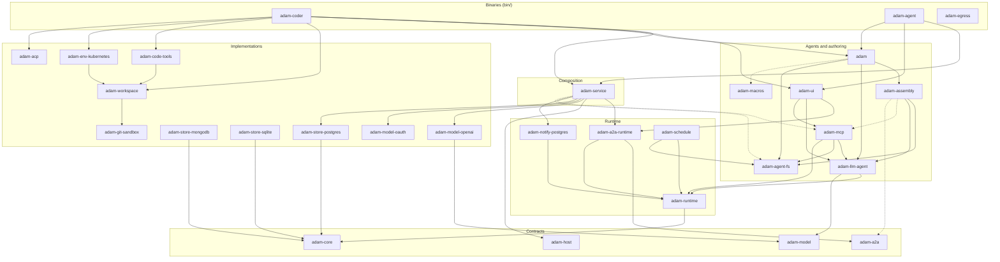

| Layer | Crates | Job |
|---|---|---|
| Contracts | [`adam-error`](../crates/adam-error/README.md), [`adam-core`](../crates/adam-core/README.md), [`adam-model`](../crates/adam-model/README.md), [`adam-a2a`](../crates/adam-a2a/README.md), [`adam-host`](../crates/adam-host/README.md) | Error classes, the `Store` port and run types, the `ModelClient` port, the `TaskBackend` port with the A2A 1.0 server, the process `Role` and `Placement` with a supervisor. |
| Implementations | `adam-store-postgres`, `adam-store-mongodb`, `adam-store-sqlite`, `adam-model-openai`, [`adam-model-oauth`](../crates/adam-model-oauth/README.md), [`adam-workspace`](../crates/adam-workspace/README.md), [`adam-code-tools`](../crates/adam-code-tools/README.md) (the file and command tools as a library, ADR 0047; moving out of the coder in steps), [`adam-git-sandbox`](../crates/adam-git-sandbox/README.md), [`adam-env-kubernetes`](../crates/adam-env-kubernetes/README.md), [`adam-acp`](../crates/adam-acp/README.md), `adam-notify-postgres` | Each in a crate of its own, so a binary links only what it uses. |
| Runtime | [`adam-runtime`](../crates/adam-runtime/README.md), [`adam-a2a-runtime`](../crates/adam-a2a-runtime/README.md), [`adam-service`](../crates/adam-service/README.md), [`adam-schedule`](../crates/adam-schedule/README.md) (a folder's schedules, [ADR 0060](decisions/0060-schedules-are-parked-runs.md): when they are due, the ids of their firings, each agent's scheduler `<agent>/adam.schedule` and `reconcile`; `adam-agent` and the coder run them with a `schedules` worker component, `reconcile_until_stopped`, and `adam-engine` with one `reconcile` at `start`) | The run state machine, journal, workers and retry policy; the A2A backend over it; the composition every agent binary shares. |
| Agents and authoring | [`adam-llm-agent`](../crates/adam-llm-agent/README.md), [`adam-ui`](../crates/adam-ui/README.md), [`adam-mcp`](../crates/adam-mcp/README.md), [`adam-agent-fs`](../crates/adam-agent-fs/README.md), [`adam-assembly`](../crates/adam-assembly/README.md), [`adam-macros`](../crates/adam-macros/README.md), [`adam`](../crates/adam/README.md) | The model-and-tools loop; the screen's tools; MCP tools; the agent-folder parser; binding a folder to agents; `#[tool]`; the facade. See [Write an agent](guides/write-an-agent.md). |
| Embedded | [`adam-engine`](../crates/adam-engine/README.md) | adam-rs in an application with no server and nothing on the network of its own ([ADR 0047](decisions/0047-adam-rs-can-be-embedded-in-an-application.md)): the embedded set, the runtime and its agent crates with `adam-a2a`'s `server`, `adam-a2a-runtime`'s `push` and `adam-ui`'s `thread-tools` off, checked by `tools/embedded-deps/check.sh`. Its API (slice 4: send, steer, answer, cancel, list, over `RuntimeTaskBackend` and a store and a model the host gives) is built; its stream of events is not yet. |
| Binaries | [`adam-coder`](../bin/adam-coder/README.md), [`adam-agent`](../bin/adam-agent/README.md), [`adam-egress`](../bin/adam-egress/README.md) | The two agents you can run, library and binary each, over `adam-service`; and the HTTPS-only egress proxy for run pods, which uses only `adam-error` and is in the same image; the chart deploys it with the run pods, whose network policy allows nothing else out ([ADR 0042](decisions/0042-run-pods-reach-the-internet-through-an-egress-proxy.md)). |

`adam-env-kubernetes` also ships the `adam-kube-exec` binary. `adam-git-sandbox` ships the server `adam-git-sandbox` and
the relay `adam-git`, and its client is what `adam-workspace` sends the coder's local `git` through: the git commands that
carry no credential run in a container that holds no secret, because git runs what a repository's configuration names
(see [its README](../crates/adam-git-sandbox/README.md); off unless `GIT_SANDBOX_SOCKET` is set, which the chart does for the
coder pod with run pods, running the server as a second container of that pod with the same work volume, the same user and no
secret, for [ADR 0041](decisions/0041-a-run-pod-sees-only-its-own-run.md)'s open decision 6: [the chart's
section](../deploy/coder/README.md#the-git-sandbox)). The workspace is `crates/*` and `bin/*`
(root `Cargo.toml`): a new crate joins by adding a directory with a `README.md`.

## Ports and implementations

A port is a trait. The core holds a `dyn` handle (`DynStore`, `DynModel`, `DynTaskBackend`,
`DynCodeHost`, ...) and never names an implementation. Swapping happens in `Cargo.toml` and in the
composition root.

```mermaid
classDiagram
    direction LR
    class Store { <<interface>> }
    Store <|.. MemoryStore
    Store <|.. PgStore
    Store <|.. MongoStore
    Store <|.. SqliteStore
    class ModelClient { <<interface>> }
    ModelClient <|.. OpenAiCompatible
    ModelClient <|.. MockModel
    class ModelCredentials { <<interface>> }
    ModelCredentials <|.. StaticBearer
    ModelCredentials <|.. RenewingCredentials
    ModelCredentials <|.. DeviceGrant
    class TaskBackend { <<interface>> }
    TaskBackend <|.. RuntimeTaskBackend
    TaskBackend <|.. InMemoryBackend
    class PushStore { <<interface>> }
    PushStore <|.. StorePushStore
    PushStore <|.. InMemoryPushStore
    class Notifier { <<interface>> }
    Notifier <|.. PgNotifier
    Notifier <|.. LocalNotifier
    class EventSink { <<interface>> }
    EventSink <|.. PgEventSink
    EventSink <|.. BroadcastSink
    EventSink <|.. NoopSink
    class Environment { <<interface>> }
    Environment <|.. Local
    Environment <|.. KubeEnvironment
    class CodeHost { <<interface>> }
    CodeHost <|.. GitHub
    CodeHost <|.. MemoryCodeHost
    class Agent { <<interface>> }
    Agent <|.. LlmAgent
    Agent <|.. CoderAgent
    class Tool { <<interface>> }
    Tool <|.. FnTool
```

| Port | Defined in | Real implementations | Doubles |
|---|---|---|---|
| `Store` | `adam-core` | `PgStore`, `MongoStore`, `SqliteStore` | `MemoryStore` (reference), `FaultyStore` and `CountingStore` (testkit) |
| `ModelClient` | `adam-model` | `OpenAiCompatible` (`adam-model-openai`) | `MockModel` |
| `ModelCredentials` | `adam-model` | `StaticBearer` (`MODEL_API_KEY`), `DeviceGrant` (`adam-model-oauth`, `MODEL_AUTH=device`); a host's own: a renewed token, a proof, an injector's tag ([ADR 0058](decisions/0058-the-models-credentials-come-from-a-provider-asked-for-each-call.md)) | `RenewingCredentials` |
| `TaskBackend` | `adam-a2a` | `RuntimeTaskBackend` (`adam-a2a-runtime`) | `InMemoryBackend` (feature `test-util`) |
| `PushStore` | `adam-a2a` | `StorePushStore` (`adam-a2a-runtime`, over the `Store`) | `InMemoryPushStore` (feature `test-util`) |
| `Notifier`, `EventSink` | `adam-runtime` | `PgNotifier`, `PgEventSink` (`adam-notify-postgres`), `BroadcastSink` (in process) | `LocalNotifier`, `NoopSink`, `CollectingSink` |
| `Clock` | `adam-runtime` | `SystemClock` | `ManualClock` |
| `Agent`, `AgentStarter` | `adam-runtime` | `LlmAgent`/`LlmStarter`, `CoderAgent`/`CoderStarter` | test agents |
| `Tool`, `ToolSource` | `adam-llm-agent` | the coder's tools, `FnTool`, MCP tools, `ThreadTools` (`adam-ui`) | test tools |
| `CodeWorkspace` | `adam-code-tools` | `ToolEnv` (`adam-coder`: the slots of a run's workspace) | `DirWorkspace` (`adam-code-tools-testkit`, the reference of its conformance cases) |
| `CodeHost` | `adam-workspace` | `GitHub` (feature `github`) | `MemoryCodeHost` (feature `test-util`) |
| `GitCredentials` | `adam-workspace` | `ScopedToken`, `GitHubApp` (inside `HostScoped`), `StaticToken` | none needed |
| `Environment` | `adam-workspace` | `Local`, `KubeEnvironment` (`adam-env-kubernetes`) | a fake API server and exec seam in the tests |
| `CallBearer` | `adam-mcp` | `GitHubReadBearer` (`adam-coder`) | test bearers |
| `PermissionPrompt` | `adam-acp` | none (the default policy needs no prompt) | `StaticPrompt` |

`AgentStarter` is the start-only half of `Agent` (`name`, `init`, `init_continuing`): a process that
only accepts requests registers a starter and never holds the model or credentials.
`Workspaces` (git) and `AcpClient` (a child process) are concrete types, not ports.

Rules the code follows:

* No implementation type appears in a trait signature; a driver error is a boxed `source`.
* A store passes the conformance suite `store_conformance!`; to add a backend, implement `Store` and add
  one line ([testing](guides/testing.md#adding-a-backend)).
* The guarantee is the version compare-and-swap in `Store::commit_run`, not the lease.

## Processes and roles

`adam-service`'s `serve(ServiceConfig, Agents, shutdown)` is the whole process. A binary builds its
agent and hands over `Agents { name, card, register, options }`; `serve` chooses the store from
`DATABASE_URL` (Postgres, MongoDB or SQLite), connects it, builds
the runtime, the A2A router and the signals, and registers the components of the role with an
`adam_host::Host`. `main` is `serve(Config::from_env(), sigterm)`.

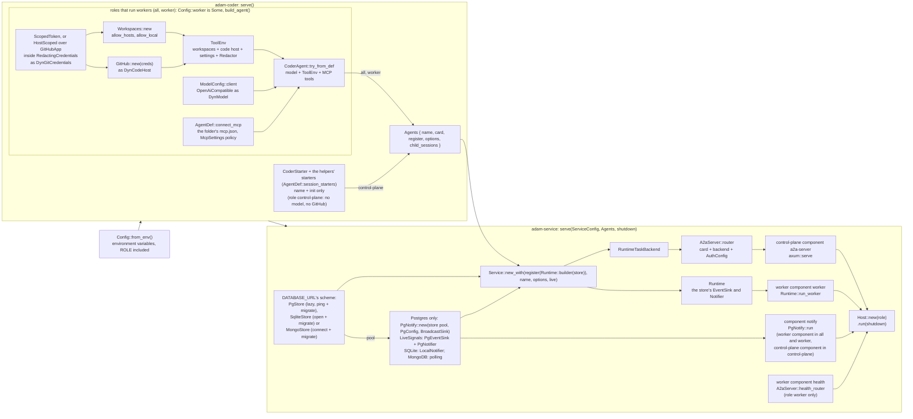

| `ROLE` | Components | Needs |
|---|---|---|
| `all` (default) | `a2a-server`, `worker`, `notify` in one process | every variable |
| `control-plane` | `a2a-server`, `notify`, over a runtime that has only the agent's starter and its helpers' starters (`AgentDef::session_starters`; starts, delivers, cancels and views runs; never steps) | `DATABASE_URL`, `A2A_BEARER_TOKENS`, `PUBLIC_URL`; no model, GitHub or workspace variable |
| `worker` | `worker`, `notify`, `health` (`GET /healthz` on `LISTEN_ADDR`, no A2A) | everything except `A2A_BEARER_TOKENS` and `PUBLIC_URL` |

* The roles meet in the store (the record and its CAS, the leases) and in `NOTIFY` ([below](#across-processes-signals-and-events)).
* On SIGTERM `Host` stops the control plane first (open streams get 10 s), then the workers with no
  bound, so they finish and commit the steps they are in. A component that stops on its own stops the
  others in the same order and the process exits 70 naming it.
* Several `adam-agent` processes with different folders can share one database: runs are scoped by the
  agent's name.

## The path of a task

A task is a run. A client talks JSON-RPC (or HTTP+JSON: the same handler, [below](#swagger-ui-and-the-rest-binding))
over HTTP to the server in `adam-a2a`, which hands the request
to a `TaskBackend` (`adam-a2a-runtime`); that starts or feeds a run in the `Runtime`. A worker advances
the run one step at a time and commits each step. The client sees progress as events on an SSE stream.

### Request in, events out

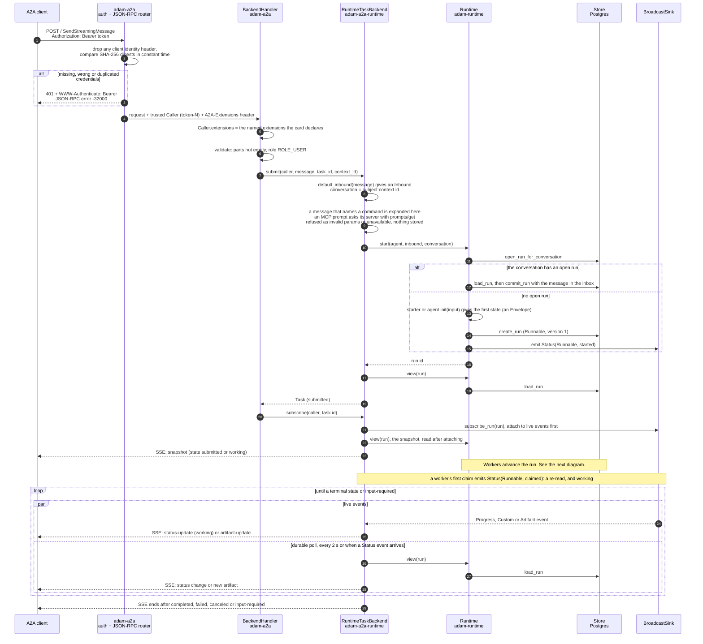

Rules this diagram cannot show:

* **Fail closed.** Only `GET /.well-known/agent-card.json`, `GET /healthz`, the docs (`GET /docs`, its files and
  `GET /openapi.json`, unless `A2A_DOCS=false`) and, when the card is signed, `GET /.well-known/jwks.json` are public; an
  empty token list rejects everything (`crates/adam-a2a/src/auth.rs`).
* **Errors are HTTP 200** with a JSON-RPC error object; the mapping is in [Errors](#errors).
* **Ownership needs no side table**: the caller's subject is part of the run's conversation id
  (`subject:context id`). Someone else's task looks like one that does not exist.
* **A request names the extensions it wants; the card decides.** The handler passes the backend only the
  ones the card declares (`Caller::extensions`), so each extension is optional on both sides.
* **Streams survive restarts.** The snapshot comes from `Runtime::view` (the durable record) and is
  polled every 2 s; a `Status` event (a commit) makes the pump poll at once, so live events cut the
  latency and the interval is only the fallback for a change no event announced. A subscriber that attaches after the worker began
  first gets the run's recent live events from a bounded replay in `BroadcastSink` (the newest 64, none older
  than 30 s, dropped at each status change), so a step that started before it attached keeps its input; a
  repeat is possible and harmless. Dropping the SSE stream drops only the subscription; only `CancelTask` cancels.

Follow-ups, `referenceTaskIds`, steering, steps and streamed text are in the
[A2A server reference](reference/a2a-server.md).

### The model's profile

A deployment's models differ, so the reasoning level, the output cap and the extra body follow the model a call
uses, not the process ([ADR 0063](decisions/0063-a-reasoning-effort-is-one-setting.md),
[ADR 0064](decisions/0064-model-profiles-reasoning-effort-and-output-cap-follow-the-model.md)).
`MODEL_ALIASES_FILE` (JSON only for now) holds `profiles` by model id and `presets` by name; `ModelConfig` reads
and validates it at startup (`crates/adam-service/src/config.rs`), and the types are `adam_model::ModelProfiles`
(`crates/adam-model/src/profiles.rs`). Nothing is applied to a request yet: the request's field, the client's wire
and the cap are the following slices.

### The tokens of each model call

A completed model call is a `RunEvent::Usage`, sent to the client as a `usage/v1` report when its request activated the
extension; a subagent's call is an event of the **root** run, under the root's step that started it; the totals ride in the
agent's state and are written on the task when it ends or waits ([ADR 0032](decisions/0032-usage-per-model-call.md),
`crates/adam-llm-agent/src/agent.rs`, `crates/adam-a2a-runtime/src/usage.rs`).

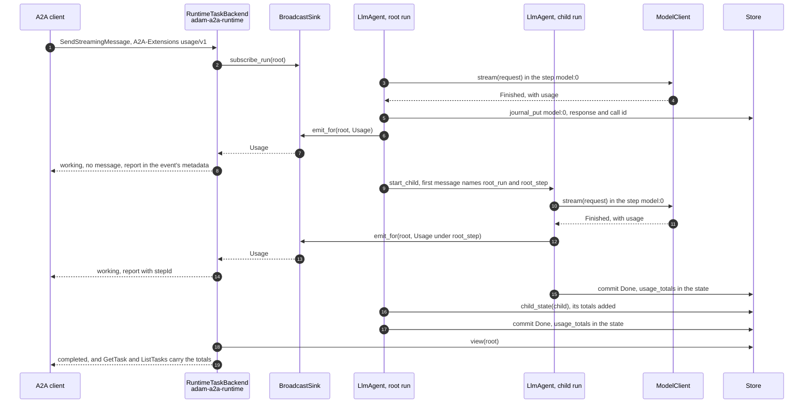

Nothing new is stored: the totals are the agent's state, which every store keeps. A call of a try that is retried, of a
turn a cancel drops or of a remote subagent is in no total (the ADR says why).

The same object carries the compute a run's commands used. A tool reports how long a command ran in a run pod
(`ToolCtx::report_sandbox`); the loop journals it with the call's result, adds it to `Conversation::sandbox_usage` in the
same commit, and a parent adds its child's, as it does the tokens. `totals_metadata` writes it as the `sandbox` member beside
`totals` when the task ends or waits: one entry per pod shape (the template's CPU and memory requests) with the commands and
their milliseconds, and for a run in the coder's own container only the environment, which reads as *not
measured* and never as zero ([ADR 0043](decisions/0043-sandbox-time-as-usage.md), `bin/adam-coder/src/tools/sandbox.rs`,
`crates/adam-a2a-runtime/src/usage.rs`).

### Swagger UI and the REST binding

Every agent serves A2A 1.0 twice over the same `BackendHandler`: JSON-RPC at `POST /` and HTTP+JSON at the paths of
§11 of the specification (`POST /message:send`, `GET /tasks/{id}`, ...; `crates/adam-a2a/src/rest.rs`). The card lists
`JSONRPC` first and `HTTP+JSON` second, at the same URL. Swagger UI at `/docs` documents both from one OpenAPI document
([ADR 0031](decisions/0031-swagger-ui-and-the-a2a-rest-binding.md)). A person opens it and sends a message over REST:

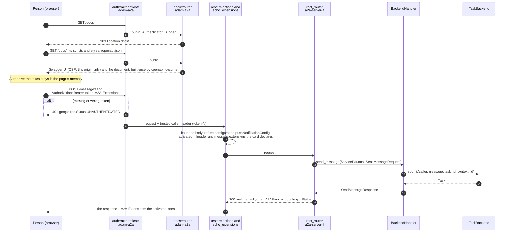

* **One handler.** `R->>H` is the call the JSON-RPC route makes too, with the same `ServiceParams`: identity, extensions,
  push configs, `ListTasks` and the extended card behave the same on both bindings. A malformed REST request (not JSON,
  a query string that does not parse, over 10 MiB) gets the binding's envelope (`PARSE_ERROR`, `INVALID_PARAMS`,
  `INVALID_REQUEST`), never the extractor's plain text.
* **The document is public and the same for everyone**: built once from the public card and the switches it shows
  (push, the extended card, bearer), with no token and nothing of the extended card. Try it out calls the server the
  page came from (the document's server is `.`).
* **Streams** (`/message:stream`, `/tasks/{id}:subscribe`, and their JSON-RPC methods) cannot be watched in Swagger UI,
  which waits for the whole response; their descriptions give the `curl`.
* There is no state diagram: nothing here has a lifecycle (the document and the assets never change while the router runs).

### Push notification delivery

Off unless `A2A_PUSH_ALLOWED_URLS` names the webhooks a deployment allows
([ADR 0030](decisions/0030-a2a-push-notifications-list-tasks-extended-card-signatures.md)). A client registers a
webhook for a task (`CreateTaskPushNotificationConfig`, or in `SendMessage`); the config and how far its delivery got are
kept in the run store, so a restart or another replica loses nothing. A deliverer in the control plane reads the task as
its owner and tells the webhook what it has not heard.

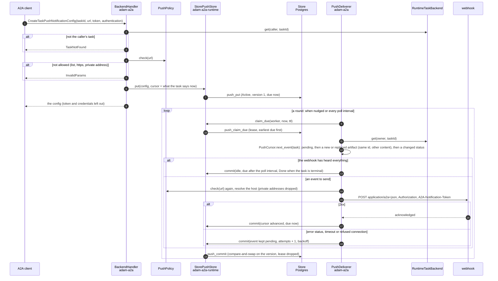

Rules this diagram cannot show:

* **A notification is a hint; `GetTask` is the truth.** What a deliverer never saw (a state between two polls, or while every
  replica was down) is not sent, the next event is the state the task is in, and a webhook may hear one event twice.
* **A failed event is kept whole in the cursor** (`PushCursor.pending`) and sent again as it was, before any later one, so a
  webhook that was down still hears each state the deliverer saw, in order.
* **Fail closed.** The policy is judged at create time and again at delivery; the client resolves names itself, drops private
  addresses, never follows a redirect and ignores `HTTP(S)_PROXY`. A `token` and `credentials` are write-only
  (`crates/adam-a2a/src/push/sender.rs`).
* **Replicas share the work through leases**, and the version compare-and-swap, not the lease, keeps a cursor from going
  backwards. A replaced or deleted config makes the commit of a delivery in flight lose; that request may still have reached
  the webhook once.

The lifecycle of one config (`PushState`, `crates/adam-core/src/store/push.rs`):

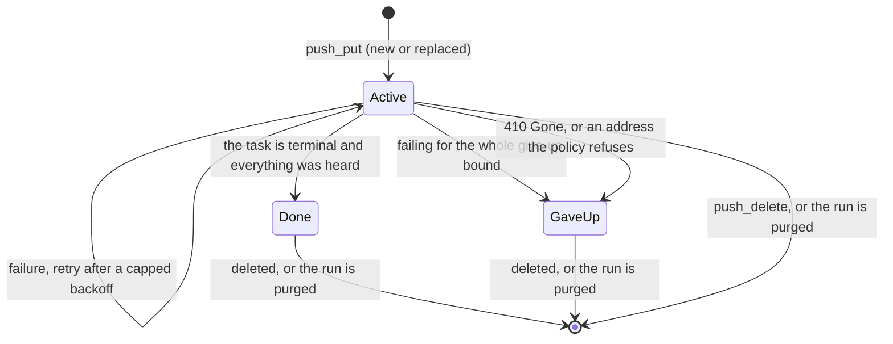

`ListTasks` is one indexed read per page of the run store (`Store::list_runs`) scoped to the caller's conversations, read as
tasks; the extended card and the card's signature are built once when the router is built
(`crates/adam-a2a/src/server.rs`). All of it is in the [A2A server reference](reference/a2a-server.md).

### The worker: claim, step, journal, commit

`Runtime::run_worker` (`crates/adam-runtime/src/worker.rs`) runs in the same process as the server
(`all`) or alone (`worker`). Any number of processes can share one database.

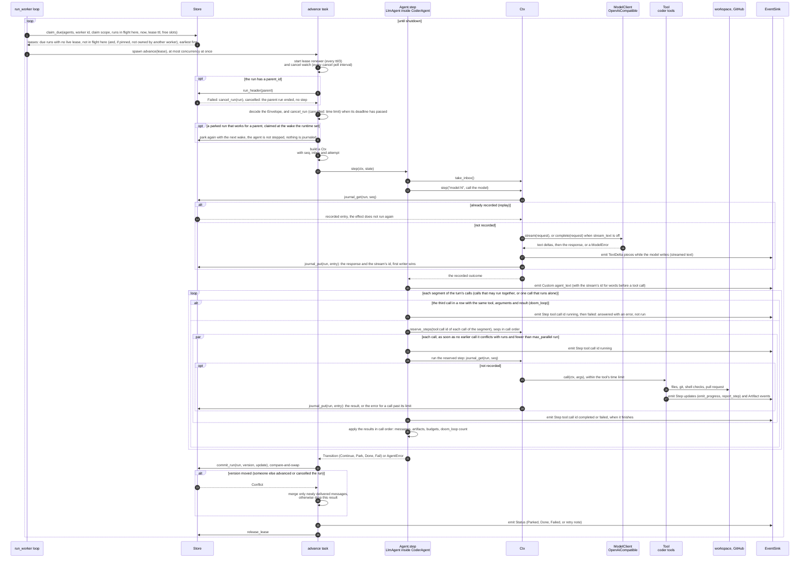

* **One step is one model turn.** `LlmAgent::step` calls the model once (journaled step `model:N`),
  runs the tools it asked for (each a journaled step `tool:<call id>`) and returns `Continue`. A call whose
  arguments were not JSON is answered from the recorded turn with an error and has no step; a run that reaches
  `max_turns` or `max_tool_calls` makes one more model call with `tool_choice: none` and ends `Done`, marked `limited`.
  So does a model that makes the same call a third time with the same result and again after the refusal
  (`doom_loop`, `limit: "repeated_call"`). A call that runs past its tool's time limit (300 s unless it says otherwise)
  is stopped inside its step and answered with an error, which the journal keeps.
* **The calls of a turn run at the same time** ([ADR 0049](decisions/0049-the-tool-calls-of-a-turn-run-at-the-same-time.md)),
  up to `max_parallel` (10 by default). A tool says what a call shares (`Tool::access`); calls that conflict keep the
  model's order, and a call that is `Alone`, repeats the call before it, or follows a limit of 1 runs by itself, after
  the calls before it are applied. The seqs of a segment's steps are reserved in call order
  (`Ctx::reserve_steps`), so the journal is the one a sequential loop writes, and the results are applied in call
  order whatever order the calls finish in. A call the model gave `after_previous: true` (an optional argument the loop adds to every schema above a limit of 1)
  waits for every call before it and holds the ones after it. A tool that declares nothing is `Alone`, so a loop of such tools is
  sequential (adam-coder's classes are in [the coder reference](reference/coder-agent.md#calls-at-the-same-time)). A cancel stops new starts and waits up to 5 s for the running calls; a transient failure stops new
  starts, waits for the running ones and retries the transition.
* **A call starts while the model writes.** The model's client says `ModelDelta::ToolCallComplete` when a call's arguments
  are whole, and the loop starts that call beside the stream, before the turn is recorded (`src/early.rs` is the pure
  gate, `Early` in `src/agent.rs` the batch of started calls). Only a call in the first segment that is no barrier, does not
  conflict with one already running or with an earlier call of the turn that did not start early, leaves room under
  `max_tool_calls` and is not a `doom_loop` refusal starts; every
  other call waits for the turn. The turn is still journaled first: `model:N` when the stream ends, then `tool:<call id>`
  at the seqs a sequential loop writes, so a crash mid-stream writes nothing and the replay asks the model again. A stream
  error waits for the started calls and retries the turn; a cancel waits `TOOL_STOP_GRACE` for them.
* **Replay is safe, effects are at-least-once.** The effect runs before its outcome is written, so a
  crash in between runs it again. Tools must be safe to repeat.
* **Waking is polling plus hints.** An idle worker sleeps at most one poll interval; `start` and
  `deliver` publish `Signal::Runnable`, `cancel` publishes `Signal::Finished`.
* **Messages that arrive during a step** are kept; the commit merges them, and a step that asked to
  park resumes at once.
* **Retry.** A transient failure is committed as `Runnable` with a future `wake_at`; the failed try's
  journal entries are abandoned.
* **Defaults** (`runtime.rs`, `retry.rs`): lease 30 s, worker poll 250 ms, cancel watch 1 s,
  subscription poll 2 s, 4 concurrent runs per worker loop,
  5 tries per transition, backoff 1 s doubling to 60 s.

### Compaction: a long history is summarised once

A history that reaches its budget is summarised at a journaled step, so the run goes on in a context
that fits and the requests after it keep one cached prefix again ([ADR 0044](decisions/0044-paged-tools-a-stable-prompt-prefix-a-plan-skills-commands-and-project-context.md)
decision 11, [ADR 0039](decisions/0039-the-agent-loop-takes-opencodes-structure-and-agents-get-plugins.md)
decision 5). It is decided at the start of `LlmAgent::step`, from the committed state, and only with no call
and no wait open (`crates/adam-llm-agent/src/agent.rs`, `compact_if_due`).

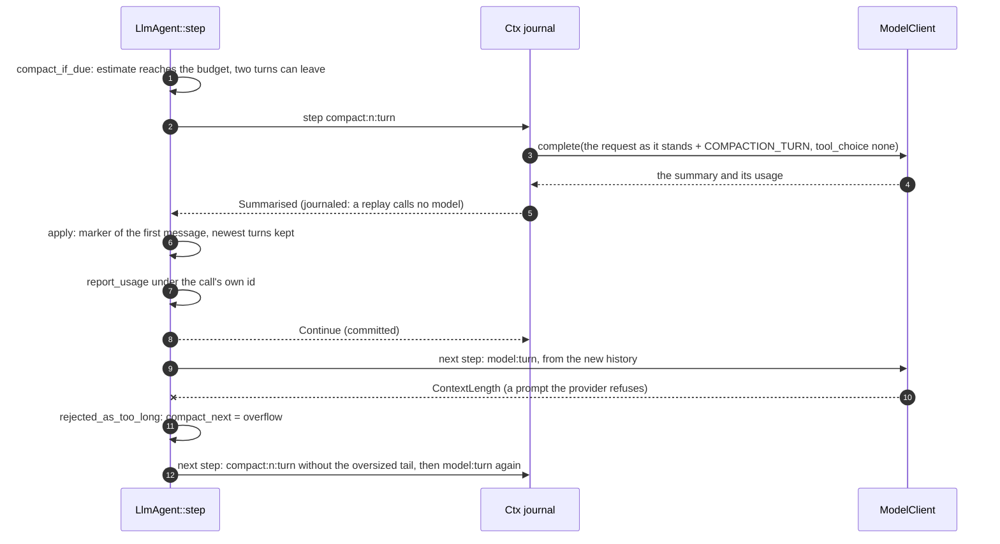

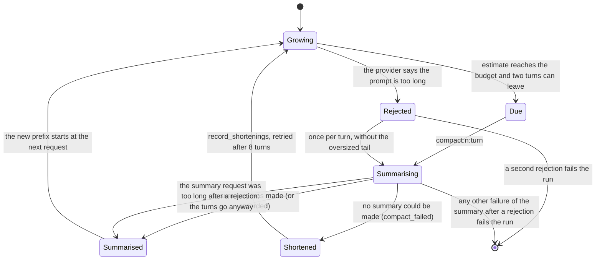

| Part | Rule |
|---|---|
| **Budget** | the smaller of `MODEL_CONTEXT_WINDOW` less 20,000 less `max_output_tokens`, and `limits.max_history_tokens`; none when neither is set (a window with no room left counts as none) |
| **Estimate** | the last call's reported prompt tokens plus characters / 4 of what came after; with no report, characters / 4 of the instructions, the tools and every message |
| **Cut** | at the start of a turn (an assistant message, never the first message), so a call is never parted from its result; the newest 1 to 8 turns worth at most a quarter of the budget stay verbatim; fewer than two turns to drop, eight compactions made by the run (a run that continues another carries the earlier ones as one record, which is not one of its eight), or a request that would still be over the budget with no summary, shortens instead |
| **Summary** | the agent's own model, the request as it stands (same system, tools and history) plus one built-in instruction as the last message, `tool_choice: none`, 4,096 output tokens, capped at 16 KiB; its usage is reported under an id of its own (`<run>-k<n>-<suffix>`); the person sees one step, "Summarise the conversation" |
| **New history** | the task (the first part of the first message) verbatim, then the marker (its second part, `Conversation::is_omission_marker`), then the person's later messages verbatim (2 KiB each, 8 KiB in all, as parts of that message), then the turns that stayed |
| **The marker's lines** | the summary, then lines **written by code** from what left: the plan, the results a tool pinned, a pointer to each kept output (built from the call's own output id), the names of the skills loaded earlier, a line that sessions exist. Text that is copied has each line that starts with `[` written `\x5b`, so it cannot forge a loop line |
| **Sessions** | a run whose `subagent_start` was cut still waits for, and cancels, the sessions it started (`Compaction::sessions`) |
| **Trust** | the summary and the pinned results are in the first message, a user-role message: text a tool returned (a repository's instructions) has that standing from the first compaction on; it is labelled as the repository's, bounded and escaped, and the coder does not read it as the person's words |
| **A subagent** | compacts against its own limits; one on another alias has no window, so its `max_history_tokens` applies |

The summary request is the previous request plus one message, so the provider serves it from its cache
(*unverified* without a provider: whether a changed `tool_choice` keeps the match). The request after a
compaction is the first of a new prefix, and `Conversation::compactions` lists those turns beside
`shortenings`; `tests/prefix.rs` holds the rule. Rolling back to a build without compaction turns a run that
has compacted into a `NonDeterminism` error.

### The access tier: which tools a step may use

The person picks a tier for each message (`plan`, `edits`, `auto`, `bypass`; the A2A extension `access-tier/v1`, [ADR 0036](decisions/0036-the-coder-keeps-to-the-access-tier-the-person-picks.md)).
The backend reads it (`crates/adam-a2a-runtime/src/tier.rs`), the coder keeps to it for what the **model** does through its tools
(`bin/adam-coder/src/tier.rs`). It is not a boundary against a command: see the ADR, decision 6.

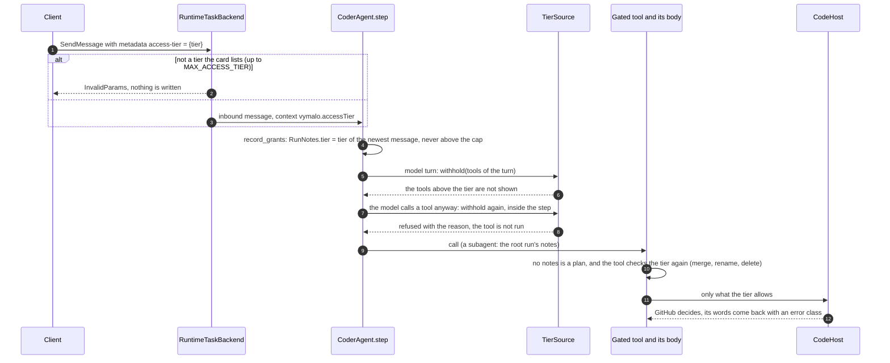

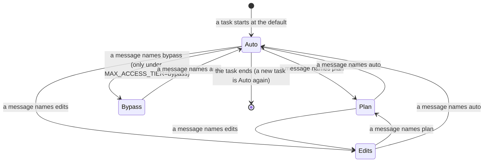

* **The newest message that names a tier wins**, from the next step; one that names none leaves it. A larger context never
  drops the tier (`PROTECTED_CONTEXT_KEYS`), and a child run starts with its parent's.
* **`merge_pull_request` needs more than the tier**: green checks on the commit it merges, and then either the commit is one this
  conversation pushed (it merges), or the tool asks the person itself in a form of its own and merges on their yes to that form
  (any other pull request, or one opened with red checks accepted); at `bypass` it asks nothing. It never reads what the
  person typed.
* **An agent another agent asked asks nobody for consent.** The A2A layer reads who a message was sent for from the claims of
  its thread-tools token (`vymalo.caller`: `main`, or `ask:<n>` for an agent another agent asked, an unreadable token counting
  as the latter, and once a message said so for the rest of the run); in such a run `request_repository`, `create_repository` and the merge's form return an error result instead of
  a question, no words are a consent, and the person's words are the ones the orchestrator carries beside the grant
  (`vymalo.person`, the `person.said` member of the thread-tools metadata): only the repositories those name are named, never
  the ask's text ([ADR 0036](decisions/0036-the-coder-keeps-to-the-access-tier-the-person-picks.md#amended-2026-10-17-an-asked-agent)).

## The run lifecycle

`RunStatus` (`crates/adam-core/src/store/mod.rs`) has four values: `Runnable`, `Parked`, `Done`,
`Failed`.

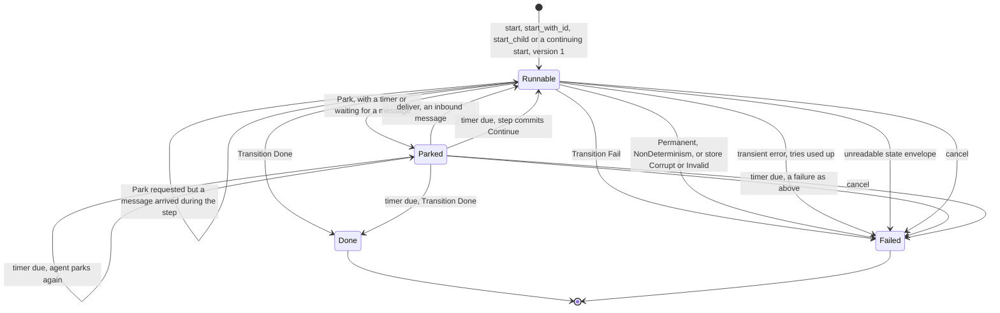

The lease is a separate lifecycle that a run goes through each time a worker takes it:

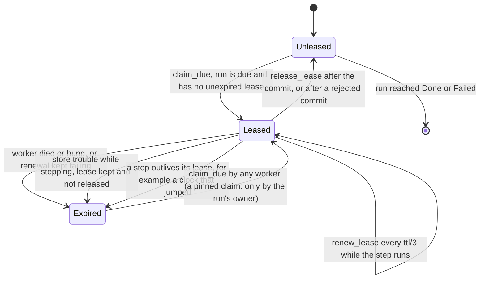

* **What makes a run due.** `sched_at` is derived from status and `wake_at`
  (`adam_core::store::sched_at`):

  | Status | `wake_at` | Due |
  |---|---|---|
  | runnable | none | immediately |
  | runnable | set | at `wake_at` (retry backoff) |
  | parked | set | at `wake_at` (timers, `ctx.sleep`) |
  | parked | none | never; resumed by committing it back to runnable (approval, inbound message) |
  | done / failed | – | never |

* **Retries.** A transient step failure (or a panic) is committed `Runnable` with
  `wake_at = now + delay` and `attempt + 1`. The delay is the larger of the backoff and the error's
  `retry_after` (capped at 24 h). The policy is the failing step's own when it names one, else the
  runtime's, and the failures are counted per step's key: at that key's `max_attempts`, at 100
  consecutive failures whatever their keys, or for a class the policy does not retry, the run is `Failed`
  ([ADR 0061](decisions/0061-a-step-names-its-retry-policy.md)).
* **A lease that lapses under a step.** The worker passes the run as `busy` in every `claim_due`, so the
  store never leases it to the same worker twice. Another worker may claim it; the CAS rejects the
  commit that comes second.
* **Store trouble.** `Corrupt` and `Invalid` fail the run (a row that can never be read must not be
  leased for ever); any other class commits nothing and keeps the lease.
* **Cancel.** `Runtime::cancel` commits `Failed` with `cancelled: <reason>`. A running step is told
  through its `CancelToken` (at once in the same process, within one poll from another). Model calls and
  the coder's commands listen to it.
* **Deliver.** `Runtime::deliver` appends to the inbox; a `Parked` run becomes `Runnable` at once. A
  step that asked for it (`Ctx::reopen_on_arrival`, which `LlmAgent` does) is not committed `Done` past
  an unread message; a child's `adam.run.finished` notice does not count (it only saves a waiting parent
  its timer).
* **Terminal states** are `Done` and `Failed`; `Store::purge_finished` deletes them with their journal, and its cutoff must be older than `SESSION_IDLE_DAYS`: a session reads closed after that idle time, and a purged latest round would make it read wrongly ([child runs](reference/child-runs.md)).

How a run looks to an A2A client (`task_state`, `crates/adam-a2a-runtime/src/convert.rs`):

| Run | A2A task state |
|---|---|
| `Runnable`, version 1, no worker holds a lease | `submitted` |
| `Runnable`, version 1, a worker holds an unexpired lease (`RunView::claimed`) | `working` |
| `Runnable`, or `Parked` with a timer | `working` |
| `Parked` with no timer | `input-required` |
| `Done` | `completed` |
| `Failed` with an error that starts `cancelled: ` | `canceled` |
| `Failed` otherwise | `failed` |

`Runtime::view` reads the lease **before** the head, so a step that commits between the two reads is
never shown as `submitted` again. A front that holds only the starter claims nothing: its tasks stay
`submitted`. A task's id is derived, not random: `task_id_for(agent, caller, context, messageId)`
(`crates/adam-a2a-runtime/src/ids.rs`), so a repeated `SendMessage` reaches the task its first attempt made.

## Data: the run store

Six tables (PostgreSQL and SQLite) or collections (MongoDB), prefixed `adam_` by default, plus a `meta` table with
the schema version: `push` holds A2A push-notification configurations (schema version 3), `blob`
and `run_blob` hold a run's file bytes and the digests it references (schema version 5, part 1), and
`body` holds a run's transcript beside the `head` and `head_version` of a run (schema version 5,
part 2; version 6 on PostgreSQL). The adapters keep them: MongoDB in the run document and the
`adam_body` collection, PostgreSQL in `runs.head`/`runs.head_version` and the `adam_body` table,
written in the same transaction as the CAS; SQLite in the same columns as PostgreSQL, in one
`BEGIN IMMEDIATE` transaction. `state` is JSONB in Postgres, a real BSON document in MongoDB and
JSON text in SQLite; in the **contract release** it is the tombstone (`null`) for a run whose head
is current, and the whole v4 envelope only for a run that has not split yet (ADR 0055). A SQLite
file is opened by one process and holds no cross-process signals
([store adapters](reference/store-adapters.md#sqlite)).

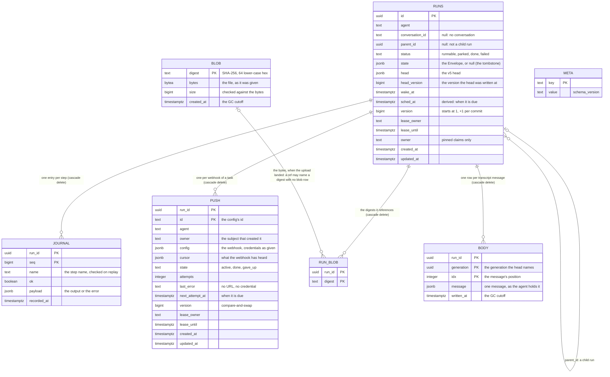

| Index | Purpose |
|---|---|
| `runs (agent, sched_at, id)` where `sched_at` is set | claiming: due runs per agent, earliest first |
| unique `runs (agent, conversation_id)` where the run is open | one open run per conversation |
| `runs (agent, updated_at)` where finished | retention sweeps |
| `runs (parent_id)` where set | children of a run |
| `runs (agent, conversation_id COLLATE "C", updated_at DESC, id DESC) INCLUDE (status)` where set | `ListTasks`: an owner's runs, newest first, by keyset; the status filter is answered from the index |
| `push (agent, next_attempt_at, run_id, id)` where active | claiming due push configs |
| `blob (created_at)` | blob GC: unreferenced blobs older than the cutoff |
| `run_blob (digest)` | blob GC: does any run still reference this digest |
| `body (run_id, generation, idx)` | reading one generation in order, and the GC's "which generations of this run" (MongoDB now; index `adam_body_generation`) |
| `body (written_at)` | body GC: superseded generations older than the cutoff (MongoDB now) |

MongoDB keeps the same fields in `adam_runs` (`_id` is the run's UUID) plus `open_key` (a plain unique
index; closed runs get `~<run id>`), `lease_token`, the listing indexes `adam_list`
(`(agent, conversation_id, updated_at, _id)`) and `adam_list_status`
(`(agent, status, conversation_id, updated_at, _id)`, for a status filter), the journal in
`adam_journal` with `_id = "<run>:<seq>"`, the push configs in `adam_push` with
`_id = "<run>:<config id>"`, the blobs in `adam_blob` with `_id` = the digest, the digests a run
references in `adam_run_blob` with `_id = "<run>:<digest>"`, and the transcript in `adam_body` with
`_id = "<run>:<generation>:<idx>"`. A version 4 run document has neither `head` nor `head_version`
(`{head_version: null}` matches a missing field). How each adapter keeps its promises: [store adapters](reference/store-adapters.md).

What `state` holds (JSON, versioned `v`; the layout is private to the runtime,
`crates/adam-runtime/src/envelope.rs`):

| Envelope field | Meaning |
|---|---|
| `v` | layout version: `1` is this envelope, `5` the head (below) |
| `agent` | the agent's own state; for an `LlmAgent`, a `Conversation` (below). The whole state in `v: 1`, the head without its messages in `v: 5` |
| `inbox` | delivered, not yet read messages (`Inbound { id, kind, payload, received_at }`) |
| `seq`, `attempt`, `rev` | next journal seq; consecutive failed tries of the run's transitions; bumped by each worker commit |
| `retry` | while a run fails: the failures per step's key and each key's policy, recorded at its first failure; cleared by a transition that succeeds, absent otherwise ([ADR 0061](decisions/0061-a-step-names-its-retry-policy.md)) |
| `output`, `error` | the result of a `Done` run; the reason of a `Failed` one |
| `artifacts` | artifacts emitted so far, committed with their transitions |

A **file artifact's** bytes are written to the blob table under their SHA-256
(`adam_runtime::blob_id`) and the commit references the digest (`RunUpdate::blobs`); a v4 state also
keeps the bytes, so a reader of the old format still reads a run, while a v5 head names them by
digest and size ([ADR 0055](decisions/0055-a-runs-state-is-a-head-and-an-append-only-transcript.md)).
Before a v5 head is built by a split, a failed transition or a cancel, every file it inherits is
checked with one `blob_stored`; one whose bytes are gone is left out of the head and its references
(logged), because the head cannot store it again. A delivery writes the head it read unchanged, so a
later refused split still sees the missing file and refuses rather than demoting without its bytes.

### The head and the body (schema version 5, part 2; the contract release)

Every commit writes a **head**, the **body rows** it appends and — for a store that keeps bodies —
the **tombstone** as `state`. `Runtime::view` is one `Store::load_head` and no body; `Runtime::state`
is the one full-state read, joining the head and the generation it names: the head names a
**prefix** (`len`) of the generation, and the rows past it — a lost CAS's extras not yet cleaned up
— are ignored, so only a short or non-contiguous prefix is `Corrupt`.

`Store::load_run`, `load_head`, `claim_due`, `open_run_for_conversation` and `list_runs` answer the
**same document**: the head when `head_version == version`, the whole `state` otherwise (a v4 run, or
a head a later commit did not rebuild). A tombstoned run whose head is behind the version serves the
head, the only readable document. The step path joins the head and the rows the claim read; a
delivery, a cancel and a `park_again` write the head they read, so the head stays current and the
next split appends to the same generation. The adapters keep the head and the body: MongoDB in the
run document and the `adam_body` collection, PostgreSQL in `runs.head`/`runs.head_version` and the
`adam_body` table. A PostgreSQL commit that writes a head or a body is
one transaction — the run row locked `FOR UPDATE`, the version check, the rows, the refs and the CAS
— so a foreign attempt's duplicate slot is resolved inside it (identical: adopted; older than the
5-minute orphan grace: collected and retried once; live and different: `Conflict`). SQLite does the
same in one `BEGIN IMMEDIATE` transaction.
The head is the envelope with `v: 5`, `agent` reduced to the agent's head, file artifacts by
reference, and a `body` member naming one generation; the rows are the messages.

| Where | What it holds |
|---|---|
| `state` (`v: 1`, or `null`) | the whole run for a v4 run; `null` — the tombstone — for a run whose head is current |
| `head` (`v: 5`) | `agent` without its messages, `inbox`, `seq`, `attempt`, `rev`, `output`, `error`, `artifacts` (files by `digest` and `size`), `deadline`, `limit_secs`, `remaining_secs`, `agent_wake`, `hb`, and `body: {generation, len}` |
| `adam_body` | one row per message, keyed `(run_id, generation, idx)`, with `written_at` for the GC |

A generation is **append-only**: a normal commit writes only the rows after the old head's `len` and
keeps the generation; a compaction (the transcript no longer starts with the old one) writes all rows
under a new generation. The delta win now holds across **every** commit of a v5 run: the contract
release's `deliver`, `cancel`, `park_again` and failed commits write the head they read, so the next
split appends instead of compacting. (The expand release's headless commits measured 12.7 MB of body
rows for 50 × 10 KB against ~0.5 MB of deltas; the `measure_the_headless_transcript` test keeps that
line as the comparison.) The store writes the rows **before** the CAS with the attempt's `writer`,
checks that all of them landed, and a commit that loses deletes its own rows and refs, so a loser
cannot poison the next append. A duplicate slot is resolved by content and age: an identical foreign
row is adopted, a differing one older than the 5-minute orphan grace is collected and the insert
retried once, and a live attempt's differing row is a `Conflict` (ADR 0055). The grace is far longer
than the insert→CAS gap of a live attempt (milliseconds; the default lease is 30 s), so it
distinguishes a dead attempt from a live one without trusting the lease. The runtime reconstructs
`join(head, rows)` before every commit and
refuses a split that does not equal the state, which keeps a bad split at `state` only. A **stale**
head is not an error: the state is served when it is the v4 envelope a v4 commit wrote, and the next
step re-splits and rewrites the head; a **tombstoned** run (`state = null`, the head behind the
version — a pre-S3 process failed a converted run) serves the head, so it stays readable.
`Runtime::view`
decodes either document (`Stored`: `v: 1` or `v: 5`), so an observer of a v4 run and of a v5 one
gets the same `RunView` shape; `RunView.state` is the agent's **head** and `RunView.artifacts` is a
`Vec<ArtifactRef>`, a file by reference. `Runtime::state` joins the head and
`body_list(run, generation)` (one body read, the only full-state read), and
`Runtime::artifact_bytes` fetches a file's blob once into a bounded, shared cache.

A store that keeps no bodies ([`Store::keeps_bodies`](../crates/adam-core/README.md)) is not written
the contract: the runtime keeps the whole v4 `state` for it and writes no head, exactly as before. A
run's format is per run: a pre-contract run keeps its v4 `state` and reads as before forever if it
never commits again, and its first commit under the contract splits it. **A v4 process cannot step a
converted run**: `Envelope::decode` refuses a head, the run is committed `Failed`, and that is why
the contract is a separate deploy (see [deploy the coder](guides/deploy-the-coder.md)).

`Conversation` (`crates/adam-llm-agent/src/conversation.rs`) has `messages`, `turns`, `tool_calls`,
`usage`, `pending_calls`, `pending_wait` (a question for the user, a child run or a remote task),
`deferred`, `artifacts`, `announced`, `source_notes`, `continued_from`, `omitted_turns`, `context` and
`read_ids`. Every field has a serde default, so older state still loads. Its `split` puts `messages`
in the body and everything else in the head; `Agent::split`/`join` default to no split, and a wrapper
that delegates `init` must delegate them too: a new run of a wrapper that does not stays in the v4
format, and a **v5 run must split** — a successful step that returns `None` on a current head is a
refused split, so the commit demotes the run to the whole v4 state (a demotion re-reads the head's
file digests, so the files keep their bytes) rather than writing the transcript into the head.

Not stored, by design: `RunEvent`s (`Status`, `Progress`, `Step`, `TextDelta`, `ReasoningDelta`,
`Custom`, `Artifact`) are live and may be lost (a short in-memory replay per run covers a late subscriber, see
[the A2A server](reference/a2a-server.md#steps)); the durable truth is the record. Signals
(`Runnable`, `Finished`) are hints.

## Across processes: signals and events

With the front and the workers in different processes, they share only the database. Left alone, a
worker finds a new run at its next poll. `adam-notify-postgres` closes the gaps over `LISTEN`/`NOTIFY`
without changing who is right: every notification is a hint, and the run completes with the crate
removed, only later. Each process has one `PgNotify` listening on `{prefix}events` and
`{prefix}signals`; its `PgEventSink` is the runtime's event sink and its `PgNotifier` the notifier.

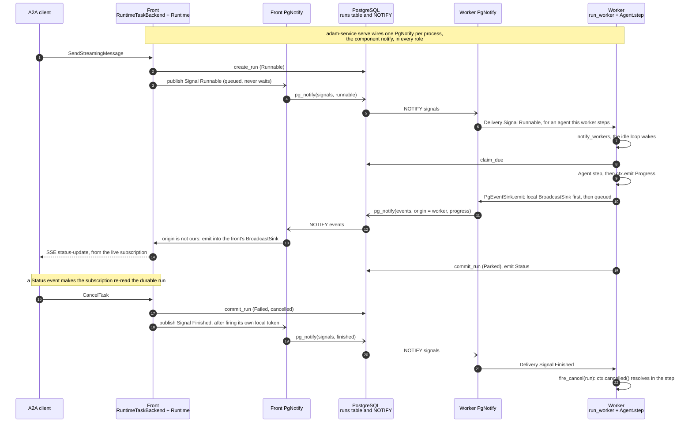

* **Best effort.** `publish` and `emit` queue (1 024 items, then drop); a failed `pg_notify` drops its batch (up to `MAX_BATCH_ITEMS`, 32 items).
* **No echo.** Events carry the sender's id and the listener skips its own; signals have no origin.
* **Size.** PostgreSQL rejects a payload of 8000 bytes or more, so nothing over 7 999 is sent. An
  oversize `Status` loses the tail of its detail; an oversize `Step` crosses without its input and
  output; any other oversize event is dropped.
* **One connection of its own** held by the listener (outside the pool): no transaction-mode pooler in front of it.
* **MongoDB has no equivalent** on a standalone `mongod`, so it keeps polling.

The listener's lifecycle (`listen_loop` in `crates/adam-notify-postgres/src/lib.rs`). A `Resync` tells
subscribers that notifications may have been lost; the worker then polls at once and re-reads the runs
it is stepping.

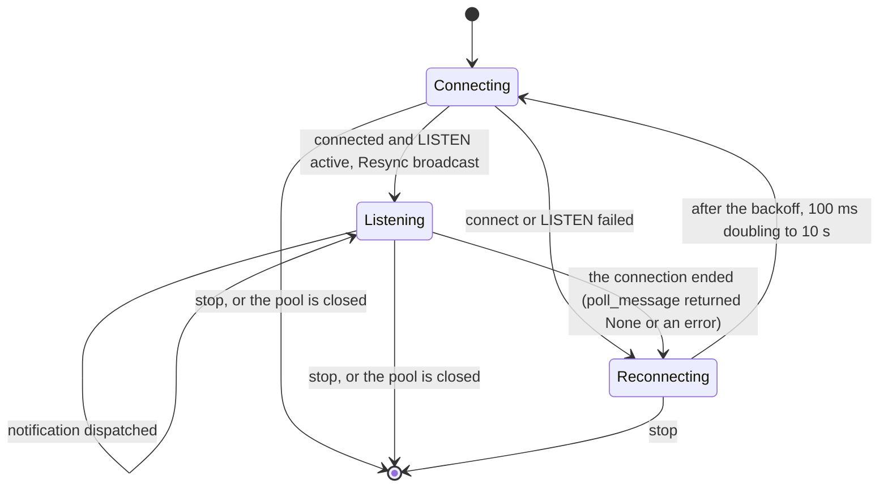

## Child runs

A subagent is a child run: an agent started by a tool of another agent, with its own history, tools and
limits, whose final answer is the result of that tool call. The runtime supplies `start_child`, the
`adam.run.finished` message, `Ctx::child_status` and `ToolError::AwaitRun`; no scheduler. A child with a
conversation (a session round, ADR 0045) reports with `adam.child.reported` instead, and
`start_child_continuing` starts it ([Child runs](reference/child-runs.md#sessions-adr-0045-slices-1-to-4)).

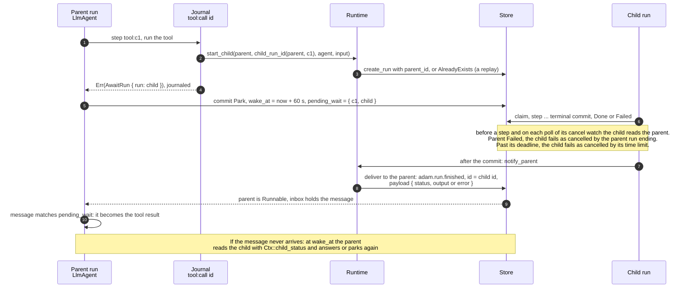

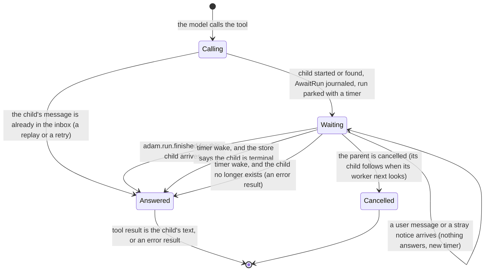

The message is a hint; the parent's timer (`wait_poll`, 60 s) is the guarantee. The child id is derived
(`child_run_id(parent, key)`), so a tool that runs again asks for the same child. Cancelling a parent does
cancel its children: a child whose parent is `Failed` is failed by its own worker, and a child started
within a time limit is failed past it ([Cancel cascades](reference/child-runs.md#cancel-cascades-and-time-limits)). A
subagent on another A2A agent is the same wait with polling and no message, and a cancel does not reach that task.
The failure interleavings, their tests and what the design refuses are in
[Child runs](reference/child-runs.md).

### Child sessions

A subagent can also run in the background as a **session** ([ADR 0045](decisions/0045-a-subagent-can-run-in-the-background-as-a-session.md)):
a conversation of child runs ("rounds") in the parent's own conversation, started, read, sent to and closed by five tools
that return at once. The parent parks only when a read asks to wait, or when its model answers while a session it started
still works or a round ended and was not yet reported. A round that ends meanwhile is told to the model by its next call: the
journaled step `model:<turn>` lists the sessions first and records the reports it appended (`reports`, no new step). A round that ended during the final call is read at the end of the turn with `wait_<turn>`, which answers at once and does not park. The sequence, the states and the interleavings are in [Child runs](reference/child-runs.md#sessions-adr-0045-slices-1-to-4).

The sessions of a conversation are limited by `SESSION_MAX_OPEN`, `SESSION_MAX_WORKING` and `SESSION_MAX_ROUNDS` (the root's file may lower them), and a kept-open session idle for `SESSION_IDLE_DAYS` reads closed: the runtime computes it when it lists or reads, nothing is written. Every role reads the settings. The workers' tools use them today; the A2A front takes them through `ChildSessions::with_limits`, which nothing calls yet (slice 6 part c wires it, with the root's effective limits) ([child runs](reference/child-runs.md)).

## Errors

Every library error enum implements `adam_error::Classify`: a variant says **what happened**, its
`ErrorClass` says **what to do**. Retry loops, the A2A error a client sees and the process exit code
decide from the class, never from a variant.

```mermaid
flowchart LR
    subgraph classes["ErrorClass"]
        direction TB
        Transient
        RateLimited
        Conflict
        Invalid
        NotFound
        Rejected
        Unauthenticated
        Unsupported
        Corrupt
        Internal
    end

    Transient & RateLimited & Conflict --> retry["is_retryable: retry<br/>RetryPolicy backoff, or wake at retry_after"]
    Corrupt & Internal --> alert["should_alert: tell an operator"]

    Transient & RateLimited & Conflict --> a1["A2A -32603<br/>backend temporarily unavailable"]
    Invalid & Rejected --> a2["A2A -32602<br/>invalid params"]
    NotFound --> a3["A2A -32001<br/>task not found"]
    Unauthenticated & Unsupported & Corrupt & Internal --> a4["A2A -32603<br/>internal error"]

    Transient & RateLimited & Conflict --> x1["exit 69<br/>EX_UNAVAILABLE"]
    Invalid --> x2["exit 78<br/>EX_CONFIG"]
    Corrupt & Internal --> x3["exit 70<br/>EX_SOFTWARE"]
    NotFound & Rejected & Unauthenticated & Unsupported --> x4["exit 1"]
```

| Class | Retry | A2A error | Exit |
|---|---|---|---|
| `Transient`, `RateLimited`, `Conflict` | yes (backoff; `retry_after`; at once, bounded) | `-32603` backend temporarily unavailable | 69 |
| `Invalid` | no | `-32602` invalid params | 78 |
| `NotFound` | no | `-32001` task not found | 1 |
| `Rejected` | no | `-32602` (`-32002` for a cancel) | 1 |
| `Unauthenticated`, `Unsupported` | no | `-32603` internal error | 1 |
| `Corrupt`, `Internal` | no, and alert | `-32603` internal error | 70 |

The tree of enums and the exit codes are in [Errors](reference/errors.md).

## Where a run's files and processes live

The coder keeps a **workspace** per run: `<root>/workspaces/<run>/`, a directory of slots, each a
repository's worktree, a scratch project or a **reference** (a repository read beside the one the run works on and never
written: a detached checkout that a run pod mounts read-only,
[References](reference/workspace-and-environments.md#references)). Its commands run through the `Environment` port: in the
coder's own container (`Local`) or in a Kubernetes pod of the run's own (`KubeEnvironment`); ADR 0052 removed
the third environment, a repository's devcontainer on a container service.

Runs move between workers at every step, but a workspace lives on one worker's disk. The deployer picks
a **placement** (`adam_host::Placement`, read from `WORKSPACE_PLACEMENT`;
[ADR 0002](decisions/0002-workspace-placement.md)):

| `WORKSPACE_PLACEMENT` | Worker root | Claims | Needs `WORKER_ID` |
|---|---|---|---|
| `shared` (default) | `WORKSPACE_ROOT`, one volume for all workers | `ClaimScope::Any` | no |
| `affinity` | `WORKSPACE_ROOT/<WORKER_ID>` | `ClaimScope::Pinned` | yes |
| `isolated` | `WORKSPACE_ROOT`, a volume of this worker only | `ClaimScope::Pinned` | yes |
| `a2a-only` | none | `Any` | refused by `adam-coder` |

A pinned run keeps an **owner** next to its lease, set by the first pinned claim and never cleared. A
pinned run whose owner is gone is stranded: keep worker ids stable and do not scale pinned workers in.
Slots, the environments' sequences and states, and the mirror lock are in
[Workspace and environments](reference/workspace-and-environments.md).

The **package caches** (npm, pnpm, cargo) are not part of a workspace: they are one deployment-level volume at `/cache`, mounted
by every pod that runs toolchains (the coder, its run pods) and shared by all of them, off by default
([ADR 0040](decisions/0040-a-shared-package-cache-at-cache.md); chart value `cache`). Installed trees (`node_modules`, `target/`) stay in the workspace.

The **kept output** of a long command, or of a long MCP result, is a file of the run too:
`<root>/outputs/<run>/<id>.txt`, written by the coder's own process (never by a pod) after the text is scrubbed
of the process's secrets, read back by `read_output`, and removed with the run by the janitor. Nothing of it is
in the journal. An agent that is only a folder has no volume: it keeps a long MCP result in the run's own state, up
to 4 MiB.

```mermaid
sequenceDiagram
    participant M as model
    participant L as LlmAgent step
    participant T as run_command / run_checks
    participant K as FileKept (bin/adam-coder/src/kept.rs)
    participant R as read_output
    M->>L: call run_command
    L->>T: journaled step tool:CALL_ID
    Note over T: the output is captured from the pipes (the first 4 MiB and 64 KiB, and the tail)
    Note over K: scrubbed, a cut capture's end cut back at a place no secret straddles
    T->>K: keep(run, id, the captured output, omitted)
    K-->>T: lines kept
    T-->>L: head, tail, output id
    L-->>M: the result (journaled: the same bytes on a replay)
    M->>L: call read_output(id, offset)
    L->>R: journaled step tool:CALL_ID
    R->>K: page(root run, id, offset, limit)
    K-->>R: lines and the last line (more / end)
    R-->>L: the page
```

```mermaid
stateDiagram-v2
    [*] --> Short: the output fits 16 KiB
    [*] --> Kept: it does not
    Short --> [*]: shown whole, nothing kept
    Kept --> Kept: read_output reads a page
    Kept --> Cut: over 4 MiB
    Cut --> Kept: the first 4 MiB are kept, and the view and the last page say so
    Kept --> Refused: the run's 64 MiB, or a link in the way
    Refused --> [*]: head and tail only, the result says so
    Kept --> [*]: the janitor removes it with the run
```

The **images** a model sees are kept the same way, apart from the text: the history holds an `ImageRef` (SHA-256,
type, size, dimensions, origin) and never a byte. Where the bytes are depends on the agent. The inbound message holds
them (and `Conversation::pending_images`, at most 2 MiB) until the first step reads it. After that the coder has them
**on its volume**, `<root>/images/<scope>/<sha256>.<ext>`, per conversation, and in the process's memory once a request
has read them: the hash is checked on the first read, and the checked bytes are kept for the life of the process (64 MiB
in all, oldest first) so a later turn sends them without reading the file again (a file changed after that first read is
not re-read). They are never in the journal, the state or the stored record (an MCP image of a server with `files: true`
is also a file artifact and is journaled as every artifact is). An agent that is only a folder keeps them in the run's
state (base64, within the 4 MiB it shares with kept outputs) **and** in the journal of the tool step that kept them, as a
kept output is, within a run's 6 MiB of journaled image bytes. Whether they are sent at all is the deployment's word
(`MODEL_INPUT_MODALITIES`): an image is admitted or replaced by a line once, when it enters the history, and what a
request sends about it follows the settings now, so the prompt a request starts with only grows while the settings stay.
See [Images in](reference/a2a-server.md#images-in) and [the coder](reference/coder-agent.md#images).

A **command that keeps running** (`start_command`, a development server) writes into the same file as it prints, line by line,
after the secrets are scrubbed, and has a record `<id>.cmd` beside it. The coder holds the process (the worker that started it is its
owner and writes a beat into the record at every sweep); the other workers see it through the record, and stop it by writing a stop
request that the owner's sweep carries out. A process group is killed whatever ended the leader; what a run starts ends with the run
(a process that leaves its group with `setsid` is the exception). Who stops it, and the lifecycle, are in
[The coder agent](reference/coder-agent.md#commands-that-keep-running).

```mermaid
sequenceDiagram
    participant A as CoderAgent::step<br/>(any worker)
    participant C as Commands (ToolEnv)
    participant R as outputs/RUN/ID.cmd
    participant W as the sweep component<br/>BACKGROUND_SWEEP_SECS (the owner)
    participant S as Store
    participant J as Janitor
    participant E as Environment
    A->>C: stop_run, when the root run is done or failed, or any run parks on the person
    A->>R: a stop request in each fresh record another worker owns
    Note over A,C: a cancel commits Failed and never calls the agent's step
    loop every BACKGROUND_SWEEP_SECS
        W->>C: sweep
        C->>S: load_run for each run that has a command
        S-->>C: finished, or not known
        C->>C: stop_run, when the run is over
        C->>R: read: a stop request or another owner stops the command, else the beat is written
    end
    J->>S: the standing of each workspace
    J->>C: stop_run, before the release
    J->>R: settle_over_run: kill by pid and group what the records name, they say gone
    J->>E: release(run)
    W->>C: stop_all, when the worker stops (gone: the worker stopped)
```

```mermaid
stateDiagram-v2
    [*] --> Starting: reserved and recorded
    Starting --> Running: spawned
    Starting --> Stopped: it could not be started
    Running --> Exited: ended by itself
    Running --> Stopped: a stop, its lifetime, the run ended, another worker took the run
    Starting --> Gone: a stale record is settled
    Running --> Gone: a stale record is settled, or the worker stops
    Exited --> [*]
    Stopped --> [*]
    Gone --> [*]
```

A **language server** (`file_diagnostics`, `find_definition`, `find_references`) is the same kind of process with a pipe on
stdin: the coder holds one per run, slot, language and project root **on this worker**, spoken to in JSON-RPC with `Content-Length`
frames, and stops it where it stops a command that keeps running (the registry is `Commands::language_servers()`, so
the agent's step, the sweep, the janitor and `use_repository_environment` reach it with no new wiring). There is no record on the volume
and no beat: a run that another worker takes up starts a server there (placement `shared`; `affinity` and `isolated` keep a run where
it is), and the first worker's server stops by itself when it is idle or its run is over. The tools, the limits and the lifecycle:
[The coder agent](reference/coder-agent.md#language-servers).

```mermaid
sequenceDiagram
    participant T as file_diagnostics, find_definition, find_references
    participant C as Commands.language_servers (Servers)
    participant P as server process<br/>own process group, stdin and stdout piped
    participant E as EnvSession
    participant A as CoderAgent::step
    participant W as the sweep component
    participant J as Janitor
    T->>C: get_or_start (run, slot, language, root)
    C->>E: prepare (ExecSpec::background), spawn
    C->>P: initialize, initialized
    T->>P: sync, then the request, within the wait
    Note over P: idle for LANGUAGE_SERVER_IDLE_SECS: its supervisor stops it
    A->>C: stop_run, when the root run ends, a run parks on the person, or use_repository_environment runs
    W->>C: sweep: stop_run for a run that is over or cancelled
    J->>C: stop_run, before the release
    W->>C: stop_all, when the worker stops
    C->>P: kill the process group
    C->>E: kill the exec id, then what the group left
```

## The two agents

| | [`adam-coder`](../bin/adam-coder/README.md) | [`adam-agent`](../bin/adam-agent/README.md) |
|---|---|---|
| Does | Adam: answers, researches, writes documents, and takes a coding task to a verified pull request | serves **any agent folder** |
| Tools | the coder's 17 own tools (workspace, files, checks, git, pull request) plus the screen's `ask_user`, `show`, `ui_catalog` and the plan's `plan_work`, `plan_check`, `plan_add` | the folder's MCP and skill tools, the screen's and the plan's tools, one per subagent |
| Needs | model, GitHub, a workspace | a model; no workspace, no GitHub |
| State | Postgres, plus files under `WORKSPACE_ROOT` | Postgres |
| Prompt and card | `bin/adam-coder/agent` (embedded, or `ADAM_AGENT_DIR`) | `ADAM_AGENT_DIR`, required |

Both ship in one image, `ghcr.io/vymalo/another-adam-rs/coder`; a service that runs a folder overrides
the entrypoint with `adam-agent`. How the coder works: [The coder agent](reference/coder-agent.md).
Deploying it: [guide](guides/deploy-the-coder.md). `adam-agent` has no embedded agent
([ADR 0005](decisions/0005-one-binary-serves-any-agent-folder.md)).

## Verified and unverified

**Verified 2026-09-29, reading this repository at `172a117`:** the ports and their implementations, the
run transitions, the request path and the coder's rules. **Re-read 2026-10-06:** the crate graph (from
`cargo metadata`) and the schema (`crates/adam-store-postgres/src/lib.rs`, `crates/adam-store-mongodb/src/lib.rs`).
The Mermaid syntax of every diagram is checked in CI by `tools/docs-check`.

**Verified 2026-09-29, executed:** the cross-process fan-out and the listener lifecycle
(`crates/adam-notify-postgres/tests/two_runtimes.rs`, PostgreSQL 16) and the `NOTIFY` payload limit of
8000 bytes (16.13 server); the continuation of a finished task (ADR 0003).

**Verified 2026-10-07, executed:** Swagger UI at `/docs` of `adam-agent` (PostgreSQL 16, a stub model) in headless
Chromium: rendered under its CSP with no error and no request to another origin, Authorize then Try it out over both
bindings ([ADR 0031](decisions/0031-swagger-ui-and-the-a2a-rest-binding.md)).

**Unverified:**

* The `sysexits.h` numbers 78, 69, 71 and 70 are from memory.
* The A2A method names, `TASK_STATE_*` names and the codes `-32001` and `-32002` are as documented in
  `crates/adam-a2a/src/lib.rs` for the pinned SDK (`a2a-lf` 0.3, `a2a-server-lf` 0.4), not checked against
  the A2A specification here. Neither is the SDK's SSE keepalive (every 15 s).
* `adam-acp`'s notes on OpenCode's behaviour (ACP over stdio) are as recorded in its README; the coder
  no longer starts OpenCode (ADR 0038), and a live run against a real gateway is the nightly `live-opencode` job.
* The run pods (ADR 0019) were tested against a fake API server and a `kind` cluster, not the owner's.
* The chart was rendered, not applied to a cluster; how it reaches the cluster after the tag bump is
  outside this repository.
