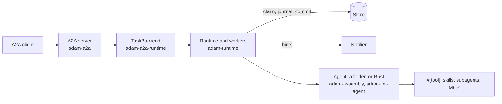

# Concepts

The ideas you need before [the architecture](architecture.md), in one screen and a glossary. For agents, the file and
test evidence: [Concepts: the evidence](../.agents/docs/concepts.md).

**Run, step, journal, lease.** A *run* is one execution of an agent, and its id is the A2A task id. The agent works in
*steps*: each side effect runs inside `ctx.step`, and its outcome is written to the *journal*. After a crash the run is
replayed, recorded outcomes are returned and nothing runs twice. A worker takes a due run with a *lease*, a claim for a
time. The lease only avoids wasted work: correctness is the version check on every commit, so a worker whose lease
expired cannot overwrite newer state. Specified in [the mental model](architecture.md#the-mental-model),
[the worker](architecture.md#the-worker-claim-step-journal-commit) and [the run lifecycle](architecture.md#the-run-lifecycle).

**Store and notifier.** Everything durable goes through the `Store` trait: runs, journal, leases, push configs. There are
PostgreSQL, MongoDB, SQLite and in-memory stores, and `adam-store-testkit` holds the conformance suite every store must
pass. A `Notifier` carries hints between processes ("a run is due"); it is never the truth, polling and the store decide,
and `adam-notify-testkit` holds its suite. Swapping either is a build-time choice. See
[ports and implementations](architecture.md#ports-and-implementations), [the run store](architecture.md#data-the-run-store)
and [signals and events](architecture.md#across-processes-signals-and-events); to write a new store, see the
[store adapters reference](reference/store-adapters.md).

**Host roles.** One process can be the control plane (the network front), the workers (the loops that claim runs), or
both. `Role` is a closed enum (`all`, `control-plane`, `worker`) and `adam-host` supervises the components of the role;
`adam-service`'s `serve` is the whole process for every binary. See [processes and roles](architecture.md#processes-and-roles).

**Agent folder.** An agent can be only a folder: `instructions.md` and a card, plus optional `skills/`, `subagents/`,
`commands/` and `mcp.json`. `adam-agent-fs` parses and validates it, `adam-assembly` binds it to a running agent, and the
`adam-agent` binary serves any folder. See [Agent files](reference/agent-files.md#layout).

**`#[tool]`, skills and subagents.** A Rust function marked `#[tool]` (the `adam-macros` crate) becomes a tool the model
can call. A *skill* is an Agent Skills `SKILL.md` the model loads when it needs it. A *subagent* is another agent file the
parent calls as a tool, and it runs as a durable child run of its own. See [the `#[tool]` contract](reference/agent-files.md#the-tool-contract),
[skills at run time](reference/agent-files.md#skills-at-run-time), [subagents at run time](reference/agent-files.md#subagents-at-run-time)
and [child runs](reference/child-runs.md).

**The A2A server and its extensions.** `adam-a2a` serves A2A 1.0 over JSON-RPC and the REST binding, with one handler
behind both; it hands each request to a `TaskBackend`. An *extension* is an optional feature the agent's card lists by
URI (steps, streamed text, usage, ...) and a client activates; a client that does not know one ignores it. See
[the A2A server](reference/a2a-server.md), [the path of a task](architecture.md#the-path-of-a-task) and
[Extensions](reference/extensions.md).

## Glossary

| Term | In one line | ADR |
|---|---|---|
| Run | One execution of an agent; `RunRecord` in `crates/adam-core/src/store/mod.rs` | [0055](decisions/0055-a-runs-state-is-a-head-and-an-append-only-transcript.md) |
| Step | One journaled side effect, `Ctx::step` in `crates/adam-runtime/src/ctx.rs` | [0061](decisions/0061-a-step-names-its-retry-policy.md) |
| Journal | The recorded outcome of each step, `JournalEntry` in `crates/adam-core/src/store/mod.rs`; its `signature` is the runtime's `adam-step/v1` signature of the entry ([0068](decisions/0068-adam-signs-its-own-history.md)) | [0076](decisions/0076-a-run-records-the-journal-epoch-it-started-on.md) |
| Lease | A worker's time-limited claim on a due run, `Store::claim_due` in `crates/adam-core/src/store/mod.rs` | none of its own; [architecture](architecture.md#the-worker-claim-step-journal-commit) |
| Store | The durable-state port, `Store` in `crates/adam-core/src/store/mod.rs` | [0053](decisions/0053-sqlite-a-store-service-a-database-per-agent-and-a-static-coder.md) |
| Notifier | The hint port between processes, `crates/adam-runtime/src/notify.rs` | none of its own; [architecture](architecture.md#across-processes-signals-and-events) |
| Role | Which components a process runs, `crates/adam-host/src/role.rs` | [0001](decisions/0001-library-first-host-roles.md) |
| Placement | Where the files of a run live, and whether it stays on one worker, `crates/adam-host/src/placement.rs` | [0002](decisions/0002-workspace-placement.md) |
| Agent folder | An agent as files, `AgentDef` in `crates/adam-assembly/src/def.rs` | [0004](decisions/0004-agent-folders-at-run-time.md) |
| `#[tool]` | The attribute that makes a function a tool, `crates/adam-macros/src/lib.rs` | none of its own; [agent files](reference/agent-files.md#the-tool-contract) |
| Skill | A `SKILL.md` loaded on demand, `crates/adam-assembly/src/skills.rs` | [0044](decisions/0044-paged-tools-a-stable-prompt-prefix-a-plan-skills-commands-and-project-context.md) |
| Subagent | An agent called as a tool, `crates/adam-assembly/src/subagent.rs` | [0045](decisions/0045-a-subagent-can-run-in-the-background-as-a-session.md) |
| TaskBackend | What the A2A server calls, `crates/adam-a2a/src/backend.rs` | [0006](decisions/0006-a2ui-and-the-vymalo-extensions-in-adam-rs.md) |
| Extension | An optional card feature by URI, `crates/adam-a2a/src/extensions.rs` | [0006](decisions/0006-a2ui-and-the-vymalo-extensions-in-adam-rs.md) |
