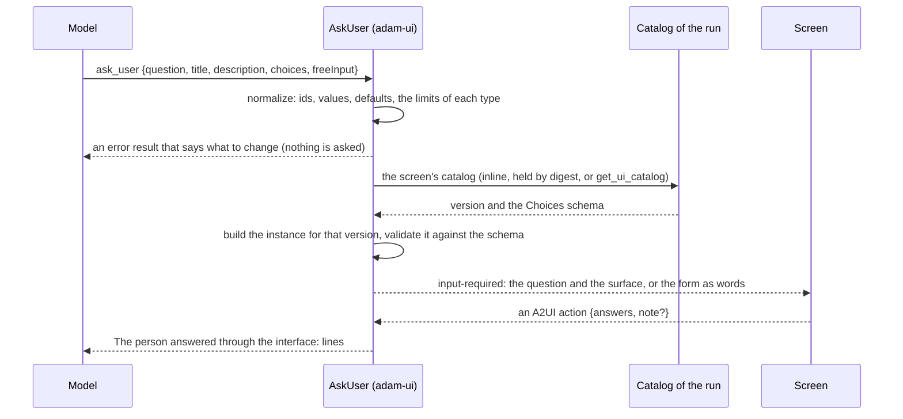
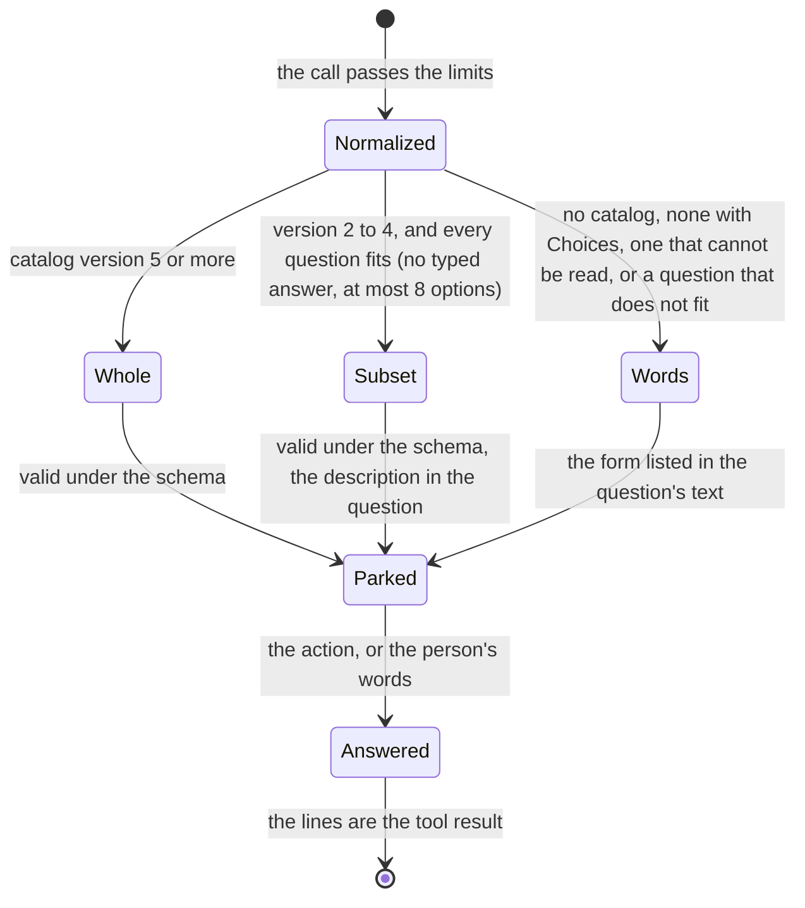

# 0035. Questions carry a title, a description and typed options

Status: **Accepted** (2026-10-11), at the owner's request after a real thread in which Adam asked the person six
things: five as prose ("Option A / Option B"), so that answers such as "Yes, add that" were ambiguous, and one as a form
that had no title, no description and none of the catalog's features. Builds on
[ADR 0006](0006-a2ui-and-the-vymalo-extensions-in-adam-rs.md) (`ask_user` draws a `Choices` form and reads its answer);
the web's side is version 5 of its UI catalog (`docs/api/ui-catalog-v1.md` of `vymalo/another-agentic-system`,
"Version 5").

## Context

*Verified 2026-10-11 by reading the code at `11f5051`:* `ask_user { question, choices? }` took at most 8 questions of 2 to 8
options each, an option being a label or `{value, label, description}`, with `multiple`, `allowOther` and `required`
(`crates/adam-ui/src/ask.rs`). A form had no heading of its own and no way to say why the agent asks; a question had no help
line, no default and no kind of answer but radio buttons and checkboxes; a typed answer or a long list was not a form at
all; an option had no picture. The coder's instructions called `ask_user` the tool for "several questions that have fixed
answers" and said nothing against writing options in prose, so a model that was not sure wrote a list. The answer was read as
`- <id>: <values>` lines (`crates/adam-a2a-runtime/src/vymalo.rs`), with nothing for a typed word.

*Reported by the owner, not verified here (the thread was not read):* the six questions of one thread, five of them prose.

*Verified 2026-10-11 in `docs/api/ui-catalog-v1.md` and `web/src/features/chat/lib/a2ui/catalog/catalog.json` of
`vymalo/another-agentic-system`:* version 5 of the catalog widens `Choices` and only adds to it, so a payload of version 4
is still valid, and the catalog the screen sends says which version it has.

## Decision

1. **A form has a title, a description and, optionally, a free box.** `ask_user` takes `title` (a few words),
   `description` (why the agent asks, in a sentence or two of plain text), `freeInput` (`true`, or `{label, placeholder}`;
   its words come back as the answer's `note`) and `submitLabel`, beside `question` (still required, still the sentence the
   person reads first) and `choices`.
2. **A question has a type, a help line and limits.** `type` is `single` (radio buttons, the default), `multiple`
   (checkboxes, with `min` and `max`), `select` (a searchable list), `images` (a deck of pictures), `text` or `longText`
   (a typed answer, no options). `multiple: true` stays and means type `multiple` (on `select` and `images` it lets several
   be picked). `help` is a line under the question, `default` is what is chosen at first (a `default` may name an option by
   its value or its label).
3. **An option has a title and a subtitle, and may have a picture, an icon and a mark.** `label`, `description`,
   `image {sha256, alt}`, `icon` (one of the `steps/v1` ids) and `recommended`. A picture is **a file of the conversation
   by its hash, never a URL**: the coder's `share_file` now tells the model an image's SHA-256
   (`Artifact::file_sha256`), and the web refuses a surface whose picture is not an image of the thread.
4. **The limits are the web's:** 8 questions, 2 to 12 options for `single` and `multiple`, 2 to 50 for `select`, 2 to 16
   for `images` (each with a picture), none for a typed answer. The tool refuses what the web's validator would refuse
   **before** it asks (contradictory `type` and `multiple`, a default that is not an option, `min` above `max`, a picture on
   a question that is not a deck, a deck tile with none), in words the model can act on, because a surface the web refuses
   is a dead form while the run waits.
5. **The screen's catalog decides what is sent.** From catalog **version 5** the whole form is sent. On version 2 to 4 the
   subset that screen has: the title, radio buttons and checkboxes of at most 8 options, `allowOther`, `required`, the
   button's words; `help` goes after the question, a recommended option is marked in its label, a list or a deck is a list of
   radio buttons or checkboxes, and the description goes in the text the person reads first. When a question needs more than
   that (a typed answer, more than 8 options) or the screen has no `Choices`, the form is words: the description, each
   question with its help, options with their descriptions and marks, the typed questions and the free box.
6. **The answer is `answers: [{id, values, other?, text?}]` and an optional `note`.** The model reads lines:
   `- <id>: <values>`, an "other" as `other: "<text>"`, a typed word as `text: "<text>"`, and a last line
   `Note: "<text>"`. Anything the person typed is a JSON string after its label, so it can never pass for an option's value
   or start a line of its own (the coder's consent answers are matched on `- consent: yes`).
   *Amended 2026-10-11 ([ADR 0036](0036-the-coder-keeps-to-the-access-tier-the-person-picks.md), a fourth review):* the first line
   of the answer names the surface it was made on, `The person answered through the interface (form ask-<call id>):`, and an
   answer counts for a call only when it is the surface that call drew; `ask_user` refuses a typed default with a character
   the person cannot see.
7. **When Adam offers options it must ask with `ask_user` and `choices`**, with a title, a description of why, and options
   that each have a label and a description; never a list in prose, and free text only when there is nothing to choose
   from. The rule is in `ask_user`'s description (every agent has it) and in the coder's instructions (`# Asking the
   person`). The tool does not *require* a title and a description: a call without them still works, as every call of
   version 4 does.
8. **The coder's consent forms set a title and a description.** `request_repository` and `create_repository` give the form a
   title and put the reason in its description (`The agent says why: "..."`; for a new repository, its description or "Nothing
   is created unless you say yes."). On a screen that cannot draw the form the description follows the question's first line,
   so the person reads the same words as before.

## Consequences

* **Compatible.** A call of version 4 (`question`, `choices` with 2 to 8 options, `multiple`, `allowOther`, `required`) makes
  the same instance and the same text as before; its limit of 8 options is now 12 for a radio or checkbox question. The
  answer lines of a version 4 answer are unchanged.
* **No new required trait method and no change of a public type's shape:** `Artifact::file_sha256` is new and additive, and
  `share_file`'s result gains a sentence for an image, which breaks a scripted mock that matches the line whole (match its
  start, `Shared <file> (`, as [ADR 0033](0033-files-from-mcp-results-are-shared-files.md) already advised).
* **The web and adam must agree on the limits.** Both check them, in two languages; a limit changed on one side is a
  change of the contract (`ui-catalog-v1.md`), and `crates/adam-ui/tests/fixtures/catalog-v5.json` is the copy of the web's
  catalog that the tests pin by digest.
* **A picture needs a file the model can name.** Only the coder's `share_file` tells the model a hash; the files of an MCP
  result or of a remote subagent (ADR 0033) do not yet, so a deck of those is not offered. *Unverified:* how a live model
  uses `images`, `select` and `freeInput`; the mock model scripts do not use them.
* **The model may ignore the rule.** The instructions say MUST and the tool's description says never to list options, but
  nothing refuses prose. A reply that lists options as text is still a valid reply.
