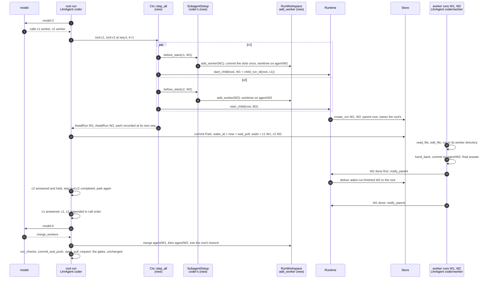
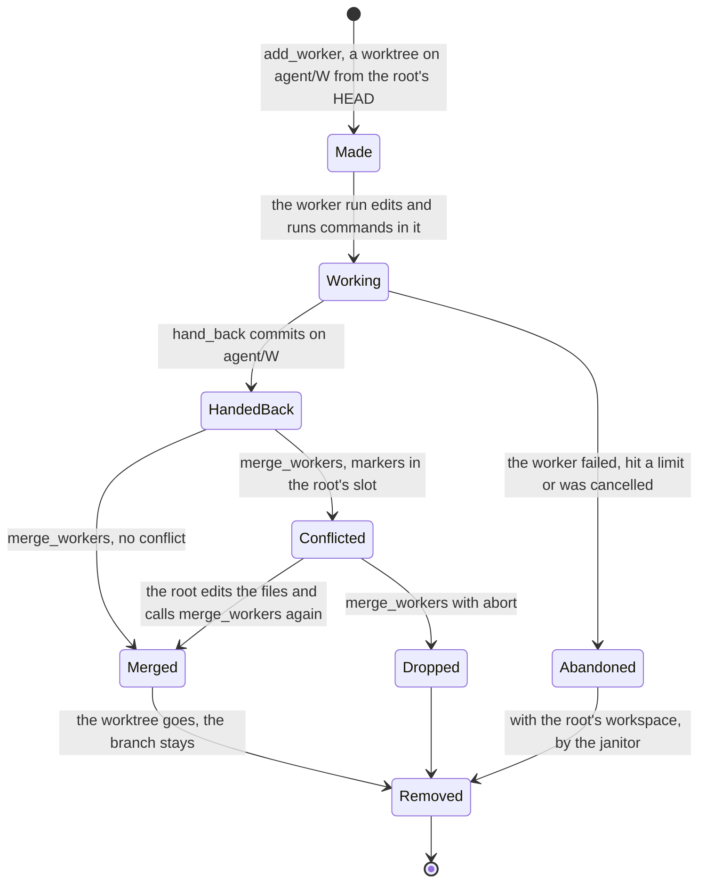
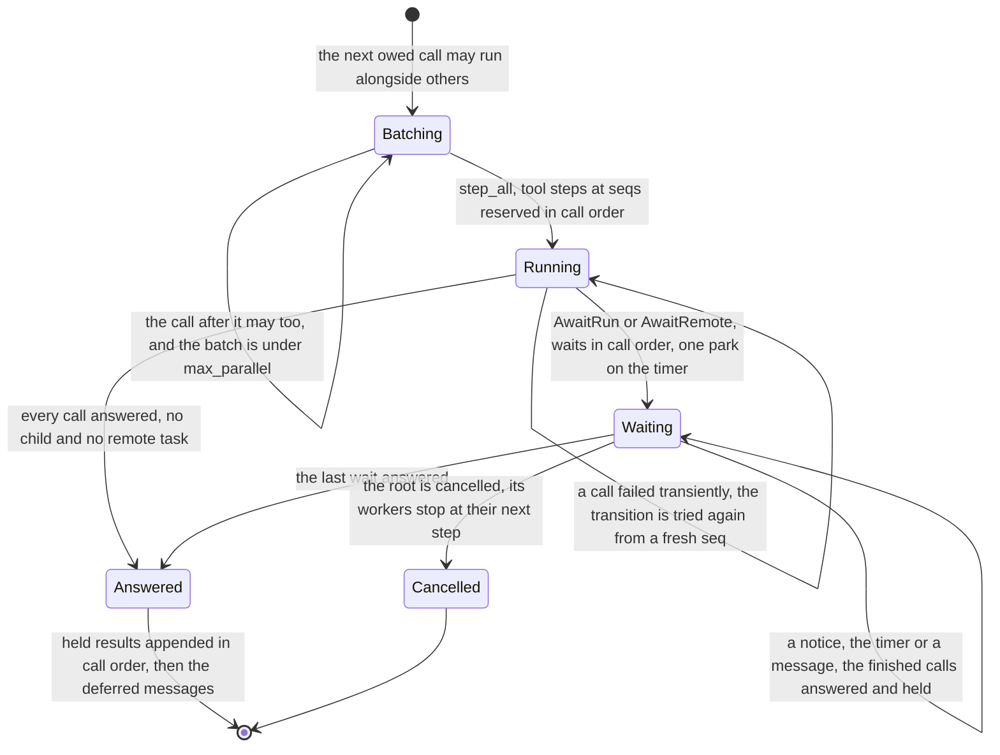

# 0037. Parallel subagent calls, and an editing worker for the coder

Status: **Accepted** (2026-10-11). Nothing of it is built yet: the slices at the end are the build order.
Amends [ADR 0002](0002-workspace-placement.md) (a child run inherits its parent's owner) and
[ADR 0021](0021-the-coder-is-adam-a-general-agent-that-can-code.md) (a third subagent, `worker`, edits). Replaces two
refusals of [Child runs](../reference/child-runs.md): "No parallel fan-out yet" and "No cascade on cancel (v1)". Builds on
[ADR 0036](0036-the-coder-keeps-to-the-access-tier-the-person-picks.md) (access tiers), [ADR 0032](0032-usage-per-model-call.md)
(usage per step) and [ADR 0016](0016-a-message-sent-to-a-working-task-is-steered-into-it.md) (steering).

*Amended 2026-10-11 ([ADR 0038](0038-the-coder-drops-opencode-and-adam-acp-stays-a-library.md), not built yet):* the owner removed OpenCode
from the coder. The trial in the owner's answer 4 is moot, and workers are the path for broad changes. The study under
*Alternatives* is what led there. Decision 1's table and decision 10's list lose `delegate_to_opencode`, which no longer
exists.

## Context

In a thread of 2026-10-11 the owner asked Adam to "create sub-agents to work faster" on a React rewrite. Adam said it
could not, which was true of its configuration: its two subagents, `explorer` and `reviewer`
(`bin/adam-coder/agent/subagents/`), are read-only, and the agent loop runs the tool calls of one model turn one after
another. The owner chose **"prompt now, parallel next"**. The prompt part is done (commit `aa9ebd5`: the instructions name
the subagents and say OpenCode can split a change across its own). This ADR decides the parallel part.

What the code does, *verified 2026-10-11 by reading it at `aa9ebd5`*:

| Where | What |
|---|---|
| `crates/adam-llm-agent/src/agent.rs`, `run_pending` | `while let Some(call) = state.pending_calls.first()`: each call is a journaled step `tool:<call id>`; the first `AwaitRun` or `AwaitRemote` parks the run, so three subagent calls of one turn run one after the other |
| `crates/adam-llm-agent/src/conversation.rs` | `pending_wait: Option<PendingWait>`: one question, one child or one remote task |
| `crates/adam-runtime/src/ctx.rs`, `Ctx::step` | takes `&mut self` and the next `seq`; a recorded name that differs is `NonDeterminism`. On a transient failure the retry starts at a fresh `seq` (`plan` in `worker.rs`), so every call of the turn runs again |
| `crates/adam-core/src/store/mod.rs`, `Store::journal_put` | keyed by `(run, seq)`, first writer wins, no order between seqs |
| `crates/adam-runtime/src/runtime.rs`, `start_child` | creates the child with `parent_id` and **no owner**; the first pinned claim makes the claiming worker its owner |
| `bin/adam-coder/src/tools/mod.rs` | `ToolEnv::slot` and `ToolEnv::session` key by `ToolCtx::root_run_id`: a subagent works in the root's worktree and environment |
| `bin/adam-coder/src/tools/notes.rs`, `NotesStore::save` | atomic (temp file and rename) but not locked: two runs that load, change and save the root's notes at once lose one write |

A model already asks for several calls in one turn: OpenAI's `parallel_tool_calls` defaults to `true`, and adam-model does
not send it.

## Decision

### In the loop: calls that run alongside each other (adam-runtime, adam-llm-agent, adam-assembly)

1. **A tool says whether its calls may run alongside others:** `Tool::concurrent() -> bool`, **default `false`** (Rule 2: a
   defaulted method, no implementer breaks), `#[tool(concurrent)]`, `FnTool::concurrently()`. A wrapper forwards it as it
   forwards `asks_user()` (`Gated` and `Redacting` in the coder); one that does not makes the tool sequential, which is safe.
   The loop runs a call alongside others only when `concurrent() && !asks_user()`.

   | Tool | Alongside | Why |
   |---|---|---|
   | `SubagentTool`, `RemoteSubagentTool` (adam-assembly) | yes | each call is a run or a task of its own |
   | `read_file` | yes | reads one file |
   | `ask_user`, `request_repository`, any `asks_user()` tool | never | a person answers one question at a time; a batch never parks on a question |
   | `run_command`, `run` | no | their guard snapshots the slot before and after a command: two at once in one slot take each other's changes for their own (`run_command` undoes them) |
   | `write_file`, `edit_file`, `apply_patch`, `delegate_to_opencode` | no | the order of edits is the model's |
   | `run_checks`, `commit_and_push`, `open_pull_request`, `merge_workers`, the admin tools | no | gates and order |
   | an MCP tool, a tool of a `ToolSource` | no | effects unknown; a source has no such declaration |

2. **Batches.** The calls of a turn are taken in order. Consecutive calls that may run alongside each other form a batch of
   at most `max_parallel` (new `LlmAgentBuilder::max_parallel`, default 4, frontmatter `limits.max_parallel`); a longer run of
   them is several batches. Every other call runs alone, as today. A batch starts when everything before it is answered and
   nothing after it starts before all of it is answered. `max_parallel` is not a field of `adam_llm_agent::Limits`: its fields
   are public and two literals name them all (`crates/adam-assembly/src/def.rs`, `bin/adam-coder/tests/agent_files.rs`).
3. **The journal: one step per call, at seqs reserved in call order.** `Ctx::step_all` (new) takes the steps of a batch,
   reserves `seq k .. k+n-1` for `tool:<c1> .. tool:<cn>`, runs the unrecorded ones concurrently and records each at its own
   seq as it finishes. A replay returns what is recorded and runs only the rest (at-least-once, as `Ctx::step`). The next seq
   is `k+n` whichever call finished first. No store change: `journal_put` takes seqs in any order. A transient failure of one
   call fails the transition, and the retry runs every call of the batch again from a fresh seq (today: every call of the turn
   before the failed one); a subagent call finds the child it started (`child_run_id`).
4. **One park for N waits; results in call order.** `Conversation` gains `waits: Vec<PendingWait>` (runs and remote tasks,
   in call order) and `held: Vec<Message>` (the batch's results so far), both absent while empty; `pending_wait` stays for a
   question and for a call that runs alone, so stored states load. After `step_all`, in call order: an answer is held and its
   step ends; `AwaitRun` becomes a wait (answered at once when its notice is in, case 7 of
   [Child runs](../reference/child-runs.md)); `AwaitRemote` becomes a wait whose deadline comes from one `ctx.now` for the
   batch; `NeedsInput` from a tool that said `concurrent` is an error result. Files, the file budget and announcements are
   applied in call order. With any wait the run parks **once**, on the `wait_poll` timer. Each wake settles the run waits from
   the notices and `Ctx::child_status` (live, not journaled, as today) and polls the remote ones in one `step_all` of
   `poll:<call id>`. When the last wait is answered the held results are appended **in call order**, the deferred messages
   after them, and the loop goes on.

   **Why a replay is deterministic:** the names and seqs of a transition's steps depend only on the committed state (the
   batch, the waits) and on recorded outcomes, never on which call finished first. The live read of a child only moves one
   way, from open to finished, so a replay that finds more children finished answers more calls and may reach `model:<turn>`
   at a seq the first try never wrote.

   | seq | Step | Outcome |
   |---|---|---|
   | k | `model:3` | calls `c1` worker, `c2` worker, `c3` `read_file` |
   | k+1, k+2, k+3 | `tool:c1`, `tool:c2`, `tool:c3` (one `step_all`) | `AwaitRun W1`, `AwaitRun W2`, the file; commit: parked, `waits` = [c1, c2], `held` = [c3] |
   | none | W2's notice wakes the root | c2 held, its step ends; parked again |
   | none | W1's notice | c1; the results of c1, c2, c3 are appended in that order |
   | k+4 | `model:4` | the model reads all three |

5. **In the store** the root is one row, `parked` with a timer, and the N children are rows with its `parent_id`. A2A reads it
   as `working` (no question: `default_prompt` is unchanged).
6. **Limits.** `max_tool_calls` counts each call of the batch when the model asks for it, and `max_turns` one per model call,
   as today; each child has its own limits. Real parallelism is also bounded by `WORKERS` (default 4) in each process. Usage
   is unchanged: each child reports under the root step of the call that started it, and `count_child` adds a child's totals
   when it answers.
7. **Cancel cascades.** The runtime does not step a child whose parent has ended: before a child's transition it reads the
   parent (`load_run`), and a parent that is `done` or `failed` makes the child `failed` with `cancelled: the parent run
   ended`. No `Store::children` is needed, a child stops within one step, and a crash cannot skip it (it is checked at every
   step). A remote task is still not cancelled.
8. **Steering.** A message sent while a batch waits wakes the root, which reads it into `deferred` (the coder also notes its
   tier), answers nothing and parks again; the model reads it once the batch is answered, as it does behind one child today.
   Stop cancels the root, and by 7 its workers.
9. **A child inherits its parent's owner.** `Store::create_run` of a run with a parent gives it the parent's owner, so under
   `affinity` and `isolated` a subagent runs on the worker that holds the root's workspace. This is a contract change of
   `create_run` with a testkit case, not a new method. Today `explorer` and `reviewer` can land on another worker there and
   find no worktree.

### In the coder: an editing `worker`

10. **`worker`, a third subagent** (`bin/adam-coder/agent/subagents/worker.md`): `read_file`, `write_file`, `edit_file`,
    `apply_patch`, `run_command`, `run` and `hand_back`, limits of its own. No `run_checks`, `delegate_to_opencode`,
    `commit_and_push`, `open_pull_request`, `share_file`, admin tool or anything that asks. It may run the project's tests with
    `run_command` to see its part work; that is not a check.
11. **A worktree of its own.** adam-assembly gains `SubagentSetup` (`BoundDef::subagent_setup(name, setup)`), run in the step
    of the call before `start_child`. The coder's setup calls `RunWorkspace::add_worker(child)` (new): under the run's lock
    it commits what the root's slots hold as a local commit (a no-op for the second worker), then, under the mirror lock as
    `Worktree::add_base_checkout` does, adds for every slot (a scratch project is a git repository too) a worktree
    `<run workspace>/.adam-workers/<child-short>/<slot>` on the branch `agent/<child-short>` from the slot's `HEAD`, with what
    git ignores linked in, as for the base checkout. Repeated, it returns what is there. **Not `agent/<run>/<worker>`:** git
    refuses a branch below an existing one (`agent/<root-short>`). `ToolEnv::slot` of a run that has a worker directory
    resolves among its worktrees; every other subagent sees the root's slots, as today.
12. **`hand_back { summary }`** commits the worker's worktrees on its branch, as the coder's identity, and ends its turn with
    `summary` as its answer (`ToolOutput::final_answer`). A worker that ends without it hands nothing back. It is withheld from,
    and refuses in, a run that is not a worker.
13. **`merge_workers { abort? }`**, a root tool, merges each worker branch that has commits past its start into the root's
    branch (`git merge --no-ff`, in the order the workers started) and reports the files. On a conflict it stops, leaves the
    markers in the root's slot and lists the files; the root edits them and calls it again, which concludes the merge (refused
    while `git ls-files -u` lists a path or a marker remains), or passes `abort: true`. While a merge is in progress,
    `commit_and_push`, `run_checks`, `open_pull_request` and `worker` refuse. The branches are refs of the same mirror, so
    nothing is fetched or pushed to merge; merged worktrees are removed and their branches stay local.
14. **The gates stay on the root.** Checks, check cycles, the pre-existing check ([ADR 0026](0026-a-failure-the-base-has-too-is-not-the-runs.md)),
    `commit_and_push` and the pull-request gate run on the root's merged tree, as for any change; `open_pull_request` sees the
    merges because they are commits of the branch it pushed. A worker passes no gate.
15. **Access tiers.** `worker`, `hand_back` and `merge_workers` need `edits` (`tier::known`), so a root at `plan` cannot start
    a worker. `Gated` reads the **root's** notes at every call, so a worker keeps the root's tier, and a message that lowers
    it holds at the worker's next call (the root's step notes it on the wake).
16. **Notes are updated under a lock.** `NotesStore::update(run, change)` holds an exclusive lock on `<run>.json.lock` (an
    async lock and `flock`, as the workspace locks) around load, change and save, and every write goes through it: workers
    write the root's notes (`missing_tool_answer`, from `run` and `run_command`) while the root's step writes them on a wake.
17. **One environment, separate directories.** All three environments refuse a `cwd` outside the run's directory
    (`session.rs` of `adam-devcontainer` and `adam-env-kubernetes`), and the worker directories are inside it:

    | Environment | Workers |
    |---|---|
    | `Local` | commands in the coder's container, each in its worker's directory |
    | run pod | the root's pod; N builds share its memory (2Gi in the chart): `max_parallel` and the template's resources are the knobs |
    | devcontainer | the root's container (the whole run directory is bound). The read-only binds of each slot's `.git` are made with the container, so a worker worktree made later has none: the guard of `run` and `run_command` is what holds there, and its snapshot leaves out `refs/heads/agent/*` and the per-branch config (`gitcli::repo_state`), so a sibling's branch is never undone |

18. **What the person sees** (`steps/v1`). Each worker call is a `tool:<call id>` step, kind `subagent`, label "Worker",
    several `running` at once, each ending when its worker answers. New: a child run's own steps are also sent to the root's
    task (`Emitter::emit_for`, as `usage/v1` already is), with `parent` set to the root's step the child works under and an id
    prefixed by the child (`<child-short>:tool:<call id>`), so each worker's edits nest under it.

A batch in the loop (`run_pending` in `crates/adam-llm-agent/src/agent.rs`, with what this ADR adds):

## Alternatives considered

* **Leave it to OpenCode's subagents.** OpenCode has a `General` subagent that can edit and is meant "to run multiple units of
  work in parallel". It stays available, and the prompt already points to it. It is not the answer to "Adam works faster with
  workers": the whole delegation is one journaled step (a crash runs all of it again), its parts are not durable, and over
  ACP a child session's steps are dropped. Its subagents share one working tree (`task` makes a child session in the same
  directory: *verified* 2026-10-11, OpenCode v1.18.33 source).
* **Integrate OpenCode fully, through a plugin or its HTTP server** (studied 2026-10-11 at the owner's request, against
  OpenCode v1.18.33 and 1.19.0, *verified* in their source and in `@opencode-ai/plugin` and `@opencode-ai/sdk` 1.18.33).
  A plugin sees every session's events, subagents included, and the tokens of each model call (`step-finish` parts), and
  `tool.execute.before` can block or rewrite a call; but `permission.ask` is declared and never called, and a plugin that
  fails to load is skipped (fail-open). `opencode serve` can abort, fork and steer a session and answer permissions over
  HTTP, but Adam reaches OpenCode only through the environment's exec (`podman exec`, `pods/exec`), stdin and stdout, so
  driving it over HTTP needs a relay into every environment. Resuming a session after a crash works (SQLite,
  `session/resume`), but interrupted calls come back as errors and the model re-plans: resumable, not a deterministic
  replay. So OpenCode is not the main line. What is worth building while it stays: harden the present path (no project
  `.opencode/` config or plugins, a password for its loopback server, deny rules in place of its default allow, the
  model's context limit) and a one-way plugin that writes its child sessions, tool parts and per-call tokens as JSON lines
  into the run's directory, read into steps and `usage/v1`, failing closed when its first line is missing. The trial in the
  owner's answer 4 then compares workers and OpenCode on tokens too.
* **One worker at a time.** An editing worker with today's loop: no change to the journal, and no speed, which is what the
  owner asked for. Slices 5 to 7 without 1 to 3 give exactly this, so it is a step on the way, not the goal.
* **Remote workers (`a2a:` subagents) on pods of their own.** Each would clone, push its own branch and need GitHub
  credentials in its pod; the tier does not cross A2A unless the worker activates `access-tier/v1`; a remote task is not
  cancelled with its parent; and it is polled every `wait_poll` (60 s). It is the way to the owner's longer goal of a pod per
  thread or per workspace, and the contract chosen here is the one it needs: a worker gets a branch and hands back commits on a
  branch of its own, which a remote worker would push and the root would fetch instead of sharing the mirror.
* **Workers in the root's worktree, no branches.** Concurrent writes to one tree, the guard of `run_command` undoing a
  sibling's edits, and no conflict to see. Rejected.
* **One journal entry for the whole batch.** A crash would lose every call that had finished. One entry per call keeps them.
* **One environment per worker.** Run pods are keyed by the root's workspace; a pod per worker multiplies pods against the
  namespace's quota and needs the volume in each. It belongs to the pod-per-thread goal, not here.
* **`Store::children` for the cascade.** A new store method for three stores and the testkit, and `cancel` would become a
  loop. The check of the parent at each child step needs neither.

## Consequences

* **Rule 2.** New and additive: `Tool::concurrent`, `#[tool(concurrent)]`, `FnTool::concurrently`, `Ctx::step_all`,
  `LlmAgentBuilder::max_parallel`, `Conversation::{waits, held}`, `SubagentSetup`, `BoundDef::subagent_setup`,
  `RunWorkspace::add_worker` and the merge, `NotesStore::update`, the coder's `hand_back` and `merge_workers`. Not additive:
  `adam_agent_fs::Limits` gains `max_parallel` (a literal that names every field breaks; the repository's own uses
  `..Default::default()`), and `Store::create_run` gains a rule for children that a store can ignore and still compile, so
  the testkit is what catches it.
* **Behaviour that changes for every folder agent:** the subagent calls of one turn run side by side (a folder sets
  `limits.max_parallel: 1` to keep one at a time), and a cancelled parent stops its children.
* **No mixed versions.** A build before `waits` reads a state with them as one with calls owed and no wait, and fails the
  run on replay. Roll every worker before slice 3 is deployed, as for `AwaitRun`.
* **Cost.** Workers multiply the tokens and the time a pod is busy; the usage totals count them. Each worker is a checkout of
  every slot on the workspace volume.
* **The prompt is at 29,819 of 30,000 characters.** The worker section must be paid for by cuts.
* **Pages to update with the build:** [Child runs](../reference/child-runs.md), [Architecture](../architecture.md) (child
  runs), [Workspace and environments](../reference/workspace-and-environments.md), [Agent files](../reference/agent-files.md)
  (`limits.max_parallel`), the coder's README, the roadmap.

## Slices

Each is testable alone, in this order.

1. **`Ctx::step_all`** (adam-runtime): three steps that finish in reverse order replay in call order; a crash after one is
   recorded runs only the other two; a wrong name at a reserved seq is non-deterministic.
2. **Batches** (adam-llm-agent): `Tool::concurrent`, `max_parallel`, `waits`, `held`. In `tests/child_runs.rs`: three
   children that finish 3, 1, 2 give one park, results in order 1, 2, 3 and a step each; the interleavings of
   [Child runs](../reference/child-runs.md) with three waits; a batch over `max_parallel` is two.
3. **Subagents side by side** (adam-assembly, adam-agent-fs): the subagent tools say `concurrent`, `limits.max_parallel`;
   the coder's `explorer` and `reviewer` run side by side and the prompt says so.
4. **The cascade** (adam-runtime): a child of an ended parent fails at its next step, on the three stores.
5. **Owner inheritance** (the stores and the testkit): a child of a pinned run is claimable only by its parent's owner.
6. **Worker worktrees** (adam-workspace): `add_worker`, the merge (clean, conflict, conclude, abort), removal, on local git.
7. **The coder's worker**: `NotesStore::update`, `SubagentSetup`, `worker.md`, `hand_back`, `merge_workers`, the refusals
   during a merge, the tiers, the prompt, the README, and an end-to-end script whose scripted model asks for two workers in
   one turn and then merges a conflict.
8. **A child's steps on the root's task** under the call's step (adam-llm-agent, adam-a2a-runtime).

## The owner's answers (2026-10-11)

1. **Steering.** A message sent while workers run waits for the batch and goes to the root, which re-plans with it. It is
   not handed to the workers.
2. **How many.** 4 per turn (`max_parallel`) and `WORKERS=4` per process, in the run pod of 2Gi.
3. **A worker's dependencies are configurable**, per deployment and per repository: `isolated` (the default: each worker
   installs its own, which the shared package caches in `/cache` make fast, vymalo/another-agentic-images#12) or `shared`
   (the ignored directories of the root's slot, `node_modules` and the like, are linked into the worker: instant, but an
   install in one worker writes into the others'). The setting is `AgentConfig`'s `spec.workers.dependencies`, with
   `spec.workers.repositories[]` (`match`, a repository URL pattern, and `dependencies`) for the exceptions, and
   `WORKER_DEPENDENCIES` with a chart value where there is no operator. A CRD of its own for per-project policy was
   considered and deferred until several agents need to share one project policy. Built in slice 6 (worker worktrees).
4. **OpenCode stays out of workers.** The owner asked whether OpenCode and ACP are still needed at all. Workers do what
   OpenCode is used for (broad, multi-file changes) in the open: journaled, a step per call, tokens counted, the tier
   checked at every call, and a crash resumes them; OpenCode's session is none of these. So once workers are built,
   `delegate_to_opencode` becomes optional behind a deployment setting, and whether it stays on by default is decided
   after a trial on real tasks (the quality of the coder's own file tools against OpenCode's).

## Verified and unverified (2026-10-11)

* *Verified 2026-10-11*, `openai/openai-openapi`, `openapi.yaml` on `master`: the Chat Completions request's
  `parallel_tool_calls` is the schema `ParallelToolCalls`, a boolean with `default: true`.
* *Verified 2026-10-11*, <https://opencode.ai/docs/agents/> (read through a summariser): three built-in subagents, `General`
  ("Has full tool access, so it can make file changes when needed", "run multiple units of work in parallel"), `Explore`
  ("Cannot modify files") and `Scout` (read-only). The source of v1.18.33 and 1.19.0 has only `general` and `explore`
  (*verified* the same day): Scout is in the docs only, so the coder's prompt rightly names the two.
* *Verified 2026-10-11* with git 2.43.0: with a branch `agent/abc`, `git branch agent/abc/w1` fails with "cannot lock ref
  'refs/heads/agent/abc/w1': 'refs/heads/agent/abc' exists".
* *Unverified:* whether a provider requires tool results in the order of the calls (they are appended in call order
  anyway); whether the model gateway and models other than OpenAI's ask for several calls per turn; `flock` on NFS and
  Longhorn RWX for the notes lock, as for the workspace locks.
