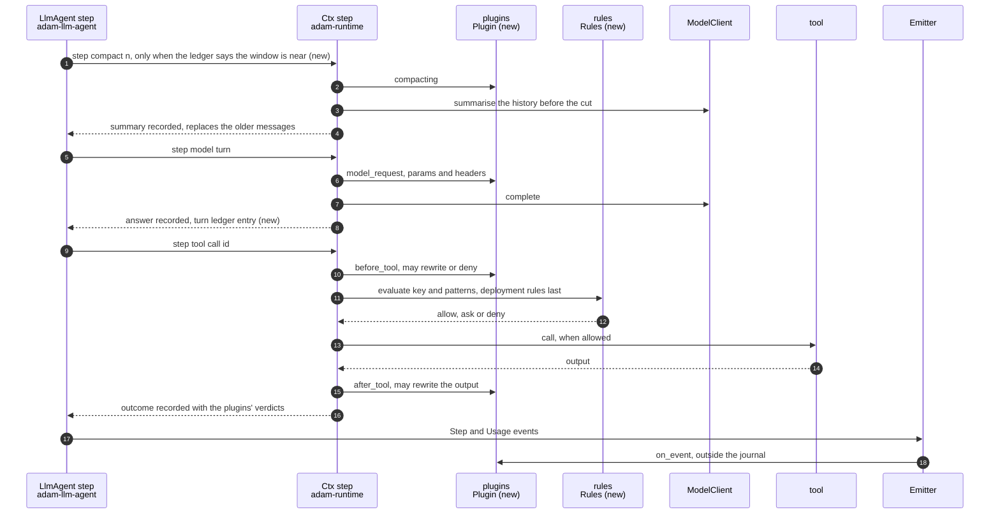
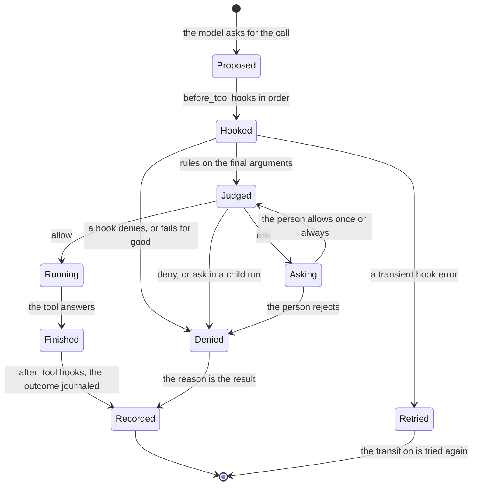

# 0039. The agent loop takes OpenCode's structure, and agents get plugins

Status: **Accepted** (2026-10-11), the owner's decision with [ADR 0038](0038-the-coder-drops-opencode-and-adam-acp-stays-a-library.md):
*"let's copy the agent loop structure of OpenCode + plugins."* Nothing of it is built yet: the slices at the end are the build
order, interleaved with [ADR 0037](0037-parallel-subagent-calls-and-an-editing-worker.md)'s.
Amends [ADR 0036](0036-the-coder-keeps-to-the-access-tier-the-person-picks.md) (decision 6: the tiers become presets of rules,
same behaviour). Builds on [ADR 0007](0007-progress-as-steps-and-streamed-text.md) (steps), [ADR 0016](0016-a-message-sent-to-a-working-task-is-steered-into-it.md)
(steering), [ADR 0020](0020-reasoning-is-streamed-beside-the-answer-and-never-stored.md) (reasoning is never stored) and
[ADR 0032](0032-usage-per-model-call.md) (usage per call).

## Context

OpenCode leaves the coder (ADR 0038), but its loop is well shaped, and the owner wants that shape and a plugin system in
adam-rs. "Copy" here means the structure, not the code. adam-rs keeps what OpenCode lacks: a journal that replays a run after
a crash, transitions committed to a store, and fail-closed composition.

**How facts are marked.**
* `oc:` means `github.com/sst/opencode` at tag `v1.18.33` (`51ef4be`), under `packages/opencode/src/`. Every `oc:` citation is
  *verified 2026-10-11* by reading that file.
* `sdk:` means npm `@opencode-ai/sdk@1.18.33`, `dist/v2/gen/types.gen.d.ts`. `plugin.d.ts` means `@opencode-ai/plugin@1.18.33`,
  `dist/index.d.ts`.
* These are byte-identical in 1.19.0 (*verified* the same day by `diff`): `permission/index.ts`, `agent/agent.ts`,
  `tool/task.ts`, `plugin/index.ts`, `acp/*`, and the hook types.
* The other files were read at 1.18.33 only, and their state in 1.19.0 is *unverified*.

### OpenCode's loop, as built

| Piece | How it works |
|---|---|
| **Session, message, part** | A session holds user and assistant messages; a message holds parts. An assistant message names its `agent`, `providerID`, `modelID`, `finish`, `error`, `cost` and `tokens` (`sdk:213-246`). Parts: `text`, `reasoning`, `file`, `tool` (state `pending` → `running` → `completed` or `error`, with `input`, `output`, `title`, `metadata`, times: `sdk:344-400`), `step-start` and `step-finish` (each model call: `reason`, `snapshot`, `tokens`, `cost`: `sdk:401-426`), `patch` (files a step changed), `compaction`, `subtask`. Stored in SQLite. |
| **The prompt loop** | `runLoop` (`oc:session/prompt.ts:1081-1340`) is a loop in memory over the stored messages. Each pass:  1. reads the history, the parts before a compaction left out (`:1092`, `oc:session/message-v2.ts:525`);  2. finds the last user and assistant messages (`:1096`);  3. stops when the last assistant finished and answered the last user;  4. runs a pending `subtask` or `compaction` first (`:1144-1158`);  5. compacts on overflow (`:1164-1166`);  6. resolves the agent **of the last user message** (`:1170`);  7. creates one assistant message, resolves the tools for that agent and model (`:1226`), builds the system prompt (`:1264`), and runs the processor (`:1272`).  On the agent's last allowed step (`agent.steps`), it adds a prompt that asks for an answer without tools (`:1178-1179,1281`). A message sent while it runs joins the running loop and is answered after the current step (`oc:effect/runner.ts:115-122`). |
| **The processor** | Turns the model's stream into parts (`oc:session/processor.ts:280-548`). It flags a **doom loop** (the same tool with the same input 3 times) as a `doom_loop` permission ask (`:29,331-373`). On `step-start` it snapshots the tree (`:424`). On `step-finish` it records the call's tokens and cost (`:435-469`), a `patch` part with the files changed (`:471-483`), and whether the context overflows (`:493-495`). It ends `continue`, `stop` or `compact` (`:693-695`). A rejected permission stops the loop (`:186-204`). |
| **Tools** | A tool is `{id, description, parameters, execute(args, ctx)}` (`oc:tool/tool.ts:55-65`). The context gives `sessionID`, `messageID`, `agent`, `abort`, `callID`, the `messages`, `metadata()` (live title and data) and `ask()` (a permission check) (`:36-46`). A result is `{title, metadata, output, attachments}` (`:48-53`). Output over 2,000 lines or 50 KiB is written to a file, and the model gets a preview with the path (`:131-140`, `oc:tool/truncate.ts:14-41`). The registry joins built-ins (`oc:tool/registry.ts:102-113`), `tool/*.ts` files of config dirs (`:185`), plugins' tools (`:199-201`) and MCP. It chooses per model (`apply_patch` for GPT models, `edit` and `write` otherwise: `:290-301`) and lets `tool.definition` rewrite descriptions (`:318`). |
| **Permissions** | Rules `{permission, pattern, action: allow\|ask\|deny}`; the **last** match wins, and no match is `ask` (`oc:permission/index.ts:28-38`). A tool asks with its key and patterns: file paths, or **one pattern per bash sub-command**, parsed with tree-sitter (`oc:tool/shell.ts:387-409`). The layers are agent defaults, the config's `permission`, the agent's own, then the session's (`oc:agent/agent.ts:115-261`, `oc:session/tools.ts:87`). A tool denied with pattern `*` is not offered at all (`oc:permission/index.ts:204-214`). `ask` waits for a client's reply (`once`, `always`, `reject`); "always" is kept **in memory** for the instance (`:23-26,110-170`). |
| **Agents** | `{name, description, mode: primary\|subagent\|all, model, variant, prompt, temperature, topP, permission, steps, options, hidden}` (`oc:agent/agent.ts:35-55`). Built-ins (`:142-261`): `build` and `plan` (primary; plan denies edits), `general` and `explore` (subagents), `compaction`, `title` and `summary` (hidden). Markdown agents come from `{agent,agents}/**/*.md` (`oc:config/agent.ts:13`). The agent is chosen **per message**, so a session switches between `build` and `plan`. |
| **The `task` tool** | One tool with a `subagent_type`. It creates a child session (`parentID`) in the same directory (`oc:tool/task.ts:156-172`). The child inherits the parent session's `deny` and `external_directory` rules (`oc:agent/subagent-permissions.ts:14-27`). Depth is 1 by default (`oc:tool/task.ts:106-117`), and a `task_id` continues an earlier child. Background runs are experimental (`:98`). |
| **Compaction** | Two levels. *Prune* marks old tool outputs as compacted beyond 40,000 protected tokens, when it frees at least 20,000 (`oc:session/compaction.ts:28-31,271-316`). *Compact*: when a step's tokens reach the context minus a reserve of 20,000 (`oc:session/overflow.ts:8-34`; never when the context is unknown), the hidden `compaction` agent writes a summary message (`summary: true`) of the history. The history before it is left out of later calls (`oc:session/compaction.ts:358-415`). A synthetic "continue" message resumes the work (`:499-515`). Plugins add context or replace the prompt (`:373-377`). |
| **Snapshots and revert** | A shadow git directory per project and worktree under the data dir (`oc:snapshot/index.ts:71`) takes `write-tree` snapshots (`:318-347`) at each step. `patch`, `restore`, `revert` and `diff` (`:36-43`) let `revert` undo the files of the steps after a message and hide those messages; `unrevert` restores them (`oc:session/revert.ts:38-100`). Off with `snapshot: false` (`oc:snapshot/index.ts:169`). |
| **Plugins** | JS or TS modules from config dirs, npm or `file://`. Hooks (`plugin.d.ts:173-322`): • `event`; • `tool.execute.before` (rewrite args, or throw to block) and `tool.execute.after` (rewrite title, output, metadata); • `chat.params` and `chat.headers`; • `shell.env`; • `tool` (add tools); • `auth` and `provider`; • `permission.ask` (declared, never called); • `experimental.*` (history, system prompt, compaction). Hooks run in load order and are awaited (`oc:plugin/index.ts:284-296`); `event` is fire-and-forget (`:255-261`). **A plugin that fails to load is skipped** (`:221-243`). |

### adam-rs today, and what to adopt

| OpenCode | adam-rs today | Gap | Adopt |
|---|---|---|---|
| Session in SQLite; the loop in memory | a run in the `Store`; `Agent::step` is one committed transition: inbox, waits, `model:<turn>`, `tool:<call id>` (`crates/adam-llm-agent/src/agent.rs:1858-1980`), each a journaled step at a seq (`crates/adam-runtime/src/ctx.rs:266`) | none: adam's replays, OpenCode's re-plans | keep adam's |
| Parts with tokens, cost and files per model call | `Conversation::messages`, `usage`, `usage_totals` (`crates/adam-llm-agent/src/conversation.rs:192-311`); a call's usage in its journal record (`agent.rs:132-150`) and as `RunEvent::Usage` | per-call model, usage and finish are not in the state; files per step nowhere | a **turn ledger** in the state (decision 2) |
| Stop when the last assistant answered the last user; a message joins the loop | a message is steered into `deferred` and read on the next turn (ADR 0016) | none | keep |
| The last step answers without tools | a tripped `max_turns` fails the run (`agent.rs:42-66`) | the work is lost to a limit | **last-turn grace** (decision 2) |
| Doom-loop check | none | a model can repeat a failing call until a limit | a `doom_loop` rule (decision 3) |
| Tool, context, result; truncation to a file | `Tool`, `ToolCtx`, `ToolOutput` (`crates/adam-llm-agent/src/tool.rs`); `NeedsInput` parks for a person; `StepIo` caps what steps show; each tool caps its own output | no title per call; no common truncation | a per-call title (decision 2); truncation stays per tool |
| Registry: built-ins, tool files, plugins, MCP; filtered per model and agent | `tools:` per agent, `ToolSource` (`specs`, `instructions`, `refine`, `withhold`: `crates/adam-llm-agent/src/source.rs:231-300`), MCP, skills, one tool per subagent | no hook around a call, no rules | plugins (decisions 7-9); rules feed `withhold` (decision 3) |
| Rules per key and pattern, layered; `ask` to a client | an allowlist per agent; the coder's tiers: `TierSource::withhold` and `Gated` at each call (`bin/adam-coder/src/tier.rs:72,182-200`, `bin/adam-coder/src/tools/mod.rs:709-719`); `permission:` in an agent file is **ignored** (`crates/adam-agent-fs/src/load/agent.rs:17-38`) | no argument patterns, no rules a folder can state, no generic ask | **rules** (decision 3); tiers become presets |
| Agents: mode, model, prompt, permission, steps; chosen per message | root and subagents in a folder with `model:`, `tools:`, `skills:`, `limits:` (`docs/reference/agent-files.md`) | no permission per agent, no hidden system agents, no switch per message | `permission:` per agent (decision 4), a `compaction` agent (decision 5); modes: open question 3 |
| `task`: one tool, child session, denies inherited, resumable | a `SubagentTool` per subagent, a child run (`AwaitRun`), remote `a2a:` subagents; ADR 0037's batches and cascade | a child keeps none of its parent's rules (the coder's tier reaches it through the root's notes) | children inherit denies and approvals (decision 3); no resume |
| Prune and summary compaction | `fit_history` shortens old tool outputs per request (`crates/adam-llm-agent/src/history.rs:85`, `agent.rs:817`) | no summary: a long run carries every message | a **compaction step** (decision 5) |
| Shadow-git snapshots, `patch`, revert | the coder's guard of `run_command`: a tree id before and after, and an undo (`bin/adam-coder/src/tools/gitcli.rs:70,266-315`, `bin/adam-coder/src/tools/inspect.rs:185`), for that tool only | no record of files per step, no revert of an earlier step | a coder **snapshot plugin** and `revert_to` (decision 6) |
| JS plugins: events, before and after a call, params and headers, env, auth and provider | `ToolSource`, `ToolSet::wrap` (`crates/adam-llm-agent/src/toolset.rs:78`), `StepIo`, `BoundDef::state`, `HidingEnvironment` | no single extension point | **`Plugin`** (decisions 7-9) |

## Decision

### The loop

1. **adam's loop stays a durable state machine.** It keeps the transitions, the journaled `model:<turn>` and `tool:<call id>`
   steps and their deterministic names. OpenCode's in-memory loop over stored messages is not copied. What is copied is what a
   turn records, the rules around a call, compaction, the agents' shape and the hooks.
2. **A turn ledger, a title per call, and a last-turn grace** (`adam-llm-agent`, additive).
   * `Conversation::turns` holds one entry per model call: `{turn, call, agent, model, usage, finish}`, written with the turn,
     from the recorded answer. A replay writes the same entry. It is not carried into a continued task.
   * `RunEvent::Usage` is unchanged. The ledger is what compaction, totals per model and an export read without the journal.
   * A tool may name its call's step (`ToolOutput::with_title`, like OpenCode's per-call `title`). The tool's label stays the
     default.
   * The turn that would trip `max_turns` is offered no tools and told to answer. The run ends with that answer, marked as
     limited, instead of failing. This is OpenCode's last step.
3. **Rules per agent, with patterns** (`adam-llm-agent`).
   * **The rule.** `Rule {key, pattern, action: Allow | Ask | Deny}`, with globs for `key` and `pattern`. The last match wins,
     as in OpenCode.
   * **Keys.** A tool's key is its name, unless `#[tool(permission = "edit")]` groups it (OpenCode's keys: `edit`, `read`,
     `bash`, `webfetch` ...).
   * **Patterns.** A tool's patterns come from its arguments: `Tool::patterns(&Value)`, default `["*"]`. Commands give **one
     pattern per sub-command**. A line that cannot be split safely (a subshell, `$(...)`, backticks, `eval`) gives one pattern
     that only a `*` rule matches, so a narrow `allow` never covers it. Fail closed.
   * **Evaluation.** Rules are evaluated **inside the call's journaled step**, after the plugins' `before_tool` hooks (so they
     judge what will run), before the tool. A replay reads the recorded outcome.
   * **Narrowing only.** The agent's `tools:` allowlist still decides what exists. Rules only narrow it: no match means allow,
     not OpenCode's `ask`.
   * **Hiding.** A `Deny` with pattern `*` also hides the tool from the model. `withhold` is derived from the rules, as
     OpenCode's `disabled` is.
   * **Layers,** merged in this order: the agent file's `permission:`, the run's preset (the tier), the approvals the run
     remembers, then **the deployment's** rules. The deployment's come last, so no file, tier or approval overrides a deny the
     deployment set.
   * **`Ask`** parks the call with a form: once, always, or reject. The reject can say why, and the model reads it.
     **"Always" is kept in the conversation**, durably, unlike OpenCode's in-memory approvals. A child run cannot ask (as
     today), so `Ask` reads as `Deny` there, with the reason.
   * **Children** inherit their parent's effective denies and approvals, recorded at `start_child`, as OpenCode's subagents
     inherit the parent session's denies.
   * **`doom_loop`:** the same tool with the same arguments three times in a row is the key `doom_loop`, default `Deny`, with a
     reason that tells the model to change course.
   * **The coder's tiers** become presets of rules generated from `tier::needs`. `Gated` keeps reading the root's notes at
     each call. The behaviour of ADR 0036 does not change, and its tests are the proof.
4. **Agent files state their rules.** `permission:` is no longer ignored. It takes OpenCode's shape
   (`permission: { edit: deny, bash: { "git push*": deny } }`), with adam's keys. An unknown key is a warning, as for other keys.
   A rule that names a tool the agent does not have is a bind error (fail closed). `mode`, `temperature` and `top_p` stay
   ignored.
5. **Compaction as a journaled step.** When the ledger says the last call's input reached the window minus a reserve (the
   window is `MODEL_CONTEXT_WINDOW`, ADR 0032; the reserve is 20,000 tokens, as OpenCode), the next transition runs a step
   `compact:<n>`.
   * **Who summarises.** The agent's `compaction` subagent, if its folder has one; else a built-in prompt. The model is the
     agent's own alias.
   * **What the summary replaces.** It replaces the messages before a cut point. The last turns are kept as they were, and a
     call never loses its result. The replaced messages leave the state; their journal records stay.
   * **Without a window** there is no summary, only `fit_history`, as OpenCode does without a context limit.
   * **Plugins** may add context through `compacting`.
   * **Replay** returns the recorded summary.
6. **Snapshots and revert belong to the coder, as a plugin.**
   * **What the plugin records.** Around every tool step that may write, it records `{before, after, files}` tree ids of each
     slot in the step's outcome. It takes them with the coder's existing `working_tree_id`, the technique OpenCode uses in a
     git directory of its own.
   * **Where the trees live.** Under `refs/adam/snapshots/<run>/<seq>` in the slot's repository, on the workspace volume, not
     in a data dir.
   * **The steps show the files** each step changed.
   * **A new tool, `revert_to { step }`** (tier `edits`), restores a slot's files to the tree before that step, with
     `restore_worktree`. It leaves `HEAD` and commits alone, and refuses during an ADR 0037 merge.
   * **A person's own undo** is open question 2.

### Plugins

7. **`Plugin`, a trait composed at build time** (`adam-llm-agent`, with a conformance testkit `adam-plugin-testkit`; Rule 2).
   * **Defaults.** Every hook has a default that does nothing, so a plugin implements only what it needs and a new hook breaks
     nobody.
   * **Hooks.** `before_tool` (rewrite the arguments, or deny with a reason), `after_tool` (rewrite the output the model reads),
     `model_request` (temperature, top-p, max output tokens, extra body, headers, as `chat.params` and `chat.headers`),
     `compacting`, `on_event` (every `RunEvent`, observe only), and `tool_source()` (an optional `ToolSource`: tools,
     instructions, descriptions, holds).
   * **The command environment** (`shell.env`) is the coder's: `adam-workspace` gains an `ExecHook` on the environment port
     that may add or hide variables of an `ExecSpec`. `HidingEnvironment` becomes one.
   * **Not adopted:** the `auth` and `provider` hooks. Endpoints and keys are the deployment's, behind `ModelClient`.
   * **Errors** carry a class (Rule 6). A transient one fails the step transiently, so the transition is tried again. Any other
     error denies the call (`before_tool`), makes its result an error (`after_tool`), or fails the model step
     (`model_request`). A hook that cannot decide never lets a call through.
8. **Declared by the agent, provided by the binary.**
   * **Declaration.** An agent file names what it needs: `plugins: [snapshot, { name: audit, options: { ... } }]`. Options are
     data; the frontmatter validator refuses secret-looking keys, as elsewhere.
   * **Unknown names.** A binary registers its plugins by name (`BoundDef::plugin(name, factory)`). A name the binary does not
     have is a bind error, and a plugin that fails to start is exit 78. **A plugin that does not load stops the agent**, unlike
     OpenCode.
   * **What `adam-agent` offers.** A folder agent gets the plugins `adam-agent` compiles in. Nothing is installed or loaded at
     run time, and nothing comes from a repository the agent works on.
   * **Out-of-process plugins** are not built now (open question 4). If they come, one adapter implements `Plugin` over JSON
     lines on the stdio of a program **the deployment** names, as MCP servers are allowed by the deployment and not by agent
     files (Rule 4). Each hook gets a deadline, and a dead program denies.
9. **Hooks and the journal.**
   * **Inside the step.** Every hook that changes behaviour runs inside the journaled step of what it changes:
     * `before_tool` and `after_tool` in `tool:<call id>`;
     * `model_request` in `model:<turn>`;
     * `compacting` in `compact:<n>`.
   * **What is recorded.** Only the step's outcome, now with which plugin decided what (`hooks: [{plugin, verdict, rewrote}]`,
     absent in older records). A replay returns it and calls no hook. A plugin's side effect is at least once, as a tool's is.
   * **What a hook cannot do.** Hooks get no `Ctx`. They cannot add steps or change their names or seqs, which is all that
     replay's determinism needs. They run in a fixed order: the folder's list, then the binary's own.
   * **`on_event`** sits outside the journal. It is a notification (Rule 5): a replayed event can arrive twice with the same
     ids, and a plugin dedupes by id.

### What adam-rs does not copy, and why

| OpenCode | Why not |
|---|---|
| Plugins that fail to load are skipped (`oc:plugin/index.ts:221-243`) | Fail closed (Rule 4): a declared plugin that does not start stops the agent |
| Plugins and config installed from npm at startup, and a repository's own `.opencode/` loaded (`oc:config/config.ts:420-480`) | Nothing is loaded at run time, and nothing comes from the code an agent works on: plugins are compiled in and named by the agent's files, and the deployment names any program |
| A loop in memory whose interrupted calls come back as errors and are re-planned (`oc:session/message-v2.ts:353-362`) | adam replays from its journal: a recorded call is never asked again |
| Approvals kept in memory (`oc:permission/index.ts:23-26`) | They are durable state of the run |
| No rule means `ask` (`oc:permission/index.ts:28-38`) | The allowlist is the closed set, and rules only narrow it. An autonomous agent does not stop on every unmatched call |
| `event` fire-and-forget in no stated order | Delivered in run order, after the emit, best effort, never deciding anything |
| `experimental.chat.messages.transform` and `experimental.chat.system.transform` (rewrite what the model reads, invisibly) | Instructions and descriptions go through `ToolSource`, where the existing tests see them. History is not rewritten |
| `auth` and `provider` hooks | The model endpoint and key are the deployment's (`ModelClient`, `MODEL_*`); a file never names one |
| One generic `task` tool and resuming a child by id | One tool per subagent with its own description, and one-shot child runs (ADR 0037's workers hand back a branch) |
| Snapshots in a data dir outside the workspace | They live in the slot's repository on the workspace volume, which survives a pod |

## Alternatives considered

* **Wrap the loop in OpenCode-compatible JS plugins** (embed a JS runtime). It would bring a second language runtime into
  every agent and hooks that cannot be replayed from the journal. adam's extension points are Rust and compiled in (Rule 2).
* **Hooks outside the journal, re-run on replay.** A replay could then decide differently from the first run, and the run
  would diverge. Rejected: decisions are recorded.
* **`ask` as the default for an unmatched call, as in OpenCode.** It is safe for an interactive tool and wrong for an
  autonomous agent with an allowlist. Rejected.
* **Keep tiers apart from rules.** Two mechanisms would say what a call may do. One set of rules with the tiers as presets is
  simpler to test, and folder agents get the same power.
* **Snapshot every step in the loop itself.** Only agents that change a worktree need it, and the loop knows no worktree. A
  coder plugin keeps `adam-llm-agent` free of git.

## Consequences

* **Rule 2.**
  * Additive: `Plugin`, `adam-plugin-testkit`, `Conversation::turns`, `ToolOutput::with_title`, `Tool::patterns`,
    `#[tool(permission)]`, `Rules`, `BoundDef::plugin`, `ExecHook`, the `compact:<n>` step, and the `hooks` member of step
    records.
  * Not additive: `adam_agent_fs` frontmatter gains `permission` and `plugins`; the first was ignored and now acts, so a folder
    copied from OpenCode with `permission:` keys may start to deny.
* **Behaviour that changes for every folder agent:**
  * a run that reaches `max_turns` ends with an answer instead of failing;
  * a long run is summarised once it nears the window, when the window is known;
  * a call repeated three times is denied.
* **Steps:** a call can carry a title of its own; a denied call's step says which rule or plugin denied it.
* **No mixed versions.** A build before `turns` reads a state that has them as unknown fields and drops them on save. Roll
  every worker before the ledger is relied on, as for ADR 0037's `waits`.
* **Pages to update with the build:**
  * [Agent files](../reference/agent-files.md): `permission`, `plugins`, the ignored keys;
  * [Architecture](../architecture.md): the step names, compaction;
  * the READMEs of `adam-llm-agent`, `adam-agent-fs`, `adam-assembly` and `adam-workspace`;
  * the coder's README (the snapshot plugin, `revert_to`).

## Slices

Each is testable alone. ADR 0038's removal comes first; it is independent.

| Order | Slice | Proof | Depends on |
|---|---|---|---|
| 1 | **Turn ledger and last-turn grace** (`adam-llm-agent`): `Conversation::turns`, `ToolOutput::with_title`, the grace turn | a replayed turn writes the same entry; a run at `max_turns` ends with an answer | nothing |
| 2 | ADR 0037 slices 1-2 (`Ctx::step_all`, batches) | theirs | |
| 3 | **`Plugin` and the testkit**: `before_tool`, `after_tool`, `model_request`, `on_event`, recorded verdicts | the testkit: a denied, a rewritten and a transient hook; a replay calls no hook; a batch of ADR 0037 runs each call's hooks in its own step | 2 (hooks sit in each call's step, which `step_all` shapes) |
| 4 | ADR 0037 slices 3-5 | theirs | |
| 5 | **Rules** (`adam-llm-agent`, `adam-agent-fs`): `Rule`, keys and patterns, sub-commands, layers, `ask` forms, approvals in state, inheritance by children, `doom_loop`, `permission:` in files; the coder's tiers as presets | ADR 0036's tests unchanged; a deployment deny beats a `bypass` preset; a child cannot widen its parent | 3 |
| 6 | **`plugins:` in agent files** and `BoundDef::plugin`; unknown names and failed starts stop the agent | a folder naming a missing plugin is exit 78 | 3 |
| 7 | ADR 0037 slices 6-8 (worker worktrees, the worker, child steps on the root's task) | theirs | |
| 8 | **Compaction step** with the `compaction` agent and `compacting` | a scripted long run is summarised once, replays the same summary, and keeps every call's result | 1, 3 |
| 9 | **The coder's snapshot plugin and `revert_to`**, across workers' worktrees | steps list their files; a revert restores a slot; refused during a merge | 3, 7 |
| 10 | **`ExecHook`** on the environment port; `HidingEnvironment` as one | the coder's secret-hiding tests unchanged | 3 |

Workers (ADR 0037) do not depend on this ADR. This ADR's plugins depend on the shape ADR 0037 gives the tool steps, hence
slice 3 after its slices 1-2.

## Open questions for the owner

1. **Does `ask` ever reach a person?** The coder's presets use only allow and deny (autonomy, ADR 0036); `ask` exists for
   folder agents that want a person in the loop. Is that right, or should the coder ask before some calls?
2. **An undo for the person.** With snapshots, the web could offer "undo this turn's edits" (an A2A extension that calls
   `revert_to`). Wanted now, later, or never?
3. **Agents switched per message.** OpenCode lets a person pick the primary agent for a message (`build`, `plan`). adam has
   the tier for that. Is a choice of agent per message also wanted?
4. **Out-of-process plugins.** Needed now, and for which plugin? Without an answer they are not built.

## Verified and unverified (2026-10-11)

* *Verified* by reading: every `oc:`, `sdk:` and `plugin.d.ts` citation above, at the stated version, and every adam-rs path
  at `5ee2ddf`.
* *Unverified:* whether OpenCode 1.19.0 changed `session/prompt.ts`, `session/processor.ts`, `session/compaction.ts`,
  `session/overflow.ts`, `session/revert.ts`, `snapshot/index.ts`, `tool/tool.ts`, `tool/registry.ts`, `tool/truncate.ts`,
  `session/tools.ts` or `session/llm/request.ts` (not compared); and how often a summary compaction loses a detail the model
  later needs (OpenCode's prompt and reserve are a starting point, not a measurement).
