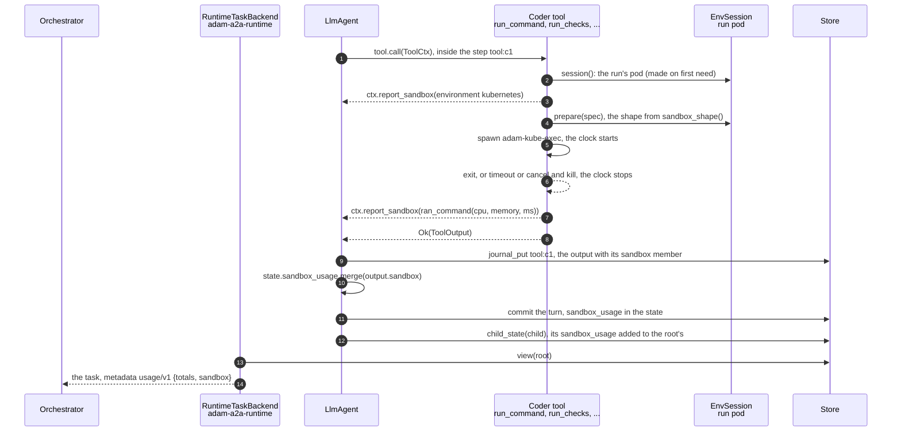
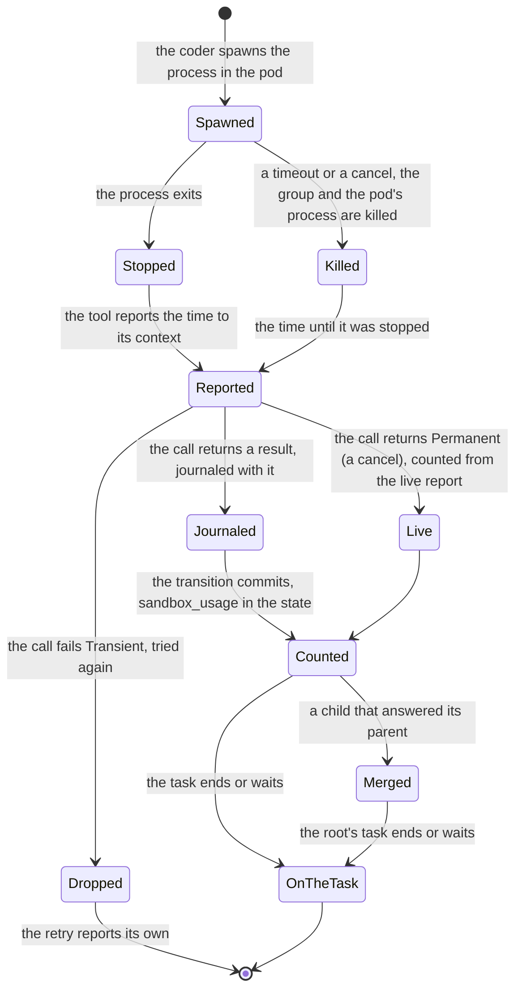

# 0043. The time a run's commands use in a sandbox is reported as usage

Status: **Accepted** (2026-10-27), for [issue #126](https://github.com/vymalo/another-adam-rs/issues/126) (M2, usage and limits per
person); the seven decisions are the ones of the design comment on that issue, agreed before building. Extends
[ADR 0032](0032-usage-per-model-call.md) (`usage/v1`, the totals in the run's state) and builds on
[ADR 0019](0019-a-runs-processes-in-a-pod-of-their-own.md) (a run's commands in a pod of its own). The contract page is the
orchestration layer's, `docs/api/usage-v1.md` of `vymalo/another-agentic-system`, changed in its own pull request; the price per
CPU-second and per GiB-second belongs to that side's usage record (its issue 281).

## Context

Model tokens are not the only cost of a coder run. A run pod holds CPU and memory, and a limit or a price per person needs that
on the record next to the tokens. What the code knows today, *verified 2026-10-27 by reading adam-rs at `75459f2`*:

* **A run has one pod at a time, made on its first command and reused after that** (`crates/adam-env-kubernetes/src/environment.rs`).
  It can have several one after another, because a pod is deleted when idle (`RUN_POD_IDLE_SECS`), when `seal` adds a slot, or when
  it fails to start. The coder keeps **no record of a pod**: no creation time, no shape ("the pod, its labels and its annotations
  are the state"), and the janitor deletes it within about 300 s after the run ends.
* **The shape is the deployment's.** It is the requests of the one pod template (`RUN_POD_TEMPLATE_FILE`, read once at startup,
  `crates/adam-env-kubernetes/src/template.rs`); the chart's default is 250m and 512Mi.
* **Every command a pod runs is spawned by the coder.** The session only *prepares* it (`EnvSession::prepare` gives the program
  `adam-kube-exec`), and the tool layer spawns it: `shell::run_in` for `run_command`, `run`, `run_checks` and the base re-run of a
  failing check, and the ACP client for OpenCode (`bin/adam-coder/src/tools/`).
* **Token totals are saved with every turn.** `Conversation::usage_totals` is committed with the turn and written to the task's
  metadata when it ends or waits (`crates/adam-a2a-runtime/src/usage.rs`, `totals_metadata`).
* **The orchestrator ignores a member it does not know beside `totals` and rejects an object with no `totals`**
  (`orchestrator/crates/core/src/usage.rs`, `UsageTotals::parse`, as read for the design comment at system `15cb544`; not read again
  here).

## Decision

1. **The unit is command time, not the time a pod lives.** What is counted is the wall time of each command run in a run pod. The
   clock starts when the coder spawns the process and stops when it has exited; a command stopped by a timeout or a cancel counts
   until it was stopped. Pod start-up, the idle wait before the reaper and the tail before the janitor are **not** counted: the
   person pays for what their run used, and the deployment sets the idle timeout and absorbs the overhead in its price per second.
   This also answers what counts for a reused pod: the time between commands does not. OpenCode is a process of the pod for the
   length of its call, and its time is a command's.
2. **Each count is weighted by the pod's shape: the run container's requests.** `cpuMillis` and `memoryBytes` are what the scheduler
   reserves and the namespace's quota counts; limits are not a cost. A resource with a limit and no request counts its limit,
   which Kubernetes copies into the request when it admits the pod; a resource with neither is **left out of the entry, not
   reported as zero**. A request that is not a Kubernetes quantity fails the coder's start, like the other faults of the
   template, since the cluster would refuse every pod.
3. **A subagent's commands are counted with its parent's**, as its tokens are: they run in the root run's pod, and the parent adds
   the child's `sandbox_usage` when the child answers (`LlmAgent::count_child`). Commands that run at the same time are summed, so
   the total can exceed the time the run took; the contract says so.
4. **It is a new member `sandbox` beside `totals` in the totals object of `usage/v1`, not a new URI.**

   ```json
   "metadata": { "https://agents.vymalo.com/a2a/extensions/usage/v1": {
     "totals": [ ... ],
     "sandbox": {
       "environment": "kubernetes",
       "usage": [ {"cpuMillis": 250, "memoryBytes": 536870912, "commands": 12, "milliseconds": 81234} ]
     }
   }}
   ```

   One entry per shape, at most 8, whole numbers of at most 2^53 - 1. An orchestrator that predates `sandbox` ignores it and the card
   does not change; a new URI would make every client choose between two versions for an addition. **`totals` is always present**
   when the object is written, `[]` for a run that made no model call, because today's parser rejects an object without it.
5. **When nothing was measured, the report says so instead of reporting zero.** A run whose commands ran in the coder's own
   container reports `"sandbox": {"environment": "local"}`, and in a dev container `{"environment": "devcontainer"}`, with **no
   `usage`**: that reads as *not measured*. A Kubernetes run that asked for its pod and ran no command reports `"usage": []`, a
   measured zero.
6. **The member follows the rules of the totals.** It is written when the task ends or waits (`completed`, `failed`, `canceled`,
   `rejected`, `input-required`, `auth-required`), cumulative for the run so far, for every reader of the task, and the orchestrator
   keeps the latest. "A client that does not activate the extension gets nothing new" is read as: no new event, header or card entry.
   The totals have always been data on the task, whether or not a request activated the extension, and `sandbox` sits beside them.
7. **There are no live per-command reports.** Call reports stay for model calls; a `working` update that carried only `sandbox` would
   be rejected by today's orchestrator.

### How it is built

A tool reports through its context, `ToolCtx::report_sandbox(&SandboxUsage)`. The loop takes what a call reported when the call
returns and puts it **in the call's result** (`ToolOutput::sandbox`), which the journaled step `tool:<call id>` records; then it adds
it to `Conversation::sandbox_usage` in the same transition as the result. That is the durability of `usage_totals`: counted once, a
replay reads the same number from the journal, and a restart keeps it. A call that ends in an error has no result to carry it
(`ToolError` is a frozen shape); a `Permanent` one, which is what a cancel returns, is counted from the live report, and a
`Transient` one is tried again and counts only the try that is kept.

The environment seam gains one **provided** method, `EnvSession::sandbox_shape() -> Option<SandboxShape>`, default `None` (not
metered). The Kubernetes session answers with the template's requests; `HidingEnvironment`'s session forwards it, because a provided
method hides itself behind a wrapper that does not. No required method and no `Store` method changed.

The coder measures where it spawns: `ToolEnv::run` wraps `shell::run_timed` (the new body of `run_in`, which also returns how long
the process ran), and the OpenCode call holds a `CommandClock` that reports when it is dropped, whichever way the call ends.
`ToolEnv::session` reports which environment the run asked for. In a metered environment the command's time is reported with the
shape; in any other only the environment is. `totals_metadata` writes `sandbox` from `state.sandbox_usage`.





### What a run with no command reports

* **A run that never asked for its environment** (it only read files, or only talked) reports **no `sandbox`**: nothing was
  asked of an environment, so there is nothing to name, and the deployment cannot be named from the run alone.
* A run that asked for its pod and ran no command reports `{"environment": "kubernetes", "usage": []}`; in the coder's own container
  or a dev container, `{"environment": "local"}` or `{"environment": "devcontainer"}`.
* If two reports of one run name different environments (a deployment that changed its environment between two turns), the one that
  measures wins, so measured time is never hidden.

## What the number misses

* **Pod time that is not command time**, on purpose (decision 1): start-up, the idle wait, the janitor's tail, and a pod made for a
  command that never ran.
* **The command of a call that failed `Transient`** and was tried again: the retry reports its own, and the first try's pod time is in
  no total. A `Permanent` failure whose live report was lost by a crash between the journal write and the commit is lost the same
  way (a result is journaled with its time; an error is not).
* **A request set by the namespace.** A `LimitRange` can give a container a default request at admission; the coder reads the
  template, not the admitted pod, so such a request is not in the entry. The chart sets requests.
* **Rounding**: a command is counted in whole milliseconds, truncated, and a fraction of a core or of a byte in a request is rounded up,
  as Kubernetes does.

## Alternatives rejected

* **The pod's whole life** (creation to deletion), which is the real cost to the cluster. Nothing records it today: it needs a durable
  record of each pod's start and end, written by five delete paths (`ensure` for a pod that ended or lacks a mount, `give_up` for one
  that fails to start, `reap_idle`, `release`, which the janitor calls, and `seal`) outside any turn, which is a new `Store` method in every adapter. A follow-up, if
  the owner wants the idle overhead billed to people.
* **A new URI, `usage/v2`.** An addition is not a break, and every client would have to pick between two versions.
* **Live per-command reports** (decision 7).
* **Measuring in the Kubernetes session.** The session prepares a command and the coder spawns it, so the session never sees it end;
  a new trait method that runs the command would move the spawn, the process group and the timeout out of the coder.
* **A `ToolOutput`-only path.** A cancel returns an error, which carries nothing; the live report covers it.

## Facts, and how they are known

| Fact | State |
|---|---|
| The coder spawns every command of a pod (`run_in` and the ACP client); the session only prepares it | *verified 2026-10-27*, `bin/adam-coder/src/tools/` at `75459f2` |
| A journaled tool result is read again on a replay and the tool is not called; `ToolOutput` ignores unknown members, so a build that predates `sandbox` reads the journal | *verified 2026-10-27*, `Ctx::step`, the serde defaults of `ToolOutput` |
| The numbers are right through the fakes: a command's time and the template's shape in the tool layer, the template's requests from the Kubernetes session, a cancel and a timeout, a child merged into its parent, a replay, the metadata of the task over A2A | tested (`bin/adam-coder/tests/environment.rs` and `e2e.rs`, `crates/adam-llm-agent/tests/sandbox_usage.rs`, `crates/adam-a2a-runtime/tests/usage.rs`, `crates/adam-env-kubernetes/src/`) |
| The orchestrator accepts `sandbox` beside `totals` | *unverified here*: the design comment read `UsageTotals::parse` at system `15cb544`; the system's own change holds it with a test |
| A command in a real run pod, on a real cluster, is timed and shape-weighted the same way | *unverified*: the fakes run the commands as local processes; `adam-kube-exec` and a cluster were not part of the run |

## Consequences

* **Breaking for a downstream struct literal**, said in the READMEs and in `adam-upgrade`: `ToolOutput` and `Conversation` have a new
  public field (`sandbox`, `sandbox_usage`; build a `ToolOutput` with `ToolOutput::text` and a `Conversation` with `Default`). Both are
  serde-defaulted and not written while empty: a stored state or journal from before reads, and a build from before reads a journal
  written after. **No required trait method**: `EnvSession::sandbox_shape` is provided. **No store change.**
* `adam-runtime` has `SandboxUsage`, `SandboxEntry`, `SandboxEnvironment` and `MAX_SANDBOX_ENTRIES`; `adam-workspace` has
  `SandboxShape`; `ToolCtx` has `report_sandbox` and `reported_sandbox`.
* An environment that wraps another one must forward `sandbox_shape`, or the default reports it as not metered. `HidingEnvironment`
  does, and a test holds it.
* A pod template whose run container requests something that is not a Kubernetes quantity fails the coder's start
  (`RUN_POD_TEMPLATE_FILE`), where it used to fail every pod the cluster was asked for.
* Nothing is stored: the usage is the agent's state, which every store keeps.
