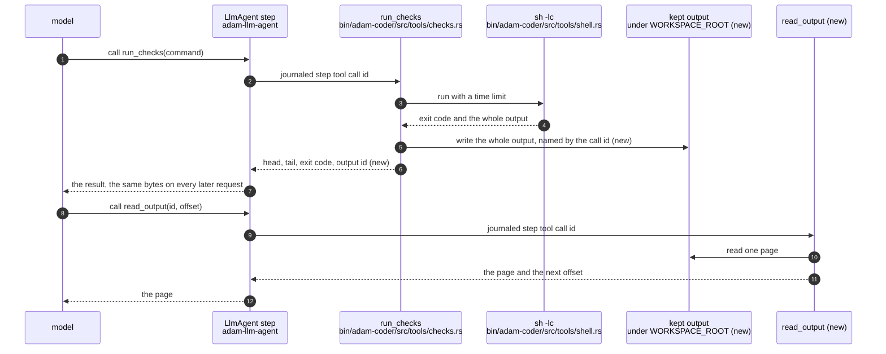
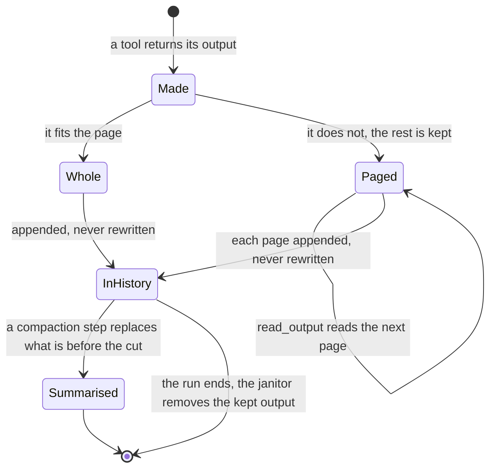

# 0044. Paged tools and a stable prompt prefix; a plan, skills, commands and project context are built in

Status: **Accepted** (2026-11-14). The directions are the owner's, given the same day after a comparison of adam-rs at `37d0b11`
with OpenCode 2.3.0; they are quoted where they decide something, and what was first only recommended was put to the owner
the same day: see [The owner's answers](#the-owners-answers-2026-11-14). Slices 1 and 2 are built (below). Builds on
[ADR 0039](0039-the-agent-loop-takes-opencodes-structure-and-agents-get-plugins.md) (the loop, rules, compaction, plugins),
[ADR 0037](0037-parallel-subagent-calls-and-an-editing-worker.md) (parallel subagents) and
[ADR 0038](0038-the-coder-drops-opencode-and-adam-acp-stays-a-library.md) (OpenCode leaves the coder), none of which is built
either (*verified 2026-11-14*: no `Plugin`, `Rule`, `doom_loop`, `Conversation::turns`, `step_all`, `compact:` step or
`revert_to` in `crates/` or `bin/`; `delegate_to_opencode` is still registered, `bin/adam-coder/src/tools/mod.rs:765`).

*Built 2026-11-16:* slice 16 (commands that keep running), decision 13. `start_command`, `stop_command` and `list_commands` (`bin/adam-coder/src/tools/background.rs`, `Commands` on `ToolEnv`, `BACKGROUND_TOOLS`), `StreamScrubber` and `LineFolder` (`crates/adam-llm-agent/src/kept.rs`), `FileKept::open_live`, `end_live`, `is_live`, the records `<id>.cmd` and the `[running: N lines so far; next page: offset=N+1]` line of a live page (`bin/adam-coder/src/kept.rs`, `Page::render_live`), `ExecSpec::background`, `ExecId::is_background` and `exec_id_for` (`crates/adam-workspace`), `bg-kp-` and `bg-dc-` ids and `adam-exec active-fg` (`crates/adam-env-kubernetes`, `crates/adam-devcontainer`), the settings, the stop in `CoderAgent::step`, the sweep component (`CommandsSweep`, wired with the tools and the janitor by `wire_commands`) and the janitor's stop before `release`; [the page](../reference/coder-agent.md#commands-that-keep-running), `tests/background.rs`. Reading is `read_output`, **unchanged** (schema, description and prefix bytes): its id is the call's output id. What the text above fixed holds, as the plan of 2026-11-16 designed it, with the owner's six answers as recommended: **(1)** a park on the person (`ask_user`, and the coder's own question) stops the run's commands; **(2)** at most 4 run at once (`BACKGROUND_COMMANDS_MAX`, 1 to 16), each for at most 3,600 s (`BACKGROUND_COMMAND_MAX_SECS`, 60 to 86,400), a sweep every 15 s (`BACKGROUND_SWEEP_SECS`, 1 to 3,600), and **`0` of the three is exit 78** naming the variable; **(3)** the sandbox time of a command is reported once, at the call that sees its end (`start_command`, `stop_command`, `list_commands`), and a command stopped by the sweep or the run's end goes unmetered (said in [ADR 0043](0043-sandbox-time-as-usage.md), *Amended*); **(4)** past 16 MiB the head stays on disk and the last 64 KiB in memory; **(5)** the names are the ADR's; **(6)** commands belong to the root run. [ADR 0041](0041-a-run-pod-sees-only-its-own-run.md) decision 3 is *Amended*: a background command does not hold the pod from a new slot. Adapted to what the code is now (`main` at `8da1849`): a command is started only in a slot the run **writes** (`ToolEnv::slot_to_write`, never a reference: `slot_use` classifies `start_command` as writing and `stop_command` and `list_commands` as taking no slot, and `a_command_is_never_started_in_a_reference` calls it with a real reference); the three tools are registered after `run` and before `read_file`; `Gated`, `tier::known` and `own_limit` name them (tiers `edits`, `plan`, `plan`; limits `environment_start` + 120 s, `environment_start` + 60 s and `environment_start` + 30 s, each + 30 s). **Several workers.** In the default placement a run moves between workers at every step, so a record this process does not hold is usually another worker's live command, not a dead one's. The owner writes a **beat** (unix seconds) into the record at start and at every sweep, and a record is **stale** when its beat is older than the larger of three sweeps and 60 s (`stale_after`, `BEAT_STALE_FLOOR_SECS`; the clocks of the workers are assumed to agree within that: said in `docs/reference/environment.md`). A fresh record is listed as running, counts against the limit, is read through its file and is left alone by a start of another id; a start step that runs again for its id returns its view and starts nothing. `stop_command` of it writes `stop_requested` into the record and, in a pod or a devcontainer, kills the exec id at once, then waits at most one sweep and a second and returns how it ended, or says the stop was asked. A stale record is a dead worker's: killed by exec id and by pid with its start time (and what is left of its group, whether or not the leader is there), and `gone: the worker that ran it is gone; start it again`. The owner's sweep writes the beat, stops a command whose record holds a stop request and one whose record names another owner, and a beat keeps a stop request it finds. A park on the person, or the end of the root run, on a worker that does not hold the command writes a stop request into every other fresh record of the run: **the guarantee is at once on the worker that holds it, within one sweep elsewhere**. The end of a child run stops nothing. Decisions I took that the text did not fix, **for the owner to confirm**: **(a) A changed git configuration is put back, and a moved HEAD or ref is reported and not undone.** The plan said all of it is restored at exit or stop. The run's own `commit_and_push` moves the branch ref while a server runs, so restoring a ref would undo the person's commit; the configuration (`core.hooksPath`, `core.fsmonitor`, a filter, a URL, `info/exclude`) is restored at the end exactly as `run` does, under the mirror lock, and the result says `git was changed while it ran`; `list_commands` marks the line; nothing is said when git cannot be read at the end. A hook file a command wrote is not undone, and none of `commit_and_push`, `run_checks` and `open_pull_request` needs it to be: every git command of the coder carries `-c core.hooksPath=/dev/null -c core.fsmonitor=false` (`crates/adam-workspace/src/git.rs`, `Invocation::invocation` and `LocalGit`), and a `filter.*.clean` runs in the git sandbox or in an empty environment, so none of the three refuses while a command runs (`run_command` and `run` name the commands that keep running in their slot in every refusal). **(b) A line is readable when it is complete.** The file holds only complete lines (a partial line waits in memory, and is written when it ends or when the command does), and a reader of a live file never shows or counts bytes after the last newline, so a page of lines is the same bytes on every read. **(c) A quiet output is not held for a margin.** `StreamScrubber::push` holds at most two margins, and `release` lets everything go except the tail that `Redactor::partial_secret_len` says can still start a secret (a value, a Base64 form, a value that is the start of a longer one), so a server that prints one line and goes quiet shows that line at once and a secret split across reads is still never written (the property tests of `stream_scrubber_equals_whole_scrub_for_any_chunking` and `stream_scrubber_with_overlapping_secrets_equals_whole_scrub`, and a split at every byte in `redact.rs`). **(d) A pod made again for a new slot, a reference or a rebuild** ends the client of the command, and the coder cannot tell why: a command in a pod or a devcontainer that a signal ended and nobody asked to stop is `stopped` with the reason *its environment was made again (a new repository, a reference or a rebuild) or something outside ended it; start it again if it is still needed*; `rebuild_environment` stops the commands first with its own reason. **(e) `active-fg` falls back to `active`** for a pod whose `adam-exec` is older (the plan said the caller waits): an older pod behaves as it did before, a background command started in it holds it. **(f) `FileKept` knows what is live in this process only**: a worker that did not start the command reads the file as finished (`[end: N lines]` for the lines there are so far). **(g) `list_commands` and `stop_command` ask for the environment only when a record needs it** (a stale record to settle, or a stop of a command another worker runs, which kills its exec id), so a list never makes a pod. **(h) The registry keeps the last 16 ended commands of a run in memory**; the records stay on the volume and `list_commands` reads them. **(i) A record is written before the process exists** (`starting`, with the exec id), so a worker that dies in between leaves what to kill; an owner never writes over a record that names another owner (`gone:<owner>`). **(j) `CoderSettings::background_output_max`** (16 MiB), **`run_kept_max`** (64 MiB) and **`background_kill_wait`** (10 s) are settings of their own with no variable, so a test reaches them with a little text or time. **(k) `rebuild_environment` stops the run's commands first**, on this worker and by request on the others. **(l) The prompt names `start_command`, `read_output` and `stop_command` in one line of 116 characters** (`list_commands` is only in its own description; the guidance is in the descriptions, which are fixed for the process) **and loses the sentence "The three commands are three jobs..."**, which said again what the bullets of `run_command`, `run` and `run_checks` say: the body was 13 characters under the 30,000 the loader warns above, so the slice makes it 24 characters shorter (29,962 for 10 check cycles, the longest case the test renders). **(m) The end of a worker's life**: on an orderly stop every command it holds is `gone: the worker stopped; start it again if it is still needed`, and a registry that is dropped kills the groups it holds; after a kill of the coder the janitor of a worker settles the records of a run that is over (kill by pid with its start time and the group, `gone`) before it removes them. A process that left its group with `setsid` is the exception to "nothing outlives its run". **(n) The park or the end on a worker that does not hold the command asks, it does not kill by exec id**: the stepping worker has no session for the run, and making one to kill something would make the environment; the owner's sweep carries it out within one sweep (and the release deletes the pod anyway at the end). **(o) The limit counts the records of other workers' fresh commands** when a command starts; two workers that start at the same instant can both take the last place. Breaking: **`ExecSpec` gains the public field `background`** (a struct literal of it stops compiling; the repository has none), `adam_workspace` exports `BACKGROUND_PREFIX` and `exec_id_for`, `ToolEnv` gains the public field `commands` and `CoderSettings` six (`background_commands_max`, `background_command_max`, `background_sweep`, `background_output_max`, `background_kill_wait`, `run_kept_max`) (a struct literal of either stops compiling), `Janitor::with_commands` and `Janitor::commands`, `Commands::stop_all` takes no reason, `Commands::stop_run_elsewhere` and `settle_over_run` are new, `CommandsSweep` and `wire_commands` are new, `FileKept::with_run_max`, `adam_coder::tools::background` is public, `Page::render_live` and `paging::running_line` are new, and **the coder's tool list and prompt change**: the specs of `start_command`, `stop_command` and `list_commands` are new in `tests/fixtures/tool-specs/` (regenerated with `ADAM_UPDATE_SNAPSHOTS=1`; no other snapshot moved, and none moved in the fix round: the descriptions did not change), `tests/fixtures/agent/prompt.txt` and `agent/instructions.md` gain the one line and lose the sentence, and the arrays of tool names of `agent_files.rs`, `e2e.rs`, `tiers.rs`, `tool_specs.rs` and `time_limits.rs` have the three; **the system repository, which vendors `agent/`, must take `instructions.md` at its next bump**. The chart `deploy/coder` renders **exactly what it did** (no value, template or golden changed; the three variables are set like any other with `extraEnv`; the sweep is the same on every worker, and a deployment with several workers wants the same `BACKGROUND_SWEEP_SECS` on all). **Version skew of `adam-exec`:** an older pod with a newer coder works (`active-fg` fails with the usage line and the pod is asked `active`, as before; a command started in it holds the pod); a newer pod with an older coder works (nothing asks `active-fg`, and an older coder starts no `bg-` command). **Unverified**, because only CI runs a cluster or a container runtime: a development server in a **run pod** (`curl localhost:PORT` from `run_command`; `prepare_workspace` of a second repository making the pod again; the client's exit code when its pod is deleted), `adam-exec kill` of a `bg-` id in a pod and in a Podman devcontainer (including the kill another worker makes for a stop it asked), `adam-exec active-fg` in the images' real `sh` (tested here with the host's `sh` only; `shellcheck` was not installed), a process that leaves its group with `setsid` and a double fork (it escapes `adam-exec kill`; a pod's deletion is the backstop and locally there is none), the start-time match of a pid off Linux, what OpenCode's own background shell does (not read), **several workers as separate processes on a shared volume**: the beat, the stale limit and the stop requests are proven with two `ToolEnv`s over one directory in one process, not with two pods, and the clocks of real hosts, and the kill of a pid by its start time **assumes the pid is on this machine** (a record does not name the host; a volume shared by several hosts could, very rarely, match a pid and start time of another one). No kind or compose scenario was added.

*Built 2026-11-16:* slice 14 (MCP), decision 3 and the image path of decision 4, with the prompts (14b) in the same change. Per-server timeouts, server instructions, prompts as commands, one image line with its SHA-256 and the painter example. Where: `McpSettings` (`crates/adam-agent-fs`, `mcp.json` keys `timeoutSecs`, `connectTimeoutSecs`, `instructions`, `prompts`), `McpPolicy::max_call` and `McpServers::instructions`, `prompt_commands`, `PromptCommand` (`crates/adam-mcp`, `src/prompts.rs`, `tests/server_settings.rs`), the append at bind and `Assembly::prompt_commands` (`crates/adam-assembly`), `RemoteCommand`, `CommandRefusal` and `Commands::add_remote` (`crates/adam-a2a-runtime`), `with_prompt_commands`, `card_with_commands` and `MCP_MAX_CALL_SECS` (`crates/adam-service`), the wiring in `bin/adam-agent` and `bin/adam-coder`, `Artifact::shared_line` (`crates/adam-runtime`), `dev/agents/painter`, `dev/wiremock/mock-image-mcp`, `dev/painter-e2e.sh`; [the format](../reference/agent-files.md#timeouts-instructions-and-prompts). What the text above fixed holds: defaults 60 s and 30 s; `MCP_MAX_CALL_SECS` 900 (the default, confirmed by the owner on 2026-11-16) lowers a larger effective value, the policy's defaults included, with one warning per key at startup; zero and negative values are refused at load; `McpTool::time_limit` follows the server's values by itself; a server's instructions are appended **once, at bind**, never per turn (`instructions_appended_stable`: two model calls, the same system bytes), 2 KiB a server (quote marks counted, a cut warns once) and 8 KiB in all, each text stripped of control and format characters, then scrubbed, then written as a Markdown blockquote, under the heading `## Instructions of the MCP server <name> (text from the server, not the person)` in server-name order, `instructions: false` per server (the coder's `github` sets it); prompts are `<server>__<prompt>`, listed once at connect and on the card, expanded at submit with `prompts/get`, the first words of what is typed onto the declared arguments in order and the last declared argument taking the rest of the line, only text messages of the user (anything else `InvalidParams`), stored like a template's expansion, a clash with a folder's command loses with one warning, `prompts: false` opts out. Decisions **for the owner to confirm**: **(1)** The four keys are one `settings` member of both `McpServer` variants, serialized only when one differs from its default (`digest_unchanged_without_keys` holds the JSON a folder had before), not four loose fields. **(2)** `MCP_MAX_CALL_SECS` bounds the **effective** value, whatever asked for it (changed from the first head, which capped only what the files asked): the file's `timeoutSecs` and `connectTimeoutSecs` (in the folder's `mcp.json` and in `ADAM_EXTRA_MCP_FILE` alike), the policy's defaults of a server that says nothing, and a value a host set in code with `McpPolicy`'s builder; it is 1 to 86400, and a value the file asks for is at least 1 s (the decision asked for a floor of 1 s on every effective value; a value a host sets in code, such as a test's 300 ms, keeps its own, so only the file's is raised). A bad timeout refuses that server (the file's other servers load), `null` is no key. **(3)** The instructions go **after the agent's own text and before its skills**, to the agent that owns the server (a subagent's never reach its parent); the 8 KiB limit leaves out the first server that would pass it and every one after, whole, with a warning, instead of cutting a text in the middle. A server with a bearer per call (the coder's `github`) keeps no session and gives no instructions and no prompts. **(4)** Prompts are the **root's** only (as commands are), the folder's commands and the prompts together at most 50 (the folder's first, then the prompts by server name and prompt name, the rest dropped with one warning that gives how many), and a prompt whose name is not `a-z0-9_-` (a command's file-name rule, so `/name` can be typed) is left out with a warning. A required argument that is missing, or any text for a prompt that declares none, is `InvalidParams` before the server is asked; the last declared argument takes the rest of the line (`/images__scene a red dot` is one `subject`), the first ones are words with double quotes respected. The text the model reads starts with one line that names the prompt and the server, and is stripped of control and format characters then scrubbed. The messages of the answer are joined by a blank line. A server that cannot be asked at submit, the redial of a lost session included, within the smaller of its `timeoutSecs` and 30 s, is the A2A `unavailable` error, nothing written. Opening a connection has one deadline, `connectTimeoutSecs`, for the dial, `initialize`, `tools/list` and `prompts/list`: a server that hangs on its prompts is connected with its tools and no prompts, with a warning. A failed `prompts/list` is a warning and no prompt, never a startup error. **(5)** The prompts are known only where the MCP servers are connected, which is a role that runs workers: **a control plane without workers lists none, and refuses** a message that names `/<server>__<anything>` for a server of the folder's `mcp.json` that serves prompts (`InvalidParams`, one warning at its start; it never reaches the model as text). That limit holds for the front of the chart's `topology: split`. Serving them there would need that role to connect the servers, which is not built; the front does not read `ADAM_EXTRA_MCP_FILE`, so a server only that file names is not refused there. **(6)** The expansion is asked in the request, before the store dedupes by `messageId`: a retry of the same message may ask the server once more and the answer is dropped (the stored text is the first one); a replay of a run never asks. **(7)** `Artifact::shared_line` itself carries the sentences about the SHA-256 (an `ask_user` option's `image` and a `show` `Image` block's `artifact`), so the coder's `share_file`, a `files: true` MCP server and a remote subagent with `files: true` say the same line, and the helper `with_picture_hint` of `share_file` is gone. **(8)** `is_format_or_control`, the one rule of what a card or a prompt may not show, moved to `adam-agent-fs` (`adam-a2a-runtime` and `adam-ui` re-export it), so `adam-mcp` needs no A2A SDK; `adam-runtime`'s `is_invisible_format` is a different, narrower set and was not merged with it. **(9)** The example is a separate script, `dev/painter-e2e.sh`, in the style of `dev/agent-cards-e2e.sh`, and the compose `agent` service reads `MCP_ALLOW_INSECURE` from `AGENT_MCP_ALLOW_INSECURE` (default `false`, as unset). The scripted painter draws only if the server's heading is in its system prompt, so the scenario proves the instructions reach the model. **Breaking changes:** both variants of `McpServer` gained `settings` (a struct literal or a pattern without `..` needs it: `crates/adam-mcp/src/servers.rs` tests, `crates/adam-mcp/tests/http.rs`, `bin/adam-coder/tests/agent_files.rs`); `adam_service::McpSettings` gained `max_call_secs` (a literal needs it); `Artifact::shared_line` says more for an image (a test or a client that matched the old line must change: the tests of `adam-mcp`, `adam-assembly`, `adam-agent`, `adam-coder` and `adam-runtime` did, and no golden file held it); `adam_mcp_testkit::Counters` gained `prompt_gets`; the crate-private `commands::apply` is async; `RemoteCommand::expand` takes the argument text as typed (`&str`) and `PromptCommand::expand_text` maps it; `adam_mcp_testkit::Script` gained `hang_prompt_list` and `list_tools_delay_ms` (a literal needs `..Default::default()`); `adam-service`'s `mcp` feature depends on `adam-agent-fs`. **The chart `deploy/coder` renders the same for every existing value**: it does not set `MCP_MAX_CALL_SECS` (the default 900 applies), and the coder's embedded `mcp.json` gained `"instructions": false` and `"prompts": false`, which changes the digest of the coder's files that `build/v1` reports and nothing the chart renders. **Changed after the first review of the built slice (2026-11-16):** the cap bounds the effective value and opening a connection has one deadline (the two reversals above); a server's text is a blockquote and is stripped before it is scrubbed; an expansion is one line longer and bounded; the split front refuses prompts instead of sending them as text; the 50 commands are one limit; the last declared argument takes the rest of the line. Whether a journaled run pins its system prompt was read, not run: it does not (each model call takes the prompt from the worker's own agent, `crates/adam-llm-agent/src/agent.rs`), so a worker with another set of connected servers gives a resumed run another system prompt for the calls after the resume; nothing breaks, and the cache prefix differs. **Unverified:** the split front's refusal on a real chart (tested in a process of `adam-agent` and `adam-coder`, not rendered or deployed); the compose example (`mock-image-mcp`, `painter-script*.json`, `dev/painter-e2e.sh`, the `compose` job's new lines): no container daemon ran where it was written, so only CI can prove it, and `shellcheck` was not installed here (the script is `sh -n` clean); which protocol version the handshake negotiates (adam sets none; `rmcp` 3.10.0's latest for `initialize` was read as 2025-11-25); that `rmcp` 3.10.0 has `InitializeResult.instructions`, `ServerPeerInfo.instructions`, `Peer::list_all_prompts` and `Peer::get_prompt_once` is *verified 2026-11-16* in its source; what a real server answers for `prompts/list` over several pages (the testkit serves one) and for `prompts/get` with arguments is not. `dev/agents/researcher` still points at a `mock-mcp-search` that this compose file does not define; not touched here.

*Built 2026-11-16:* slice 13 (references), decision 10, 13a and 13b together (slice 7 had landed). `SlotKind::Reference` and `RunWorkspace::add_reference` (`crates/adam-workspace`), `SlotMount::read_only` and `WorktreeDirs::read_only` (`crates/adam-env-kubernetes`), `ReferenceDef` and `references:` (`crates/adam-agent-fs`), `bin/adam-coder/src/tools/references.rs`, `ToolEnv::slot_to_read` and `slot_to_write`, `tests/references.rs`; [the page](../reference/workspace-and-environments.md#references). Decisions and changes from the text above, **confirmed by the owner (2026-11-16), all thirteen as built**: **(1)** The repository's own file is `.agents/references.json`, `{"references": [{"name", "url", "branch"?, "description"}]}`; the deployment's file `ADAM_REFERENCES_FILE` and the folder's `references:` have the same entry (a name of the slot rule, a one-line description of at most 200 characters, no credentials in the address, at most 16, a name once). The deployment's file is **added** to the agent's, and a name both declare is exit 78. **(2)** A repository's reference goes through `request_repository` with a new optional `reference`, the name the prepared repository listed: the address must be the recorded one, the form says which repository lists it, quotes its text and says "read only", and the yes is recorded as the consent `reference:<key>` (`reference:<key>@<branch>` when the declaration names a branch, which the form shows: another branch of one repository is another question), which **never names the repository**, whether it came as a click or as typed words (`Yes, read acme/lib` holds the address, and the answer to a question about a reference is not read for repositories), so `prepare_workspace` of it is still refused. The form also says that what is read there can end up in what the agent writes (a commit, a pull request). Nothing is fetched before the yes, and an address the workspace refuses for a repository is refused before anyone is asked. **(3)** A repository's file may give **http(s) addresses only**: no path and no `file://`, even where `ALLOW_LOCAL_REPOS` allows them (a path would be a way to read the coder's own mirrors); the deployment's and the agent's may. No file may give a query string or a fragment (a token travels in either). The deployment's and the agent's references are checked against the workspaces' policy at startup: an address it refuses is exit 78 naming the reference. **(4)** `run_command` in a reference is **allowed under the look-around guard** (what changes a file, `HEAD` or the git state is undone and refused); `run` and `run_checks` are refused. Without run pods only the tool layer protects a reference, and the guard cannot see a file that `.gitignore` excludes: the docs say so. A run pod and a devcontainer mount the reference read-only. **(5)** A reference is never the default slot, for a write or a read; a run with only references says there is nothing to work in. **(6)** `merge_pull_request`, `rename_repository`, `delete_repository` and `publish_scratch` refuse the repository of a reference **unless the person named it too**, and a reference named by its name (not only by its address) is the reference, never a bare name read as another repository. **(7)** A reference's own `AGENTS.md`, `CLAUDE.md` and skills are not shown as a repository's are: it is read text. **(8)** A reference is read at the commit its branch had when the first read made it (it is not moved during the run): the first read says the commit, the run's notes keep it, and a reference made again (its directory was lost) is checked out at that commit; a commit that is gone from the repository is said, and nothing is moved to another. **(9)** The names and descriptions of the agent's and the deployment's references are in the system prompt as the words of a `ToolSource` that offers no tool, before the tier's words; with none, the prompt is what it was. A repository's own are in the result of `prepare_workspace`, recorded in the notes, so a retry gives the same bytes. **(10)** A devcontainer environment puts the references after the other slots, so one never decides which `devcontainer.json` is used; a workspace of only references has nothing to run in there (a reference has no devcontainer of its own), and a run pod works with it. **(11)** A reference and the working copy of the same repository may both be slots: the repository's address reaches the working copy (for a read and a write), the reference's own name reaches the reference. A name that is the directory of another slot is never answered with that slot: a repository's declaration of it is not offered, and for the agent's or the deployment's the lookup says the name is both. **(12) The bound on a repository's reference, exactly.** It is fetched with the credentials of a repository (a GitHub App's installation token for the address's owner) and nothing ties its owner or visibility to the repository that declared it, so a repository can ask for a private repository of another owner in the same installation. Three things bound that: the person's yes to the exact address and branch the form shows; `check_repository` (the allowed hosts, the owners a GitHub App acts for); and an http(s) address with no credentials, query string or fragment. After a yes the content reaches the model and can be quoted into what it writes: the form says so, and nothing else stops it. **(13)** A file shared from a reference is not a result of the run (a scratch run that shared only that does not end as delivered). Breaking: the metadata of a reference slot has version 3 (a repository's and a scratch project's keep 2), so a binary that does not know references refuses the workspace of a run that has one, in a rolling deploy or a rollback, instead of reading it as a repository slot it can write; `RunWorkspace::add_reference_at` and `Worktree::head_commit` are new; `SlotMount` and `WorktreeDirs` gain `read_only` (a struct literal needs it), `SlotKind` gains a variant (the enum is `#[non_exhaustive]`), the annotation of a pod with a reference has `ro` lines, `request_repository` gains `reference` (its schema and the prefix of every cached request break once at deploy), `ToolEnv` gains `references`. **Not built:** a chart value for `ADAM_REFERENCES_FILE` (a deployment sets it with the chart's extra environment and a mounted file); the `kind` check that a `touch` in a reference from a run pod fails with `EROFS` (the mount plan and the pod's annotation are proven on a fake API server, the real mount is *unverified* until CI runs a cluster); `adam-agent` reads no references (it has no workspace; it logs one warning at start when a folder declares them). The chart `deploy/coder` renders the same for every value it had.

*Built 2026-11-16:* slice 11a (the five kinds, the check of the answer, the descriptions), decisions 6 and 7 without the blocks inside a question (slice 11b, which waits for catalog version 8). `crates/adam-ui/src/ask.rs` and its `ask/` modules, `Tool::read_answer` (`crates/adam-llm-agent/src/tool.rs`), `PAYLOAD_FORM` (`crates/adam-a2a-runtime/src/vymalo.rs`). Decisions and changes from the text above, **for the owner to confirm**: **(1)** `date` is a day only (the amendment to decision 6). **(2)** The answer is checked through a **provided method of the `Tool` trait**, `read_answer(call_id, args, ui, payload) -> AnswerCheck` (additive: the default accepts), which the loop calls before the model hears an answer to a parked question. The question needs no new field: the form is rebuilt from the call's own arguments, which the history holds, and what was drawn is read from the interface that went with the question. A wrapper that does not forward it accepts every answer, so `Scrubbed`, the coder's `Gated` and `Redacting` do, each with a test. **(3)** A refused answer is **not used**: the run stays parked on a new `PendingQuestion` whose words are the rule's (`The answer to "budget" ("..") was not used (above_max): ..`) and the question, whose interface is the same form on a new surface `ask-<call>.r<n>` (the coder's `surface_of_answer` reads it as the call's own) with each question that passed carrying the person's answer as its `default`; the model sees nothing and the loop journals `answer_refused {call_id, question, rule}`. A refusal is made for five reasons: a rule of the catalog, and two that are adam's own and not among the catalog's ten, `other_surface` (the answer names another surface than the one held in the pending question's journaled interface, compared exactly, so a stale click on an earlier form is never read as this question's; the contract is silent on what an agent does with such an answer) and `several_answers` (a message that holds more than one form action, which the model would read whole). **A form is asked again at most 5 times** (`MAX_REFUSALS`, read from the surface's `.r<n>`): the sixth bad answer ends the question with an error result that names the last rule and question and tells the model to ask another way (`AnswerCheck::End`). A refusal and an ending are scrubbed by `Scrubbed` and the coder's `Redactor` like the question the call asked. Words, and a form that went out as text, are accepted unchecked, as catalog version 7 allows, except that a yes or no that is the one question of a form asked as words, and answered with exactly `yes`, `no` or one of its two labels (any case, nothing trimmed), is read as that value (`AnswerCheck::Read`). **(4)** What a screen takes is read from its `Choices` schema **one kind at a time** (a question with every member of the kind is validated), not from the version number. **(5)** A kind the screen lacks is asked as version 6's nearest form (`confirm` and `scale` as radio buttons, `number`, `date` and `rank` as typed words with a `help`), or as words; the answer is judged by the contract's rules when it came back as radio buttons and when it came back as typed words (a number or a day as the one value, a rank as the numbers of the options in order), the typed text being the value; words typed instead of using the form at all reach the model unchecked, which the tool's description says. The answer is kept in the payload up to the 16 KiB an action may carry. **(6)** The contract's rules cover the five kinds only: a form of the six older types is not judged by their rules, but its answer is still tied to its surface. A hidden, control or bidirectional character is refused in `yesLabel`, `noLabel`, `unit`, `fromLabel`, `toLabel` and `help`; option labels of the older kinds still accept them. **(7)** The model may write a number as a JSON number; it is turned into the decimal string the catalog needs (the one contract vector that says a JSON bound is invalid is therefore tested as accepted-and-converted). **(8)** The fixtures of this repository are now the published catalogs of versions 6 and 7 (byte copies, `crates/adam-ui/tests/fixtures/UPSTREAM`, compared with the published files in CI); the hand-written `Checklist` subsets are renamed `checklist-subset-v6.json` and `-v8.json` (the old `catalog-v7.json` was version 8's `Checklist`), and the earlier statement above that version 6 was *unverified* is out of date. **(9)** The prompt: the `share_file` and `show` entries shortened, one sentence on the kinds in "Asking the person"; the tool descriptions are not counted in the 30,000 characters. Not proven without a provider: how well models choose among eleven kinds.

*Built 2026-11-16:* slice 11b (a question that shows what it asks about), the blocks inside a question of decisions 6 and 7. `crates/adam-ui/src/ask/shown.rs`, `tests/ask_v8.rs`, the version 8 catalog and the 46 `v8-surfaces` cases vendored in `crates/adam-ui/tests/fixtures`. Decisions and changes from the text above, **for the owner to confirm**: **(1)** The contract's `show` is a list of **ids** of components of the surface; the argument the model writes is `show: [{component, ...}]` and adam-ui makes the ids (`q<i>-s<j>`), so the ids a surface needs (each shown once, placed nowhere else) cannot be wrong, and the contract's rules about an id twice, one id shown by two questions and a shown component placed elsewhere are impossible to break from the tool (the vectors for them are held as such). **(2)** The list is the contract's, seven components: `Text`, `Image`, `Mermaid`, `Code`, `Cards`, `Callout`, `Chart`. The brief's examples, a `Table` and a `Diff`, are **not** on it and are refused naming the block, with the advice to put a diff in a `Code` block. **(3)** What a screen does is read from its `Choices` schema, not its version. One that takes `show` gets a `Column` as root with the form (id `ask`) and the blocks loose. One that does not (versions 2 to 7) is never sent `show`: the blocks it can draw go in the `Column` above the form, as the contract advises an agent to do for version 7 (the contract writes it for one form: each question's blocks are under a caption that names the question and the numbers of its blocks, the order the model listed them, and the model's own `help` is left as written). **(4)** Where the contract says to put the words of what cannot be drawn in the `help`, the `help` (300 characters) cannot hold a diff: the words go **in full** after the question the person reads first, under the same caption and as `Block <n>: ...`, with every member that is content (a code fence is longer than any run of backticks in the code). With no `Column` nothing is half placed: every block is said in words. A confirmation is never asked about a diff that was cut. A form asked again says them again, and as text the same words follow the question (code verbatim). **(5)** The contract is silent on hidden and bidirectional characters in shown content. Any control or format character (the characters `adam-a2a-runtime` already refuses in a `help`; a line break, a carriage return and a tab are text) in **any** text of a block is refused naming the block, the member and the code point, with the advice to write it as a visible escape (`\u{200D}`) or to say it in words, because a person who consents to a diff trusts what is drawn; a zero-width joiner in an emoji sequence is refused with it. Blank characters that are neither control nor format (U+2028, U+2029, U+034F, the variation selectors, U+115F, U+1160, U+3164, U+FFA0, U+2800) are **not** refused: the rule is the shared one, unchanged. **(6)** An `Image` names a file by its sha256 (`artifact`, written in lower case; a URL or a path is refused). Whether the thread holds that file is **not** checked by the agent: neither `show` nor an option's `image` has a list of the conversation's files, and the contract makes it the web's rule (`artifact`, which refuses the whole surface). **(7)** Every block is checked on every screen, and with no catalog, against a table of the seven components' own members, types and limits (`crates/adam-ui/src/ask/blocks.rs`, held equal to the vendored catalog of version 8 by a test), and a `Chart` series needs one value per label. A surface, and the words a screen gets, over 64 KiB in UTF-8 bytes are refused before they are asked, naming the size; a form asked again that the carried defaults would push over drops them (texts first). **(8)** The redacting wrappers scrub every string of the surface and of a refusal, so a registered secret in a block is replaced (`Scrubbed` in `adam-assembly` and the coder's `Redacting`, one test through the coder's wrapper for versions 8, 7 and 5 and for three forms asked again). Not proven without a provider: how well models choose what to show; *unverified* (not proven here): the web's own drawing of a `Column` that holds a form and captions on versions 2 to 6 (the contract speaks of version 7 and of one form); and what a run does while it is parked on a question whose surface the web refused (a hash of a file the thread does not hold).

*Built 2026-11-15:* slice 9 (compaction and overflow recovery), ADR 0039 decision 5 and the third item of decision 11. At the start of a step, from the committed state and with no call or wait open, a history whose estimate (the last call's reported input tokens, `Conversation::last_prompt`, plus characters / 4 since; characters / 4 of everything when nothing was reported) reaches the budget, `MODEL_CONTEXT_WINDOW` less 20,000 less `max_output_tokens` or `max_history_tokens` (the smaller when both are set; none when neither is), is summarised in a journaled step `compact:<n>:<turn>` (one id for each attempt) by the agent's own model, with the request as it stands plus one built-in instruction (`COMPACTION_TURN`) and `tool_choice: none`, 4,096 output tokens, the usage reported under an id of its own, the outcome journaled so a replay calls no model. The cut is at a turn start; the newest 1 to 8 turns worth at most a quarter of the budget stay; fewer than two turns to drop, eight compactions made by the run, or a request that would still be over the budget with no summary at all (the instructions, the tools, the task and the turns that stay, which the marker only adds to), shortens instead, and so does a summary that cannot be made (not tried again for eight turns). The marker is the second part of the first message; its lines after the summary are written by code (the plan, the results a tool pinned with `ToolOutput::pinned`, which `prepare_workspace` sets and nothing else does, pointers to kept outputs built from the call's own id, the names of the skills loaded, a line that sessions exist), and copied text has every line that starts with `[` escaped. `Compaction::sessions` keeps a run that cut its `subagent_start` waiting for, and cancelling, its sessions. A prompt the provider rejects (`ModelError::is_context_overflow()`, a documented predicate: the class stays `Invalid`) is compacted once, without the oversized tail, and asked again; a second rejection of the turn fails the run naming both; after a rejection, a summary request that is itself rejected as too long drops the turns without a summary (the marker says so), and any other failure of the summary call fails the run with that call's class and message, with the history kept; only the two bodies `adam-model-openai` already maps are recognised (Anthropic-style, Gemini, llama.cpp and Ollama bodies are *unverified* and none was added without a captured body). The person sees one step, "Summarise the conversation", and one usage report. Changes from the text above, and decisions **for the owner to confirm**: **(1)** the trigger is the smaller of the window budget and `max_history_tokens`, so the coder (`max_history_tokens: 100000`) compacts at 100,000 tokens rather than shortening there; **(2)** compaction also runs without a declared window (ADR 0039 decision 5 amended); **(3)** the person's later messages are kept **verbatim as parts of the first message after the marker**, not as a line of the marker, so a reader of what the person said (the coder's `named_repos`) still reads them while it skips the summary; **(4)** the compaction is its own transition (`Continue` after the step) and the model is asked in the next one, from the new history; **(5)** `ToolOutput::pinned` is the one new public member of a tool's result and only `prepare_workspace` sets it; **(6)** at most 8 compactions a run: a run that continues another carries `pinned_calls`, the summary and the earlier `compactions` folded into one record (`carried`, bounded as the marker is, not one of the run's eight), so its compaction writes the same code-made lines again and a conversation is compacted for as long as it lasts; **(7)** a compaction that fails permanently is not tried again for 8 turns (`Conversation::compact_failed`); **(8)** the tests of the shortening (`tests/prefix.rs`, the coder's `project_instructions.rs`) run on a model that refuses a summary, so they still test the fallback they were written for; **(9)** `Conversation::overflow_message` is a field the plan did not list, so that the second rejection can name the first; **(10)** the pinned results and the summary sit in message 0, a user-role message, so text a tool returned (a repository's instructions) has the standing of a user message with the provider from the first compaction on, where it was a tool result before: it is **not** cut down, because keeping it is what pinning is for, and it is labelled as the repository's, bounded and escaped, and the coder's reader of what the person said skips the marker part, so no repository or consent follows from it; **(11)** the bounds are: a summary 16 KiB, a saying of the person 2,048 characters and 8,192 in all (newest first; the coder takes its notes from the history at the start of each step and so does not depend on the older words, which the summary may carry), a pinned result 32 KiB each and 64 KiB in all counted after escaping, 50 pointers and 50 skill names listed; **(12)** the step id names its attempt, so a summary that failed and is tried again eight turns later is not the same step for the person. Not built: the folder's `compaction` subagent and the `compacting` hook (no plugin exists). Not proven without a provider: how good the summaries are, real overflow bodies, reported tokens against characters / 4, and whether the provider's cache hits after a compaction and on the summary request. Tests: `crates/adam-llm-agent/tests/compaction.rs`, `tests/prefix.rs` (`a_compaction_is_the_only_break_besides_shortenings`), the units of `src/compaction.rs` and `src/conversation.rs`, `bin/adam-coder/src/agent.rs` (`a_summary_is_not_the_persons_words`), `bin/adam-coder/tests/project_instructions.rs`, `crates/adam-model/src/error.rs`. Breaking: public fields on `Conversation` and `ToolOutput`; a run whose prompt was rejected as too long compacts instead of failing; a run that has compacted does not replay on an older build.

*Built 2026-11-15:* slice 12 (commands), decision 9, with the agent serving them. `crates/adam-agent-fs` (`commands/<name>.md`, `AgentManifest.commands`), `crates/adam-a2a` (`ExtensionConfig::commands`), `crates/adam-a2a-runtime/src/commands.rs` (`Commands`, `RuntimeTaskBackend::with_commands`), the coder's `agent/commands/` (`review`, `fix-checks`, `explain`); [the wire contract](../reference/a2a-server.md#commands-commandsv1) and [the format](../reference/agent-files.md#commands-commandsnamemd). Changes from the text above, and decisions **for the owner to confirm**: **(1)** the slice line says a message whose text starts with `/<name>` is expanded and an unknown command is `InvalidParams`; that holds for the metadata form only. **A `/word` that is not a command stays plain text**, so "/tmp is full" reaches the agent as written, and `//name`, for a command the agent serves, is the literal `/name`. **(2)** The metadata member is read **only when the request activated the extension** (fail closed, like `access-tier/v1`); the text form is always read. When both name a command the metadata wins. A metadata invocation still needs a text part (the inbound function refuses an empty message), which the member replaces. **(3)** The expansion is in `RuntimeTaskBackend::submit`, right after the inbound function, and **not "in the transition"**: only a request can answer `InvalidParams`, and the inbound is what the store keeps, so a replay never expands again and a later edit of the folder changes no old run (a test restarts a backend over the same store with an edited template). The payload keeps `command = {name, arguments}` beside the expanded `text`. **(4)** The expansion is one pass of plain substitution (`$ARGUMENTS` trimmed, `$1` to `$9` split on whitespace with double quotes respected, a missing one empty, any other `$` itself), so an argument that names a placeholder is not expanded again; arguments at most 4 KiB before and the text at most 32 KiB after (and not empty), a template at most 32 KiB, 50 commands, a description at most 200 characters, an `argument-hint` at most 100; a line of the result that begins as a form's answer is marked `(typed) `, as in any message. **(5)** `` !`...` `` is refused at load, and so is **any** `!` followed by a backtick, whether or not a closing one follows (fail closed over a lookalike). **(6)** The card lists the extension only when the agent has commands; `params.commands` is sorted by name and `argumentHint` is left out when there is none. **(7)** Commands are root-agent only: `subagents/<n>/commands/` is a warning and ignored, `agents/<name>/` has its own. MCP prompts as commands, and a repository's own `.claude/commands` and `.opencode/commands`, are **not built** (slice 14 and a later one). `AgentManifest.commands`, `EmbeddedAgent.commands`, `Agents.commands` and `CommandInfo` are new public items; the manifest leaves `commands` out of its JSON when empty, so a folder without `commands/` keeps its digest. The consumer-side contract page (`docs/api/commands-v1.md` in another-agentic-system) is **not written yet**, and the system's check that `dev/coder/agent` holds exactly the upstream files fails until its three commands are copied there. After review (2026-11-15): one name is one file (`.md` stripped once, a duplicate is a load error), a command file is a regular file of at most 40 KiB read only after that check, a form's answer is never a command (its text is not read as `/name`; a metadata command beside it is `InvalidParams`), `$$` is a literal `$`, a NUL in metadata arguments and an unbounded name in an error are handled, and the card and the backend take their commands from one manifest (`Commands::from_manifest`) with a test through `serve`.

*Built 2026-11-15:* slice 8 (skills on by default), decision 8, without references. A folder with no `skills:` already had every skill it holds (`crates/adam-assembly/src/skills.rs`) and `skills: []` already turned them off: both are now pinned by tests. **`load_skill` and `read_skill_file` take a string `name`** (the second keeps its argument `skill`), with no enum, and a fixed description: the same schema whatever skills exist. Both gain `offset` and `limit`, page like `read_file` (2,000 lines or 50 KiB, a negative offset from the end) and end with the paging line (`[more: N lines left; next page: offset=K]` or `[end: N lines]`), and both are paged tools, so the loop's 64 KiB backstop names `offset`. A body that goes on names its bundled files in one line on its first page, and the `<skill_resources>` list comes with its last page (it is part of the text that is paged); a body line that starts with `[` is shown as `\x5b`. `SkillError::Window` is a new variant of a closed enum (breaking for a `match`). **An agent that finds skills during a run** has `AgentDef::run_skills(Arc<dyn RunSkills>)` (the trait, with `run_skills_conformance`, is in `adam-assembly`; it answers `Result<ToolOutput, ToolError>` and not `Result<String, String>`, so that a refusal is a result and only a failure worth retrying is a transient error): a name with a `/` goes to it and a name without never does; with it set the **root** always has both tools and one fixed sentence in its prompt, also when the folder has no skill of its own, so what a run finds is a tool result and the system prompt and the tool list stay the same bytes; `skills: []` installs neither; subagents get none. **The coder** (`bin/adam-coder/src/tools/skills.rs`) lists a prepared repository's skills in the result of `prepare_workspace`, not as a message, for the reason given for slice 7, **before** the project instructions block and in the same frame: a header that says whose text it is and that it grants no tool, no access tier and no consent, one escaped line `- <slot>/<skill>: <description> (<dir>)` for each (the description scrubbed, on one line, cut at 300 characters), a line for each skill that was found and not listed, and a closing line `[end of skills of slot <slot>]`. The directories are `.agents/skills`, `.claude/skills` and `.opencode/skills`, in that order; a directory reached twice counts once; a name an earlier directory has is skipped and said so; a link that leaves the slot, a file that is not a regular one, a `SKILL.md` over 256 KiB, a bad name and a skill with no description are skipped and said so, in one line each (at most 16, the rest counted); at most 64 skills and 16 KiB are listed, and the rest is counted, so a prepare result with a full 32 KiB instructions block stays under the backstop. What was listed is `RunNotes::repo_skills` (by slot: the call id, the skills, the skipped lines, the count): the same call renders the same bytes **from the record**, any other prepare of the slot lists nothing, and `load_skill` takes only recorded names (a slot that was not prepared in the run is refused and told to call `prepare_workspace`). `load_skill name=<slot>/<skill>` shows the whole `SKILL.md` (frontmatter included, so that the numbers are those of `read_file`) as numbered lines behind a header, scrubbed, control characters written `\xNN`, paged, with `[more: N lines left; next page: load_skill name=<slot>/<skill> offset=K]`; there is no `<skill_content>` wrapper. `read_skill_file` resolves the path inside the slot and requires it to stay below the skill's directory, text only, at most 1 MiB. `allowed-tools` is ignored, nothing is run, and the text grants no tool, tier, consent or repository. Owner decisions taken as recommended: the coder's first two skills are `discover-checks` and `pull-request-text` (new text; no line was added to the instructions and no rule moved out of them, so the prompt is longer than the body only by the catalog and the sentence); subagents get no repository skills; `skills: []` turns repository skills off; `.opencode/skill` (singular) is not read. That `.claude/skills` and `.opencode/skills` are the directories those tools read today is *unverified*, and so is whether a model picks a skill on its own from the catalog or the listing (it needs a real provider; only the bytes of the prefix are proven). Changes from the plan: a first page lists the bundled files in a line before its paging line, and the list inside the text comes with the last page (the plan said "first page only"). Tests: `crates/adam-assembly/tests/skills.rs`, `bin/adam-coder/tests/tools.rs`, `bin/adam-coder/tests/project_instructions.rs`, `bin/adam-coder/tests/tiers.rs`, `bin/adam-coder/tests/agent_files.rs`. Breaking: the schemas of the two tools lose their enums and gain `offset` and `limit`, a result of either gains a last line, the root of the coder has two more tools and a longer prompt (one break of every cached prefix at deploy), `SkillError::Window`, `RunNotes::repo_skills` (additive). After review (2026-11-15): the line that names a skill's bundled files holds at most 4 KiB of escaped paths and 200 paths, then `, and N more`; a skills directory (and a skill's own) is read at most 1,024 entries deep (`Dir::entries_capped` in `adam-workspace`, which says whether there were more), and entries never opened are said so (`… and N more entries of <dir> were not examined`) and are not called skills; a skill's directory must be its own (`<base>/<name>` once resolved), so a link to `.`, to a wide directory or to another skill is skipped with `Not listed: <dir>: its directory is a link` and the skill it leads to is listed once under its own name; a prepared slot with nothing to list records an empty note, so `load_skill` says no skill was listed for it in this run and not that it was never prepared; a description is scrubbed before it is cut; and the bidirectional controls U+202A to U+202E and U+2066 to U+2069 are written `\u{..}` in the listing and the bundled-files line (not in the shared `escape_text`). `RepoSkillsNote::unexamined` is additive.

*Built 2026-11-15:* slice 7 (project instructions), decision 10 without references. `bin/adam-coder/src/tools/project.rs`. Departures from the text above: the text is **not a message**: it is appended to the result of `prepare_workspace` (and, for a nested file, put before the page of the read tool's result), because a user message would be read as the person's words and widen `RunNotes::named_repos`; the first page of `README.md` is cut like the others (32 KiB, a nested file 8 KiB, at a whole line, the paging line last: `[more: N lines left; next page: read_file path=<file> repo=<slot> offset=K]`, with `repo` because a workspace may hold several slots). Nested files are `AGENTS.md`, else `CLAUDE.md`, never `README.md`, and the first read call that touches the directory (`read_file`, `list_files`, `find_files`, `search_files` with a `path`) shows the shallowest one not yet shown. "Shown" is `RunNotes::instructions_shown` (`<slot>`, `<slot>/<dir>` to the call id), in the notes of the run that made the call (a subagent's history is not its root's): the same call id shows the text again (a retry), any other call does not. Files are read through the slot's descriptor; a link that leaves the slot, a non-regular file (a FIFO is opened without waiting), text that is not UTF-8 or a file over 4 MiB counts as absent with a one-line note. The text is scrubbed before it is cut. **The text is shown as numbered lines** (the numbers of `read_file`, control characters escaped), between a header and a closing line, because the repository's text is written by whoever can commit to it and must not be able to write the loop's own lines (the paging line, a header, the truncation marker). **A shortened history treats the result like any other**: an old result over 512 characters is cut from its end, so a shallow cut leaves the header and a deep one removes block and header together; the marker says a file is read with its read tool, and the file is still there. The history keeps a kept-output pointer only for the id of the result's own call and rewrites it as one canonical line (`kept::pointer_line`), so text that holds the needle cannot outlive a cut. Below the roots a run is shown at most 32 files, and a nested file with an escaped path over 256 bytes is not shown. Tests: `bin/adam-coder/tests/tools.rs`, `bin/adam-coder/tests/project_instructions.rs`. Breaking: the `prepare_workspace` result grows; `RunNotes` gains a field (additive); the prompt step 3 changed.

*Built 2026-11-15:* slice 4 (the prefix holds), decision 1. `record_shortenings` (`crates/adam-llm-agent/src/history.rs`) shortens the oldest tool outputs **in the state**, down to three quarters of `max_history_tokens`, and `Conversation::shortenings` lists the turns where it did; each request is the state's messages. Source tools are offered sorted by name (an MCP server's listing order across reconnects is *unverified*). `ModelRequest::prompt_cache_key` and `MODEL_PROMPT_CACHE_KEY` (`off` default, `conversation`). Changes from the text above: the key is **the first 32 hex digits of the SHA-256 of the conversation id**, not the id (ids carry user names); the loop sets the field on every request of a run with a conversation id and the **client** decides whether to send it (`OpenAiCompatible::with_prompt_cache_key`), so no builder or `WorkerParts` changed; a `MODEL_EXTRA_BODY` member of the same name wins. That the field is accepted on `POST /chat/completions` is *unverified* (OpenAI's API reference answered 403 on 2026-11-15), so it stays off by default. Known exceptions to the rule: the closing turn is appended to the request only, so a reopened run loses it; what a source adds on purpose (the access tier or mentioned agents in the instructions, the `show` description once the catalog is held, a thread-tools listing) changes `system` or `tools`. Three rules came out of review: **a shortening never cuts the only pointer to a whole output** (the line that names `read_output {"id":…}` is put after the marker when a cut removes it, and the marker's count is cumulative over repeated cuts); **a tool result under 512 characters is never shortened** (small structured results hold ids nothing else repeats); and **the shortening is decided from the state as it was committed**, at the start of a step, before it reads a message that arrived since (a message counts toward the budget one turn later), so a replay after a lost commit shortens the same way. The sort of a source's tools comes before `MAX_SOURCE_TOOLS`. Tests: `crates/adam-llm-agent/tests/prefix.rs`. Breaking: public fields on `ModelRequest`, `Conversation` and `ModelConfig`; the stored history is no longer complete.

*Built 2026-11-14:* slice 10 (`doom_loop`, time limits, the cancel cascade; [child runs](../reference/child-runs.md#cancel-cascades-and-time-limits)), with these changes from the text: `doom_loop` denies the third call in a row **with the same result** (so a poll whose answer changes keeps working) and, after two refusals, takes the closing turn with `limit: "repeated_call"`; a tool's limit is decided inside its journaled step (300 s unless declared; the coder's command tools the deployment limit plus 30 s, MCP tools their call timeout plus 10 s); a local child's limit is `limits.max_minutes` (30, `0` none, at most 1,440); the cascade reads the parent (`Failed` or gone), adds no `Store` method, and does not reach a remote A2A task.

*Built 2026-11-14:* slice 1 (the loop survives), with two changes from the text above: the closing turn keeps its tools and sends `tool_choice: none`, and a complete body without `finish_reason` stays a protocol error.

*Built 2026-11-14:* slice 5 (ADR 0038's removal of OpenCode), with ADR 0038's slices 1, 2, 4 and 5 in one pull request; its operator slice (3) is void here, [ADR 0046](0046-the-operator-lives-in-the-platform-repository.md).

*Built 2026-11-14:* slice 2 (paged reads), decision 2 up to and including the loop's backstop: `crates/adam-llm-agent/src/paging.rs`, `read_file`, `list_files`, `find_files` and `search_files` (`bin/adam-coder/src/tools/files.rs`, `find.rs`), `Dir::entries`. As decided, with these details the text above left open: the last line is `[more: <n> lines left; next page: offset=<k>]` or `[end: <n> lines]` (`entries`, `paths`, `matches` for the other tools), with no header line; a negative `offset` reaches back at most 10,000 lines; the 64 KiB cap cuts on a character boundary and names `offset` only for a tool that declares `Tool::paged()` (`#[tool(paged)]`, never read from a schema), and is applied after the journal, which keeps the whole output (the model, the history and the step event carry the cut); every page also stops at 50 KiB with the next offset taken from the last item shown, and names are printed escaped (`\n`, `\\`, `\xNN`, a leading `[` as `\x5b`) so none can forge the final line; `search_files` also stops with an error at 20,000 files, 256 MiB read or 20,000 matches, skips files over 4 MiB (counted in its last line) and binary files; a call over 30 s is an error result, never a partial page. The candidates of `find_files` and `search_files` come from `git ls-files` through the git sandbox and fail closed without it. Not built yet (as of slice 2): the command output kept as `read_output`, the MCP result kept and paged, `read_skill_file`'s `offset` and `limit`, and decision 1.

*Built 2026-11-14:* slice 3, kept output. `crates/adam-llm-agent/src/kept.rs` (`ReadOutput`, the `KeptOutputs` trait with its conformance function, `keep_long`), `bin/adam-coder/src/kept.rs` (`FileKept`: `<root>/outputs/<run>/<id>.txt`, scrubbed before it is written, `0700`/`0600`, 16 MiB an output and 64 MiB a run), `bin/adam-coder/src/tools/output.rs` (head and tail, `timeout`), the janitor, and `adam-mcp`'s `keep_overflow`. As decided, with these details the plan left open: the id is `o-` and 16 hex characters of SHA-256(root run, call key), so a call that runs again keeps under the same id; commands and the coder's MCP results are kept **on the volume** by the coder's own process, which captures the output from the command's pipes, so a run pod or a devcontainer never has to read it; an agent that is only a folder (no `KeptStore`) keeps a long MCP result **in the run's state**, 4 MiB for the run, and a result over that is shown as its first page with `[not kept: ...]` (never silently cut); an `isError` MCP result is still cut at 64 KiB; structured content over 64 KiB is pretty-printed to page by lines; a line over 2,000 characters is folded onto several lines in the kept copy so that no byte is out of reach; a result carries no duration; `timeout` on `run_command`, `run` and `run_checks` is at most `CHECK_TIMEOUT_SECS` and a larger value is an error, not a clamp; `read_output` is tier `plan`. Not built here: the outer time limit of every tool (slice 4's neighbour), decision 1, `read_skill_file`'s paging.

*Built 2026-11-14:* slice 6 (`plan_work`, `plan_check`, `plan_add`): three tools of `adam-ui`, returned by `Ui::tools()` so every root agent has them, state in `Conversation::plan`, tier `plan` in the coder. Three changes from the text above. **The screen**: the plan said no catalog has a `Checklist`; the orchestration layer's catalog **version 6 does** (`items` of `{label, state}`, `state` one of `done`, `doing`, `todo`, `failed`; optional `title`; 1 to 50 items), and a later version will add a `dropped` state and an item `note`. The agent decides from the resolved catalog alone, never from a version number: one `Checklist` when the catalog validates one (a `dropped` item uses the state if the catalog allows it and is otherwise left out with the title saying so; a note goes in `note` if allowed and otherwise after the label, cut to the label limit), else a `Column` of `Text`s, else no surface. The fixtures of this repository stop at version 5; `catalog-v6.json` and `catalog-v7.json` are hand-written subsets, *unverified* against the published file. **Titles**: the three steps are titled "Write the plan", "Update the plan" and "Add to the plan" (the coder's test wants every step title unique). **The empty title** of the result block is `Plan`. **After review (2026-11-14):** the surface is built from a plan that was scrubbed first (`ToolCtx::scrub`, set by the coder's `Redacting`), never cut before scrubbing; the plan is **one artifact** under the id of its surface `plan-<12 hex digits of a hash of the conversation id>` (`Artifact::id`; the runtime replaces an artifact whose id the run holds, at commit; the task lists it once and the stream sends each change under that id with no `append`), the same surface for the whole conversation; label, note and title are each cut to the catalog's own limit, and the lines of a 49 or 50 item plan are packed into at most 50 `Text`s. `plan_check` can put an item back (`pending`), clear a note (`""`) and, with no arguments, show the plan again; `plan_add` numbers from the highest id. The client rule (a `createSurface` for a surface that exists starts it over; a surface `plan-` plus a character is a plan, drawn from its newest copy, with no form, input or button) is the orchestration layer's catalog version 8, *unverified* against the published page. **With slice 10**: the plan tools are on the coder's `QUICK_TOOLS` list (no I/O of their own, the default time limit), and the doom-loop rule applies to them as to any tool: three identical `plan_check {}` in a row (same arguments, same result) are refused the third time, the plan stays as it was, and any update between two reads is a different call, never a repeat. Not proven without a provider: how well models plan with these descriptions, and how a real screen draws the surface.

## Context

The goal is the owner's: adam-rs "as stable as possible", as good as OpenCode 2 "and even above". Two of the directions are
about cost:

> To save on tokens, we need to provide tools that will help do simple things in the same structured manner. That way we shall
> provoke the caching mechanism of upstream token providers. Things that provoke reads shall all be paginated, as much as possible.

What the code does today, *verified 2026-11-14 by reading adam-rs at `37d0b11`*:

| Area | Today | Where |
|---|---|---|
| The request | `system`, the tool specs and the history are rebuilt for every model call | `crates/adam-llm-agent/src/agent.rs:815-819` |
| History over the budget | `fit_history` shortens the **oldest** tool outputs in the copy that is sent, by exactly the excess, on every request. Once a run is over `max_history_tokens` (100,000, estimated as characters / 4), the oldest output changes on every call, so the provider's cached prefix ends there every time | `crates/adam-llm-agent/src/history.rs:85-116` |
| Overflow | a prompt the provider rejects as too long is `ModelError::ContextLength`, not retryable: the run fails | `crates/adam-model/src/error.rs:101,128` |
| Reading a file | `read_file` without a range returns the whole file up to 256 KiB (about 64,000 tokens) | `bin/adam-coder/src/tools/files.rs:80` |
| Finding and searching | no tool; the model runs `ls` and `grep -rn` through `run_command` | `bin/adam-coder/src/tools/inspect.rs` |
| Command output | the **last** 16,384 bytes only; the rest is kept nowhere; one timeout of 900 s for every command | `bin/adam-coder/src/config.rs:1117-1119` |
| Cache accounting | cached input tokens are read from the response; no cache key and no cache hint is sent | `crates/adam-model-openai/src/wire.rs:391` |
| Skills | an agent has the skills its `skills:` selects; the names are an enum in the tool's schema; the coder ships none | [Agent files](../reference/agent-files.md#skills-at-run-time) |
| Project instructions | not loaded; the prompt tells the model to `cat` `CLAUDE.md`, `AGENTS.md` and `README` | `bin/adam-coder/agent/instructions.md:309-316` |
| A plan, commands, references | none | |
| `ask_user` | six question types: `single`, `multiple`, `select`, `images`, `text`, `longText`; at most 8 questions | `crates/adam-ui/src/ask.rs` |

Facts about third parties:

* **OpenAI's prompt cache matches a prefix** of the rendered request from its first byte: instructions, tool definitions (names,
  descriptions, schemas, order) and history. An edit to an earlier message ends the match there. It is automatic above a
  minimum length (1,024 tokens on current models); `prompt_cache_key` routes or separates requests that share a prefix
  (*verified 2026-11-14*, <https://developers.openai.com/api/docs/guides/prompt-caching>). The page's examples are for the
  Responses API; that the same holds on `POST /chat/completions`, the one API adam-rs speaks, is *unverified*, and so is every
  other provider and gateway.
* **OpenCode 2.3.0**: `read` pages at 2,000 lines and 50 KiB, `glob` and `grep` return 100 results by default, a truncated shell
  output is kept whole in a file, and plan tracking is an opt-in `todowrite` (*verified 2026-11-14*,
  <https://opencode.ai/docs/tools/>, <https://opencode.ai/docs/config/>).

## Decision

### The prefix stays the same

1. **Within a run, a request is the previous request plus what happened since** (`adam-llm-agent`). This is the rule every
   other decision here keeps.
   * **System prompt and tool specs** do not change between two calls of a run unless the person changed something (the access
     tier, a mode). Specs are sent in one fixed order. Nothing that changes by itself (a date, a counter) goes into either.
   * **What a run learns on the way** (project instructions, a loaded skill, the plan, a reference) is appended as a message or
     a tool result. It never rewrites the system prompt.
   * **History is only appended to, except at a compaction** (ADR 0039 decision 5). `fit_history`'s shortening on every request
     goes: a tool output is bounded when it is made (decision 2), and a long run is summarised once, at a journaled step.
     Until compaction is built, a shortening is **recorded in the state** the first time it is made and sent the same way after.
   * **The proof** is a test of the loop: for a scripted run, each request's bytes start with the previous request's, except
     across a compaction step.
   * **A cache key** (`MODEL_PROMPT_CACHE_KEY=conversation`, off by default) sends the conversation id as `prompt_cache_key`.
   * **Cache markers.** No gateway is assumed (answer 5), so a marker for providers that cache only at marked points is a
     setting of its own, off by default, built when a deployment names the provider. That any gateway passes one through is
     *unverified*.

### Everything that reads is paged

2. **One paging convention for every tool that reads.** Input: `offset` and `limit`. Output: the page, then one last line that
   says what is left and the `offset` of the next page. The same call gives the same bytes, so a repeated read is a cached read.
   The owner: "Things that provoke reads shall all be paginated, as much as possible."

   | Tool | Change | Page |
   |---|---|---|
   | `read_file { path, offset?, limit? }` | pages by lines; a negative `offset` reads from the end; a line over 2,000 characters is cut; a missing file names the closest paths. `start_line` and `end_line` stay as aliases | 2,000 lines or 50 KiB |
   | `list_files { path?, offset?, limit? }` (new) | one directory, not recursive, sorted | 200 entries |
   | `find_files { pattern, path?, offset?, limit? }` (new) | a glob over the slot, git-ignored files left out, sorted | 100 paths |
   | `search_files { pattern, path?, include?, literal?, offset?, limit? }` (new) | file contents; path, line number and the line | 100 lines |
   | `run_command`, `run`, `run_checks` | the result is the head and the tail of the output with the call's output id; the whole output is kept for the run under `WORKSPACE_ROOT`, outside the worktree | 16 KiB as today, split between head and tail |
   | `read_output { id, offset?, limit? }` (new) | pages a kept command output | 2,000 lines or 50 KiB |
   | `read_skill_file` | gains `offset` and `limit` | the same |

   * The three new tools are tier `plan`, confined to the slot like `read_file`, and bounded in time (30 s).
   * **A backstop in the loop**: a tool result over a common cap (64 KiB) is cut with a marker before it enters the history,
     whatever the tool. A tool with a paged form says how to read the rest; any other says only that it was cut.
   * **An MCP result over 64 KiB is kept whole for the run and paged with `read_output`** (answer 4), like a command's
     output. An agent with no workspace keeps it in the run's state, under the loop's limit on what a run may keep.

### What stays outside

3. **No web fetch and no web search built in.** The owner: "brave search mcp and fetch mcp exist. I in fact prefer to keep some
   features outside." A deployment adds them with `ADAM_EXTRA_MCP_FILE` ([ADR 0018](0018-extra-mcp-servers-are-a-file-merged-over-the-agents-own.md)).
   That makes the MCP client part of the product's quality, so it gains what OpenCode's has and adam's lacks: timeouts a
   deployment can set per server (today 30 s to connect and 60 s a call, fixed, `crates/adam-mcp/src/policy.rs:16-19`) and the
   server's `instructions` in the prompt.
4. **Images are generated by an MCP server, and inline only when the model can.** The owner: "I prefer offloading image gen to
   mcp. But again, if a model supports it, we need to enable it so that it can be inline."
   * **By MCP** it works today: a server with `files: true` hands its image to the person as a shared file
     ([ADR 0033](0033-files-from-mcp-results-are-shared-files.md)). The work is documentation and an example server in the
     dev stack.
   * **Inline** is a capability of the model alias that the deployment declares (`MODEL_OUTPUT_MODALITIES=text,image`). An
     image in the model's answer becomes a shared file ([ADR 0012](0012-files-as-a2a-artifacts.md)) and never enters the
     history. The wire shape differs by provider and is *unverified*; it is built later, against the first provider a
     deployment names (answer 6). The MCP way comes first.
   * **Seeing images** is the other half: with `MODEL_INPUT_MODALITIES=text,image`, `read_file` on an image gives it to the
     model; without, it answers as today that the file is binary.

### What is built in

5. **A plan every agent can keep: `plan_work`.** The owner: "`plan_work` would be a better name for `todowrite`. And it should
   be built-in. Even a normal chat can have a plan, and all associated tools for checking a case and adding more blocks."
   * **Three tools**, in `adam-ui`, offered to every root agent, a folder agent included:
     `plan_work { title?, items: [text] }` starts or replaces the plan; `plan_check { id, status, note? }` sets one item to
     `doing`, `done` or `dropped`; `plan_add { items: [text], after? }` adds items.
   * **State.** The plan is in the conversation's state: journaled, replayed, carried into a task that continues the task.
     At most 50 items.
   * **What the model reads.** Each call returns the whole plan as short lines, so the current plan is always near the end of
     the history and is said again after a compaction.
   * **What the person sees.** A surface on a screen that can draw it, and a step otherwise.
   * A subagent has no plan of its own in the first slice.
6. **`ask_user` gets more kinds of question.** The owner: "`ask_user` should be made better, support more variants of
   questions." Beside the six of today (answer 3): `confirm` (yes or no, with the two labels), `number` (`min`, `max`,
   `step`, `unit`), `scale` (a rating between two labelled ends), `date` (a day, or a day and a time) and `rank` (put 2 to 12
   options in order). Each needs a component version on the screen's side (`docs/api/ui-catalog-v1.md` of
   `vymalo/another-agentic-system`); on a screen without it the question degrades to text, as today, and never fails the run.
   The owner also: "Images, graphs,... A2UI is enabled by default so we might as well use it." So **a question may show what
   it asks about**: the form takes the display blocks `show` already draws (an image shared in the conversation, a graph, a
   card) above its questions, checked against the screen's catalog like the rest.
   *Amended 2026-11-16:* **`date` is a day only**, `YYYY-MM-DD`, not "a day, or a day and a time". The screen's catalog
   (version 7, `docs/api/ui-catalog-v1.md` of `vymalo/another-agentic-system`) has a calendar day with no time and no zone,
   and an agent may not ask for what the screen cannot draw. A day and a time wait for a version of the catalog that has them.
7. **`share_file` and `show` say how to be used.** The owner asks for "good doc, around how the agent should use them". Their
   descriptions are rewritten: when to use each, when not, the limits, one example each. The reference page gains a section
   for a person who writes an agent. The descriptions are pinned by the prompt's golden file.
8. **Skills are on for every agent.** The owner: "All skills should be built-in. A model can pick a new skill if present and
   if required."
   * An agent has **every skill of its folder** without naming them. `skills:` only narrows, and `skills: []` turns them off.
   * `load_skill`'s `name` becomes a string checked at the call (an unknown name lists what exists), no longer an enum, so the
     tool's schema does not change when a skill appears (decision 1).
   * **The coder ships skills** of its own for its recurring work (the first set is a slice).
   * **"If present" includes the repository** (answer 2): the skills of the repository a run works on (`.agents/skills`, `.claude/skills`,
     `.opencode/skills` of a slot) are listed to the model when the slot is prepared, as a message, and loaded with the same
     tool. They are text from the repository, trusted as its `AGENTS.md` is (decision 10): they grant no tool and no tier.
9. **Commands: yes, as prompt templates the agent serves** (the owner asked "Should it support slash commands?", answer 1). The slash is the client's; the template is the agent's, so every client of an agent gets the same commands.
   * **Where.** `commands/<name>.md` in the agent folder: a `description`, an `argument-hint`, and a body with `$ARGUMENTS`
     and `$1`, `$2`. MCP prompts become commands once the client reads them.
   * **How a client learns them.** An optional extension of the card, `https://agents.vymalo.com/a2a/extensions/commands/v1`,
     with `params { commands: [{name, description, argumentHint}] }`.
   * **How one is invoked.** A message's `metadata[URI] = {"command": "<name>", "arguments": "..."}`, or, from a client that
     knows no extension, a message whose text starts with `/<name>`. The agent expands it in the transition that reads the
     message; an unknown command is `InvalidParams`. Plain A2A is untouched.
   * **Not copied:** OpenCode's `` !`command` `` block, which runs a shell command outside every permission.
   * A repository's own commands (`.opencode/commands`, `.claude/commands`) are invoked by text only, once a slot exists; they
     cannot be on the card.
10. **A run reads what the project says about itself, in code.** The owner ties it to commands: "the AGENTS.md file /
    CLAUDE.md or README.md should be read, as well as other features that come with that (e.g. references)".
    * **When a slot is prepared**, the coder reads `AGENTS.md` at its root, else `CLAUDE.md`, else the first page of
      `README.md`, and appends it to the conversation as a message that names the file. At most 32 KiB; the rest is read with
      `read_file`.
    * **Nested files** are appended the first time a read tool touches a directory that has one, once each (recorded in the
      state).
    * **It is the repository's text, not the person's**: it never grants a repository, a tier or a consent
      ([ADR 0008](0008-a-workspace-holds-several-repositories.md)).
    * **References.** `references:` in the agent folder, or a file the deployment names, lists other repositories by a name,
      a URL, a branch and a description. A reference is a **read-only slot**: the read tools work there, the write tools and
      `commit_and_push` refuse. The model is told the name and the description, and the checkout is made on first use. A
      reference the deployment or the agent declares needs no consent to read; one a repository's own file asks for goes
      through `request_repository`, as any repository nobody named.

### The rest: OpenCode's level, and above

11. **The loop no longer loses a run to something it can recover from.** These are in no earlier ADR:
    * a stream that ends without `finish_reason` is transient and tried again (today `Protocol`, the run fails,
      `crates/adam-model-openai/src/wire.rs:281-282`);
    * a tool call whose arguments are not JSON is answered to the model as that call's error, and the run goes on;
    * a rejected prompt (`ContextLength`) runs the compaction step and tries once more, as OpenCode does;
    * a tool has a time limit in the loop, from its own declaration, and a local child run has one too;
    * a command takes a `timeout` of its own, up to the deployment's limit.
12. **What ADR 0039 and ADR 0037 already decided is built in this order of need:** the last-turn grace, `doom_loop`, the
    compaction step, the cancel that reaches a child, parallel subagent calls. ADR 0038's removal comes first, as it says.
13. **Commands that keep running** (`start_command`, read with `read_output`, `stop_command`) follow the paged output of
    decision 2: a development server a check needs. They die with the run's pod, and the tool says so.

## Alternatives considered

* **Keep `fit_history` and raise the budget.** It still rewrites the oldest output on every call past the budget, which is
  when a request costs most. Rejected for decision 1.
* **Search through the shell, with a bigger tail.** The tail is the wrong end of a search, the output's shape depends on the
  flags the model picked, and nothing bounds it. Dedicated tools give one shape and one page size.
* **Web tools built in.** The owner prefers them outside; a deployment picks its provider.
* **One `plan` tool with an `op` argument.** Three small tools have smaller schemas and are easier for a small model to call
  right.
* **Commands only in the client.** Each client would keep its own templates, and an agent asked by another agent would have
  none.

## Consequences

* **Rule 2.** Additive: the three read tools, `read_output`, the `plan_*` tools, the new `ask_user` types, `commands/` and
  `references:` in the folder format, the `commands/v1` extension, the modalities and cache-key variables. Not additive:
  `read_file` with no range returns a page where it returned the file; a folder with no `skills:` gets every skill of its
  `skills/`; `load_skill`'s schema loses its enum; the coder's prompt golden file changes.
* **The orchestration layer** (`vymalo/another-agentic-system`) has work of its own: the new question components, a plan
  surface, the composer's command menu and its contract page. Each is a change there.
* **Pages to update with the build:** [Agent files](../reference/agent-files.md), [Coder agent](../reference/coder-agent.md),
  [Environment](../reference/environment.md), [Errors](../reference/errors.md), [Architecture](../architecture.md), the
  `adam-a2a-extensions` and `adam-agent-folder` skills, and the READMEs of `adam-llm-agent`, `adam-ui`, `adam-mcp`,
  `adam-agent-fs`, `adam-assembly`, `adam-model-openai` and `bin/adam-coder`.

## Slices

Each is testable alone.

| Order | Slice | Proof | Depends on |
|---|---|---|---|
| 1 | **The loop survives** (decision 11, first two items; ADR 0039's last-turn grace) | a scripted stream with no `finish_reason` is retried; bad tool-call JSON is an error result and the run completes; a run at `max_turns` ends with an answer | nothing |
| 2 | **Paged reads** (decision 2): `read_file` pages, `list_files`, `find_files`, `search_files`, the loop's backstop | the same call returns the same bytes; a page ends with the next offset; a path outside the slot is refused | nothing |
| 3 | **Kept command output** and `read_output`; a `timeout` per command | a 1 MiB output is read back page by page; the janitor removes it with the run | 2 |
| 4 | **The prefix test and recorded shortenings** (decision 1); the cache key | each request of a scripted run starts with the one before | 2 |
| 5 | ADR 0038's removal of OpenCode | its own | nothing |
| 6 | **`plan_work`, `plan_check`, `plan_add`** | a plan survives a replay and a continued task; a folder agent has it | nothing |
| 7 | **Project instructions** (decision 10, without references) | a slot with `AGENTS.md` appends it once; a nested file once; it grants nothing | 2 |
| 8 | **Skills on by default**, the string `name`, the coder's first skills, a repository's skills | a folder with no `skills:` lists its skills; a new skill does not change the tool's schema | 4, 7 |
| 9 | **Compaction and overflow recovery** (ADR 0039 slices 1 and 8; decision 11) | a scripted long run is summarised once and keeps the prefix after it; a rejected prompt is compacted and retried once | 4 |
| 10 | **`doom_loop`**, tool and child time limits, the cancel that reaches a child | a call repeated three times is denied; a child past its limit is an error result | nothing |
| 11 | **`ask_user` kinds**, the `share_file` and `show` descriptions | each kind validates and degrades to text; the golden prompt | the screen's catalog for the forms |
| 11a | the five kinds, the check of the answer on the agent's side, the two descriptions (built 2026-11-16) | the contract's 133 vectors; a refused answer asks again on a new surface and never wakes the model | catalog version 7 |
| 11b | a question that shows what it asks about (`show` blocks inside a form; built 2026-11-16) | a form with a block is valid for the catalog; the contract's 46 `v8-surfaces` cases are held to the tool; a secret in a block never reaches the surface | catalog version 8 |
| 12 | **Commands** and the `commands/v1` extension | a card lists them; metadata and `/name` expand the same; an unknown one is `InvalidParams` | nothing |
| 13 | **References** as read-only slots (built 2026-11-16) | a write there is refused; a repository-declared one asks | 7 |
| 14 | **MCP**: timeouts per server, server instructions, prompts; the image example (built 2026-11-16) | a slow server is bounded by its own setting | nothing |
| 15 | **Modalities**: images in (15a). Images out, made inline by a model that can (15b), are **deferred** by the owner (2026-11-16) until a provider is named: an image is made by an MCP server | built against a named provider | a deployment that names one |
| 16 | **Commands that keep running** (built 2026-11-16) | started, read, stopped; gone with the run (and with the pod) | 3 |
| 17 | **Diagnostics from a language server** (added by the owner, 2026-11-16): a tool that asks a language server for the errors and warnings of a file, off unless the image or the host has the server | a scripted server answers; with no server the tool says so | 16 |

## The owner's answers (2026-11-14)

1. **Commands:** the agent serves them: templates in its folder, announced by the `commands/v1` extension, invoked by
   metadata or by text.
2. **Skills:** the agent's folder and the repository a run works on. A repository's skills grant no tool and no tier.
3. **`ask_user`:** `confirm`, `number` and `scale`, `date` and `rank`, and images and graphs in a question through A2UI.
4. **A large MCP result** is kept and paged.
5. **The gateway is not fixed.** adam-rs assumes none, and each behaviour that depends on one is a setting.
6. **Inline images** come later; image generation through an MCP server comes first.
