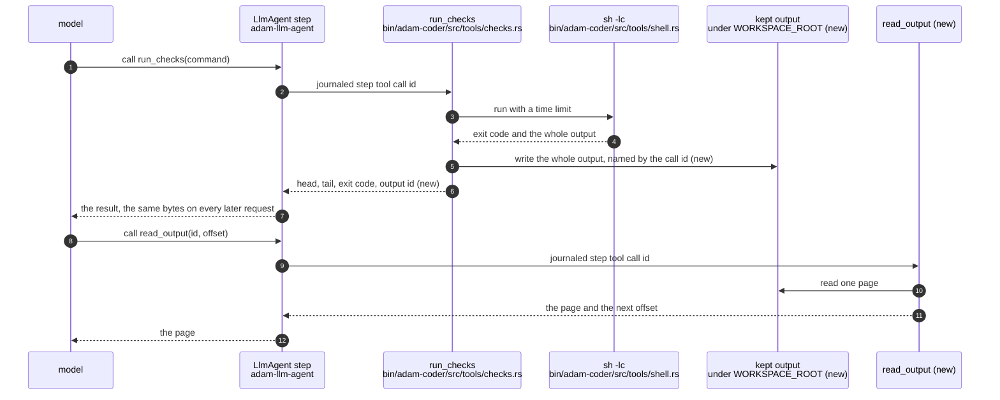
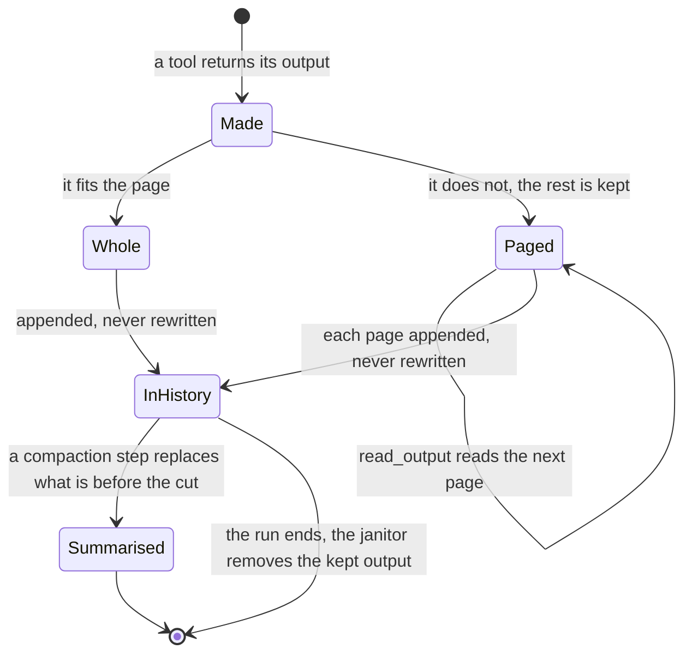

# 0044. Paged tools and a stable prompt prefix; a plan, skills, commands and project context are built in

Status: **Accepted** (2026-11-14). The directions are the owner's, given the same day after a comparison of adam-rs at `37d0b11`
with OpenCode 2.3.0; they are quoted where they decide something, and what was first only recommended was put to the owner
the same day: see [The owner's answers](#the-owners-answers-2026-11-14). Slices 1 and 2 are built (below). Builds on
[ADR 0039](0039-the-agent-loop-takes-opencodes-structure-and-agents-get-plugins.md) (the loop, rules, compaction, plugins),
[ADR 0037](0037-parallel-subagent-calls-and-an-editing-worker.md) (parallel subagents) and
[ADR 0038](0038-the-coder-drops-opencode-and-adam-acp-stays-a-library.md) (OpenCode leaves the coder), none of which is built
either (*verified 2026-11-14*: no `Plugin`, `Rule`, `doom_loop`, `Conversation::turns`, `step_all`, `compact:` step or
`revert_to` in `crates/` or `bin/`; `delegate_to_opencode` is still registered, `bin/adam-coder/src/tools/mod.rs:765`).

*Built 2026-11-14:* slice 1 (the loop survives), with two changes from the text above: the closing turn keeps its tools and sends `tool_choice: none`, and a complete body without `finish_reason` stays a protocol error.

*Built 2026-11-14:* slice 5 (ADR 0038's removal of OpenCode), with ADR 0038's slices 1, 2, 4 and 5 in one pull request; its operator slice (3) is void here, [ADR 0046](0046-the-operator-lives-in-the-platform-repository.md).

*Built 2026-11-14:* slice 2 (paged reads), decision 2 up to and including the loop's backstop: `crates/adam-llm-agent/src/paging.rs`, `read_file`, `list_files`, `find_files` and `search_files` (`bin/adam-coder/src/tools/files.rs`, `find.rs`), `Dir::entries`. As decided, with these details the text above left open: the last line is `[more: <n> lines left; next page: offset=<k>]` or `[end: <n> lines]` (`entries`, `paths`, `matches` for the other tools), with no header line; a negative `offset` reaches back at most 10,000 lines; the 64 KiB cap cuts on a character boundary and names `offset` only for a tool that declares `Tool::paged()` (`#[tool(paged)]`, never read from a schema), and is applied after the journal, which keeps the whole output (the model, the history and the step event carry the cut); every page also stops at 50 KiB with the next offset taken from the last item shown, and names are printed escaped (`\n`, `\\`, `\xNN`, a leading `[` as `\x5b`) so none can forge the final line; `search_files` also stops with an error at 20,000 files, 256 MiB read or 20,000 matches, skips files over 4 MiB (counted in its last line) and binary files; a call over 30 s is an error result, never a partial page. The candidates of `find_files` and `search_files` come from `git ls-files` through the git sandbox and fail closed without it. Not built yet: the command output kept as `read_output`, the MCP result kept and paged, `read_skill_file`'s `offset` and `limit`, and decision 1.

## Context

The goal is the owner's: adam-rs "as stable as possible", as good as OpenCode 2 "and even above". Two of the directions are
about cost:

> To save on tokens, we need to provide tools that will help do simple things in the same structured manner. That way we shall
> provoke the caching mechanism of upstream token providers. Things that provoke reads shall all be paginated, as much as possible.

What the code does today, *verified 2026-11-14 by reading adam-rs at `37d0b11`*:

| Area | Today | Where |
|---|---|---|
| The request | `system`, the tool specs and the history are rebuilt for every model call | `crates/adam-llm-agent/src/agent.rs:815-819` |
| History over the budget | `fit_history` shortens the **oldest** tool outputs in the copy that is sent, by exactly the excess, on every request. Once a run is over `max_history_tokens` (100,000, estimated as characters / 4), the oldest output changes on every call, so the provider's cached prefix ends there every time | `crates/adam-llm-agent/src/history.rs:85-116` |
| Overflow | a prompt the provider rejects as too long is `ModelError::ContextLength`, not retryable: the run fails | `crates/adam-model/src/error.rs:101,128` |
| Reading a file | `read_file` without a range returns the whole file up to 256 KiB (about 64,000 tokens) | `bin/adam-coder/src/tools/files.rs:80` |
| Finding and searching | no tool; the model runs `ls` and `grep -rn` through `run_command` | `bin/adam-coder/src/tools/inspect.rs` |
| Command output | the **last** 16,384 bytes only; the rest is kept nowhere; one timeout of 900 s for every command | `bin/adam-coder/src/config.rs:1117-1119` |
| Cache accounting | cached input tokens are read from the response; no cache key and no cache hint is sent | `crates/adam-model-openai/src/wire.rs:391` |
| Skills | an agent has the skills its `skills:` selects; the names are an enum in the tool's schema; the coder ships none | [Agent files](../reference/agent-files.md#skills-at-run-time) |
| Project instructions | not loaded; the prompt tells the model to `cat` `CLAUDE.md`, `AGENTS.md` and `README` | `bin/adam-coder/agent/instructions.md:309-316` |
| A plan, commands, references | none | |
| `ask_user` | six question types: `single`, `multiple`, `select`, `images`, `text`, `longText`; at most 8 questions | `crates/adam-ui/src/ask.rs` |

Facts about third parties:

* **OpenAI's prompt cache matches a prefix** of the rendered request from its first byte: instructions, tool definitions (names,
  descriptions, schemas, order) and history. An edit to an earlier message ends the match there. It is automatic above a
  minimum length (1,024 tokens on current models); `prompt_cache_key` routes or separates requests that share a prefix
  (*verified 2026-11-14*, <https://developers.openai.com/api/docs/guides/prompt-caching>). The page's examples are for the
  Responses API; that the same holds on `POST /chat/completions`, the one API adam-rs speaks, is *unverified*, and so is every
  other provider and gateway.
* **OpenCode 2.3.0**: `read` pages at 2,000 lines and 50 KiB, `glob` and `grep` return 100 results by default, a truncated shell
  output is kept whole in a file, and plan tracking is an opt-in `todowrite` (*verified 2026-11-14*,
  <https://opencode.ai/docs/tools/>, <https://opencode.ai/docs/config/>).

## Decision

### The prefix stays the same

1. **Within a run, a request is the previous request plus what happened since** (`adam-llm-agent`). This is the rule every
   other decision here keeps.
   * **System prompt and tool specs** do not change between two calls of a run unless the person changed something (the access
     tier, a mode). Specs are sent in one fixed order. Nothing that changes by itself (a date, a counter) goes into either.
   * **What a run learns on the way** (project instructions, a loaded skill, the plan, a reference) is appended as a message or
     a tool result. It never rewrites the system prompt.
   * **History is only appended to, except at a compaction** (ADR 0039 decision 5). `fit_history`'s shortening on every request
     goes: a tool output is bounded when it is made (decision 2), and a long run is summarised once, at a journaled step.
     Until compaction is built, a shortening is **recorded in the state** the first time it is made and sent the same way after.
   * **The proof** is a test of the loop: for a scripted run, each request's bytes start with the previous request's, except
     across a compaction step.
   * **A cache key** (`MODEL_PROMPT_CACHE_KEY=conversation`, off by default) sends the conversation id as `prompt_cache_key`.
   * **Cache markers.** No gateway is assumed (answer 5), so a marker for providers that cache only at marked points is a
     setting of its own, off by default, built when a deployment names the provider. That any gateway passes one through is
     *unverified*.

### Everything that reads is paged

2. **One paging convention for every tool that reads.** Input: `offset` and `limit`. Output: the page, then one last line that
   says what is left and the `offset` of the next page. The same call gives the same bytes, so a repeated read is a cached read.
   The owner: "Things that provoke reads shall all be paginated, as much as possible."

   | Tool | Change | Page |
   |---|---|---|
   | `read_file { path, offset?, limit? }` | pages by lines; a negative `offset` reads from the end; a line over 2,000 characters is cut; a missing file names the closest paths. `start_line` and `end_line` stay as aliases | 2,000 lines or 50 KiB |
   | `list_files { path?, offset?, limit? }` (new) | one directory, not recursive, sorted | 200 entries |
   | `find_files { pattern, path?, offset?, limit? }` (new) | a glob over the slot, git-ignored files left out, sorted | 100 paths |
   | `search_files { pattern, path?, include?, literal?, offset?, limit? }` (new) | file contents; path, line number and the line | 100 lines |
   | `run_command`, `run`, `run_checks` | the result is the head and the tail of the output with the call's output id; the whole output is kept for the run under `WORKSPACE_ROOT`, outside the worktree | 16 KiB as today, split between head and tail |
   | `read_output { id, offset?, limit? }` (new) | pages a kept command output | 2,000 lines or 50 KiB |
   | `read_skill_file` | gains `offset` and `limit` | the same |

   * The three new tools are tier `plan`, confined to the slot like `read_file`, and bounded in time (30 s).
   * **A backstop in the loop**: a tool result over a common cap (64 KiB) is cut with a marker before it enters the history,
     whatever the tool. A tool with a paged form says how to read the rest; any other says only that it was cut.
   * **An MCP result over 64 KiB is kept whole for the run and paged with `read_output`** (answer 4), like a command's
     output. An agent with no workspace keeps it in the run's state, under the loop's limit on what a run may keep.

### What stays outside

3. **No web fetch and no web search built in.** The owner: "brave search mcp and fetch mcp exist. I in fact prefer to keep some
   features outside." A deployment adds them with `ADAM_EXTRA_MCP_FILE` ([ADR 0018](0018-extra-mcp-servers-are-a-file-merged-over-the-agents-own.md)).
   That makes the MCP client part of the product's quality, so it gains what OpenCode's has and adam's lacks: timeouts a
   deployment can set per server (today 30 s to connect and 60 s a call, fixed, `crates/adam-mcp/src/policy.rs:16-19`) and the
   server's `instructions` in the prompt.
4. **Images are generated by an MCP server, and inline only when the model can.** The owner: "I prefer offloading image gen to
   mcp. But again, if a model supports it, we need to enable it so that it can be inline."
   * **By MCP** it works today: a server with `files: true` hands its image to the person as a shared file
     ([ADR 0033](0033-files-from-mcp-results-are-shared-files.md)). The work is documentation and an example server in the
     dev stack.
   * **Inline** is a capability of the model alias that the deployment declares (`MODEL_OUTPUT_MODALITIES=text,image`). An
     image in the model's answer becomes a shared file ([ADR 0012](0012-files-as-a2a-artifacts.md)) and never enters the
     history. The wire shape differs by provider and is *unverified*; it is built later, against the first provider a
     deployment names (answer 6). The MCP way comes first.
   * **Seeing images** is the other half: with `MODEL_INPUT_MODALITIES=text,image`, `read_file` on an image gives it to the
     model; without, it answers as today that the file is binary.

### What is built in

5. **A plan every agent can keep: `plan_work`.** The owner: "`plan_work` would be a better name for `todowrite`. And it should
   be built-in. Even a normal chat can have a plan, and all associated tools for checking a case and adding more blocks."
   * **Three tools**, in `adam-ui`, offered to every root agent, a folder agent included:
     `plan_work { title?, items: [text] }` starts or replaces the plan; `plan_check { id, status, note? }` sets one item to
     `doing`, `done` or `dropped`; `plan_add { items: [text], after? }` adds items.
   * **State.** The plan is in the conversation's state: journaled, replayed, carried into a task that continues the task.
     At most 50 items.
   * **What the model reads.** Each call returns the whole plan as short lines, so the current plan is always near the end of
     the history and is said again after a compaction.
   * **What the person sees.** A surface on a screen that can draw it, and a step otherwise.
   * A subagent has no plan of its own in the first slice.
6. **`ask_user` gets more kinds of question.** The owner: "`ask_user` should be made better, support more variants of
   questions." Beside the six of today (answer 3): `confirm` (yes or no, with the two labels), `number` (`min`, `max`,
   `step`, `unit`), `scale` (a rating between two labelled ends), `date` (a day, or a day and a time) and `rank` (put 2 to 12
   options in order). Each needs a component version on the screen's side (`docs/api/ui-catalog-v1.md` of
   `vymalo/another-agentic-system`); on a screen without it the question degrades to text, as today, and never fails the run.
   The owner also: "Images, graphs,... A2UI is enabled by default so we might as well use it." So **a question may show what
   it asks about**: the form takes the display blocks `show` already draws (an image shared in the conversation, a graph, a
   card) above its questions, checked against the screen's catalog like the rest.
7. **`share_file` and `show` say how to be used.** The owner asks for "good doc, around how the agent should use them". Their
   descriptions are rewritten: when to use each, when not, the limits, one example each. The reference page gains a section
   for a person who writes an agent. The descriptions are pinned by the prompt's golden file.
8. **Skills are on for every agent.** The owner: "All skills should be built-in. A model can pick a new skill if present and
   if required."
   * An agent has **every skill of its folder** without naming them. `skills:` only narrows, and `skills: []` turns them off.
   * `load_skill`'s `name` becomes a string checked at the call (an unknown name lists what exists), no longer an enum, so the
     tool's schema does not change when a skill appears (decision 1).
   * **The coder ships skills** of its own for its recurring work (the first set is a slice).
   * **"If present" includes the repository** (answer 2): the skills of the repository a run works on (`.agents/skills`, `.claude/skills`,
     `.opencode/skills` of a slot) are listed to the model when the slot is prepared, as a message, and loaded with the same
     tool. They are text from the repository, trusted as its `AGENTS.md` is (decision 10): they grant no tool and no tier.
9. **Commands: yes, as prompt templates the agent serves** (the owner asked "Should it support slash commands?", answer 1). The slash is the client's; the template is the agent's, so every client of an agent gets the same commands.
   * **Where.** `commands/<name>.md` in the agent folder: a `description`, an `argument-hint`, and a body with `$ARGUMENTS`
     and `$1`, `$2`. MCP prompts become commands once the client reads them.
   * **How a client learns them.** An optional extension of the card, `https://agents.vymalo.com/a2a/extensions/commands/v1`,
     with `params { commands: [{name, description, argumentHint}] }`.
   * **How one is invoked.** A message's `metadata[URI] = {"command": "<name>", "arguments": "..."}`, or, from a client that
     knows no extension, a message whose text starts with `/<name>`. The agent expands it in the transition that reads the
     message; an unknown command is `InvalidParams`. Plain A2A is untouched.
   * **Not copied:** OpenCode's `` !`command` `` block, which runs a shell command outside every permission.
   * A repository's own commands (`.opencode/commands`, `.claude/commands`) are invoked by text only, once a slot exists; they
     cannot be on the card.
10. **A run reads what the project says about itself, in code.** The owner ties it to commands: "the AGENTS.md file /
    CLAUDE.md or README.md should be read, as well as other features that come with that (e.g. references)".
    * **When a slot is prepared**, the coder reads `AGENTS.md` at its root, else `CLAUDE.md`, else the first page of
      `README.md`, and appends it to the conversation as a message that names the file. At most 32 KiB; the rest is read with
      `read_file`.
    * **Nested files** are appended the first time a read tool touches a directory that has one, once each (recorded in the
      state).
    * **It is the repository's text, not the person's**: it never grants a repository, a tier or a consent
      ([ADR 0008](0008-a-workspace-holds-several-repositories.md)).
    * **References.** `references:` in the agent folder, or a file the deployment names, lists other repositories by a name,
      a URL, a branch and a description. A reference is a **read-only slot**: the read tools work there, the write tools and
      `commit_and_push` refuse. The model is told the name and the description, and the checkout is made on first use. A
      reference the deployment or the agent declares needs no consent to read; one a repository's own file asks for goes
      through `request_repository`, as any repository nobody named.

### The rest: OpenCode's level, and above

11. **The loop no longer loses a run to something it can recover from.** These are in no earlier ADR:
    * a stream that ends without `finish_reason` is transient and tried again (today `Protocol`, the run fails,
      `crates/adam-model-openai/src/wire.rs:281-282`);
    * a tool call whose arguments are not JSON is answered to the model as that call's error, and the run goes on;
    * a rejected prompt (`ContextLength`) runs the compaction step and tries once more, as OpenCode does;
    * a tool has a time limit in the loop, from its own declaration, and a local child run has one too;
    * a command takes a `timeout` of its own, up to the deployment's limit.
12. **What ADR 0039 and ADR 0037 already decided is built in this order of need:** the last-turn grace, `doom_loop`, the
    compaction step, the cancel that reaches a child, parallel subagent calls. ADR 0038's removal comes first, as it says.
13. **Commands that keep running** (`start_command`, read with `read_output`, `stop_command`) follow the paged output of
    decision 2: a development server a check needs. They die with the run's pod, and the tool says so.

## Alternatives considered

* **Keep `fit_history` and raise the budget.** It still rewrites the oldest output on every call past the budget, which is
  when a request costs most. Rejected for decision 1.
* **Search through the shell, with a bigger tail.** The tail is the wrong end of a search, the output's shape depends on the
  flags the model picked, and nothing bounds it. Dedicated tools give one shape and one page size.
* **Web tools built in.** The owner prefers them outside; a deployment picks its provider.
* **One `plan` tool with an `op` argument.** Three small tools have smaller schemas and are easier for a small model to call
  right.
* **Commands only in the client.** Each client would keep its own templates, and an agent asked by another agent would have
  none.

## Consequences

* **Rule 2.** Additive: the three read tools, `read_output`, the `plan_*` tools, the new `ask_user` types, `commands/` and
  `references:` in the folder format, the `commands/v1` extension, the modalities and cache-key variables. Not additive:
  `read_file` with no range returns a page where it returned the file; a folder with no `skills:` gets every skill of its
  `skills/`; `load_skill`'s schema loses its enum; the coder's prompt golden file changes.
* **The orchestration layer** (`vymalo/another-agentic-system`) has work of its own: the new question components, a plan
  surface, the composer's command menu and its contract page. Each is a change there.
* **Pages to update with the build:** [Agent files](../reference/agent-files.md), [Coder agent](../reference/coder-agent.md),
  [Environment](../reference/environment.md), [Errors](../reference/errors.md), [Architecture](../architecture.md), the
  `adam-a2a-extensions` and `adam-agent-folder` skills, and the READMEs of `adam-llm-agent`, `adam-ui`, `adam-mcp`,
  `adam-agent-fs`, `adam-assembly`, `adam-model-openai` and `bin/adam-coder`.

## Slices

Each is testable alone.

| Order | Slice | Proof | Depends on |
|---|---|---|---|
| 1 | **The loop survives** (decision 11, first two items; ADR 0039's last-turn grace) | a scripted stream with no `finish_reason` is retried; bad tool-call JSON is an error result and the run completes; a run at `max_turns` ends with an answer | nothing |
| 2 | **Paged reads** (decision 2): `read_file` pages, `list_files`, `find_files`, `search_files`, the loop's backstop | the same call returns the same bytes; a page ends with the next offset; a path outside the slot is refused | nothing |
| 3 | **Kept command output** and `read_output`; a `timeout` per command | a 1 MiB output is read back page by page; the janitor removes it with the run | 2 |
| 4 | **The prefix test and recorded shortenings** (decision 1); the cache key | each request of a scripted run starts with the one before | 2 |
| 5 | ADR 0038's removal of OpenCode | its own | nothing |
| 6 | **`plan_work`, `plan_check`, `plan_add`** | a plan survives a replay and a continued task; a folder agent has it | nothing |
| 7 | **Project instructions** (decision 10, without references) | a slot with `AGENTS.md` appends it once; a nested file once; it grants nothing | 2 |
| 8 | **Skills on by default**, the string `name`, the coder's first skills, a repository's skills | a folder with no `skills:` lists its skills; a new skill does not change the tool's schema | 4, 7 |
| 9 | **Compaction and overflow recovery** (ADR 0039 slices 1 and 8; decision 11) | a scripted long run is summarised once and keeps the prefix after it; a rejected prompt is compacted and retried once | 4 |
| 10 | **`doom_loop`**, tool and child time limits, the cancel that reaches a child | a call repeated three times is denied; a child past its limit is an error result | nothing |
| 11 | **`ask_user` kinds**, the `share_file` and `show` descriptions | each kind validates and degrades to text; the golden prompt | the screen's catalog for the forms |
| 12 | **Commands** and the `commands/v1` extension | a card lists them; metadata and `/name` expand the same; an unknown one is `InvalidParams` | nothing |
| 13 | **References** as read-only slots | a write there is refused; a repository-declared one asks | 7 |
| 14 | **MCP**: timeouts per server, server instructions, prompts; the image example | a slow server is bounded by its own setting | nothing |
| 15 | **Modalities**: images in, then images out | built against a named provider | a deployment that names one |
| 16 | **Commands that keep running** | started, read, stopped; gone with the pod | 3 |

## The owner's answers (2026-11-14)

1. **Commands:** the agent serves them: templates in its folder, announced by the `commands/v1` extension, invoked by
   metadata or by text.
2. **Skills:** the agent's folder and the repository a run works on. A repository's skills grant no tool and no tier.
3. **`ask_user`:** `confirm`, `number` and `scale`, `date` and `rank`, and images and graphs in a question through A2UI.
4. **A large MCP result** is kept and paged.
5. **The gateway is not fixed.** adam-rs assumes none, and each behaviour that depends on one is a setting.
6. **Inline images** come later; image generation through an MCP server comes first.
