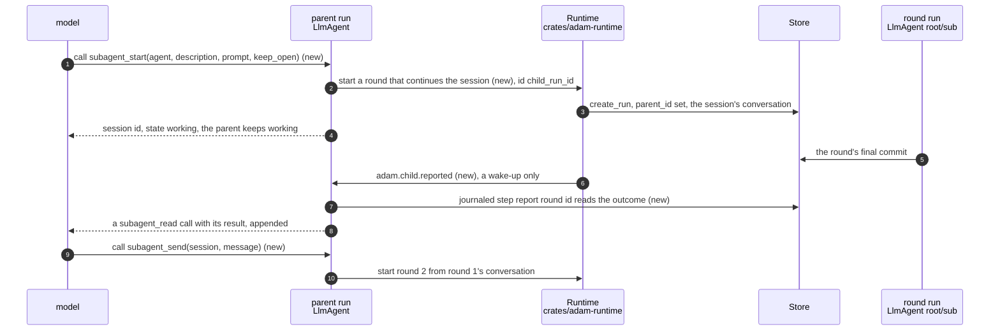
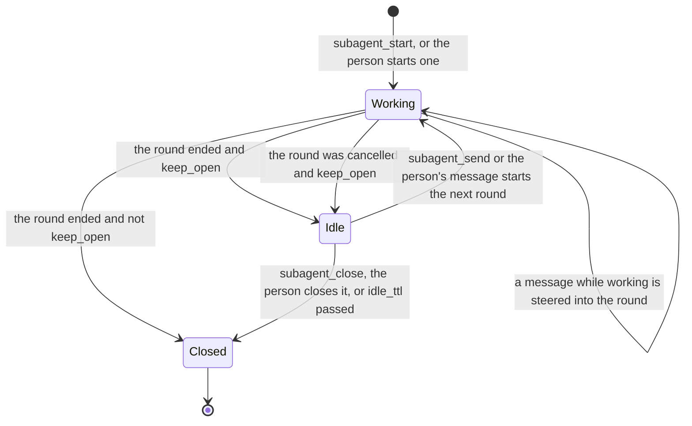

# 0045. A subagent can run in the background as a session the parent and the person talk to again

Status: **Accepted** (2026-11-14), the owner's decision: *"we need to add the capability that opencode has to create child
session, and exchange messages with it. At creation, there should be a button to auto-close after work is done, so that the
child session can further be reused."* The six defaults under [What was put to the owner](#what-was-put-to-the-owner) are
recommendations the owner was told the work proceeds with. Slices 1, 2 and 3 are built (below). Reverses "one-shot child runs" and "no
resume" of [ADR 0039](0039-the-agent-loop-takes-opencodes-structure-and-agents-get-plugins.md); amends
[ADR 0037](0037-parallel-subagent-calls-and-an-editing-worker.md), [ADR 0003](0003-a-new-task-continues-the-task-it-references.md),
[ADR 0016](0016-a-message-sent-to-a-working-task-is-steered-into-it.md) and
[ADR 0034](0034-a-turn-that-asks-nothing-completes-and-scratch-lives-for-the-thread.md) (dated notes in each); follows
[ADR 0044](0044-paged-tools-a-stable-prompt-prefix-a-plan-skills-commands-and-project-context.md) decisions 1 and 2 for its
tools. The orchestration layer's side is its own ADR in `vymalo/another-agentic-system`.

*Built 2026-11-14 ([ADR 0044](0044-paged-tools-a-stable-prompt-prefix-a-plan-skills-commands-and-project-context.md) slice 10):* the runtime half of decision 6: a cancelled or failed parent fails the open round (`cancelled: the parent run ended`) and the session stays usable; `start_child_continuing_within` gives a round the same time limit. Remote sessions are not cancelled (slice 5: *amended 2026-11-18*, built: a round sends `CancelTask`, see below).

*Built 2026-11-14:* slice 1 (the runtime): `Runtime::start_child_continuing`, the kind `adam.child.reported`
(`CHILD_REPORTED_KIND`, chosen by whether the child has a conversation) and `Runtime::list_sessions`, in
`crates/adam-runtime`, with no change to a store or the testkit. Deviations: a listing over runs cannot tell a
closed session, so `SessionState` is a closed enum of `Working` and `Idle` (`Closed` comes with the header, slice 2, as a deliberate breaking addition);
`list_sessions` takes the agent names to look at, because a run listing is per agent; and the conversation id is the
parent's id with `%` and `/` escaped (`%25`, `%2F`), then `/s/<session>`, because a client chooses its context ids freely; a
run counts as a session's only when its round 1 exists with a parent; `start_child_continuing` refuses a `prior` that is
not a round of the session and a round of another agent (`InvalidSession`), but an open `prior` of the session is
`ConversationBusy`, which a caller tells apart with `RuntimeError::is_busy()`; the listing says how the latest round
ended (`Done`, `Failed`, `Cancelled`); until slice 2 a report is not read by any agent (`LlmAgent` drops it, and
`Ctx::arrived` does not count it). Slice 2 breaks the first of those deviations on purpose: `SessionState::Closed` exists now.

*Built 2026-11-14:* slice 2 (the five tools): `SessionTools` in `crates/adam-llm-agent` (`sessions.rs`), given to a root with local
subagents by `adam-assembly`; `ToolError::AwaitSession` and `PendingWait::Session`; the session header (`Conversation::session`, a
`SessionHeader` the runtime reads from the round's state); `Conversation::rounds_started`; the turn-end wait. Departures from the
decisions above, each for a reason found while building:

* **`closed` is derived** from the latest round (its header, a close request in its inbox, or an ended round of a session
  that is not kept open), so a round the runtime cancels or fails (which no agent commits) closes a not-kept-open session
  too. Closing an idle session is a round that calls no model; closing a working one delivers `adam.session.close`, which the
  round reads and which is not counted as unread input. `SessionHeader` has a `closing` field the ADR does not list.
* **`PendingWait::Session` is looked at through `Tool::poll_remote`**, the session id as the `task`, in the journaled step
  `poll:<call id>`: no new `Tool` method, so wrappers that forward `poll_remote` need no change.
* **The report is text, not a JSON object**: a header line, `report: done|failed`, the report as a numbered page, and the
  convention's final line. The `background` member of the report in the table is not built (it belongs to the reports of
  slice 3). `subagent_read` with `wait` returns the first page.
* **The turn-end wait** appends a `subagent_read` call (id `wait_<turn>`) to the model's own message and waits for one session at
  a time, in the order the listing gives; it is skipped when the history has no `subagent_start` or `subagent_send` call, so a run
  that never uses sessions journals what it always did.
* **Two bounds of slice 4 are constants here** because a missing one is unsafe: 16 open sessions per conversation and 20 rounds
  per session (a close counts as a round). `idle_ttl`, `max_working` and the settings are slice 4.
* **`subagent_start` lists remote subagents in the enum** and refuses them in words (slice 5 builds them); a session tool is given
  only to a root with at least one local subagent. (*Amended 2026-11-18:* slice 5 built them: no refusal, and a root with any subagent has the five.)
* **The coder's tier**: the five are `plan` tier, like the helpers they run.
* **Also departures:** results are text, not rows (`subagent_list`, `subagent_close` too); `BoundDef::scrub` exists so the coder's
  redactor reaches the tools the assembly makes; every round a run started or sent to is counted once in its totals (`Conversation::rounds_started`, a journaled step `usage:<call id>`),
  when a report is read and at the latest when the run ends, read or not (a store error is retried); the open sessions are still found by scanning the conversation's rounds (known limit, 5,000 rounds of one subagent);
  `SessionHeader` has `closing` and a round number `round` (rounds are ordered by it, not by timestamp); a closing round has no report:
  a read of a closed session gives the last round that worked; a close request survives `Runtime::cancel`, and a round whose state
  cannot be read closes its session; a call that acts on a session is committed before it runs; a run that ends cancels rounds it
  could not wait for; at most 4 rounds work at once (`max_working` as a constant); retention must outlast a session's idle life.

*Built 2026-11-18:* slice 3 (reports during a turn, `crates/adam-llm-agent/src/{agent,sessions,conversation}.rs`). The rounds that ended reach
the model without a read of its own; the design departs from the slice's text in these ways, each to leave committed journals replaying and to move
no step's seq (as ADR 0050 decision 9 does for messages):

1. **No `children:<turn>` or `report:<round id>` steps.** The listing and the reads are made inside the step `model:<turn>` and recorded in
   its record (`reports`, `sessions_open`, both absent when empty), so a committed journal from before replays as it was. At the end of a turn the
   existing step `sessions:<turn>` and the read `wait_<turn>` are used. **No mixed versions**, as for slice 2: a transition in flight when a worker
   of the other revision takes the run can replay differently, so stop every worker of the old revision before a run uses sessions.
2. **Reports are read through `ChildStarter::session` and the read tool's `poll_remote`**, not `Ctx::child_status`, which refuses the rounds of
   other parents, a person's round included. The appended calls are `subagent_read` calls with ids `report_<32 hex of the round id>`.
3. **`Ctx::arrived` does not count reports.** The turn that a report keeps going is decided from the store at the end of the turn (a round that
   ended during the final model call is read with `wait_<turn>`, which answers at once), which needs no notice: every round this run started has
   either ended or is waited for, and a person's round never notifies a parent. A notice stays a wake-up; a lost one costs at most one turn, a
   duplicate matches nothing.
4. **A report is of the session's latest round that worked** (`SessionSummary::report`, new in `adam-runtime`), so a closing round that follows does not
   hide it. It is due once: the round has ended, is not in `Conversation::reported_rounds` (the last 128, carried to a later task), its call id is not
   already in the history (the cap can give up a round that is still due), and this run started it or a person did **after the chain of tasks began**
   (`Conversation::chain_started`, set at the first model call and carried; a task that does not continue another does not re-tell a person's old
   round). A round an earlier task's run started is not reported: that run waited for it or cancelled it. A round that a later round of the same
   session replaced before the parent looked is **not reported on its own**: only the latest round that worked is. A round cancelled by the close that follows it is not reported either: whoever closed the session knows (`a_closing_round_does_not_hide_the_report_of_the_round_before` and the remote cancel cases hold both).
5. **When the loop lists:** at the first model call of each run, and before every call while `Conversation::sessions_open` is set (a session that is not
   closed was seen, a call started or sent to one since, or a due report was not appended). A person's session that starts while none is open is
   reported at the parent's next task: decision 7's "now or in a later task".
6. **Appended reports are not calls of the model.** They do not count toward `max_tool_calls` or `doom_loop`, carry no `after_previous` and are added
   only when no result is owed, so never inside an ADR 0049 segment. The report at the end of a turn is a real call (`wait_<turn>`), as in slice 2.
   A record whose answer predates a message the run has read leaves its reports for the next call, and the rounds are counted all the same, so the
   steps of a replay do not depend on it.
7. **A person's round** is reported with its header marked "started by the person"; the person's words are not in the report, and it is a tool result,
   never a user message. Decision 7 as amended for slice 6 part a ("waits for slice 3") is built.

Proof: the cases of `crates/adam-llm-agent/tests/sessions.rs` for slice 3 (memory, PostgreSQL, MongoDB), the due rule in `sessions.rs`, and the record
in `agent.rs`. Three existing cases that count the tokens of a round **nobody read** (`a_round_never_read_is_counted_when_its_session_closes`,
`a_round_never_read_is_counted_when_the_parent_ends`, `a_store_error_on_the_usage_read_is_retried`) run on `LlmAgentBuilder::without_session_reports`
(a hidden builder method that makes the agent as a build from before), because the loop now reads such a round at its next model call. **Unverified
risks:** the appended assistant message carries no reasoning (a model with `echo_reasoning`); two assistant messages in a row can happen; the listing
runs inside `model:<turn>` before the call with no time limit of its own; the step events of the appended reads are emitted after the answer has streamed.

*Built 2026-11-18:* slice 6 part a (the A2A front, `crates/adam-a2a-runtime/src/child_sessions.rs`, the card entry in `crates/adam-a2a`, two
readers and `closing_round_payload` in `crates/adam-runtime`): a client that activates `child-sessions/v1` sees the sessions of a parent
context on the parent task, follows each round as a task of a child context, and starts, talks to, stops and closes a session;
`RuntimeTaskBackend::with_child_sessions`, `ChildSessions`, `ExtensionConfig::child_sessions`. Not built (then): the stream events of the
contract (slice 6 part b, below) and the wiring into `adam-assembly`, `adam-service` and `adam-coder` (part c), so no shipped agent lists the
card yet.

*Built 2026-11-18:* slice 6 part b (the events, `crates/adam-a2a-runtime/src/session_events.rs` and `subscribe.rs`): the stream of a parent
task, for a request that activated `child-sessions/v1`, says `opened`, `round`, `reported` and `closed` as status updates of the parent
(a tracker seeded from the snapshot's listing, listing again when the parent's record changes and at least every second, once more before
the final event; the diff per session is a pure function in the contract's order, filling steps missed between listings), and the stream
of a round carries the session object on the update that ends the round and on the one where `closing` turns true. `round.state` is the
A2A JSON spelling (`TASK_STATE_COMPLETED`), as in the sessions object. A round that only closes the session reports nothing. Not built: the
wiring into `adam-assembly`, `adam-service` and `adam-coder` (part c).

*Built 2026-11-18:* slice 5 (remote sessions, `crates/adam-assembly/src/remote_session.rs`, `RemoteEndpoint` in `remote.rs`, `Agent::on_cancelled`
in `crates/adam-runtime`, the roster in `crates/adam-llm-agent/src/sessions.rs`): a session on an `a2a:` subagent of the root is a chain of
rounds, each a run of `RemoteRoundAgent` registered as `<root>/<subagent>` (no model: card, send, look, report). The session tools,
the listing, the notices, the closing round, the turn-end wait and the A2A front work on it unchanged. The context is carried
(`contextId`, `referenceTaskIds`), a message to a working round is steered or queued, a cancelled round sends `CancelTask`. Proof:
`crates/adam-assembly/tests/remote_sessions.rs` (twelve cases against an in-process A2A server, memory and PostgreSQL), four hook cases in
`crates/adam-runtime/tests/runtime.rs`, two in `crates/adam-llm-agent/tests/sessions.rs`. Not built: slice 6 part c must register the
round agents' starters on the A2A front; a reload of `LiveAssembly` keeps the round agents of the first load.

*Amended 2026-11-18* (slice 5; decision 10 as built, each a departure found while planning or building):

1. **A message to a working remote is queued inside the round.** It is sent as the next remote task of the same round, joined with the
   others that waited, not left for the next round. The report of the round has every answer.
2. **`subagent_send` says `queued`** when the round's agent keeps the message until its remote can take it (`queues_messages` in the round's
   state), else `steered`.
3. **`CancelTask` comes from a hook**, `Agent::on_cancelled(run, state)` (provided, does nothing), which the runtime spawns after a cancel
   commit succeeds, once per commit, best effort. It exists only where the full agent is registered: a process that registered only
   the starter sends nothing. The next round cancels the task the round before left (`cancel-prior`).
4. **The time limit of a remote round** is `AgentDef::remote_timeout` (one hour). At the limit the runtime cancels the round and the
   remote task is cancelled. The one-shot tool of a remote subagent still leaves its task running.
5. **Context continuity needs an authenticated caller on an adam remote**: `adam-a2a-runtime` ignores `referenceTaskIds` from an
   anonymous caller (*verified 2026-11-18*, `crates/adam-a2a-runtime/src/backend.rs`).
6. **A round shows no steps, counts no tokens and shares no files** of the remote's work: files are described in a line, the remote's
   tokens are not added to the parent's.
7. **The five tools go to a root with any subagent**, a root with only remote subagents included (it had none before).
8. **`input-required` is a report**, not an error: the question is the report and the next round answers the task by `taskId`.
   `failed`, `canceled`, `rejected` and `auth-required` fail the round and the session stays usable.
9. **The card is read once per round**, on a client rebuilt from it, so a card that changed between rounds is read again.
10. **The one-shot tool is unchanged.** A subagent called through its tool behaves as before.

*Amended 2026-11-18* (slice 5, after review):

* **A cancel while the send is answered is recoverable.** The round commits the send's request before the call (`sending`). If a
  cancel lands before the task id is committed, `on_cancelled`, or the next round (`cancel-prior`), repeats that send under its
  message id and cancels the task found. This needs a remote that deduplicates message ids to avoid a second task; one that does
  not makes a task and cancels it. Every cancel is one try, logged, not repeated.
* **A closing round cancels what the round before left first.**
* **Messages a failed or cancelled round never sent** go first in the next round.
* **A round limits itself**: it records its first step and fails after `remote_timeout`, because the A2A front starts a person's round with no runtime limit. `remote_timeout` is both the one-shot tool's wait cap and a round's limit.
* **`read_ids` keeps 64 ids**: a copy delivered after 64 newer messages is sent again.

*Amended 2026-11-18* (slice 6 part a; each is a departure found while building, and the contract is
`docs/api/child-sessions-v1.md` of `vymalo/another-agentic-system`):

* **Decision 11, the close is in the message's metadata** (`metadata[URI].close {cancel}`, the contract's choice), not a data part.
* **Decision 1, a person's round is its own parent.** A round a person starts has no run of an agent behind it, so it is started with
  its own id as parent: no run's end cancels it and no run waits for it. The runtime says it
  (`SessionView::started_outside_a_run`) and the A2A front derives `by: person` from it. A round the model starts is unchanged.
* **Decision 7**: a person's round reports to no parent; the report of a person's round to the parent run waits for slice 3. (*Built 2026-11-18, slice 3:* the parent reads it from the store at its next listing; see the note above.)
* **Decision 9**: a round a person starts always has a tier written (the one its message names, else the agent's default).
* **Decision 5**: the card's `maxOpen` is the value the deployment passes to `ChildSessions::new`, which must equal the model tools' constant (16) until slice 4 makes it a setting. It is checked before a start, so concurrent starts may exceed it by the number racing, as the tools' check may.
* **Not built here:** the live usage of a model round stays on the parent until the loop is free to change; push configs on round
  tasks are unsupported.

## Context

*Verified 2026-11-14 by reading adam-rs at `103965f`:*

| Today | Where |
|---|---|
| One tool per subagent, `{message}`; each call is a child run with fresh context and **no conversation** (`start_child` passes `None`) | `crates/adam-runtime/src/runtime.rs` (`start_child`) |
| The parent **parks** until the child ends (`AwaitRun`, `PendingWait::Run`); calls of one turn run one after another | `crates/adam-llm-agent/src/agent.rs`, `src/conversation.rs` |
| A child cannot be sent a second message; cancelling the parent does not reach it; a local child has no time limit | [Child runs](../reference/child-runs.md) |
| A child may not ask the person: asking tools are refused in a subagent at bind time | `crates/adam-assembly/src/def.rs` |
| A remote `a2a:` subagent is `SendMessage` with `returnImmediately` and polling, with no `contextId` | `crates/adam-assembly/src/remote.rs` |
| The store allows one open run per agent and conversation, lists runs by a conversation prefix, and a new run can start from a finished one's conversation | `crates/adam-core/src/store/mod.rs`, `store/query.rs`; `init_continuing` in `runtime.rs` (ADR 0003) |
| A message to a working run is delivered to its inbox and read at its next step | `Runtime::deliver` (ADR 0016) |

OpenCode 2.3.0 (*verified 2026-11-14*, <https://opencode.ai/docs/agents/>, <https://opencode.ai/docs/tools/>): its `subagent`
tool starts a background child session and returns the session's id at once; the child reports to its parent each time it goes
idle; a later message to that id continues it with its context; child sessions resume after a restart; depth is 1 by default.

## Decision

1. **A child session is a child conversation holding a chain of child runs**, as a root A2A context holds tasks.
   * Each **round** is one run of `<root>/<subagent>` with `parent_id` set and a conversation id derived from the parent's
     context and the session id. Round n+1 starts from round n's conversation (`init_continuing`).
   * The session id is round 1's run id (`child_run_id(parent, call_id)`).
   * `Conversation::session` (new) is a round's header: `{id, agent, description, keep_open, closed}`. **The truth is the
     latest round's record**; nothing else stores a session.
   * A message to a working session is steered into its open round (`Runtime::deliver`). A message to an idle one starts the
     next round.
   * An idle session holds no run, no lease and no pod.
2. **"Close when done" is chosen at creation.** `keep_open: false` (the default) is today's one-shot child: the session closes
   when its round ends. `keep_open: true` leaves it idle after each round, to be sent more messages by the parent agent and
   by the person. A closed session is never reopened.
3. **Five tools with fixed schemas**, beside today's one tool per subagent, which stays for a synchronous ask. The only enum is
   the folder's subagent names, so the specs do not change within a run; results are paged (ADR 0044).

   | Tool | Arguments | Result |
   |---|---|---|
   | `subagent_start` | `agent`, `description` (at most 80 characters), `prompt`, `keep_open` | `{session, agent, state: "working", keep_open}`, at once |
   | `subagent_send` | `session`, `message` | `{session, round, state, delivered: "new_round" or "steered"}`; an error result when closed |
   | `subagent_read` | `session`, `wait`, `offset`, `limit` | `{session, state, round, report: {status, text, background} or null}` |
   | `subagent_close` | `session`, `cancel` | `{session, state: "closed"}` |
   | `subagent_list` | `offset`, `limit` | rows `{session, agent, description, state, round, keep_open}`, open first |

4. **The parent keeps working, and a report is read from the store.**
   * A start is an answered call: the parent does not park. Several children therefore run at once without ADR 0037's batches.
   * When a round ends, the child's commit notifies its parent with `adam.child.reported` (new; `adam.run.finished` stays for
     a one-shot child run with no conversation).
   * The notice only wakes the parent (Rule 5). A journaled step `report:<round id>` reads the round's outcome
     (`Ctx::child_status`) and the loop appends it as a `subagent_read` call with its result, behind any result it owes. It is
     data, never the person's words, and it is only appended.
   * A journaled step `children:<turn>` reads every working round before a model call, so a lost notice costs one turn at most.
     a notice delivered twice matches nothing (the usage of a round is counted from `Conversation::rounds_started`).
   * `subagent_read { wait: true }` parks with `PendingWait::Session` (new) and the poll timer, as `PendingWait::Run` does.
   * **A parent's turn does not end while a round it started in that task still works**: it parks on those sessions. A report
     that arrives during the final model call reopens the turn, as a steered message does.
5. **Limits.** Each round keeps the subagent's own `limits:`. A session has `max_rounds` (20), a time limit per round (ADR 0044
   slice 10) and `idle_ttl` (7 days, after which it reads as closed). A parent conversation has `max_open` (16) and
   `max_working` (4). Depth stays 1: the session tools go to the root, and to a subagent only when its file asks.
6. **Cancel reaches the children.** Cancelling or failing a parent stops its working rounds; a kept-open session goes idle and
   stays usable. (ADR 0037 decision 7 said "done or failed": a done parent cannot have working rounds, by decision 4.)
7. **A session lives in the parent's context, not in its task.** A later task of the conversation finds its sessions by the
   prefix listing and may send to them. A round the person starts is reported to the parent agent, marked as the person's, at
   the parent's next `children:` step.
8. **Workspace.** A read-only child sees the slots of the parent's current task. An editing child that is kept open gets ADR
   0037's worker worktree keyed by **the session**, on branch `agent/<session>`, merged by the parent in any later task.
9. **Permissions.** A round the agent starts carries the parent's access tier and its inherited denies (ADR 0039 decision 3).
   A round the person starts carries the tier the person picked, capped by the subagent's own rules. A child may ask the
   person only in a kept-open session whose client activated the extension of decision 11; otherwise asking is refused, now
   per run instead of at bind time.
10. **Remote subagents get the same tools.** A remote session is a chain of local proxy rounds, each of which sends the
    message and polls. Round 1 names no `contextId` and adopts the remote's; round n sends it with `referenceTaskIds`. A
    message to a working remote is steered when its card lists `steer/v1`, else queued for the next round. A cancel sends
    `CancelTask`. Closing is local: A2A has no way to close a context.
11. **Clients learn of sessions through an optional extension**,
    `https://agents.vymalo.com/a2a/extensions/child-sessions/v1` (contract page in `vymalo/another-agentic-system`).
    * Card: `params { agents: [{name, description}], maxOpen }`.
    * Events on the parent task: `opened`, `round`, `reported`, `closed`, each with the session, its `contextId`, the agent,
      `keepOpen` and who acted.
    * A person starts a child with message metadata `{start: {agent, description, keepOpen}}`, talks to it with a plain
      `SendMessage` in the child's context, and closes it with a data part `{close: true}`.
    * Without activation a client sees `subagent_start` as an ordinary step and a child context is `InvalidParams`.

## Alternatives considered

* **Keep one-shot children and let the parent re-explain.** It is what ADR 0039 chose; the owner now asks for the opposite,
  and a long piece of delegated work loses its context at every call.
* **A session as a row of its own in the store.** A new `Store` method breaks every implementer (Rule 2); the chain of runs
  and the prefix listing already say everything a row would.
* **Deliver the report as a message from the person.** It would be untrue, and it would grant what only a person's words grant.
* **Let a parent's turn end with children working.** A late report would have to start a task nobody asked for.

## Consequences

* **Rule 2.** Additive: a runtime entry point that starts a continuing child, the notice kind, `Conversation::session` and
  `reported`, `PendingWait::Session`, the five tools, the extension. No new required `Store` method.
* **No mixed versions**, as for ADR 0037's `waits`: roll every worker before sessions are used.
* **Retention.** `purge_finished` must keep a finished round longer than `idle_ttl`.
* **Pages to update with the build:** [Child runs](../reference/child-runs.md), [Agent files](../reference/agent-files.md),
  [A2A server](../reference/a2a-server.md), [Architecture](../architecture.md), the READMEs of `adam-runtime`,
  `adam-llm-agent`, `adam-assembly`, `adam-a2a-runtime` and `bin/adam-coder`, and the `adam-a2a-extensions` skill.

## Slices

| Order | Slice | Proof | Depends on |
|---|---|---|---|
| 1 | **Runtime**: start a continuing child, the `adam.child.reported` kind, a session listing over `list_runs` | on all three stores: round 2 carries round 1; a second start while open is refused and a deliver steers | nothing |
| 2 | **The five tools**, the header, auto-close and close rounds, `PendingWait::Session`, the turn-end wait. The smallest slice that gives "start in the background, read the report, send another message" | start, read with wait, send round 2 with its context; a closed session refuses; replay and the interleavings of [Child runs](../reference/child-runs.md) | 1; ADR 0044 slice 2 |
| 3 | **Reports during a turn**: the `report:` and `children:` steps | a lost notice is recovered at the next turn; a duplicate is ignored; ADR 0044's prefix test holds | 2 |
| 4 | **Limits and the cancel that reaches children** | a round past its limit is an error result; a cancelled parent stops its rounds | 2; ADR 0044 slice 10 |
| 5 | **Remote sessions** | a mock agent: the context is kept across rounds, a steer when listed, `CancelTask` | 2 |
| 6 | **`child-sessions/v1`** in `adam-a2a-runtime` | a client opens, talks to and closes a child; without activation it is `InvalidParams` | 2 |
| 7 | **The coder**: kept-open `explorer` and `reviewer`; worker sessions | an e2e script | 6; ADR 0037's worker |
| 8 | **Asking from a visible child** | an `input-required` round and a `blocked` report | 6 |

## What was put to the owner

The work proceeds with these, told to the owner on 2026-11-14; a different answer is a dated note here.

1. "Close when done" is on by default, for the agent and for the person.
2. A parent's turn waits for the rounds it started.
3. A round the person starts is reported to the parent agent, marked as the person's.
4. A kept-open child may ask the person only when the client shows child sessions.
5. An editing child may be kept open, with a worktree per session, once the worker exists.
6. Today's one tool per subagent stays.
