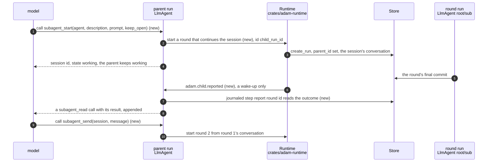
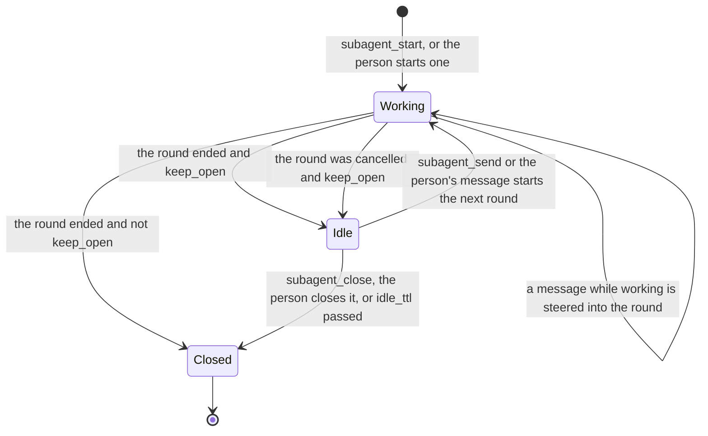

# 0045. A subagent can run in the background as a session the parent and the person talk to again

Status: **Accepted** (2026-11-14), the owner's decision: *"we need to add the capability that opencode has to create child
session, and exchange messages with it. At creation, there should be a button to auto-close after work is done, so that the
child session can further be reused."* The six defaults under [What was put to the owner](#what-was-put-to-the-owner) are
recommendations the owner was told the work proceeds with. Nothing of it is built. Reverses "one-shot child runs" and "no
resume" of [ADR 0039](0039-the-agent-loop-takes-opencodes-structure-and-agents-get-plugins.md); amends
[ADR 0037](0037-parallel-subagent-calls-and-an-editing-worker.md), [ADR 0003](0003-a-new-task-continues-the-task-it-references.md),
[ADR 0016](0016-a-message-sent-to-a-working-task-is-steered-into-it.md) and
[ADR 0034](0034-a-turn-that-asks-nothing-completes-and-scratch-lives-for-the-thread.md) (dated notes in each); follows
[ADR 0044](0044-paged-tools-a-stable-prompt-prefix-a-plan-skills-commands-and-project-context.md) decisions 1 and 2 for its
tools. The orchestration layer's side is its own ADR in `vymalo/another-agentic-system`.

## Context

*Verified 2026-11-14 by reading adam-rs at `103965f`:*

| Today | Where |
|---|---|
| One tool per subagent, `{message}`; each call is a child run with fresh context and **no conversation** (`start_child` passes `None`) | `crates/adam-runtime/src/runtime.rs` (`start_child`) |
| The parent **parks** until the child ends (`AwaitRun`, `PendingWait::Run`); calls of one turn run one after another | `crates/adam-llm-agent/src/agent.rs`, `src/conversation.rs` |
| A child cannot be sent a second message; cancelling the parent does not reach it; a local child has no time limit | [Child runs](../reference/child-runs.md) |
| A child may not ask the person: asking tools are refused in a subagent at bind time | `crates/adam-assembly/src/def.rs` |
| A remote `a2a:` subagent is `SendMessage` with `returnImmediately` and polling, with no `contextId` | `crates/adam-assembly/src/remote.rs` |
| The store allows one open run per agent and conversation, lists runs by a conversation prefix, and a new run can start from a finished one's conversation | `crates/adam-core/src/store/mod.rs`, `store/query.rs`; `init_continuing` in `runtime.rs` (ADR 0003) |
| A message to a working run is delivered to its inbox and read at its next step | `Runtime::deliver` (ADR 0016) |

OpenCode 2.3.0 (*verified 2026-11-14*, <https://opencode.ai/docs/agents/>, <https://opencode.ai/docs/tools/>): its `subagent`
tool starts a background child session and returns the session's id at once; the child reports to its parent each time it goes
idle; a later message to that id continues it with its context; child sessions resume after a restart; depth is 1 by default.

## Decision

1. **A child session is a child conversation holding a chain of child runs**, as a root A2A context holds tasks.
   * Each **round** is one run of `<root>/<subagent>` with `parent_id` set and a conversation id derived from the parent's
     context and the session id. Round n+1 starts from round n's conversation (`init_continuing`).
   * The session id is round 1's run id (`child_run_id(parent, call_id)`).
   * `Conversation::session` (new) is a round's header: `{id, agent, description, keep_open, closed}`. **The truth is the
     latest round's record**; nothing else stores a session.
   * A message to a working session is steered into its open round (`Runtime::deliver`). A message to an idle one starts the
     next round.
   * An idle session holds no run, no lease and no pod.
2. **"Close when done" is chosen at creation.** `keep_open: false` (the default) is today's one-shot child: the session closes
   when its round ends. `keep_open: true` leaves it idle after each round, to be sent more messages by the parent agent and
   by the person. A closed session is never reopened.
3. **Five tools with fixed schemas**, beside today's one tool per subagent, which stays for a synchronous ask. The only enum is
   the folder's subagent names, so the specs do not change within a run; results are paged (ADR 0044).

   | Tool | Arguments | Result |
   |---|---|---|
   | `subagent_start` | `agent`, `description` (at most 80 characters), `prompt`, `keep_open` | `{session, agent, state: "working", keep_open}`, at once |
   | `subagent_send` | `session`, `message` | `{session, round, state, delivered: "new_round" or "steered"}`; an error result when closed |
   | `subagent_read` | `session`, `wait`, `offset`, `limit` | `{session, state, round, report: {status, text, background} or null}` |
   | `subagent_close` | `session`, `cancel` | `{session, state: "closed"}` |
   | `subagent_list` | `offset`, `limit` | rows `{session, agent, description, state, round, keep_open}`, open first |

4. **The parent keeps working, and a report is read from the store.**
   * A start is an answered call: the parent does not park. Several children therefore run at once without ADR 0037's batches.
   * When a round ends, the child's commit notifies its parent with `adam.child.reported` (new; `adam.run.finished` stays for
     a one-shot child run with no conversation).
   * The notice only wakes the parent (Rule 5). A journaled step `report:<round id>` reads the round's outcome
     (`Ctx::child_status`) and the loop appends it as a `subagent_read` call with its result, behind any result it owes. It is
     data, never the person's words, and it is only appended.
   * A journaled step `children:<turn>` reads every working round before a model call, so a lost notice costs one turn at most.
     `Conversation::reported` (new) maps a session to the last round reported, so a notice delivered twice matches nothing.
   * `subagent_read { wait: true }` parks with `PendingWait::Session` (new) and the poll timer, as `PendingWait::Run` does.
   * **A parent's turn does not end while a round it started in that task still works**: it parks on those sessions. A report
     that arrives during the final model call reopens the turn, as a steered message does.
5. **Limits.** Each round keeps the subagent's own `limits:`. A session has `max_rounds` (20), a time limit per round (ADR 0044
   slice 10) and `idle_ttl` (7 days, after which it reads as closed). A parent conversation has `max_open` (16) and
   `max_working` (4). Depth stays 1: the session tools go to the root, and to a subagent only when its file asks.
6. **Cancel reaches the children.** Cancelling or failing a parent stops its working rounds; a kept-open session goes idle and
   stays usable. (ADR 0037 decision 7 said "done or failed": a done parent cannot have working rounds, by decision 4.)
7. **A session lives in the parent's context, not in its task.** A later task of the conversation finds its sessions by the
   prefix listing and may send to them. A round the person starts is reported to the parent agent, marked as the person's, at
   the parent's next `children:` step.
8. **Workspace.** A read-only child sees the slots of the parent's current task. An editing child that is kept open gets ADR
   0037's worker worktree keyed by **the session**, on branch `agent/<session>`, merged by the parent in any later task.
9. **Permissions.** A round the agent starts carries the parent's access tier and its inherited denies (ADR 0039 decision 3).
   A round the person starts carries the tier the person picked, capped by the subagent's own rules. A child may ask the
   person only in a kept-open session whose client activated the extension of decision 11; otherwise asking is refused, now
   per run instead of at bind time.
10. **Remote subagents get the same tools.** A remote session is a chain of local proxy rounds, each of which sends the
    message and polls. Round 1 names no `contextId` and adopts the remote's; round n sends it with `referenceTaskIds`. A
    message to a working remote is steered when its card lists `steer/v1`, else queued for the next round. A cancel sends
    `CancelTask`. Closing is local: A2A has no way to close a context.
11. **Clients learn of sessions through an optional extension**,
    `https://agents.vymalo.com/a2a/extensions/child-sessions/v1` (contract page in `vymalo/another-agentic-system`).
    * Card: `params { agents: [{name, description}], maxOpen }`.
    * Events on the parent task: `opened`, `round`, `reported`, `closed`, each with the session, its `contextId`, the agent,
      `keepOpen` and who acted.
    * A person starts a child with message metadata `{start: {agent, description, keepOpen}}`, talks to it with a plain
      `SendMessage` in the child's context, and closes it with a data part `{close: true}`.
    * Without activation a client sees `subagent_start` as an ordinary step and a child context is `InvalidParams`.

## Alternatives considered

* **Keep one-shot children and let the parent re-explain.** It is what ADR 0039 chose; the owner now asks for the opposite,
  and a long piece of delegated work loses its context at every call.
* **A session as a row of its own in the store.** A new `Store` method breaks every implementer (Rule 2); the chain of runs
  and the prefix listing already say everything a row would.
* **Deliver the report as a message from the person.** It would be untrue, and it would grant what only a person's words grant.
* **Let a parent's turn end with children working.** A late report would have to start a task nobody asked for.

## Consequences

* **Rule 2.** Additive: a runtime entry point that starts a continuing child, the notice kind, `Conversation::session` and
  `reported`, `PendingWait::Session`, the five tools, the extension. No new required `Store` method.
* **No mixed versions**, as for ADR 0037's `waits`: roll every worker before sessions are used.
* **Retention.** `purge_finished` must keep a finished round longer than `idle_ttl`.
* **Pages to update with the build:** [Child runs](../reference/child-runs.md), [Agent files](../reference/agent-files.md),
  [A2A server](../reference/a2a-server.md), [Architecture](../architecture.md), the READMEs of `adam-runtime`,
  `adam-llm-agent`, `adam-assembly`, `adam-a2a-runtime` and `bin/adam-coder`, and the `adam-a2a-extensions` skill.

## Slices

| Order | Slice | Proof | Depends on |
|---|---|---|---|
| 1 | **Runtime**: start a continuing child, the `adam.child.reported` kind, a session listing over `list_runs` | on all three stores: round 2 carries round 1; a second start while open is refused and a deliver steers | nothing |
| 2 | **The five tools**, the header, auto-close and close rounds, `PendingWait::Session`, the turn-end wait. The smallest slice that gives "start in the background, read the report, send another message" | start, read with wait, send round 2 with its context; a closed session refuses; replay and the interleavings of [Child runs](../reference/child-runs.md) | 1; ADR 0044 slice 2 |
| 3 | **Reports during a turn**: the `report:` and `children:` steps | a lost notice is recovered at the next turn; a duplicate is ignored; ADR 0044's prefix test holds | 2 |
| 4 | **Limits and the cancel that reaches children** | a round past its limit is an error result; a cancelled parent stops its rounds | 2; ADR 0044 slice 10 |
| 5 | **Remote sessions** | a mock agent: the context is kept across rounds, a steer when listed, `CancelTask` | 2 |
| 6 | **`child-sessions/v1`** in `adam-a2a-runtime` | a client opens, talks to and closes a child; without activation it is `InvalidParams` | 2 |
| 7 | **The coder**: kept-open `explorer` and `reviewer`; worker sessions | an e2e script | 6; ADR 0037's worker |
| 8 | **Asking from a visible child** | an `input-required` round and a `blocked` report | 6 |

## What was put to the owner

The work proceeds with these, told to the owner on 2026-11-14; a different answer is a dated note here.

1. "Close when done" is on by default, for the agent and for the person.
2. A parent's turn waits for the rounds it started.
3. A round the person starts is reported to the parent agent, marked as the person's.
4. A kept-open child may ask the person only when the client shows child sessions.
5. An editing child may be kept open, with a worktree per session, once the worker exists.
6. Today's one tool per subagent stays.
