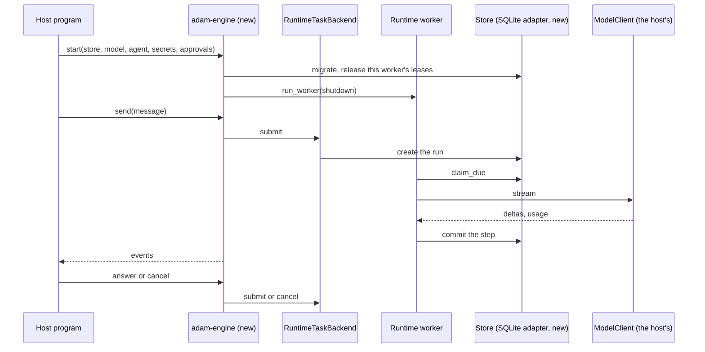
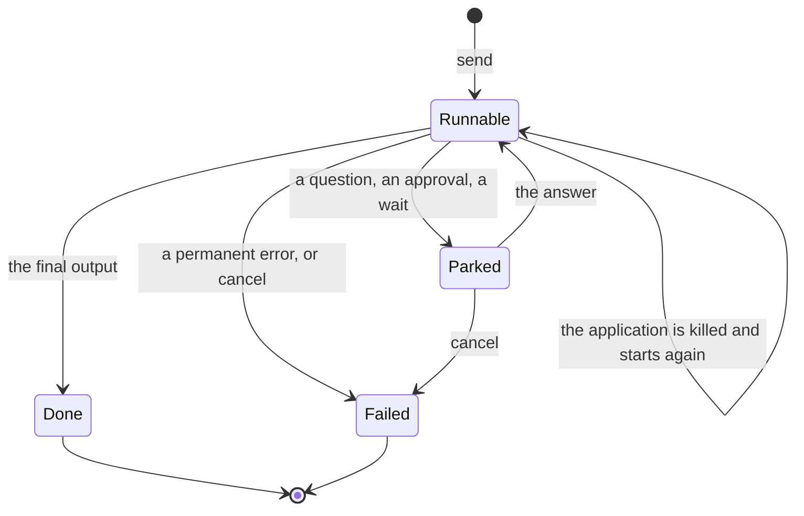

# 0047. adam-rs can be embedded in an application

Status: **Accepted** (2026-11-16), an owner decision: the six decisions at the end are confirmed as written. Nothing is
built; by the owner's order of the same day it is built after ADR 0044 and after
[ADR 0045](0045-a-subagent-can-run-in-the-background-as-a-session.md). *Amended 2026-11-16*: decision 9 and slice 10
(adam-rs as an ACP agent). The owner's words (2026-11-15): *"I just want adam-rs to be the
agent at the core of it. It'll use a sqlite on desktop. So we need to develop traits and features, so that we shall have
it possible for adam-rs to be embedded e.g. into a flutter app via frb, knowing that the core state of the app would be
managed by the rust part"*; *"It'll just be a library"*; *"We can use hexagonal port and adapter around adam-rs, so that
we can implement an adapter for cratestack"*. Builds on [ADR 0001](0001-library-first-host-roles.md),
[ADR 0036](0036-the-coder-keeps-to-the-access-tier-the-person-picks.md),
[ADR 0038](0038-the-coder-drops-opencode-and-adam-acp-stays-a-library.md) and
[ADR 0044](0044-paged-tools-a-stable-prompt-prefix-a-plan-skills-commands-and-project-context.md).

*Amended 2026-11-18 ([ADR 0050](0050-hooks-around-the-agent-loop-compiled-first-and-programs-second.md)):* decision 6's `ApprovalPolicy` is served by a deciding hook at `tool.before` that returns `Ask`, decided inside the call's step rather than before it, so the decision is recorded with the step and a replay never asks again. Slice 5 becomes an adapter over ADR 0050's approvals (its slice H8).

*Amended 2026-11-19 ([ADR 0053](0053-sqlite-a-store-service-a-database-per-agent-and-a-static-coder.md)), an owner decision:*
decision 3 is built differently. `adam-store-postgres` and `adam-notify-postgres` leave `sqlx` for `tokio-postgres`, so
`adam-store-sqlite` joins **the main workspace** (no workspace of its own), and it is plain `rusqlite` with bundled SQLite,
**not built on cratestack**: the `Store`'s statements are hand-written SQL that the embedded facade does not generate, and the
facade would bring its schema macro and Rust 1.98 to the phone's path. It keeps the `rusqlite` minor that `cratestack-rusqlite`
uses, so an application whose own state is on cratestack links one `sqlite3`. The rest of decision 3 (the conformance suite, one
writer, immediate transactions, WAL, `LocalNotifier`, the lock file) and decision 2's check on `adam-engine` stand. Slice 3 here is
ADR 0053's slice 3.

*Built 2026-11-19, slice 1* (the owner exempted this ADR's slices on 2026-11-19, so they start now; the epic is
vymalo/another-agentic-system#387): `adam-a2a`'s `server`, `adam-a2a-runtime`'s `push` and `adam-ui`'s `thread-tools`,
all on by default, so a server build is unchanged; `adam-engine` exists as the embedded set (its API is slice 4), and
`tools/embedded-deps/check.sh` (CI job `embedded`, part of the required `lint`) builds each split crate with its defaults
off and with each feature alone, and fails when `adam-engine`'s tree holds an HTTP server or client, the A2A SDK's server
or client, a database driver, the Kubernetes client, a TLS stack or the MCP client; its self-test plants `axum` and
`rustls` and turns two gates back on, and each fails it. Without `thread-tools`, `adam-ui` keeps the screen's tools over a
catalog a message carries (`Ui::embedded`) and `Ui::screen`, a source that adds the mentioned agents and describes `show`.
**Not yet:** `adam-assembly`'s `remote` gate, whose files another track holds (asked on the coordination channel), so
`adam-engine` does not depend on `adam-assembly` yet; and the check on Windows and macOS, which is slice 8's runner.
The model's credentials are ADR 0058's port: the host gives `ModelCredentials`, so the engine reads no key.

*Amended 2026-11-20: slice 1b is built.* `adam-assembly` has the feature `remote`, on by default, which gates the remote
(`a2a:`) subagents and the A2A client, `reqwest` and `url` they need; `a2a` turns it on. Without it `bind` refuses an
`a2a:` subagent with the new `Error::RemoteNotEnabled`, before any secret is read; `env`, `secrets`,
`allow_insecure_remotes`, `remote_timeout` and `connect_mcp` keep their signatures and behaviour. `adam` passes it on
(`remote`, in its defaults, over `adam-assembly` without defaults), and `adam-agent-fixture` takes `adam` without
defaults, so the dev-dependency cycle no longer turns `remote` on in `adam-assembly`'s own test builds; `check.sh`
asserts that with `cargo tree -e features`, builds `adam-assembly` with and without it (its doctests, `dev` and `mcp`
included), and its self-test turns `adam-assembly/remote` back on and finds `reqwest`, and plants the fixture's leak
and fails. A crate that takes `adam` with `default-features = false` loses remote subagents unless it adds `remote`. `adam-engine` now depends on `adam-assembly` without defaults. With
that, **decision 2's feature set is complete**: `server`, `push`, `remote` and `thread-tools`. The check on Windows and
macOS is still slice 8's runner.

## Context

A program that links adam-rs today takes `adam-service` (an HTTP server, Postgres, an OpenAI client, configuration read
from the environment) or composes `adam`, `adam-runtime` and `adam-a2a-runtime` itself. The second way still brings an
HTTP server and client, a second TLS provider and the MCP client, through `adam-a2a`, `adam-assembly` and `adam-ui`
(their `Cargo.toml`). The pieces an embedder needs are already ports:

| Port | Where | Adapters today |
|---|---|---|
| The run store | `Store`, `crates/adam-core/src/store/mod.rs`, with `adam-store-testkit` | Postgres, MongoDB, memory |
| Signals | `Notifier`, `crates/adam-runtime/src/notify.rs` | Postgres, `LocalNotifier` (in-process) |
| The model | `ModelClient`, `crates/adam-model/src/client.rs` | OpenAI-compatible, `MockModel` |
| Where commands run | `Environment` and `EnvSession`, `crates/adam-workspace/src/environment.rs` | local, Kubernetes |
| Tasks in and out | `TaskBackend`, `crates/adam-a2a/src/backend.rs`, implemented by `RuntimeTaskBackend` | the A2A server |

The runtime runs on the caller's tokio runtime (`Runtime::run_worker` takes a shutdown future,
`crates/adam-runtime/src/worker.rs`) and no library crate installs a signal handler. What is missing: a store for one
machine, ports for the three things that are still wired to a server (secrets read from the environment, no approval of a
tool call, the coder's file and command tools tied to its binary and to worktrees), and a way in that is not HTTP.

The first embedder is a desktop application whose own Rust core holds its state and alone calls the model service; it
keeps its state in SQLite through cratestack, whose embedded store is `rusqlite`. *Verified 2026-11-16* (the crates.io
index and a `cargo generate-lockfile` probe): `rusqlite` 0.41 needs `libsqlite3-sys` 0.39 or later, `sqlx-sqlite` 0.9
needs one below 0.38, and one build links one `sqlite3`; `sqlx` 0.9 with `json`, `chrono` and `uuid`, as
`adam-store-postgres` uses it, locks `sqlx-sqlite` even when nothing uses it, so a `rusqlite` crate cannot join this
workspace as it is.

## Decision

1. **Embedded, adam-rs is a library and speaks no protocol.** No server, no card, no bearer token, nothing on the
   network. A new crate, `adam-engine`, is the way in: it starts the runtime on the caller's tokio runtime and offers
   start, send (a new task, a follow-up, a message to a working task, an answer to a question), cancel, list and a stream
   of events, as a typed Rust API of adam's own with no A2A type in a public signature. Inside it calls
   `RuntimeTaskBackend`, the code the A2A server calls, so there is one implementation of follow-ups, steering and
   answers.
2. **A server build does not change; the embedded set is a choice of Cargo features.** `adam-a2a` gets a feature `server`,
   `adam-a2a-runtime` `push`, `adam-assembly` `remote`, `adam-ui` `thread-tools`, all on by default. A CI job fails when
   the dependency tree of `adam-engine` holds an HTTP server or client, a database driver, the Kubernetes client, a
   second TLS provider or the MCP client, and another checks the embedded set on Windows and macOS.
3. **The store is an adapter, and the SQLite one is built on cratestack.** It passes `store_conformance!` like every
   other: one writer, each change one immediate transaction, WAL, `LocalNotifier` for signals, and a lock file that
   refuses a second process (fail closed) and lets the engine release its own leases at start, so a killed application
   resumes its runs at once. It lives in this repository in **a Cargo workspace of its own**, with its own CI job, so the
   two SQLite bindings never share a dependency graph. adam owns its file and its schema; the host refers to a run by id.
   *Amended 2026-11-20:* the words "built on cratestack" and "a Cargo workspace of its own" here, "The SQLite store on
   cratestack, in its own workspace" in slice 3's row and "in a workspace of its own" in confirmed decision 2 are what the
   amendment of 2026-11-19 changed: by [ADR 0053](0053-sqlite-a-store-service-a-database-per-agent-and-a-static-coder.md),
   `adam-store-sqlite` is plain `rusqlite` in **the main workspace**, still in this repository. The text is kept as written.
4. **The model client is the host's.** The embedded set links no model client and reads no key.
5. **Secrets are a port.** A `SecretSource` trait replaces the direct reads of the process environment (a remote
   subagent's bearer, MCP variables). The process environment stays the default of a server; the engine's default
   refuses every name.
   *Built 2026-11-19 (slice 2):* `adam_core::SecretSource` with `ProcessEnv` (the default of `AgentDef` and
   `adam_mcp::Env`) and `NoSecrets`; `AgentDef::secrets` gives one source to the remote subagents and the MCP servers,
   after the values of `AgentDef::env`. A refused name is `RemoteAuthProblem::Refused` or `VarProblem::Refused`, and a
   `${VAR:-default}` keeps its default. `adam_engine::default_secrets()` is `NoSecrets` (its test is the slice's proof), and the engine's builder (slice 4)
   takes it as its default.
6. **A tool call can need the person's approval.** An `ApprovalPolicy` decides before a tool's journaled step: allow,
   refuse, or ask. An ask parks the run as a question; the answer runs or refuses **the same call**, once, and a replay
   never asks again. The access tiers of ADR 0036 decide what is asked.
7. **The file and command tools become a library over a workspace port.** They move from `bin/adam-coder` to a crate
   behind a `CodeWorkspace` trait. The coder implements it over its worktrees; a second implementation is **the person's
   own directory**, which a run never owns, cleans or restores: a command there reports what it changed and undoes
   nothing.
   *Amended 2026-11-19 (slice 6, step 2b):* the port is two traits in `adam-code-tools`. `CodeWorkspace` serves the
   file and search tools: the `Place` a tool works in (never a read-only one for a write), the redactor, the nested
   project instructions and, with the file tools, a required hook after a write. The commands get a trait that
   **extends** it and takes a `Place` from the same `place()`, so a command and a file tool find a place and refuse a
   write the same way. Its guard (record what a command changed, undo it) is the workspace's: the person's directory
   records and undoes nothing. The conformance cases are `adam-code-tools-testkit`.
   *Built 2026-11-20 (step 5b):* the commands' port, `adam_code_tools::commands::CommandWorkspace`, extends
   `CodeWorkspace` with three required methods: `session` (where a command runs; the implementation reports it to the
   call's usage), `limits` (`CommandLimits`: the timeout and the bytes of output shown) and `kept` (the `KeptOutputs` a long
   output is kept in). It is additive: an implementation of `CodeWorkspace` alone is unchanged. The plumbing that
   `run_command` and `run` share moved with it: `commands::run` (the body of the coder's `ToolEnv::run`, which now
   delegates), `environment_error`, `run_error` and `cancelled`, and the coder's `tools::output` whole as `adam_code_tools::output`
   (`settle` over the port, `timeout_of` over `CommandLimits`), behind thin wrappers in the coder, so no call site changed.
   `ToolEnv` and the testkit's `DirWorkspace` (a local session, settable limits, `MemoryKept`) implement it and pass
   `command_workspace_conformance!`; the pins of `tests/command_results.rs` and `tests/write_results.rs` pass unchanged.
   `session_error` and its advice to call `rebuild_environment` stay the coder's. **Not yet:** the guard (what a command
   changed, and its undo) and the tools themselves, step 5c; the trait's methods grow then.
   *Built 2026-11-20 (step 5c-1):* the guard is on the port, and `run_command` is `adam_code_tools::inspect::run_command`
   over it. **A break:** `CommandWorkspace` has two new required methods, `guard(ctx, place, Guarding)` (`Look` or `Make`;
   it returns a `CommandGuard` whose `settle` says `Unchanged`, `FilesChanged`, `Undone`, `Unreadable` or `Unwatched`, or
   the refusal the model is told) and `after_run(ctx, place)` (what follows a command that makes things; `run_command`
   never calls it), and two provided ones, `refusal_note` and `missing_tool_answer`; only `ToolEnv` and the testkit's
   `DirWorkspace` implement it here. The coder's guard, `SlotGuard`, wraps the worktree's `Snapshot`, which stays the
   coder's; the person's directory is never undone, so `DirWorkspace`'s guard is `Unwatched`. The coder's `#[tool]`
   declaration is unchanged and delegates; the pins of `tests/command_results.rs` and `tests/tool_specs.rs` pass
   unchanged. Three answers differ, each only where no workspace goes today: "the workspace lacks a tool" is shown
   after the workspace answers, so not at all when the coder's notes cannot be updated; a place that carries no `Slot`
   is refused, so a coder command never runs unguarded; and a look that reports `FilesChanged` (none does) says the
   files stay. **Not yet:** `run`, step 5c-2, which also decides whether a failing `after_run` should settle the guard
   first (today, as in the coder, a change to git then stays).
   *Built 2026-11-20 (step 5c-2):* `run` is `adam_code_tools::make::run`, so `run_command` and `run` are both crate
   functions over `CommandWorkspace`, with **no change to the trait**. `run` takes its place for a write and its guard
   for a `Make`, and calls `after_run` once for a command that ran, **before** the guard is settled, so the coder's
   check epoch moves for a command its guard then undoes too; the text of `after_run` (the coder's published note) is
   appended only when files changed. `ToolEnv::after_run` now moves the epoch and gives the note for `run`, once; the
   coder's own copy is gone. `git status` as text is `adam_code_tools::git::status_text`, re-exported by the coder. The
   `#[tool]` declaration is unchanged and delegates; the pins of `tests/command_results.rs` and `tests/tool_specs.rs`
   pass unchanged. Still the coder's: the background tools (`start_command`, `stop_command`, `list_commands`),
   `run_checks`, and `Snapshot` and its restores. **Kept as they are, and fixed next, each in a change of its own:** the
   list of changed files loses the first entry's leading space (`status_text` is trimmed), a file a command put back
   as `HEAD` is said to be ignored by the project, and a failing `after_run` drops the guard unsettled, so a change to
   git stays.
   *Amended 2026-11-20 (after step 5c-2):* the three are fixed. `status_text` is git's answer untrimmed, and a rename
   in the worktree only (` R`) is counted once; changed files that git lists none of are said to be ignored or back
   as `HEAD` has them, and with no answer from git, that git could not say; a failing `after_run` settles the guard
   before its error is returned (and logs a guard that could not restore the place), so a change to git is undone.
   The answers of `run` that change are pinned anew in the coder's `tests/command_results.rs` and the testkit's
   `tests/run.rs`.
8. **Commands run as the person unless a sandbox says otherwise.** A local sandbox is an `Environment`: first a process
   tree that can be killed, then the operating system's own confinement where there is one. `describe` says what is not
   protected.
9. **No ACP in this plan.** ADR 0038 stands: `adam-acp` stays a library that nothing here wires.
   *Amended 2026-11-16* (the owner): adam-rs speaks ACP **as an agent**, as slice 10 below. `adam-acp` today is the
   client half only (it drives an agent); the agent half is an adapter over `adam-engine` that speaks ACP on stdio, so an
   editor that hosts ACP agents can be a front end for adam-rs. It is a separate process and links nothing of the editor.
   The client half is still wired by nothing.

The states are `RunStatus` (`crates/adam-core/src/store/mod.rs`). A run that was claimed when the application was killed
is still `Runnable`: at the next start the engine releases its own leases and the worker claims it again.

## Consequences

* **Rule 2.** Three new ports (`SecretSource`, `ApprovalPolicy`, `CodeWorkspace`, the last as two traits, amended
  2026-11-19 under decision 7), each with a default that keeps
  today's behaviour, and each with a testkit. A consumer that sets `default-features = false` on the four split crates
  loses what the features gate; with the defaults nothing changes.
* **Rule 3.** No closed enum changes. *Amended 2026-11-20 (slice 1b):* one, stated: `adam_assembly::Error` gains
  `RemoteNotEnabled { origin }`, in every build, so a `match` on it without `_` breaks (the `adam-assembly` README says
  so under **Breaking**).
* **Rule 4.** The engine reads no environment variable and no file it was not given. An agent folder is embedded with
  `include_agent!` or named by the host.
* **Platforms.** Linux and macOS first for the tools and the sandbox. Windows builds the engine from the first slice and
  gets the tools after a Windows backend for the workspace code, which is Unix-only today
  (`crates/adam-workspace/src/safe_fs/`).
* **Not protected.** Until a sandbox backend exists, a command the person approved can do what the person can: their
  files, their network, their credentials.
* **Pages.** A new guide, `docs/guides/embed-in-an-app.md`; `docs/architecture.md`; the READMEs of the crates named
  here; the `adam-embed` and `adam-store-adapter` skills.

## Slices

| # | Slice | Proof | Needs |
|---|---|---|---|
| 1 | The feature split and the dependency check | every feature alone compiles; the forbidden crates are absent; Windows and macOS check | nothing |
| 2 | `SecretSource` | a name the environment has is refused by the engine's default | nothing |
| 3 | The SQLite store on cratestack, in its own workspace | the conformance suite; a second process is refused; a newer schema is refused | nothing |
| 4 | `adam-engine` with a chat agent, and an example embedder | send, steer, answer, cancel, list; a killed process resumes its run; a slow reader keeps memory bounded | 1, 3 |
| 5 | Approvals | yes runs the same call once; a replay never asks twice | 4 |
| 6 | The tools as a library | the coder's suite and its golden prompt unchanged | nothing |
| 7 | The person's directory, and a local agent | the example edits a file with a scripted model; nothing is restored | 5, 6 |
| 8 | The workspace and the tools on Windows and macOS | the same tests on hosted runners | 7 |
| 9 | The local sandbox | a write outside the directory is refused | 7, ADR 0044 slice 16 |
| 10 | adam-rs as an ACP agent (added 2026-11-16): an adapter over `adam-engine` on stdio | a scripted ACP client starts a session, prompts, answers a permission request and cancels | 4, 5 |

Slices 1 to 8 and 10 need nothing of what is left of ADR 0044.

*Built 2026-11-20 (slice 4, PRs 1–3):* `adam-engine`'s API, `Engine::builder`, `start`, `send`, `steer`, `answer`,
`cancel`, `list`, `get` and `shutdown`, over `RuntimeTaskBackend` with no A2A type in a signature (#240); a run's events,
`events`, with a slow reader kept bounded, a file's bytes withheld from the ring, and a dropped engine's run resumed by
the next over the same `MemoryStore` (#242); and an example embedder, `crates/adam-engine/examples/chat`, a terminal chat
over a folder agent whose model client (`adam-model-openai`) is a dev-dependency, so the embedded check is unchanged,
driven by `tests/example.rs`, with the guide `docs/guides/embed-in-an-app.md` (PR 3). **Slice 4 is not done until the
proof that a killed process resumes its run merges (PR 4):** `tests/resume_process.rs` (a child process killed with
`SIGKILL`, its run finished by the next without its committed step running again) is written and ignored until the
SQLite store of slice 3 (ADR 0053 slice 3) lands. Not built either: the engine sets no fixed worker id and releases no
lease at start (the first diagram's "release this worker's leases"), so a restarted engine waits for its old leases to
run out.
*Amended 2026-11-20:* built. `Limits::worker_id` is fixed (default `adam-engine`, empty refused) and `start` calls
`Store::release_worker_leases` after migrating, so a restarted engine claims its old runs at once; the id must be used by
one live engine per store (`a_restarted_engine_claims_its_old_runs_at_once` in `crates/adam-engine/tests/engine.rs`).

## Decisions the owner confirmed

Confirmed on 2026-11-16, all six as written.

1. The A2A types crate (data only, no HTTP) stays an **internal** dependency of `adam-engine`, because decision 1 reuses
   `RuntimeTaskBackend`. Removing it from the tree is one more slice: move that logic below the A2A layer.
2. The SQLite adapter lives **here**, in a workspace of its own, rather than in the host's repository.
3. One process per database file, enforced by a lock file.
4. Approvals are announced to A2A clients as a new extension, not as part of `access-tier/v1`.
5. The first operating-system sandbox is macOS's, then Linux's; Windows last.
6. The crate is named `adam-engine` (`adam-embed` is a skill's name).

Added on 2026-11-16, after a check of whether an editor's own agent could be embedded instead: slice 10, adam-rs as an
ACP agent.

## Verified and unverified

* *Verified 2026-11-16*: the SQLite binding conflict and its two probes (Context); cratestack's embedded store is
  `rusqlite` 0.41.1 with bundled SQLite and offers the raw connection for hand-written transactions (its `README.md` and
  `Cargo.toml` at 0.20.1, `crates/cratestack-rusqlite/src/runtime.rs`).
* *Verified 2026-11-16* (the `main` branch of `zed-industries/zed`): the `agent` crate of the Zed editor is
  `GPL-3.0-or-later` (`crates/agent/Cargo.toml`), its workspace sets `publish = false` (`Cargo.toml`), and its docs describe
  a custom agent as a separate process that speaks ACP (`docs/ai/external-agents`). So an editor is a front end for
  adam-rs over ACP, and its agent is not a library to link.
* *Unverified*: every claim about building on macOS and Windows; flutter_rust_bridge's behaviour with streams; whether a
  cratestack schema can say a partial unique index and a composite key; every operating-system sandbox; that a step that
  panics leaves the worker alive.
