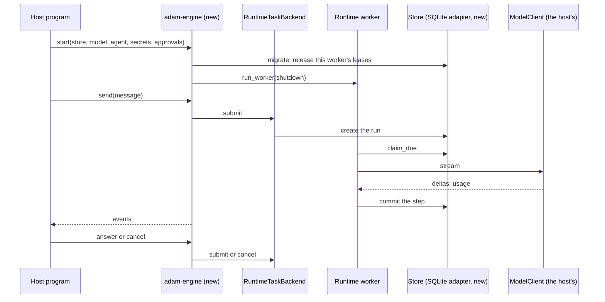
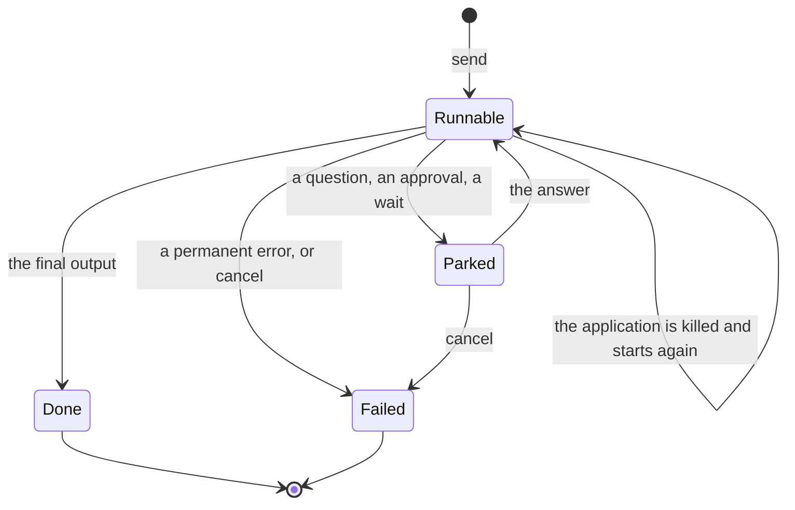

# 0047. adam-rs can be embedded in an application

Status: **Accepted** (2026-11-16), an owner decision: the six decisions at the end are confirmed as written. Nothing is
built; by the owner's order of the same day it is built after ADR 0044 and after
[ADR 0045](0045-a-subagent-can-run-in-the-background-as-a-session.md). *Amended 2026-11-16*: decision 9 and slice 10
(adam-rs as an ACP agent). The owner's words (2026-11-15): *"I just want adam-rs to be the
agent at the core of it. It'll use a sqlite on desktop. So we need to develop traits and features, so that we shall have
it possible for adam-rs to be embedded e.g. into a flutter app via frb, knowing that the core state of the app would be
managed by the rust part"*; *"It'll just be a library"*; *"We can use hexagonal port and adapter around adam-rs, so that
we can implement an adapter for cratestack"*. Builds on [ADR 0001](0001-library-first-host-roles.md),
[ADR 0036](0036-the-coder-keeps-to-the-access-tier-the-person-picks.md),
[ADR 0038](0038-the-coder-drops-opencode-and-adam-acp-stays-a-library.md) and
[ADR 0044](0044-paged-tools-a-stable-prompt-prefix-a-plan-skills-commands-and-project-context.md).

*Amended 2026-11-18 ([ADR 0050](0050-hooks-around-the-agent-loop-compiled-first-and-programs-second.md)):* decision 6's `ApprovalPolicy` is served by a deciding hook at `tool.before` that returns `Ask`, decided inside the call's step rather than before it, so the decision is recorded with the step and a replay never asks again. Slice 5 becomes an adapter over ADR 0050's approvals (its slice H8).

## Context

A program that links adam-rs today takes `adam-service` (an HTTP server, Postgres, an OpenAI client, configuration read
from the environment) or composes `adam`, `adam-runtime` and `adam-a2a-runtime` itself. The second way still brings an
HTTP server and client, a second TLS provider and the MCP client, through `adam-a2a`, `adam-assembly` and `adam-ui`
(their `Cargo.toml`). The pieces an embedder needs are already ports:

| Port | Where | Adapters today |
|---|---|---|
| The run store | `Store`, `crates/adam-core/src/store/mod.rs`, with `adam-store-testkit` | Postgres, MongoDB, memory |
| Signals | `Notifier`, `crates/adam-runtime/src/notify.rs` | Postgres, `LocalNotifier` (in-process) |
| The model | `ModelClient`, `crates/adam-model/src/client.rs` | OpenAI-compatible, `MockModel` |
| Where commands run | `Environment` and `EnvSession`, `crates/adam-workspace/src/environment.rs` | local, Kubernetes |
| Tasks in and out | `TaskBackend`, `crates/adam-a2a/src/backend.rs`, implemented by `RuntimeTaskBackend` | the A2A server |

The runtime runs on the caller's tokio runtime (`Runtime::run_worker` takes a shutdown future,
`crates/adam-runtime/src/worker.rs`) and no library crate installs a signal handler. What is missing: a store for one
machine, ports for the three things that are still wired to a server (secrets read from the environment, no approval of a
tool call, the coder's file and command tools tied to its binary and to worktrees), and a way in that is not HTTP.

The first embedder is a desktop application whose own Rust core holds its state and alone calls the model service; it
keeps its state in SQLite through cratestack, whose embedded store is `rusqlite`. *Verified 2026-11-16* (the crates.io
index and a `cargo generate-lockfile` probe): `rusqlite` 0.41 needs `libsqlite3-sys` 0.39 or later, `sqlx-sqlite` 0.9
needs one below 0.38, and one build links one `sqlite3`; `sqlx` 0.9 with `json`, `chrono` and `uuid`, as
`adam-store-postgres` uses it, locks `sqlx-sqlite` even when nothing uses it, so a `rusqlite` crate cannot join this
workspace as it is.

## Decision

1. **Embedded, adam-rs is a library and speaks no protocol.** No server, no card, no bearer token, nothing on the
   network. A new crate, `adam-engine`, is the way in: it starts the runtime on the caller's tokio runtime and offers
   start, send (a new task, a follow-up, a message to a working task, an answer to a question), cancel, list and a stream
   of events, as a typed Rust API of adam's own with no A2A type in a public signature. Inside it calls
   `RuntimeTaskBackend`, the code the A2A server calls, so there is one implementation of follow-ups, steering and
   answers.
2. **A server build does not change; the embedded set is a choice of Cargo features.** `adam-a2a` gets a feature `server`,
   `adam-a2a-runtime` `push`, `adam-assembly` `remote`, `adam-ui` `thread-tools`, all on by default. A CI job fails when
   the dependency tree of `adam-engine` holds an HTTP server or client, a database driver, the Kubernetes client, a
   second TLS provider or the MCP client, and another checks the embedded set on Windows and macOS.
3. **The store is an adapter, and the SQLite one is built on cratestack.** It passes `store_conformance!` like every
   other: one writer, each change one immediate transaction, WAL, `LocalNotifier` for signals, and a lock file that
   refuses a second process (fail closed) and lets the engine release its own leases at start, so a killed application
   resumes its runs at once. It lives in this repository in **a Cargo workspace of its own**, with its own CI job, so the
   two SQLite bindings never share a dependency graph. adam owns its file and its schema; the host refers to a run by id.
4. **The model client is the host's.** The embedded set links no model client and reads no key.
5. **Secrets are a port.** A `SecretSource` trait replaces the direct reads of the process environment (a remote
   subagent's bearer, MCP variables). The process environment stays the default of a server; the engine's default
   refuses every name.
6. **A tool call can need the person's approval.** An `ApprovalPolicy` decides before a tool's journaled step: allow,
   refuse, or ask. An ask parks the run as a question; the answer runs or refuses **the same call**, once, and a replay
   never asks again. The access tiers of ADR 0036 decide what is asked.
7. **The file and command tools become a library over a workspace port.** They move from `bin/adam-coder` to a crate
   behind a `CodeWorkspace` trait. The coder implements it over its worktrees; a second implementation is **the person's
   own directory**, which a run never owns, cleans or restores: a command there reports what it changed and undoes
   nothing.
8. **Commands run as the person unless a sandbox says otherwise.** A local sandbox is an `Environment`: first a process
   tree that can be killed, then the operating system's own confinement where there is one. `describe` says what is not
   protected.
9. **No ACP in this plan.** ADR 0038 stands: `adam-acp` stays a library that nothing here wires.
   *Amended 2026-11-16* (the owner): adam-rs speaks ACP **as an agent**, as slice 10 below. `adam-acp` today is the
   client half only (it drives an agent); the agent half is an adapter over `adam-engine` that speaks ACP on stdio, so an
   editor that hosts ACP agents can be a front end for adam-rs. It is a separate process and links nothing of the editor.
   The client half is still wired by nothing.

The states are `RunStatus` (`crates/adam-core/src/store/mod.rs`). A run that was claimed when the application was killed
is still `Runnable`: at the next start the engine releases its own leases and the worker claims it again.

## Consequences

* **Rule 2.** Three new traits (`SecretSource`, `ApprovalPolicy`, `CodeWorkspace`), each with a default that keeps
  today's behaviour, and each with a testkit. A consumer that sets `default-features = false` on the four split crates
  loses what the features gate; with the defaults nothing changes.
* **Rule 3.** No closed enum changes.
* **Rule 4.** The engine reads no environment variable and no file it was not given. An agent folder is embedded with
  `include_agent!` or named by the host.
* **Platforms.** Linux and macOS first for the tools and the sandbox. Windows builds the engine from the first slice and
  gets the tools after a Windows backend for the workspace code, which is Unix-only today
  (`crates/adam-workspace/src/safe_fs/`).
* **Not protected.** Until a sandbox backend exists, a command the person approved can do what the person can: their
  files, their network, their credentials.
* **Pages.** A new guide, `docs/guides/embed-in-an-app.md`; `docs/architecture.md`; the READMEs of the crates named
  here; the `adam-embed` and `adam-store-adapter` skills.

## Slices

| # | Slice | Proof | Needs |
|---|---|---|---|
| 1 | The feature split and the dependency check | every feature alone compiles; the forbidden crates are absent; Windows and macOS check | nothing |
| 2 | `SecretSource` | a name the environment has is refused by the engine's default | nothing |
| 3 | The SQLite store on cratestack, in its own workspace | the conformance suite; a second process is refused; a newer schema is refused | nothing |
| 4 | `adam-engine` with a chat agent, and an example embedder | send, steer, answer, cancel, list; a killed process resumes its run; a slow reader keeps memory bounded | 1, 3 |
| 5 | Approvals | yes runs the same call once; a replay never asks twice | 4 |
| 6 | The tools as a library | the coder's suite and its golden prompt unchanged | nothing |
| 7 | The person's directory, and a local agent | the example edits a file with a scripted model; nothing is restored | 5, 6 |
| 8 | The workspace and the tools on Windows and macOS | the same tests on hosted runners | 7 |
| 9 | The local sandbox | a write outside the directory is refused | 7, ADR 0044 slice 16 |
| 10 | adam-rs as an ACP agent (added 2026-11-16): an adapter over `adam-engine` on stdio | a scripted ACP client starts a session, prompts, answers a permission request and cancels | 4, 5 |

Slices 1 to 8 and 10 need nothing of what is left of ADR 0044.

## Decisions the owner confirmed

Confirmed on 2026-11-16, all six as written.

1. The A2A types crate (data only, no HTTP) stays an **internal** dependency of `adam-engine`, because decision 1 reuses
   `RuntimeTaskBackend`. Removing it from the tree is one more slice: move that logic below the A2A layer.
2. The SQLite adapter lives **here**, in a workspace of its own, rather than in the host's repository.
3. One process per database file, enforced by a lock file.
4. Approvals are announced to A2A clients as a new extension, not as part of `access-tier/v1`.
5. The first operating-system sandbox is macOS's, then Linux's; Windows last.
6. The crate is named `adam-engine` (`adam-embed` is a skill's name).

Added on 2026-11-16, after a check of whether an editor's own agent could be embedded instead: slice 10, adam-rs as an
ACP agent.

## Verified and unverified

* *Verified 2026-11-16*: the SQLite binding conflict and its two probes (Context); cratestack's embedded store is
  `rusqlite` 0.41.1 with bundled SQLite and offers the raw connection for hand-written transactions (its `README.md` and
  `Cargo.toml` at 0.20.1, `crates/cratestack-rusqlite/src/runtime.rs`).
* *Verified 2026-11-16* (the `main` branch of `zed-industries/zed`): the `agent` crate of the Zed editor is
  `GPL-3.0-or-later` (`crates/agent/Cargo.toml`), its workspace sets `publish = false` (`Cargo.toml`), and its docs describe
  a custom agent as a separate process that speaks ACP (`docs/ai/external-agents`). So an editor is a front end for
  adam-rs over ACP, and its agent is not a library to link.
* *Unverified*: every claim about building on macOS and Windows; flutter_rust_bridge's behaviour with streams; whether a
  cratestack schema can say a partial unique index and a composite key; every operating-system sandbox; that a step that
  panics leaves the worker alive.
