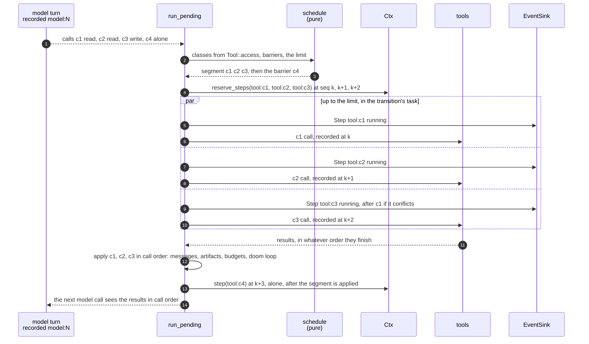
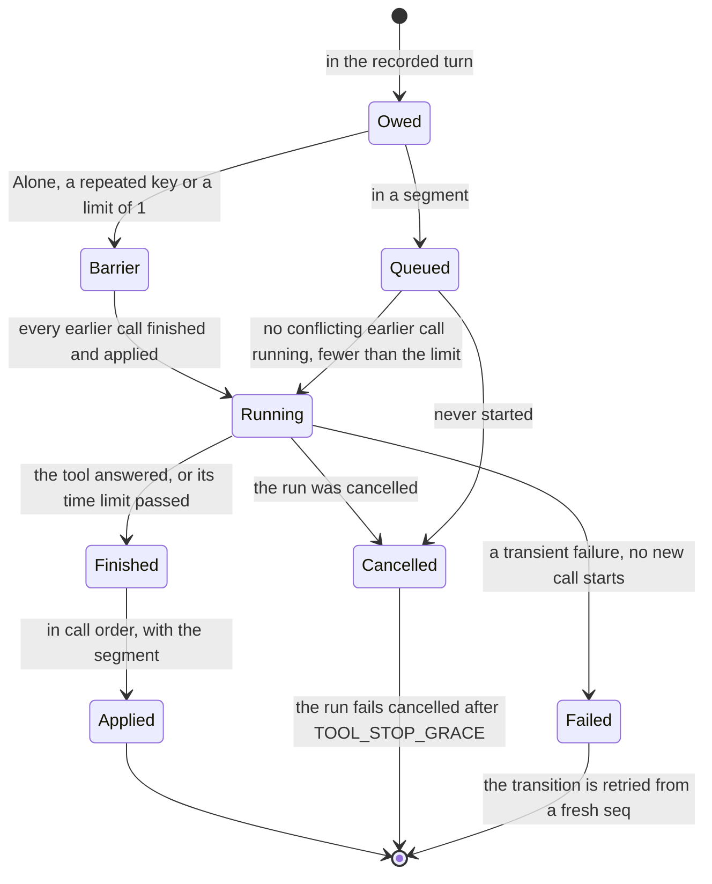

# 0049. The tool calls of a turn run at the same time

Status: **Accepted** (2026-11-17), an owner decision. Two sentences of the owner's decide it:

> *"adam should run tools in parallel with a max of 10, configurable. So that the model can request 4 tools and get them called at once."*

> *"we can make tool call sync on demand by the agent, and async by default."*

The owner then accepted every recommendation of the plan that follows ("Accept all", 2026-11-17). Amends
[ADR 0037](0037-parallel-subagent-calls-and-an-editing-worker.md) (decisions 1 to 3) and
[ADR 0039](0039-the-agent-loop-takes-opencodes-structure-and-agents-get-plugins.md) (its slice 2). Built in slices P0 to P9;
the status of each is in *Slices*.

## Context

What the loop does today, *verified 2026-11-17 by reading `49e2d2b`*:

| Fact | Where |
|---|---|
| `run_pending` takes the first owed call, runs it as the journaled step `tool:<call id>`, applies its result and takes the next. A turn of four reads takes four times as long as one. | `crates/adam-llm-agent/src/agent.rs` `run_pending`, `run_tool` |
| A cancel is checked between calls. A running call sees it through its `ToolCtx` token, a child of the run's (`within`). | `run_pending`, `within` |
| `doom_loop` is decided before a call from the committed state, and `repeats` is updated from each result, so call *i*'s decision depends on the result of call *i-1*. | `run_pending`, `record_answer` |
| `max_tool_calls` is counted when the model asks. | `model_turn` |
| `Ctx::step(&mut self, ..)` takes the next seq, runs the work if nothing is recorded, writes it, and moves to `seq + 1`. `Store::journal_put` takes seqs in any order. | `crates/adam-runtime/src/ctx.rs`, `crates/adam-core/src/store/mod.rs` |
| `Tool` has `asks_user`, `paged`, `time_limit` and `step_style`: no declaration of what a call shares with the others. | `crates/adam-llm-agent/src/tool.rs` |
| adam never sends `parallel_tool_calls`; `MODEL_EXTRA_BODY` may. | `crates/adam-model-openai/src/wire.rs`, `docs/reference/environment.md` |
| `run_command` snapshots its slot before the command and **restores** any difference after it, so an `edit_file` in the same slot during a command would be undone. | `bin/adam-coder/src/tools/inspect.rs` |
| `NotesStore::save` is atomic (temp file and rename) but not locked: two tools that load, change and save the notes at once lose a write. | `bin/adam-coder/src/tools/notes.rs` |
| `Environment::ensure` is single-flight per run. The git sandbox runs at most `GIT_SANDBOX_MAX_COMMANDS` (64) commands at once. | `adam-env-kubernetes`, `adam-devcontainer`, `adam-git-sandbox` |
| A2A `steps/v1` throttles per step id, so several running steps each get their start and their end. | `crates/adam-a2a-runtime/src/subscribe.rs` |

How OpenCode V2 does it, *verified 2026-11-17* at tag `v2.3.0` (`a6b15d33`) of `github.com/anomalyco/opencode`, the repository
npm `@opencode/cli@2.3.0` names (paths under `packages/`):

| Fact | Source |
|---|---|
| Every `tool-call` event of the model's stream forks a fiber at once, with no concurrency limit. | `core/src/session/runner/step.ts:135-158` |
| The step waits for every call; on a stop, cooperative tools are asked to cancel and the rest are interrupted after `COOPERATIVE_STOP` (5 s). | `step.ts:106-117,166-186,370,66` |
| Results go back to the model in the order of the calls, not the order they finish. | `core/src/session/runner/to-llm-message.ts:218-223` |
| Writes to one file are serialised by a process-local mutex keyed by path. | `core/src/file-mutation.ts:36-37,68-88` |
| `parallel_tool_calls` is sent only when configured; the system prompts of several models push batching. There is no per-call ordering flag. | `ai/src/protocols/open-responses.ts:847-852`; `core/src/plugin/system-prompt/*.txt` |

adam takes the results in call order, the per-path write lock (as scheduling, here) and a prompt line that pushes batching. It
does not take calls started while the model still streams (the journal needs the recorded turn first), an unbounded number
at once, or "interrupted" answers (adam replays).

## Decisions

1. **All calls of a turn run concurrently, up to a limit, and conflicts are scheduled.** The limit is 10 by default and 1 to
   32 (`LlmAgentBuilder::max_parallel`, and later the deployment's `MAX_PARALLEL_TOOL_CALLS`). More calls than the limit wait
   in a queue inside the turn and start in call order; a call is never refused for it. A limit of 1 is today's behaviour.
2. **A tool declares what a call shares: `Tool::access(&self, &Value) -> ToolAccess`**, from the call's arguments (which come
   from the recorded turn, so it is deterministic):

   ```rust
   #[non_exhaustive]
   pub enum ToolAccess {
       Independent,          // shares nothing with the run's other calls
       Uses(Vec<Use>),       // Use { mode: Read | Write, scope: String }
       Alone,                // the default
   }
   ```

   A scope is an opaque key with `/` levels (`files`, `files/src/a.rs`, `commands`). Two uses **overlap** when one scope equals
   the other or is a prefix of it at a `/`. Two calls **conflict** when one is `Alone`, or when they have overlapping uses and
   at least one writes. `ToolSource::access(&self, name, args)` does the same for a source's tools (the first source that does
   not answer `Alone` decides; a source answers `Independent` or `Uses` only for a tool it offers).
   `#[tool(parallel = "independent" | "read" | "write" | "exclusive", path = "<argument>", access = path::to::fn)]` and
   `FnTool::with_access` declare it for a function. `read` and `write` use `files`, or `files/<normalised path>` with `path`
   (lexical normalisation: `./` dropped, `a/./b` folded; an absolute path or one with `..` widens to `files`). A wrapper must
   forward `access`, as it forwards `asks_user`; one that does not makes the tool `Alone`, which is safe. The class is on
   `Tool`, not in `ToolSpec`, which is the model-facing type with public fields. `ToolAccess` and `Use` are
   `#[non_exhaustive]` **on purpose, and unlike the closed enums of `CLAUDE.md` Rule 3** (`Role`, `Placement`,
   `ClaimScope`): a new class or a new field of a use must not break every tool author's build, and a consumer that
   matches `ToolAccess` has no reason to fail to compile on a new variant (it treats an unknown one as `Alone`).
   `UseMode` is closed (`Read`, `Write`): a third mode would change what conflicts, so every consumer must see it.
3. **A tool that declares nothing is `Alone`** (fail closed): it is code adam does not know, and one attribute opts in. Every
   first-party tool declares its class (slices P7 and P8). MCP tools are `Independent` by default, with `"parallel": false`
   per server in `mcp.json` to make them `Alone` (slice P7).
4. **The loop forces `Alone`, whatever a tool says,** for `asks_user()` tools, the session tools (`SUBAGENT_START`, `SEND`,
   `READ`, `CLOSE`), any tool that can park the run (`AwaitRun`, `AwaitSession`, `AwaitRemote`: the subagent tools), and every
   call when the limit is 1. A call with the same key as the call just before it (for the first call, the committed
   `repeats.key`) is a **barrier** too, because `doom_loop` needs that result applied.
5. **Segments.** A *segment* is the run of calls between two barriers; an `Alone` call is a barrier and a segment of its own.
   A barrier starts when every earlier call has finished and its result has been **applied in call order**, and nothing after
   it starts before it is done. Inside a segment, call *j* waits for each earlier call *i* it conflicts with; otherwise it
   starts as soon as fewer than the limit are running. Ready calls start in call order.
6. **The journal is the sequential journal.** `Ctx::reserve_steps` takes the seqs `k .. k+n-1` of a segment's calls in call
   order and `ReservedStep::run` records each at its own seq (`Ctx::step_all` is the convenience form). Only barrier calls can
   be followed by extra steps (`usage:`, `ctx.now`), so the tool steps of a segment have the names and seqs the sequential loop
   gives them: a replay works with any limit, a rollback to a sequential build replays, and changing the limit mid-run is
   harmless.
7. **Results go back in the model's order.** Messages, artifacts, the file budget, kept outputs, the plan and the doom-loop
   count are applied **in call order** after the segment, whatever order the calls finished in. Step events are said live: a
   `running` event when a call actually starts and its end when it finishes, both with the call's id; if applying the result
   changes the outcome (a file refused by the budget), a corrected end event follows. The room for kept outputs, the room
   for files (`ToolCtx::spend_files`) and the image gate are one budget for the segment and are enforced again when
   results are applied.
8. **A crash in the middle of a segment** replays the same seqs: recorded calls are not run again and unrecorded calls run
   again (at-least-once, as today). A `Read` is harmless to repeat, a `Write` must be retry-safe (the coder's write tools
   are), an `Independent` call has the contract of one MCP call today, and an `Alone` call is alone, so at most one is in
   flight. No call is answered "interrupted": without a start marker adam cannot tell "never started" from "started", and
   a marker would be a second journal write per call. OpenCode answers that way because it has no replay.
9. **A transient failure of one call** stops new starts, waits for the running calls to end within their time limits, and
   fails the transition transiently; the retry from a fresh seq runs the turn's calls again. (`Tool`'s doc said "every tool of
   the same model turn that ran before it"; it now says every call of the turn that started in the failed try.)
10. **A cancel** is checked before each start. Calls not yet started never start. Running calls have the run's token, as
    today, and the loop waits up to `TOOL_STOP_GRACE` (5 s) for them, then drops their futures and fails the run `cancelled`.
11. **A call that cannot run in a segment of several** and still returns `NeedsInput`, `Await*` or a result with
    `reported` rounds there (a declaration bug; `ToolOutput::reported` is honoured only from tools that run alone) is
    answered with an error result, "this tool cannot run alongside others: call it alone". The outcome is recorded, so a replay
    agrees, and a test catches the bug.
12. **Sync on demand** is a reserved optional boolean argument, `after_previous`, injected into every schema when the limit is
    above 1 and stripped before the tool, `Tool::access`, `call_key`, hooks and the step's input see the call. A call with it
    is a barrier. Slice P6 builds it; a one-sentence addition to the instructions says what it means. Alternatives weighed:
    `after: [index]` (positions are error-prone for models, and needs cycle checks), a wrapper `run_in_order { calls }` (inner
    arguments no schema validates, one result for many calls), and a barrier tool `then {}` (a meaningless call and result in
    the history). The fallback if the extra tokens (an estimate: 300 to 400 per request for about 40 tools) matter is `then {}`.
13. **`parallel_tool_calls` is not sent.** adam leaves it to the provider (on OpenAI it defaults to `true`, *verified
    2026-10-11*, `openai/openai-openapi`, recorded in ADR 0037); `MODEL_EXTRA_BODY` can force it. At a limit of 1 `false` is
    not sent either: the model would make more turns. Whether the owner's gateway and model ask for several calls per turn is
    *unverified*. No call starts while the model is still streaming.
14. **Commands, notes and one-shot subagents.** In v1 the coder runs one command at a time per workspace (`Write commands`,
    alongside reads), because `run_command` restores any change it did not make. `NotesStore::update` (a per-run async mutex
    around load, change and atomic save) makes concurrent note writes safe. One-shot subagent calls stay `Alone`; background
    sessions ([ADR 0045](0045-a-subagent-can-run-in-the-background-as-a-session.md)) are the way to children side by side, and
    ADR 0037's `waits` and `held` are a later slice (P10). There is no per-process cap: `WORKERS` times the limit bounds it,
    and the git sandbox queues beyond 64 commands.

The owner's examples:

| Turn | What runs |
|---|---|
| 4 reads (`read_file`, `search_files`, `list_files`, `find_files`, any files) | all 4 at once, about 1x instead of 4x |
| 2 reads and an edit | all 3 at once; a read of the edited file keeps the model's order with the edit, and the other read runs alongside |
| 3 commands (`run_command`) | one after another, as today, alongside any reads or MCP calls of the turn |
| 4 GitHub MCP reads | all 4 at once |





## Consequences

*Rule 2 of `CLAUDE.md`.*

* **Additive:** `Tool::access`, `ToolSource::access`, `ToolAccess`, `Use`, `UseMode`, the `#[tool]` options,
  `FnTool::with_access`, `Ctx::reserve_steps`, `ReservedStep`, `Ctx::step_all`, `LlmAgentBuilder::max_parallel`
  (slice P4), and later `NotesStore::update`.
* **Not additive, in later slices:** `adam_agent_fs::Limits` gains `max_parallel` (a struct literal breaks); the `adam-service`
  `Config` and the MCP server config gain a field; the MCP tool calls of every folder agent now run concurrently; the prompt
  prefix changes once; the chart renders a new key. Say each in the pull request and in `adam-upgrade`.
* **Slices P1 to P4 change no behaviour in production:** every first-party tool is `Alone` until its class is declared, so
  the loop runs one call at a time as before. Tests of the loop with declared test tools prove the rest.
* The plan for hooks becomes ADR 0050.

## Slices

| # | Slice | State |
|---|---|---|
| P0 | this ADR, the notes on ADRs 0037 and 0039, `docs/architecture.md` | built |
| P1 | `Ctx::reserve_steps`, `ReservedStep`, `Ctx::step_all` | built |
| P2 | `ToolAccess`, `Use`, `Tool::access`, `ToolSource::access`, `#[tool(parallel, path, access)]`, `FnTool::with_access`, forwarding in every wrapper | built |
| P3 | `schedule.rs`: segments, conflicts, barriers, the queue (pure) | built |
| P4 | `run_pending` by segments, `LlmAgentBuilder::max_parallel` | built |
| P5 | `MAX_PARALLEL_TOOL_CALLS`, `limits.max_parallel`, the chart key | not built |
| P6 | `after_previous` | not built |
| P7 | classes of the library tools: MCP, UI, assembly, `read_output` | not built |
| P8 | the coder: `NotesStore::update`, the class table, atomic writes | not built |
| P9 | the batching sentence, the bench pin, calls per turn in the bench | not built |
| P10 | ADR 0037 decision 4 (`waits`, `held`) so subagent and remote calls join segments | later |

*Unverified:* that GitHub tag `v2.3.0` is byte for byte the published binaries; that a provider requires tool results in call
order (they are in call order anyway); the owner's gateway and model asking for several calls per turn; the steps panel of
`vymalo/another-agentic-system` with concurrent steps; that the coder's `write_file` and `edit_file` write atomically; the
token estimate for `after_previous`.
