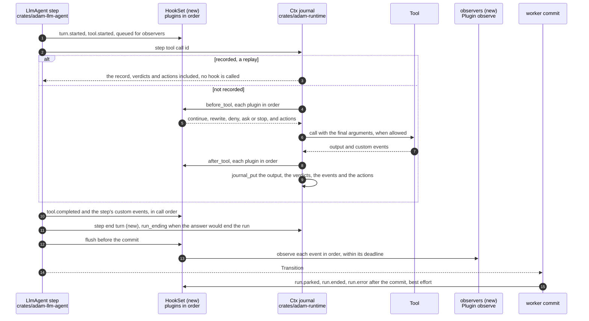
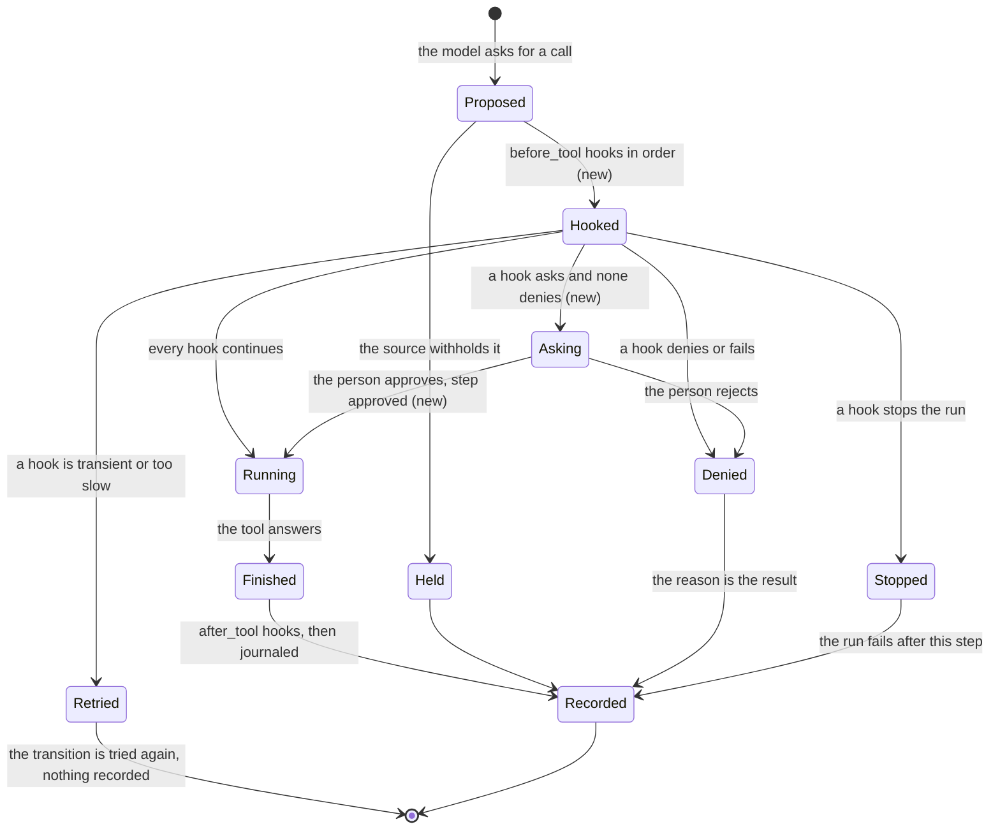

# 0050. Hooks around the agent loop, compiled first and programs second

Status: **Accepted** (2026-11-18), an owner decision. Asked which kind of hooks adam-rs should have, compiled ones or
programs, the owner said (2026-11-17):

> *"Both, and for all events around the loop, and with the possibility of custom events too. Compiled first."*

The owner then accepted the recommendations that follow (2026-11-17), with three answers of their own, quoted where they
decide something: a hook may refuse a person's message (decision 9), a hook may keep a run going at its end (decision 10),
and a hook never writes a compaction summary but may ask the loop for one (decision 11). Nothing is built; the build
order is in [Slices](#slices). Extends [ADR 0039](0039-the-agent-loop-takes-opencodes-structure-and-agents-get-plugins.md)
(decisions 7 to 9, `Plugin`) and reverses its owner's answer 4 ("no out-of-process plugins now"); follows
[ADR 0049](0049-the-tool-calls-of-a-turn-run-at-the-same-time.md) (the calls of a turn run at the same time); amends
[ADR 0044](0044-paged-tools-a-stable-prompt-prefix-a-plan-skills-commands-and-project-context.md) (the `compacting` hook)
and [ADR 0047](0047-adam-rs-can-be-embedded-in-an-application.md) (decision 6, approvals). Dated notes in each.

## Context

What the loop is today, *verified 2026-11-18 by reading `351072b`*:

| Fact | Where |
|---|---|
| No `Plugin` trait, no `before_tool`, no `ExecHook` in the code: ADR 0039's plugins are not built | grep of `crates/`, `bin/` |
| A tool call is the journaled step `tool:<call id>`; the calls of a turn run in segments, their steps reserved in call order and run at the same time, results applied in call order | `crates/adam-llm-agent/src/agent.rs` (`run_pending`, `run_tool`), `Ctx::reserve_steps` in `crates/adam-runtime/src/ctx.rs` |
| The scheduler groups calls by what each declares it touches, from the arguments the model sent | `Tool::access` in `crates/adam-llm-agent/src/tool.rs`, `ToolAccess` in `src/access.rs`, `src/schedule.rs` |
| A model call is `model:<turn>`; compaction is `compact:<n>:<turn>`, its own transition, run before the step takes in what arrived | `agent.rs` (`model_turn`, `compact_if_due`, `LlmAgent::step`) |
| Messages that arrived are taken in (`absorb_inbox`) outside any journaled step; images first go through journaled steps of their own | `agent.rs` (`step`, `admit_images`, `absorb_inbox`) |
| A run ends by the model's answer (`Flow::Done`) or a tool's final answer, after `end_sessions` | `agent.rs` (`step`) |
| `Ctx::step` returns a recorded outcome on replay and fails with `NonDeterminism` when the step at a recorded seq has another name; a transient retry starts at a fresh seq | `crates/adam-runtime/src/ctx.rs` |
| A panic in `Agent::step` is caught and becomes a transient error | `crates/adam-runtime/src/worker.rs` |
| `RunEvent::Custom {kind, payload}` exists and the A2A layer sends each to clients as a data part | `crates/adam-runtime/src/events.rs`, `crates/adam-a2a-runtime/src/subscribe.rs` |
| `ModelRequest` carries `temperature`, `max_output_tokens`, `metadata`, `prompt_cache_key`; no `top_p`, headers or extra body | `crates/adam-model/src/types.rs` |
| `HidingEnvironment` hides variable names from a command, one fixed hook | `crates/adam-workspace/src/environment.rs` |
| A stdio MCP server starts with `env_clear`, a few safe variables and `kill_on_drop`, and only when the deployment allows stdio | `crates/adam-mcp/src/connection.rs` (`SAFE_VARS`) |
| In an agent file, `hooks` and `permission` are ignored keys and `plugins` is an unknown key (both a warning) | `crates/adam-agent-fs/src/load/agent.rs` |
| Errors carry one of ten classes (`Transient`, `RateLimited`, `Invalid`, `Rejected`, `Internal`, ...) | `crates/adam-error` (`ErrorClass`) |

How two other agents do it:

* **OpenCode V2** (`@opencode/cli` 2.3.0; *verified 2026-11-17* by reading the npm tarballs `@opencode/plugin@2.3.0` and
  `@opencode/schema@2.3.0`): a plugin is `{id, setup(context)}` and registers hooks per domain, whose callbacks mutate
  their input (`tool.execute.before` and `.after`, `permission.evaluate`, `shell.create.before`, `session.prompt`,
  `session.context`, `session.compaction`, `session.experimental.idle`, `session.model.request`, ...). Typed events are
  subscribed to by name; a plugin declares custom events with a schema and emits them, ephemeral. Whether the GitHub
  tag `v2.3.0` matches the tarballs is *unverified*.
* **Claude Code** (*verified 2026-11-17* from <https://code.claude.com/docs/en/hooks>, the first third of the page; the
  rest *unverified*): hooks are commands given one JSON object on stdin per event (`PreToolUse`, `PostToolUse`,
  `UserPromptSubmit`, `Stop`, `PreCompact`, ...); exit code 2 blocks, other failures let the action proceed; hooks may be
  declared in a repository's project settings; a command hook inherits the environment; the default timeout is 600 s.

adam takes the shape (deciding points that rewrite or refuse, observers of named events, custom events with a schema,
programs over stdio) and leaves what breaks its rules: a failing hook never lets an action through (Rule 4), nothing a
repository holds is run, a program's environment is empty, and every decision is journaled so a replay asks no hook again.

## Decision

### The model

1. **Words.**

   | Word | Meaning |
   |---|---|
   | point | a named place in the loop, for example `tool.before` |
   | deciding hook | a hook at a point that may rewrite, deny, ask or stop; it runs **inside** the journaled step it affects |
   | observer | a hook that only reads an event; it runs outside the journal and never changes the run |
   | event | what an observer receives: a core event of the catalogue (decision 5) or a custom event (decision 6) |
   | verdict | what a deciding hook returns: `Continue` (with any rewrite made in place), `Deny`, `Ask`, `Stop` |
   | action | something a hook asks the loop to do as its own step (decision 11) |

2. **A decision is journaled with the outcome of its step and never recomputed.** A replay returns the record and calls
   no deciding hook. Only verdicts other than `Continue`, and rewrites, are recorded, beside the step's outcome:
   `{plugin, point, verdict, reason}`. A tool step's record becomes `HookedOutput { output (flattened), hooks, args,
   events, actions }`, each member absent when empty, so an old record decodes as "no hooks" and an older build reads a
   new one and ignores the members it does not know (the precedent is `Recorded` of the model step). A denial is
   recorded as an error result, so a build rolled back replays it as an error and the call stays unrun.

3. **Adding or removing a plugin never changes a recorded step's name or seq.** A deciding hook runs inside a step that
   exists anyway. Four steps are new, and none depends on which plugins are configured:

   | Step | When | Why it is safe |
   |---|---|---|
   | `end:<turn>` | every time the run would end with an answer (decision 10), whatever the plugins | taken whether or not a plugin decides there |
   | `tool:<call id>:approved` | only after a recorded `Ask` (decision 12) | the record decides, not the configuration |
   | `action:<turn>:<i>` | only after a recorded request for an action that is not a compaction (decision 11) | the record decides |
   | none for messages | `message.received` is decided inside `model:<turn>` or `compact:<n>:<turn>` (decision 9) | no new step |

   `end:<turn>` changes the journal of every run that ends with an answer. A transition that crashed in its last
   step under a build without it replays with `NonDeterminism`: roll every worker before the build is used, as for
   ADR 0045.

4. **Hooks take `&self` and are called at the same time** for several runs of a process and, since ADR 0049, for the
   calls of one segment of a turn. Each call's hooks run inside its own step; the hooks of one call run one after
   another. Events of a turn's calls reach observers **in the model's call order**, the order results are applied in,
   never the order the calls finish.

### What a hook sees

5. **The catalogue of core events.** Every event carries `{name, key, run, root_run, agent, at}`; `key` is stable
   across replays (decision 14). No event carries a run context entry, a header value or an environment value. Text is
   scrubbed with the agent's scrubber and cut at 4 KiB a field on a character boundary, JSON arguments and outputs at
   16 KiB, a whole event at 32 KiB, and a cut field says so.

   | Event | Fires | Kind | Where |
   |---|---|---|---|
   | `run.started` | the first transition of a run | observe | before the first step |
   | `message.received` | a person's message (the start, a follow-up, a steer, an answer) is about to reach a model | **decide**: allow, rewrite, refuse | inside `model:<turn>` or `compact:<n>:<turn>` (decision 9) |
   | `turn.started` | before `model:<turn>` | observe | before the step |
   | `model.request` | before a model call, `kind: turn` or `compaction` | **decide**: rewrite the parameters, stop | inside `model:<turn>`, `compact:<n>:<turn>` |
   | `model.responded`, `model.failed` | a model step returned | observe | after the step, from its record |
   | `usage.recorded` | a model call's usage is reported | observe | after the step |
   | `tool.started` | a call's step is about to run | observe | before the step |
   | `tool.before` | after the source's `withhold`, before the tool | **decide**: rewrite the arguments, deny, ask, stop | inside `tool:<call id>` |
   | `tool.after` | the tool answered | **decide**: rewrite the output, stop | inside `tool:<call id>` |
   | `tool.completed`, `tool.failed`, `tool.denied` | a call's step is recorded | observe | after the step, from its record |
   | `turn.ended` | every call of the turn has a result | observe | after the turn's last tool step |
   | `question.asked`, `question.answered` | a tool parked on a question; its answer was read | observe | after the step; after the answer is taken in |
   | `approval.asked`, `approval.answered` | a `tool.before` verdict `Ask` parked; the person answered | observe | after the step; after the answer is taken in |
   | `compaction.before` | before the summary call | **decide**: add context (at most 4 KiB), veto | inside `compact:<n>:<turn>` |
   | `compaction.ended` | a compaction was recorded | observe | after the step, from its record |
   | `child.started`, `child.ended` | a one-shot subagent call starts its child or reads its outcome | observe | after the step that did it |
   | `session.started`, `session.round.started`, `session.round.ended`, `session.closed` | the session tools of ADR 0045 act, or a report is read | observe | after the step that did it |
   | `run.ending` | the run would end with an answer (the model's, or a tool's final answer) | **decide**: end, or continue with a reason | inside `end:<turn>` (decision 10) |
   | `run.cancelled` | the agent sees its cancel during a step | observe | before the transition returns |
   | `run.parked`, `run.ended`, `run.error`, `artifact.kept` | the runtime committed a park, an end, a failed try or a file | observe | after the commit, best effort |
   | `run.woke`, `run.moved` (amended 2026-11-25) | a parked run is resumed, or another worker takes over its lease | observe | after the commit, best effort, once per transition |
   | `exec.prepare` | a command's `ExecSpec` is prepared (the coder, `adam-workspace`) | **decide**: add non-secret variables, hide names, refuse | inside the step of the tool that runs the command |

   Not events, on purpose: streamed text and reasoning (many, not durable, and reasoning is never stored, ADR 0020); a
   hook that failed (a log line and a count: an event about hooks invites loops); the model's choice, endpoint and
   retry policy (the deployment's). A file write is not a core event, because only the coder knows what wrote a file:
   the coder emits `coder.files.changed` (decision 6) and a hook that blocks writes decides at `tool.before`.

6. **Custom events.** A tool (`Tool::events`), a plugin (`Plugin::events`) or an agent's builder declares each event it
   emits as `EventSpec {name, version, schema, visibility}` before it can emit it.
   * Names match `^[a-z][a-z0-9_]*(\.[a-z][a-z0-9_]*){1,4}$`; the first segment is a namespace. The core namespaces
     (`run`, `message`, `turn`, `model`, `tool`, `permission`, `question`, `approval`, `compaction`, `child`, `session`,
     `usage`, `artifact`, `exec`, `hook`, `adam`) are refused at build (exit 78 in a binary); the coder uses `coder.`.
     Two declarations of one name that differ are refused at build.
   * A tool emits through `ToolCtx::emit_event`, and the event is recorded in its step's outcome, so a replay delivers it
     again with the same key. An undeclared, oversized (4 KiB of data) or excess event (16 per step, 256 per transition)
     is refused with an error that carries a class, and is not sent.
   * A plugin subscribes by exact name, `ns.*` or `*`; a pattern whose namespace is neither core nor declared is refused
     at build.
   * Visibility `Hooks` (the default) stays in the process; `Clients` also goes out as today's `RunEvent::Custom`, so no
     new extension and no new `RunEvent` variant is needed.

7. **What a deciding hook may not change.** A rewrite cannot change which tool runs (the tier's `withhold` and the
   allowlist judged the name), the system prompt or the history (ADR 0039: instructions and descriptions go through
   `ToolSource`), the model, its endpoint or its key (the deployment's, behind `ModelClient`). A `tool.before` rewrite
   that changes what the call touches (`Tool::access` of the new arguments differs from the one the schedule used,
   ADR 0049) is refused as `Invalid`, and the call is denied: the schedule was decided from the model's arguments.

### Verdicts, failures and the owner's three answers

8. **Order and combination.** For each agent, one list: the agent file's `plugins:` (a subagent: the root's, then its
   own; it cannot drop one of the root's), then the binary's own plugins, then the deployment's programs (decision 15),
   and at `tool.before` the rules of ADR 0039 decision 3 last. The deployment comes last so nothing in a file or a
   binary overrides it. Hooks of a point run one after another, each seeing what the ones before it left; the strongest
   verdict wins, `Stop` > `Deny` > `Ask` > `Continue`. A verdict a point does not allow is a failure of class `Invalid`.

   | What happened | Deciding hook | Observer |
   |---|---|---|
   | `Deny` | the call is answered with the reason; the run goes on | not applicable |
   | `Stop` | the call is answered with the reason, and the run fails `stopped by <plugin>: <reason>` | not applicable |
   | Timeout, or an error of class `Transient` or `RateLimited` | the step fails transiently and the transition is tried again (the runtime's retry policy); a run that keeps failing fails | logged, counted, dropped |
   | `Invalid` output, or any other error | `tool.before`: denied, "hook <name> failed"; `tool.after`: the result becomes an error; elsewhere the step fails for good | dropped |
   | A panic | caught at the hook's call (`catch_unwind`), class `Internal`, as above | caught, logged, dropped |
   | The run was cancelled meanwhile | the cancel wins; no verdict is recorded | dropped |

   A hook that cannot decide never lets anything through. Deadlines: a compiled deciding hook 5 s by default (at most
   60), a program 2 s (at most 30), an observer 2 s per event (at most 10), and all of a transition's observers 5 s
   before its commit (at most 30).

9. **A hook may refuse a person's message.** The owner: *"A hook can do that. We can use that in the future to validate
   user input, e.g. files and applications."* `message.received` is a deciding point: allow, rewrite the text, or refuse
   with a reason the person sees.
   * It is decided in the first step that would send the message to a model: `model:<turn>`, or `compact:<n>:<turn>`
     when a compaction comes first. A message is taken in outside the journal today, and nothing sends it to a model
     before one of those steps, so no step is added. The verdict is recorded in that step's outcome and applied to the
     state from the record, so a replay reaches the same history.
   * The payload holds the message's text (scrubbed, bounded) and its files and images **by reference** (name, media
     type, size, the reference the image steps recorded), never their bytes.
   * A refused message never reaches a model. If it started the task, the run fails with class `Rejected` and the reason; if it
     arrived while the task worked, it is left out, the task goes on, and a status event names the plugin and the reason.
     A refusal is never silent.

10. **A hook may keep a run going at its end, in the first build.** The owner: *"Yes, and now."* `run.ending` is a
    deciding point when the run would end with an answer, the model's or a tool's final answer
    (`ToolOutput::final_answer`): allow the end, or continue with a reason.
    * It is decided in `end:<turn>`, taken at every such end before the open sessions are ended (`end_sessions`), so
      its seq never depends on the plugins.
    * A continuation appends the reason to the history as a message the model reads, marked as the plugin's and never
      shown as the person's words, and the loop asks the model again.
    * A deployment setting caps the continuations of a run (3 by default, 0 to 20). Past the cap the run ends, and the
      step records `capped`. The count is in the run's state.
    * An end by a failure, a limit or a cancel is observed only: a hook cannot keep alive what a limit ended.

11. **A hook never writes the compaction summary, and may ask for actions.** The owner: *"No, even with memory. But it
    can trigger compaction, memory refresh or even more."*
    * `compaction.before` may add context or veto; the summary is the model's (ADR 0044 slice 9).
    * Any deciding hook may return actions beside its verdict: `HookAction`, a `#[non_exhaustive]` set. `Compact` is the
      first; others are declared like custom events (`ActionSpec {name, version, schema}`, namespaced) by the plugin that
      performs them, so a memory refresh is added by the plugin that owns memory, with no change to the trait.
    * An action is recorded in the outcome of the step whose hook asked, so a replay never asks again. The loop then
      performs it as its own step: `Compact` as the next `compact:<n>:<turn>` (reason `requested`, within ADR 0044's
      bound of compactions per run), a declared action as `action:<turn>:<i>`, in which the declaring plugin's `perform`
      runs and its result is recorded. A hook never performs an action itself.

12. **`Ask` parks for the person's approval**, ~~after the coder's snapshot plugin is built (the owner's order)~~. The
    approval is a question form; on yes, `tool:<call id>:approved` runs the recorded arguments once; on no, the call is
    answered with the reason. A replay never asks twice. A run whose client cannot show the form (a child run,
    ADR 0045 decision 9) reads `Ask` as `Deny`. Until this is built, `Ask` is recorded as an error result
    `awaiting approval`, so the call is never run.
    *Amended 2026-11-27, an owner decision: H8 no longer waits for H11; an application already embeds adam-engine and
    needs approvals.* The words struck out above no longer hold; what was built is in the note of slice H8 at the end.

### Programs

13. **Compiled first.** `Plugin` lives in `adam-llm-agent` with a conformance testkit, `adam-plugin-testkit` (Rule 2):

    ```rust
    #[async_trait]
    pub trait Plugin: Send + Sync + 'static {
        fn name(&self) -> &str;
        fn subscriptions(&self) -> Subscriptions { Subscriptions::none() }
        fn events(&self) -> Vec<EventSpec> { Vec::new() }
        fn actions(&self) -> Vec<ActionSpec> { Vec::new() }
        fn tool_source(&self) -> Option<DynToolSource> { None }
        fn deadline(&self) -> Duration { DEFAULT_DECIDE_DEADLINE }
        async fn message_received(&self, cx: &HookCtx, m: &mut MessageHook) -> Result<Decision, HookError> { Ok(Decision::cont()) }
        async fn before_tool(&self, cx: &HookCtx, call: &mut ToolCallHook) -> Result<Decision, HookError> { Ok(Decision::cont()) }
        async fn after_tool(&self, cx: &HookCtx, done: &mut ToolResultHook) -> Result<Decision, HookError> { Ok(Decision::cont()) }
        async fn model_request(&self, cx: &HookCtx, p: &mut ModelParams) -> Result<Decision, HookError> { Ok(Decision::cont()) }
        async fn compacting(&self, cx: &HookCtx, c: &mut CompactingHook) -> Result<Decision, HookError> { Ok(Decision::cont()) }
        async fn run_ending(&self, cx: &HookCtx, e: &RunEndingHook) -> Result<Decision, HookError> { Ok(Decision::cont()) }
        async fn perform(&self, cx: &HookCtx, action: &HookAction) -> Result<Value, HookError> { Err(HookError::unsupported()) }
        async fn observe(&self, cx: &HookCtx, event: &HookEvent) -> Result<(), HookError> { Ok(()) }
    }
    ```

    * `Decision` is the verdict and the actions. `HookEvent` is `#[non_exhaustive]`, one variant per core event plus
      `Custom`; its JSON form is the program protocol's payload. `HookError` implements `Classify` (Rule 6).
    * `HookCtx` holds the run, root run, agent, point, key, attempt, deadline, cancel token and `emit_event`, and **no
      `Ctx`, store, secret or run context** (ADR 0039 decision 9).
    * One trait with typed deciding methods and one `observe`: the deciding points are few and need typed inputs; the
      events are many and grow, so a new event is a variant, not a method. A trait per event was considered: more types,
      dynamic registration, no gain.
    * The command environment is `adam-workspace`'s: `ExecHook::prepare(&mut ExecSpec)`, composed by the binary
      (`HookedEnvironment`); `HidingEnvironment` becomes one. A variable a hook adds must be a plain upper-case name,
      never `PATH`, `LD_*`, `BASH_ENV`, `ENV`, `IFS` or a hidden name; hidden names always win.
    * `plugins:` in an agent file names what the binary registered (`BoundDef::plugin`); a name the binary does not have,
      or a plugin that does not start, is exit 78 (ADR 0039 decision 8). `hooks:` stays an ignored key: **an agent file
      never names a program**. `adam-agent` compiles in `audit` (structured log lines of the subscribed events); the
      coder `audit` and `snapshot`.
    * **Audit is off by default**: named by a folder, or turned on by the deployment, never silent.

14. **Replay and keys.** Deciding hooks run on the first execution and on a transient retry, never on a replay that finds
    the step recorded. Observers of events read from a record, and of events emitted before a step, see them again on a
    replay with the same key; events after a commit are best effort and not repeated. Observers are flushed before the
    transition's commit, so within a transition each event reaches them at least once. Keys: `<run>/<step>/<point>/<plugin>`
    for a deciding hook (and `attempt` beside it), `<run>/<step>/<event>/<index>` for an event of a record,
    `<run>/<inbound id>/<event>` for a message, `<run>/<event>/<committed version>` after a commit. A plugin that writes
    elsewhere dedupes on the key; the testkit checks it accepts a key twice.

15. **Then programs, declared by the deployment.** One adapter (`adam-hook-exec`) implements `Plugin` over JSON lines on
    stdio, protocol `adam-hooks/1`.
    * **Declared per process**, in a file the deployment names (`ADAM_HOOKS_FILE`, and `HOOKS_ALLOW_PROGRAMS=true`, as
      stdio MCP servers need theirs; without it a file that names programs is exit 78), with an **agent filter** per
      program (`agents`, default all) and its points (`decide` or `observe`; `decide` at an observe-only point is exit
      78). Never by an agent file, a repository or a message. An embedder passes the same configuration as a value.
    * **The protocol.** `hello` both ways (a program that does not answer within 5 s, or names another protocol, fails
      the start: exit 78), then `event` requests with an `id`, a `mode`, the `key`, the deadline and the payload, answered
      in any order by `reply` with a verdict (`continue`, `rewrite`, `deny`, `ask`, `stop`) and any actions; `shutdown`
      at the end. One JSON object per line, at most 256 KiB; unknown members ignored.
    * **Scrubbed arguments.** A program gets payloads scrubbed; a rewrite over a scrubbed span is refused (`Invalid`, so
      denied), so a program cannot write a redaction marker into a real call.
    * **Fail closed.** A deciding request past its deadline is `Transient`: the transition is tried again, and after the
      runtime's tries the run fails. A program that misses three deadlines in a row, closes its output or writes what is
      not JSON is killed (its process group) and restarted with backoff; while it is down its deciding points are
      `Transient`. A dead policy program stops calls, never lets them through.
    * **Environment.** `env_clear`, then the safe variables of `adam-mcp`, then the file's non-secret `env`; secrets only
      by name through ADR 0047's `SecretSource`, refused until it exists. Never a model key, a database URL or the A2A
      token. stderr is logged scrubbed.
    * **Where.** Long-lived, one process per program per worker process, in the agent's own container as the same
      non-root user, in an empty private directory. **Never in a run pod**: there a hook reaches a command only through
      `exec.prepare` on its `ExecSpec`. A program's time is not sandbox usage (ADR 0043).





A replay calls no deciding hook. Observers see each event of a transition at least once, and events after a commit at
most once. What a hook asks the loop to do is done in a step of the loop's own, after the step that recorded the ask.

## Alternatives considered

* **Programs only, or compiled only.** The owner asked for both, compiled first: compiled hooks are fast and typed for
  library users, programs let an operator add a policy without a build.
* **Fail open on a failing hook**, as Claude Code does for errors other than its exit code 2. A hook that decides is a
  policy; when it cannot decide, letting the action through defeats it.
* **Hooks declared in the repository**, as Claude Code's project settings allow. The repository is the code an agent
  works on; nothing it holds is run (ADR 0039).
* **A step of its own for each message**, to decide `message.received`. It adds a step per message and changes every
  journal; the first step that would send the message to a model already exists and is where refusing it matters.
* **A hook that supplies the compaction summary** (OpenCode's `session.compaction` may). The owner refused it; a hook
  asks for a compaction instead (decision 11).
* **Mutating the history or the system prompt** (OpenCode's `session.context`). ADR 0039 keeps the history unrewritten,
  and ADR 0044 needs the prompt prefix stable.

## Consequences

* **Rule 2.** Additive: `Plugin` (every method defaulted, so a new point breaks no implementer), `HookSet`, `HookEvent`
  and `HookAction` (`#[non_exhaustive]`), `HookedOutput`, `Tool::events` (defaulted), `ToolCtx::emit_event`,
  `BoundDef::plugin`, `ExecHook`, `HookedEnvironment`, and the crates `adam-plugin-testkit` and `adam-hook-exec`. No new
  `Store` method. **Breaking:** `plugins:` in agent files acts (a folder with an unknown name now exits 78);
  `ModelRequest` gains `top_p`, `headers`, `extra_body` (slice H3b; a struct literal without `..Default::default()`
  breaks); `RunEvent::Status` may gain an error class for `run.error` (slice H4; a pattern without `..` breaks).
* **No mixed versions.** `end:<turn>` and `tool:<call id>:approved` are new step names: roll every worker before the
  build that adds each is used.
* **Concurrency.** Hooks are tested with concurrent calls from the first slice, because ADR 0049 runs a segment's calls
  together: the testkit calls each hook 16 at once, and the first slice's tests run a turn of independent calls.
* **Latency.** A deciding hook is on the critical path of its step; a slow one costs a retry, then the run.
* **Pages to update with the build:** [Architecture](../architecture.md) (a section on where a plugin sits in a step),
  [Agent files](../reference/agent-files.md) and [Write an agent](../guides/write-an-agent.md) (`plugins:`), a new guide
  for writing a plugin, [Environment](../reference/environment.md) and [Errors](../reference/errors.md)
  (`ADAM_HOOKS_FILE`, `HOOKS_ALLOW_PROGRAMS`, the continuation cap, exit codes), the coder chart's README and
  [Deploy the coder](../guides/deploy-the-coder.md), the READMEs of every crate a slice touches, and the skills
  `adam-agent-folder`, `adam-embed`, `adam-upgrade` and `adam-coder-deploy`.

## Slices

**Hook code waits for ADR 0049's last part** (slices P8 and P9 built): the first code slice edits the loop and the tool
step that part changes. Hooks are tested with concurrent tool calls from H1 on.

| Order | Slice | Proof | Depends on |
|---|---|---|---|
| H0 | This ADR and the notes on ADRs 0039, 0044, 0047 | docs-check | nothing |
| H1 | `Plugin` with `before_tool` and `after_tool`, `HookSet` (order, combination, deadlines, `catch_unwind`), `HookError`, `HookedOutput`, `LlmAgentBuilder::plugin`; the testkit with doubles and `plugin_conformance!` | deny, rewrite, stop, a transient hook retried, `Invalid` and a panic deny, a rewrite that changes `Tool::access` is denied; a replay after a crash past the step's `journal_put` calls no hook; old and new records decode both ways; a turn of four concurrent calls each runs its own hooks | ADR 0049 P8, P9 |
| H1b | `message.received`: allow, rewrite, refuse | a refused start fails the run, class `Rejected`, with the reason; a refused steer is left out and the task goes on; files by reference; a replay asks no hook | H1 |
| H1c | `run.ending` and `end:<turn>`, the continuation cap | a continuation asks the model again with the reason; past the cap the run ends `capped`; a replay of `end:<turn>` asks no hook | H1 |
| H1d | `HookAction`, `Compact`, declared actions and `perform` in `action:<turn>:<i>` | a requested compaction is the next `compact:` step; a declared action runs once across a crash; a replay never asks again | H1 |
| H2 | Observers: `observe`, `HookEvent`, ordered queues, the flush before a commit, bounds and scrubbing | a golden event list for a scripted run; a replay repeats events with the same keys; a slow or panicking observer leaves the run unchanged | H1 |
| H3 | `model.request` on `temperature`, `max_output_tokens`, `metadata`; H3b adds `top_p`, headers and an extra body (credential-like header names refused) | the model sees the rewrite; a replay asks no hook; a `Stop` fails the run | H1 |
| H4 | Events after a commit (`run.parked`, `run.ended`, `run.error`, `artifact.kept`) | one event per park, end, failed try, on the three stores | H2 |
| H4b | Wake and move events (`run.woke`, `run.moved`), after H4 | exactly one wake event per resume and one move event per lease taken over, on the three stores | H4 |
| H5 | Custom events: `EventSpec`, namespaces, `Tool::events`, `ToolCtx::emit_event`, patterns, limits, `Clients` visibility | an undeclared or reserved name is refused; a replay delivers again with the same key; an A2A client sees a `Clients` event and not a `Hooks` one | H2 |
| H6 | `plugins:` in agent files, `BoundDef::plugin`, inheritance by subagents, `audit` | a missing name exits 78; a secret-looking option is refused; audit lines match a golden | H2 |
| H10 | `ExecHook`, `HookedEnvironment`, `HidingEnvironment` as one | the coder's hiding tests unchanged; hidden names always win | H1 |
| H11 | The coder's `snapshot` plugin, `revert_to`, its custom events | steps list their files; a revert restores a slot; a replay takes no snapshot | H1, H5, H6 |
| H8 | `Ask` parks; `tool:<call id>:approved` | an approved call runs once across a crash; a replay never asks twice; a child reads `Ask` as `Deny` | H1 (no longer after H11: decision 12, amended 2026-11-27) |
| H9 | `compaction.before`; `model.request` with `kind: compaction` | the summary request carries the added context; a veto shortens instead; a replay asks no hook | H1, H3 |
| H7 | Child and session events | a scripted run with a one-shot child and a kept-open session gives the events in order, again on a replay | H2; ADR 0045 slices 3 and 4 |
| P1 | `adam-hook-exec`, the `adam-hooks/1` adapter, and a test program | messages round-trip; a dead program makes deciding points transient, then the run fails; garbage denies; the child sees only the safe variables; a replay sends no request | H1, H2, H5 |
| P2 | The deployment's file and switch, wiring in `adam-agent` and `adam-coder`, exit codes | no switch is exit 78; a program denies `git push` on the dev stack | P1 |
| P3 | The coder chart: `hooks.file` and its volume, with goldens (`deploy/coder` is read by another repository: the pull request says so) | renders and goldens | P2 |

`permission.ask`, a deciding point on the `ask` of ADR 0039's rules, comes with those rules (ADR 0039 slice 5) and is
added here by a dated note when they are built.

*Amended 2026-11-24 (slice **H1b** built):* decision 9's "no step is added" is not what shipped. A message is
decided in a step of its own — `message:start`, then `message:<inbound id>` — which is taken **only when a hook set is
installed** (an empty set writes no step, so a journal written without hooks replays unchanged), and the record is
`MessageDecision` (`text` when a hook rewrote the message, `hook` when it was refused). The reason a step was needed is
replay: the decision must be readable after a crash without asking a hook again, and `model:<turn>` is recorded by the
model call that follows it. The consequence decision 3 warns about stands for a run already in flight when a deployment
adds its first plugin: its next transition takes a new step at a seq the journal holds, so roll every worker before the
build is used. Decision 9's payload, refusal semantics and `Rejected` class are as written.
**The owner accepted this reading** (ANR-Q86, 2026-11-24): *"Accept the conditional step (keep the Amended note, roll
workers before a deployment's first plugin)"*.

*Amended 2026-11-18 (ADR 0045 slice 3, which reports to the model a session round that ended, is built; no hook is):* the reports a model call is given are
appended **inside the step `model:<turn>`** and recorded in its record, so `model:<turn>` holds what decision 9 puts there for `message.received` and the
reports of ADR 0045. When both exist, the message verdict is applied first, then the reports. A report is not a message, so `message.received` is not asked
about it. A report that keeps a turn going is a read of `wait_<turn>` made after `sessions:<turn>`, so `end:<turn>` comes after `sessions:<turn>` and is not
taken when a report keeps the turn going: a hook never sees an end that is taken back. No step name changes.

*Amended 2026-11-24 (slice H7, built):* `child.started`, `child.ended`, `session.started`, `session.round.started`,
`session.round.ended` and `session.closed` are observed events of the agent loop, in `EventKind`. The key of each is
`<run>/tool:<call id>/<name>/0`, the call being the one that did it, so a replay gives the same key.

| Event | When | Fields |
| --- | --- | --- |
| `child.started` | a tool returned `AwaitRun` for a one-shot child | `tool`, `call_id`, `child_run` |
| `child.ended` | the child's outcome is read, whichever transition reads it | the same, and `status` (`done` or `failed`) |
| `session.started` | `subagent_start` answered | `call_id`, `session`, `agent`, `keep_open` |
| `session.round.started` | `subagent_send` answered | `call_id`, `session`, `round` |
| `session.round.ended` | `subagent_read` returned a report, at once or after a wait | `call_id`, `round_run` |
| `session.closed` | `subagent_close` answered | `call_id`, `session` |

The events come from the tool's answer, not from the runtime's store, so a refused call (an error answer) is
`tool.failed` and no session event. A one-shot child is a run a tool starts and waits for (`AwaitRun`); a
`subagent_start` with `keep_open: false` is a session with one round. The test replays the session events from a copied
journal; a one-shot child's run id derives from its parent's run id, so a copy under another run cannot replay it, and
its events are held by the golden order alone.
*Amended 2026-11-24 (slice H4 built):* `RuntimeBuilder::observers(HookSet)` gives the runtime plugins whose `observe` receives `run.parked`, `run.ended` (done or failed), `run.error` (a failed try that will be retried) and one `artifact.kept` per artifact a transition kept, after the commit and best effort (a crash between the commit and its events loses them). Keys are `<run>/commit:<version>/<event>/<index>`. `RunEvent::Status` did not gain an error class: the event carries the text and the attempt. Proof: `observers_get_one_event_per_park_end_failed_try_and_artifact` in `crates/adam-runtime/tests/runtime.rs`, on the memory, PostgreSQL and MongoDB stores.

## Amended (2026-11-25): the wake and the move

ANR-9's second gap ([sys#403](https://github.com/vymalo/another-agentic-system/issues/403)) asks for lifecycle hooks when a run
**parks, wakes or moves to another worker**. H4 (above) covers the park and the end; **verified at `main` before writing this**:
the catalogue at *Events* lists `run.parked`, `run.ended`, `run.error` and `artifact.kept` and **no event for a wake or for a
lease taken over**, so two events are added here and a slice row follows H4.

### `run.woke`

- **Fires** when a run that was **parked** is resumed: the transition from parked back to running, which is the store's own
  claim of the run's lease after a park. **Exactly once per resume**, not once per step — a run resumed and then parked again
  wakes twice, because it was resumed twice.
- **Payload** `{ run, worker, cause }`, `cause` one of `lease`, `signal` or `schedule`. Never the run's text, never a secret.
- **Why it is not folded into `run.parked`:** a park that is never resumed is a different story from one that is, and an observer
  that watches for stalls needs the second half.

### `run.moved`

- **Fires** when the lease of a run is **taken over by another worker** — the previous worker's lease lapsed and a different one
  claimed it. **Exactly once per takeover**, and *never* on a run's first claim: the first claim is a start, not a move.
- **Payload** `{ run, from, to }`: the worker that lost the lease and the one that took it. Both are worker identities already in
  the store; nothing new is stored for it.

### Replay and duplicates

Both events carry the **`seq` of the row transition they describe**, so a replay produces them again **with the same key** and an
observer deduplicates by `(run, kind, seq)`. A store that lost a write and re-emits the transition re-emits the event with the same
key; a second claim of the same lease is refused by the store, so a second `run.moved` for it cannot exist. Both are **observe**
only: no hook may veto a wake or a move, because the transition has already happened in the store.

*Amended 2026-11-25 (slice **H1c** built):* `run.ending` is `Plugin::run_ending(&HookedEnd { text, continuations })`.
`Verdict::Continue` allows the end and `Verdict::Deny(reason)` keeps the run going with the reason; `Stop` ends the run
as it was ending, and `Ask` or a hook failure is recorded `failed` and the run ends (a retryable failure fails the try).
It is decided in the step `end:<turn>`, recorded as `{verdict: allow|continue|capped|stop|failed, reason, plugin}`, at
the three places a run ends with an answer, before `end_sessions`. A continuation appends the reason as a user message
that says a plugin asked, and clears an announced answer. The count is `Conversation::end_continuations`; the cap is
`LlmAgentBuilder::max_run_continuations` (3 by default, at most 20) and the service setting `MAX_RUN_CONTINUATIONS`
(exit 78 outside 0 to 20). Wiring the setting into the agents the assembly builds is not done: the service parses it,
and a host that builds its agent by hand passes it to the builder.

*Amended 2026-11-26 (slice **H9** built):* `Plugin::compaction_before(&HookedCompaction { context })` runs in the
journaled `compact:<n>:<turn>` step, after the sources were applied and before the summary call: `context` is text the
plugin appends, sent as one more user message after the summary instruction; `Verdict::Continue` summarises,
`Deny(reason)` vetoes and the history is shortened instead (the reason is what the step reports, and no summary call is
made), `Stop(reason)` fails the run as a `model.request` stop does, and `Ask` or a hook failure is a verdict the point
does not allow — a failure of class `Invalid` that ends the run (decision 8's table: elsewhere the step fails for good).
Only `Deny` shortens; a hook that cannot decide never lets a summary through. The hook never writes the summary.
`model.request` gained `kind: ModelCallKind` (`Turn` or `Compaction`), so a plugin sees the summary call too; the point
still may only rewrite `temperature`, `max_output_tokens` and `metadata`, and a `Stop` fails the run. Both run inside
the step, so a replay of the recorded summary asks neither. The summary the model returns is unchanged: an empty answer
is still "no summary" and drops the turns.

*Amended 2026-11-27 (slice **H5** built):* a tool declares custom events with `Tool::events() -> Vec<EventSpec>` (defaulted, so no
implementer breaks), the agent's builder with `LlmAgentBuilder::event(EventSpec)`, and a plugin with `Plugin::events`;
`EventSpec { name, version, schema, visibility }` and `Visibility::{Hooks, Clients}` are in `adam-plugin`. `try_build` refuses
a name that does not match `^[a-z][a-z0-9_]*(\.[a-z][a-z0-9_]*){1,4}$`, one whose first segment is a core namespace
(compared without regard to case), two declarations of one name that differ and a version of 0 (`BuildError::Event`, which a
binary reports as exit 78); `build()` leaves an agent with no custom event when a declaration is refused. A tool emits
only what it or the agent declared, with `ToolCtx::emit_event(name, data) -> Result<(), EmitError>` (class `Invalid`):
data is scrubbed with the call's scrubber and then held to 4 KiB, a step holds 16 events and a transition 256, **one counter
for all the calls of a transition** (`Conversation::event_budget`, made when the state is loaded and never serialized),
and a refused emit takes none of the budget. The accepted events are the new `HookedOutput::events` (`name`, `version`,
`data`), recorded in the call's step with its result; **delivery reads the record**, after the step and in call order, in
`conclude`: each event goes to the observers that subscribe to it with the key `<run>/tool:<call id>/<name>/<index>`, and one
declared `Clients` also goes out as `RunEvent::Custom { kind: <name>, payload: { version, key, data } }`, which
`adam-a2a-runtime` already serves as a data part, so no extension and no `RunEvent` variant is added. The record holds the
name and the version and not the visibility, so a build that no longer declares a name delivers it to nobody. Two readings
of the ADR to confirm: **`Plugin::subscriptions` defaults to `Subscriptions::core()` (every core event, no custom one), not
`none()`**, because every observer written for slices H2 to H7 already receives the core events and `none()` would silence
them; a custom event reaches an observer only when a pattern (an exact name, `ns.*` or `*`) names it, and the exact
subscription to a core name (`tool.completed`) is legal although declaring one is not. A pattern whose namespace is neither
core nor declared, and an exact core name that is not in the catalogue, is a `DeclarationError::DeadSubscription` at build.
**Not built in this slice:** `HookCtx::emit_event` (the plugin side of emitting; plugins have no `HookCtx` yet, so
`Plugin::events` declares for subscriptions and conflicts and no more), a validation of the data against its `schema` (the
schema is carried for a consumer; the loop bounds the size), and `#[tool(events(..))]` for the macro. Proof:
`crates/adam-llm-agent/tests/custom_events.rs` (an undeclared or reserved name is refused, a replay after a crash delivers
the event again with the same key, the 16 and 256 bounds), `crates/adam-a2a-runtime/tests/custom_events.rs` (an A2A client
reads `demo.published` and not `demo.kept`) and `events_conformance!` in `adam-plugin-testkit`.

*Amended 2026-11-27 (slice **H8** built):* a `tool.before` verdict `Ask` parks the run for the person's approval, as
decision 12 says, with three readings to confirm.
* **The record.** `tool:<call id>` records the `ask` decision with its question, the arguments the hooks left (`args`)
  and a new member, `HookedOutput::approval` (the question). Its output is the error `awaiting approval: <question>`, so a
  build that predates H8 reads the call as unrun; a record without `approval` (written before H8) still replays as an
  unrun call, because the record decides, not the configuration. A replay of the transition that parked finds the step
  recorded and parks on the same question: no hook is asked again.
* **The question.** The run parks with a `PendingQuestion` whose text is the hook's question and a line on how to
  answer, with no form (`ui` absent): the shape every question takes, so the A2A front shows `input-required` as for
  `ask_user`. The call is kept in `Conversation::approval` (`call_id`, `tool`, `question`, `arguments`, `approved`).
  **Reading 1: a clear yes approves** (`yes`, `y`, `approve`, `approved`, `allow`, `ok`, `okay`, without regard to case
  or a final `.` or `!`), **and any other answer is a no**, whose words are the reason the call is answered with:
  `not run: the person did not approve the call. They answered: <words>`. A form drawn by a client (a `confirm` of
  `ask_user`) is not offered: the loop has no catalogue of the screen.
* **Yes.** The yes is taken in outside the journal, as every answer is, and sets `approved`; the loop then runs the call
  alone in the journaled step `tool:<call id>:approved` with the recorded arguments: no `before_tool` hook is asked again,
  a source's `withhold` and `after_tool` still apply. A crash past that step's journal write replays the transition, reads
  the same answer, finds the step recorded and runs nothing; the approval is cleared in the commit of the call's result.
* **A run nobody can approve.** A child run that may not ask the person (ADR 0045 decision 9) and a firing of a
  schedule record the ask as a `deny`, answered with `NOT_APPROVABLE` and the question, and nothing parks.
* **Reading 2: an `Ask` no longer ends the set.** `HookSet::before_tool` asks the plugins after the one that asked, and
  a later `Deny`, `Stop` or failure wins (the state diagram's "a hook asks and none denies"); of two asks the first
  question stands. Before H8 the first verdict other than `Continue` ended the set, which let an approval run a call a
  later plugin would have refused.
* **Reading 3: beside other calls** (a segment of ADR 0049) an asked call cannot wait: it is answered "call the tool
  alone to have it approved" and not run. A single call that started while the model wrote parks as one that did not.
* **Observers.** `approval.asked` (`EventKind::ApprovalAsked`, key `<run>/tool:<call id>/approval.asked/0`, with the
  tool, the call and the question) when the run parks, again with the same key on a replay of that transition, and
  `approval.answered` (key `<run>/<inbound id>/approval.answered/0`, with `approved`) when the answer is taken in. The
  asking call says no `tool.completed` or `tool.denied` until it runs or is refused.
* **Not built here:** the engine's run state, events and answer path for an embedding host (ADR 0047 slice 5; its
  builder takes no `HookSet` yet), and an A2A test that drives an approval end to end.

Proof: `crates/adam-llm-agent/tests/approval.rs`: an approved call runs once across a crash (the worker dies in the next
call after `tool:c1:approved` was journaled; the side effect stays at 1; red with that step run outside the journal), a
replay never asks twice (the park's commit is lost; the replay parks on the recorded ask with the hook asked once; red
with `tool:<call id>` run outside the journal), a child reads `Ask` as `Deny` (red with every run approvable: it parks
for ever), and a no refuses the call with the person's words (red with every answer a yes). `an_ask_parks_the_run_and_observers_read_the_approval`
in `tests/hooks.rs` holds the two events and their keys, and `an_ask_lets_the_plugins_after_it_refuse` in
`plugin_conformance!` holds reading 2. `tool:<call id>:approved` is a new step name: roll every worker before the build
is used (*No mixed versions*, above).

*Amended 2026-11-27 (ADR 0047 slice 5 built):* the engine's half of H8, which the note above lists as not built, is
built. `adam_assembly::BoundDef::hooks(HookSet)` runs a host's hooks in every agent before the plugins a file names,
and `adam-engine` takes them (`EngineBuilder::hooks`, `plugin`), shows a parked approval as
`RunState::AwaitingApproval` with the call, and answers it with `Engine::approve`; see ADR 0047's note of the same day.
`HookSet` is `Clone`, and the `input_required` event of an approval says its question through the agent's `StepIo`
redactor. The A2A test that drives an approval end to end is still not built.

*Amended 2026-11-28 (ADR 0087 slice C2):* `session.started` also carries `mode` (`one_shot`, `sealed` or `open`), beside the
`keep_open` it means, which stays for the hooks of before. A `subagent_start` with `wait: true` says `session.started` when
the call parks, from its arguments and with `wait: true`, and `session.round.ended` when its first report settles the call,
as a `subagent_read` that waits does. Proof: `a_start_that_waits_answers_its_first_report_once` and
`observers_see_a_child_and_a_session_in_order` in `crates/adam-llm-agent/tests/sessions.rs`.
