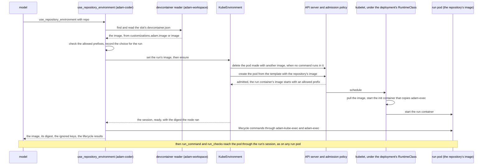
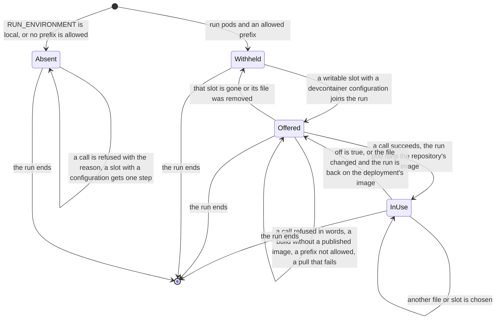

# 0052. No Podman: a repository's own environment is a run pod of its image

Status: **Accepted** (2026-11-19), an owner decision, a hard cutover. The owner: "adam-rs is already inside a dev container, why
do we need podman again? In prod we'll have gVisor. Does it make sense again having podman? If installed on desktop, in a
sandbox for work, doesn't it make sense to remove podman?", and then: "We can make it still possible. E.g via a tool that
appears only when a repo comes with its own config. Honestly, I also want a hard cutover." **Nothing is built**; the slices are
at the end. Supersedes [ADR 0010](0010-a-run-works-in-its-repositorys-devcontainer.md) (a run works in its repository's
devcontainer on a rootless Podman service) except its lookup of the file (decision 3 there), and amends
[ADR 0019](0019-a-runs-processes-in-a-pod-of-their-own.md), [ADR 0041](0041-a-run-pod-sees-only-its-own-run.md),
[ADR 0048](0048-a-benchmark-harness-for-adam-coder-and-opencode.md), [ADR 0040](0040-a-shared-package-cache-at-cache.md),
[ADR 0036](0036-the-coder-keeps-to-the-access-tier-the-person-picks.md) and
[ADR 0043](0043-sandbox-time-as-usage.md) (dated notes there).

## Context

A run's commands (`run_command`, `run`, `start_command`, `run_checks`) go through the `Environment` port of `adam-workspace`
(`crates/adam-workspace/src/environment.rs`), which has three implementations today:

| Implementation | Where the commands run | Chosen by |
|---|---|---|
| `Local` (`adam-workspace`) | the coder's own container | the default |
| `DevContainer` (`crates/adam-devcontainer`, ADR 0010) | a container of the repository's `devcontainer.json`, made by the devcontainer CLI on a rootless Podman service beside the coder | `DEVCONTAINER_RUNTIME=podman` |
| `KubeEnvironment` (`crates/adam-env-kubernetes`, ADR 0019, ADR 0041) | a pod of the run's own, made from the deployment's template; the repository's `devcontainer.json` is not read | `RUN_ENVIRONMENT=kubernetes` |

What the Podman path costs, read from the code at `main` (`bcf8787`, 2026-11-19):

* **It runs nowhere in production.** The chart never sets `DEVCONTAINER_RUNTIME` and Kubernetes keeps it `off` (ADR 0010
  decision 9); `podman` together with run pods is refused (exit 78, `bin/adam-coder/src/config.rs`), and so is it by the
  platform's operator (`crates/domain/src/validate.rs` of another-agentic-platform, *verified 2026-11-19* by reading it).
* **It is a second runtime to carry.** A crate (`adam-devcontainer`: the policy checked three times, the override file, the
  state, the CLI and `podman-remote` as child processes), ten coder variables (`DEVCONTAINER_*`, `CONTAINER_HOST`), the
  devcontainer CLI 0.89.0 and the static `podman-remote` 5.8.7 in the image (`docker/coder/Dockerfile`), a Podman service in the
  dev stack (`dev/podman/`, `dev/compose.devcontainer.yaml`), a CI job (`devcontainer` of `ci.yml`), four end-to-end scenarios
  (`coder.yml`), and in the orchestration layer `dev/compose.devcontainer.yaml`, `dev/coder/podman/` and
  `dev/devcontainer-e2e.sh` (another-agentic-system, *verified 2026-11-19* by listing them).
* **Its isolation is weaker than what production gets.** ADR 0010 says so: an escape lands in the service, which sees every run's
  `/work`; there are no per-container limits. Production runs commands in run pods (ADR 0019), each seeing only its run (ADR 0041),
  deny-by-default network (ADR 0042), and soon under gVisor: the platform's AD-052 (decided 2026-11-16, planned, not built) puts run
  pods under a sandboxed `RuntimeClass` the deployment names and the admission policy requires
  ([§59c, K14](https://github.com/vymalo/another-agentic-platform/blob/main/docs/architecture/10-control-plane-and-crds.md), *verified
  2026-11-19* by reading it).
* **Where adam runs on a desktop, it is already in a sandbox.** The person runs it in a dev container or another work sandbox they
  chose; a nested container engine adds a second trust boundary inside the first and needs a host setting (the Ubuntu sysctl of
  ADR 0010).
* **The benchmark depends on it** ([ADR 0048](0048-a-benchmark-harness-for-adam-coder-and-opencode.md)): `bench/compose.yaml` runs
  one Podman service per slot and one for grading, built from `dev/podman`, and `bench/lib/containers.mjs` (`PodmanRemote`) drives
  them with `podman --remote`. Each service holds its own copy of the 9.7 GB coder image, about 30 GB in all, and own task images are
  saved whole and loaded into each; smoke test 4 cannot run in a session that has about 20 GB of disk.

What a repository's own environment still gives, and how adam can give it without an engine:

* `devcontainer.json` names an image (`image`), or how to build one (`build.dockerfile`, `features`), or a Compose file
  (`dockerComposeFile`); `customizations` holds "product specific properties, defined in supporting tools"; `initializeCommand` runs
  on the host and the other lifecycle commands (`onCreateCommand`, `updateContentCommand`, `postCreateCommand`,
  `postStartCommand`, `postAttachCommand`) inside the container, in that order (*verified 2026-11-19*,
  <https://containers.dev/implementors/json_reference/>).
* A run pod's image is the deployment's (the template's `run` container), and the commands reach it through `adam-exec`, a POSIX
  `sh` script an init container copies from the coder's image into an `emptyDir` (`crates/adam-devcontainer/src/adam-exec.sh`,
  copied by `docker/coder/Dockerfile`): **any image with `/bin/sh` and `/proc` can be a run pod's image**. The image is pulled by
  the kubelet, not by the coder, so no engine runs in a coder or a run pod.
* A tool can be offered on some model turns and not others: `ToolSource::withhold` (`crates/adam-llm-agent/src/source.rs`) leaves a
  tool out of what the model is shown and refuses a call to it with a reason, read again at each turn and inside the call's step;
  the access tier is built on it (`bin/adam-coder/src/tier.rs`, `TierSource`). `ToolAccess` (ADR 0049) says what a call shares,
  not whether it is offered.

## Decision

### No Podman anywhere

1. **The Podman path is removed, with no switch and no dormant code.** The crate `adam-devcontainer` is deleted; so are the
   devcontainer CLI and `podman-remote` in the coder image, the Podman service of the dev stack (`dev/podman/`,
   `dev/compose.devcontainer.yaml`), its CI job, its scenarios and mocks, and the same pieces in another-agentic-system. Two pieces
   of it are kept and moved, because run pods need them: `adam-exec` (to `crates/adam-env-kubernetes`, with its tests) and the
   lookup and reading of a `devcontainer.json` (to `adam-workspace`, a pure module with no runtime: decision 6).
2. **A deployment that asked for Podman fails closed.** `DEVCONTAINER_RUNTIME=podman` is exit 78 with a message that names this
   ADR, so a deployment that relied on it does not start and silently run its commands in the coder. Every other removed variable
   is ignored with a warning, as ADR 0038 did for OpenCode's.

### Where commands run

3. **Two environments, chosen by `RUN_ENVIRONMENT` as today.**

   | Where adam runs | `RUN_ENVIRONMENT` | The commands run in |
   |---|---|---|
   | A desktop, a laptop, the dev stack | `local` (the default) | the coder's own container, which on a desktop **is** the person's work sandbox: adam adds no container inside it |
   | Kubernetes | `kubernetes` | a run pod of its own (ADR 0019), seeing only its run (ADR 0041), deny-by-default network (ADR 0042), under the platform's gVisor `RuntimeClass` once the deployment names one (AD-052) |

   The closed enum `RunEnvironment` (`bin/adam-coder/src/config.rs`) keeps its two variants. `ALLOW_COMMANDS_NEXT_TO_SECRETS`
   keeps its rule with one way out fewer: a GitHub App key file with `local` needs it, run pods do not.

### A repository that brings its own environment

4. **A tool, `use_repository_environment`, offered only when it can work.** It is offered on a model turn when **all** of these hold,
   and withheld otherwise (a `ToolSource` of the coder whose `withhold` reads them each turn):
   1. the worker runs its commands in run pods (`RUN_ENVIRONMENT=kubernetes`);
   2. the deployment allows repository images: `RUN_POD_REPOSITORY_IMAGES` names at least one image prefix (chart
      `runPods.repositoryImages.allowedPrefixes`, **empty by default**, and then the tool is never offered);
   3. a **writable** slot of the run (a repository's worktree or a scratch project, not a reference) holds a devcontainer
      configuration at one of the places the specification lists: `.devcontainer/devcontainer.json`, `.devcontainer.json`, or
      `.devcontainer/<folder>/devcontainer.json` (ADR 0010 decision 3's lookup), read from the coder's checkout.

   It is a `plan`-tier tool (ADR 0036): it changes where commands run, not what a repository holds, and `run_command` already runs
   a repository's code at that tier. A call to it when it is withheld is refused with the reason, as the tier's refusals are.
   Where the first two conditions fail (a desktop, the dev stack, a deployment that allows no prefix) a run whose slot has a
   configuration gets one step, once: "this repository has a devcontainer configuration; this deployment runs commands in
   <where>", so nothing is silent (ADR 0010's rule).
5. **What it takes and does.** `use_repository_environment { repo?, config?, off? }`:
   * `repo` names the slot (default: the one slot that has a configuration; refused, naming them, when several have one), `config`
     the file when the slot has several, `off: true` goes back to the deployment's image.
   * It reads the file from the coder's checkout, chooses the image (decision 6), checks it against the allowed prefixes, records
     the choice for the run, and makes the run pod **now** with the template's pod and that image in its `run` container, so the
     pull and the start are this call's steps and a failure is this call's result. A pod that runs with another image is made
     again (as `seal` does for a missing mount, ADR 0041), waiting for a command that runs in it.
   * Then it runs the configuration's lifecycle commands once per pod, in the specification's order (`onCreateCommand`,
     `updateContentCommand`, `postCreateCommand`, `postStartCommand`), as the run's commands in the slot's directory, each a step;
     a failure is in the result and the pod stays. `initializeCommand` (the host's) and `postAttachCommand` never run.
   * `containerEnv` and `remoteEnv` with plain values are set on the run container; a value with `${...}`, or a name the template
     or the code sets (the proxy variables, `HOME`, `ADAM_*`), is refused in words. Everything else that asks for privileges or
     host resources (`privileged`, `capAdd`, `securityOpt`, `runArgs`, `mounts`, `init`, `forwardPorts`, `appPort`,
     `workspaceMount`, `workspaceFolder`, `remoteUser`, `containerUser`, `updateRemoteUserUID`, `hostRequirements`) is **ignored and
     listed** in the result: the pod is the deployment's, and its user, mounts, resources, network and runtime class do not move.
   * Its result says the image, the digest the node ran (`status.containerStatuses[].imageID`), the file, what was ignored, and the
     lifecycle commands' outcome. It is `parallel = "exclusive"` (ADR 0049): no other call shares its turn segment.
   * The choice is the conversation's, as the slots are: a run that continues the conversation keeps it. If the file changed since
     (its digest is recorded), the run is back on the deployment's image, with a step, and the tool is offered again.
   * `rebuild_environment` goes: its case, a broken Podman devcontainer, no longer exists, and `off: true` is the way back.
6. **Which image, and what is refused in words.**

   | The configuration has | The image of the run pod |
   |---|---|
   | `customizations.adam.image` | that image, whatever else the file says: the repository vouches that its CI builds and publishes this configuration's image there (with `buildah`, `docker buildx`, or the devcontainer CLI's `build --push` for features) |
   | `image`, and no `build` and no `features` | `image` |
   | `build.dockerfile` or `features`, and no `customizations.adam.image` | **refused**: "this configuration builds its image (`<what>`); this coder runs no container engine. Build and publish the image in the repository's CI under one of <the allowed prefixes>, and name it in `customizations.adam.image`, or replace the build by `image`" |
   | `dockerComposeFile` | **refused**: "a Compose configuration is not supported: name one image (`image` or `customizations.adam.image`)" |
   | an image outside the allowed prefixes, or with a `${...}` variable | **refused**, naming the prefixes |

   A tag is accepted, and the digest the node pulled is reported and recorded; a deployment that wants digests only says so
   ([For the owner](#for-the-owner-to-confirm), O1). The image's own `devcontainer.metadata` label is not read: the coder has no
   registry client and pulls nothing. An image without `/bin/sh` cannot run `adam-exec`; the first command finds out and the
   result says the image needs a shell.
7. **The port.** `adam-workspace` gains a defaulted `Environment` method that sets or clears the image of a run (its name is the
   first slice's), whose default refuses (`EnvError::Refused`), so `Local` and any outside implementation compile unchanged;
   `KubeEnvironment` implements it, records the choice where the run's metadata is (never in a run pod's mounts) and in a pod
   annotation, and makes a pod again when the two differ. `Environment::rebuild` and its `use_default` go
   ([Breaking changes](#breaking-changes)).
8. **The chart and the admission policy.** `deploy/coder` gains `runPods.repositoryImages.allowedPrefixes` (empty: nothing of it
   renders), rendered into the coder's `RUN_POD_REPOSITORY_IMAGES` and into the run pods' admission policy: the `run` container
   may then use an image that **starts with** an allowed prefix; the init containers keep the exact list (`coder.runPodAllowedImages`),
   and everything else the policy refuses is unchanged (no Secret, no host namespace, no privilege, the priority class, the claims,
   the chart's pull secrets only). The chart's render is a contract the platform reads (`deploy/coder` in `CLAUDE.md`): the pull
   request that adds the value says so. The platform's operator gains the same setting in its own run-pod parameters (its slice).

### The sequence: a run on Kubernetes uses its repository's environment

### The tool's availability

The tool appears at most once per run in the list the model is shown, so the stable prefix of ADR 0044 decision 1 is broken once
when it appears, as a change of the access tier breaks it.

### The benchmark

9. **The bench uses the host's container runtime, and that is its first slice, independent of the rest.** `bench/lib/containers.mjs`
   gets a `Containers` implementation over the host's runtime (`HostContainers`, the `docker` CLI the stack already needs for
   `docker compose`) in place of `PodmanRemote`; the Podman services `podman-1`, `podman-2` and `grader` leave `bench/compose.yaml`,
   and nothing in `bench/` builds `dev/podman`. **Every image is in the host's store once**: the coder image, the task images, and
   an own task's image, used where `bench tasks build` made it, never saved and loaded. The environment check, the base, grading and
   the OpenCode arm run as containers of the task image on networks of the host runtime with the members `bench/compose.yaml`
   gives them today (a container of an agent reaches the meter relay and nothing else; the grader is alone).
10. **adam's arm runs as adam runs on a desktop under this ADR: its commands where the coder runs** (`RUN_ENVIRONMENT=local`,
    settings that exist at the pinned coder, so no adam change is needed). So that its commands still run in the task image, the
    coder container is started **from the task image**, with the coder's files from the pinned coder image copied once into a
    read-only volume (a one-shot container of the coder image), and the git sandbox, the relays and the pusher stay on the coder
    image. `bench doctor` checks that the coder starts in each selected task image (the task image's C library must load the
    coder's binary, *unverified*: the coder is built on Debian trixie and the own tasks on `node:24.22.0-bookworm-slim`); a task
    image it cannot start in is reported by `doctor` and refused by selection for both arms, so the arms keep one task set.
11. **Kubernetes Jobs (kind) are not chosen for the bench.** They would match production best, but a kind node keeps its own copy
    of every image it runs (`kind load` copies into the node), which is the disk problem again. kind supports network policy out of
    the box since v0.24.0 (*verified 2026-11-19*, its release notes), so the choice can be revisited on a host with the disk.

### Breaking changes

| Removed | Replaced by |
|---|---|
| the crate `adam-devcontainer` (`DevContainer`, `Settings`, `Runtime`, `Network`, the policy, the override file) | the reader in `adam-workspace` (decision 6); run pods |
| `DEVCONTAINER_RUNTIME` (`podman` is exit 78), `CONTAINER_HOST`, `DEVCONTAINER_DEFAULT_IMAGE`, `DEVCONTAINER_NETWORK`, `DEVCONTAINER_DEPLOYMENT_ID`, `DEVCONTAINER_UP_TIMEOUT_SECS`, `DEVCONTAINER_SETUP_TIMEOUT_SECS`, `DEVCONTAINER_PREPULL`, `DEVCONTAINER_CLI`, `DEVCONTAINER_PODMAN`, `DEVCONTAINER_CACHE_DIR`; the test variables `ADAM_TEST_DEVCONTAINER*` | `RUN_ENVIRONMENT`; the template's image; `RUN_POD_REPOSITORY_IMAGES` (new) |
| the tool `rebuild_environment` | `use_repository_environment` (new, offered only as decision 4 says) |
| `Environment::rebuild(run, use_default)` (a defaulted method of the port) | a defaulted method that sets or clears a run's image (decision 7) |
| `EnvKind::DevContainer` (`adam-workspace`); `EnvKind::Kubernetes` gains the configuration it was made from | a `checks` artifact's `environment` says `kubernetes` with the file as its `source` |
| `SandboxEnvironment::Devcontainer` (`adam-runtime`): adam never reports `"environment": "devcontainer"` again | `local` or `kubernetes`; the `usage/v1` contract keeps the word, so readers of older reports (the system's usage ledger) are unchanged |
| the devcontainer CLI and `podman-remote` in the coder image, and their smoke tests | nothing |
| `dev/podman/`, `dev/compose.devcontainer.yaml`, the CI job `devcontainer`, `SCENARIO=devcontainer`, `default-env`, `broken-env`, `no-runtime` and their mocks | a scenario of the `run-pods` kind job (slice 1) |
| `PodmanRemote` and the Podman services of `bench/` | `HostContainers` (decision 9) |

`rebuild_environment` and `use_repository_environment` are tool names the bench's prompt map and the coder's instructions may
name; the slice that changes the tools changes them too.

## Alternatives rejected

* **Keep Podman behind a switch.** The owner asked for a hard cutover, production never used it, and a path that no deployment
  runs is untested code.
* **Build the image at run time in the cluster** (BuildKit, buildah or Kaniko in a pod): an engine at run time again, privileged
  inside a user namespace (the platform's AD-043), unproven under gVisor (AD-052 refuses the build modes with a class until they are
  proven), and Kaniko is archived (AD-043). A repository's CI builds and publishes instead.
* **envbuilder**: in maintenance mode (another-agentic-system ADR 0028, *verified 2026-10-01* there).
* **Use the repository's image automatically, with no tool.** It moves a run to an image the person did not see chosen, and the
  owner asked for a tool. The step of decision 4 tells the person; the model decides with the person.
* **List the tool always and refuse it where it cannot work.** The owner asked for a tool that appears only with a configuration;
  `withhold` gives both: not shown, and refused in words if called.
* **Run the image's user** (`remoteUser`, `containerUser`, `updateRemoteUserUID`). The run pod's user is the deployment's, which owns
  the work volume's files and which the admission policy holds non-root; a pod per image user would need the volume's ownership to
  move with it.
* **The host's container socket for the coder.** Rejected by ADR 0010 already: it hands the coder, which holds credentials, the host.
* **For the bench, Kubernetes Jobs in kind**: decision 11.

## Consequences

* adam has one way to isolate a run's commands, the run pod, and production is where it is proven. The devcontainer CLI, Podman's
  client and their pins leave the image.
* A repository that wants its own environment publishes an image from its CI and names it, and a deployment allows its registry
  prefix. A configuration that only has a Dockerfile or features is refused in words that say what to add.
* The pod's user is fixed: an image whose toolchain is writable only by its own user, or lives in that user's home, works for
  reading and running but not for installing into it; package caches go to `/cache` (ADR 0040) and `$HOME` is the template's.
  *Unverified* how many common devcontainer images this affects.
* Lifecycle commands that a feature or an image's `devcontainer.metadata` label adds are not run: the label is not read
  (*unverified* how often images rely on it).
* Under gVisor, a repository's image runs like the default one; what AD-052 has not yet proven (the run pod's volume and `exec`
  under `runsc`) applies to both.
* On a desktop and in the dev stack the tool never appears; commands run where the coder runs, in the person's own sandbox.
* The orchestration layer's ADR 0028 (`devcontainer.json` is the contract) still holds for *what*; its *how* moves to this ADR (a
  dated note there, in its slice). The platform's `Engine` mode (AD-043, a Podman sidecar of a run pod, planned, not built) is
  dropped by the same decision (its slice amends AD-043); its `Build` mode (BuildKit) is not Podman and is not decided here.
* The bench needs only the host's runtime, each image once instead of a copy of the coder image in each Podman service (about 30 GB more today); smoke test 4 should fit in about 20 GB (*unverified* until slice B1's proof);
  adam's arm runs its commands next to the coder, which is how a desktop runs adam under this ADR, not how production does.

## For the owner to confirm

*The owner's answers (2026-11-19):* O1, O2 and O5 are **decided as the defaults** below (a tag accepted with the
pulled digest recorded; no allowed prefix by default; the bench's adam arm started from the task image), and the
platform's `Engine` (AD-043) is **dropped**, as the Consequences say. O3, O4 and O6 stand at their defaults until the
owner says otherwise.

| Id | Topic | Default | Alternative |
|---|---|---|---|
| O1 | A repository image named by tag | accepted; the digest the node pulled is reported and recorded | digest only (`@sha256:` required) |
| O2 | Allowed prefixes | none by default: the deployment names its registries | a default such as the workspace image's own registry path |
| O3 | Lifecycle commands | run once per pod, in order, as the run's commands | not run; the model runs what it needs |
| O4 | The choice across a conversation | kept, until `off` or the file changes | asked again in every task |
| O5 | The bench's adam arm | the coder started from the task image (decision 10) | the coder image for both arms' commands, the task image for grading only |
| O6 | The platform's `Build` mode (BuildKit) | out of this decision | dropped with `Engine` |

## Slices

Each is a pull request with its own proof. B1 is first and depends on nothing but this record.

| # | Slice | Repository | Proof | Depends on |
|---|---|---|---|---|
| 0 | This record, the notes on ADRs 0010, 0019, 0036, 0040, 0041, 0043 and 0048, `docs/README.md`, `docs/roadmap.md` | adam | docs-check | none |
| B1 | The bench on the host's runtime: `HostContainers`, no Podman services, own images used where built, adam's arm as decision 10 says, `bench/README.md` | adam | `bench doctor` and the dry run pass on a host with about 20 GB free; `node --test "bench/test/*.test.mjs"`; `git grep -i podman bench` empty | 0 |
| 1 | The reader of `devcontainer.json` in `adam-workspace`; the port's image method; `KubeEnvironment` with a run's image; `use_repository_environment` and its source; the chart's `runPods.repositoryImages` and the policy; docs | adam | unit tests of the reader and of every refusal; the fake API server's tests; render-check; the `run-pods` kind job with a repository whose `customizations.adam.image` is an image loaded into kind, and one with only a Dockerfile refused | 0 |
| 2 | The dev stack and CI: `dev/podman/`, `dev/compose.devcontainer.yaml`, the four scenarios, their mocks and fixtures, the `devcontainer` job and the compose check; `docs/reference/dev-stack.md`, the guides | adam | CI green; `git grep -i podman dev .github` empty | B1 (the bench no longer builds `dev/podman`) |
| 3 | The code: delete `adam-devcontainer` (`adam-exec` moves to `adam-env-kubernetes` with its tests), the coder's `DEVCONTAINER_*` and exit 78 for `podman`, `rebuild_environment`, `EnvKind::DevContainer`, `SandboxEnvironment::Devcontainer`, the image's CLI and client; the reference docs, `SECURITY.md`, the `adam-coder-deploy` skill | adam | the workspace builds and tests; the image's smoke tests; `git grep -i podman` finds only decision records | 1, 2 |
| 4 | The orchestration layer: `dev/compose.devcontainer.yaml`, `dev/coder/podman/`, `dev/devcontainer-e2e.sh`, `e2e-all.sh`, the CI jobs, `dev/README.md` "Devcontainers", a dated note on its ADR 0028 | system | its CI; `git grep -i podman dev .github` empty | 0; before its adam pin moves past 3 |
| 5 | The platform: the operator's repository-image prefixes in the run-pod parameters and the admission policy, the parity goldens at slice 1's revision, the `DEVCONTAINER_RUNTIME` rule removed, AD-043's `Engine` dropped by a dated note | platform | its tests, render-check and goldens; the policy's refusals against a bare API server | 1, 3 |
| 6 | The images repository: `README.md` says who uses the `workspace` image now (the run pod's default image, and a base a repository can name); its `devcontainer.metadata` label and check stay | images | its docs check | 1 |
