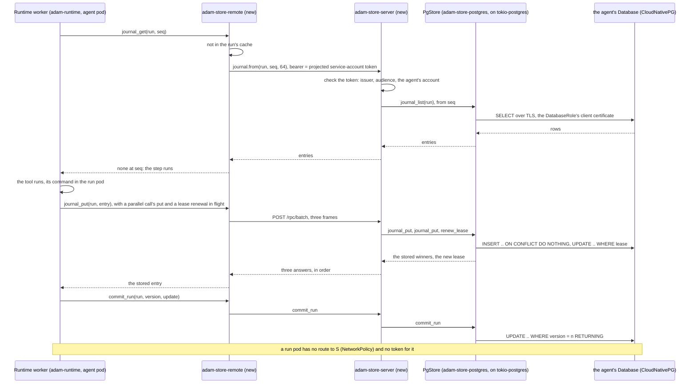
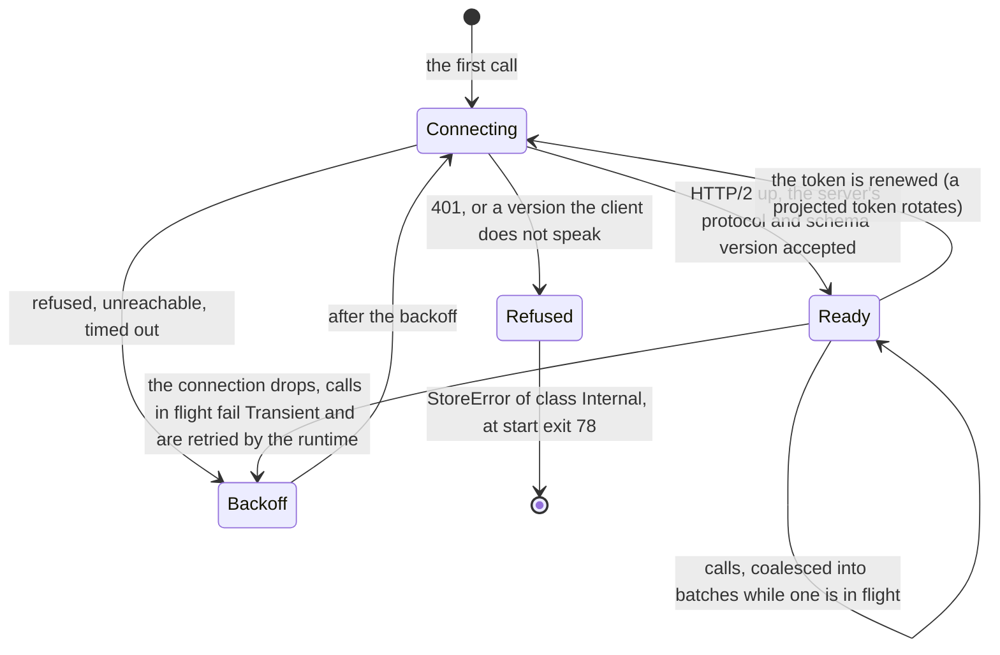
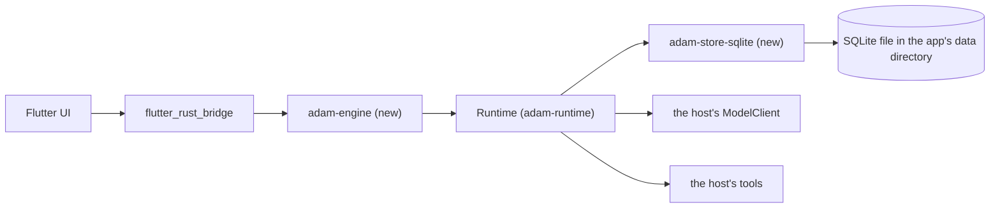
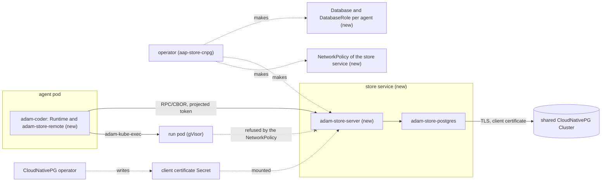
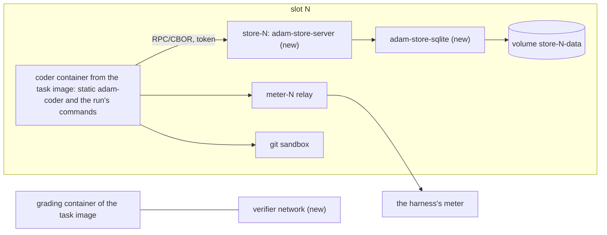

# 0053. SQLite, a store service, a database per agent and a static coder

Status: **Accepted** (2026-11-19), an owner decision. The owner's words: SQLite joins Postgres and MongoDB because "a test
harness or client app won't use postgres/mongo"; the SQLite binding conflict is solved for good by moving
`adam-store-postgres` off `sqlx`; `Store` is served by a store service over CrateStack RPC/CBOR; the platform makes one
CloudNativePG `Database` and `DatabaseRole` per agent in a shared cluster; the image's binaries are static
(`x86_64-unknown-linux-musl`). **Nothing is built**; the slices are at the end. Builds
[ADR 0047](0047-adam-rs-can-be-embedded-in-an-application.md) decision 3 and amends it (its workspace of its own), decides
[ADR 0052](0052-no-podman-a-repositorys-own-environment-is-a-run-pod-of-its-image.md) decision 10's open glibc point, and
changes the bench of [ADR 0048](0048-a-benchmark-harness-for-adam-coder-and-opencode.md) (dated notes there).

## Context

The `Store` port (`crates/adam-core/src/store/mod.rs`, 19 methods) has two shipped adapters and the memory one
([Store adapters](../reference/store-adapters.md)). Today:

* **The binaries know one store.** `adam-service` connects `PgStore` from `DATABASE_URL` and `PgNotify` on its pool
  (`crates/adam-service/src/serve.rs`); MongoDB is a library adapter only.
* **SQLite cannot join the workspace.** `adam-store-postgres` and `adam-notify-postgres` use `sqlx` 0.9, and `sqlx` locks
  `sqlx-sqlite` even when nothing uses it. *Verified 2026-11-19* (the crates.io index and two `cargo generate-lockfile`
  probes, `rusqlite` 0.43 with `bundled` beside `sqlx` with `postgres`, `json`, `chrono`, `uuid`): with `sqlx` 0.9.0
  (this workspace's lock) the resolution fails on `links = "sqlite3"`, because `sqlx-sqlite` 0.9.0 wants
  `libsqlite3-sys` below 0.38; with `sqlx` 0.9.1, published 2026-11-18, it resolves, because `sqlx-sqlite` 0.9.1 widened
  that to below 0.41. The ceiling is still there: the next `libsqlite3-sys` (0.41) conflicts again until `sqlx` follows.
  So ADR 0047 put the SQLite adapter in a Cargo workspace of its own.
* **Every process that runs a worker holds the database's credential.** In a cluster that is the coder pod; on a desktop
  or in the bench a run's commands run beside the coder (`RUN_ENVIRONMENT=local`, ADR 0052 decision 3), so a file
  database there would be readable by the commands.
* **The image's binaries need glibc 2.39.** They are built on `rust:1.94-trixie` (`docker/coder/Dockerfile`), and the
  bench's adam arm is to start the coder from each task image (ADR 0052 decision 10), where Debian bookworm has
  glibc 2.36 (*verified 2026-11-19* by the caller).
* **The platform makes one CloudNativePG `Cluster` per service** (`crates/store-cnpg` of another-agentic-platform, its
  §59a S6), and defers "a `Database` in someone else's Cluster".

What the pieces offer, checked on 2026-11-19:

* **Postgres without `sqlx`.** `tokio-postgres` 0.7.18 (2026-06-12; `postgres-types` 0.2.14), the client of the
  `rust-postgres` project, is pipelined (concurrent queries on one connection go out without waiting) and delivers
  `LISTEN` notifications as `AsyncMessage::Notification` (its `src/lib.rs`, `src/connection.rs`). `deadpool-postgres`
  0.14.2 (2026-08-26) pools it; `bb8-postgres` 0.9.0 has had no release since 2024-12. `tokio-postgres-rustls` 0.14.0
  (2026-05-21) takes `rustls` 0.23 with no provider of its own, so the tree keeps aws-lc-rs. *Verified* on crates.io and in
  the published sources. Its `sslmode` is `disable`, `prefer` or `require` only (`src/config.rs`), while `sqlx` also parses
  `verify-ca`, `verify-full`, `sslrootcert`, `sslcert` and `sslkey` (`sqlx-postgres` 0.9.0, `src/options/parse.rs`),
  *verified* in both sources.
* **SQLite.** `rusqlite` 0.43.0 (2026-11-15) needs `libsqlite3-sys` 0.40; CrateStack's embedded store,
  `cratestack-rusqlite` 0.20.4, needs `rusqlite` 0.41.1 (`libsqlite3-sys` 0.39). One build links one `sqlite3`, so an
  application that uses both must use one `rusqlite` minor. *Verified* on crates.io.
* **CrateStack RPC** (github.com/cratestack/cratestack at `cbbae98`, 0.20.4 of 2026-11-16, MIT; *verified 2026-11-19* in
  its `README.md`, `docs/design/rpc-transport.md`, `docs/design/rpc-batching-coalescing-model.md`,
  `docs/adr/0017-remove-grpc-protobuf.md`, `crates/cratestack-client-rust` and `examples/rpc-procedures`):
  * a schema with `transport rpc` and `datasource { provider = "none" }`, compiled by `cratestack-api`'s
    `include_server_schema!(…, db = None)`, gives an axum router with `POST /rpc/{op_id}` and `POST /rpc/batch`, and a
    `ProcedureRegistry` trait the service implements: no database and no `sqlx` in the tree;
  * `cratestack-client`'s `include_client_schema!` gives typed procedure clients over `reqwest` 0.13 (`rustls`, no
    provider chosen; it enables `rustls`'s `ring` feature), and `RpcClient::batch`; a client can be built on a given
    `reqwest::Client` (`with_http_client`);
  * CBOR is the default codec between services; `@stream` procedures answer as `application/cbor-seq`, and
    subscriptions go over SSE or WebSocket;
  * a batch is **not transactional**: each frame is its own call, the server may run frames in parallel, the answers
    come back in the request's order, and a frame never refers to another; a batch has a frame limit;
  * coalescing calls into batches is a shipped TypeScript package and, in Rust, an example (`examples/rpc-batch-debounce`),
    not a library;
  * **gRPC was removed** in 0.8.5 (its ADR 0017); `cratestack-grpc` stopped at 0.8.4 (2026-08-18);
  * the workspace's `rust-version` is 1.98.0 (crates.io), and the project is pre-1.0: "minor releases can break".

  *Verified 2026-11-19 by a probe* (Rust 1.98.0, `x86_64-unknown-linux-musl`, `cratestack-api`, `cratestack-client`,
  `cratestack-codec-cbor` 0.20.4): a `transport rpc` schema with one procedure (a `Uuid`, a `BigInt`, a `String`, a
  `Boolean`, a `Json`) compiled as a server and as a client in two crates; the client called it alone, then three times in
  one `POST /rpc/batch`, over CBOR, with a bearer token checked by an `AuthProvider`; a call without the token was refused
  (`permission_denied`, 403). Two limits found: a `Json` field is `Json<cratestack::Value>`, whose integers are `i64`, so
  `u64::MAX` came back as the float `1.8446744073709552e19`; and in an image with no CA certificates the default client
  panics when it is built (`reqwest` 0.13: "No CA certificates were loaded from the system").
  *Unverified*: the cost of one call; streaming (`@stream`) and the batch's frame limit were read, not run.
* **CloudNativePG 1.30.2** (the latest release, 2026-11-17; *verified 2026-11-19* in
  `docs/src/declarative_role_management.md` and `declarative_database_management.md` at the tag `v1.30.2`):
  * `Database` (`postgresql.cnpg.io/v1`): `spec.name`, `spec.owner`, `spec.cluster.name` (immutable), `databaseReclaimPolicy`
    (`retain` by default, or `delete`), `ensure`; `status.applied`, `status.message`; `postgres`, `template0` and
    `template1` are refused;
  * `DatabaseRole` (the recommended form, namespaced with its Cluster): `spec.cluster.name`, `spec.name`, `login`,
    `inRoles`, `connectionLimit`, `databaseRoleReclaimPolicy` (`retain` by default; `delete` drops the role, and stays
    `Terminating` while the role owns objects), `passwordSecret` (a `kubernetes.io/basic-auth` Secret someone else
    writes), and `clientCertificate`, with which **the CloudNativePG operator itself** writes the Secret
    `<databaserole>-client-cert` (`tls.crt`, `tls.key`), signed by the cluster's client CA, 90 days, renewed 7 days before
    expiry; the Cluster needs a `hostssl … cert` line in `spec.postgresql.pg_hba` for it; a `DatabaseRole` of an existing
    role adopts it and resets what it omits;
  * a name in the Cluster's `spec.managed.roles` wins over a `DatabaseRole` of the same name, which then reports
    `applied: false`.
* **musl.** A release build of the six binaries of the image (`adam-coder`, `adam-agent`, `adam-kube-exec`,
  `adam-egress`, `adam-git-sandbox`, `adam-git`) at `main` (`d8d6005`) for `x86_64-unknown-linux-musl`, with `musl-gcc` as
  the C compiler and nothing else changed, **built** (8 minutes on 4 cores; *verified 2026-11-19*): aws-lc-sys, ring
  through `rustls`, `kube` with `ws`, `sqlx`'s Postgres driver, the vendored `protoc`, `rmcp`, `reqwest` 0.13. `file` says
  each is `static-pie linked`; in an empty root (no C library, no `/etc`) as uid 10001 each starts and reaches its own
  configuration check (exit 78, `adam-kube-exec` 64). A second probe built `rusqlite` 0.41 `bundled` (SQLite 3.54.1, run),
  `tokio-postgres` 0.7.18, `deadpool-postgres` 0.14.2, `tokio-postgres-rustls` 0.14.0, `mongodb` 3.10.1 and `mimalloc`
  0.1.52 for musl, and the CrateStack probe above is musl too. *Unverified*: a whole run on musl (TLS to real hosts, DNS
  in a cluster, git), and the allocator's effect.

## Decision

### SQLite, and the store chosen by `DATABASE_URL`

1. **`adam-store-postgres` and `adam-notify-postgres` move to `tokio-postgres`**, pooled by `deadpool-postgres`, TLS by
   `tokio-postgres-rustls` on the process's aws-lc-rs provider. `sqlx` leaves the workspace and `Cargo.lock`, and CI
   fails when it comes back (`cargo tree -i sqlx` must find nothing). The schema, the statements and the guarantees of
   [Store adapters](../reference/store-adapters.md) do not change, and the migration of an existing database is a no-op:
   the tables `sqlx` made are the tables `tokio-postgres` reads. The adapter parses the URL parameters `tokio-postgres`
   does not (`sslmode=verify-ca` and `verify-full`, `sslrootcert`, `sslcert`, `sslkey`) and configures `rustls` with them,
   so every `DATABASE_URL` that works today works after.

   *Amended 2026-11-20 (slice 2, #361):* built. Both crates run on `tokio-postgres` 0.7.18, `deadpool-postgres` 0.14.2
   and `tokio-postgres-rustls` 0.14.0, `sqlx` is out of `Cargo.lock`, and the `clippy-default` job runs
   `if cargo tree --workspace --locked -i sqlx; then exit 1; fi` (an absent package exits 101). The URL handling lives in
   the new `adam-postgres` crate, `PgConfig`: it strips the TLS keys and the `sqlx` aliases, maps `sslmode` to the
   driver's `disable|prefer|require`, and for the two verifying modes installs a `rustls` verifier — `verify-ca` checks
   the chain only, `verify-full` the chain and the host name — with roots from `sslrootcert` (else the Mozilla roots) and
   an optional client certificate from `sslcert`+`sslkey`; the provider is always `aws-lc-rs`, named explicitly because
   the tree also compiles `ring` (through `mongodb`). The breaking signatures (Rule 2):
   `PgStore::from_pool(deadpool_postgres::Pool)`, `PgStore::pool() -> &deadpool_postgres::Pool`,
   `PgStore::from_config(PgConfig, u32)`, and `PgNotify::new(deadpool_postgres::Pool, PgConfig, BroadcastSink)` — the
   listener owns a connection of its own, because deadpool drives a pooled client as the `Connection` future, which
   drops notifications. `adam_core::time::Timestamp` binds through `postgres-types`' `with-jiff-0_2`, so the `PgTime`
   bridge of [ADR 0057](0057-time-is-jiff-with-the-bytes-chrono-wrote.md) is deleted. One error class changes: `sqlx`'s
   `Protocol` and `WorkerCrashed` were `Transient`, `tokio-postgres` has no equivalent, so what is not a database error,
   a closed connection or an I/O/TLS failure is `Internal`; a unique violation, a serialization failure, a lost
   connection and a bad statement keep their classes.

   *Amended 2026-11-20, second part (the head and the body, ADR 0055):* `SCHEMA_VERSION` is 6 and `PgStore`
   keeps bodies (`keeps_bodies() == true`). `runs.head`/`runs.head_version` hold the v5 head and the version it
   was written at; `adam_body` holds `(run_id, generation, idx) -> (message, writer, written_at)` and cascades
   with the run. A commit that writes a head, a body or blob references is **one transaction**: the run row
   locked `FOR UPDATE`, the version check, the rows after the head's `len`
   (`INSERT .. SELECT unnest(..) ON CONFLICT DO NOTHING`), the refs, the CAS; a foreign slot is resolved inside
   it (identical message adopted, older than the 5-minute orphan grace collected and retried once, live and
   different `Conflict`). `load_head` is one `SELECT` that serves the head when `head_version == version` and
   the whole state otherwise, so `Runtime::view` on Postgres is one `lease_until` + one `load_head` and no body;
   `Runtime::state` joins the head and one `body_list`. The upgrade gate is `stored < 6` (or
   `to_regclass('<prefix>body')`), never the blob step's `stored == Some(4)`: a database stamped 5 has the blob
   tables and no head or body. `tests/fixtures/schema-v5.sql` (the `sqlx` build) opens and upgrades to 6, and
   `schema-v6.sql` is the current schema, compared with the live statements by a unit test. `Store::load_head`
   and `keeps_bodies` are defaulted; **a `Store` wrapper must forward them** (with `body_list` and `gc_body`),
   because the default `load_head` calls the wrapper's `load_run`, so a view through a wrapper that does not
   delegate silently reads the whole state and loses the head.
2. **`adam-store-sqlite` (new) joins the main workspace**: `rusqlite` with `bundled` SQLite, on the `rusqlite` minor that
   `cratestack-rusqlite` uses (0.41 today), so an application can link both; a CI probe resolves the two together. It is
   what ADR 0047 decision 3 asked: `store_conformance!`, one writer, each change one `BEGIN IMMEDIATE` transaction, WAL,
   `LocalNotifier` for signals, a lock file that refuses a second process and lets the process release its own leases at
   start. Its calls run on a blocking thread, so the async runtime never waits on the file.
3. **Every binary picks its store from `DATABASE_URL`**, in `adam-service` (each adapter behind a Cargo feature of the
   service, all on in the image):

   | `DATABASE_URL` | Store | Signals across processes |
   |---|---|---|
   | `postgres://…`, `postgresql://…` | `adam-store-postgres` | `LISTEN`/`NOTIFY` (`adam-notify-postgres`) |
   | `mongodb://…`, `mongodb+srv://…` | `adam-store-mongodb` | none: workers poll |
   | `sqlite://<path>` | `adam-store-sqlite` | in-process (`LocalNotifier`) |
   | `store+http://…`, `store+https://…` (new) | `adam-store-remote` (decision 5) | the service's stream (decision 7) |

   Any other scheme is exit 78. `sqlite://` holds one process per file, so a `ROLE` of `control-plane` or `worker` on it is
   exit 78: a split deployment uses Postgres, MongoDB or the store service.

   *Amended 2026-11-20 (slice 3, #362): built, except the store service.* `adam-store-sqlite` is in the main workspace
   on `rusqlite` 0.41.1 with `bundled` (the minor `cratestack-rusqlite` 0.20.4 uses, so an application that links both
   has one `libsqlite3-sys`), `SCHEMA_VERSION` 1, and passes `store_conformance!`, `blob_conformance!` and
   `body_conformance!`; it keeps heads, bodies and blobs. It is one file, one process: `open` takes an exclusive
   `flock` on `<path>.lock` and refuses a second process, `migrate` clears the dead predecessor's leases so a
   `SIGKILL`ed process's runs are claimable at once, and a file stamped with a newer schema is refused. Every change is
   one `BEGIN IMMEDIATE` transaction on a blocking thread; WAL; `LocalNotifier` in process. `adam-service` chooses the
   adapter from `DATABASE_URL`: `postgres(ql)://`, `mongodb(+srv)://` and `sqlite://`, each behind a feature
   (`store-postgres`, `store-mongodb`, `store-sqlite`, all on in the binaries); an unknown scheme is exit 78, and so is
   `sqlite://` with `ROLE=worker` or `ROLE=control-plane`. MongoDB is now selected, not only a library. The probe
   `tools/sqlite-probe` (CI job `sqlite-probe`, part of `lint`) resolves the adapter with `cratestack-sqlite` and
   asserts one `rusqlite` and one `libsqlite3-sys`. **Not built:** `store+http://`/`store+https://` and the store
   service of decisions 4–7. Breaking: `adam-service`'s Postgres dependencies are optional features, and
   `ServeError::Connect` is a struct variant whose message names the backend (`connecting to Postgres`,
   `connecting to SQLite`), not a generic "connecting to the store".

### A store service

4. **`Store` is served over CrateStack RPC with CBOR**, not gRPC: CrateStack does what this needs (above) and removed its
   gRPC transport, and the owner's default for a Rust service is CrateStack. One schema, `store.cstack` (new), says one
   procedure per `Store` method plus `journal.from` (decision 6) and `signals` (decision 7), with `transport rpc` and no
   datasource; `StoreError`'s class (`adam_error::Classify`) travels in the error, so the caller decides from the class as
   it does in process (Rule 6). A state, a payload or a push configuration travels as `Bytes` holding its JSON text, not
   as CrateStack's `Json`, whose integers are `i64` (above): the value read back is the value written. The client is
   built on its own `reqwest::Client` (`with_http_client`), with the CA it is given, so an image without system
   certificates does not stop it.
5. **Two parts.** `adam-store-remote` (new) is the client adapter: a `Store` that passes `store_conformance!` against a
   real server in its tests. `adam-store-server` (new, `bin/adam-store-server`) serves **any** `Store` it is given: it
   chooses its own from its `DATABASE_URL` (decision 3, the remote scheme refused), runs `migrate` at start, and holds the
   only database credential. The client's `migrate` asks the server for its schema and protocol version and refuses one
   it does not speak (exit 78). It listens on HTTP/2 (`h2c` on a private network, TLS otherwise) and refuses every call
   without a credential (Rule 4): a bearer token from a file, or, in a cluster, the agent's projected service-account token
   checked against the cluster's issuer (decision 10).
6. **Batching and pipelining**, because every step journals (`Ctx::step` reads `journal_get` and writes `journal_put`,
   `crates/adam-runtime/src/ctx.rs`):
   * **One HTTP/2 connection** carries every call of a process at once, so the concurrent calls the runtime already makes
     (the steps of parallel tool calls, ADR 0049; lease renewals of several runs; push deliveries) do not wait for one
     another.
   * **Coalescing.** Calls that are issued while a request is in flight wait for it and go out together as one
     `POST /rpc/batch`. A lone call is never delayed (no timer). Calls in flight together are by construction ones the
     runtime does not order, which is what a batch allows (its frames are independent).
   * **Read-ahead of the journal.** A `journal_get` the client cannot answer from its cache calls `journal.from(run, seq,
     64)`, which returns the entries from `seq` on, and caches them per run until the lease of that run is released. An
     entry once written never changes (first writer wins), so a cached entry is always right; **an absence is never
     cached**. Replaying a run of N steps then costs about N/64 calls instead of N.
   * **A new step's write is not deferred**: `journal_put` returns the stored winner, which the step returns, so a step
     waits one round trip, as it waits for Postgres today.
   * **Retries.** A call whose connection broke is `Transient` and the runtime retries it; a commit's version check and
     the journal's first-writer-wins make the retry safe, as they do for a dropped database connection today.
7. **Signals.** The service offers `signals`, an `@stream` procedure that forwards its own notifier (Postgres `NOTIFY`, or
   in-process for SQLite), and `adam-store-remote` gives a `Notifier` over it. A signal is never the truth (Rule 5): a
   broken stream is a `Resync`, and workers poll as they do on MongoDB.

### Where it runs

8. **Three shapes.**

   | Shape | The store | Who can read the data |
   |---|---|---|
   | **Phone** (Flutter with flutter_rust_bridge, `adam-engine` of ADR 0047) | `adam-store-sqlite` in process | the application: there is no shell, and the tools are the host's |
   | **Cloud** (Kubernetes) | `adam-store-remote` → the agent's store service → `adam-store-postgres` → the agent's own `Database` | the store service alone; the agent pod holds no database credential; run pods cannot reach the service |
   | **Bench, desktop dev** | `adam-store-remote` → a store service beside the coder → `adam-store-sqlite` on a volume of the service | the store service alone: the run's commands, which run beside the coder, see neither the file nor its credential |

   In the bench and on a desktop the coder still hides its variables from its children and is non-dumpable
   (`crates/adam-service/src/harden.rs`), so a command cannot read the store's token from the coder's environment.
9. **Production databases: one `Database` and one `DatabaseRole` per agent in a shared CloudNativePG cluster.** The
   platform's `store-cnpg` makes, for an agent `<svc>`:
   * a `DatabaseRole` `<svc>-store` with `login: true`, `inRoles` the cluster's agents group, and `clientCertificate`, so the
     CloudNativePG operator writes the credential (`<svc>-store-client-cert`) and **no component of ours writes or reads a
     Secret** (the platform's AD-024 stands);
   * a `Database` `<svc>` owned by that role, in the cluster the deployment names;
   * both with the reclaim policy of the service's `deletionPolicy` (`retain` for `Retain`, `delete` for `Delete`);
   * the agent's store service (a Deployment of `adam-store-server` from the agent's own image), which mounts that Secret
     and the cluster's CA and connects with `sslmode=verify-full` and the certificate;
   * a `NetworkPolicy` that admits to the store service only the agent's own pods, so run pods (gVisor, AD-052) are refused
     at the network as well as by their deny-by-default egress (ADR 0042).

   The shared Cluster is the deployment's: it carries the agents group (in `spec.managed.roles`, `login: false`) and one
   `pg_hba` line, `hostssl all +<group> all cert`, which the operator reads (it is not a Secret) and reports missing as
   not ready. A per-service `Cluster` stays available for a deployment that wants one.
10. **The agent's credential for the store service** is a projected service-account token of the agent's pod, with the
    audience of its store service, checked by the service against the cluster's service-account issuer (its OIDC
    discovery and keys) with the subject the agent's own account. Nothing is written for it, and a run pod, which has no
    such token (ADR 0041), has nothing to present. Outside a cluster the token is a file the deployment makes.

### A static coder

11. **The image's binaries are built for `x86_64-unknown-linux-musl`**, statically linked: `adam-coder`, `adam-agent`,
    `adam-kube-exec`, `adam-egress`, `adam-git-sandbox`, `adam-git`, and `adam-store-server` when it exists. They then
    start in any Linux image of that architecture, whatever its C library, which is what the bench's adam arm needs
    (ADR 0052 decision 10: the coder started from the task image). The build stage adds the musl target and `musl-tools`
    to the pinned Rust image; the runtime base stays the `workspace` image. A global allocator other than musl's
    (`mimalloc` by default) is set in the binaries, since musl's allocator is slow under many threads (*unverified* for
    adam: the slice measures it).

    What moves with it: the image (its binaries), its tag (`sha-<7>` of the slice's merge, bumped by the workflow, never
    by hand), the platform's and the system's pins when their holders move them, the bench's `bench/pins.json` (tag, digest,
    revision), and so the bench's configuration fingerprint (`pins`), which makes a new pilot necessary
    (`requireConfirmed`, `bench/lib/budget.mjs`).

### The bench (ADR 0052's slice B1, amended)

12. **What changes in B1's plan** (ADR 0052 decisions 9 and 10 otherwise stand):
    * **The glibc question is answered by the static coder** (decision 11), not by a loader: adam's coder starts in every
      task image, so selection no longer drops a task for it, and `bench doctor` checks that the static binary starts.
    * **Postgres leaves the bench.** Each slot gets a store service (`store-N`, `adam-store-server` from the pinned coder
      image) with SQLite on a volume of its own, and the coder's `DATABASE_URL` names that service (decision 8);
      `bench/postgres-init.sql` goes. Until slices 3 and 4 are built, B1's first half keeps the bench's Postgres.
    * **Both arms run as uid 10001**: the coder container, OpenCode's container, and every command they run.
    * **Both arms get equal CPU and memory limits** on the container in which the agent and its commands run, from one
      setting of the harness.
    * **A runtime marker joins the configuration fingerprint** (`configFingerprint`, `bench/lib/budget.mjs`): a field
      `runtime` that names the stack's shape (the host's runtime, the store, the coder's linking, the uid, the limits), so a
      ledger of the Podman stack and one of this stack never confirm each other's pilot.
    * **One shared `verifier` network for gradings**, in place of the grader's own network: a grading container joins it
      and nothing else, and it reaches the internet only while a verifier needs it, as `grader-net` did.

### Sequence: a cloud step journals through the store service

### The client's connection

Leases are the store's (`claim_due`, `renew_lease`), not the connection's: a store service that restarts loses nothing, and
a worker whose renewals fail past its lease loses the run to another worker as it would on a database outage.

### Shapes

Phone:

Cloud:

Bench (and desktop dev, with one slot):

## Alternatives rejected

* **gRPC (tonic, protobuf).** A second RPC stack and a code generator beside CrateStack, which the owner uses for Rust
  services; CrateStack removed its gRPC transport (0.8.5, its ADR 0017), so it would not be CrateStack either.
* **A CloudNativePG `Cluster` per service** (today's `store-cnpg`). A Postgres instance, its storage and its backups per
  agent; a database and a role per agent in one cluster isolate the data by role and cost one instance.
* **Keep `sqlx` and the SQLite adapter in a workspace of its own** (ADR 0047 as written). Two workspaces, two CI setups and
  two lockfiles; no binary could choose SQLite at run time; and the conflict comes back with each `libsqlite3-sys` that
  `sqlx`'s ceiling has not reached (it was solved by `sqlx` 0.9.1 the day before this record, and reopens at 0.41).
* **Run the glibc coder in older task images through its own loader** (`ld-linux-x86-64.so.2 --library-path` with
  trixie's libraries in the read-only volume). Every program the coder starts from that volume (`adam-git`,
  `adam-kube-exec`) must be started the same way, `/proc/self/exe` names the loader, and the trick breaks with any library
  the binary loads later. A static binary has no C library to bring.
* **SQLite in the coder's process for the bench and the desktop.** The run's commands run beside the coder and could read
  or change the file.
* **One store service for every agent of a namespace.** It would hold every agent's credential; one per agent keeps a
  compromise to one database.

## Consequences

* **Rule 2.** No `Store` or `Notifier` method changes. New adapters: `adam-store-sqlite`, `adam-store-remote` (a `Store`
  and a `Notifier`), and the server `adam-store-server`. **Breaking for embedders:** `PgStore::from_pool` and
  `PgStore::pool` take and give a `deadpool_postgres::Pool` instead of a `sqlx::PgPool`, and so does `PgNotify::new`;
  `adam_store_postgres`'s errors no longer wrap `sqlx` errors. another-agentic-system's `orch-agent-adam` passes
  `sqlx` pools today (`orchestrator/crates/agent-adam/src/agents.rs`) and changes with the bump of its adam pin; its
  agent-local build then holds both drivers. The crate READMEs say so.
* **Environment.** `DATABASE_URL` takes four schemes (decision 3); `postgres` URLs keep every parameter they take today.
  `docs/reference/environment.md` and `errors.md` change in the slices.
* **MSRV.** The crates that use CrateStack (`adam-store-remote`, `adam-store-server`, and through them `adam-service` and
  the binaries) need Rust 1.98, CrateStack's `rust-version`. The workspace moves from 1.94 to 1.98 in slice 4, with the
  builder image of `docker/coder/Dockerfile` and the CI job `msrv`.
* **Two TLS providers in the binaries.** `cratestack-client-rust` enables `rustls`'s `ring` beside the tree's aws-lc-rs; the
  binaries already name their provider (`crates/adam-env-kubernetes`), so nothing changes at run time, and ADR 0047's
  check keeps both out of `adam-engine`.
* **A wire contract.** `store.cstack` is versioned; a client and a server of different protocol versions refuse each
  other at start. Client and server ship in one image, so a deployment moves them together.
* **Cost of a call.** A step costs one round trip to the store service and one from it to the database instead of one;
  *unverified* how much that adds per step until slice 4 measures it, and the bench reports it.
* **ADR 0047 decision 3 still holds** except "a Cargo workspace of its own" and "built on cratestack": the adapter is plain
  `rusqlite`, because the `Store`'s statements (the claim's conditions, the partial unique index, keyset paging) are
  hand-written SQL that CrateStack's embedded facade does not generate (ADR 0047 left that *unverified*), and the facade
  would bring the schema macro and Rust 1.98 to the phone's path for nothing. The application's own state stays on
  CrateStack; adam's file stays adam's; the one rule is a shared `rusqlite` minor.
* **The platform.** AD-024 holds: the operator writes a `Database`, a `DatabaseRole`, a Deployment, a Service and a
  `NetworkPolicy`, never a Secret. The shared Cluster's `managed.roles` and `pg_hba` are the deployment's (the
  co-ownership §59a calls *unverified* is avoided: the operator never writes the Cluster).
* **The bench** loses its Postgres: each slot gets a store service with SQLite, on the coder image.
* **Pages.** `docs/architecture.md` (the store), [Store adapters](../reference/store-adapters.md),
  `docs/reference/environment.md`, `docs/guides/deploy-the-coder.md`, the crate READMEs, the `adam-store-adapter`,
  `adam-embed` and `adam-coder-deploy` skills.

## For the owner to confirm

| Id | Topic | Default | Alternative |
|---|---|---|---|
| Q1 | The remote scheme | `store+http://` and `store+https://`, the token in a file the URL does not hold | the token as the URL's password |
| Q2 | One store service per agent | yes (decision 9) | one per namespace |
| Q3 | The database credential | the `DatabaseRole`'s client certificate, written by CloudNativePG | a password Secret from an External Secrets generator |
| Q4 | The agent's credential for the service | its projected service-account token, checked against the issuer | a token the deployment writes |
| Q5 | MSRV | 1.98 for the whole workspace | 1.98 only for the crates that use CrateStack, behind features off in the MSRV job |
| Q6 | The musl allocator | `mimalloc` | musl's own, if the bench shows no difference |
| Q7 | arm64 | not now: the image is `linux/amd64` (`.github/workflows/coder.yml`) | `aarch64-unknown-linux-musl` beside it |

## Slices

Each is a pull request with its own proof.

| # | Slice | Repository | Proof | Depends on |
|---|---|---|---|---|
| 0 | This record; the notes on ADRs 0047, 0048 and 0052; `docs/README.md`; `docs/roadmap.md` | adam | docs-check | none |
| 1 | The static musl image: the build stage, the allocator, the smoke tests that every binary is static (`file`, `ldd`) and starts in a bookworm and an Alpine image | adam | `coder.yml` green; the binaries start in `debian:bookworm-slim` | none |
| 2 | `adam-store-postgres` and `adam-notify-postgres` on `tokio-postgres`; `sqlx` gone and a CI check that it stays gone; the URL parameters | adam | both conformance suites on Postgres; every URL form of the docs and the chart parses; `cargo tree -i sqlx` empty | none |
| 3 | `adam-store-sqlite`, and `adam-service` choosing the store from `DATABASE_URL` | adam | `store_conformance!`; a second process refused; a split role on `sqlite://` is exit 78; the probe with `cratestack-sqlite` resolves | 2 |
| 4 | `store.cstack`, `adam-store-remote` and `adam-store-server`: coalescing, read-ahead, signals, the token check, the MSRV move | adam | `store_conformance!` and `notifier_conformance!` through a real server over memory, SQLite and Postgres; a replay of 200 steps in at most 5 calls; a call without a token refused | 3 for SQLite under it |
| 5 | The coder chart's store service (off by default: nothing renders), its `NetworkPolicy` and the projected token | adam | render-check; the parity goldens of the platform say so in the pull request | 4 |
| 6a | The bench on the host's runtime (ADR 0052's B1 with decision 12 here): Podman out, uid 10001, equal limits, the runtime marker, the `verifier` network; the bench's Postgres stays | adam | ADR 0052's proof; every container of both arms at uid 10001 with equal limits; a fingerprint test | none (the adam arm in a bookworm task needs 1) |
| 6b | The bench's store: a store service with SQLite per slot, Postgres out, the pin at a static coder | adam | the dry run passes with no Postgres container; `bench doctor` starts the coder in each selected task image | 1, 3, 4, 6a |
| 7 | The platform: `Database`, `DatabaseRole`, the store service's Deployment, Service and `NetworkPolicy` from `store-cnpg` | platform | tests on the fake API server; the kind job with CloudNativePG 1.30.2: an agent's step journals through its store service, and a run pod is refused | 4, 5 |
