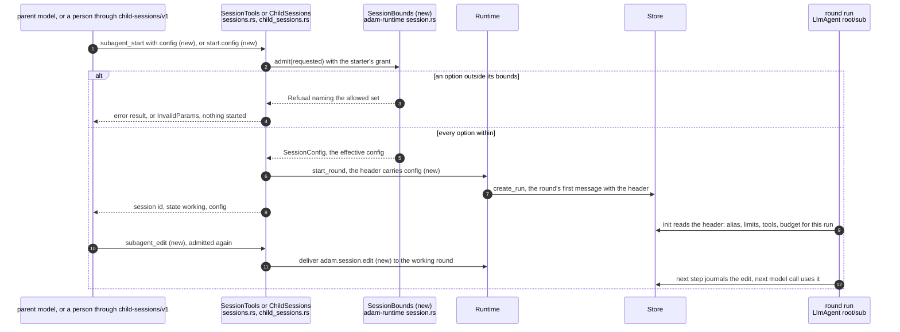
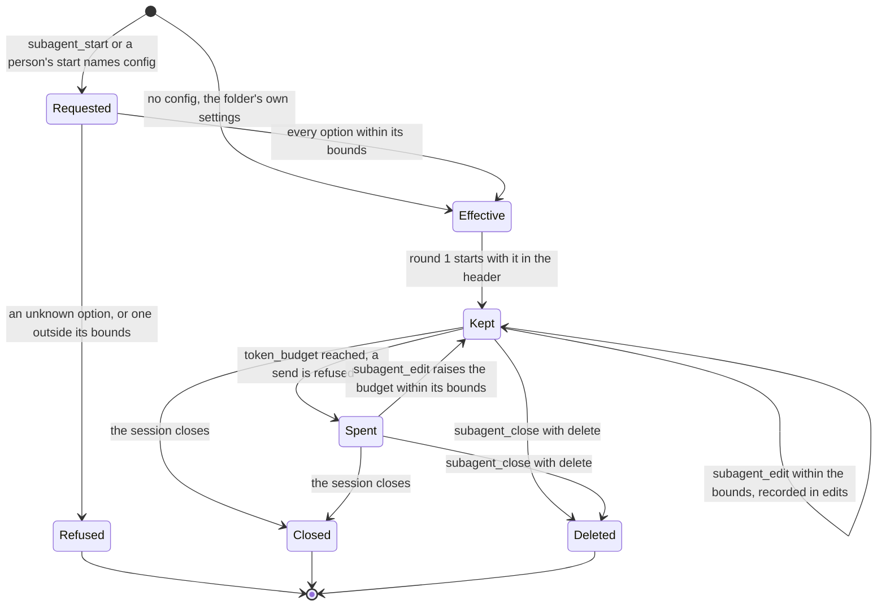

# 0054. A child session can be configured, edited and deleted, within what its folder allows

Status: **Accepted** (2026-11-19), the owner's request. Told that `subagent_start` takes only `agent`, `description`, `prompt`
and `keep_open`, the owner answered: *"Hmm it's not enough. We should be capable of configuring the model itself, the max
context window (e.g to force compactation sooner), the tools allowed,... all optionally. You can increase the list of
options."* The same day the owner added three things: the system prompt documents the session tools (decision 9), a running
session can be deleted (decision 10), and some settings of a session can be edited, a running one included (decision 11).
The shape below and the defaults under [What is put to the owner](#what-is-put-to-the-owner) are proposed with the request;
a different answer is a dated note here. **Nothing is built.** The owner builds the slices; each is written as a ticket.
Amends [ADR 0045](0045-a-subagent-can-run-in-the-background-as-a-session.md) (decision 3's table, the header of decision 1, the
close of decision 11; a dated note there). Uses [ADR 0036](0036-the-coder-keeps-to-the-access-tier-the-person-picks.md) (tiers),
[ADR 0044](0044-paged-tools-a-stable-prompt-prefix-a-plan-skills-commands-and-project-context.md) (the stable prefix, compaction),
[ADR 0049](0049-the-tool-calls-of-a-turn-run-at-the-same-time.md) (parallel calls) and
[ADR 0050](0050-hooks-around-the-agent-loop-compiled-first-and-programs-second.md) (the `session.*` events). The contract
`child-sessions/v1` is the orchestration layer's (`docs/api/child-sessions-v1.md` in `vymalo/another-agentic-system`); its
amendment is the owner's to make there.

## Context

*Verified 2026-11-19 by reading adam-rs at `d8d6005`:*

| Today | Where |
|---|---|
| `subagent_start` reads `agent`, `description`, `prompt`, `keep_open`; the round's header is `{id, agent, description, keep_open, closed, closing, round}` | `crates/adam-llm-agent/src/sessions.rs` (`Start::call`), `crates/adam-runtime/src/session.rs` (`SessionHeader`) |
| A later round copies the latest round's header (`view.header.clone()`), so whatever the header holds carries | `sessions.rs` (`Send::call`), `crates/adam-a2a-runtime/src/child_sessions.rs` (`next_header`) |
| A person's start is `metadata[URI].start {agent, description, keepOpen}`; **unknown members are ignored** | `child_sessions.rs` (`parse_start`) |
| Each round is a run of **one shared `LlmAgent`** per subagent, built at startup from its file: alias, instructions (with the skills catalog), tools, `Limits`, `max_parallel` | `crates/adam-assembly/src/assembly.rs` (`Bound::model`, `build`), `crates/adam-assembly/src/def.rs` |
| The request's `system` is the agent's fixed instructions, then what tool sources add | `crates/adam-llm-agent/src/agent.rs` (`request.system = self.instructions`, `instructed`) |
| `Limits { max_turns, max_tool_calls, max_output_tokens, max_history_tokens }`, per run; `max_output_tokens: 0` leaves it to the model | `agent.rs` (`Limits`) |
| Compaction is due at `min(window − 20,000 − max_output_tokens, max_history_tokens)`; with neither, never | `crates/adam-llm-agent/src/compaction.rs` (`budget`), `agent.rs` (`history_budget`) |
| A subagent's model is its file's `model:` alias or its parent's; one client, one endpoint (`MODEL_BASE_URL`); only `MODEL`'s alias has a context window and modalities (`MODEL_CONTEXT_WINDOW`, `MODEL_INPUT_MODALITIES`); `Bound::model_aliases` can check aliases but **no deployment sets it** | `assembly.rs`, `crates/adam-service/src/config.rs`, [environment](../reference/environment.md) |
| `ModelRequest.temperature` exists and the loop **never sets it**; there is no reasoning-effort field (`MODEL_EXTRA_BODY` sets one for the whole deployment); a folder's `temperature:` is ignored with a warning | `crates/adam-model/src/types.rs`, `crates/adam-model-openai/src/wire.rs`, [agent files](../reference/agent-files.md) |
| A tool source can hide tools for a turn and the loop refuses a hidden one called anyway (`ToolSource::withhold`) | `crates/adam-llm-agent/src/source.rs`, ADR 0036 decision 6 |
| The coder's tier of a subagent is the root's, read from the root run's notes, capped by `MAX_ACCESS_TIER` | `bin/adam-coder/src/tier.rs` (`TierSource::tier_of`) |
| A local child's tools work in the **root run's** workspace | `bin/adam-coder/src/tools/mod.rs` (`root_run_id`) |
| No structured output: no `response_format`; a JSON Schema validator (`jsonschema` 0.58) is in the workspace, used by `adam-ui` | `Cargo.toml`, `crates/adam-ui/src/catalog.rs` |
| No `Store` method deletes one run; `purge_finished(agent, before)` deletes finished runs by age | `crates/adam-core/src/store/mod.rs` |

## Decision

1. **`subagent_start` takes an optional `config` object**, and a person's start through `child-sessions/v1` takes the same
   object as `start.config` (camelCase on the wire). Every member is optional; no `config` is the folder's own settings, as
   today. **An unknown member is refused**, unlike `start`'s own members: an ignored narrowing fails open.
2. **The rule: an option chooses within, or narrows, what the subagent's folder, the deployment and the starter allow. It
   never widens them.**
   * Each subagent's **bounds** are computed once at startup by the assembly from its file and the deployment
     (`SessionBounds`, new, `crates/adam-runtime/src/session.rs`). The starter's own grant (its tier) is added at the call.
   * One pure function, `SessionBounds::admit(requested) -> Result<SessionConfig, Refusal>` (new), serves the tool and the
     A2A front, so they cannot disagree. It fills nothing in: an absent option stays absent and means "the folder's".
   * A refusal names the option, the value asked and the allowed set or range, in words (`config.max_turns is 500; at most
     200 for reviewer`). A list is cut at 50 names with "and N more". Nothing is started.
3. **The effective config is recorded in the session header**, which is journaled with the round's state:
   `SessionHeader.config: Option<SessionConfig>` (new), `spent` (new, decision 6) and `edits` (new, decision 11).
   * It is computed in the call of `subagent_start` (a journaled tool step) and carried by the round's first message, so a
     replay reads it and never recomputes it. A repeated call that finds its round returns that round's config.
   * Each later round copies it and **clamps it to the bounds of that time** (a deployment that lowered a limit since is
     obeyed; nothing is raised back). A `model` no longer allowed fails the round in words; it never falls back silently.
   * It is reported: in each `subagent_list` row, on the head line of `subagent_read`, and as `config` on the A2A session
     object and its events.
4. **The options.** The source of truth is what bounds each one today; "Enforced by" is the code that holds it (new, unless
   it exists). An edit (decision 11) takes effect at the next model call or the next round, as the last column says.

   | Option | Behaviour | Source of truth (the bound) | Narrowing rule | Enforced by | Takes effect | Slice |
   |---|---|---|---|---|---|---|
   | `max_turns`, `max_tool_calls` | per round, as today | the subagent's `limits:` (defaults 50, 200) | 1 to the folder's | `Limits` of the run, read from the header in `agent.rs` | next model call | 1 |
   | `max_output_tokens` | per model call | `limits.max_output_tokens` (4,096) | 256 to the folder's; with the folder's `0` (the model's), 256 to 1,048,576; never `0` (that widens) | the request in `agent.rs` | next model call | 1 |
   | `context_window` | compaction starts sooner | the model's window (`MODEL_CONTEXT_WINDOW`, per alias in slice 11), `limits.max_history_tokens` | at most the model's window when known; at least 20,000 + the effective `max_output_tokens` + 8,000, so a budget is left (a smaller one would turn compaction **off**) | `compaction::budget` given `min(window, context_window)` | next model call | 1 |
   | `max_parallel_tool_calls` | ADR 0049 | `limits.max_parallel` lowered by `MAX_PARALLEL_TOOL_CALLS` | 1 to that | `LlmAgent::max_parallel` read per run | next model call | 1 |
   | `time_limit` (minutes) | per round | `limits.max_minutes` (30; `0` none), a remote's `remote_timeout` (one hour) | 1 to that (any when `0`) | the `within` of `start_round` | next round | 1 |
   | `max_rounds` | per session | the root's effective `max_session_rounds` and `SESSION_MAX_ROUNDS` | 1 to that | `Send::call`, the A2A front | next round | 1 |
   | `tools` | an allow-list, the folder's syntax (names, `*` patterns: `github__*` selects an MCP server) | the subagent's bound tools (`tools:` and its `mcp.json`) | each entry matches at least one bound tool; a source's tool is offered only when matched | a session withhold in the loop, at both points ADR 0036 decision 6 (a) and (b) uses | next model call | 3 |
   | `deny_tools` | a deny-list, same syntax | as `tools` | as `tools`; applied after it | as `tools` | next model call | 3 |
   | `token_budget` | a cap on the session's tokens (input and output, as `usage/v1` counts them) | none today: any value narrows | 1,000 to 2^53 − 1 | before each model call: `spent` + this round's tokens reached ends the round with the closing turn and the words `token budget reached`; a send to a spent session is refused | next model call | 6 |
   | `instructions` | text appended to the folder's instructions, never replacing them | none | at most 4,000 characters, one block; rendered after the folder's text under a fixed heading that says it comes from the parent agent or the person and that the instructions above take precedence | the run's `system` in `agent.rs` | next round | 7 |
   | `skills` | a subset of the catalog | the subagent's `skills:` | each a skill of that selection; preloaded skills stay (they are the folder's instructions) | the catalog rendered per run; `load_skill` refuses another | next round | 7 |
   | `access_tier` | a ceiling for every round | the starter's tier (the parent's, or the person's message), `MAX_ACCESS_TIER` | at most those; refused where the deployment lists no tiers | `TierSource::tier_of` and `Gated` take the minimum with the header's ceiling (`bin/adam-coder/src/tier.rs`) | next model call | 8 |
   | `report_schema` | the round's final answer is one JSON value that matches | none | draft 2020-12, at most 16 KiB, no `$ref` outside itself, compiles; local subagents only | at the final answer: two corrective turns (counted in `max_turns`) with the first three errors, then the round fails `report does not match report_schema` | next round | 9 |
   | `model` | an alias from an allow-list | the subagent file's new `models:` (its `model:` is the default and always allowed), intersected with the deployment's `MODEL_ALIASES` when set | one of that set; never an arbitrary id; refused on a remote subagent | the alias of the run's requests, window and modalities | next round | 11 |
   | `reasoning_effort` | per request | the deployment's declaration for that alias | one of the values declared; refused when none is (amended below) | a new `ModelRequest` field, sent by `adam-model-openai` | next model call | 12 |
   | `temperature` | per request | the deployment's declaration for that alias | within the declared range; refused when none is | `ModelRequest.temperature`, set by the loop for the first time | next model call | 12 |

   A **remote** (`a2a:`) subagent takes `time_limit`, `max_rounds` and `instructions` (sent ahead of the first message, as
   text); every other option is refused in words: its loop is another system's. Tools the loop itself needs (`read_output`)
   are never removed by `tools` or `deny_tools`.

   *Amended 2026-11-21 (ADR 0063)*: for `reasoning_effort` only, the declaration is the **model entry** in
   `MODEL_ALIASES_FILE` (the alias's `reasoning` object: its levels and its wire), not a global variable. A folder or
   session value must be one of that model's levels; a request outside them is refused; a model whose entry takes none
   refuses any effort. There is **no default**: unset sends nothing. `temperature` is unchanged.
5. **Dropped, each for a reason.**

   | Candidate | Why not |
   |---|---|
   | `mcp_servers` | MCP tools are named `<server>__<tool>`, so `tools: ["github__*"]` and `deny_tools` already select servers; servers are connected per agent at startup and shared, so a subset saves no connection. One mechanism, one refusal |
   | `files` | a local child already works in the root run's workspace (`root_run_id`): the prompt names the paths. Handing files to a remote is a file part of A2A, a different decision |
   | `extra_body`, `echo_reasoning` | deployment settings (`MODEL_EXTRA_BODY`, `MODEL_ECHO_REASONING`); a free-form body per session widens by definition |
   | session tools for the child, depth | ADR 0045 decision 5 keeps depth 1; an option may not grant tools |
   | an idle limit per session | `idle_ttl` is read runtime-wide when a session is listed; a per-session value buys little and adds a field to every listing |
6. **`spent`**: each round's agent keeps `SessionHeader.spent`, the session's tokens so far (the earlier rounds', carried by
   the header, plus its own), in the state it commits, so the runtime's listing reads it from the round's record like the
   rest of the header and a send can refuse a spent session without a new store read.
7. **The model.** One endpoint (`MODEL_BASE_URL`), several aliases, chosen per session from an allow-list; several endpoints
   are not decided here. The allow-list is the subagent file's `models:` (new key) intersected with the deployment's
   `MODEL_ALIASES` (new; it also turns on the startup check `Bound::model_aliases` already has). The facts of each alias (its
   context window, modalities, the reasoning efforts and temperature range it accepts) are declared by the deployment
   (`MODEL_ALIASES_FILE`, new, a JSON or YAML map of alias to facts; the name is proposed): today only `MODEL`'s alias has
   any. When the orchestrator's model relay exists (`vymalo/another-agentic-system` ADR 0063, proposed, not built), the relay
   is that endpoint and its offered models narrow the set again.
8. **The A2A front takes `start.config`** with the same `admit`, refusing with `InvalidParams` in words before anything is
   written. A person's start takes no `accessTier` member: the message's tier (`access-tier/v1`) is the person's choice and
   becomes the ceiling. The card's `params.agents[]` gains `config`: the options each helper takes and their bounds, the
   named sets (`models`, `tools`, `skills`) included, so a client can draw a form. **A client sends `config` only to a helper
   whose card entry lists it**: an older agent ignores unknown `start` members.
9. **The system prompt documents the session tools** (owner, 2026-11-19).
   * When an agent has the session tools, its instructions end with a short fixed section, *Child sessions*: what each tool
     does (start with `config`, send, read, list, edit, close and delete), when to keep a session open, and that options only
     narrow what each helper allows and a refusal says the allowed set.
   * **Where:** appended at bind in `adam-assembly`, after the skills catalog, so it is part of `LlmAgent::instructions` and of
     the request's `system` before anything a tool source adds (`agent.rs`, `instructed`). It is in the stable prefix of
     ADR 0044 decision 1 and counted in `fixed_chars`.
   * **Fixed per agent:** it names the tools and the helpers (sorted, as the roster is) and nothing per session, no limit and
     no count, so a deployment that changes a limit does not change the prompt (as `with_limits` keeps the specs).
   * **One source:** a table in `sessions.rs` (each tool's name, purpose and arguments) generates both the specs and the
     section (`SessionTools::guide`, new). A test fails when a tool or an argument named in the section is not in the specs,
     or the other way round.
10. **Deleting a session is `subagent_close { session, cancel, delete }`**, not a sixth tool (owner, 2026-11-19).
    * **Why:** a delete is a close that also hides; it uses the closing round that exists (`closing_round_payload`), the A2A
      front already closes through `close {cancel}`, and the prompt keeps one tool fewer. `delete: true` implies `cancel: true`.
    * It stops a working round, as a close with cancel does, then writes `deleted: true` (new) in the closing round's header.
      A deleted session is never listed, frees its place under `max_open`, and is refused by every tool in words
      (`session … was deleted`). It cannot be reopened (no closed session can).
    * **The store:** its rounds' runs are **kept** until `purge_finished` removes them by age (retention, for audit); a delete
      that erases them now needs a new required `Store` method, which breaks every implementer (Rule 2), and is not decided
      here. What the parent already read stays in the parent's history (ADR 0039 keeps history unrewritten).
    * **Notices:** an `adam.child.reported` notice of a round the delete cancelled matches nothing (a notice only wakes); the
      due rule never reports a round of a deleted session.
    * **A2A:** a person deletes with `metadata[URI].close {cancel: true, delete: true}` on a message to the child context. The
      parent's stream says `closed` with `deleted: true` (a new member, not a new event, so a strict reader of the four
      events keeps working); the sessions object no longer lists it; a request about its context or its rounds is
      `TaskNotFound`. Whether the orchestrator erases the child thread is the orchestrator's decision.
11. **Editing a session is a new tool, `subagent_edit { session, config }`** (owner, 2026-11-19). `subagent_send` stays for
    messages only, and takes no `config`.
    * **Why a tool of its own:** an edit needs no message, has its own result and refusal, and is its own step and hook event;
      folding it into `send` would make a message optional there and blur two results.
    * **The rule** is decision 2, against the bounds of the time of the edit and the editor's own grant: an edit may set an
      option back up to the bounds, never past them. `config` here is a patch: a member set to `null` returns it to the
      folder's.
    * **A working session:** the edit is delivered to the open round as `adam.session.edit` (new, like `adam.session.close`,
      not counted as unread input), read at the round's next step and journaled there. Options marked *next model call* in the
      table apply from the next call; the others are pending in the header and apply from the next round.
    * **An idle session:** the edit is a round that calls no model, as a close of an idle session is; it counts toward
      `max_rounds` as a close does, and has no report (a read gives the last round that worked).
    * **History:** the header keeps the last 16 edits (`edits`: the round, who edited, `agent` or `person`, and the members
      changed), carried by every later round. The A2A front takes `metadata[URI].edit {config}` on a message to the child
      context and reports the change as a `round` event's session object.
    * Changing `tools`, `max_output_tokens` or `reasoning_effort` mid-round changes the request's prefix once: the prompt cache
      of that session misses once (ADR 0044).
12. **No mixed versions.** A worker of the revision before ignores `config` in a header and would run the round with the
    folder's settings: roll every worker before any session uses `config` (as ADR 0045 says for sessions).

## Alternatives considered

* **Free choice of model id or endpoint per session.** It would widen what the deployment pays for and trusts; the owner's
  rule is "within".
* **One `LlmAgent` per distinct config.** Configs are open-ended; building agents at run time breaks the one-agent-per-subagent
  registration the runtime and the A2A front rely on. The shared agent reads its config from the run's header instead.
* **Store the config in a row of its own.** A new `Store` method breaks every implementer (Rule 2); the header already is the
  session's truth.
* **Ignore an unknown option**, as `start` ignores unknown members. A narrowing silently dropped fails open.
* **`subagent_send { message?, config? }`** for edits, and **`subagent_delete`** as a sixth tool: see decisions 10 and 11.
* **Purge a deleted session's runs at once.** It needs a store method (above) and loses the audit trail; retention removes them.
* **Provider structured output (`response_format`) for `report_schema`.** Gateways differ in what they accept (*unverified*
  per gateway); a check of the final answer is adam's own and works on any model.

## Consequences

* **Rule 2.** No new required `Store` method; no closed enum gains a variant. Breaking for code that builds the structs with a
  literal: `SessionHeader` gains `config`, `spent`, `deleted`, `edits` (slice 1 makes it `#[non_exhaustive]` with a
  constructor, itself one break); `SessionAgent` gains its bounds; `ModelRequest` gains `reasoning_effort` (slice 12). All
  serialise with defaults, so a stored header from before reads as "no config".
* **The prompt changes once** for every root with subagents: `subagent_start` gains `config`, a sixth tool `subagent_edit`
  appears, `subagent_close` gains `delete`, and the *Child sessions* section is added (one cache miss per conversation after
  the upgrade).
* **New settings** (slice 11): the file key `models:` on a subagent and `MODEL_ALIASES`, `MODEL_ALIASES_FILE`; a bad value is
  exit 78. A file with `models:` read by an older adam is warned about and ignored.
* **The contract** `child-sessions/v1` changes: `agents[].config` on the card, `start.config`, `edit`, `close.delete`, `config`
  and `deleted` on the session object and events. The owner amends it in `vymalo/another-agentic-system` before slice 10.
* **Pages to update with the build:** [Child runs](../reference/child-runs.md), [Agent files](../reference/agent-files.md),
  [Environment](../reference/environment.md), [A2A server](../reference/a2a-server.md), [Architecture](../architecture.md) (the
  compaction budget), the READMEs of `adam-runtime`, `adam-llm-agent`, `adam-assembly`, `adam-a2a-runtime`, `adam-model`,
  `adam-service` and `bin/adam-coder`, and the `adam-a2a-extensions` skill.
* **Hooks:** the `session.*` events of ADR 0050 (slice H7, not built) carry the effective config and the edits.

## Slices

Each slice is a ticket a person can pick up, in this order; one pull request each, tests on memory, PostgreSQL and MongoDB
where a store is involved (`crates/adam-llm-agent/tests/sessions.rs` holds the session cases).

**1. The config, its bounds and the limits** (no new infrastructure). Depends on nothing.
* Files: `crates/adam-runtime/src/session.rs` (`SessionConfig`, `SessionBounds`, `admit`, the header fields, `#[non_exhaustive]`),
  `crates/adam-assembly/src/assembly.rs` and `def.rs` (bounds per subagent), `crates/adam-llm-agent/src/sessions.rs` (`config` on
  `subagent_start`, list and read), `agent.rs` and `compaction.rs` (the run reads its limits, window and parallelism from the header).
* Accepted when: each of `max_turns`, `max_tool_calls`, `max_output_tokens`, `context_window`, `max_parallel_tool_calls`,
  `time_limit` and `max_rounds` is honoured by a round and refused above its bound with words naming it; `max_output_tokens: 0`
  and a `context_window` that leaves no budget are refused; an unknown option is refused; a session with a smaller
  `context_window` compacts at the turn the budget says; round 2 carries the config; a lowered deployment limit clamps round 2;
  a replay of a committed journal gives the same requests; list and read show the config.
* *2026-11-27 (ANR-651, slice 1 part 3):* the run reads the seven options from the header. `max_turns`, `max_tool_calls`,
  `max_output_tokens`, `max_parallel_tool_calls` and `context_window` at the next model call (`agent.rs`, `compaction::effective_window`),
  `time_limit` and `max_rounds` in `Send::call`. Round 2 copies the config and clamps it (`SessionBounds::clamp`) before the round
  limit is checked. `subagent_start` takes `config` in snake_case and admits it with `SessionBounds::admit`. **Not in this part:**
  `config` on the A2A `start` (the front), and *list and read showing the config* (the head line of `subagent_read`, the
  `subagent_list` row), which stay open in slice 1; a re-configuration of a running session is `subagent_edit` (slice 4).
  The `subagent_start` schema grew (the `config` object), which **changes the stable prompt prefix, and so the prompt cache,
  of every agent that has subagents**: the first requests after the deploy miss the cache once. A `config` on a remote subagent
  is refused by option name unless it is `time_limit` or `max_rounds`, and a value that is not a whole number of 32 bits is
  refused naming its option.
* *2026-11-27 (ANR-203, slice 1 part 4): slice 1 is complete.* `config` is on the A2A `start` of `child-sessions/v1`: camelCase members
  (`maxTurns`, `maxToolCalls`, `maxOutputTokens`, `contextWindow`, `maxParallelToolCalls`, `timeLimit`, `maxRounds`), read by
  `parse_start` in `adam-a2a-runtime` and admitted by the **same** `SessionBounds::admit` as the tool. Each `ChildSessionAgent` carries
  its bounds (`with_bounds`; `Assembly::child_sessions` and the workers of `adam-agent` and `adam-coder` take them from
  `Assembly::session_bounds()`). The refusal is `InvalidParams` with the option's words renamed `start.config.<member>`, and nothing
  starts; an unknown member is refused, as is any other value `admit` refuses (`maxOutputTokens: 0` among them). A remote helper takes
  only `timeLimit` and `maxRounds`, as the tool does. **A helper whose bounds are not known fails closed:** a role that binds no
  agent (a control plane) refuses every `start.config`, because the deployment's `MAX_PARALLEL_TOOL_CALLS` and the model are known
  only where the agent is bound. The admitted config is written into the header of round 1, and is reported as `config` (camelCase,
  only the options set, absent when none) on the session object, on the parent's `sessions` rows and on the events. List and read
  show it: a `subagent_list` row ends with `config: max_turns 20, time_limit 10`, and `subagent_read` has a `config:` line after its
  head; a session with none shows nothing. No tool description changed, so the coder's tool-size golden is untouched. The contract
  `child-sessions-v1.md` (in another repository) needs a `start.config` member and a `config` member of the session object.
* *2026-11-27 (ANR-1093):* **the control plane of a split deployment admits a `start.config` too**; the "fails closed" limit of the
  ANR-203 note above no longer holds for the shipped agents. The bounds never needed the bound agent: they are the helper's folder
  (`limits`), the deployment's `MAX_PARALLEL_TOOL_CALLS` and the root's effective `max_session_rounds`; only the model's window is a
  fact of the model (decision 11), and **no role has it when it admits**, because `context_window` is `None` in the bounds of a
  worker as well (`admit` applies the floor, the run takes the minimum with the model's window). So there was nothing to refuse
  only on a control plane. `crates/adam-assembly/src/bounds.rs` holds **one pure function**, `bounds_of`, that `Assembly` (the
  workers' session tools, and the front of `all` and `worker`) and the new `AgentDef::session_bounds()` (the control plane, which
  binds nothing) both call, so the two cannot disagree; the clamping rule of decision 3 is one function too (`parallel_limit`, used
  by the agent's build and by the bounds). The deployment's `MAX_PARALLEL_TOOL_CALLS` reaches a definition by
  `AgentDef::session_max_parallel(n)`, which `bind` also takes as the agents' limit unless `BoundDef::max_parallel` says another.
  `adam-service` reads the variable on **every role**, leniently (`SessionSettings::max_parallel_tool_calls`: a bad value is the
  default there and no problem, since the roles that run workers still refuse it and a control plane starts as before), and
  `adam-coder` and `adam-agent` give it to the definition beside `session_limits`, then call `session_bounds()` in the arm that binds
  no agent (`ChildSessions::with_bounds` now gets real bounds there). **Operating rule:** give the control plane the same
  `MAX_PARALLEL_TOOL_CALLS` and `SESSION_MAX_ROUNDS` as the workers (the chart renders `SESSION_MAX_ROUNDS` on every role; it renders `MAX_PARALLEL_TOOL_CALLS` on the workers only, so until `deploy/coder` renders it on the front too, a split deployment that lowers it sets `MAX_PARALLEL_TOOL_CALLS` in `config.extraEnv` instead of `config.maxParallelToolCalls`, which reaches every role, or accepts the default 10 on the front). A control plane with a
  larger value would admit a config the worker then narrows at run time; it never admits more than the folder's own limits, and a
  worker never runs a round above its own bound. Tests: `adam-assembly/tests/session_bounds.rs` (the definition's bounds equal a
  worker's over a table of folders, session limits and parallel limits), `adam-service` `every_role_reads_max_parallel_for_the_session_bounds`
  and, for the split topology, `adam-agent/tests/agent.rs` (a control plane and a worker over one store: a config within the
  helper's bounds is admitted and recorded in the header, one above a bound is refused naming `start.config.<member>`).

**2. The system prompt section** (decision 9). Depends on 1.
* Files: `sessions.rs` (the table, `SessionTools::guide`), `crates/adam-assembly/src/def.rs` or `assembly.rs` (append at bind),
  `crates/adam-llm-agent/tests/prefix.rs`.
* Accepted when: a root with subagents has the section after its catalog and one without has none; the section is byte-equal
  under any `SessionLimits`; the drift test fails when a spec argument is renamed alone; ADR 0044's prefix test holds.
* *Built (2026-11-27, ANR-208):* `SessionTools::guide()` and `SessionTools::guide_for(helpers)` in `sessions.rs` make the *Child
  sessions* section from one table (`GUIDE`: each tool's name, purpose and arguments, and the options of `config` from
  `CONFIG_OPTIONS`). It names the five tools that exist (`subagent_start`, `_send`, `_read`, `_close`, `_list`): *edit* and
  *delete* are slices 4 and 5 and join the table with their tools. `def.rs` appends it at bind, after the skills catalog, to the
  root that has subagents (`guide_for` takes the helper names: the section needs no bounds, but `SessionTools` is not built at bind
  because a `SessionAgent` needs them), so it is in
  `AgentInfo::prompt`, in `LlmAgent::instructions` and in `fixed_chars`. It has no limit and no count, so it is the same bytes
  under any `SessionLimits`. **The table generates the argument lists; the descriptions are written twice and no test compares
  them:** each spec's `required` is built
  from it (`required_of`), a unit test holds each spec's `properties` keys (and `required`) to the table's arguments, and the specs stay
  pinned byte for byte by `tests/fixtures/session-tools.json`. The drift test (`tests/sessions.rs`,
  `the_guide_and_the_specs_name_the_same_tools_and_arguments`) holds the guide's tools,
  arguments, required flags and `config` options to the live specs in both directions, and a second test proves the check fails
  on a rename on either side. **Consequence:** the prompt of every agent that has subagents grows by about 1.7 KB
  (the coder's baseline in `first_request.rs` moved by the section's size), which **changes the stable prefix and so the prompt
  cache once** at the deploy. `tests/prefix.rs` is unchanged: it holds for any instructions, the section is part of them.

**3. `tools` and `deny_tools`.** Depends on 1.
* Files: `agent.rs` (the session withhold, both points), `sessions.rs`, `def.rs` (the bound tool names).
* Accepted when: a hidden tool is not in the request and a call to it is refused without running; a pattern matching no tool is
  refused with the list; an MCP server is selected by `server__*`; `read_output` stays.

**4. `subagent_edit`** (decision 11). Depends on 1 and 3.
* Files: `sessions.rs`, `crates/adam-runtime/src/session.rs` (`adam.session.edit`, `edits`), `agent.rs` (read at the next step).
* Accepted when: an edit of a working round changes the next model call for *next model call* options and the next round for the
  others; an idle edit is a round with no model call and no report; an edit past a bound is refused; the history holds 16; a
  replay of a journal with an edit is the same.

**5. Delete** (decision 10). Depends on 1.
* Files: `sessions.rs` (`subagent_close` `delete`), `crates/adam-runtime/src/session.rs` (`deleted`, the listing filter, the due rule).
* Accepted when: deleting a working session cancels its round and it is never listed again; every tool refuses it; its runs are
  still in the store; no report of it reaches the parent.

**6. `token_budget` and `spent`.** Depends on 1.
* Files: `agent.rs` (the check and the closing turn), `conversation.rs` (`spent`), `session.rs` (the listing reads it), `sessions.rs`.
* Accepted when: a round that reaches the budget ends with the closing turn and `token budget reached`; `spent` carries across
  rounds; a send to a spent session is refused; an edit that raises the budget within its bound lets it work again.
* *2026-11-27 (ANR-213):* **`token_budget` and `spent` are built, except the edit case, which waits for slice 4.** `SessionConfig::token_budget`
  is `Option<u64>`, 1,000 to 2^53 − 1 (`MIN_SESSION_TOKEN_BUDGET`, `MAX_SESSION_TOKEN_BUDGET`); no folder bounds it today, so
  `SessionBounds::token_budget` is `None` and `admit` holds the request to that range (a folder's own cap, if one ever exists, lowers
  the ceiling). `Conversation::spent` starts from the header's `spent` at `init` (round 2 starts from round 1's), adds every model
  call of the round as `usage/v1` counts it (input + output; the compaction summary included) and writes it into
  `SessionHeader::spent` in the state the round commits, so `SessionSummary::spent` and `SessionView::header` read it from the
  record. Before each model call, `spent >= token_budget` makes that call the closing turn (`LimitKind::TokenBudget`,
  `limit: "token_budget"`); a closing turn with no words fails the round with `token budget reached: the session has spent N of
  its M tokens`. A send to a spent session is refused from the header the view already carries: `subagent_send` in words,
  `message_to_session` as `UnsupportedOperation` (so the engine's `send` too). A header stored before this slice decodes
  `spent: 0`, and a round resumed from such a journal counts only the calls it makes after the resume. **Not testable here:** the
  last accepted case, an edit that raises the budget within its bound, because `subagent_edit` is slice 4 and is not built; the
  budget is read from the header at every model call, so the slice's edit needs no change here.

**7. `instructions` and `skills`.** Depends on 1.
* Files: `def.rs` (the catalog kept apart from the body), `agent.rs` (the run's `system`), `crates/adam-assembly/src/skills.rs` (`load_skill`).
* Accepted when: the session's text follows the folder's under the fixed heading in round 2 and later; an unlisted skill is not in
  the catalog and `load_skill` refuses it; a preloaded skill stays.

**8. `access_tier`** (the coder). Depends on 1.
* Files: `bin/adam-coder/src/tier.rs` (`TierSource`, `Gated`), `crates/adam-llm-agent/src/source.rs` and `tool.rs` (the header's
  ceiling on `SourceCtx` and `ToolCtx`).
* Accepted when: a `plan` session of an `auto` parent is offered no write tool and a named one is refused at the tool; a tier above
  the parent's is refused; a deployment without tiers refuses the option.

**9. `report_schema`.** Depends on 1.
* Files: `agent.rs` (the check at the final answer), `crates/adam-llm-agent/Cargo.toml` (`jsonschema`), `sessions.rs`.
* Accepted when: a matching answer is the report; a mismatch gets two corrective turns and then fails the round with the reason;
  a schema with an outside `$ref` or over 16 KiB is refused.
* *Built (2026-11-27, ANR-220)*: `SessionConfig::report_schema` (`reportSchema` on the wire) is held by `SessionBounds::admit`
  (`crates/adam-runtime/src/session.rs`, so the tool and the later A2A front share it): an object, at most 16 KiB
  (`MAX_REPORT_SCHEMA_BYTES`), no `$ref` or `$dynamicRef` that does not start with `#`, and a draft 2020-12 schema that compiles
  with nothing fetched (`jsonschema` without its default features, in `adam-runtime` and `adam-llm-agent`). A remote subagent
  refuses it by name. The loop checks the answer at each place a round can end (`LlmAgent::report_gate`, `agent.rs`: the words that end a turn, an answer a tool announced, a tool's `final_answer`, and a closing turn): not one JSON
  value, or one that does not match, puts the first three problems to the model as a turn (the first also tells the schema,
  since the round is not otherwise shown its configuration), twice at most, each a model call counted in `max_turns`; then the
  round fails with `report does not match report_schema` and the last problems. **A closing turn's answer (a limit was
  reached, so no correction is left) must match too, or the round fails the same way**: a report that does not match is never
  a `Done` one. A correction drops the announced answer that failed, so the corrected words are what is checked next. The count is `Conversation::report_corrections`, reset when a message reaches the run. A `format` is an annotation under draft 2020-12 and is not enforced; an answer in a code fence is not accepted (the correction says so). `subagent_start`'s
  `config` names the option and its description tells the model to describe the shape in `prompt` too.

**10. The A2A front.** Depends on 1, 4, 5 and the contract amendment in `vymalo/another-agentic-system`.
* Files: `crates/adam-a2a-runtime/src/child_sessions.rs`, `session_events.rs`, `crates/adam-a2a` (the card's `agents[].config`).
* Accepted when: `start.config`, `edit` and `close.delete` behave as the tools do, refusals are `InvalidParams` before any write,
  the session object and events carry `config` and `deleted`, and a deleted session's context is `TaskNotFound`.

**11. The model** (new infrastructure: the deployment's alias facts). Depends on 1.
* Files: `crates/adam-agent-fs/src/schema/agent.rs` (`models:`), `crates/adam-service/src/config.rs` (`MODEL_ALIASES`,
  `MODEL_ALIASES_FILE`), `adam-model-openai` (facts per alias), `assembly.rs`, `agent.rs` (the run's alias), `deploy/coder` (values).
* Accepted when: a session runs on an allowed alias with that alias's window and modalities in its requests and usage reports; an
  alias outside the set is refused with the set; a bad file is exit 78.

**12. `reasoning_effort` and `temperature`.** Depends on 11.
* Files: `crates/adam-model/src/types.rs`, `crates/adam-model-openai/src/wire.rs`, `agent.rs`.
* Accepted when: the declared values are sent and others refused; an alias that declares none refuses both.
* *Amended 2026-11-21 (ADR 0063)*: for `reasoning_effort`, the declared values are the model entry's levels, and
  unset sends nothing (no default); `temperature` still refuses when none is declared.

## What is put to the owner

The work proceeds with these; a different answer is a dated note here.

1. `subagent_send` takes no `config`; edits are `subagent_edit` (decision 11).
2. Delete is a flag of `subagent_close`, and a deleted session's runs are kept until retention purges them (decision 10).
3. An edit of an idle session is a round with no model call and counts toward `max_rounds`.
4. `instructions` is kept, appended under a heading that gives the folder's text precedence, and applies from the next round.
5. `context_window` has a floor (20,000 + `max_output_tokens` + 8,000); usage reports keep the model's own window.
6. The card lists each helper's named sets (models, tools, skills); they are not secrets, and the card already lists the helpers.
7. `model` chooses among aliases of one endpoint; several endpoints wait for the model relay.
8. A set reasoning effort replaces a `MODEL_EXTRA_BODY` member of the same name *(amended 2026-11-21, ADR 0063: the members the model's wire would duplicate)*.

## Amended 2026-11-27 (slice 5, split in two)

Slice 5 — `subagent_close {delete}` — lands in two pieces, because a working round cannot be given the closing
round that writes the tombstone until it has ended.

1. **The first piece (ANR-1213)** adds `SessionHeader.deleted`, makes `SessionView::from_rounds` answer `None` for
   a deleted session (so it is never listed again and every tool refuses it as *no session*), and accepts
   `delete: true` on an **idle** session, whose closing round writes the tombstone. Its runs stay in the store.
2. **A working session is refused**, with words that say to close it first — *not* cancelled by the delete, which is
   what decision 10 says. The cancel-then-delete order is the second piece, together with the due rule and the
   parent parked on `AwaitSession`, and it carries its own tests on the three stores.
