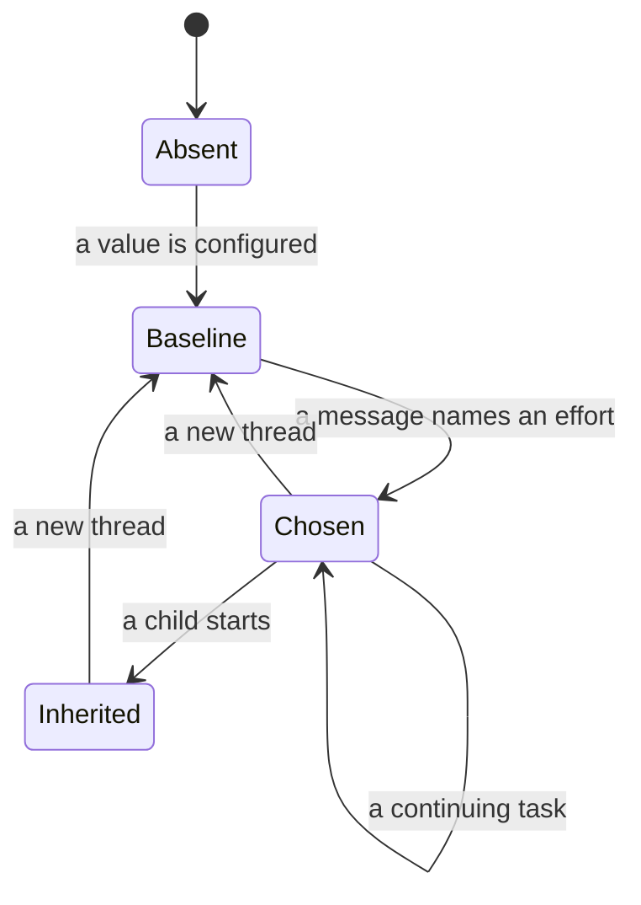
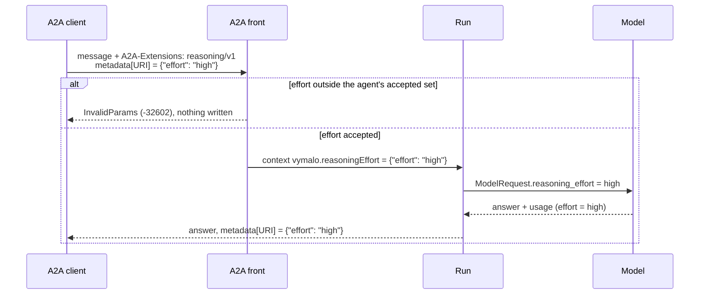

# 0063. A reasoning effort is one setting, configurable end to end

Status: **Accepted** (2026-11-21)

## Context

The model gateway `api.ai.camer.digital` reasons **not at all** when a request carries no
`reasoning_effort`, and adam sends none today: `MODEL_EXTRA_BODY` is the only way to set it, and the
chart documents that escape hatch (`deploy/coder/values.yaml:71-79`). The owner asked for one setting,
reasoning effort, configurable in adam and all its clients.

The gateway's own values were **verified** on 2026-11-20 by direct calls from the benchmark harness
(`bench/README.md` at `bench/variants-reasoning`'s `3281d519`, not merged; model
`deepseek-v4.1-flash-1017`): `low`, `medium`, `high` and `max` are accepted; omitting the member
reasons not at all; `none` and `minimal` were never sent and are **unverified**. At a 32k-token output
budget, `medium`, `high` and `max` spent more than 32k reasoning tokens and produced no answer, so the
effort and the output budget interact (the loop's handling of a reasoning-only length stop is its own
change, tracked separately).

## Decision

1. **The values are a closed enum.** `ReasoningEffort` in `adam-model`: `Low`, `Medium`, `High`,
   `Max`, spelled `low`, `medium`, `high`, `max` on the wire and in every setting. Built like
   `AccessTier`: an `ALL` array, an exhaustive `as_str` and `FromStr`, and serde `rename_all` on top, so
   a new variant fails to compile everywhere until it is handled. `none` and `minimal` are refused as
   unknown, not passed through; they are added only when the gateway verifies them, with a dated note
   here. "Off" is **the absence of the setting**, never a value.

2. **The deployment declares the accepted set; the narrower levels choose within it.**
   `MODEL_REASONING_EFFORT` (and the chart's `config.modelReasoningEffort`) declares exactly one value;
   unset declares the full closed list. The **folder's** `reasoning_effort` is the agent's default and
   must be one of the declared values (anything else is a load error); it is not a bound on the
   agent's children — the deployment's set is. The **request** and the **thread** choose one of the
   declared values; anything outside is refused, never clamped.
   The order is: request → thread → agent folder → deployment → `MODEL_EXTRA_BODY` → absent.
   - **request**: the `reasoning/v1` extension on one A2A message (decision 4).
   - **thread**: the run's current effort, held in the protected context key `vymalo.reasoningEffort`;
     the newest activated message sets it. It **carries into a continuing task of the same thread and
     into a child run** — this is a thread setting, unlike the access tier's per-message one. A new
     thread starts at the folder's value, else the deployment's.
   - **agent folder**: `reasoning_effort` at the top level of the frontmatter.
   - **deployment**: `MODEL_REASONING_EFFORT`, and the chart's `config.modelReasoningEffort`.
   - **`MODEL_EXTRA_BODY`**: its `reasoning_effort` member keeps working as the raw deployment escape
     hatch, but **loses to any typed level**: a set typed effort replaces that one member (ADR 0054's
     owner item 8). This is the one exception to "the extra body wins over what the runtime wrote",
     and it is stated in `adam-model-openai`'s docs, the chart's and `docs/reference/environment.md`.
   - Every level is optional; absent everywhere is today's behaviour.

3. **The folder key is `reasoning_effort`, not `effort`.** `effort` is already an ignored Claude
   Code/Copilot key (`crates/adam-agent-fs/src/load/agent.rs:27`); promoting it would change what an
   existing folder means. It stays ignored. A folder value outside the declared set is a load error
   naming the file and line.

4. **The A2A extension is `https://agents.vymalo.com/a2a/extensions/reasoning/v1`.** Its card entry is
   `required: false` with `params: {efforts: [lowest first], default?: <one of them>}`:
   - `efforts` is **the set this agent accepts** — the deployment's declared set (the full closed list
     when `MODEL_REASONING_EFFORT` is unset). It is the enforcement point: a request outside it is
     refused, so a deployment that sets `low` cannot be raised by a caller.
   - `default` is the effort a **new task** starts at: the folder's value, else the deployment's; it is
     absent when neither sets one. A live thread may be at a different value.
   It is activated per message exactly like `access-tier/v1` (the `A2A-Extensions` header and/or
   `message.extensions`); an activated message **must** carry
   `metadata[URI] = {"effort": "<one the agent accepts>"}`. A missing entry, a non-object, a missing or
   non-string `effort`, an unknown word, or a word outside the accepted set is `InvalidParams`
   (`-32602`) **before anything is written**. Other members of the entry are ignored, as
   `access-tier/v1` ignores them. A message that did not activate the extension carries no effort. The
   value is merged into the run's protected context as `vymalo.reasoningEffort`
   (`{"effort": ..}`); the newest message wins from the agent's next step. A caller that activated it
   is echoed the effort on the `SendMessage` answer, `GetTask`, the first stream frame, and when it
   changes — the same shape as the access tier's echo. The extension can only set an effort: there is
   no member that clears one (see decision 8).

5. **The wire and where the default is applied.** `ModelRequest` gains
   `reasoning_effort: Option<ReasoningEffort>`; `adam-model-openai` sends it as `reasoning_effort`. The
   merge order is: the extra body, then the request's own member, so a typed level wins (a test pins
   `MODEL_EXTRA_BODY={"reasoning_effort":"medium"}` + request `low` → body `low`).
   The deployment's value is **not** put on the client: the assembly resolves the folder's value, else
   the deployment's, into the agent's default (`LlmAgentBuilder::reasoning_effort`), and the loop uses
   the thread's context value if present, else that default. The compaction/summary call sets the typed
   field to `None` (a fixed output budget; reasoning there spends it); `MODEL_EXTRA_BODY` still reaches
   every request, so a deployment that uses the raw escape hatch also reasons in summaries — stated in
   the docs.

6. **Usage.** Each model call's `UsageEvent` carries `effort: Option<ReasoningEffort>`, reported per
   call by `usage/v1` (the struct is `#[non_exhaustive]`, so additive). It is **the typed effort the
   request named**; it is absent when only `MODEL_EXTRA_BODY` set one, because the loop cannot see the
   raw member. The totals stay per provider+model; the effort is per call. The bench's own arm
   fragment remains the source for the raw case.

7. **The engine.** `adam_engine::Limits` gains `reasoning_effort: Option<ReasoningEffort>`
   (`#[non_exhaustive]`, additive). It is the deployment's declaration for the agents the engine
   hosts: the folder's value must be in it, and a request's extension chooses within it.

8. **The deployment.** `MODEL_REASONING_EFFORT` (both binaries, through `ModelConfig`) and the chart's
   `config.modelReasoningEffort`, validated against the closed list. An invalid value is a startup
   error (exit 78), as `MODEL_CONTEXT_WINDOW` is. The chart **refuses** `config.modelReasoningEffort`
   beside a `config.modelExtraBody.reasoning_effort` member (a render error naming both), matching its
   convention for every other clash; a hand-written `MODEL_REASONING_EFFORT` beside
   `MODEL_EXTRA_BODY` follows the binary's rule (the typed value wins). Unset renders nothing, so the
   chart's goldens stay byte-identical. `deploy/coder` is read by `vymalo/another-agentic-platform`'s
   parity goldens; the PR says so.

9. **The default.** The code ships with **no** default: nothing changes until a deployment sets one.
   The recommended deployment value for the coder is **`low`** — the only level the bench verified to
   answer quickly (10–20 s), while `medium`, `high` and `max` ran past 32k reasoning tokens with no
   answer at that budget. `medium` is the intended next step once the length-stop fix and a larger
   output budget are proven. The owner decides whether the chart ships a default.

## The effort's life

## The extension in one message

## Consequences

- A deployment that sets nothing is byte-identical to today: no member, no reasoning, no new env.
- **Breaks (a struct literal must add the field):** `ModelRequest` (`adam-model`), `ModelConfig`
  (`adam-service`), and `AgentFrontmatter` (`adam-agent-fs`, public and not `#[non_exhaustive]`).
  `adam-engine::Limits` and `UsageEvent` are `#[non_exhaustive]`, so they are additive. The PRs, the
  crate READMEs and the `adam-upgrade` skill say so.
- **Files that say the opposite today** and change with the implementation: `docs/reference/agent-files.md`
  (the known-key list and the "`ModelRequest` has no such fields, so the keys are ignored" paragraph),
  `docs/reference/a2a-server.md` (one section per extension, and the `usage/v1` members),
  `docs/reference/environment.md`, `crates/adam-a2a/src/extensions.rs`'s "Twelve extensions" and table,
  `crates/adam-a2a/README.md`, `crates/adam-a2a-runtime/README.md`, `.agents/skills/adam-a2a-extensions`,
  `.agents/skills/adam-agent-folder`, `bin/adam-coder/tests/fixtures/agent/card.json`, and the
  `bin/adam-agent`/`bin/adam-coder` card tests' exact URI lists.
- `docs/api/usage-v1.md` lives in `vymalo/another-agentic-system`; the system half's ADR and PR amend it
  (the effort member is additive).
- The card gains one extension; the chart renders `MODEL_REASONING_EFFORT` only when set, so the four
  goldens are unchanged by default.
- The bench is the instrument that verified the values; its `sent.effort`/`askedEffort` already exist on
  `bench/variants-reasoning`, and the full run can read the typed effort a call named.
- The length-stop fix is complementary: a high effort can spend the whole output budget reasoning; the
  loop must not treat that as a question.

## Amends ADR 0054

*Amended 2026-11-21 (ADR 0063)*: for `reasoning_effort` only, the deployment's declaration is
`MODEL_REASONING_EFFORT` (one value), and **unset declares the full closed list**; until
`MODEL_ALIASES_FILE` carries the facts per alias (0054 slice 11), the declaration is the deployment's
one model. The folder's `reasoning_effort` is a **default within the declared set, not a bound**; a
session or a request outside the declared set is refused. `temperature` is unchanged (an alias that
declares none refuses it). The `MODEL_EXTRA_BODY` rule is 0054's owner item 8, not decision 8.

## Alternatives considered

- **The deployment as a default only** (a caller may raise it): a caller could force `max` and burn
  >32k tokens per task on a deployment that set `low` — a denial-of-wallet, given the bench's own
  evidence. The declared set is the bound instead.
- **The folder as a bound on its children**: 0054's "never widens what the folder allows" is about the
  folder's tools, skills and model set; the effort is a default, and the owner's order puts the
  request above the folder. The deployment's set bounds everyone.
- Accept `none`/`minimal`: unverified against the gateway; fail closed instead.
- Reserve `reasoning_effort` in `MODEL_EXTRA_BODY`: breaks every deployment and the chart's own
  documented example (`{reasoning_effort: medium}`); the typed-wins exception keeps them working.
- Promote `effort`: silently changes an ignored key's meaning.
- A hardcoded default: the owner said nothing changes until it is configured.
- A separate extension per level: the effort is one scalar; one URI with `efforts`/`default` is enough.

## Open questions

- The owner's default (recommendation: `low` for the coder, the only level the bench verified to answer
  quickly; `medium` once the length-stop fix and a larger budget are proven; off in code).
- The system and web half (read `reasoning/v1` from the live card, per message and per thread, the
  picker) and the platform field (`AgentConfig.model.reasoningEffort`, a deployment ceiling, `aapctl`)
  are separate ADRs in their repositories; they follow this contract.
- Whether `medium`/`high`/`max` need a larger output budget to answer at all is a bench question, not
  a setting this ADR adds.
