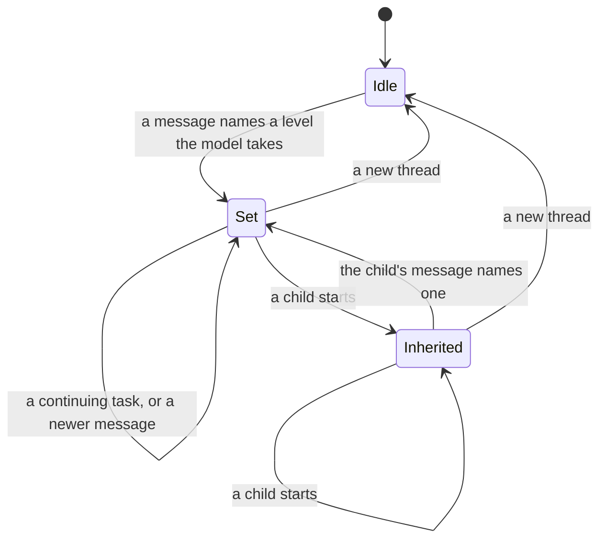
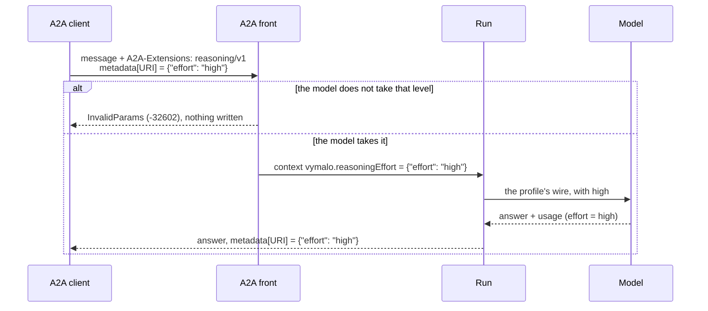

# 0063. A reasoning effort is one setting, per model, configurable end to end

Status: **Accepted** (2026-11-21)

## Context

The models behind the gateway differ: some reason only when a level is sent, others reason by default, and
the level names how much. Adam sends none today: `MODEL_EXTRA_BODY` is the only way to set one. The owner
asked for one setting, reasoning effort, configurable in adam and all its clients — and ruled, on
2026-11-21, that:

- **there is no global default** (not in the chart, the env or the code); unset means nothing is sent, while a profile or a preset may set a per-model value;
- **the setting is per model**, because each model behind the gateway differs: a deployment's model
  configuration declares, for each model it can call, whether it takes a reasoning setting, which levels
  it accepts, and **how they are sent**;
- the vocabulary is the gateway's observed levels, closed, but the mapping and the allowed levels belong
  to the model's profile;
- `reasoning/v1` advertises the levels of the agent's **current model**, and a request outside them is
  refused, fail closed;
- the precedence stays request → thread → agent folder → the agent's preset → the profile, each level
  choosing among the model's levels;
- every surface (coder, folder agent, engine, orchestrator/web, platform) gets the feature through its
  own mechanism — the parity rule.

The bench's earlier probe (2026-11-20, `bench/variants-reasoning` at `3281d519`) found `medium`, `high` and
`max` spending more than 32k reasoning tokens at a 32k output budget with no answer; #273 (2026-11-21) now
continues a turn that the output limit cuts while the model is only thinking, so the run no longer ends as
a question — the budget still bounds one turn, and the effort still trades latency and tokens for
reasoning.

The gateway was probed on 2026-11-21: 25 models, wire `reasoning_effort`, with no setting and every level,
then a multi-step problem with three samples per level (about 200k tokens). **Verified 2026-11-21** on the
deployment's gateway; the table below is by family, names no gateway host, and the full per-model table is
recorded outside this repository.

- Every model accepts every level with a 200, **except Gemini**, which returns 400 for `max` and `xhigh`.
- `none` and `minimal` are real levels: **some models reason unless `none` is sent** (DeepSeek,
  `adorsys-frontend`, `adorsys-researcher`), while the others reason by default and `none` turns that off.
- There is **no graded effect** between `low`, `medium`, `high` and `max`: the real switch is off versus on.
  Gemini is the exception (`low` answers wrong; `medium` and `high` answer right).
- GLM (5.3, 5.3-flash, 4.7-flash) is stochastic and partly inverted; no level controls it, so its
  `reasoningEfforts` is empty.
- `thinking` is ignored where accepted and rejected by Gemini; the `reasoning` object is a 400 on Gemini.
  **Only `reasoning_effort` is verified on this gateway**; the other wires are for other gateways and are
  unverified here.
- The owner's bench finding holds: DeepSeek v4.1-1017 at `low` answers 3/3 correctly in about a second,
  and `max` adds nothing.

## Decision

1. **The vocabulary is closed.** `ReasoningEffort` in `adam-model`: `None`, `Minimal`, `Low`, `Medium`,
   `High`, `XHigh`, `Max`, spelled `none`, `minimal`, `low`, `medium`, `high`, `xhigh`, `max` — the
   gateway's observed levels. Built like `AccessTier`: an `ALL` array, an exhaustive `as_str` and
   `FromStr`, and serde `rename_all` on top, so a new variant fails to compile everywhere until it is
   handled. `none` is a **real level**: some models reason unless it is sent. Absence sends nothing and is
   the model's default, which may reason; a model that takes no setting has `reasoningEfforts: []`.

2. **The model profile is the only seat.** Each model's profile in `MODEL_ALIASES_FILE` (the `profiles:`
   map; ADR 0054 slice 11; the output cap, `extraBody` and the `presets:` bundle are the companion ADR
   0064's, not in this PR) declares its reasoning fields:
   - `reasoningEfforts`: the levels it accepts, a subset of the closed vocabulary, lowest first; absent or
     empty means the model takes **no** reasoning setting.
   - `reasoningWire`: one of a closed set, and it is how a level is sent:
     - `reasoning_effort` → `{"reasoning_effort": "<level>"}` — **the only wire verified on this
       gateway** (every family accepts it; Gemini rejects `max` and `xhigh`);
     - `reasoning_object` → `{"reasoning": {"effort": "<level>"}}` — for another gateway, unverified here
       (a 400 on Gemini);
     - `thinking_budget` → `{"thinking": {"type": "enabled", "budget_tokens": <n>}}`, with
       `reasoningBudgets` mapping **every** declared level to its token budget — for another gateway,
       unverified here (`thinking` is ignored or rejected by this one).
   - `reasoningEffort` (optional): the model's own value, one of its `reasoningEfforts`.
   - A preset in `presets:` may carry `reasoningEffort`; a profile may name one (`preset:`).
   - A level outside the vocabulary, an unknown `reasoningWire`, a duplicate level, a
     `reasoningBudgets` entry for an undeclared level, a declared level with no budget, a budget that is
     not a positive integer, a `reasoningEffort` outside the model's `reasoningEfforts`, a preset's
     `reasoningEffort` outside them, `reasoningBudgets` without `thinking_budget`, `reasoningEfforts`
     without a `reasoningWire`, or a `reasoningWire` with no `reasoningEfforts` is a **startup error
     (exit 78)**, naming the alias and the file. `reasoningEfforts: []` is how a model says it takes none.
   - **There is no `MODEL_REASONING_EFFORT` and no code default.** The chart gains **one value**,
     `config.modelProfiles`, that mounts the file (a ConfigMap); it is unset by default, so the goldens
     are unchanged. The file is the deployment's.

3. **No global default.** If the request, the thread, the session, the folder, the preset and the
   profile's `reasoningEffort` all set nothing, no reasoning member is sent — today's behaviour. A
   profile's or a preset's `reasoningEffort` is an explicit per-model choice, not a global default; the
   card's `default` is the resolved value (the folder's, else the preset's, else the profile's), and is
   absent when none of them sets one.

4. **The levels, narrowest wins: request → thread → agent folder → the agent's preset → the profile.**
   A child's `subagent_start` value is a **request-level** choice (ADR 0054's table says "per request"),
   so it sits with the request and wins over the inherited thread.
   - **request**: the `reasoning/v1` extension on one A2A message (decision 5), and a child's
     `subagent_start` config (ADR 0054's table row) — both explicit choices by the person or the parent,
     winning over the inherited thread (the extension for the message it activates, the session for that
     child's calls).
   - **thread**: the run's current effort, held in the protected context key `vymalo.reasoningEffort`;
     the newest activated message sets it. It **carries into a continuing task of the same thread and
     into a child run** (and the child's own children). A **new thread starts at the resolved default**.
   - **agent folder**: `reasoning_effort` at the top level of the frontmatter (the engine builder's value
     is the same level for an embedded agent with no folder).
   - **the agent's preset**: the folder's `model_preset:` (ADR 0064) and the profile's base preset.
   - **the profile**: its own `reasoningEffort` (then its base preset's), the model's own value.
   Every choice picks among **the current model's** `reasoningEfforts`. A request outside them is
   `InvalidParams` (`-32602`) **before anything is written**; a folder, session, preset or profile value
   outside them is a load/start error naming the file and line (exit 78 for a binary). A folder that sets
   an effort on a model whose profile takes none is that same error.

5. **The A2A extension is `https://agents.vymalo.com/a2a/extensions/reasoning/v1`.**
   - The card lists it **only when the root agent's model takes at least one level**; `params` is
     `{efforts: [the model's levels, lowest first], default?: <the resolved default>}`. `default` is the
     folder's, else the preset's, else the profile's value; it is absent when none of them sets one.
   - It is activated per message exactly like `access-tier/v1` (the `A2A-Extensions` header and/or
     `message.extensions`); an activated message **must** carry
     `metadata[URI] = {"effort": "<one of the model's levels>"}`. A missing entry, a non-object, a missing
     or non-string `effort`, an unknown word, or a level the model does not take is `InvalidParams`
     (`-32602`) before anything is written. Other members of the entry are ignored.
   - The accepted sets are a `ReasoningEfforts` in `adam-a2a`, mapping each alias to its model's levels,
     carried to the backend as `AccessTiers` is (`with_reasoning_efforts`); it builds the card's
     `efforts` for the root's model and refuses a request against the model of the run it reaches — the
     root's for the root context, the child's for a child context. `Bound` carries the resolved default
     (the folder's, else the preset's, else the profile's), or none.
   - The value is merged into the run's protected context as `vymalo.reasoningEffort`
     (`{"effort": ..}`); the newest message wins from the agent's next step. A caller that activated it
     is echoed the effort on the `SendMessage` answer, `GetTask`, the first stream frame, and when it
     changes — the access tier's echo shape. The extension can only set: no member clears an effort.
   - A subagent's `subagent_start` value is checked against the **subagent's** profile, not the root's
     (the card describes the root's model). A helper's `child-sessions/v1` `config` bounds carry its
     model's levels, so a person can set a session value on a helper whose model differs. A child whose
     model takes levels under a root whose model takes none is not reachable by the extension (the card
     does not list it); only the child's session `config` can set its effort.

6. **The wire.** `ModelRequest` gains `reasoning_effort: Option<ReasoningEffort>`; the client is given
   the profiles and applies the `reasoningWire` of the request's model:
   - the typed level is applied **after** the profile's `extraBody` (or, until ADR 0064 lands,
     `MODEL_EXTRA_BODY`), and it removes only the members the chosen wire would duplicate —
     `reasoning_effort` and `reasoning.effort` for the first two wires, `thinking` for `thinking_budget` —
     so a typed level wins without dropping a flag the model needs; if the extra body's `reasoning`
     object becomes empty, the object is removed;
   - other extra-body members remain;
   - the compaction/summary call sets the typed field to `None`; the profile's `extraBody` still reaches
     it, so a profile that names a reasoning member also reasons in summaries (stated in the docs).
   A test pins the order: `MODEL_EXTRA_BODY={"reasoning_effort":"medium"}` + a request `low` on a
   `reasoning_effort` model → body `low` only.

7. **Usage.** Each model call's `UsageEvent` carries `effort: Option<ReasoningEffort>` — **the typed
   effort the request named**; it is absent when no typed level was set (including when only
   `MODEL_EXTRA_BODY` set a reasoning member, because the loop cannot see the raw member). Reported per
   call by `usage/v1` (the struct is `#[non_exhaustive]`, so additive); the totals stay per
   provider+model.

8. **The engine.** `Engine::builder()` takes the same profiles (`models(profiles)`, additive) and the
   agent's explicit value (`reasoning_effort(value)`, checked against the profile) for an embedded agent
   with no folder — the platform's `agent.embedded` coder is this seat. `Limits` keeps the run bounds and
   stays `Copy`. The engine has no per-message extension, so the run's effort is the session's, else the
   folder's, else the builder's explicit value, else the preset's, else the profile's, else nothing.

   *Amended 2026-11-21:* two `Limits` types are in play, and only the second is `Copy`.
   `adam_engine::Limits` (the engine's) is `Clone + PartialEq`, not `Copy` — it holds the worker id,
   the retry policy and the session limits — and it holds no model setting; `adam_llm_agent::Limits`,
   the loop's per-run bounds, **is** `Copy`. The operative requirement is that the engine's `Limits`
   keeps the run bounds and never a model setting: the profiles and the level reach the engine through
   `EngineBuilder::models` and `EngineBuilder::reasoning_effort`, never through `Limits`. The builder's
   level applies to **any root whose file sets none**, folder or not — the file's own
   `reasoning_effort` wins — and never to a subagent, which has its own file.

9. **The parity table.** The feature is not done until every surface has it through its own mechanism;
   the gaps are the issues linked from `docs/reference/parity.md`, whose reasoning row this ADR updates.

   | Surface | How it sets the effort, per model | State |
   |---|---|---|
   | `adam-coder` | the profile for its model; the folder's `reasoning_effort`; the engine builder's explicit value when embedded; `reasoning/v1` per message; the card lists the model's levels | to build (#284) |
   | `adam-agent` (folder agents) | the same: the profile, the folder key, the extension, the card | to build (#284) |
   | `adam-engine` (embedded) | `Engine::builder().models(profiles)`; the session/folder/preset/profile value checked; no per-message extension | to build (#284) |
   | orchestrator and web | read `reasoning/v1` from the live card (never cached); send the level per message and store it per thread; the picker shows the card's levels | gap: #415 |
   | platform | `ModelEndpoint` declares the levels and the wire; `AgentConfig` picks; forms, Platform API, `aapctl` | to build (#284) |
   | another-app | the hexagonal plan's ports (private) | no column; the coordinator tracks it |

   *State 2026-11-21:* the `adam-engine` row's builder seat is built (#317); the table's "to build"
   is kept as the decision was written.

## The probe, model by model (2026-11-21)

| Family (models) | `reasoning_effort` accepted | Absent reasons? | Recommended `reasoningEfforts` | Notes |
|---|---|---|---|---|
| DeepSeek (v4.1-flash, v4.1-flash-1017, v4-flash-0731) | all levels | **no** | `[none, low]` | `low` 3/3 correct, ~1 s; `max` adds nothing |
| Kimi (k2.5, k2.7-code, k3.1-pro) | all levels | yes | `[none, minimal]` (k2.5, k3.1) | |
| Gemini (3p1-flash-lite) | all except `max`, `xhigh` (400) | yes | `[none, medium]` | `low` answers wrong; `medium`/`high` right; the `reasoning` object is a 400 |
| GLM (5.3, 5.3-flash, 4.7-flash) | all levels (200) | yes | `[]` | stochastic, partly inverted; no level controls it |
| Qwen (3-5-9b-local) | all levels | yes | `[none, low]` | the embedding model is not a chat model |
| MiniMax (m3, m2p5, m2.7) | all levels | yes | `[none, low]` | |
| MiMo (v2p5-pro, v2p5, v2.6-pro, v2.6-flash) | all levels | yes | `[none, low]` | |
| Ornith, Gemma, adorsys-* | all levels | **no** for `adorsys-frontend`/`adorsys-researcher`; yes otherwise | `[none, low]` | |
| `qwen3-embedding-8b` | not a chat model | — | `[]` | no profile |

"all levels" is `none`, `minimal`, `low`, `medium`, `high`, `xhigh`, `max`. The recommended set is the
cheapest reliable level per family; the full per-model table is recorded outside this repository.

## The effort's life

The diagram is for a model whose profile takes at least one level; a model that takes none has no
extension, so `Idle --> Set` cannot happen and only a session/folder/preset/profile value (which is then
an error) could name one.

## The extension in one message

## Consequences

- A deployment that sets nothing renders nothing new: no reasoning member and no new value; the model file
  is the only new input, its path `MODEL_ALIASES_FILE` and the chart's one value
  (`config.modelProfiles`) are unset by default. The file is the deployment's.
- **Breaks (a struct literal must add the field):** `ModelRequest` (`adam-model`), `AgentFrontmatter`
  (`adam-agent-fs`, public and not `#[non_exhaustive]`), and `ModelConfig` (`adam-service`, the
  `MODEL_ALIASES_FILE` path and profiles). The alias-file types are new. `UsageEvent` is
  `#[non_exhaustive]`, so additive; `Bound`, `OpenAiCompatible` and `ReasoningEfforts` gain fields or
  methods additively; `adam-engine::Limits` is unchanged and the engine's builder gains `models(profiles)`.
  The implementation PR updates the crate READMEs and the `adam-upgrade` skill.
- **Files that say the opposite today** and change with the implementation: `docs/reference/agent-files.md`
  (the known-key list and the "`ModelRequest` has no such fields, so the keys are ignored" paragraph),
  `docs/reference/a2a-server.md` (one section per extension, and the `usage/v1` members),
  `docs/reference/environment.md`, `docs/reference/errors.md` (the exit-78 list),
  `docs/architecture.md` (the new context key), `crates/adam-a2a/src/extensions.rs`'s "Twelve extensions"
  and table, `crates/adam-a2a/README.md`, `crates/adam-a2a-runtime/README.md`,
  `crates/adam-model-openai/README.md` (the "it wins over what the client wrote" sentence gains the
  exception), `crates/adam-llm-agent/README.md` (the protected-keys list gains `vymalo.reasoningEffort`),
  `deploy/coder/README.md` and `values.yaml` (the model file), `bin/adam-agent/README.md` and
  `bin/adam-coder/README.md`, `bin/adam-coder/tests/fixtures/agent/card.json`, the two binaries' card
  tests' exact URI lists, `.agents/skills/adam-a2a-extensions`, `.agents/skills/adam-agent-folder`, and
  `bench/README.md` (its `off` arm sends `{"reasoning_effort":"none"}`; `none` is now a real level, so the arm is unchanged).
- `docs/api/usage-v1.md` lives in `vymalo/another-agentic-system`; the system half's ADR and PR amend it.
- The card gains one extension only for a model that takes a level; the chart gains one value that mounts
  the model file, unset by default, so the four goldens are unchanged.
- The parity gaps (orchestrator/web and platform) are issues, linked from the matrix; another-app is
  private and has no column. The engine's builder and the two binaries are this repository's.
- The probe is the evidence for the profiles; the profiles themselves are the deployment's, and the
  ADR's examples are not a shipped configuration.

## Amends ADR 0054

*Amended 2026-11-21 (ADR 0063)*: for `reasoning_effort` only, the declaration is the model's **profile**
in `MODEL_ALIASES_FILE` (`reasoningEfforts`, `reasoningWire`, `reasoningBudgets`, `reasoningEffort`), not
a global variable; a session, folder, preset or profile value must be one of that model's levels, and
there is **no global default** (a profile's or preset's `reasoningEffort` is an explicit per-model
choice; absent everywhere sends nothing). The `MODEL_EXTRA_BODY` rule is 0054's owner item 8, extended: a
typed level removes the members the model's wire would duplicate from the profile's `extraBody` (or
`MODEL_EXTRA_BODY` until ADR 0064 lands) and writes the model's mapping. `temperature` is unchanged.

## Amended 2026-11-22

*Amended 2026-11-22:* **a `thinking_budget` profile may not declare `none`.** The shape has no disabled
form — `{"thinking": {"type": "enabled", "budget_tokens": n}}` — so a level that means "do not reason"
would send thinking **enabled**. `reasoningEfforts` containing `none` with
`reasoningWire: thinking_budget` is a startup error (exit 78), naming the alias and the level: leave
`none` out or use another wire. The probe table's recommended `[none, low]` sets are for the
`reasoning_effort` wire. A hand-built `ModelProfile` (or a direct `serde_json::from_str`) bypasses
`parse_json`, so the client refuses the same pairing at the call (`ModelError::InvalidRequest`: the wire
has no disabled form), and the invariant holds everywhere. (#327)

## Amended 2026-11-22 (decision 5, the map's key)

*Amended 2026-11-22:* decision 5 says `ReasoningEfforts` maps "each alias" to its model's levels. It is keyed by
the **agent registration name** — the `AgentInfo` name, which carries its `model_alias` — not the literal alias: two
agents may share one model alias and differ, an agent may be renamed without renaming its model, and both the card
entry and the reading name the agent whose model answers. The levels are still the model's `reasoningEfforts`,
lowest first; nothing else in decision 5 changes.

## Alternatives considered

- **A global `MODEL_REASONING_EFFORT`** (an earlier draft): the owner rejected it — the models behind the
  gateway differ, and one wire mapping cannot serve them.
- **A global default value**: the owner rejected it; unset must stay "nothing sent" (a profile's or preset's per-model value is allowed, decision 3).
- **A free-form wire template** (a JSON fragment with placeholders): too easy to send a malformed body;
  the three closed mappings cover the observed shapes, and a fourth is a new ADR.
- **`none`/`minimal` kept out of the vocabulary** (an earlier draft): the probe showed some models reason
  unless `none` is sent, so both are real levels and are in.
- **A separate extension per model**: the card already describes one agent's model; one URI with
  `efforts` is enough.

## Open questions

- The `reasoning` fields for the deployment's models (the probe informs them; the owner sets them).
- The orchestrator/web and platform halves (the system's #415, the platform's #284), and the
  `docs/reference/parity.md` rows.
- The full per-model probe table lives outside this repository; the deployment's profiles are the owner's.
- Whether a model's `thinking_budget` budgets are per level a fixed table or a formula; the entry carries
  the table, and a formula is a later ADR if a model needs one.

*Amended 2026-11-28 (ANR-55, the owner's answer to ANR-Q125):* under the `thinking_budget` wire, a typed level no longer
removes the extra body's `thinking` object wholesale. It removes only the two members the wire writes — `thinking.type`
and `thinking.budget_tokens` — and writes its own into the object, so a sibling the extra body set survives (GLM's
`clear_thinking: false` keeps earlier turns' reasoning). A `thinking` that is not an object cannot hold those members, so
the typed level replaces it, as the `reasoning` object wire does. Decision 6's "the members its wire would duplicate" is
therefore read as the members the wire **writes**, not the object that holds them. Proof:
`crates/adam-model-openai/src/wire.rs` — `the_thinking_budget_wire_keeps_a_thinking_objects_other_members` (red with
`members.remove("thinking")`), `the_thinking_budget_wire_replaces_a_thinking_that_is_not_an_object`, and the third arm of
`each_wire_writes_its_own_member`.
