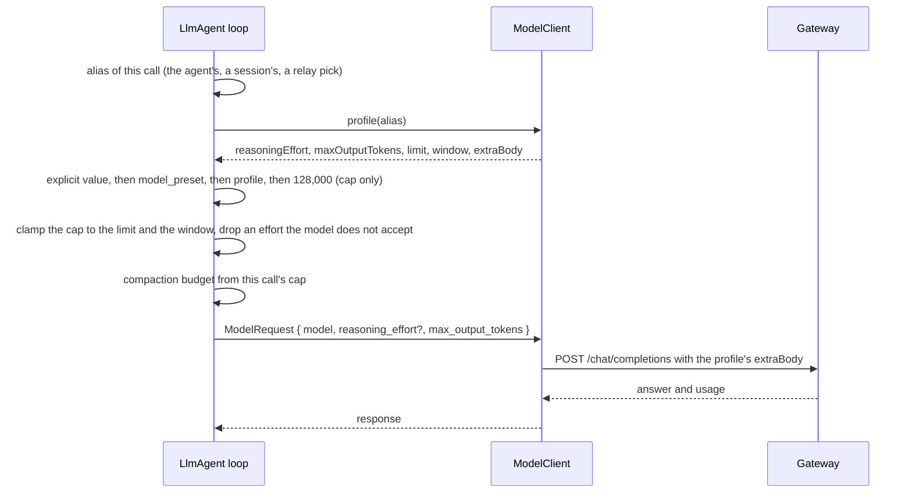
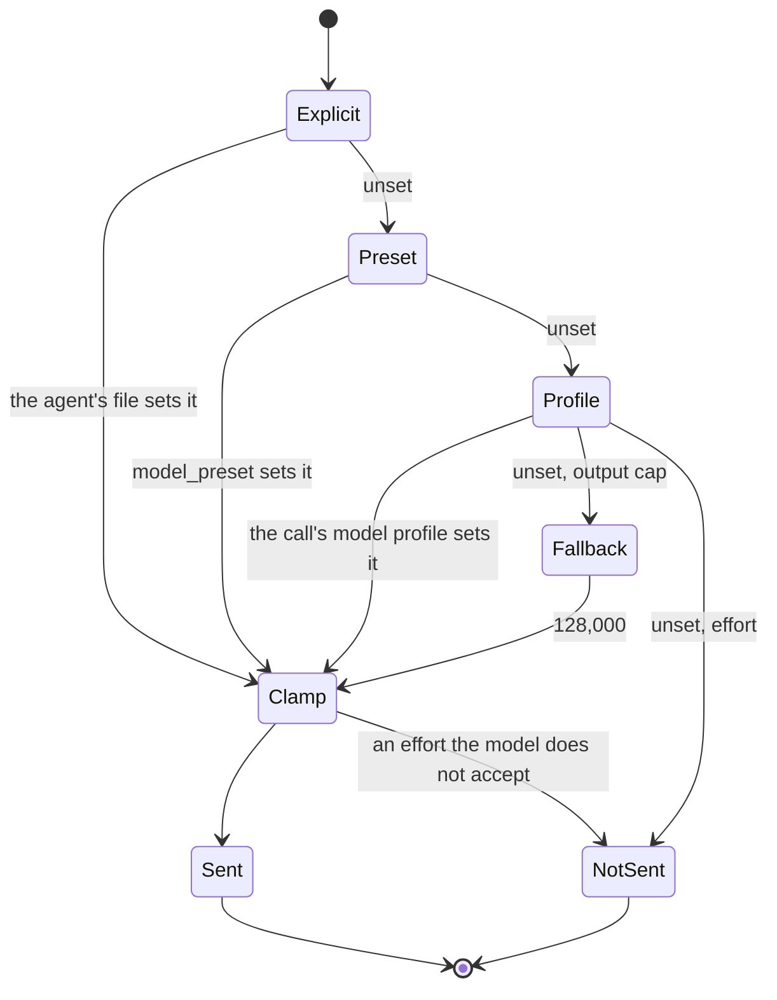

# 0064. Model profiles: reasoning effort and output cap follow the model

Status: **Proposed** (2026-11-21), on the owner's words of 2026-11-21, which are the requirements:

1. *"we'll have no default [reasoning effort]. It heavily depends on each model, each task. We can have presets tho. For
   our bench, low looks the best."*
2. *"The output cap should be configurable too. Most agents today can do 120k output. Just give a default of the current
   average in 2026, and provide a configuration per agent/model."*
3. On a setting for the whole chart: *"If the model changes dynamically, this would be an issue, right?"* Yes: the
   settings must follow the model a call uses, not the deployment.

**Nothing is built.** The shape, the names and the default below are proposed for the owner to confirm. Uses
[ADR 0054](0054-a-child-session-can-be-configured-within-what-its-folder-allows.md) (decision 7: the deployment declares
the facts of each alias in a file) and, if it is accepted, ADR 0063 *A reasoning effort is one setting* (pull request
#268, not merged on 2026-11-21: the closed enum `ReasoningEffort`, the folder key `reasoning_effort`, the extension
`reasoning/v1` and `ModelRequest.reasoning_effort`). It replaces 0063's deployment-wide `MODEL_REASONING_EFFORT` and
`config.modelReasoningEffort` (its decisions 2, 8 and 9), which owner item 3 rules out.

## Context

**What the benchmark found.** At the gateway the bench used, a request that carries no `reasoning_effort` does no
reasoning, and adam sends none unless `MODEL_EXTRA_BODY` sets one. Neither chart sets it: `deploy/coder` (`modelExtraBody:
null`) and the system repository's `deploy/chart` (no `MODEL_EXTRA_BODY` for its agents). With an effort set, the coder's
`max_output_tokens: 8192` was filled by reasoning alone in every adam failure; pull request #273 now asks again when a
turn is cut while thinking, at most `MAX_THINKING_CUTS` times. The values that fill a request belong to the model: one
model takes `low`, another refuses the member, a third has half the output limit of the next.

**Where adam picks a model and its limits today** (2026-11-21, `main` at `75fbe70c`):

| What | Where it is set | Scope | Code |
|---|---|---|---|
| Endpoint, key, default alias | `MODEL_BASE_URL`, `MODEL_API_KEY` (or `MODEL_AUTH=device`), `MODEL` | the process: one client, one endpoint | `crates/adam-service/src/config.rs` (`ModelConfig`, `ModelConfig::client`) |
| Extra request members | `MODEL_EXTRA_BODY`, merged into **every** request of every alias | the process | `config.rs` (`extra_body`), `crates/adam-model-openai/src/wire.rs` |
| Echo of earlier reasoning | `MODEL_ECHO_REASONING` | the process, every alias | `config.rs` (`echo_reasoning`), `wire.rs` |
| Context window | `MODEL_CONTEXT_WINDOW` | `MODEL`'s alias only (`with_context_window`); another alias has none | `config.rs`, `ModelClient::context_window` in `crates/adam-model/src/client.rs` |
| Input modalities | `MODEL_INPUT_MODALITIES`, `MODEL_IMAGE_*` | `MODEL`'s alias only | `config.rs`, `ModelClient::input_modalities` |
| The `max_tokens` member's name | `OpenAiCompatible::with_max_tokens_field` (code only, no variable) | the client | `crates/adam-model-openai/src/lib.rs` |
| An agent's alias | the folder's `model:` (an alias or `inherit`); a subagent inherits its parent's | one per agent, fixed at startup | `crates/adam-agent-fs/src/schema/agent.rs` (`ModelRef`), `crates/adam-assembly/src/assembly.rs` (`Assembly::model`) |
| Output cap | the folder's `limits.max_output_tokens`; absent, the loop's default **4,096**; `0` sends none | one per agent, whatever its model | `schema/agent.rs` (`Limits`), `crates/adam-assembly/src/def.rs` (`limits`), `crates/adam-llm-agent/src/agent.rs` (`Limits`, the request) |
| The coder's caps | 8,192 for the coder, 4,096 for `explorer` and `reviewer` | the folder | `bin/adam-coder/agent/instructions.md`, `bin/adam-coder/agent/subagents/*.md` |
| Summary call | `SUMMARY_OUTPUT_TOKENS` (4,096) | every compaction | `crates/adam-llm-agent/src/compaction.rs` |
| Compaction budget | `min(window − 20,000 − max_output_tokens, max_history_tokens)` | per agent | `compaction.rs` (`budget`) |
| Reasoning effort | no field: `ModelRequest` has `max_output_tokens` and `temperature` only; a folder's `effort` and `temperature` are ignored with a warning | — | `crates/adam-model/src/types.rs`, [agent files](../reference/agent-files.md) |
| Model catalogue | none built. ADR 0054 decision 7 proposes `MODEL_ALIASES` and `MODEL_ALIASES_FILE` (facts per alias); `Assembly::model_aliases` exists and no deployment sets it | — | `assembly.rs` |
| The engine | `adam_engine::Limits` holds no model setting; the host passes one client | the application | `crates/adam-engine/src/engine.rs` |

**Can the model change during a run?** Today, no: each agent is built once with one alias (`Assembly::model`), and every
call of its runs, the summary included, uses it. Within one task the model differs between a parent and a subagent whose
file names another alias. Two planned changes make it change at run time, which is why owner item 3 matters:

* ADR 0054 slice 11 (accepted, not built): a child session chooses an alias from an allow-list, applied from its next
  round.
* The system repository's ADR 0063 *model relay* (proposed, not built): the person picks a model per message; the
  relay forwards every call of that message's token to the pick, whatever name adam sends, and the message carries the
  pick and the offered models (`{url, token, expiresAt, models, model?}`).

**The other repositories** (read-only here):

* **The platform** (`vymalo/another-agentic-platform`, `crates/api`): `AgentConfig.spec.model` holds `model` (the alias),
  `endpointRef` or `baseUrl` and `apiKeySecretRef`, and `extraBody`, `echoReasoning` and `contextWindow`, one each for the
  agent, rendered into the `MODEL_*` variables (`crates/api/src/config.rs`, `Model`); `ModelEndpoint.spec.models` is a
  list of alias names the forms offer, "informative" (`crates/api/src/model_endpoint.rs`).
* **The system** (`vymalo/another-agentic-system`): its ADR 0005 (any OpenAI-compatible endpoint) and ADR 0035 (named
  endpoints `models.endpoints`, each task with an `endpoint`, a `model` and `maxTokens`) configure the orchestrator's own
  utility calls; its chart sets `MODEL`, `MODEL_BASE_URL`, `MODEL_API_KEY` and `MODEL_CONTEXT_WINDOW` for the `chat` and
  `browser` agents (`deploy/chart/templates/chat.yaml`, `browser.yaml`) and no effort or cap.

**What current models allow.** The documented maximum output of one request, read from each provider's own page:

| Family | Model ids | Max output | Context window | Source |
|---|---|---|---|---|
| Anthropic | `claude-fable-5-2`, `claude-opus-5-5`, `claude-sonnet-5-5`, `claude-haiku-5-5` | 128K | 1M | *verified 2026-11-21*, <https://platform.claude.com/docs/en/about-claude/models/overview> |
| Anthropic, older | Opus 4.5, Sonnet 4.5, Haiku 4.5; Opus 4.1 | 64K; 32K | 200K | *verified 2026-11-21*, same page |
| OpenAI | `gpt-6.2-astra` | 128,000 | 1,050,000 | *verified 2026-11-21*, <https://developers.openai.com/api/docs/models/gpt-6.2-astra> |
| OpenAI | `gpt-6.2-sol`, `gpt-6.1-terra`, `gpt-6-luna` | 128K | 1.05M | *verified 2026-11-21*, <https://developers.openai.com/api/docs/models> |
| Google | `gemini-4-carbon`, `gemini-4-neon` | 65,536 ("default synchronous"; up to 1,048,576 "with long decode") | 1,048,576, input and output together | *verified 2026-11-21*, <https://aistudio.google.com/docs/models/gemini-4-carbon>, <https://aistudio.google.com/docs/models/gemini-4-neon> |
| Google | `gemini-4-hydrogen`, `gemini-4-argon` | "64K / 1M" | 1M | *verified 2026-11-21*, <https://aistudio.google.com/docs/models> (index only); whether long decode is reachable through an OpenAI-compatible request is *unverified* |
| DeepSeek | `deepseek-flash`, `deepseek-v4-pro` | 384K ("MAXIMUM") | 1M | *verified 2026-11-21*, <https://api-docs.deepseek.com/quick_start/pricing>; the default when `max_tokens` is omitted is not on that page (*unverified*) |
| GLM (Z.ai) | GLM-5.3 | 128K | 1M | *verified 2026-11-21*, <https://docs.z.ai/guides/llm/glm-5.3> |
| Qwen | `qwen4-max` | 131,072; 262,144 in thinking mode | 1,000,000 | *verified 2026-11-21*, <https://www.alibabacloud.com/help/en/model-studio/qwen4-max> |
| Qwen | `qwen3.7-max` | 131,072, thinking mode too | 1,000,000 | *verified 2026-11-21*, <https://www.alibabacloud.com/help/en/model-studio/qwen3-7-max> |
| Kimi (Moonshot) | `kimi-k3.1-pro`, `kimi-k3` | no separate figure: input and output share the 1M window | 1M | *verified 2026-11-21*, <https://platform.kimi.ai/docs/models>; Alibaba Cloud, which also serves `kimi-k3`, lists "Max Output Length 1048576" (*verified 2026-11-21*, <https://www.alibabacloud.com/help/en/model-studio/kimi-k3>) |

## Decision

1. **A profile per model, keyed by the model's id.** The id is the name the request's `model` carries: the gateway alias
   of `MODEL` or of a folder's `model:`, or, behind a relay, the id of the model the relay serves (decision 4). A profile
   has, all optional:

   | Key | Meaning |
   |---|---|
   | `reasoningEffort` | the effort sent to this model; unset sends none |
   | `reasoningEfforts` | the efforts this model accepts (a fact, ADR 0054 decision 7); unset accepts every value of the closed enum |
   | `maxOutputTokens` | the output cap asked of this model |
   | `maxOutputTokensLimit` | the model's own documented maximum for one request (a fact); every cap sent is clamped to it |
   | `extraBody` | members merged into this model's requests only (decision 6) |
   | `preset` | a named preset (decision 2) the profile starts from; the profile's own keys win |

   The facts ADR 0054 decision 7 already puts there (the context window, the modalities) live in the same entry.

2. **Presets are named bundles** of `reasoningEffort` and `maxOutputTokens`, declared by the deployment (`presets:` in the
   same file). A profile names one as its base; an agent's file names one as `model_preset:` (a new frontmatter key, root
   or subagent) for its task. A preset that is not declared is exit 78, naming the file and the line. The owner's bench
   setting is a preset in the bench's own file (the owner's, never in the repository): `reasoningEffort: low`.

3. **Precedence, per model call.** For each setting, the first that says it:

   1. the agent's explicit value: the folder's or the subagent file's `limits.max_output_tokens` and `reasoning_effort`;
   2. the preset the agent's file names (`model_preset:`);
   3. the profile of the call's model: its own keys, then its base preset;
   4. **for the output cap only**, the global fallback, **128,000** (below). There is **no global effort**: absent
      everywhere, no `reasoning_effort` is sent.

   Then the cap is clamped (decision 5) and an effort the model does not accept (`reasoningEfforts`) is not sent. The
   choices made for one run stay above this order and within the same bounds: a child session's `config`
   (ADR 0054 slices 1 and 12) and, if ADR 0063 is accepted, a message's `reasoning/v1` effort.

4. **Applied at each model call, never at startup.** The loop resolves the effort and the cap from the alias of the
   request it is building, so a session that moves to another alias, or a relay pick, takes that model's profile with
   it, and the compaction budget is computed from the cap of the call, not of the agent. Behind a relay, adam keys the
   profile on the pick the message names; how the relay tells adam a model's profile is the system's follow-up. A call
   whose model has no profile gets steps 1, 2 and 4.

5. **The cap never exceeds what the model and the window allow.** The cap sent is the smallest of the chosen value, the
   profile's `maxOutputTokensLimit` when known, and, when the context window is known, what the window leaves after the
   20,000-token margin and the history the agent keeps (`max_history_tokens`, or half the window when the agent sets
   none). A cap lowered by the clamp is logged once per agent and model. A model with no `maxOutputTokensLimit` gets the
   chosen value as it is: a deployment that serves a model below 128,000 (Gemini 4 at 65,536, the 4.5 generation of
   Claude at 64K) gives it a profile, and the startup check warns when `MODEL`'s alias has none.

6. **`MODEL_EXTRA_BODY` is replaced, as a hard cutover.** It has the flaw owner item 3 names: one body for every model,
   though `enable_thinking`, `thinking` or `chat_template_kwargs` mean something to one family and are refused by
   another. A profile's `extraBody` replaces it, with the same refusals (`model`, `messages`, `tools`, `tool_choice`,
   `stream`) plus `reasoning_effort` and the `max_tokens` members, which have typed keys. A process that finds
   `MODEL_EXTRA_BODY` set exits 78 naming the profiles file; the chart refuses `config.modelExtraBody` at render. No
   period where both work: two places for one fact is how a deployment ends up with the effort set twice.

7. **Where profiles are configured.** In adam, the file ADR 0054 decision 7 introduces (`MODEL_ALIASES_FILE`, a YAML or
   JSON file), with two top-level keys, `presets` and `profiles`; the same variable and the same file for `adam-coder`
   and `adam-agent`, and `adam_engine` takes the parsed value from its host. A bad file, an effort outside the closed
   enum, a `maxOutputTokens` above its own `maxOutputTokensLimit`, or a `reasoningEffort` outside `reasoningEfforts` is
   exit 78. The chart gains `config.modelProfiles` (rendered as a ConfigMap and mounted; unset renders nothing). Example,
   with made-up aliases:

   ```yaml
   presets:
     quick: { reasoningEffort: low }
     thorough: { reasoningEffort: high, maxOutputTokens: 64000 }
   profiles:
     large-coder:
       preset: quick
       reasoningEfforts: [low, medium, high, max]
       maxOutputTokensLimit: 131072
       contextWindow: 1000000
     small-chat:
       maxOutputTokensLimit: 65536
       extraBody: { enable_thinking: false }
   ```

   **The other repositories map to this and decide their own shape** (follow-ups, not decided here): the system's
   `models.endpoints` (its ADR 0035) and the relay's offered `models` (its ADR 0063) for the agents its chart runs; the
   platform's `ModelEndpoint.spec.models` and `AgentConfig.spec.model` (`extraBody`, `echoReasoning`, `contextWindow`),
   which the operator renders into the agent's profiles file.

### The default output cap: 128,000

The flagship caps for one ordinary request, one figure per family from the table above, sorted: Google 65,536, OpenAI
128,000, Anthropic 128K, GLM 128K, Qwen 131,072, DeepSeek 384K, Kimi up to its 1M window. The **median** is 128K, which
is also the typical value (four of seven families) and the owner's "120k". It is written as 128,000, the lowest reading
of "128K" (OpenAI's own figure), so the default never exceeds a model documented as 128K whichever way it counts. The
mean (about 270K) is not used: Kimi's shared window and DeepSeek's 384K pull it above what most models take. Below the
default: Gemini 4 (65,536 per ordinary request) and the Claude 4.5 and 4.1 generations (64K, 32K); they need a profile.

### A model call



### One setting's resolution



## Consequences

* **A deployment that sets nothing sends no effort, as today, and a larger cap**: every agent without an explicit
  `max_output_tokens` asks for 128,000 instead of 4,096, clamped by the window when it is known. Output is billed by what
  is generated, so the larger cap costs nothing by itself, but some providers count the requested cap against a rate
  limit (*unverified*).
* **The coder's folder drops its explicit caps** (8,192 and the subagents' 4,096): an explicit value wins over every
  profile, so leaving them keeps the failure the bench found. The dev agents' folders (`dev/agents/*/agent`) are checked
  the same way.
* **Breaks**: `adam_llm_agent::Limits::max_output_tokens` becomes optional (unset is "the profile's, then the fallback";
  `0` is refused); `AgentFrontmatter` gains `model_preset`; `MODEL_EXTRA_BODY` and the chart's `config.modelExtraBody`
  are removed. `ModelClient` gains a provided method `profile(model)` (a default answers "none"), so implementers do not
  break (Rule 2). The crate READMEs and the `adam-upgrade` skill say so.
* **`deploy/coder` changes** (`config.modelProfiles` added, `config.modelExtraBody` refused): the platform's parity goldens
  read it, and the pull request says so.
* **ADR 0063** (pull request #268): if it merges first, this ADR amends it with a dated note (its decisions 2, 8 and 9
  are replaced by profiles and presets; its enum, folder key, extension, wire field and usage stay); if not, it is revised
  to this shape before it merges.
* **ADR 0054** gets a dated note when this is accepted: decision 7's file holds `presets` and `profiles`, and a
  profile's `reasoningEfforts` is its "reasoning efforts it accepts".
* **Pages to update with the build**: [Agent files](../reference/agent-files.md) (`model_preset`, the cap's default),
  [Environment](../reference/environment.md) and [Errors](../reference/errors.md) (the file, the removed variable, exit
  78), [Architecture](../architecture.md) (the compaction budget), [Parity](../reference/parity.md),
  `deploy/coder/README.md`, `docs/guides/deploy-the-coder.md`, and the skills `adam-agent-folder` and `adam-coder-deploy`.
* `MODEL_CONTEXT_WINDOW`, `MODEL_ECHO_REASONING` and `MODEL_INPUT_MODALITIES` keep describing `MODEL`'s alias; folding them
  into profiles is ADR 0054 slice 11's to decide.

## Slices

Each is one pull request, in order.

1. **The profiles file.** `MODEL_ALIASES_FILE` parsed into `presets` and `profiles`, every exit-78 rule of decision 7,
   `ModelClient::profile` with its default, `OpenAiCompatible::with_profiles`, `adam_engine` taking the same value.
   Nothing reads a profile yet. Accepted when a bad file is exit 78 naming the line and a good one is reported by
   `profile(alias)`.
2. **The output cap per call.** `Limits::max_output_tokens` optional, the precedence of decision 3 for the cap, the
   fallback 128,000, the clamp of decision 5, the compaction budget from the call's cap, `model_preset:` read; the coder's
   and the dev agents' explicit caps removed. Accepted when two subagents on two aliases send each its profile's cap, an
   alias with a `maxOutputTokensLimit` below the fallback is clamped to it, and a known window clamps the cap.
3. **The reasoning effort per call.** Built on ADR 0063's enum and `ModelRequest.reasoning_effort` (built here if 0063 is
   not): the folder's `reasoning_effort`, the preset's and the profile's, none by default, an effort outside
   `reasoningEfforts` not sent and logged. Accepted when a profile with `low` sends `low`, an alias without one sends no
   member, and a folder value wins over the profile.
4. **`MODEL_EXTRA_BODY` cut over.** The profile's `extraBody`, the variable refused at startup, the chart's
   `config.modelProfiles` and the refusal of `config.modelExtraBody`, goldens, docs. Accepted when the render with
   profiles mounts the file and the old value fails the render naming the new one.
5. **A model chosen at run time.** When ADR 0054 slice 11 or the relay lands: the session's alias or the relay's pick is
   the key. Accepted when a session moved to another alias sends that alias's effort and cap on its next call.

Follow-ups in the other repositories, theirs to decide: the system maps its endpoints and relay models to profiles and
renders them for its agents; the platform's `ModelEndpoint` and `AgentConfig` gain profiles and its operator renders the
file.

## Open questions

1. **The default cap.** 128,000, the median, or 65,536, the lowest current flagship cap, which no listed model refuses
   but which a reasoning model can fill? *Recommendation*: 128,000, with a profile for each model below it.
2. **A preset named by the agent against the model's profile.** Decision 3 lets the task's preset win over the model's
   profile, so `model_preset: quick` sends `low` to every model that accepts it. Should the model's profile win instead?
   *Recommendation*: the agent's preset wins, since the owner said the effort depends on the task as well as the model;
   the model's facts (`reasoningEfforts`, `maxOutputTokensLimit`) still bound it.
3. **ADR 0063's deployment-wide effort.** Replace `MODEL_REASONING_EFFORT` with presets and profiles before #268 merges,
   or merge 0063 as it is and amend it? *Recommendation*: revise #268 before it merges, so no release ships a variable
   that a hard cutover then removes.
