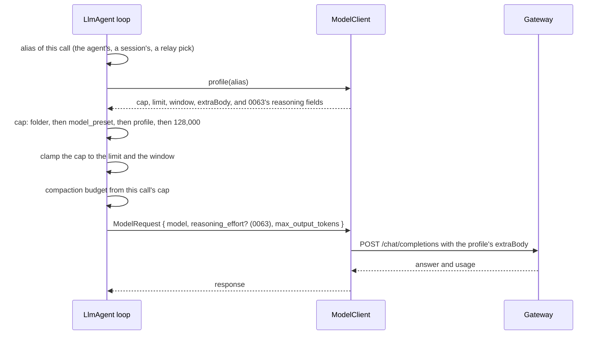
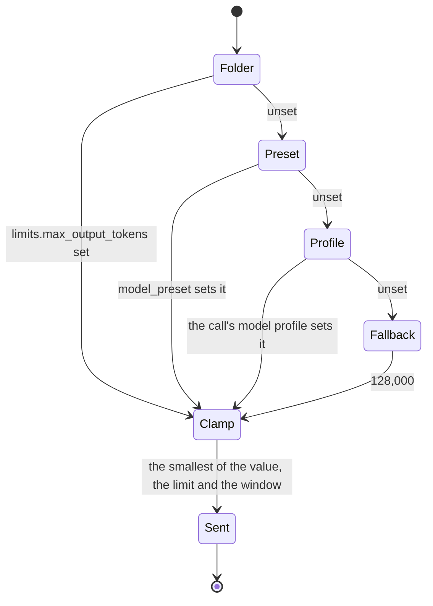

# 0064. Model profiles: the output cap, the extra body and presets follow the model

Status: **Accepted** (2026-11-21), on the owner's words of 2026-11-21, the coordinator's ruling of the same day, and the
owner's answers to its two questions (below).

The owner's words, which are the requirements:

1. *"no default [reasoning effort] … We can have presets tho. For our bench, low looks the best."*
2. *"The output cap should be configurable too … a default of the current average in 2026, and provide a configuration
   per agent/model."*
3. On a setting for the whole chart: *"If the model changes dynamically, this would be an issue, right?"* Yes: the
   settings must follow the model a call uses, not the deployment.

**Nothing is built.** The names and the default below are proposed for the owner to confirm.

**Two ADRs, one file, one profile shape.** [ADR 0063](0063-a-reasoning-effort-is-one-setting.md) (accepted) owns the
reasoning fields of a profile (`reasoningEfforts`, `reasoningWire`, `reasoningBudgets`, `reasoningEffort`), the closed
`ReasoningEffort`, `reasoning/v1`, the gateway probe and the parity row; an unset or empty `reasoningEfforts` means the
model takes no reasoning setting and adam sends nothing. **This ADR owns** the output cap (`maxOutputTokens`,
`maxOutputTokensLimit`, the 128,000 fallback), the profile's `extraBody` and the `presets:` bundle. A preset may carry
`reasoningEffort`, which 0063 defines and this ADR does not redefine. Both build on
[ADR 0054](0054-a-child-session-can-be-configured-within-what-its-folder-allows.md) decision 7 (the deployment declares
the facts of each alias in a file, `MODEL_ALIASES_FILE`).

```yaml
presets:
  quick: { reasoningEffort: low }
profiles:
  <model id>:
    preset: quick
    reasoningEfforts: [low, medium, high, max]   # 0063; absent/empty = none
    reasoningWire: reasoning_effort               # 0063
    reasoningBudgets: { low: 1024 }               # 0063
    maxOutputTokens: …                            # 0064
    maxOutputTokensLimit: 131072                  # 0064
    extraBody: { … }                              # 0064
```

## Context

**What the benchmark found** (S-BENCH's pilot, 2026-11-20/21: 8 cells, 40 runs). All four adam failures were turns cut
at the 8,192 output clamp: reasoning tokens 8,190 to 8,192, no content and no tool call. OpenCode hit the same clamp once
and recovered. Pull request #273 (merged as `9568a10`) now asks again when a turn is cut while thinking, at most
`MAX_THINKING_CUTS` times; it does not raise the clamp. The coder's explicit 8,192 is the clamp.

**The gateway's limit.** The gateway reported a `max_completion_tokens` of 131,072 for the model used (*verified
2026-11-21* against the gateway's model info), sixteen times the clamp.

**32K is not enough.** In the earlier probe the blind reviewer, at medium, high and max effort, ran past a 32,768 cap
with reasoning only. A cap in the tens of thousands is therefore not always enough at the higher efforts, which supports
a fallback near the models' own limits.

**Unset reasoning sends nothing**, whatever the model's default (0063). With an effort set, the values that fill a
request belong to the model: one takes `low`, another refuses the member, a third has half the output limit of the next.

**Where adam picks a model and its limits today** (2026-11-21, `main` at `75fbe70c`):

| What | Where it is set | Scope | Code |
|---|---|---|---|
| Endpoint, key, default alias | `MODEL_BASE_URL`, `MODEL_API_KEY` (or `MODEL_AUTH=device`), `MODEL` | the process: one client, one endpoint | `crates/adam-service/src/config.rs` (`ModelConfig`, `ModelConfig::client`) |
| Extra request members | `MODEL_EXTRA_BODY`, merged into **every** request of every alias | the process | `config.rs` (`extra_body`), `crates/adam-model-openai/src/wire.rs` |
| Echo of earlier reasoning | `MODEL_ECHO_REASONING` | the process, every alias | `config.rs` (`echo_reasoning`), `wire.rs` |
| Context window | `MODEL_CONTEXT_WINDOW` | `MODEL`'s alias only (`with_context_window`); another alias has none | `config.rs`, `ModelClient::context_window` in `crates/adam-model/src/client.rs` |
| Input modalities | `MODEL_INPUT_MODALITIES`, `MODEL_IMAGE_*` | `MODEL`'s alias only | `config.rs`, `ModelClient::input_modalities` |
| The `max_tokens` member's name | `OpenAiCompatible::with_max_tokens_field` (code only, no variable) | the client | `crates/adam-model-openai/src/lib.rs` |
| An agent's alias | the folder's `model:` (an alias or `inherit`); a subagent inherits its parent's | one per agent, fixed at startup | `crates/adam-agent-fs/src/schema/agent.rs` (`ModelRef`), `crates/adam-assembly/src/assembly.rs` (`Assembly::model`) |
| Output cap | the folder's `limits.max_output_tokens`; absent, the loop's default **4,096**; `0` sends none | one per agent, whatever its model | `schema/agent.rs` (`Limits`), `crates/adam-assembly/src/def.rs` (`limits`), `crates/adam-llm-agent/src/agent.rs` (`Limits`, the request) |
| The coder's caps | 8,192 for the coder, 4,096 for `explorer` and `reviewer` | the folder | `bin/adam-coder/agent/instructions.md`, `bin/adam-coder/agent/subagents/*.md` |
| Summary call | `SUMMARY_OUTPUT_TOKENS` (4,096) | every compaction | `crates/adam-llm-agent/src/compaction.rs` |
| Compaction budget | `min(window − 20,000 − max_output_tokens, max_history_tokens)` | per agent | `compaction.rs` (`budget`) |
| Reasoning effort | ADR 0063's: not repeated here | — | [ADR 0063](0063-a-reasoning-effort-is-one-setting.md) |
| Model catalogue | none built. ADR 0054 decision 7 proposes `MODEL_ALIASES` and `MODEL_ALIASES_FILE` (facts per alias); `Assembly::model_aliases` exists and no deployment sets it | — | `assembly.rs` |
| The engine | `adam_engine::Limits` holds no model setting; the host passes one client | the application | `crates/adam-engine/src/engine.rs` |

**Can the model change during a run?** Today, no: each agent is built once with one alias (`Assembly::model`), and every
call of its runs, the summary included, uses it. Within one task the model differs between a parent and a subagent whose
file names another alias. Two planned changes make it change at run time, which is why owner item 3 matters:

* ADR 0054 slice 11 (accepted, not built): a child session chooses an alias from an allow-list, applied from its next
  round.
* The system repository's ADR 0063 *model relay* (proposed, not built): the person picks a model per message; the
  relay forwards every call of that message's token to the pick, whatever name adam sends, and the message carries the
  pick and the offered models (`{url, token, expiresAt, models, model?}`).

**The other repositories** (read-only here):

* **The platform** (`vymalo/another-agentic-platform`, `crates/api`): `AgentConfig.spec.model` holds `model` (the alias),
  `endpointRef` or `baseUrl` and `apiKeySecretRef`, and `extraBody`, `echoReasoning` and `contextWindow`, one each for the
  agent, rendered into the `MODEL_*` variables (`crates/api/src/config.rs`, `Model`); `ModelEndpoint.spec.models` is a
  list of alias names the forms offer, "informative" (`crates/api/src/model_endpoint.rs`).
* **The system** (`vymalo/another-agentic-system`): its ADR 0005 (any OpenAI-compatible endpoint) and ADR 0035 (named
  endpoints `models.endpoints`, each task with an `endpoint`, a `model` and `maxTokens`) configure the orchestrator's own
  utility calls; its chart sets `MODEL`, `MODEL_BASE_URL`, `MODEL_API_KEY` and `MODEL_CONTEXT_WINDOW` for the `chat` and
  `browser` agents (`deploy/chart/templates/chat.yaml`, `browser.yaml`) and no effort or cap.


**What current models allow.** The documented maximum output of one request, read from each provider's own page:
| Family | Model ids | Max output | Context window | Source |
|---|---|---|---|---|
| Anthropic | `claude-fable-5-2`, `claude-opus-5-5`, `claude-sonnet-5-5`, `claude-haiku-5-5` | 128K | 1M | *verified 2026-11-21*, <https://platform.claude.com/docs/en/about-claude/models/overview> |
| Anthropic, older | Opus 4.5, Sonnet 4.5, Haiku 4.5; Opus 4.1 | 64K; 32K | 200K | *verified 2026-11-21*, same page |
| OpenAI | `gpt-6.2-astra` | 128,000 | 1,050,000 | *verified 2026-11-21*, <https://developers.openai.com/api/docs/models/gpt-6.2-astra> |
| OpenAI | `gpt-6.2-sol`, `gpt-6.1-terra`, `gpt-6-luna` | 128K | 1.05M | *verified 2026-11-21*, <https://developers.openai.com/api/docs/models> |
| Google | `gemini-4-carbon`, `gemini-4-neon` | 65,536 ("default synchronous"; up to 1,048,576 "with long decode") | 1,048,576, input and output together | *verified 2026-11-21*, <https://aistudio.google.com/docs/models/gemini-4-carbon>, <https://aistudio.google.com/docs/models/gemini-4-neon> |
| Google | `gemini-4-hydrogen`, `gemini-4-argon` | "64K / 1M" | 1M | *verified 2026-11-21*, <https://aistudio.google.com/docs/models> (index only); whether long decode is reachable through an OpenAI-compatible request is *unverified* |
| DeepSeek | `deepseek-flash`, `deepseek-v4-pro` | 384K ("MAXIMUM") | 1M | *verified 2026-11-21*, <https://api-docs.deepseek.com/quick_start/pricing>; the default when `max_tokens` is omitted is not on that page (*unverified*) |
| GLM (Z.ai) | GLM-5.3 | 128K | 1M | *verified 2026-11-21*, <https://docs.z.ai/guides/llm/glm-5.3> |
| Qwen | `qwen4-max` | 131,072; 262,144 in thinking mode | 1,000,000 | *verified 2026-11-21*, <https://www.alibabacloud.com/help/en/model-studio/qwen4-max> |
| Qwen | `qwen3.7-max` | 131,072, thinking mode too | 1,000,000 | *verified 2026-11-21*, <https://www.alibabacloud.com/help/en/model-studio/qwen3-7-max> |
| Kimi (Moonshot) | `kimi-k3.1-pro`, `kimi-k3` | no separate figure: input and output share the 1M window | 1M | *verified 2026-11-21*, <https://platform.kimi.ai/docs/models>; Alibaba Cloud, which also serves `kimi-k3`, lists "Max Output Length 1048576" (*verified 2026-11-21*, <https://www.alibabacloud.com/help/en/model-studio/kimi-k3>) |

## Decision

1. **The profile file is shared with 0063.** One file, `MODEL_ALIASES_FILE` (ADR 0054 decision 7; YAML or JSON), with two
   top-level keys, `presets` and `profiles`; the same variable for `adam-coder` and `adam-agent`, and `adam_engine`
   takes the parsed value from its host. A profile is keyed by the model's id (the name the request's `model` carries: a
   gateway alias, or the id of the model a relay serves). **Whichever of 0063's and this ADR's first slices lands first
   builds the loader; the other adds its fields.** This ADR's keys, all optional:

   | Key | Meaning |
   |---|---|
   | `maxOutputTokens` | the output cap asked of this model |
   | `maxOutputTokensLimit` | the model's own documented maximum for one request (a fact); every cap sent is clamped to it |
   | `extraBody` | members merged into this model's requests only (decision 5) |
   | `preset` | a named preset (decision 2) the profile starts from; the profile's own keys win |

   The reasoning keys are 0063's. The context window and the modalities (ADR 0054 decision 7) live in the same entry.

2. **Presets are named bundles** under `presets:`: `reasoningEffort` (0063's) and `maxOutputTokens`. A profile names one
   as its base (`preset:`); an agent's file names one as `model_preset:` (a new frontmatter key, root or subagent) for its
   task. A preset that is not declared is exit 78, naming the file and the line; so is a `maxOutputTokens` above the
   model's `maxOutputTokensLimit`. The owner's bench setting is a preset in the bench's own file (the owner's, never in
   the repository): `reasoningEffort: low`.

3. **Precedence, per model call.** The combined order, for the effort and the cap:

   request (a child's session value is one) → thread → folder → the agent's `model_preset` → the profile
   (`reasoningEffort`, then its base preset) → absent.

   For the **effort**, all of it is 0063's (decision 4); the profile's `reasoningEfforts` bounds every level, and there
   is no global effort. For the **output cap**, only the folder's `limits.max_output_tokens` (the subagent's file for a
   subagent), the `model_preset`'s, then the profile's (`maxOutputTokens`, then its base preset) apply, and then the
   **fallback, 128,000, which is this ADR's and applies to the cap only**. The cap is then clamped (decision 4). The
   card's `default` for `reasoning/v1` is the resolved folder, preset or profile value, if any, else absent (0063).

4. **Applied at each model call, never at startup.** The loop resolves the cap from the alias of the request it is
   building, so a session that moves to another alias, or a relay pick, takes that model's profile with it, and the
   compaction budget is computed from the cap of the call, not of the agent. A call whose model has no profile gets the
   agent's value, its preset's, then 128,000. **The cap never exceeds what the model and the window allow**: it is the
   smallest of the chosen value, the profile's `maxOutputTokensLimit` when known, and, when the context window is known,
   what the window leaves after the 20,000-token margin and the history the agent keeps (`max_history_tokens`, or half
   the window when it is `0`; an omitted key keeps the 100,000 default). A cap lowered by the clamp is logged once per agent and model. A model with no
   `maxOutputTokensLimit` gets the chosen value as it is: a deployment that serves a model below 128,000 (Gemini 4 at
   65,536, the 4.5 generation of Claude at 64K) gives it a profile, and the startup check warns when `MODEL`'s alias has
   none.

5. **`MODEL_EXTRA_BODY` keeps working until this ADR's cutover, then is replaced.** Until slice 3 lands it behaves as
   today and as 0063 describes. The cutover replaces it with the profile's `extraBody`, which has the same refusals
   (`model`, `messages`, `tools`, `tool_choice`, `stream`) plus the `max_tokens` members, which have a typed key: **a
   process that finds `MODEL_EXTRA_BODY` set exits 78** naming the profiles file, and the chart refuses
   `config.modelExtraBody` at render. From then on 0063's exception applies to the profile's `extraBody`: a typed
   reasoning level removes the members its wire would duplicate and writes the model's mapping. The reason for replacing
   it is owner item 3: one body for every model, though `enable_thinking`, `thinking` or `chat_template_kwargs` mean
   something to one family and are refused by another. No period where both work after the cutover: two places for one
   fact is how a deployment ends up with it set twice.

6. **Where the file is set.** The chart's `config.modelProfiles` (0063 adds it; this ADR adds nothing to the chart but
   the refusal of `config.modelExtraBody`). A bad file is exit 78. Example, with made-up aliases:

   ```yaml
   presets:
     quick: { reasoningEffort: low }
     thorough: { reasoningEffort: high, maxOutputTokens: 64000 }
   profiles:
     large-coder:
       preset: quick
       reasoningEfforts: [low, medium, high, max]
       reasoningWire: reasoning_effort
       maxOutputTokensLimit: 131072
       contextWindow: 1000000                 # not read yet (ADR 0054 slice 11)
     small-chat:
       reasoningEfforts: []
       maxOutputTokensLimit: 65536
       extraBody: { enable_thinking: false }
   ```

   **The other repositories map to this and decide their own shape** (follow-ups, not decided here): the system's
   `models.endpoints` (its ADR 0035) and the relay's offered `models` (its ADR 0063) for the agents its chart runs; the
   platform's `ModelEndpoint.spec.models` and `AgentConfig.spec.model` (`extraBody`, `echoReasoning`, `contextWindow`),
   which the operator renders into the agent's profiles file.

### The default output cap: 128,000

The flagship caps for one ordinary request, one figure per family from the table above, sorted: Google 65,536, OpenAI
128,000, Anthropic 128K, GLM 128K, Qwen 131,072, DeepSeek 384K, Kimi up to its 1M window. The **median** is 128K, which
is also the typical value (four of seven families) and the owner's "120k". It is written as 128,000, the lowest reading
of "128K" (OpenAI's own figure), so the default never exceeds a model documented as 128K whichever way it counts. The
mean (about 270K) is not used: Kimi's shared window and DeepSeek's 384K pull it above what most models take. The pilot's
gateway limit (131,072) and the blind reviewer that outgrew 32,768 agree. Below the default: Gemini 4 (65,536 per
ordinary request) and the Claude 4.5 and 4.1 generations (64K, 32K); they need a profile.

### A model call



### The cap's resolution



## Consequences

* **A deployment that sets nothing sends no effort (0063) and a larger cap**: every agent without an explicit
  `max_output_tokens` asks for 128,000 instead of 4,096, clamped by the window when it is known. Output is billed by what
  is generated, so the larger cap costs nothing by itself, but some providers count the requested cap against a rate
  limit (*unverified*).
* **The coder's folder drops its explicit caps** (8,192 and the subagents' 4,096): an explicit value wins over every
  profile, so leaving them keeps the failure the pilot found. The dev agents' folders (`dev/agents/*/agent`) are checked
  the same way.
* **Breaks**: `adam_llm_agent::Limits::max_output_tokens` becomes optional (unset is "the profile's, then the fallback";
  `0` is refused); `AgentFrontmatter` gains `model_preset` (beside the field 0063 adds); `MODEL_EXTRA_BODY` and the
  chart's `config.modelExtraBody` are removed at the cutover. `ModelClient` gains a provided method `profile(model)` (a
  default answers "none"), so implementers do not break (Rule 2). The crate READMEs and the `adam-upgrade` skill say so.
* **`deploy/coder` changes** (`config.modelExtraBody` refused at the cutover): the platform's parity goldens read it, and
  the pull request says so.
* **ADR 0063** (accepted) is not contradicted: it already names the profile as the seat, `presets:` and the output cap
  as this ADR's, and `MODEL_EXTRA_BODY` as in force until this ADR lands. Its rule that a typed level wins over the extra
  body moves to the profile's `extraBody` at the cutover.
* **ADR 0054** gets a dated note when this is accepted: decision 7's file holds `presets` and `profiles`.
* **Pages to update with the build**: [Agent files](../reference/agent-files.md) (`model_preset`, the cap's default),
  [Environment](../reference/environment.md) and [Errors](../reference/errors.md) (the removed variable, exit 78),
  [Architecture](../architecture.md) (the compaction budget), [Parity](../reference/parity.md) (an output-cap row),
  `deploy/coder/README.md`, `docs/guides/deploy-the-coder.md`, and the skills `adam-agent-folder` and `adam-coder-deploy`.
* `MODEL_CONTEXT_WINDOW`, `MODEL_ECHO_REASONING` and `MODEL_INPUT_MODALITIES` keep describing `MODEL`'s alias; folding them
  into profiles is ADR 0054 slice 11's to decide.

## Slices

Each is one pull request, in order. The reasoning slices (effort per call, `reasoning/v1`) are 0063's.

1. **The profiles file, shared.** Whichever lands first, this slice or 0063's, builds the loader
   (`MODEL_ALIASES_FILE` into `presets` and `profiles`, exit 78 on a bad file, `ModelClient::profile`,
   `OpenAiCompatible::with_profiles`, `adam_engine` taking the value); the other adds its fields. This ADR's part:
   `maxOutputTokens`, `maxOutputTokensLimit`, `extraBody`, `preset`, with their exit-78 rules.
2. **The output cap per call.** `Limits::max_output_tokens` optional, decision 3 for the cap, the fallback 128,000, the
   clamp of decision 4, the compaction budget from the call's cap; the coder's and the dev agents' explicit caps removed.
   Accepted when two subagents on two aliases send each its profile's cap, an alias with a `maxOutputTokensLimit` below
   the fallback is clamped to it, and a known window clamps the cap.
3. **`MODEL_EXTRA_BODY` cut over.** The profile's `extraBody`, the variable refused at startup, the chart's refusal of
   `config.modelExtraBody`, goldens, docs. Accepted when the old value fails startup and the render naming the profiles
   file, and a typed level still wins over the profile's `extraBody`.
4. **Presets.** `presets:` with `maxOutputTokens`, a profile's `preset:`, `model_preset:` in the frontmatter, the order of
   decision 3 (with 0063's effort). Accepted when an agent naming `quick` sends `low` and its preset's cap, and an
   undeclared preset is exit 78.
5. **A model chosen at run time.** (The engine's per-message pick and the fallback switch, slice 6, are in the 2026-11-23 amendment below.) When ADR 0054 slice 11 or the relay lands: the session's alias or the relay's pick is
   the key. Accepted when a session moved to another alias sends that alias's cap on its next call.

Follow-ups in the other repositories, theirs to decide: the system maps its endpoints and relay models to profiles and
renders them for its agents; the platform's `ModelEndpoint` and `AgentConfig` gain profiles and its operator renders the
file.

## Settled by the owner (2026-11-21)

1. **The default cap is 128,000.** A model whose own limit is lower has a profile with its `maxOutputTokensLimit`.
2. **A preset carries the cap as well as the effort.** `maxOutputTokens` in a preset is still clamped to the model's
   `maxOutputTokensLimit` and to the window.

## Amended 2026-11-21

*Amended 2026-11-21:* **the `Limits` type keeps `max_output_tokens: u32`.** The Consequences section above announced
it becoming optional; it does not. The assembly resolves and clamps the cap once per agent, before the loop, and hands
the loop the final value, so the loop keeps one field and no `Option`. A folder's `0` is refused by the loader; `0`
stays legal on the Rust `Limits` for an embedder that builds an agent by hand, where it means "the model's own".

*Amended 2026-11-21:* **decision 4's "applied at each model call" is superseded for slices 2 to 4 by a per-agent
resolution at bind.** The model is fixed at bind in these slices, so `BoundDef::model` resolves and clamps each
agent's cap once (slice 2), and the loop receives the final `Limits::max_output_tokens`; the compaction budget is
derived from that resolved cap. Slice 5 (a model chosen at run time) is where the resolution returns to each call.

*Amended 2026-11-21:* **a preset above the model's limit is refused, not clamped.** This supersedes the sentence in
"Settled by the owner (2026-11-21)" item 2 that a preset's `maxOutputTokens` is "still **clamped**": a preset the agent
names that asks above the model's `maxOutputTokensLimit` is refused at bind (exit 78), while the folder's own value is
clamped. It follows the coordinator's 18:42Z ruling accepting decision 4; the board post asks the owner for a veto,
and if he takes it we amend again.

## Amended 2026-11-23: a locked model switches once to a fallback, and a message may name a model

*Amended 2026-11-23:* **slice 6, the switch on a typed refusal.** [ADR 0067](0067-a-model-call-through-an-injector-names-its-run-and-a-refusal-parks-the-run.md)
decision 7 leaves the switch to "the profile's fallback model" and fails the run naming the model until it is built.
This ADR's "fallback" is the 128,000 output cap, so no slice owned the switch. It is this one. It is an amendment, not a
new ADR: it changes what a profiled model's calls resolve to, which is this ADR's subject, and claims no number.

1. **The fallback is declared in the agent's file.** `model_fallback: <alias>` in the frontmatter of a root or a subagent
   (a local-only key, warned on a remote subagent). A subagent follows its **own** file's value; none is inherited from
   its parent. The seat is the folder because the agent knows what a lesser model may still do for it; a deployment-wide
   default in a profile (`fallback`) is not built and would be a later slice.
2. **Validation at start.** The alias goes through the same check as `model:` (not empty, one token, one of
   `model_aliases` when the deployment lists them) and must differ from the agent's own alias
   (`AliasProblem::SameAsModel`). A refusal is the assembly's `Error::ModelAlias` naming the agent and its file, which
   every host turns into exit 78 (the engine's `start` returns `EngineError::Agent`).
3. **What the fallback resolves to.** Its output cap, resolved as decision 3 does for the fallback model (the folder's
   `limits.max_output_tokens`, the agent's preset, the fallback's profile, then 128,000, clamped to the fallback's own
   limit and window). Its reasoning level is the fallback's **own** profile's (`reasoningEffort`, else its base
   preset's), never the folder's: the folder's level was chosen for the agent's model, which the fallback may not take.
4. **The switch.** When a model call is refused with `ModelError::ModelLocked`
   ([ADR 0067](0067-a-model-call-through-an-injector-names-its-run-and-a-refusal-parks-the-run.md) decision 7), a run
   with a fallback records the switch in its state (`Conversation::model_switch`: `from`, `to`, the turn), says it as
   a step, and asks the same turn again of the fallback, in the next transition. The refusal is in the journal as the
   failure of `model:<turn>`; the second call is that turn's step in the next transition, so a replay finds the same
   refusal, makes no call to the locked model, and builds the same requests. A run with no fallback fails as before,
   naming the model.
5. **Once, and never back.** After the switch every call of the run, the summary call of a compaction included, names the
   fallback with its cap and level; the run does not try the first model again. A second `ModelLocked`, on the fallback,
   fails the run: `model call failed: <the refusal>: `<fallback>` is the fallback of `<first>`, which the endpoint did
   not allow either, and a run switches once`. A subagent's run switches on its own.
6. **The step.** Label `Switched model`, state `Completed`, detail ``The model `<from>` is not allowed; this run continues
   on `<to>` ``, id `model-switch:<turn>`.
7. **Usage.** A `usage/v1` event names the model the call was made to, so the calls after the switch name the fallback; the
   refused call reports none (no tokens were taken). `UsageTotals` count under the same alias.
8. **A message may name a model (decision 5's slice, narrowed).** `Say::with_model(alias)` in the engine asks that the
   run be answered by `alias`, with that profile's cap and level. The engine refuses an alias that has no profile in
   `EngineBuilder::models` (`EngineError::Invalid`, nothing written), and every alias when it was given none. It travels
   as the context key `vymalo.model` (`{"model": alias}`), which only an agent **given choices** honours: the assembly
   gives them when the host calls `BoundDef::allow_model_choice` (the engine does, a served agent's front does not), so a
   remote caller cannot choose what a run costs. The choice holds for the run until a later message names another; the
   fallback switch overrides it. Not built: the compaction's budget still derives from the agent's own window and cap.

Slice 6 is accepted when a scripted run whose model answers `model_locked` continues on the fallback with its cap and
level, the step and the usage say so, and a replay after a lost commit asks the locked model nothing more; a second lock
fails the run naming both models; and the engine refuses a `Say` that names a model with no profile.
