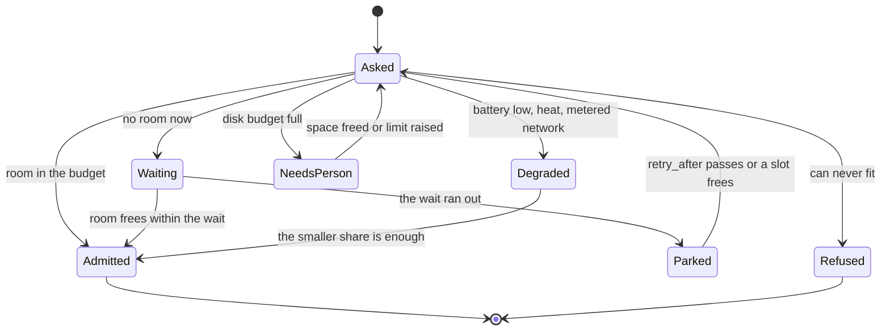

# 0065. Resource governance: admission, pools and OS limits

Status: **Accepted** (2026-11-23)

## Context

adam must never take more of a machine than its owner allows. Today a command has a time limit and a capped output,
and nothing caps its CPU, memory, processes or disk. Four runs at once, each with ten tool calls per turn, can start
forty commands. `race` and `step_all` have no process-wide cap. A worktree janitor frees finished runs, but there is
no disk budget and no free-space check. adam does not know whether its host is on battery, hot or on a metered link.

The owner answered ten questions on 2026-11-21. They fix the shape below:

| Question | Answer |
|---|---|
| Over budget: wait, park or fail? | **Wait, then park.** Never fail a run because a slot is busy. Refuse only what can never fit. Ask the person only when the disk is full |
| Linux without systemd | **Partial limits, and say so** (rlimits and `nice`) |
| A command over its memory | **Stop it and tell the model.** Never stop adam itself |
| Battery, heat, metered network | **On by default**; the host may turn each rule off |
| Where does adam run on a device? | **Inside the host's process; measure first.** A helper process only if a measurement shows adam's own memory over budget |
| Does a device setting cap server agents? | **No.** A device sets its own ceiling; a deployment sets the server's |

Three layers, each catching what the one before lets through: **admission** (is there room in the budget?),
**bulkheads** (each kind of work has its own pool), and **the operating system's own limits** on every process adam
starts. The OS cannot cap adam's own threads without capping the host's screen, so adam's own memory is bounded by
construction and the OS caps what adam starts.

## Decision

### 1. One rule: the ceiling comes from outside, a file or a person can only lower it

The deployment or the device sets the ceiling. An agent folder's `limits:` block and a person may lower a value,
never raise it. This is the rule `MAX_PARALLEL_TOOL_CALLS` and `limits.max_parallel` already follow.

### 2. The budget type

A new pure crate, `adam-budget` (no I/O), holds `Budget`: `runs`, `tool_calls`, `processes`, `git`, `mcp_servers`,
`model_calls`, `tokens_per_minute: Option<u32>`, `command_memory`, `command_cpu` (millicores), `disk`,
`disk_reserve` (bytes or a ratio) and `per_conversation_share` (a ratio, default one half). It is `#[non_exhaustive]`
with a builder. `Budget::lower(&self, other)` is the only way to combine budgets (deployment, then folder, then
person), so a value cannot be raised by construction.

### 3. The admission port

`Admission` is a trait with a conformance testkit (`admission_conformance!`), as rule 2 of the agent guide requires:

```rust
async fn admit(&self, ask: Ask) -> Result<Permit, Refused>;
fn snapshot(&self) -> Usage;
```

A `Permit` gives its share back on `Drop`, so a cancelled or panicking holder frees it. No driver type appears in
the signature.

| Implementation | What | When |
|---|---|---|
| `LocalAdmission` | tokio `Semaphore`s, a weighted one per MiB for command memory, a token bucket for tokens per minute; one process | slice 2 |
| `StoreAdmission` | counted in the run store, for several replicas (a server's per-person limits) | later; not decided here |

The testkit proves: never over a limit under 100 concurrent asks; a dropped or cancelled holder frees its share; one
conversation never holds more than its share of a pool while another waits; `snapshot` adds up.

### 4. Refusals carry a class; no new class

`Refused` implements `Classify` (rule 6 of the agent guide). The ten classes already say what to do.

| Refusal | Class | What happens |
|---|---|---|
| `Busy { pool, retry_after }`, `TokensPerMinute { retry_after }` | `RateLimited` | wait in a short queue; past the wait the run **parks** until `retry_after`, as the runtime already does at `max(backoff, retry_after)` (ADR 0061) |
| `DiskFull { used, limit }` | `Rejected` | the person is asked to free space or raise the limit, through the deciding `tool.before` hook of ADR 0050, so a replay never asks twice |
| `TooLarge { what, asked, limit }` | `Invalid` | refused, naming the limit and its value: the same input never succeeds |
| a command killed by the OS for memory or CPU | not an error | the tool result says "stopped: memory limit 2 GB"; the run goes on and the model can change approach |



### 5. Pools (bulkheads)

One kind of work never starves another. Each pool has its own size and queue.

| Pool | Primitive | Replaces |
|---|---|---|
| Model calls | a `Semaphore`, plus a token bucket for tokens per minute | nothing: new |
| Tool calls in flight | one `Semaphore` for the process | the per-turn `max_parallel`, which stays and now sits inside the process-wide pool |
| Commands, language servers, stdio MCP servers | a `Semaphore` for processes and a weighted one for memory | `BACKGROUND_COMMANDS_MAX` and `LANGUAGE_SERVERS_MAX`, which stay and count inside `MAX_PROCESSES` |
| git | its own `Semaphore` | git sharing the command slots |
| MCP servers alive | a pool; the idle one goes first | nothing: new |
| File I/O | `spawn_blocking` behind a `Semaphore` | tokio's default of 512 blocking threads |
| Events to the host | the bounded broadcast ring | exists |

Where admission sits: `Engine::send` and the A2A backend (a new run); the worker's claim (exists); the tool loop in
`adam-llm-agent`; `adam_code_tools::shell::run_in` and the background, language-server and MCP stdio spawners;
`adam-workspace` clone, worktree and cache writes; `adam-model-openai`.

The engine stays on "the current tokio runtime". A host that wants adam's threads below its screen's runs it on its
own runtime, with `worker_threads` set to its core budget, `max_blocking_threads` lowered and a lower thread priority
in `on_thread_start`. That is the host's job and is written in the engine README.

### 6. The OS limits: a `Confine` port

`Confine` sits in `adam-workspace` beside `Environment`:

```rust
fn confine(&self, cmd: &mut Command, limits: &ProcessLimits) -> Result<Confined, ConfineError>;
fn describe(&self) -> Enforcement; // Full | Partial(Vec<&'static str>) | None
```

| OS | Backend | Without administrator rights | Notes |
|---|---|---|---|
| Linux | `SystemdScope`: one transient scope per command under a slice for adam, `MemoryMax`, `CPUQuota`, `TasksMax`; feature-gated | yes, through the person's own user manager (*verified 2026-11-21*, upstream systemd delegates `pids`, `memory` and `cpu` to the user manager; a distribution may differ, so adam checks at start) | falls back to `Rlimits` |
| Unix fallback | `Rlimits`: `RLIMIT_AS` (Linux only), `RLIMIT_FSIZE`, `RLIMIT_NOFILE`, `RLIMIT_CPU`, `nice` 10, idle I/O priority on Linux | yes | `describe()` says `Partial` and names what is not enforced. **Never `RLIMIT_NPROC`**: on Linux it counts every process of the user and would break the person's desktop (*verified 2026-11-21*, the Linux man page) |
| macOS | `DarwinBackground`: rlimits for file size, open files and CPU time; background priority (`PRIO_DARWIN_BG`); a watchdog that reads the command's memory every second and stops its process group over budget | yes | macOS does not enforce memory rlimits (*verified 2026-11-21*, secondary sources), hence the watchdog |
| Windows | `JobObject`: one job per command, nested under one job for adam (*verified 2026-11-21*, Microsoft Learn: nested jobs since Windows 8), memory limit, CPU rate hard cap, active-process limit, kill on close; below-normal priority | *unverified*: no administrator step is documented for creating a job | needs commands on Windows, which is slice 8 of ADR 0047 |
| Android, iOS | none: adam runs no commands there; model calls and in-process tools only | n/a | a run parks when the host goes to the background (*unverified* for exact OS thresholds) |

Everywhere: commands start at low priority, one file's size is capped, and a command's process group is killed as one.
adam's crates keep `forbid(unsafe_code)`. Backends use `rustix`, as `adam-git-sandbox` does, and the `windows`
crate's safe wrappers where they exist. A backend that needs `unsafe` lives in its own small crate that allows it,
reviewed with the `unsafe-checker` skill.

### 7. The disk budget

adam keeps its own count, because file-system quotas need an administrator: the size of its workspaces and cache,
checked before a clone, a worktree or a cache write, and the free space left on the disk. It always leaves a reserve
free. When a request would pass the budget, the run asks the person (decision 4). The janitor may free space; **it
never removes a workspace that holds unpushed work**, whatever the budget says. A file larger than the whole budget is
`TooLarge`.

### 8. The device-state port

`DeviceState` is a host-pushed port with four readings:

| Reading | Values |
|---|---|
| power | `OnMains`, `OnBattery { percent, low_power }` |
| thermal | `Nominal`, `Fair`, `Serious`, `Critical` |
| network | `Unmetered`, `Metered`, `Offline` |
| memory pressure | `Normal`, `Warn`, `Critical` |

The host calls `Engine::set_device_state`. The engine lowers its live budget by a fixed rule table and never below one
run. Defaults, each of which the person can turn off: on battery below 20 % or in low-power mode, one run and no new
background commands; a hot device (`Serious`) holds new steps; on a metered network no clone or large fetch without
asking. Servers have no `DeviceState`.

### 9. The resource report

The engine emits `EngineEvent::Resources(Usage)` at most every 2 seconds while a run works. Servers export metrics:
`adam_admission_in_use{pool}`, `adam_admission_waits_total{pool}`, `adam_admission_refusals_total{pool,reason}`,
`adam_process_stopped_total{reason}` (`memory`, `cpu`, `time`, `cancel`) and `adam_disk_bytes{kind}`. **No person, run
or conversation identifier is a label.** There is no always-on indicator: a host shows the report on request, and when
something waits or is refused it names which budget and its value.

### 10. Bounds by construction (slice 1, built)

Independent of admission, no one response can grow adam's memory without limit. Pull request #297 made these
constants of `adam-model-openai`; a value over a cap is a `Protocol` error of class `Corrupt` before the buffer grows
past it:

| Cap | Value |
|---|---|
| one SSE line | 1 MiB |
| one event's `data:` | 4 MiB |
| a whole stream | 64 MiB |
| a response body | 16 MiB |

### 11. New settings

Every setting is read the same way on every role, and a bad value is exit 78 naming it. The names are decided here
and built in the slices below; the defaults are the owner's (a desktop host, 2026-11-21).

| Setting | Variable and `Limits` field | Desktop default |
|---|---|---|
| runs at once | `WORKERS`, `Limits::concurrency` (exist) | 2 |
| tool calls in flight, whole process | `MAX_TOOL_CALLS_IN_FLIGHT` | 4 |
| processes at once (commands, git, servers) | `MAX_PROCESSES` | 4 |
| git processes | `MAX_GIT_PROCESSES` | 2 |
| MCP servers alive | `MAX_MCP_SERVERS` | 4 |
| model calls in flight | `MAX_MODEL_CALLS` | 2 |
| tokens per minute | `MODEL_TOKENS_PER_MINUTE` | none |
| memory for commands | `COMMAND_MEMORY_MAX` | a quarter of the RAM, at most 8 GB |
| CPU for commands | `COMMAND_CPU_MAX` | half the cores, at least 1 |
| disk for workspaces and cache | `WORKSPACE_DISK_MAX` | 20 GB |
| free space kept | `WORKSPACE_DISK_RESERVE` | the larger of 10 % of the disk and 5 GB |

A folder's `limits:` block gains `max_processes`, `command_memory`, `command_cpu` and `max_model_calls`, each lowering
the ceiling only. A phone host defaults to one run, two tool calls, no processes, one model call and a 1 GB disk
budget. A server's per-person limits are the orchestrator's, not adam's.

## Consequences

- **A new required trait.** `Admission` and `Confine` are new ports with testkits. Implementers of `Environment` are
  not broken: `Confine` is a separate trait.
- **No new `ErrorClass` variant.** Rule 3 of the agent guide is untouched.
- **Parity.** `docs/reference/parity.md` gains a section **Resources**, one row per setting above plus the device
  state, the resource report and the OS enforcement, each filling every column or naming its gap.
- **Pages to update as the slices land:** `docs/reference/environment.md`, `docs/reference/agent-files.md`,
  `docs/reference/errors.md`, `docs/architecture.md` (the admission sequence and the permit lifecycle),
  `crates/adam-engine/README.md`, `docs/guides/embed-in-an-app.md`, `deploy/coder/README.md`, the `adam-embed` skill.
- **Windows commands wait for ADR 0047 slice 8.** The `JobObject` backend lands with it.
- **A command's CPU limit can throttle a build.** A deployment that sets one chooses its size; throttling under a
  limit is *unverified* until slice 3 has run a build under it.
- **Measure first.** If a measurement shows adam's own memory over budget inside a host, a helper process is a new
  decision, not this one.

## Slices

Each is one pull request, in order.

1. **Bounds on model streaming.** Done (#297, decision 10). Proof: `an_endless_line_is_corrupt_and_memory_stays_flat`,
   `an_error_body_is_cut_at_its_cap`.
2. **The budget, the admission port and the pools for model calls and tool calls.** `adam-budget`, `LocalAdmission`,
   `admission_conformance!`, `Limits` and the new variables for those pools. Accepted when twenty runs never exceed the
   budget in flight, a cancelled run gives its permits back, a full pool parks a run with `retry_after`, and one
   conversation takes at most its share.
3. **The process pool and the OS limits.** `Confine` and its backends. Accepted when a memory hog, a fork bomb and a
   file over the size limit are each stopped while the engine keeps answering, `describe()` says `Partial` without
   systemd, on Linux, macOS and Windows runners (ADR 0047 slice 8's matrix).
4. **The disk budget.** Accepted when a clone past the budget asks the person, the reserve is kept free, and a
   workspace with unpushed work is never removed. **Partly built:** `adam-workspace` measures its root, checks the
   budget and the reserve before a mirror or worktree (`WorkspaceError::DiskFull`, class `Rejected`) and sweeps finished
   runs without touching unpushed work (`a_clone_past_the_disk_budget_asks_the_person`, `the_reserve_is_kept_free`,
   `unpushed_work_is_never_removed`), and **the coder's janitor uses the same decision** (`RunWorkspace::remove_if_pushed`):
   a finished run's workspace is kept, and logged as kept, when it holds uncommitted changes, commits no `origin` ref has,
   or any scratch project (`a_scratch_project_with_unpushed_work_is_kept_with_its_run`,
   `an_uncommitted_change_keeps_the_workspace_of_its_run`). A scratch project has no remote, so it is never swept; ADR 0034
   is amended for that. Not built yet: `WORKSPACE_DISK_MAX` and `WORKSPACE_DISK_RESERVE`, the
   `tool.before` question to the person, `TooLarge`, cache writes, and `adam_disk_bytes{kind}`.
5. **The device-state port.** Accepted when a fake device on battery runs one run at a time and a hot device holds new
   steps. **Partly built:** `adam-device-state` holds `DeviceState`, the four readings and `FakeDevice`, and
   `adam-device-state-testkit` the suite `device_state_conformance!`. Not built yet: `Engine::set_device_state` and
   the rule table that lowers the live budget by these readings.
6. **The resource report and the parity rows.** Accepted when a snapshot names each pool's use and the parity page has
   the section.

Per-person limits before a run starts, in a server or an orchestrator, are decided where that component lives and may
count through a `StoreAdmission` later.

## Amended 2026-11-24

*Amended 2026-11-24:* **slice 3 is delivered on Linux only.** The `Confine` port with its two Linux backends (`Rlimits`,
`SystemdScope`) and the process pool for commands (`run`, `run_command`, the checks) are built, with
`MAX_PROCESSES`, `MAX_GIT_PROCESSES`, `COMMAND_MEMORY_MAX` and `COMMAND_CPU_MAX`. Still open, as a follow-up card: the
macOS and Windows backends and the three-system matrix the slice's acceptance names. Background commands, language
servers and git do not take a seat yet. The *unverified until slice 3 has run a build under it* note in the
Consequences stands: no build has been run under a CPU limit.
