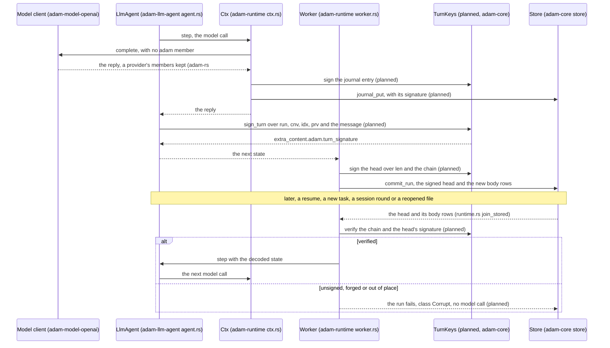
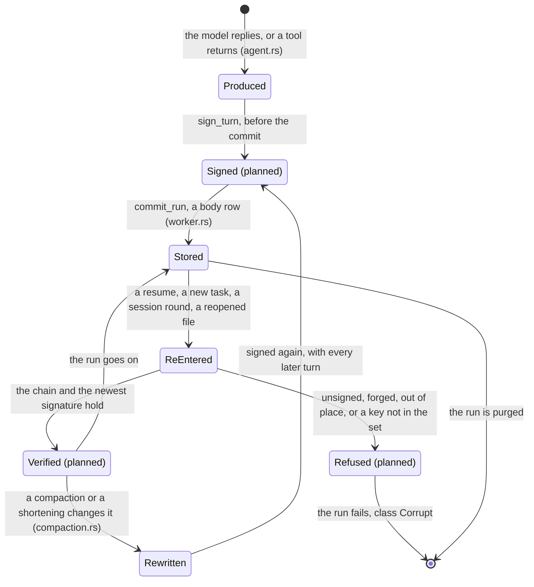

# 0068. adam signs its own history

Status: **Accepted** (2026-11-22). The owner decided on 2026-11-22 that adam uses, **by default** and for security, the same
kind of signature the model providers use for their reasoning continuity. Nothing of it is built: the slices are at the
end, after ADR 0067's S8b and S8c.

It has two parts. **Part 1 is not decided here**: adam carries every opaque member a provider attaches (Gemini 3's
`thought_signature` in a tool call's `extra_content`) byte for byte, sends it back only to the model that made it, and
drops it when a run changes model; that is [adam-rs#322](https://github.com/vymalo/another-adam-rs/issues/322), built
separately. **Part 2 is this ADR**: adam signs the turns it produces and verifies every history that comes back. It
builds on #322's carrier.

## Context

**What the providers do** (each *verified 2026-11-22* on the page named):

| Provider | What it attaches | Source |
|---|---|---|
| Gemini | A thought signature, "an encrypted representation of the model's internal reasoning state"; in `generateContent` it "can be attached to any part, such as living inside `functionCall` parts", and a stateless caller "MUST always resend all `thought` blocks exactly as they were received". On the OpenAI-compatible API it is `tool_calls[i].extra_content.google.thought_signature`, sent back on the assistant message | <https://aistudio.google.com/docs/thinking>; the JSON examples of <https://docs.cloud.google.com/vertex-ai/generative-ai/docs/migrate/openai/examples> (the Gemini API's own <https://aistudio.google.com/docs/openai> says only that Gemini 3 supports thought signatures there) |
| Anthropic | A `signature` on every `thinking` block: "Full thinking content is encrypted and returned in the `signature` field … The API uses the signature to verify that thinking blocks were generated by Claude when you pass them back"; it is opaque; with tools the blocks go back "complete and unmodified", and a modified block is a `400`; a `redacted_thinking` block carries an opaque, encrypted `data` | <https://platform.claude.com/docs/en/build-with-claude/thinking>, *Thinking encryption* and *Preserving thinking blocks* |
| OpenAI | Reasoning items carry `encrypted_content` (by default, per the page; `include: ["reasoning.encrypted_content"]` is still accepted); the stateless mode is `store: false` or Zero Data Retention; with function calls the caller passes back "the reasoning items returned with the function calls along with the tool outputs" | <https://developers.openai.com/api/docs/guides/reasoning> |

*Unverified* against those pages: the `400` Gemini 3 answers when the signature is missing. adam's bench saw it on every
second call (#322); the docs pages read do not state it. Also *unverified*: how each provider makes its value (a MAC,
an encryption, both). The pages say only that it is opaque.

The shape is the same everywhere: **an opaque string in a member that names its maker, next to the content it belongs
to, sent back unchanged, and checked only by whoever made it.** It stops a caller from making the model believe it
reasoned what it did not.

**adam has no such check on its own history.** A run's history leaves process memory and comes back at these points,
and each time adam takes it as its own:

| Re-entry | Where today |
|---|---|
| A resume: a restart, another worker, a lease that ran out | the head and its body rows joined (`crates/adam-runtime/src/runtime.rs`, `join_stored`, `join_head`; [ADR 0055](0055-a-runs-state-is-a-head-and-an-append-only-transcript.md)); a state written whole (`crates/adam-runtime/src/envelope.rs`, `Envelope::decode`) |
| A journal replay: a step's recorded result instead of a second call | `Ctx` reading `journal_get` (`crates/adam-runtime/src/ctx.rs`), `JournalEntry` (`crates/adam-core/src/store/mod.rs`) |
| A new task that continues a conversation | `init_continuing` (`crates/adam-runtime/src/runtime.rs`, `new_run_within`), `Conversation::continued` (`crates/adam-llm-agent/src/conversation.rs`) |
| A child session's round | `Runtime::start_child_continuing` (`crates/adam-runtime/src/runtime.rs`; [ADR 0045](0045-a-subagent-can-run-in-the-background-as-a-session.md)) |
| The embedded engine reopening its file | `SqliteStore::open` (`crates/adam-store-sqlite/src/lib.rs`), `Engine::start` (`crates/adam-engine/src/engine.rs`) |
| The store service ([ADR 0053](0053-sqlite-a-store-service-a-database-per-agent-and-a-static-coder.md)) | the same rows, over RPC |
| A fork, or a history a client sends | **text only**: an A2A message becomes one user message (`crates/adam-a2a-runtime/src/convert.rs`, `default_inbound`; `crates/adam-a2a-runtime/src/vymalo.rs`); another-agentic-system's fork puts the earlier conversation in front of the text (its `orchestrator/crates/agent-a2a/src/client.rs:755` at `e95eafcd`, read 2026-11-22) |

So whoever can write a row (a compromised store, a person with the SQLite file of an engine, a broken migration) can put
words in the agent's mouth: an earlier assistant turn that "agreed" to something, or a tool result that "showed" it. The
next model call takes that history as true.

## Decision

1. **adam signs every turn it produces and commits**: each assistant message, and each tool result it records. A
   person's message is not signed (it is not adam's), but the chain (decision 3) covers it.

2. **The signature rides in #322's carrier, in the providers' shape.** #322 keeps a provider's members as the JSON
   object the provider sent, `extra_content`, namespaced by its maker (`{"google": {"thought_signature": "…"}}`). This
   ADR adds one maker and one member: **`extra_content.adam.turn_signature`**, an opaque string, on `Message::Assistant`
   (message level, beside #322's) and on `Message::Tool` (which gains the same carrier). If #322 names its Rust field
   differently, the JSON names here stand. Where it rides:

   | Where | How |
   |---|---|
   | The store | inside the body row's `message` (`BodyRow`, `crates/adam-core/src/store/mod.rs`), as the state holds it; no column changes for rows |
   | The run's head | the envelope the runtime commits (`crates/adam-runtime/src/envelope.rs`) gains `signature`, the same form with `typ` `adam-head/v1` (decision 4); the state is JSON, so no column changes |
   | The journal | `JournalEntry` gains `signature: Option<String>`, the same form with `typ` `adam-step/v1` over `run`, `seq`, `name`, `ok` and `payload`; each adapter stores it (Postgres and SQLite a column, MongoDB a field) and the testkit requires the round trip |
   | A model call | never sent: #322 sends a member back only to the model that made it, and adam is no model; the wire drops the `adam` namespace, and an `adam` member in a model's reply is dropped before the turn is recorded |
   | A2A | *planned* (slice T4): `https://agents.vymalo.com/a2a/extensions/signed-turns/v1`, listed on the card only when the deployment turns it on (it hands tool results to the client, which a task's message does not carry today). When a client activates it, the task's agent message carries in `metadata[<uri>]` the rows the task committed, each with its signature, with `run`, `cnv`, the first row's `idx` and its `prv` (decision 3); a client may send such rows back to continue from them (a fork, decision 6). Without the extension nothing changes |

3. **What is signed, and to what it is bound.** The value is a JWS (RFC 7515) in compact form with a **detached
   payload** (RFC 7515 appendix F): `BASE64URL(header)..BASE64URL(signature)`, the construction adam already uses for
   its card ([ADR 0030](0030-a2a-push-notifications-list-tasks-extended-card-signatures.md), `crates/adam-a2a/src/signing.rs`).
   * The header is `{"alg":"EdDSA","kid":"<key id>","typ":"adam-turn/v1"}`.
   * The payload, never sent, is the RFC 8785 canonical JSON of `{typ, run, cnv, idx, prv, msg}`: `run` is the run that
     commits the turn, `cnv` the base64url SHA-256 of the run's conversation id (the run's own id when it has none),
     `idx` the turn's position in the transcript, `prv` the chain hash of every message before it, and `msg` the message
     as stored (after [ADR 0051](0051-a-nul-is-stored-as-the-replacement-character.md)'s replacement), without its
     `extra_content.adam` member. A provider's members are part of `msg`, so they are protected too.
   * The chain: `h(-1) = SHA-256(JCS({typ, run, cnv}))`, `h(i) = SHA-256(h(i-1) ‖ SHA-256(JCS(message i)))` (two
     32-byte values, so no separator is needed),
     over **every** message, a person's included, with each one's `adam` member. So a change to any earlier message,
     a reordering or a row spliced in from another run or position breaks every later signature.

4. **When adam verifies: whenever history comes from outside its own process memory**, at each re-entry of the table
   above, once per decode and before the first model call in that process; a state that stays in memory between steps
   is not checked again. The decoded state carries no mark of having been checked (a field the decoder never fills).
   * **The head.** At every commit the runtime (`crates/adam-runtime/src/worker.rs`) also signs the head: the payload is
     the canonical JSON of `{typ: "adam-head/v1", run, cnv, len, chain, head}`, where `len` is the number of body rows,
     `chain` is `h(len-1)` and `head` is the envelope without its signature (for a run whose state is not split, the whole
     state, and `chain` is over its messages). On a decode the runtime (`join_stored`, `Envelope::decode`) recomputes the
     chain over the rows and checks this one signature. It covers every field of the state, not only the messages (the
     loaded tool groups, the owed calls, the summary, the session), and the transcript's length: rows past `len` are
     already not part of the state ([ADR 0055](0055-a-runs-state-is-a-head-and-an-append-only-transcript.md)), and a
     row appended with a new `len` breaks the signature. `run` is the id the run was loaded by and `cnv` the hash of the
     record's `conversation_id`, so a run moved to another conversation in the store is refused too.
   * **The turns.** Every assistant and tool row must also carry a turn signature whose header parses and names a key in
     the key set, so a revoked key is refused wherever it signed. A carried history (decision 5) and a `signed-turns/v1`
     message (decision 6) are checked by the agent loop: the chain, and the newest turn's signature against the payload
     rebuilt at its position. adam signs a turn only over a prefix it holds verified in memory, so that one signature
     vouches for every byte before it; rows after it must be a person's messages.
   * **The journal.** Entries are not chained: each entry the runtime replays (`crates/adam-runtime/src/ctx.rs`) is
     checked on its own.

   So a load costs one signature check, plus one per replayed journal entry, and a SHA-256 pass over the transcript.

5. **adam re-signs only its own acts.** A message adam changes is a message it produces: a compaction (a new body
   generation), a shortening of an old output, a carried history, `answer_owed_calls`. The changed message and every
   assistant and tool message after it are signed again. A history carried into a new run (a new task of the
   conversation, a session's round, a fork through `signed-turns/v1`) is verified under the run it came from, then signed
   under the new run, so every signature of a run names that run.

6. **What is refused, and its class** (Rule 6):

   | Where | What happens | Class |
   |---|---|---|
   | A stored row, a journal entry or a carried history that is unsigned where it must be signed, forged, out of place, or signed by a key not in the set (revoked, or a set that lost it) | the run fails with a `turn signature` error before any model call; no turn is added | `Corrupt` (alert) |
   | A `signed-turns/v1` message that does not verify, or whose rows are not the caller's: their `cnv` must be the hash of the conversation of **the caller's subject** and the source context the message names (`encode_conversation`, `crates/adam-a2a-runtime/src/convert.rs`), so rows of another person's conversation are refused even when adam signed them | refused with `-32602` (`InvalidParams`), nothing written | `Invalid` |
   | Plain A2A: a message whose text or data looks like a history | today's rule: it is the text of **one new user turn**, never an assistant turn (`default_inbound`, `vymalo_inbound`) | none: accepted as a person's words |

7. **The key comes from the vault, through a port asked like the model's credentials.** A port `TurnKeys` (*planned*,
   in `adam-core` beside `SecretSource`, `crates/adam-core/src/secrets.rs`) **signs** a payload (`sign(payload) ->
   signature`, with its `kid`) and gives the key set of public keys; it never hands out the private key, so a host may
   sign in a keychain, a KMS or an HSM. It follows the pattern of `ModelCredentials` ([ADR 0058](0058-the-models-credentials-come-from-a-provider-asked-for-each-call.md),
   `crates/adam-model/src/credentials.rs`): the host provides, adam asks, and no value is ever logged, journaled or put in
   an error. The `kid` is the key's vault reference in the form another repository's ADR 0083 fixed in its amendment
   of 2026-11-21, `vault:<name>#v<n>`, which that decision says is not a secret (*verified 2026-11-22*: another-agentic-system
   `docs/decisions/0083-trusted-components-the-agent-names-and-the-client-draws.md` at `e95eafcd`, *Amended 2026-11-21*,
   items 1 and 2). For a server (*planned*, slice T2):

   | Variable | What | Default |
   |---|---|---|
   | `TURN_SIGNING_KEY_FILE` | a PKCS#8 PEM Ed25519 private key, mounted from the Secret the reference resolves to | **required** |
   | `TURN_SIGNING_KEY_ID` | the `kid`: the reference, `vault:<name>#v<n>` | the key's RFC 7638 thumbprint |
   | `TURN_VERIFY_KEYS_FILE` | a JWKS of the public keys of earlier versions (not secret: a ConfigMap), each `kid` its reference, with a `revoked` list of the references no longer accepted | the signing key's own public key only |

   The turn key is not the card's key: another purpose, another rotation. A `TURN_SIGNING_KEY_ID` of `vault:<name>#v<n>`
   with `n` above 1 is exit 78 unless the verify set names every earlier version `1` to `n-1`, as a key or as revoked:
   a rotation that forgot the set would otherwise refuse every history signed before it.

8. **Rotation and revocation.** A rotation makes version `n+1` and keeps version `n` for 24 hours (the same ADR 0083
   amendment). During that overlap a worker that has not restarted still signs with `n`, so the key set holds both public
   keys and a verifier accepts either. After it the private key `n` is gone and its **public key stays in the set**: the
   turns it signed stay valid, and nobody can sign a new one with it. **Revoking** a key that leaked is removing its
   public key from the set and naming it under `revoked`: every turn it signed is then refused, which is the point. Keys and the set are read at
   start, so a revocation is a rollout of every role, with a new signing key: a worker that has not restarted would go on
   signing with the revoked key, and the others would refuse its turns.

9. **Fail closed, by deployment kind** (Rule 4). No kind runs with the feature off, and there is no switch to turn it off.

   | Kind | No key |
   |---|---|
   | A server: `adam-coder`, `adam-agent`, every role (`DATABASE_URL` always names a store that outlives the process) | exit 78, naming the variable |
   | The engine on a store that outlives the process (a SQLite file) | `Engine::start` fails (`Invalid`); the host gives a `TurnKeys` backed by the **platform keychain** through the builder (*planned* `EngineBuilder::turn_keys`): it signs there, and keeps the key set there too, because a person who can write the file can write a key set beside it; adam never reads the keychain itself |
   | The engine or a test on a `MemoryStore` | `TurnKeys::ephemeral()`, a key made at start that dies with the process, as the history does |

10. **Ed25519, not an HMAC.**

    | | HMAC-SHA256 | Ed25519 |
    |---|---|---|
    | Who can verify | only a holder of the key, who can also forge | anyone with the public key, who cannot sign: the orchestrator, an auditor, a client of `signed-turns/v1` |
    | After a rotation | the old key goes after 24 h, so every turn it signed becomes unverifiable: every idle conversation would have to be re-signed within the day, or be refused | the public key stays; nothing is re-signed |
    | Revocation | removing the key also breaks honest turns, with no way to tell them apart | the same, and only for a key that leaked |
    | Cost per turn | about 1 µs, a 32-byte tag | tens of µs, a 64-byte signature (OpenSSL on the machine this was written on: 39 µs to sign, 113 µs to verify; aws-lc-rs *unverified*, slice T1 measures it) |
    | Dependency | `aws-lc-rs`'s `hmac` | `aws-lc-rs`'s `ED25519`, already used to sign the card |

    The rotation row decides: with a key the vault keeps 24 hours, only a public key can keep a history older than a day
    verifiable. Verifying outside adam comes with it. The cost does not matter at this grain: two signatures per commit
    (the turn and the head), one check per load plus one per replayed journal entry (decision 4), beside a model call of
    seconds. **`aws-lc-rs` is already in every build** that has a model client: the workspace's `rustls` names its
    `aws_lc_rs` feature (`Cargo.toml`), and `adam-a2a` and `adam-workspace` depend on it (*verified 2026-11-22*:
    `aws-lc-rs` 1.18.1 in `Cargo.lock`, a dependency of `rustls` 0.23.46); RFC 8785 canonicalization is `adam-a2a`'s `canonicalize` (behind its `server` feature, with `ryu-js`) and
    moves to `adam-core` so the engine has it. No package is added to `Cargo.lock`.

11. **Turns from before the feature: adopt for one release, then refuse.** As [ADR 0055](0055-a-runs-state-is-a-head-and-an-append-only-transcript.md)
    did, in two releases. In release N (slice T3) a run with **no** signature at all is adopted: verified as far as it can
    be (nothing), signed as it stands at its next commit, and counted (`adam_turns_adopted_total`, *planned*); a run with
    any signature, on its head or a turn, is checked in full. A journal entry with no signature is replayed in N and
    refused in N+1, as a row is. In release N+1 (slice T5) an unsigned assistant or tool row is refused like a forged
    one. During N a store attacker can still downgrade a run by stripping all its signatures: that is today's exposure,
    and N+1 ends it. Nothing in the store can mark the cutoff, because the store is what is not trusted; the release does.

## What it protects, and what it does not

**It protects** against an earlier agent turn or tool result that adam did not produce: inserted by a client, written by
a compromised store or by whoever holds an engine's file, or replayed from another run, conversation or position. So the
agent cannot be made to believe it already agreed to something, ran something or saw something.

**It does not protect:**

* **The content of a tool's output.** adam signs what the tool returned, faithfully. A web page that tells the model to
  do something is still a prompt injection, and needs its own defences.
* **Secrets.** A signature hides nothing: the turns are as readable as before, and a secret in a turn is still there.
* **A rollback** of a run to an earlier state that adam really signed, head and rows together: the store is adam's only
  memory of how far a run got, so a store restored from an older backup is accepted. (A user turn appended in the store
  is refused: it changes the signed `len`.)
* **A person's own words.** A user turn is chained, not signed: a client that sends a new message can say anything, as
  today; it cannot change what came before adam's last turn.
* **A stolen key.** It forges until it is revoked (decision 8).

## Diagrams

Sign at commit, verify on re-entry. `TurnKeys` and every call marked *planned* are not built.

A turn's life:

## Alternatives

* **An HMAC.** Decision 10: cheaper, but a verifier can forge, and a 24-hour key cannot keep older history verifiable.
* **Sign in the runtime, not in the agent loop.** The runtime knows the run and each body row's position, and is the same
  for every agent; but the signature must live in the message (decision 2), which the runtime does not know, and the
  agent's re-signing acts (compaction, carrying) are the agent's. So the runtime signs what is its own, the head and the
  journal entries, and the agent signs the turns.
* **A signature per message, each verified.** Simpler to explain, but a load of a long run would make one Ed25519 check
  per turn (a thousand turns, about 0.1 s), and splicing would still need a chain. The chain needs one.
* **Encrypt the history**, as OpenAI and Anthropic do with their reasoning. Confidentiality is not what is asked, and a
  person, the orchestrator and the web read these turns.
* **Trust the store.** Today's rule. It makes the store's integrity the agent's, on a phone too.
* **A switch to turn it off.** The owner asked for it by default; a switch would be on every dev stack and copied into
  deployments. Tests use `TurnKeys::ephemeral()`.

## Consequences

* **Every deployment needs a key before it upgrades to slice T2**, or it exits 78. The chart gains the key from its
  ExternalSecret and the verify set as a ConfigMap; the platform's operator must mount both (a parity row says so).
* **About 220 bytes per signed message** in the store (the member with a 19-character `kid`), about as much per journal
  entry and per head, and the same on A2A when `signed-turns/v1` is active. A load hashes the transcript (SHA-256, about
  1.5 GB/s with OpenSSL here) and makes one signature check, plus one per replayed journal entry.
* **Plain A2A is unchanged**: a client that sends history without signatures sends a person's words.
* **`JournalEntry` gains a field**: no trait method changes, but an adapter outside this repository that builds a
  `JournalEntry` by its fields, or does not store the new one, breaks (Rule 2): the crate README and `adam-upgrade` say so.
* **`Message::Tool` gains the carrier**; older binaries ignore the member (`serde` defaults), so a rollback within release
  N keeps working, and the rolled-back binary does not verify.
* *Unverified*: that every store returns a message whose RFC 8785 form is the one adam signed (MongoDB's numbers in
  particular). Slice T1's testkit case writes and reads back floats, large integers and non-ASCII keys in each adapter.

## Slices

After ADR 0067's S8b and S8c.

| Slice | What | Tests |
|---|---|---|
| T1 | `TurnKeys` and its testkit in `adam-core`, `TurnKeys::ephemeral`; the Ed25519 implementation and the key set from a JWKS; the `turn_signature` form, its payload and the chain; `canonicalize` moved to `adam-core` | a golden vector (Ed25519 is deterministic: a fixed key and message give a fixed string); each payload field changed fails; a `kid` outside the set fails; both versions of an overlap pass; a public-only key verifies and cannot sign; a revoked key fails; no `Debug` or error holds a key; the size bound; the round trip of numbers and keys in each store adapter; a measurement of sign and verify |
| T2 | the server variables and exit 78, every role; the chart's key from the ExternalSecret and the verify set; `EngineBuilder::turn_keys`, and `Engine::start` refusing a file store without keys | the configuration table; exit 78 for a missing, unreadable or non-Ed25519 key; the chart's goldens; the engine's refusal and `ephemeral` on a `MemoryStore` |
| T3 | sign turns at commit in the agent loop and the head in the worker; verify on re-entry; the journal's signature in each adapter; re-signing after a compaction, a shortening and a carry; release N's adoption | each re-entry of the *Context* table (a resume after a kill, a new task, a session round, the engine reopening its file, a journal replay, the store service) with a forged assistant row, a forged tool row, a changed user row, an appended user row, a row spliced from another run, a reordering, a changed head field and a run moved to another conversation: the run fails `Corrupt` and the mock model got no call; a forged journal entry is refused on replay; a compaction re-signs; a legacy run is adopted once; #322's members inside the signed bytes; the testkit's journal round trip |
| T4 | `signed-turns/v1`, behind a deployment setting: the card lists it and its JWKS the turn keys; the rows on the task's message; a message that continues from signed rows | a client that kept the earlier rows verifies a task's rows with the card's key set, and one that did not checks them against the given `prv`; a fork from them is verified and re-signed under the new run; a forged or reordered row, and rows of another subject's conversation, are `-32602` with nothing written; off by default, the card does not list it; plain A2A, a data part shaped like signed rows without the extension, is one user turn |
| T5 | release N+1: no adoption | an unsigned assistant or tool row is refused `Corrupt`, with an error that names this ADR's migration |

## Not decided here

* **#322** (part 1): how a provider's members are kept and to which model they go back.
* **What the orchestrator does with `signed-turns/v1`**: storing the rows in its log, sending them back on a fork, and
  checking them. That is another-agentic-system's decision.
* **Signing a person's messages** on their way in (by the orchestrator, for the person): another key and another trust.
