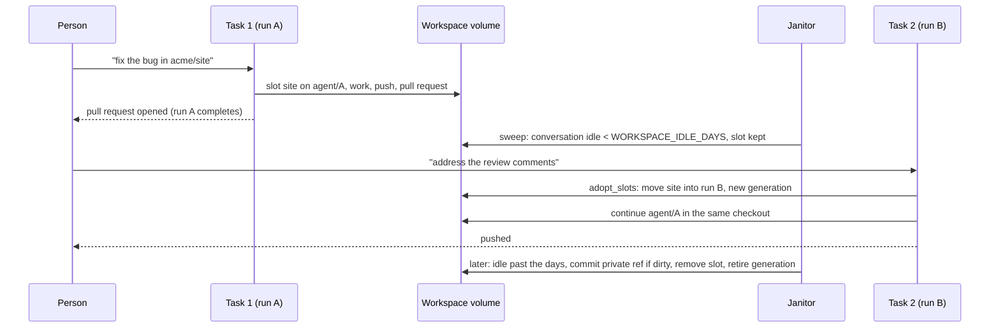
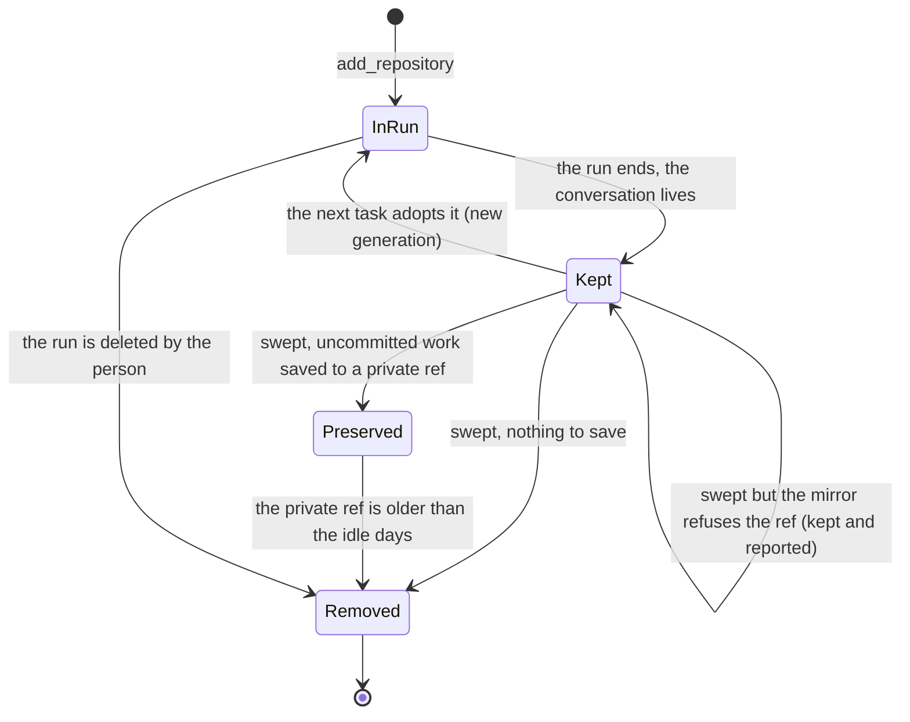

# 0073. A conversation keeps its repository slots

Status: **Proposed** (2026-11-24). A design; nothing is built. The values below are proposals for the owner to confirm
(*What was put to the owner*). Amends [ADR 0008](0008-a-workspace-holds-several-repositories.md) decision 2 ("the workspace
lives as long as the run") and [ADR 0034](0034-a-turn-that-asks-nothing-completes-and-scratch-lives-for-the-thread.md)
decision 2 (scratch lives for the thread), and extends the second to repository slots. Builds on
[ADR 0041](0041-a-run-pod-sees-only-its-own-run.md) (a slot's generation, the pod's mounts),
[ADR 0045](0045-a-subagent-can-run-in-the-background-as-a-session.md) decision 8 (a kept-open session's worktree) and
[ADR 0065](0065-resource-governance-admission-pools-and-os-limits.md) decision 7 (the sweep keeps unpushed work). The
per-person mirror (a mirror for each person, designed in the open amendment of ADR 0041) is taken as the intended source
of every slot; this ADR does not depend on it being built.

## Context

Since ADR 0034 a **scratch** project follows the conversation: the next task takes it over. A **repository slot** does
not. It belongs to a run and goes when the run ends and its work is pushed (ADR 0008 decision 2; the janitor,
`bin/adam-coder/src/janitor.rs`, *verified 2026-11-24 by reading it at `91a052d`*). So a person who comes back the next
morning to "now fix the review comments" finds a new run with no checkout: it clones (or fetches) again, loses the
dependency install and build output of the worktree, and cannot see the files the last run left uncommitted if the
sweep let it go. Four facts hold today and shape the design:

| Fact | Where |
|---|---|
| A slot is a git worktree of the repository's mirror, on branch `agent/<run-short-id>`, in `workspaces/<run>/<dir>/` | ADR 0008 decisions 1 and 3 |
| The sweep removes a finished run's workspace unless it holds unpushed work; it never removes scratch | `Janitor::sweep`, `RunWorkspace::remove_if_pushed` |
| `adopt_scratch` moves scratch projects of the same conversation into the new run's workspace by renaming a directory under both runs' locks | ADR 0034 decision 2 |
| A slot's directory has a **generation** (`Slot::generation`), new each time the directory is made; a run pod's mount and the mirror's worktree directory name carry it, so an old pod cannot reach a new directory | ADR 0041 decisions 6 to 9 |

## Decision

1. **A repository slot belongs to the conversation, not to the run.** The unit stays one directory
   `workspaces/<run>/<dir>/` with a record under `meta/<run>/<dir>.json`, so no layout changes. What changes is its
   *owner of record*: the slot's metadata gains `conversation` (as `ScratchMeta::conversation` does), and the slot
   survives the end of the run that made it for as long as rules 5 and 6 allow.
2. **The branch is kept.** A slot keeps the branch it was made on, `agent/<run-short-id>` of the run that made it, for the
   life of the slot. A later task does **not** get a new branch name: it continues that branch, as ADR 0003 already makes a
   task continue the task it references. A pull request opened from it stays open from it.
3. **Adoption.** The first step of a run moves the slots that other runs of the same conversation hold into its own
   workspace, exactly as `RunWorkspace::adopt_scratch` does for scratch (rename the directory under both runs' locks, a name
   the run already has stays where it is, the record's run is rewritten). A moved slot **gets a new generation** before the
   move is visible (the rule of ADR 0041 decision 6: a directory that a pod may have mounted is another directory when it
   moves), so a run pod of the old run keeps its old mount and sees nothing of the new place. Adoption is one call,
   `RunWorkspace::adopt_slots`, taking scratch and repository slots together; `adopt_scratch` becomes its scratch half.
   The adopted slot is **scratch for the purpose of the sweep** until the new run ends: it is that run's, and rule 5
   applies to the run's end, not to the move.
4. **A mirror worktree is moved, not remade.** A move changes the slot's directory, so the mirror's
   `worktrees/<name>` record and the slot's `.git` file are repointed with `git worktree move` under the mirror's lock, and
   the recorded admin directory (`admin`, ADR 0041 decision 6) is read again afterwards. If the move fails the slot is left
   where it was and reported, and the new run makes a fresh slot on the same branch from the mirror (the branch is in the
   mirror, so nothing is lost; the uncommitted files are what a failed move can strand, and rule 7 covers them).
5. **The sweep: idle days and a cap.** A finished run's workspace is no longer removed because the run is finished. Two
   settings, both lowering-only as ADR 0065 decision 1 requires (a deployment sets them; a folder or a person can shorten):

   | Setting | Meaning | Proposed default |
   |---|---|---|
   | `WORKSPACE_IDLE_DAYS` | days after the **last task of the conversation** before the sweep may remove its slots. `0` restores the old rule (removed with the run) | `14` |
   | `WORKSPACE_DISK_CAP` | bytes, or a ratio of the volume, that kept slots may use together; over it the sweep removes the **oldest idle conversation** first, never one with an open run | `50%` of the volume, and ADR 0065's `disk_reserve` still wins |

   A conversation with an open run (`runnable` or `parked`) is **never** swept, whatever either setting says, as for
   images today. The idle time is measured from the newest run of the conversation in the store; when the store cannot
   answer, the slots stay (the images' rule). `SCRATCH_IDLE_DAYS` keeps timing a conversation's images; `WORKSPACE_IDLE_DAYS`
   times its slots. They are two settings because ADR 0065 decision 7 made scratch unremovable and the new one is not: one
   name for both would silently change what a deployment that set `SCRATCH_IDLE_DAYS` already decided.
6. **A slot is removed only by the sweep, a deletion or a person's request, and always after rule 7.** Whichever removes
   it, the generation of every slot of the conversation is retired first (its record is removed under the lock, then the
   directory), so no pod keeps a mount of a directory that is gone and a later slot of the same name starts at a new
   generation.
7. **Uncommitted work is never lost to a sweep.** Before a repository slot is removed: if it has uncommitted changes
   (tracked or untracked and not ignored), they are committed to a **private ref** in the mirror,
   `refs/adam/kept/<conversation>/<dir>/<time>`, by the coder's identity, a ref no remote receives (the coder never pushes
   outside `agent/*`, ADR 0008 decision 6); if it has commits no `origin` ref has, they are on the branch already, and
   the branch stays in the mirror. If a ref cannot be written (a locked or full mirror) the slot is **kept and reported**
   (`Sweep::kept_unpushed`, as today). The same rule runs before a cap removal. A later task that names the repository
   again is told, in its first step's text, that the conversation had a slot, the branch, and the private ref if one was
   made, so the model can offer to restore it. Restoring is `git checkout` of that ref into a new slot, never automatic.
8. **A background session's worktree is a slot of the conversation too.** ADR 0045 decision 8 gives an editing child that
   is kept open a worker worktree keyed by the session, on branch `agent/<session>`. That worktree is a repository slot of
   the **parent's conversation** with `owner: session` in its record. It follows rules 5 to 7 with one difference: a
   session that is still open (the parent's context lists it as open) holds its slot like an open run does, and a
   **closed** session's slot is merged by the parent or reported unmerged, never swept silently, because its branch is
   the only copy of the worker's commits. A read-only child shares the parent's slots and has none of its own.
9. **A deleted conversation.** A2A has no "delete the thread" (ADR 0034 decision 2), but the orchestrator can delete one
   (`DELETE /api/threads/{id}`, ADR 0043 of another-agentic-system). The orchestrator does **not** ask the coder to end the
   slots in this ADR: the sweep is the end. This keeps the coder protocol unchanged and keeps the orchestrator out of the
   coder's volume. A later ADR may add an optional extension that says "this context is gone"; until then a deleted
   thread's slots go with the idle days, which is at most `WORKSPACE_IDLE_DAYS`, and the private refs of rule 7 go with
   them (a ref older than the idle days is removed by the same sweep). *Proposed; the owner decides (question 2).*
10. **The platform's pod-volume case.** In the platform (another-agentic-platform), the coder does not mount a run pod's
    volume: ADR 0041 gives the pod `subPath` mounts of the coder's own volume, and a platform that runs the coder's tools in
    **another** pod (the `Environment` seam of ADR 0019, the remote sandbox of ADR 0071) has the files in that pod's volume,
    not the coder's. For such an environment a slot has two homes: the **record and the branch** (always on the coder's
    volume and mirror) and the **checkout** (in the environment). The checkout is not kept across a pod's end; it is
    **rebuilt from the branch**. So the coder moves a slot's content as git does: `git bundle create` of the branch (and of
    the private ref when there is uncommitted work, made as in rule 7 inside the environment by `adam-exec`) is read over
    exec and unbundled into the mirror before the environment is released, and the next task's `ensure` clones from the
    mirror into the new pod. Dependency installs and build output are **not** kept in that case (they are in the pod's own
    volume; the shared package cache of ADR 0040 and its proposed pull-through proxy are what keeps them cheap). A
    platform that wants them kept gives the pod a persistent volume claim named by the conversation; that is the platform's
    decision and its chart's setting, not the coder's, and this ADR only says the coder then treats that volume as the
    checkout and does not bundle. *Unverified: no environment other than the coder's own container and the Kubernetes run
    pod exists at `91a052d`; the bundle path is designed here and built by the last slice.*
11. **Generation still separates an old pod from a current one.** A slot's generation is new when the directory is made
    and when it moves (rule 3). Nothing in this ADR changes the mount or its checks: the pod's `subPath` carries the
    generation, `ensure` refuses a pod whose generation is not the slot's, and a kept slot that is adopted by a new run is,
    to a pod, a new directory. A slot kept across runs that is **not** moved (the same run's task continues it in place) keeps
    its generation, so a running pod stays valid.
12. **What does not change.** The model's tools are the same: `add_repository` of a repository the conversation already has
    returns the existing slot (ADR 0008 decision 3, "at most one slot per run", now "per conversation"), with a note that it
    was kept. The coder's gate (no push outside `agent/*`), the checks before a pull request, and the person's word for a
    repository are unchanged.

## Consequences

* A second task of a conversation starts in the checkout the first one left: build output and installs are there, and so are
  the files it did not commit. The cost is disk: a slot is held for up to `WORKSPACE_IDLE_DAYS`, and the volume must be
  sized for the conversations of that window (the cap is the guard, and `disk_reserve` of ADR 0065 outranks it).
* A person who deletes a thread keeps their files on the coder's volume for at most the idle days. The deployment's
  privacy text must say so; a deployment that cannot accept it sets `WORKSPACE_IDLE_DAYS=0` and has ADR 0008's rule.
* A private ref in the mirror is the coder's own and is **not** reachable by a run pod: ADR 0041 gives a pod no mirror, and
  `refs/adam/kept/*` is excluded from every fetch the coder makes for a pull request. A test holds both.
* `RunWorkspace::adopt_scratch` becomes the scratch half of `adopt_slots`; `Slot` gains `conversation()` and `owner()`;
  `Workspaces` gains a sweep API that takes the two settings; `Janitor::with_workspace_idle` and `Sweep::kept_idle` are new.
  No required trait method is added to `Store` or `Notifier`; `Environment` gains an **optional** `export_slot` (provided,
  returns "not supported") for rule 10.
* Metadata written before has no conversation: such a slot is not adopted and is swept as it is today (with the run, once
  pushed). A mixed volume works, as ADR 0008 decision 7 did for its own layout change.
* `docs/reference/environment.md`, `docs/reference/workspace-and-environments.md`, `docs/reference/parity.md`,
  `deploy/coder/README.md` and the crate READMEs of `adam-workspace` and `adam-coder` change with the slices that build
  them.

## Alternatives considered

* **One workspace per conversation** (ADR 0008's rejected alternative, and ADR 0034's). Rejected again: a run's slots are
  per run on purpose (branch `agent/<run>`, locks, a pod's mounts); moving slots is smaller than moving the unit, and it
  reuses `adopt_scratch`.
* **Keep every slot forever.** The volume fills; the idle days and the cap are the owner's controls.
* **Commit and push uncommitted work to `agent/*` before a sweep.** It would publish work nobody asked to publish and
  break the gate's meaning. A private ref in the mirror keeps it local.
* **Ask the orchestrator to end a deleted thread's slots.** It adds a coordination step for a window of days. Left to a later
  ADR (question 2).
* **One setting for scratch and slots.** It would change what `SCRATCH_IDLE_DAYS` already means in deployed charts.
* **Keep the pod volume (platform case).** A persistent volume per conversation is a platform decision with a cost; bundles
  are the portable default.

## Slices and the test of each

| Order | Slice | Test that proves it |
|---|---|---|
| 1 | **Metadata**: a slot records `conversation` and `owner`; old records still read | a v2 record without the fields reads; a record with them round-trips |
| 2 | **Adoption**: `adopt_slots` moves repository and scratch slots, repoints the mirror worktree, new generation | a second run of the conversation finds the slot, the branch and an uncommitted file; a name the run has is left; a moved slot's old generation is refused by `ensure`; the failing-move path makes a fresh slot on the same branch |
| 3 | **The sweep**: `WORKSPACE_IDLE_DAYS`, never an open conversation, the store-down rule, `0` is the old rule | a fake clock: kept at 13 days, swept at 15; open run never; store error keeps; `0` removes with the run |
| 4 | **The cap**: `WORKSPACE_DISK_CAP`, the oldest idle conversation first, `disk_reserve` wins | over the cap the oldest idle one goes and an open one does not; the reserve beats the cap |
| 5 | **Uncommitted work**: the private ref, the kept-and-reported path, the note to the next task | a dirty slot is swept and `refs/adam/kept/...` has its files; a locked mirror keeps the slot; the ref is in no pod and in no pull-request fetch |
| 6 | **Sessions**: a kept-open session's worktree is a slot of the conversation | an open session holds its slot; a closed one is merged or reported, never swept silently (ADR 0045 slice 7 part 2) |
| 7 | **Settings and docs**: the two settings in `config.rs`, the chart and the references | a config test per setting (default, `0`, a refusal of a negative); docs-check passes |
| 8 | **The pod-volume case**: `export_slot`, the bundle over exec, rebuild from the mirror | an environment double: a pod ends, the next task's pod has the branch and the private ref |

## What was put to the owner

1. **The defaults**: `WORKSPACE_IDLE_DAYS` 14 and `WORKSPACE_DISK_CAP` 50% of the volume. Proposed, not decided.
2. **A deleted thread**: leave the slots to the sweep (this ADR) or add an extension that tells the coder the context is
   gone (faster erasure, one more protocol surface).
3. **Whether a slot's private ref is offered back** by the coder's first step (this ADR) or only kept for an operator.
