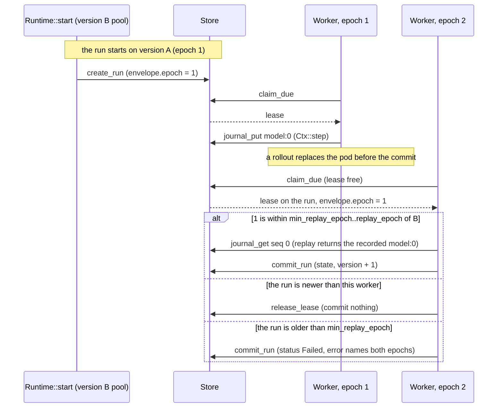
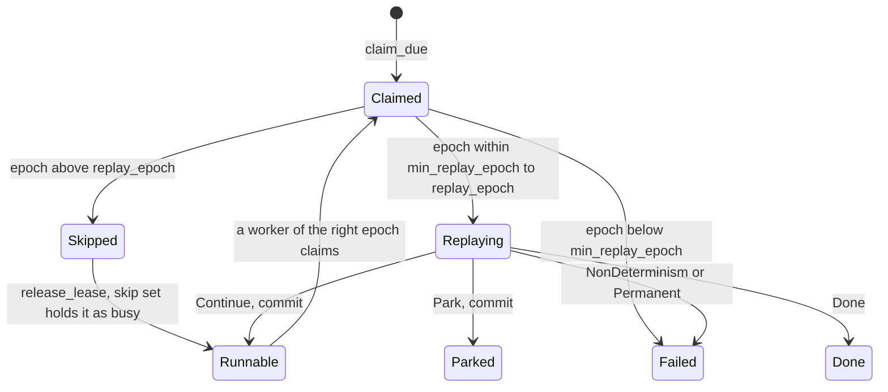

# 0076. A run records the journal epoch it started on, and a worker steps only the epochs its code can replay

Status: **Accepted** (2026-11-26). The owner accepted this decision and **its seven recommendations as written**, with
the platform's AD-059, on 2026-11-26 (recorded in another-context's `decisions-2026-11-26.md`, row 113,
skyengpro/another-context#177); the platform's half merged first (another-agentic-platform#156, `628c5a7`). The table
under *Open questions* is the ruling: an integer epoch, `Permanent` with an `Unsupported` source, the envelope now and
a column only with slice 5, a refused run waits rather than fails, a follow-up run starts on the current epoch, a child
records its own, and no `partition` value until a rollout shows the rule is not enough. It adds no setting and no
feature a user sets, so `docs/reference/parity.md` is unchanged; a slice that adds a setting updates it.

## Premise, checked at `main` (e24f185f, 2026-11-25)

**A changed step list fails a replay with `NonDeterminism`: true.**

| Where | What it does |
|---|---|
| `crates/adam-core/src/store/mod.rs:542`, `:604` | `StoreError::NonDeterminism { run, seq, recorded, requested }`, class `Corrupt` |
| `crates/adam-core/src/store/memory.rs:328`, `crates/adam-store-postgres/src/lib.rs:1480`, `crates/adam-store-sqlite/src/lib.rs:901`, `crates/adam-store-mongodb/src/lib.rs:2146` | `journal_put`: an entry already at `(run, seq)` with another `name` is refused; the first writer wins |
| `crates/adam-store-testkit/src/lib.rs:1948` | the conformance case: `charge` recorded at seq 0, `refund` refused |
| `crates/adam-runtime/src/ctx.rs:270` | `Ctx::step`: "a different `name` at a recorded `seq` fails with `NonDeterminism`, as does a recorded result that no longer decodes" |
| `crates/adam-runtime/src/worker.rs:1114-1119` | both the `AgentError` and the `StoreError` form end the run: `failed("non-deterministic replay: ...")`, status `Failed`, no retry |

**No ADR covers versioning: true.** `grep -rniE "patched|side by side|in.flight"` over `docs/` and a search for
`NonDeterminism` find only warnings that repeat one rule, *stop every worker of the old revision first*: ADR 0004
decision 4 (`docs/decisions/0004-agent-folders-at-run-time.md:58`), ADR 0045 (`:66`, "No mixed versions"), ADR 0050
(`:88`, "roll every worker before the build is used") and `docs/reference/agent-files.md:1120`. No file in
`docs/decisions` has "version" in its name. This ADR settles that rule instead of repeating it.

## Context

**What a replay is keyed on.** The journal is keyed `(run, seq)` and an entry is `{ seq, name, ok, payload,
recorded_at }` (`JournalEntry`, `crates/adam-core/src/store/mod.rs:475`). A replay does not compare the request or the
input: it compares the step **name** at each `seq` and decodes the payload (`docs/architecture.md:31`). Names are
built by the loop, for example `model:<turn>` (`crates/adam-llm-agent/src/agent.rs:2786`), `tool:<call id>` (`:5101`),
`usage:<call>` (`:3908`), `sessions:<turn>` (`:3793`), `poll:<call id>` (`:5649`), `model-switch:<n>` (`:2441`) and
`message:start` (`:5911`).

**So "a changed step list" means one of three things** in a transition that has recorded at least one step and has
not committed: a step added, removed or reordered (every later `seq` shifts); a step renamed; or a payload type that no
longer decodes. A prompt, a limit or a description changing is invisible, because the request is rebuilt every turn
(ADR 0004, context). A transition that committed is safe: its steps are behind it, and the next transition starts at
the committed `seq`. The exposure is a run **mid-transition**, and a long turn (a model call, a tool, a child) is
mid-transition most of the time.

**What a run stores.** `RunRecord` has no build or version field except `version`, the commit counter
(`crates/adam-core/src/store/mod.rs:371-383`). Its `state` holds the runtime's `Envelope`
(`crates/adam-runtime/src/envelope.rs:19`), whose fields are all `serde(default)` or optional, so a field can be added
without touching the stores (`Envelope::new`, `:86-103`; created at `crates/adam-runtime/src/runtime.rs:1665`). A
leased run also has an *owner* with `ClaimScope::Pinned`, store-side scheduling data (`store/mod.rs:451-463`).

**The claim path.** A worker calls `Store::claim_due(agents, worker, scope, busy, now, ttl, limit)`
(`store/mod.rs:794`; the call is in `crates/adam-runtime/src/worker.rs:114`), then `advance` steps each lease and
`release_lease`s it. `busy` names runs the caller will not be offered again whatever their lease says, and they do not
count against `limit` (the doc of `claim_due`). A claim filters by agent name and scope only: **a worker cannot decline
a run by its version today**, so the first worker to poll takes it.

**Why the rule hurts now.** The chart's workers are a `StatefulSet` with `updateStrategy: RollingUpdate` and
`podManagementPolicy: Parallel` (`deploy/coder/templates/statefulset.yaml:12-18`). During a rollout an old pod and a new
pod share one store, so "stop every worker of the old revision first" is not something the chart can do.

## Decision

### 1. A run records an integer `epoch` in its envelope when it starts

The agent says which journal shape its code writes: a provided method `Agent::replay_epoch(&self) -> u32` (default `0`),
so no implementer breaks. `Runtime::start` writes it into the new `Envelope::epoch` (`#[serde(default)]`, absent
means `0`); the head (`crates/adam-runtime/src/head.rs`, which copies the envelope's bookkeeping) carries it too. A run
started before this ADR has no field and is epoch `0`: **epoch 0 is the journal as it is at `e24f185f`**.

*Why an integer and not the image tag or the folder digest.* A tag changes on every commit, but only a change to the
step list matters, and a digest of an agent folder changes when a prompt does. An epoch is bumped by the author who
changes a step list, on purpose, in the same PR; a test (slice 4) catches the author who forgets.

*Recommendation: the envelope, not a store column.* It needs no `Store` method, no migration and no testkit case on
three stores. The cost is that a store cannot filter on it (decision 3 and slice 5 return to this).

### 2. Old runs keep running old code: a branch on the run's epoch, kept until no run needs it

| Option | What it is | For | Against |
|---|---|---|---|
| **A. Epoch branch in the code** | `ctx.epoch()` returns the run's epoch; the loop keeps the old step list for `epoch < N` | one pool; no extra pods; the old path is read in review | the old path stays in the code until retired; the author must keep it replayable |
| B. `patched`-style marker in the journal | a step records a marker at its `seq`; replay takes the new path only if the marker is there (Temporal's `patched`; its exact semantics *unverified* here, not fetched) | no run-level field; works per call site | a marker is a step, so it shifts `seq` for every run that has it; one marker per change, forever |
| C. Workers per version | the old image keeps serving its runs; the new one takes new runs | the old code is never edited; a removed tool still works | two pools and a router: the claim cannot route today, so it needs slice 5 and the store column; double cost during a rollout |

*Recommendation: A for a step list the code can still produce, C only as the way out when it cannot* (a tool, an MCP
server or a type that is gone: `docs/reference/agent-files.md:1120`). A marker (B) is not recommended: it changes the
journal of runs that would have been fine. A run that cannot be served by any live code is failed on purpose (decision
3), never silently diverged.

### 3. A worker whose epoch range does not hold the run's does not step it

The agent also says the oldest epoch its code can replay: a provided `Agent::min_replay_epoch(&self) -> u32` (default
`0`). Before it steps a leased run, the worker compares:

| The run's epoch | Meaning | What the worker does |
|---|---|---|
| `min <= e <= replay_epoch` | the code can replay it | steps it, as now |
| `e > replay_epoch` | a newer worker started it; this pod is the old one in a rollout | **does not step it, commits nothing**: releases the lease and puts the run in a worker-local skip set passed as `busy` for a short time, so the next poll does not take it again; a worker of the right epoch claims it |
| `e < min` | the code that could replay it is gone | fails the run with a message that names both epochs; the class is the existing `Unsupported` |

Rulings behind the middle row, each from the code above:

* **Not `AgentError::Transient`.** A transient failure commits, counts an attempt and is bounded: `retrying` ends in
  `Verdict::AttemptsSpent` or `Verdict::Ceiling` and `failed(...)` (`worker.rs:988-1040`), and it abandons the try's
  journal entries (`seq`). A rollout that lasts longer than the policy would fail healthy runs.
* **Not leaving the lease to expire.** The new worker would wait a whole TTL for a run nobody is stepping.
* **No new `ErrorClass` variant** (Rules 3 and 6): the existing `Unsupported` and `Corrupt` say what to do; the
  decision is on the numbers, which are not an error class.
* **`busy` is reused as the skip set** because it already means "never offered, not counted against `limit`" and
  needs no `Store` change. Its limit is spin: until slice 5, each old pod claims and releases a newer run once per skip
  period. *Unverified:* how many such runs a rollout produces; slice 3's test measures claims per run, not a rate.
* **The failure of the last row** uses `Permanent` (`worker.rs:1108`, status `Failed`); whether the class rides
  on its source as `Unsupported` is Open question 2.

### 4. The operator's side: roll in two steps, with no chart change in this ADR

The chart needs nothing to be safe, because the worker refuses what it cannot replay (decision 3). What an operator
does for a change that bumps the epoch:

1. **Roll the image** (`RollingUpdate`, as now). New pods start runs at epoch `N`; old pods leave `N` runs alone and
   keep serving `N-1` and below. A pod that is told to stop drains in `terminationGracePeriodSeconds`
   (`statefulset.yaml:61`) and releases its leases.
2. **Retire the old path** in a later release, once no open run has epoch `< N` (slice 6 makes that countable). That
   release raises `min_replay_epoch`.

What the chart could add later, each as its own change with a `docs/reference/parity.md` row: a `StatefulSet`
`updateStrategy.rollingUpdate.partition` value to hold back pods for a canary (a Kubernetes feature; its behaviour
with `podManagementPolicy: Parallel` is *unverified* here) and a second release of the chart for option C, which
needs `WORKER_ID` to stay unique per pod (`statefulset.yaml:183`, pinned runs follow the pod name). `deploy/coder` is
read by another repository: say so in that PR.

### 5. What a platform that rolls versions through channels needs

In neutral words, a platform that moves a new version through staged channels needs four things, in this order of cost:

| Needs | Gets it from |
|---|---|
| to know which version a run started on | `epoch` in the run's view (slice 6) |
| to know which versions a pool can serve | `replay_epoch` and `min_replay_epoch` in the card or the health output (slice 6) |
| to know when a version can be retired | a count of open runs per epoch: from the envelope it is a scan, from a store column a query (slice 5) |
| to keep a channel's runs on that channel's pods | option C and the store column (slice 5); until then, two pools share runs and the epoch rule only keeps them safe |

Nothing here knows what a channel is; it is the integer and the three numbers.

## How a run meets a worker of another epoch

The first line is the existing path (`Runtime::start`, `claim_due`, `Ctx::step`, `journal_put`, `commit_run`); the
`alt` is slices 2 and 3.

`Runnable`, `Parked`, `Failed` and `Done` are `RunStatus` (`store/mod.rs`); `Claimed`, `Replaying` and `Skipped` are
the worker's own moments (`advance`, `crates/adam-runtime/src/worker.rs:415`), and `Skipped` is new.

## Slices

One PR each, in order; each ships alone. **Breaks implementers** is whether a `Store` or `Agent` implementer fails to
compile (Rule 2); **testkit** is whether the case runs on memory, Postgres, MongoDB and SQLite.

| # | PR | Decisive test (fails without the slice) | Breaks implementers | Testkit |
|---|---|---|---|---|
| 1 | `Envelope::epoch`, `Agent::replay_epoch` (provided, `0`), written by `Runtime::start`, carried by the head | a run started under an agent with epoch 3 reads epoch 3 after a commit and a reload through the head; a stored envelope without the field decodes as 0 | no: a provided method, a defaulted field | no |
| 2 | `Agent::min_replay_epoch` (provided, `0`) and the worker's check; `Ctx::epoch()` | two agents on one store: the run of an epoch-2 agent is claimed by an epoch-1 worker and the worker leaves its `version`, journal and `state` unchanged; a run below `min` ends `Failed` naming both epochs | no | no |
| 3 | the skip set: a refused run goes into `busy` for a period | the epoch-1 worker claims a refused run at most once per period over ten polls, and an epoch-2 worker then steps it to a commit | no | no |
| 4 | golden journals: a journal of the coder's transition kept as a fixture, replayed against the current loop (`adam-llm-agent` tests) | rename one step in the loop and the fixture replay fails with `NonDeterminism`; adding a branch on `ctx.epoch()` makes it pass again for the old fixture | no | no |
| 5 | **optional**, only if slice 3's spin matters or option C is wanted: a store column `epoch`, written by `NewRun` (a builder `NewRun::epoch`), and a provided `Store::claim_due_for(.., epochs)` whose default claims and releases (correct, but a non-matching run at the head can starve the rest) | with runs of epochs 1 and 2 due, a worker serving `{2}` is leased only the epoch-2 ones, whatever their `sched_at` order | **a new field on `NewRun` breaks code that builds it as a literal** (`NewRun::new` does not); the method is provided | **yes**: a case in `adam-store-testkit` and a migration in Postgres, MongoDB and SQLite; memory has none |
| 6 | the epoch in `RunView` and a count of open runs per epoch; the two numbers in the card or health | a started run's view shows its epoch; with two epochs open, the count reports both | no | only if the count is a store query (slice 5) |
| 7 | docs: `docs/guides/deploy-the-coder.md` gains "roll a change to the step list" (decision 4); `docs/reference/errors.md` the new failure text; the rule "roll every worker first" in ADRs 0004, 0045, 0050 gets a dated *Amended* note | `docs-check` passes with the new links and anchors | no | no |

Slices 1 to 4 ask nothing of a store. The first real step-list change after slice 2 carries its own epoch bump and a
golden fixture of the old journal.

## Open questions

| # | Question | Recommendation |
|---|---|---|
| 1 | Is the epoch an integer the author bumps, or derived (image tag, folder digest)? | An integer: only a step-list change needs it, and a test catches a forgotten bump (slice 4). |
| 2 | Does the refusal of a too-old run use `AgentError::Permanent` carrying `Unsupported`, or `Rejected`? | `Permanent` with an `Unsupported` source; `Rejected` means a policy refused the input (`worker.rs:1113`). Verify how `Permanent` carries a class before slice 2. |
| 3 | Is the envelope enough, or should the epoch be a store column from the start? | The envelope now; the column only with slice 5, and only when routing by epoch or a cheap count is wanted. |
| 4 | How long may a refused run wait? | Until a worker of its epoch is up; the run is not failed for waiting, but a platform should alarm on a run claimed and refused for longer than its limit (slice 6). |
| 5 | Does a conversation's follow-up run start on the current epoch? | Yes: a new run is a new journal. Only a run that continues mid-transition keeps its epoch. |
| 6 | Do children follow the parent's epoch? | No: each run records its own, since a child is a run with its own journal (`docs/reference/child-runs.md`). |
| 7 | Is the `partition` canary worth a chart value? | Only after one rollout shows the epoch rule is not enough; it is a parity row and a contract with the repository that renders this chart. |

## Consequences

* **Good:** a rolling deploy stops failing runs that were mid-transition; the rule "roll every worker first" becomes a
  check in code. Slices 1 to 4 touch no store.
* **Cost:** the author keeps an old step list alive until its epoch is retired, and one more field, one more test
  fixture per epoch. A run can be refused by every worker of a version that was rolled back (the run waits, not fails).
* **Risk:** an epoch that is not bumped when the step list changed fails exactly as today; slice 4 is the guard and is
  only as good as its fixtures.
