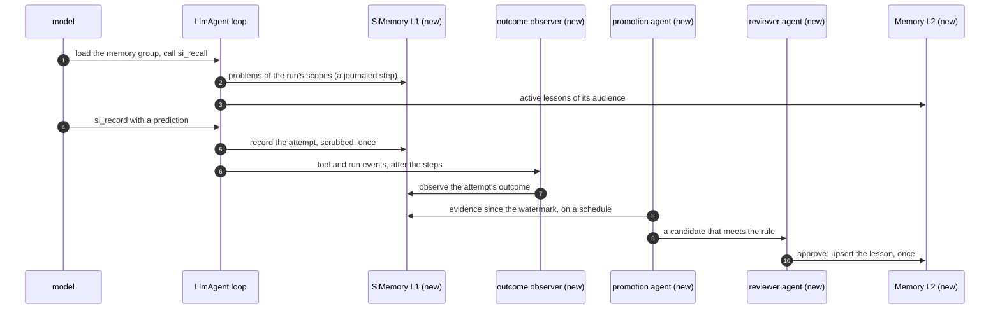
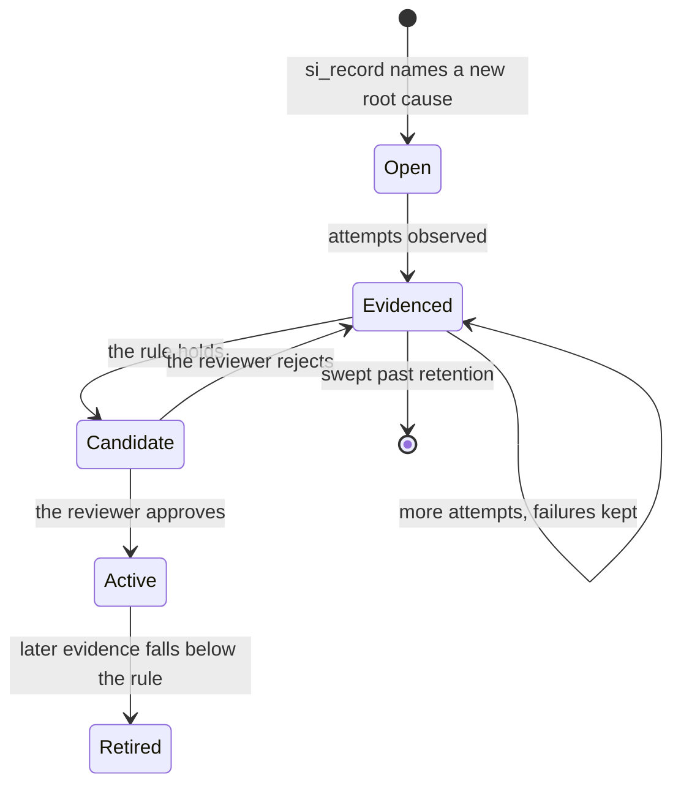

# 0081. An agent keeps a self-improvement memory near it, and what holds becomes the deployment's memory

Status: **Accepted** (2026-11-27), the owner's decision; the points under [Still open](#still-open) wait for an answer.
Nothing is built. The evidence behind this page (the paper, the code it was checked against, the comparison with a code
index) is in [the agent page](../../.agents/docs/decisions/0081-an-agent-keeps-a-self-improvement-memory-near-it-and-what-holds-becomes-the-deployments-memory.md).

The owner said (2026-11-27):

> *"We'll also add this [arXiv 2611.18856] to the adam-rs, in the form of a new crate on all coding agents. Also, we
> don't need it for chat by default. Adam-agents and adam-coder has them enabled by default, configurable. That implies
> a memory. That memory is not the same as the global memory, this one is not far from the agent. We'll keep it
> hexagonal tho (with port and adapters). We'll have a pass between global and local memory so that if something
> happens consistently, we just have to upgrade the global memory. => I'll say we have SIMemory (L1) and Memory(L2)"*

And, answering the questions put to them the same day:

| Question | The owner, 2026-11-27 |
|---|---|
| What to build | "Both, lessons first": task-time lessons first, then the paper's own setting, a harness optimizer over agent folders, on the same ports |
| Who promotes L1 to L2 | "Review using another configurable agent/model with its config": another agent, with its own model and configuration, reviews each candidate; not a person, not automatic |
| How an agent reaches it | "Tools first": recall and record are tools in a lazy tool group, journaled; memory in the prompt is a later option |
| Where it is stored | "I'm seeing a port & adapter here for mongo, redis, postgres and in-folder at first": ports with adapters for MongoDB, Redis, PostgreSQL and an in-folder store, the in-folder one first |

Builds on [ADR 0050](0050-hooks-around-the-agent-loop-compiled-first-and-programs-second.md) (plugins and observers),
[ADR 0066](0066-a-first-request-is-lean-and-tools-load-in-groups.md) (tool groups),
[ADR 0044](0044-paged-tools-a-stable-prompt-prefix-a-plan-skills-commands-and-project-context.md) (the stable prefix),
[ADR 0060](0060-schedules-are-parked-runs.md) (schedules) and [ADR 0070](0070-a-secret-is-replaced-where-it-is-a-value.md)
(the redaction marker).

## Context

*Self-Improvement Memory* (arXiv:2611.18856, *verified 2026-11-27*) is the record a harness optimizer keeps of the edits
it tried: grouped by root cause, each attempt with its rationale, what it was **predicted** to fix, what was **observed**,
and where it came from. Carried to a new benchmark or model it beat carrying the harness alone in all ten settings. The
paper's memory serves the optimizer, not the agent that solves the task.

adam-rs has no agent memory today. The orchestration layer keeps a person's own notes, owned by the person; that is not
this memory, and it leaves an agent's own memory to adam.

## Decision

1. **Two layers, two ports.** *SIMemory* (L1) is an agent's own memory, near it: the problems it met and what it tried.
   *Memory* (L2) is the deployment's: lessons that held across L1 scopes. Each is a trait of a new crate `adam-memory`
   with a conformance testkit, so an adapter proves itself the way a `Store` does. No driver type is in a signature;
   errors carry a class.
2. **Adapters.** The in-folder store comes first (plain files in a directory the deployment gives the agent), then
   PostgreSQL, MongoDB and Redis. Each is a feature of a crate of its own, and the same suite runs on each.
3. **The paper's shape, at task time.** An L1 entry is a **problem** (a short root cause) with its **attempts**: the
   remedy, the rationale, a prediction written before the outcome, the observation stamped after it, and provenance. A
   failed attempt is kept. The model decides which problem an attempt belongs to. An attempt may carry code anchors as
   text so a lesson can be judged stale.
4. **Scope.** L1 is keyed by deployment, caller, agent and kind (`agent`, or one repository). L2 is keyed by deployment
   and audience. Nothing crosses a caller. Memory is not per person, because adam cannot tell people apart yet; a
   repository-scoped entry is served only to a run that has that repository prepared.
5. **Bounds and secrets.** Every list is bounded and old attempts are swept. Every text is scrubbed before the write, and
   a text that still holds the redaction marker is refused, not stored. An agent-scoped entry or a lesson may not name a
   repository, a path, a URL, a host or an e-mail address. The loop never copies a person's message or a tool's output
   into memory.
6. **Tools, not the prompt.** A tool group `memory` offers `si_recall` (the run's L1 problems and the active L2 lessons
   for its audience, with provenance) and `si_record` (open or extend a problem). Both are ordinary journaled tool steps:
   a replay returns the record and asks no store, and a write lands once across a retry. The first request gains one
   loader line. A preload into the prompt is a later option and waits for a journal epoch.
7. **Outcomes are observed, not written by the model.** An observer plugin stamps an attempt's observation from the
   tool and run events (the coder's checks, the run's end). It runs outside the journal and never changes a run.
8. **Promotion is a rule, then a review.** A problem becomes a candidate when, within a window, it has enough successful
   attempts from enough runs and conversations in at least two L1 scopes, a high enough success rate and no recent
   failure. The thresholds are deployment settings. A scheduled built-in agent runs a **pure** promotion function and
   writes candidates, once per candidate.
9. **Another agent reviews each candidate.** A reviewer agent, with its own model and configuration (a folder, a model
   alias and its limits, set by the deployment), reads a candidate with its evidence and approves or rejects it. Only an
   approved lesson is served. The review is journaled and keeps its reason.
10. **A lesson never widens.** Its audience is the intersection of its sources'. A text that fails decision 5 stays in
    L1. A lesson whose evidence turns is retired: kept, and no longer served. States are closed: proposed, active, retired.
11. **On for the two binaries, off for a chat by its folder.** `adam-coder` and `adam-agent` enable it by default,
    configurable; `adam-engine` does not. A folder's `si_memory:` key turns it off (the chat folders say `off`) or tunes
    it. The key is not `memory`, which is Claude Code's ignored key. L2 and promotion need a configured store; with none
    there is no L2.
12. **Fail closed.** An unknown option, or memory on over a store with no adapter, exits at startup. At run time an
    unreachable memory is a transient tool error and the run goes on without it; a failed scrub or bound refuses the
    write. Memory never grants a tool, a tier or a repository.

## Slices

Cards of the board epic; each is one pull request, its proof seen failing first.

| Slice | What | Proof |
|---|---|---|
| M0 | this ADR and its pages | docs-check |
| M1 | the L1 port, its testkit and the in-folder adapter | a double that answers another scope or writes twice for one key fails the suite |
| M2 | the PostgreSQL, MongoDB and Redis adapters | the suite on each; fails with a URL unset under the CI switch |
| M3 + M4 | `si_memory:` and the deployment's settings; the `si_recall` and `si_record` tools as a lazy group | a folder `off` is off; a replay asks the store nothing; a secret in a field is refused |
| M5 + M6 | the outcome observer; the defaults in `adam-coder` and `adam-agent`, and the chart | a passing check stamps a success; the first request differs by one loader line; the chart renders unchanged by default |
| M7 + M8 | the L2 port and adapters; the promotion rule and the reviewer agent | the same evidence twice is one lesson; a rejected candidate is never served; one scope never reaches every audience |
| M9 + M10 | L2 in `si_recall` and retirement; a paired study in `bench/` ([ADR 0048](0048-a-benchmark-harness-for-adam-coder-and-opencode.md)) with and without memory | a retired lesson is not served; the study is a report, not a gate |
| M11 | the harness optimizer over agent folders, on the same ports | its own ADR first |

## Still open

| # | Question | Recommendation |
|---|---|---|
| 1 | Is L2 one deployment's, or does it span deployments | one deployment |
| 2 | How a chat is told apart | the chat folders say `si_memory: off` |
| 3 | The promotion thresholds | the draft's: 5 successes, 5 runs, 3 conversations, 2 scopes, a lower bound of 0.6 over 30 days |
| 4 | Per-person isolation | key repository entries by person once the person's identity exists |
| 5 | Whether subagents read the root's memory | read the root's L1, write under their own name |
| 6 | The platform's `AgentConfig` field for the key | a field of the same name, in step |

## Consequences

* A new port pair with a testkit and four adapters. `Store` does not change, so no implementer breaks.
* Every agent built with the crate gains one loader line in its first request; a model call is added only when the model
  loads the group.
* A wrong lesson can spread to the agents of a deployment; provenance, review and retirement limit it and do not remove
  it. A repository's text can try to plant a lesson; repository scope and the reviewer limit that.
* The reviewer is a model: it adds a cost per candidate and can be wrong. It is configured, journaled and replaceable.
* The gain of task-time memory is unmeasured; the paper measured an optimizer's. M10 is the evidence.
* The platform's `AgentConfig` and the orchestration layer's chat folders change in step.

## Alternatives rejected

* **`memory:` as the key.** It is Claude Code's, read and ignored today: reusing it turns behaviour on in imported files.
* **Memory as `Store` methods.** A new required method breaks every implementer, and the store is per run.
* **The orchestration layer's person memory as L2.** It is the person's, off until they turn it on, reached by tools.
* **The whole record in every prompt, as the paper does.** Thousands of runs need a bound, and a changing prefix breaks
  the provider's cache.
* **A code index as the L1 store.** It holds code, rebuilt per revision; L1 holds outcomes that cannot be rebuilt. An
  attempt links to code only through its anchors.
* **Promotion by a person, or with no review.** The owner chose another agent as reviewer.
* **Inferring a chat** from its tools or tags. Implicit, and a tag is presentation.
