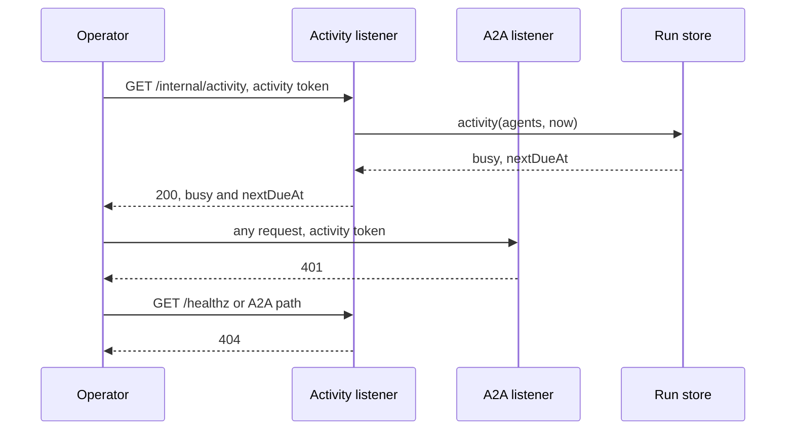
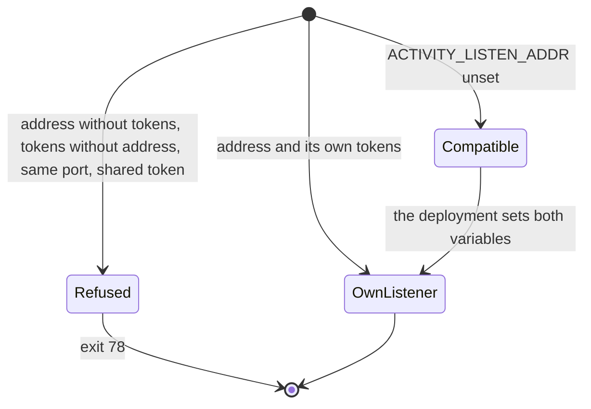

# 0081. The activity route has a listener and tokens of its own

Status: **Accepted** (2026-11-27). The owner decided on 2026-11-27, for the platform's card that consumes the route:
*"separate port first"*. The number is the next free one at the time of writing; take the next free at merge.

## Context

`GET /internal/activity` answers `{"busy": N, "nextDueAt": "..."}` from the run store: how many runs a worker holds a
live lease on, and when the next open run is due. It carries no run content and no secret. It was added for a caller
that scales the service, the platform's operator (its decision AD-058, slice A1), and no ADR recorded it.

Until now the route sat on `LISTEN_ADDR`, the A2A listener (or a worker's probe listener), behind `A2A_BEARER_TOKENS`
like every route but `/healthz`. So the operator would need an A2A token and a network path to the A2A port. An A2A
token is the right to message the agent, cancel its tasks and read them: an operator that only needs a count would
hold all of that, and an operator that is compromised could message every agent it scales.

## Decision

1. **A listener of its own.** `ACTIVITY_LISTEN_ADDR` turns on a second listener, on every role. It serves
   `GET /internal/activity` and nothing else: no card, no `/healthz`, nothing of A2A. Every other path is a 404.
2. **Tokens of its own.** `ACTIVITY_BEARER_TOKENS` is a comma-separated list, read the way `A2A_BEARER_TOKENS` is. The
   activity listener accepts those tokens and no other; the A2A listener never accepts them.
3. **Fail closed.** The process exits 78 before it binds anything when the address is set with no usable token, when
   tokens are set with no address, when the address takes the port of `LISTEN_ADDR`, or when a token is in both lists.
   No message names a token.
4. **The route leaves the A2A port when it has its own.** With `ACTIVITY_LISTEN_ADDR` set, `LISTEN_ADDR` no longer
   serves the route, even to an A2A token. Unset, it stays there behind the A2A tokens, for the deployments that read it
   that way today. That compatible form is **deprecated**: the process says so once at start, and it goes in a later
   release.
5. **The chart keeps it off by default.** `activity.enabled` renders the address, the tokens from a Secret the
   deployment names (never a value of the chart), a container port and a Service port `activity` on the pods the
   Service selects, and a NetworkPolicy rule that gives `activity.allowedNamespace` that port alone. Off, nothing is
   rendered and the goldens do not move.

## Why not keep the route on the A2A port only

A second token list on the same port would still put the operator on the A2A port's network path, and one listener's
authentication would hold two kinds of credential: a bug in which tokens a route accepts would open A2A to the operator.
Two listeners make the separation a property of the network and of the process: the NetworkPolicy gives the operator one
port, and the router of that port has no A2A route to reach.

## Consequences

- `ServiceConfig` gains the field `activity` (`ActivitySettings`): a struct literal stops compiling. `ServeError` gains
  `ActivityWithoutTokens`, and `serve_on_with_activity` takes a listener the caller bound. `adam_a2a` gains
  `A2aServer::protected_router`.
- A deployment that reads the route on the A2A port keeps working until the compatible form is removed. To move, it sets
  both variables (with the chart, `activity.*`) and gives its caller the new tokens and port.
- The chart's render is read by the platform's parity goldens: a change to what it renders for `activity.*` is said in
  the pull request.
- Not built: the removal of the compatible form, and a check that the platform's operator reads the new port.
