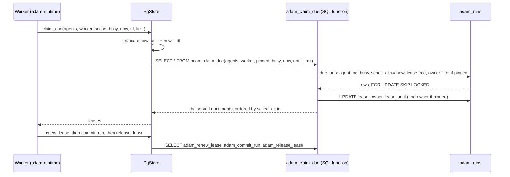
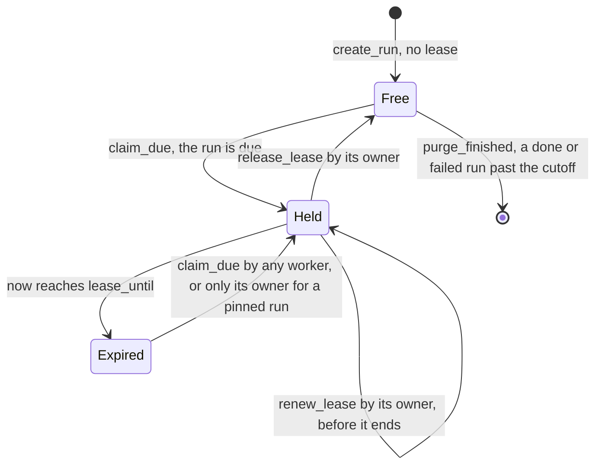

# 0082. The SQL adapters keep their rules in the database

Status: **Accepted** (2026-11-27). Nothing is built. The owner decided on 2026-11-27:

> *"If something can be done in SQL, we better use SQL rather than rust"*
>
> *"I just saw that procedures in postgres support atomic. So wow, the biggest part is solved then! Let's move all to
> SQL. (…)"*
>
> *"Do it for all SQL adapters that we have in our system, included adam, -system and -platform"*

This ADR is adam-rs's half: the PostgreSQL store, the PostgreSQL notifier and the SQLite store. The orchestrator's
and the platform's SQL adapters are decided in their own repositories. The survey, row by row, with the code each row
stands on, is the agent page: [0082, the evidence](../../.agents/docs/decisions/0082-the-sql-adapters-keep-their-rules-in-the-database.md).

## Context

adam-rs has three SQL adapters and one shared connection crate:

| Crate | What it is | Where its rules live today |
|---|---|---|
| `adam-store-postgres` | `Store` on PostgreSQL | SQL text built in Rust (`format!` with the table prefix) and sent statement by statement; the control flow of a commit, a journal append and a body write is Rust |
| `adam-notify-postgres` | `EventSink` and `Notifier` over `LISTEN`/`NOTIFY` | one `SELECT pg_notify(..)` per batch; everything else is the process's |
| `adam-store-sqlite` | `Store` on one SQLite file, one process | SQL text built in Rust, one `BEGIN IMMEDIATE` transaction per change |
| `adam-postgres` | `DATABASE_URL`, TLS, the pool, the SQLSTATE → class mapping | Rust |

Most rules are already SQL: the version compare-and-swap is an `UPDATE .. WHERE version = $expected`, a claim is
`FOR UPDATE SKIP LOCKED`, one open run per conversation is a partial unique index, statuses are `CHECK`s. What is not
SQL is the glue between statements: which document a read serves, when a run is due (`sched_at`), the body write's
three resolutions (adopt, collect an orphan, refuse a live writer), the journal's non-determinism check, the second
read that tells a lost race from a missing run, and the batch loops of the sweeps.

The PostgreSQL store supports PostgreSQL 12 and later today, and CI runs 12 and 17. Its migrations are SQL strings in
the crate, applied by `migrate()` under an advisory lock, one statement per simple-protocol message; a start on a
current schema runs no DDL.

What the owner saw is the SQL-standard function body: `BEGIN ATOMIC … END`, or `RETURN expression`, for
`LANGUAGE sql`. It is parsed when the function is created, its dependencies on tables and columns are tracked, and it
cannot take polymorphic argument types (*verified 2026-11-27*: postgresql.org, CREATE FUNCTION, current and 14
documentation; the 13 documentation has no `sql_body`; the feature matrix entry "BEGIN ATOMIC function bodies"). The
body is atomic for a simpler reason than the keyword: a function call runs inside the statement that calls it, so in
the caller's transaction, or in the implicit transaction of a lone statement.

## Decision

1. **PostgreSQL: every rule moves into a function of the store's schema.** The adapter sends only calls
   (`SELECT * FROM adam_claim_due(..)`) and the migration DDL; it binds arguments and decodes rows. Reads become
   functions too, so the schema is the one contract and Rust holds no statement text.
   - **SQL-standard bodies** (`LANGUAGE sql`, `BEGIN ATOMIC … END` or `RETURN`) where the logic is plain SQL: the
     served document, claims and leases, creates, listings, push claims, blob writes, one batch of a sweep.
   - **PL/pgSQL** where it needs control flow, a fresh snapshot between two statements, or `RAISE`: a commit (the
     headless compare-and-swap included, so a lost race reports the version that won), the body write, the journal
     append, a push commit.
   - Functions are `SECURITY INVOKER` (the default) and named with the table prefix, so two deployments sharing a
     database keep apart. A PL/pgSQL function carries `SET search_path FROM CURRENT`, so it resolves the tables it was
     created beside, as a SQL-standard body does by construction.
2. **The caller's clock stays the caller's.** Every time is an argument, as it already is for a claim: the process
   computes `now`, truncates it to milliseconds and passes it (ADR 0057's bytes). The database's own clock is never
   read, so a skew between a worker and the server cannot make a run due early or late.
3. **A lost race is an answer, not an error.** A version conflict and a missing run come back as an outcome column of
   the function's row, before anything is written. `RAISE` is kept for refusals and for a failure after a write, where
   the abort must roll the rows back. Every `RAISE` is an `ERROR` line in the server's log, which is the second reason
   a routine race does not raise.
4. **Error classes: custom SQLSTATEs map to `adam_error::Classify` classes in one place.** The table lives in
   `adam-postgres`, beside the mapping of PostgreSQL's own codes, and the store builds each `StoreError` variant from
   it. The codes use the class `AD`, which PostgreSQL does not use, and none ends in `000` (those are category codes).

   | SQLSTATE | Raised when | `StoreError` | Class |
   |---|---|---|---|
   | `AD001` | a body row's index is not its position, an append starts past the rows, a head has no body | `InvalidInput` | `Invalid` |
   | `AD002` | the journal holds another step at this sequence number; the recorded name is the error's `DETAIL` | `NonDeterminism` | `Corrupt` |
   | `AD003` | stored data breaks an invariant (a collected body slot is still occupied) | `Corrupt` | `Corrupt` |
   | `AD004` | a live attempt wrote a different body row; raised after rows were written, so the commit rolls back | `Conflict` | `Conflict` |

   PostgreSQL's own codes keep their meaning: a unique violation is `AlreadyExists` or `ConversationBusy` by the
   constraint's name, a foreign-key violation is `NotFound`, a NUL is `InvalidInput`, and the transient codes stay
   transient.
5. **Traits stay put.** `Store`, `Notifier` and `EventSink`, and their testkits, do not change (Rule 2), so no
   implementer breaks and no caller changes. The conformance suites are the proof: every slice keeps them green, and
   every moved rule is broken on purpose once to see a case fail.
6. **What stays in Rust, and why.** Only what SQL cannot hold or must not hold:
   - the NUL replacement (`storable`): a `JSONB` argument refuses a NUL when it is bound, before any body runs, and
     one rule for every backend is ADR 0051;
   - the clock and its truncation (decision 2);
   - the migration's orchestration: the advisory locks, the version gate, `CREATE INDEX CONCURRENTLY` (which no
     function and no transaction can run);
   - configuration checks (the table prefix, the pool size, the statement timeout) and the decoding of rows;
   - the loop over a sweep's batches: a batch is a function, but a function cannot commit, and a procedure that commits
     must be called outside a transaction block, so each batch stays its own transaction by a Rust loop until a test
     proves a committing procedure through the driver;
   - child runs and cancellation: the runtime reads a parent's status and cancels by rewriting the run's state
     document and calling the agent's hook. That document is the runtime's, not the schema's; the commit the cancel
     ends in is a function like any other.
7. **The notifier.** `adam-notify-postgres` already sends one SQL statement per batch. The payload cap, the cut of an
   oversize event, the origin filter and the channel prefix are the process's, and stay. Sending `runnable` and
   `finished` from a trigger at commit is possible, but a notification is never the truth (Rule 5): it is a question
   for the owner, not a slice of this ADR.
8. **SQLite has no stored procedures.** Its rules go into constraints, triggers and views where SQLite can express
   them; the rest stays in Rust:
   - **into SQL:** the served document (a view), `sched_at` (a trigger on insert and on a change of status, wake time
     or update time), the hex check on a blob digest (a trigger, as a `CHECK` on an existing table needs a rebuild),
     the journal's non-determinism check (a trigger that raises; reading the winner stays), a claim (one
     `UPDATE .. RETURNING`), a purge (one `DELETE`: its batches already run inside one transaction, so they bound
     nothing), the collection of a superseded body generation (a trigger on the head);
   - **stays in Rust:** the body write's three resolutions (control flow), the lease clearing at `migrate` (it rests
     on the file lock), the refusal of a newer schema, the NUL rule and the clock.

   A trigger's refusal is `RAISE(ABORT, 'adam:<code>')`, mapped to the same `StoreError` variants by one table in the
   crate.
9. **MongoDB is not SQL and is out of scope.**
10. **Migrations carry the functions.** They are schema version 7 of the PostgreSQL store and version 2 of the
    SQLite store, created in the migration transaction after the tables they name. The PostgreSQL driver sends each
    statement whole, in one simple-protocol message, so the server parses a `BEGIN ATOMIC` block itself and nothing
    splits it on `;`; a tool that splits a file on `;` must never apply these files. A start on a current schema still
    runs no DDL, so a changed function always comes with a version bump, and a function whose contract changes gets a
    new name, the old one dropped a release later (expand, then contract, as ADR 0055 did). A column a SQL-standard
    body uses cannot be altered or dropped until the function is dropped: such a migration drops and recreates the
    function in the same transaction. **A test applies the migrations to a fresh database and calls every function**,
    and fails when the set of functions in the schema differs from the list.
11. **The minimum rises to PostgreSQL 15.** `BEGIN ATOMIC` needs 14, and 14 reached its end of life on 2026-11-12, so
    the oldest server the community still supports is the floor (*verified 2026-11-27*: postgresql.org, versioning
    policy: 15 to 19 supported, 14 ended 2026-11-12). `migrate()` refuses an older server with `Invalid`, before any
    DDL, so a binary exits 78 rather than half-migrating. CI's oldest server moves from 12 to 15.

### A worker claims a run through the function

### A run's lease

A claim is one call: the function picks the due runs, locks them without waiting for another worker's, sets the lease
and returns what a reader would see, in claim order. A lease that has ended is free to a claim but cannot be renewed,
so a worker that stalled past its lease learns it at its next renewal. A commit never touches the lease. On SQLite the
same states hold, with one process: a claim is one `UPDATE .. RETURNING`, and `migrate` clears every lease because the
file lock proves no other process is alive.

### Slices

One pull request per adapter area. Each keeps the conformance suites green, breaks every rule it moves once on purpose
to see a case fail, and adds its functions to the fresh-database test.

| Slice | Area | Decisive test |
|---|---|---|
| P0 | the version 7 step, the SQLSTATE table, the refusal below 15, CI on 15 | migrate a fresh database and call every function; a server below 15 is refused before any DDL |
| P1 | reads and the served document | the listing cases and the body cases on which document a read serves |
| P2 | claims and leases | concurrent claims are exclusive; a pinned run never goes to another worker; an ended lease is taken over |
| P3 | create and the headless commit, `sched_at` | one winner among concurrent commits; a stale version and a missing run come back as outcomes |
| P4 | the journal append | non-determinism is detected; concurrent writers agree on the first entry |
| P5 | the commit with a head, a body and blob references | the body suite and the three body resolutions |
| P6 | push configurations | the push cases |
| P7 | purge, blob sweep, body collection | purge and sweep cases |
| P8 | no statement left in Rust | a test fails when the adapter holds a statement that is not a call or migration DDL |
| S1 | SQLite: the view, the `sched_at` and digest triggers, version 2 | the store suite, and a version 1 file upgrades |
| S2 | SQLite: the journal trigger, the one-statement claim and purge, the body collection trigger | non-determinism, claim, purge and compaction cases |

## Consequences

- **The schema is the contract.** A reader of the database sees every rule beside the data it guards, and an operator
  can read a function instead of a Rust file. The Rust side shrinks to binding and decoding.
- **Fewer round trips.** A lost compare-and-swap, a journal entry another worker wrote and a push commit that lost its
  race each cost a second statement today; each becomes one call.
- **PostgreSQL 12, 13 and 14 are dropped.** A deployment on one of them must upgrade the server before it takes this
  release; `migrate()` says so and the process exits 78.
- **Migrations get heavier.** Dependency tracking refuses a column change under a function, so such a migration
  drops and recreates the function; a changed function always bumps the schema version.
- **Two dialects of the same rule.** A rule the SQLite store keeps in Rust (the body write) exists in PL/pgSQL and in
  Rust. The shared suites keep the two equal; a third copy for MongoDB stays in Rust.
- **Mixed fleets during a rollout are safe.** A process of the previous release keeps sending its statements against
  the same tables, and the functions keep those statements' meaning, so both write the same rows by the same rules.
  A later change of meaning takes a new function name.
- **Cost of a call** is *unverified*: P2 and P5 measure a claim and a commit against today's statements before they
  merge.

## Alternatives rejected

- **Keep the rules in Rust.** It works, but it is what the owner decided against.
- **Procedures (`CALL`) for everything.** A procedure cannot be used in a `SELECT` and returns at most one row, so a
  claim or a listing could not be one. Functions return sets; procedures are kept for a committing batch loop if a test
  proves it.
- **String bodies (`AS $$ … $$`) for the plain-SQL functions too.** They are parsed only when called, so a renamed
  column breaks them silently; a SQL-standard body is checked when it is created.
- **Raise on every lost race.** It aborts nothing that needed aborting, logs an `ERROR` per race on the server and
  makes a routine outcome look like a failure.
- **The database's clock.** It would remove the time arguments, but a worker and the server would then disagree on
  when a run is due, and the time a run reports would change source.
- **Keep PostgreSQL 14 as the floor.** It is the version the feature needs, but no community fix reaches it any more.
- **A trigger that sends the signals.** Deferred to the owner (decision 7): it couples the notifier's channel to the
  store's schema for a hint.
