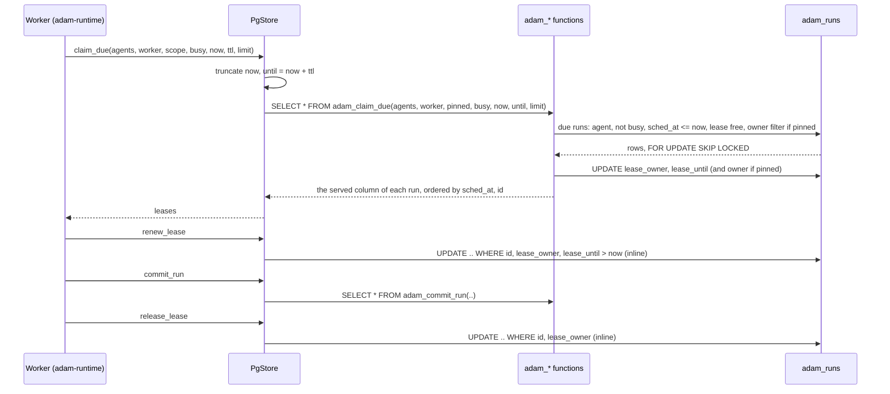
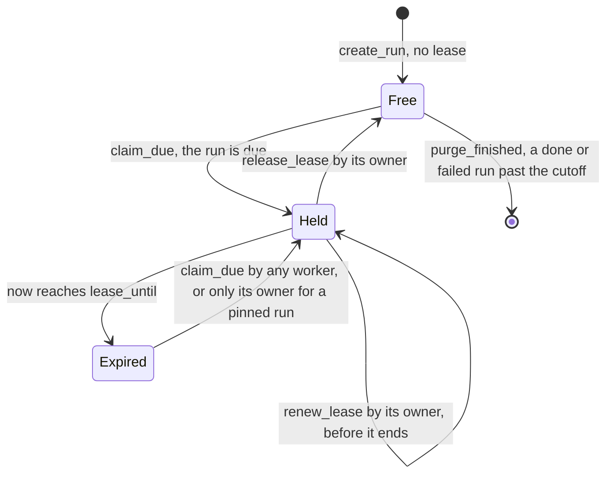

# 0082. The SQL adapters keep their rules in the database

Status: **Accepted** (2026-11-27). Slice P0 is built (2026-11-27); P1–P7, S1 and S2 are not. The owner decided on 2026-11-27:

> *"If something can be done in SQL, we better use SQL rather than rust"*
>
> *"I just saw that procedures in postgres support atomic. So wow, the biggest part is solved then! Let's move all to
> SQL. (…)"*
>
> *"Do it for all SQL adapters that we have in our system, included adam, -system and -platform"*

and, later the same day, on the oldest server:

> *"Min postgres version is not 15, it's 18."* (the owner, 2026-11-27)

Asked by the owner, *"BEGIN ATOMIC for all operations? Even those that doesn't need it? Isn't it too much?"*, the
answer was a recommendation: a database function only for an operation that carries a rule, and plain statements for
the rest. The owner raised no objection. It is decision 1 below; the wording is the recommendation's, not the
owner's.

This ADR is adam-rs's half: the PostgreSQL store, the PostgreSQL notifier and the SQLite store. The orchestrator's
and the platform's SQL adapters are decided in their own repositories. The survey, row by row, with the code each row
stands on, is the agent page: [0082, the evidence](../../.agents/docs/decisions/0082-the-sql-adapters-keep-their-rules-in-the-database.md).

## Context

adam-rs has three SQL adapters and one shared connection crate:

| Crate | What it is | Where its rules live today |
|---|---|---|
| `adam-store-postgres` | `Store` on PostgreSQL | SQL text built in Rust (`format!` with the table prefix) and sent statement by statement; the control flow of a commit, a journal append and a body write is Rust |
| `adam-notify-postgres` | `EventSink` and `Notifier` over `LISTEN`/`NOTIFY` | one `SELECT pg_notify(..)` per batch; everything else is the process's |
| `adam-store-sqlite` | `Store` on one SQLite file, one process | SQL text built in Rust, one `BEGIN IMMEDIATE` transaction per change |
| `adam-postgres` | `DATABASE_URL`, TLS, the pool, the SQLSTATE → class mapping | Rust |

Most rules are already SQL: the version compare-and-swap is an `UPDATE .. WHERE version = $expected`, a claim is
`FOR UPDATE SKIP LOCKED`, one open run per conversation is a partial unique index, statuses are `CHECK`s. What is not
SQL is the glue between statements: which document a read serves, when a run is due (`sched_at`), the body write's
three resolutions (adopt, collect an orphan, refuse a live writer), the journal's non-determinism check, the second
read that tells a lost race from a missing run, and the batch loops of the sweeps.

The PostgreSQL store supports PostgreSQL 12 and later today, and CI runs 12 and 17. Its migrations are SQL strings in
the crate, applied by `migrate()` under an advisory lock, one statement per simple-protocol message; a start on a
current schema runs no DDL.

What the owner saw is the SQL-standard function body: `BEGIN ATOMIC … END`, or `RETURN expression`, for
`LANGUAGE sql`. It is parsed when the function is created, its dependencies on tables and columns are tracked, and it
cannot take polymorphic argument types (*verified 2026-11-27*: postgresql.org, CREATE FUNCTION, current and 14
documentation; the 13 documentation has no `sql_body`; the feature matrix entry "BEGIN ATOMIC function bodies"). The
body is atomic for a simpler reason than the keyword: a function call runs inside the statement that calls it, so in
the caller's transaction, or in the implicit transaction of a lone statement.

## Decision

1. **PostgreSQL: a function for each operation that carries a rule; the rest stays inline.** An operation becomes a
   function of the store's schema when one plain statement cannot hold its rule:
   - **several statements that must agree**: a commit (with a head, a body and blob references), the body write;
   - **a read after another writer's commit**, which needs a fresh snapshot: the headless commit's conflict (the
     version that won), the journal's winner, the push commit's version;
   - **a refusal by `RAISE`**: the body plan, the journal's non-determinism;
   - **rows picked by a rule, not by the id the caller names**: a claim of runs or of push configurations (due, not
     busy, lease free, the pinned owner, the claim order), one purge batch, one blob sweep batch, the collection of
     superseded body generations;
   - **a rule more than one statement would repeat**: when a run is due (`sched_at`), a `RETURN` function that the
     create statement and the commit function both call.

   Everything else stays an **inline, parameterized statement**, prepared once as today: the reads, the create, the
   lease renewal and release, a push configuration's put, list and delete, a blob's put and get. Each is one
   statement, so the statement is already atomic, and its condition is its own `WHERE`. A function there would add a
   migration and a schema version to every change of a query, hide the plan behind a call in `EXPLAIN` and in the
   server's statistics, and make nothing more atomic. The one rule every read shares, which document a read serves, is
   a column of the table (decision 12), so an inline read and a function read serve the same document.
   - **SQL-standard bodies** (`LANGUAGE sql`, `BEGIN ATOMIC … END` or `RETURN`) where the logic is plain SQL: claims,
     one batch of a purge or a sweep, the body collection, `sched_at`.
   - **PL/pgSQL** where it needs control flow, a fresh snapshot between two statements, or `RAISE`: a commit (the
     headless compare-and-swap included, so a lost race reports the version that won), the body write, the journal
     append, a push commit.
   - Functions are `SECURITY INVOKER` (the default) and named with the table prefix, so two deployments sharing a
     database keep apart. A PL/pgSQL function carries `SET search_path FROM CURRENT`, so it resolves the tables it was
     created beside, as a SQL-standard body does by construction.
2. **The caller's clock stays the caller's.** Every time is an argument, as it already is for a claim: the process
   computes `now`, truncates it to milliseconds and passes it (ADR 0057's bytes). The database's own clock is never
   read, so a skew between a worker and the server cannot make a run due early or late.
3. **A lost race is an answer, not an error.** A version conflict and a missing run come back as an outcome column of
   the function's row, before anything is written. `RAISE` is kept for refusals and for a failure after a write, where
   the abort must roll the rows back. Every `RAISE` is an `ERROR` line in the server's log, which is the second reason
   a routine race does not raise.
4. **Error classes: custom SQLSTATEs map to `adam_error::Classify` classes in one place.** The table lives in
   `adam-postgres`, beside the mapping of PostgreSQL's own codes, and the store builds each `StoreError` variant from
   it. The codes use the class `AD`, which PostgreSQL does not use, and none ends in `000` (those are category codes).

   | SQLSTATE | Raised when | `StoreError` | Class |
   |---|---|---|---|
   | `AD001` | a body row's index is not its position, an append starts past the rows, a head has no body | `InvalidInput` | `Invalid` |
   | `AD002` | the journal holds another step at this sequence number; the recorded name is the error's `DETAIL` | `NonDeterminism` | `Corrupt` |
   | `AD003` | stored data breaks an invariant (a collected body slot is still occupied) | `Corrupt` | `Corrupt` |
   | `AD004` | a live attempt wrote a different body row; raised after rows were written, so the commit rolls back | `Conflict` | `Conflict` |

   PostgreSQL's own codes keep their meaning: a unique violation is `AlreadyExists` or `ConversationBusy` by the
   constraint's name, a foreign-key violation is `NotFound`, a NUL is `InvalidInput`, and the transient codes stay
   transient.
5. **Traits stay put.** `Store`, `Notifier` and `EventSink`, and their testkits, do not change (Rule 2), so no
   implementer breaks and no caller changes. The conformance suites are the proof: every slice keeps them green, and
   every moved rule is broken on purpose once to see a case fail.
6. **What stays in Rust, and why.** Besides the inline statements of decision 1, only what SQL cannot hold or must
   not hold:
   - the NUL replacement (`storable`): a `JSONB` argument refuses a NUL when it is bound, before any body runs, and
     one rule for every backend is ADR 0051;
   - the clock and its truncation (decision 2);
   - the migration's orchestration: the advisory locks, the version gate, `CREATE INDEX CONCURRENTLY` (which no
     function and no transaction can run);
   - configuration checks (the table prefix, the pool size, the statement timeout) and the decoding of rows;
   - the loop over a sweep's batches: a batch is a function, but a function cannot commit, and a procedure that commits
     must be called outside a transaction block, so each batch stays its own transaction by a Rust loop until a test
     proves a committing procedure through the driver;
   - child runs and cancellation: the runtime reads a parent's status and cancels by rewriting the run's state
     document and calling the agent's hook. That document is the runtime's, not the schema's; the commit the cancel
     ends in is a function like any other.
7. **The notifier.** `adam-notify-postgres` already sends one SQL statement per batch. The payload cap, the cut of an
   oversize event, the origin filter and the channel prefix are the process's, and stay. Sending `runnable` and
   `finished` from a trigger at commit is possible, but a notification is never the truth (Rule 5): it is a question
   for the owner, not a slice of this ADR.
8. **SQLite has no stored procedures.** Its rules go into constraints, triggers and views where SQLite can express
   them; the rest stays in Rust:
   - **into SQL:** the served document (a view), `sched_at` (a trigger on insert and on a change of status, wake time
     or update time), the hex check on a blob digest (a trigger, as a `CHECK` on an existing table needs a rebuild),
     the journal's non-determinism check (a trigger that raises; reading the winner stays), a claim (one
     `UPDATE .. RETURNING`), a purge (one `DELETE`: its batches already run inside one transaction, so they bound
     nothing), the collection of a superseded body generation (a trigger on the head);
   - **stays in Rust:** the body write's three resolutions (control flow), the lease clearing at `migrate` (it rests
     on the file lock), the refusal of a newer schema, the NUL rule and the clock.

   A trigger's refusal is `RAISE(ABORT, 'adam:<code>')`, mapped to the same `StoreError` variants by one table in the
   crate.
9. **MongoDB is not SQL and is out of scope.**
10. **Migrations carry the functions.** They are schema version 7 of the PostgreSQL store and version 2 of the
    SQLite store, created in the migration transaction after the tables they name. The PostgreSQL driver sends each
    statement whole, in one simple-protocol message, so the server parses a `BEGIN ATOMIC` block itself and nothing
    splits it on `;`; a tool that splits a file on `;` must never apply these files. A start on a current schema still
    runs no DDL, so a changed function always comes with a version bump, and a function whose contract changes gets a
    new name, the old one dropped a release later (expand, then contract, as ADR 0055 did). An inline statement
    changes with the binary and needs no migration, as today. A column a SQL-standard body uses cannot be altered or
    dropped until the function is dropped: such a migration drops and recreates the function in the same transaction. **A test applies the migrations to a fresh database and calls every function**,
    and fails when the set of functions in the schema differs from the list.

    *Amended 2026-11-27 (slice P0):* version 7 is the **first** version that carries functions, not the only one. P0
    stamps 7 and creates none, and each slice ships on its own, so a database a P0 release stamped 7 never runs the
    migration again: a slice that adds, changes or drops a function bumps the version once more (P1 is 8 if it adds
    one, and so on). That is this decision's own rule, "a changed function always comes with a version bump", applied
    to the slices. SQLite's version 2 is unchanged by this note.
11. **The minimum is PostgreSQL 18, the owner's floor.** `BEGIN ATOMIC` needs 14; the owner set 18, which the
    community supports until 2030-11-14 (*verified 2026-11-27*: postgresql.org, versioning policy). `migrate()` refuses
    an older server with `Invalid`, before any DDL, so a binary exits 78 rather than half-migrating. CI's oldest server
    moves from 12 to 18. The newest CI runs today, 17, is below the floor, so it cannot stay: the matrix runs 18 for
    both MongoDB versions until a change adds a newer server. The other jobs that run 17, and the compose stack (16),
    move to 18. The chart's CloudNativePG cluster names no image, so P0 either pins one at 18 or shows that the
    operator's default is 18 or later; the chart's render is read by another repository, so a pin is said in the pull
    request.

    *Amended 2026-11-27 (slice P0):* the chart **pins** the image (`database.imageName`, PostgreSQL 18.7 by tag and
    digest). The operator's default is its release's own (17 up to CloudNativePG 1.27, 18 in 1.28 to 1.30, 19 on its
    main branch), and the chart names no operator release, so no default can be shown to hold. Every PostgreSQL of CI
    and both compose stacks (the dev stack and the bench) run 18.7, pinned by tag and digest.
12. **What PostgreSQL 18 gives the store.** One feature is adopted, two are not:
    - **Adopted: the served document is a virtual generated column** of the runs table, `served`: the head when it is a
      JSON object and current, or when the state is the JSON `null` tombstone, else the state, the expression the reads repeat today. It is
      computed when it is read, uses only built-in functions and operators (a virtual column may use nothing else), and
      adding it never rewrites the table (*verified 2026-11-27*: postgresql.org, Generated Columns and ALTER TABLE, 18
      documentation). It cannot be written, and a process of the previous release never names it, so a mixed fleet is
      unaffected. The rule lives beside the data, and every read, inline or in a function, selects `served`.
    - **Not adopted: `RETURNING old` and `new`** (*verified 2026-11-27*: postgresql.org, 18 release notes and Returning
      Data from Modified Rows). Every old value a commit needs is read before its write (the body plan reads the current
      head under the row lock), and a lost race needs a row the `UPDATE` did not touch, which `RETURNING` never returns.
      The one place it would save a statement, the journal's winner through `ON CONFLICT DO UPDATE .. RETURNING old.*`,
      turns every replay into an update of the winner's row.
    - **Not adopted: `uuidv7()`** (*verified 2026-11-27*: postgresql.org, UUID Functions, 18 documentation). A body
      generation's id is random today and nothing orders by it, and a version 7 id carries a time the server computes,
      the database's clock that decision 2 keeps out. The function that makes a generation uses `gen_random_uuid()`, a
      core function in the 13 and the 18 documentation (*verified 2026-11-27*: postgresql.org, UUID Functions).

### A worker claims a run through the function

### A run's lease

A claim is one call: the function picks the due runs, locks them without waiting for another worker's, sets the lease
and returns what a reader would see, in claim order. A lease that has ended is free to a claim but cannot be renewed,
so a worker that stalled past its lease learns it at its next renewal. A commit never touches the lease. On SQLite the
same states hold, with one process: a claim is one `UPDATE .. RETURNING`, and `migrate` clears every lease because the
file lock proves no other process is alive.

### Slices

One pull request per adapter area. Each keeps the conformance suites green, breaks every rule it moves once on purpose
to see a case fail, and adds its functions to the fresh-database test. No slice turns an inline statement into a
function unless decision 1 says it carries a rule.

| Slice | Area | Decisive test | Status |
|---|---|---|---|
| P0 | the version 7 step, the SQLSTATE table, the refusal below 18, CI, compose and the chart on 18 | migrate a fresh database and call every function; a server below 18 is refused before any DDL | built 2026-11-27 |
| P1 | the `served` column; the reads select it, inline | the listing cases and the body cases on which document a read serves | to do |
| P2 | the claim function; renewal and release stay inline | concurrent claims are exclusive; a pinned run never goes to another worker; an ended lease is taken over | to do |
| P3 | the `sched_at` function, the inline create, the headless commit | one winner among concurrent commits; a stale version and a missing run come back as outcomes | to do |
| P4 | the journal append | non-determinism is detected; concurrent writers agree on the first entry | to do |
| P5 | the commit with a head, a body and blob references | the body suite and the three body resolutions | to do |
| P6 | the push claim and the push commit; put, list and delete stay inline | the push cases | to do |
| P7 | purge, blob sweep, body collection | purge and sweep cases | to do |
| S1 | SQLite: the view, the `sched_at` and digest triggers, version 2 | the store suite, and a version 1 file upgrades | to do |
| S2 | SQLite: the journal trigger, the one-statement claim and purge, the body collection trigger | non-determinism, claim, purge and compaction cases | to do |

*2026-11-27, P0 built:* `migrate()` refuses a server older than 18 with `Invalid` before any lock or DDL; schema
version 7 is the step the functions arrive in (none yet; each later slice that adds one bumps the version, decision
10's note); the `AD001`–`AD004` table is `adam_postgres::AdamSqlState`, and `classify` and the store follow it; a
fresh-database test compares the schema's functions with its list (empty) and calls each; CI, the dev stack, the
bench and the chart run PostgreSQL 18.7. The proofs are on the [agent page](../../.agents/docs/decisions/0082-the-sql-adapters-keep-their-rules-in-the-database.md#p0-built-2026-11-27).

## Consequences

- **The schema holds the rules.** A reader of the database sees every rule beside the data it guards, and an operator
  can read a function instead of a Rust file. What stays in Rust as text is plain: reads, and writes of one statement
  whose condition is their `WHERE`, each visible as itself in `EXPLAIN` and in the server's statistics.
- **Fewer round trips.** A lost compare-and-swap, a journal entry another worker wrote and a push commit that lost its
  race each cost a second statement today; each becomes one call.
- **PostgreSQL 12 to 17 are dropped.** A deployment on one of them must upgrade the server before it takes this
  release; `migrate()` says so and the process exits 78. Until a newer server joins CI, the store is tested on 18
  alone.
- **Migrations get heavier.** Dependency tracking refuses a column change under a function, so such a migration
  drops and recreates the function; a changed function always bumps the schema version.
- **Two dialects of the same rule.** A rule the SQLite store keeps in Rust (the body write) exists in PL/pgSQL and in
  Rust. The shared suites keep the two equal; a third copy for MongoDB stays in Rust.
- **Mixed fleets during a rollout are safe.** A process of the previous release keeps sending its statements against
  the same tables, and the functions keep those statements' meaning, so both write the same rows by the same rules.
  A later change of meaning takes a new function name.
- **Cost of a call** is *unverified*: P2 and P5 measure a claim and a commit against today's statements before they
  merge.

## Alternatives rejected

- **Keep the rules in Rust.** It works, but it is what the owner decided against.
- **Procedures (`CALL`) for everything.** A procedure cannot be used in a `SELECT` and returns at most one row, so a
  claim or a listing could not be one. Functions return sets; procedures are kept for a committing batch loop if a test
  proves it.
- **String bodies (`AS $$ … $$`) for the plain-SQL functions too.** They are parsed only when called, so a renamed
  column breaks them silently; a SQL-standard body is checked when it is created.
- **Raise on every lost race.** It aborts nothing that needed aborting, logs an `ERROR` per race on the server and
  makes a routine outcome look like a failure.
- **The database's clock.** It would remove the time arguments, but a worker and the server would then disagree on
  when a run is due, and the time a run reports would change source.
- **A function for every operation, reads included.** It would make the schema the only place of every statement,
  but each change of a query would cost a migration and a schema version, a plan would hide behind a call, and a
  single statement is already atomic.
- **The oldest supported server, 15, as the floor.** It would keep more deployments, but the owner set 18, and 18 gives
  the served column (decision 12).
- **A trigger that sends the signals.** Deferred to the owner (decision 7): it couples the notifier's channel to the
  store's schema for a hint.
