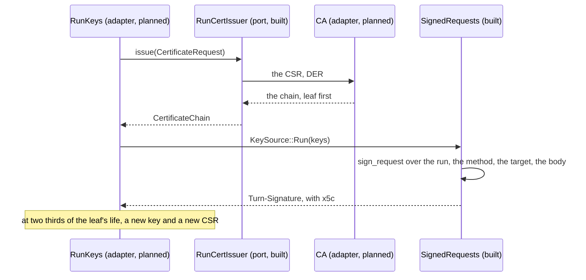
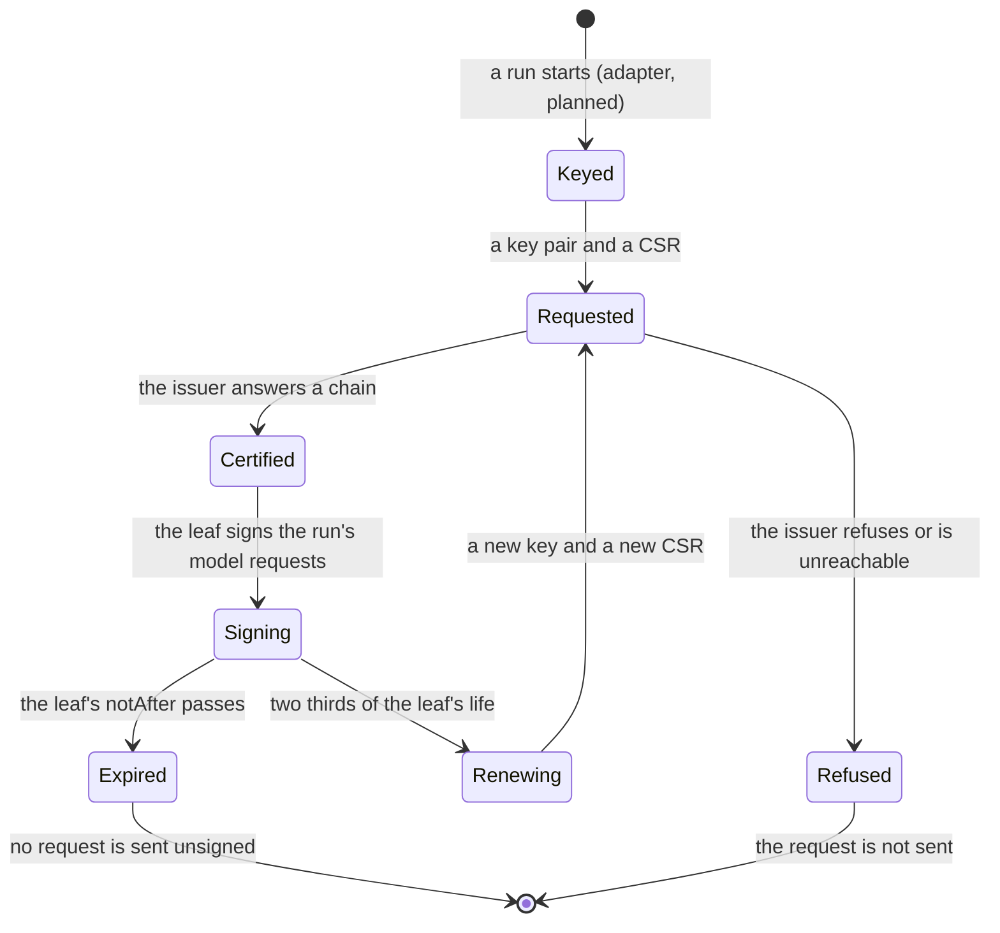

# 0086. A run signs its model requests with a certificate

Status: **Accepted** (2026-11-28). The owner decided on 2026-11-27, as option A of the run-certificate
question: a run's model requests are signed by a key a certificate authority certifies **for that run**, and
the certificate is obtained through an issuer port that takes a certificate signing request and answers a
chain. This change builds the ports, the fake issuer and the conformance suite they must pass. No issuer
adapter and no deployment wiring is built: the environment names below are fixed here and read by a later
slice. The evidence, the suite's cases and the deliberate failure are on the
[agent page](../../.agents/docs/decisions/0086-a-run-signs-its-model-requests-with-a-certificate.md).

## Context

[ADR 0068](0068-adam-signs-its-own-history.md) gives a process one `TurnKeys`: it signs the history and, since
*Amended 2026-11-25 (the request signature)*, every model request. That is the right key for a history, which
must verify long after the run that wrote it is gone, so its public key stays in a key set.

A model request is a different lifetime and a different reader. The verifier sits **in front of the model**,
not in adam, and it is not given adam's key set: it trusts a CA. The shared prompt-signature contract already
asks for `x5c` on every cloud call, and ADR 0068's amendment records that a call signed with the file key
carries `kid` only and the contract's verifier refuses it (`mismatch`). The certificate path was built in
slice T1 (`testkit::Certified`) and no adapter produces a chain yet.

The run is the unit such a verifier can bind: the request names its root run in `X-Run-Id`, and the prompt
statement names the person. A process key is shared by every run the process steps, so a chain for it says
"some adam process", never which run.

## Decision

1. **Option A: an issuer port.** `RunCertIssuer::issue(&CertificateRequest) -> Result<CertificateChain,
   RunCertError>`, in `adam-core` beside `TurnKeys` (`crates/adam-core/src/turn/run_cert.rs`). The request is
   a CSR as adam carries it: DER bytes of a PKCS#10 request, bounded at 8 KiB, never empty
   (`CertificateRequest`). The answer is the `CertificateChain` a signature header already carries as `x5c`
   (leaf first, at most four certificates of 2 KiB). The error carries a class. **No driver type crosses the
   port**: no `rcgen`, `x509` or `rustls` type appears in its signature, so an adapter may be an HTTP call to
   a CA, a KMS, or a test double.

2. **The run leaf signs model requests only; the history keeps the process `TurnKeys`** (amends ADR 0068
   decisions 2 and 7). A history signature must verify after the run that made it is gone, so it uses a key
   whose public key stays in a set. A run certificate is renewed, and dies with the run: it is right for a
   request that lives for seconds and wrong for a transcript that outlives it. A model call still never
   carries a turn's signature; this decision only changes *which* key signs the request.

3. **`RunKeys` is a `TurnKeys` that belongs to one run.** It adds no method, and `TurnKeys` gains none: the
   request path asks for the current key, signs, and reads the key set, whichever source it holds. The marker
   has **no blanket implementation**, so `KeySource::Run` accepts only a signer an adapter declared per-run;
   a process key cannot be passed as a run key by mistake.

4. **`KeySource { Process, Run }` is closed**, and it is what `SignedRequests` holds (`adam-model`). `Process`
   is the default: `SignedRequests::new` keeps its signature and means the process's turn keys, so a host that
   gives no run keys signs exactly as before. `SignedRequests::with_key_source` chooses. A new variant must
   fail to compile in the request path, as a new `KeyStatus` or `SignatureType` does.

*Amended 2026-11-28 (the keyring and the name).* Decision 3 gains its implementation, `RunKeyring`
(`crates/adam-core/src/turn/run_cert/keyring.rs`), and the name the CSR asks for: the request's
`subjectAltName` is a **critical** URI, `urn:another:person::agent:<run>` — the PKI decision of
2026-11-26 — where `` is the person's subject as the host read it, restricted to the URI's
unreserved characters (RFC 3986 §2.3) so it cannot be bent, and `<run>` is the run's id. Decision 5
gains what the slice had to decide: the renewal is read on `current()` (the call before a signature),
a failed renewal is retried no sooner than `RENEW_RETRY_SECS` (15 s) so an outage costs one CA round
trip per window and not one per model call, and a leaf whose `notAfter` has passed refuses with
`RunKeyError::Expired` (`Transient`) — the call is not sent. The leaf must certify the key the
request asked about, or the chain is refused (`RunKeyError::Chain`, `Internal`).

5. **Renewal at two thirds of the leaf's life, with a new key each time.** The adapter renews when two thirds
   of the interval from the leaf's `notBefore` to its `notAfter` have passed: a new key pair, a new CSR, a new
   leaf. It never re-issues a certificate for the same key, so a key that leaked stops being usable at the
   renewal, and the run never signs with two keys at once. The old key signs until the new leaf is in hand;
   a renewal that fails leaves the old key signing until it expires, and a request the keys cannot sign is
   never sent (decision 8).

6. **The `RUN_CERT_*` names.** A server reads them with the model's configuration. None is read yet: the
   wiring is a later slice, and this table is the name it will use.

   | Variable | What | Default |
   |---|---|---|
   | `RUN_CERT_ISSUER_URL` | the CA's issuing endpoint: adam sends the DER request, the CA answers the chain | unset: no run certificate; the process turn keys sign every request, as today |
   | `RUN_CERT_ISSUER_TOKEN_FILE` | a bearer the CA requires, read from a mounted Secret, never from the environment's value | unset: none is sent |
   | `RUN_CERT_ISSUER_CA_FILE` | the PEM trust anchors for the CA's own TLS certificate | the system roots |

   The run certificate is not the turn key and not the card's key: another purpose, another lifetime, another
   rotation. Unset `RUN_CERT_ISSUER_URL` is not "sign nothing": the request is still signed, by the process
   turn keys. It is "no run certificate".

7. **The chain is carried, not trusted.** `verify_request` checks the signature against the key set it is
   given, by `kid`, and carries `x5c` for the verifier in front of the model to check against its CA. adam does
   not decide whether a CA is trusted: a deployment does, at the verifier.

8. **Fail closed.** With `RUN_CERT_ISSUER_URL` set, a request the run key cannot sign is not sent: an issuer
   that cannot be reached is a transient error, a refusal is `Auth`, and an answer that is not a chain adam can
   carry is `Internal`. The port's classes are:

   | Error | Meaning | Class |
   |---|---|---|
   | `RunCertError::Invalid` | the CA refuses the request as written (not a CSR, a name it does not issue) | `Invalid` |
   | `RunCertError::Unavailable` | the CA cannot be reached | `Transient` |
   | `RunCertError::Refused` | the CA refuses to issue (a policy, a credential) | `Unauthenticated` |
   | `RunCertError::Internal` | the answer is not a chain adam can carry | `Internal` |
   | `BadCertificateRequest` | the request is empty or over 8 KiB, refused before it is sent | `Invalid` |

## What it protects, and what it does not

**It protects** the model gateway from a caller that replays or fabricates a request: the request is signed
by a key whose leaf chains to a CA the gateway trusts, and the key is unique to the run, so a request signed
with it came from that run and not from another. It also lets a run be attested without handing the gateway
adam's process key set.

**It does not protect:**

* **The process's history key.** A run certificate says nothing about a turn: the history still verifies
  against the process `TurnKeys` (decision 2).
* **A compromised CA.** A chain is only as good as the verifier's trust in its issuer.
* **The run's identity by itself.** The chain names the key; `X-Run-Id` and the prompt statement name the run
  and the person, and binding them is the verifier's check, as for the process key today.
* **A key that leaked before its renewal.** It signs until the new leaf is in hand; revocation is the CA's.

## Diagrams

Issue once per run, sign every call, renew at two thirds of the leaf's life. The ports are built; the adapter
and the wiring are not.

A run key's life:

## Slices

| Slice | What | State |
|---|---|---|
| R1 | the ports (`RunCertIssuer`, `RunKeys`, `CertificateRequest`, `RunCertError`), the closed `KeySource`, the fake issuer and `run_cert_issuer_conformance!` | **built**, 2026-11-28 |
| R2a | the renewal clock and the keyring: `RunKeyring`, `RunSubject`, `RunClock`, a key per run, a CSR with the person-and-run SAN, the chain cached, renewal at two thirds with a new key, fail closed on an expired leaf, a sentinel test | **built**, 2026-11-28 |
| R2b | an issuer adapter (an HTTP CA, a token, a trust anchor) | not built |
| R3 | the wiring: `RUN_CERT_ISSUER_URL` and the two files, a run key per run, and the request path choosing `KeySource::Run` | not built |
| R4 | the gateway side: the verifier checks `x5c` against its CA and binds the chain to the run | another party's work, not adam's |

## Consequences

* **No behaviour changes today.** No variable is read, no run key is made, and `SignedRequests::new` is the
  process source, so every call is signed exactly as it was.
* **A new port to implement** for a host that wants run certificates; the suite (`run_cert_issuer_conformance!`)
  is what proves an adapter.
* **A chain per run is a few kilobytes of header** on every model call (a leaf and a CA certificate,
  base64url in `x5c`), against a `kid`-only header of a few hundred bytes. The model request already carries a
  body of kilobytes; it is the trade for a verifier that needs no shared key set.
* **The renewal is a new key, not a new certificate for the old one** (decision 5): an adapter that caches the
  key pair across renewals fails the run, and the suite's binding case is the check that catches a chain for
  another key.
