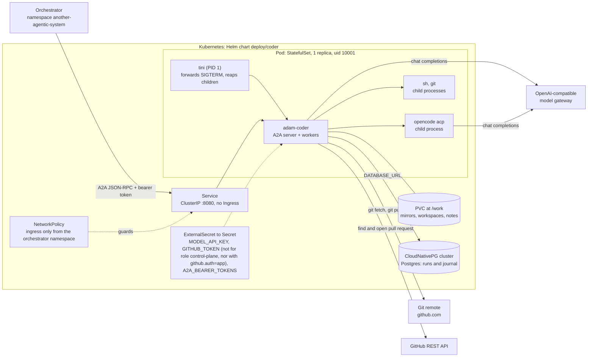
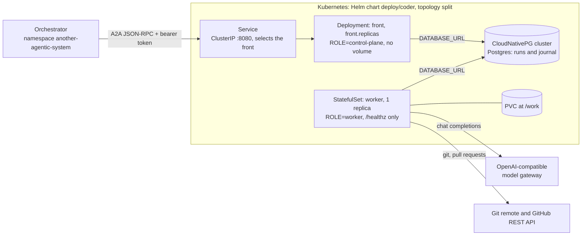
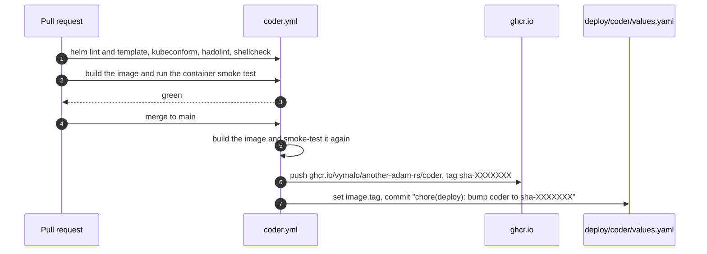

# Deploy the coder

The coder is one image, `ghcr.io/vymalo/another-adam-rs/coder` (built from `docker/coder/Dockerfile`), deployed
by the Helm chart in [`deploy/coder`](../../deploy/coder/README.md). The chart README documents every value;
this page is the path through the decisions. How the chart reaches the cluster after merge is outside this
repository (*unverified* here).

## What you get

One container, one process, one database. Reachable **only inside the cluster**: the orchestrator calls A2A on
the Service with a bearer token; there is no Ingress.



`topology: split` runs the two halves as separate workloads: a stateless front (`ROLE=control-plane`, no volume)
the Service selects, and the worker StatefulSet (`ROLE=worker`, `/healthz` only):



## The image

`docker/coder/Dockerfile`, built from the **repository root**, has three stages: it compiles `adam-coder`,
`adam-agent`, `adam-kube-exec`, `adam-egress` and the two binaries of `adam-git-sandbox` on a pinned `rust:1.94-trixie` (tag and digest, so glibc matches the
runtime image; `adam-egress` is the HTTPS-only proxy for run pods, [`bin/adam-egress`](../../bin/adam-egress/README.md),
smoke-tested in the image and run by the chart with run pods; `adam-git-sandbox` is the server that runs the coder's git
where no secret is readable and `adam-git` the relay that stands in for git, [`crates/adam-git-sandbox`](../../crates/adam-git-sandbox/README.md),
smoke-tested in the image and run by the chart, with run pods, as a container of the coder's pod that mounts the same work volume and holds no secret;
a deployment without run pods that sets `GIT_SANDBOX_SOCKET` runs the server itself); it takes the official `github-mcp-server` binary (pinned by tag and digest); and the runtime is the
`workspace` image of `vymalo/another-agentic-images` (Rust, Flutter/Dart, Node, git, tini, OpenCode, the obscura
headless browser), pinned by an immutable tag, with those binaries, the devcontainer CLI and Podman's remote client
added. It runs as uid 10001, listens on `0.0.0.0:8080`, keeps its files in `/work`, and its entrypoint is
`tini -- adam-coder` (`tini` forwards SIGTERM and reaps children). Tags are `sha-<7>` of the commit. Both agents' binaries are smoke-tested in CI
(`docker/coder/test/`).

The build argument `ADAM_BUILD_REVISION` (CI passes the commit) is baked into both binaries. The agent card then says
which build answers: `version` is `<crate version>+<first 7>` and the `build/v1` extension carries the whole revision
and a digest of the agent's files ([ADR 0028](../decisions/0028-the-card-says-which-build-answers.md), contract in
[A2A server](../reference/a2a-server.md)). A build without the argument says `unknown`. The smoke tests check the card
against `EXPECT_REVISION`, which CI sets to the commit.

## Before you start

| You need | Why |
|---|---|
| Kubernetes 1.29+ (1.30+ for run pods) | the GitHub MCP server and, with run pods, the git sandbox are native sidecars; run pods use a `ValidatingAdmissionPolicy` (*unverified*, from memory) |
| the CloudNativePG operator, **or** an existing Postgres | the run store; `database.enabled: false` + `database.existingSecret.name` for your own |
| External Secrets (`ExternalSecret`, `external-secrets.io/v1`) | the three secrets below; the defaults point at one owner's `secretStoreRef` and `key`, override them |
| a StorageClass | the PVC at `/work` (a ReadWriteMany one for `shared` or `affinity` placement) |
| an OpenAI-compatible model gateway | `config.modelBaseUrl`, with its `/v1` prefix |
| a GitHub token, or a GitHub App | to push and open pull requests |

## Secrets

Nothing secret is in values or in git.

| Variable | AWS property (default) | For |
|---|---|---|
| `MODEL_API_KEY` | `adam_coder_model_api_key` | roles that run workers |
| `GITHUB_TOKEN` | `adam_coder_github_token` | workers, with `github.auth: token` (the default) |
| `A2A_BEARER_TOKENS` | `adam_coder_a2a_bearer_tokens` (comma-separated) | roles that serve A2A (the front, with `split`) |
| `MODEL_BASE_URL` | `model_base_url` | only with `config.modelBaseUrlFromSecret: true`, to keep the URL out of git |

Put an AWS property in place **before** turning an option on that reads it: a missing property fails the whole
`ExternalSecret` sync. With a GitHub App there is no `GITHUB_TOKEN`; you make the Secret that holds the App's
private key (`private-key.pem`) yourself and name it in `github.app.privateKeySecret`; the chart never holds it.
The orchestrator holds one of the bearer tokens.

## Install

```sh
helm lint deploy/coder
helm template coder deploy/coder --namespace another-agentic-system          # read what it will create
sh deploy/coder/tests/render-check.sh                                          # the guarantees, asserted on the render
helm upgrade --install coder deploy/coder --namespace another-agentic-system -f my-values.yaml
```

`image.tag` is bumped by CI on every green build of `main` (`sha-<7>`); do not edit it by hand.

The values you will actually set:

| Value | Decision |
|---|---|
| `config.modelBaseUrl`, `config.model`, `config.opencodeModel` | the gateway and the model alias (`coder`) |
| `config.publicUrl` | the URL clients reach (goes into the agent card); empty is the in-cluster Service URL |
| `topology` | `combined` (default) or `split`. Switch with `--set topology=split`; the Service selector moves to the front once it exists, so do it at a quiet moment |
| `replicaCount`, `workspace.placement` | more than one worker **needs** a placement (`isolated`, `affinity` or `shared`, [why](../reference/workspace-and-environments.md#placement-which-worker-holds-a-runs-files)); the chart refuses `replicaCount > 1` without one. Switching between a per-pod and a shared volume needs `kubectl delete statefulset <release>-coder --cascade=orphan` first |
| `github.auth`, `github.app.*` | `token`, or `app` with exactly one of `installationId` (pinned) or `owners` (the accounts it may act for; no default list). **An App needs `runPods.enabled: true`**, or `runPods.allowCommandsNextToSecrets: true` to accept the risk: [upgrading](#upgrading-an-app-deployment) |
| `config.allowedRepoHosts`, `config.githubApiUrl` | repository hosts the token may go to; GitHub Enterprise: add the host and `https://<host>/api/v3` |
| `github.createRepoOwners` | owners the coder may create repositories for (a list restricts); empty: the accounts a GitHub App names (not `owners: ["*"]`), and nothing for a token. The person agrees first, unless they picked the `bypass` access tier |
| `accessTiers.max` | the highest access tier a person may pick: `plan`, `edits`, `auto` (empty, the default) or `bypass`, which is opt-in (rename and delete repositories). With an App and the commands in the coder's container, a command can read the key: [the access tiers](../../deploy/coder/README.md#the-access-tiers) |
| `database.*` | CloudNativePG `Cluster` (default) or `existingSecret` |
| `mcp.websearch.url`, `mcp.context7.enabled` | optional extra MCP servers, off by default |
| `a2a.push.allowedUrls`, `a2a.cardSigning.secretName` | optional A2A push notifications (the webhooks they may reach) and a signed agent card (a Secret with the key), both off by default ([the chart](../../deploy/coder/README.md#push-notifications-and-the-cards-signature-a2a)) |
| `config.modelExtraBody`, `config.modelEchoReasoning` | to make a model emit its reasoning |
| `config.modelContextWindow` | the model's context window in tokens (`MODEL_CONTEXT_WINDOW`), so a screen shows how full the context is |
| `runPods.enabled` | [below](#run-pods). Production runs the commands of a run in run pods; [an example of the values](../../deploy/coder/examples/production.values.yaml) |
| `runPods.allowCommandsNextToSecrets` | `false` (default). `true` accepts that, with an App and no run pods, a command can read the App's key file; only for an upgrade you cannot finish yet: [upgrading](#upgrading-an-app-deployment) |

Render-time guards stop a bad combination at `helm template`, not at rollout (`templates/_validate.tpl`).

## Verify

* The pods are `Ready` (probes hit `/healthz`; the GitHub MCP sidecar starts first).
* `GET <PUBLIC_URL>.well-known/agent-card.json` is public and returns the card; so are Swagger UI and the OpenAPI
  document; any other route without a bearer token is `401`.
* Swagger UI has no Ingress either: `kubectl -n another-agentic-system port-forward svc/coder 8080:8080`, then open
  `http://127.0.0.1:8080/docs`, **Authorize** with a token and **Try it out**
  ([the chart](../../deploy/coder/README.md#swagger-ui)).
* Send a task as in [Run it locally](run-locally.md#send-the-coder-a-task) with a real repository.
* A pod that exits **78** has a configuration problem (the log names the variable; an App with a key file and no run pods says
  `refusing to start with the GitHub App's private key in a file`: [upgrading](#upgrading-an-app-deployment)); **69** means
  Postgres is not reachable; a missing `ExternalSecret` property leaves pods in `CreateContainerConfigError`.

Graceful shutdown gets 120 seconds: on SIGTERM the workers finish the steps they are in; a step cut short by
SIGKILL is taken over once its lease expires.

## Run pods

`runPods.enabled: true` ([ADR 0019](../decisions/0019-a-runs-processes-in-a-pod-of-their-own.md)) runs each active
run's checks, commands and OpenCode in **a pod of its own**, so a build is bounded by a pod's memory (2Gi) and
not the coder's (about 1Gi). Off by default, and then invisible. It renders the pod template (a ConfigMap), a
`PriorityClass` and a `ResourceQuota` scoped to it, a ServiceAccount with a Role for `pods` and `pods/exec`, a
`ValidatingAdmissionPolicy` that refuses any pod of that ServiceAccount but the intended one, and a
`NetworkPolicy` that is **deny by default** ([ADR 0042](../decisions/0042-run-pods-reach-the-internet-through-an-egress-proxy.md)):
a run pod reaches DNS, the **egress proxy** the chart runs beside it (`adam-egress`, from the coder's own image) and
`runPods.networkPolicy.extraEgress`, and nothing else. The proxy lets a run pod reach the package registries and git hosts
of its allow-list over HTTPS (`CONNECT` to port 443, public IPv4 addresses only) and refuses every other host; the pod's
`HTTPS_PROXY` names it. Add a host with `runPods.egressProxy.extraAllow`; there is no switch for open egress. Details:
[chart README, "The egress proxy"](../../deploy/coder/README.md#the-egress-proxy). Needs Kubernetes 1.30+. A run pod mounts only its own run's directory, each slot's directory on its own (so the pod cannot rename it), the mirror of each of its
repositories **read-only** and each worktree's own directory in it, and no Secret but the model key
([ADR 0041](../decisions/0041-a-run-pod-sees-only-its-own-run.md), proposed): `git commit` and anything else that writes the
mirror fails in the pod, the coder commits. The template must mount the work claim once, whole, at `WORKSPACE_ROOT` (the
chart's does; a hand-written one that does not stops the coder, exit 78).

**The coder's own git runs in a sandbox container.** `git` runs the programs a repository's configuration names (a clean
filter, an fsmonitor), and some repositories are a run's own, so with run pods the chart adds a second container to the coder
pod, `git-sandbox`, in which the `git status`, `git add`, `git diff` and `git commit` of the coder run
([ADR 0041](../decisions/0041-a-run-pod-sees-only-its-own-run.md), open decision 6; issue
[#118](https://github.com/vymalo/another-adam-rs/issues/118)). It has the work volume and the coder's user and nothing secret: no
Secret volume or variable, no service-account token (the token is a projected volume of the coder container alone), a process
namespace of its own and a read-only root file system. `fetch`, `push` and `ls-remote`, which need the token, stay in the coder.
There is nothing to configure but its memory (`runPods.gitSandbox.resources`, 1Gi) and no switch to turn it off; the coder rolls once on the upgrade.
**Without run pods git runs in the coder's container, next to the secrets, and is not protected.** What it does not cover (a program in the
sandbox still reads and writes the whole work volume) and how it is checked: [chart README, "The git sandbox"](../../deploy/coder/README.md#the-git-sandbox).

Details and what is unverified on the owner's cluster:
[chart README, "Run pods"](../../deploy/coder/README.md#run-pods). The repository's devcontainer is **not** used
on Kubernetes ([why](../../deploy/coder/README.md#devcontainers-are-off-here)).

## Upgrading an App deployment

**A breaking change** ([vymalo/another-adam-rs#120](https://github.com/vymalo/another-adam-rs/issues/120), ADR 0036 decision 6).
With `github.auth: app` and `runPods.enabled: false`, the default, the commands of a run (`run_command`, `run_checks`, OpenCode)
run in the coder's own container as the user that can read the App's private key, a mounted file. A command can read it, mint
installation tokens and act as the App at **any access tier, a `plan` included**. The coder used to log a warning and go on. It
now **refuses to start** (exit 78), and the chart **refuses to render**.

| Your release | After the upgrade |
|---|---|
| `github.auth: token` | nothing changes |
| `github.auth: app` and `runPods.enabled: true` | nothing changes: the commands run in pods that have no key |
| `config.role: control-plane`, or the front of `topology: split` | nothing changes: it runs no command and holds no key |
| `github.auth: app` and `runPods.enabled: false` | **`helm template` fails** and names the values below |

Choose one, in the same change that moves `image.tag` (the chart's bump):

1. **Turn on run pods** (the safe one): `runPods.enabled: true`. It needs Kubernetes 1.30 or later,
   `externalSecrets.enabled: true` and the right to make the cluster-scoped objects the chart renders (a `PriorityClass`, a
   `ValidatingAdmissionPolicy` and its binding); [Run pods](#run-pods) and the
   [chart README](../../deploy/coder/README.md#run-pods) have the rest, and
   [`deploy/coder/examples/production.values.yaml`](../../deploy/coder/examples/production.values.yaml) is a complete set of values
   (an App by owners, the key a file, run pods on) that the render checks assert.
2. **Accept the risk for now**: `runPods.allowCommandsNextToSecrets: true`. The coder starts as before and still logs the warning
   at every start. Remove the line when run pods are on. Grant the App only the permissions you can live with meanwhile
   ([the tiers](../../deploy/coder/README.md#what-the-github-app-must-be-granted)).

The render failing is the point: with Argo CD or another GitOps tool the sync fails and **the running pods stay**, where a rollout
would replace the coder with one that exits 78 in a loop. Run `helm template` on your values before you merge.

Things to know:

* The chart sets the variable itself, and only when the value is `true`: `config.extraEnv.ALLOW_COMMANDS_NEXT_TO_SECRETS` is
  refused. If you set it there to get ahead of the upgrade (an older chart accepts it, an older image ignores it), move it to the
  value in the upgrade.
* A deployment that pins `image.tag` to a new image under an **older chart** has no value to set and crash-loops: set
  `ALLOW_COMMANDS_NEXT_TO_SECRETS=true` in `config.extraEnv` first, or move the chart first.
* The operator makes no run pods ([ADR 0029](../decisions/0029-adam-rs-has-an-operator.md)), so an `AgentConfig` with
  `github.app` needs `spec.extraEnv.ALLOW_COMMANDS_NEXT_TO_SECRETS: "true"` before its image moves to this revision; the operator
  does not check for it, the pod exits 78 until it is there ([`examples/coder.yaml`](../../deploy/operator/examples/coder.yaml)).
  Compose and any other deployment set the variable themselves.
* A key given **inline** (`GITHUB_APP_PRIVATE_KEY`) is not a file and is not refused. The chart never uses it.
* To see whether a release is affected, run `helm template` with its values: it fails if it is. A pod that is already failing
  says `refusing to start with the GitHub App's private key in a file` in its log.

## A package cache shared by pods

By default every pod starts with an empty home and downloads its packages again. `cache.existingClaim` (a
ReadWriteMany claim you manage, shared with other releases) or `cache.create` mounts one volume at `/cache` in the
coder pods and the run pods, where npm, pnpm and cargo keep their caches
([ADR 0040](../decisions/0040-a-shared-package-cache-at-cache.md)). Off by default, and then invisible. It is one
trust domain, cargo takes no lock on NFS, and the volume's root must be writable by uid 10001:
[chart README, "The package cache"](../../deploy/coder/README.md#the-package-cache). The operator mounts the
same claim from `AgentConfig` `environment.cache`
([Run agents with the operator](run-agents-with-the-operator.md)).

## A folder agent instead of the coder

The same image carries `adam-agent`. The chart deploys the coder only. For a folder agent, run the image with
the entrypoint `tini -- adam-agent`, the folder mounted read-only at `ADAM_AGENT_DIR` and readable by uid 10001,
and write your own manifest using the chart's StatefulSet as a model for the variables
([Write an agent](write-an-agent.md), [`bin/adam-agent`](../../bin/adam-agent/README.md#image-and-compose)).
Or let the operator make it from an `AgentService`: [Run agents with the operator](run-agents-with-the-operator.md).

## How a change reaches the chart



Pin a consumer to an image by tag **and** digest (`adam-upgrade`). The build context is the repository root.
A new GHCR package is private until its owner makes it public: check an anonymous pull before pointing a
deployment at it.

## Known risks

* **No database backups.** Losing the CNPG volume loses the run ledger, not the pushed branches or pull requests.
* **A pinned run whose worker never returns is stranded** (`affinity`, `isolated`): keep worker ids stable, do not
  scale in, keep the volumes.
* **`flock` on network volumes is unverified** for `shared` on NFS and Longhorn RWX.
* **The chart has not been applied with more than one worker**; the renders are checked, a live rollout is not.
* The `NetworkPolicy` is inert unless the cluster's CNI enforces policies. With run pods that means the egress proxy is there and nothing forces a run pod through it (kind's kindnet enforces them: the `run-pods` CI job fails where they are not).
* **Run pods reach only the hosts of `runPods.egressProxy.allow`** (HTTPS). A tool that ignores `HTTPS_PROXY`, or fetches over plain HTTP or from a host that is not listed, fails; an allowed host still accepts what a run sends it with its own credential, and domain fronting is not seen ([ADR 0042](../decisions/0042-run-pods-reach-the-internet-through-an-egress-proxy.md)).
* The model gateway's URL is not a credential: kept out of git, it is still in the pod's environment and the
  startup log.

Full list and the verified/unverified facts: [chart README](../../deploy/coder/README.md#known-risks).
